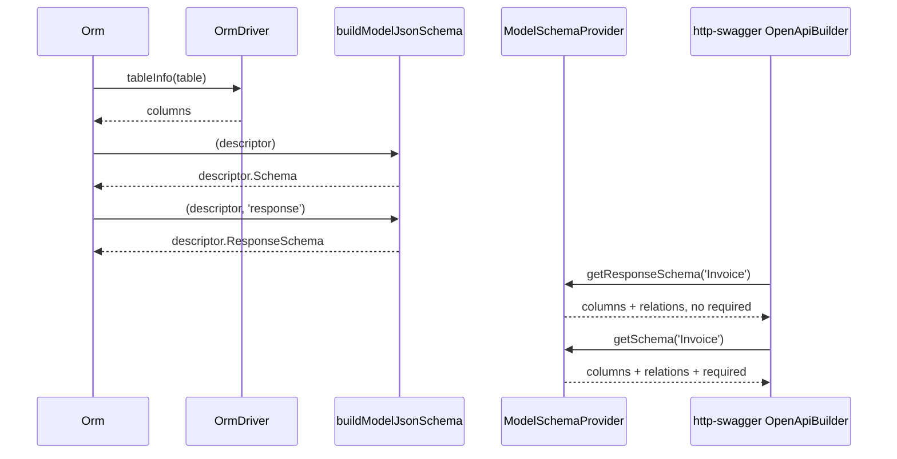

# JSON schema

The ORM builds two JSON schemas for every model from its reflected columns: a request schema (what a client may send) and a response schema (what a query hands back). `ModelSchemaProvider` serves both, plus the model's relations, to `@spinajs/validation` schema consumers by model class name.

## How it works

1. `Orm.resolve()` calls `reloadTableInfo()`. For every model with a known connection it reads the table columns with `OrmDriver.tableInfo()` and merges them into the descriptor.
2. `reloadTableInfo()` then calls `buildModelJsonSchema(descriptor)` and stores the result on `descriptor.Schema`. It calls `buildModelJsonSchema(descriptor, 'response')` and stores that on `descriptor.ResponseSchema`.
3. `buildModelJsonSchema()` walks `descriptor.Columns`. It skips columns without a name and `@Ignore()` columns. In the response flavour it also skips `@Hidden()` properties. Each remaining column becomes one property (see the mapping below).
4. In the request flavour, every column that is neither nullable nor auto-increment is listed in `required`. The response flavour never has `required`.
5. `ModelSchemaProvider.resolve()` runs when the provider is resolved. It maps every class registered under `'__models__'` (every `@Model()` class) by class name.
6. A consumer calls `getSchema(name)` or `getResponseSchema(name)`. `ModelSchemaProvider.buildSchema()` reads the model's descriptor through the static `getModelDescriptor()`, copies the column properties and appends one property per relation.
7. It returns `undefined` for an unknown name, or when the descriptor has no schema with `properties` yet.



### Column mapping

The lookup key is `IColumnDescriptor.Type`, the type string the driver reflects from the database.

| Column type | JSON schema |
| --- | --- |
| `tinyint`, `smallint`, `mediumint`, `int`, `bigint` | `{ type: 'integer' }` |
| `decimal`, `float`, `double`, `bit` | `{ type: 'number' }` |
| `boolean` | `{ type: 'boolean' }` |
| `date` | `{ type: 'string', format: 'date' }` |
| `dateTime`, `datetime`, `timestamp` | `{ type: 'string', format: 'date-time' }` |
| `json` | `{ type: 'object' }` |
| `set` | `{ type: 'array', items: { type: 'string' } }` |
| anything else | `{ type: 'string' }` |

Then, in this order:

1. Response flavour only: an entry in the driver's `OrmDriver.ResponseSchemaTypes` for the same type string replaces the shape above.
2. A `BooleanValueConverter` (declared with `@Bool()`, or resolved for the column) makes it `{ type: 'boolean' }`.
3. A `DatetimeValueConverter` (declared with `@DateTime()`, `@CreatedAt()`, `@UpdatedAt()`, `@SoftDelete()` or `@Archived()`) makes it `{ type: 'string', format: 'date-time' }`. A `date` column keeps `format: 'date'`.
4. A string property without a datetime converter gets `maxLength` from the column's `MaxLength` when it is above `0`.
5. A column comment becomes `description`.
6. A nullable column gets `nullable: true`.

Converters match by class name along the prototype chain, so a driver subclass such as orm-mssql's `MsSqlDatetimeValueConverter` counts. A converter declared by a decorator wins over the instance resolved for the column.

### Relation properties

`ModelSchemaProvider` adds each relation under its property name:

| Relation type | Property |
| --- | --- |
| `RelationType.One` | `{ type: 'object', description: '<TargetModel name>' }` |
| `RelationType.Many`, `RelationType.ManyToMany` | `{ type: 'array', items: { type: 'object', description: '<TargetModel name>' } }` |
| `RelationType.Query`, `RelationType.Virtual` | omitted (no `TargetModel`) |

`@spinajs/http-swagger` replaces such a `description`-tagged object with a `$ref` to the target model's component. The response schema drops relations listed in `@Hidden()`; the request schema keeps them.

## Services and extension points

| Service | Role | Default implementation | How to override |
| --- | --- | --- | --- |
| `SchemaProvider` (from `@spinajs/validation`) | Resolves a type name to a JSON schema; `getResponseSchema()` for the read side | `ModelSchemaProvider`, registered with `@Injectable(SchemaProvider)` when `@spinajs/orm` loads | Register another provider with `@Injectable(SchemaProvider)`; consumers ask every provider and take the first answer |
| `OrmDriver.ResponseSchemaTypes` | Per-type shapes the driver returns differently from what it accepts; response flavour only | `{}` in `OrmDriver`. `@spinajs/orm-mysql`: `decimal`, `newdecimal`, `numeric` → `string`. `@spinajs/orm-postgres`: `decimal`, `numeric`, `bigint` → `string`. | Redeclare the field in a driver subclass |
| `buildModelJsonSchema(descriptor, kind?)` | Builds one flavour from a descriptor; `kind: ModelSchemaKind` is `'request'` (default) or `'response'` | — | Call it directly for tooling; the stored results come from `Orm` |

```ts
// A driver whose client library returns DECIMAL as a string: tell the response schema so
export class LedgerDriver extends SqlDriver {
  public readonly ResponseSchemaTypes: Readonly<Record<string, unknown>> = {
    decimal: { type: 'string' },
  };
}
```

`ModelSchemaProvider` members:

| Member | Returns |
| --- | --- |
| `resolve(): void` | Builds the name → model class map from `'__models__'`. |
| `getSchema(typeName)` | `descriptor.Schema` properties plus relations, with `required`. `undefined` for an unknown name. |
| `getResponseSchema(typeName)` | `descriptor.ResponseSchema` properties plus relations not in `@Hidden()`, no `required`. Falls back to `descriptor.Schema` minus `@Hidden()` columns when `ResponseSchema` has no properties. |

`SCHEMA_SYMBOL` from `@spinajs/orm` is `Symbol.for('ORM_SCHEMA_SYMBOL')`. Nothing in `@spinajs/orm` reads it. It is a different symbol from the `SCHEMA_SYMBOL` that `@spinajs/validation`'s `@Schema()` writes.

## Important behaviour

- Schemas exist only after `Orm` resolves. Before that, `descriptor.Schema` and `descriptor.ResponseSchema` are `{}` and `ModelSchemaProvider` returns `undefined`.
- A model whose connection is missing is skipped with a warning; it keeps empty schemas.
- The schema describes the database table, not the TypeScript class. A property with no column has no schema entry; a column with no property has one.
- `required` lists every column that is not nullable and not auto-increment. A column with a database default is still required.
- The request flavour keeps `@Hidden()` columns: hiding a value on the way out does not stop a client sending it. Use `@Ignore()` for a property outside the table.
- Driver overrides apply to the response flavour only. On mysql a `DECIMAL` is `number` in a request and `string` in a response.
- `nullable: true` is the OpenAPI 3.0 keyword, not a JSON Schema type union.
- `ModelSchemaProvider` maps models by class name. Two model classes with the same name share one entry: the one registered last wins.
- Models registered after `ModelSchemaProvider.resolve()` ran are not in its map.
- In this monorepo `@spinajs/http-swagger` is the consumer of `SchemaProvider`. Request validation reads `@Schema()` metadata and route argument schemas, not `ModelSchemaProvider`.
- `@spinajs/http-swagger` publishes one component `<Name>` when both flavours agree. When they differ, the response keeps `<Name>` and the request becomes `<Name>Request`.
- An `@Int64('number')` column is `{ type: 'integer' }` and an `@Int64('string')` or `@Int64('bigint')` column `{ type: 'string' }`, in both flavours and whatever the driver's `ResponseSchemaTypes` say about `bigint`.

## Best practices

- Mark secrets with `@Hidden()` (a password hash, an internal key). It removes them from responses and from the response schema in one place.
- Attach `@DateTime()` or `@Bool()` to columns stored as text or `tinyint`. The schema then publishes `date-time` or `boolean` instead of the storage type.
- Set column comments in migrations; they become `description` in the published API.
- When a driver returns a type differently from what it accepts, declare it in `ResponseSchemaTypes`, not in model code.

## Patterns and antipatterns

```ts
// Don't: orm's SCHEMA_SYMBOL is not the key @Schema() writes, this is always undefined
import { SCHEMA_SYMBOL } from '@spinajs/orm';
const dtoSchema = Reflect.getMetadata(SCHEMA_SYMBOL, CreateInvoiceDto.prototype);

// Do: read @Schema() metadata with the validation package's symbol
import { SCHEMA_SYMBOL } from '@spinajs/validation';
const dtoSchema = Reflect.getMetadata(SCHEMA_SYMBOL, CreateInvoiceDto.prototype);
```

```ts
// Don't: @Ignore() drops the column from the request schema too, and dehydrate() still returns it
@Ignore()
public PasswordHash: string;

// Do: @Hidden() keeps it in the request schema and drops it from responses and dehydrate()
@Hidden()
public PasswordHash: string;
```

## Examples

### Keep a password hash out of the published response

```ts sample
import { Connection, Hidden, Model, ModelBase, Primary } from '@spinajs/orm';

@Connection('default')
@Model('accounts')
export class Account extends ModelBase<Account> {
  @Primary()
  public Id: number;

  public Email: string;

  // in getSchema('Account'), absent from getResponseSchema('Account') and from dehydrate()
  @Hidden()
  public PasswordHash: string;
}
```

### Inspect both schemas of a model

```ts sample
import { DI } from '@spinajs/di';
import { Connection, Model, ModelBase, Orm, Primary, buildModelJsonSchema } from '@spinajs/orm';

@Connection('default')
@Model('invoices')
export class Invoice extends ModelBase<Invoice> {
  @Primary()
  public Id: number;

  public Number: string;

  public Total: number;
}

export async function invoiceSchemas() {
  // schemas are built from the reflected table while Orm resolves
  await DI.resolve(Orm);

  const descriptor = Invoice.getModelDescriptor();

  return {
    request: descriptor.Schema,
    response: descriptor.ResponseSchema,
    rebuilt: buildModelJsonSchema(descriptor, 'response'),
  };
}
```

### Ask every schema provider for a model's response contract

```ts sample
import { Autoinject } from '@spinajs/di';
import { SchemaProvider } from '@spinajs/validation';

export class ContractExporter {
  @Autoinject(SchemaProvider)
  protected SchemaProviders!: SchemaProvider[];

  public responseOf(typeName: string): Record<string, unknown> | undefined {
    const response = this.SchemaProviders.map((p) => p.getResponseSchema(typeName)).find((s) => !!s);
    return response ?? this.SchemaProviders.map((p) => p.getSchema(typeName)).find((s) => !!s);
  }
}
```

## Related

- [Models](./02-models.md): `@Hidden()`, `@Ignore()` and the column descriptors the schema is built from.
- [Converters and hydration](./04-converters-and-hydration.md): the converter decorators that change a property's published type.
- [Relations](./06-relations.md): the relations `ModelSchemaProvider` adds as properties.
- [Connections](./01-connections.md): `OrmDriver` and the connection a model needs before its schema exists.
- [Architecture](./12-architecture.md): where `ResponseSchemaTypes` sits among the driver extension points.
- [`@spinajs/orm-mysql`](../orm-mysql/README.md): declares `DECIMAL` as `string` on responses.
- [`@spinajs/orm-mssql`](../orm-mssql/README.md): registers `MsSqlDatetimeValueConverter`, which the datetime rule recognises.
- [`@spinajs/orm-http`](../orm-http/README.md): uses models as route bodies and responses that the schemas describe.
