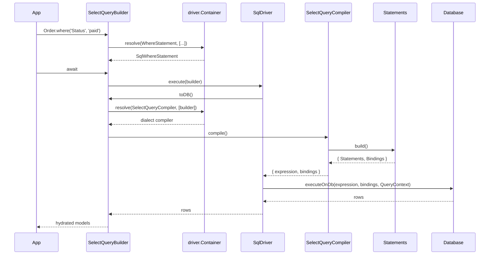

# Architecture

`@spinajs/orm` contains no SQL. Builders collect statement objects, and both the statements and the compilers that join them into SQL are abstract classes resolved from the connection's own DI container. A dialect package binds concrete classes into that container, so two connections on different databases coexist in one process. Read this page to follow a query from a builder call to rows, or to change how a dialect writes SQL.

## How it works

1. **Driver boot.** `Orm.resolve()` resolves the class registered under each connection's `Driver` token, passing the connection entry. See [Connections](01-connections.md).
2. **Driver container.** `OrmDriver.resolve()` creates `driver.Container` as a child of the root container and registers `StandardModelToSqlConverter` as `ModelToSqlConverter`, `StandardObjectToSqlConverter` as `ObjectToSqlConverter`, plus `JsonValueConverter`, `UuidConverter` and `UniversalValueConverter`.
3. **Dialect bindings.** A dialect driver overrides `resolve()`, calls `super.resolve()`, then registers its implementations: `SqlDriver.resolve()` in `@spinajs/orm-sql` binds the generic SQL statements and compilers, and each dialect driver binds its overrides plus its `IdentifierQuoter`, `LiteralQuoter` and `ServerResponseMapper` (see the exceptions in [Services and extension points](#services-and-extension-points)). The container resolves the last registration of a token, so a registration made after `super.resolve()` wins.
4. **Builder creation.** `createQuery()` calls `DI.resolve('OrmConnection', [descriptor.Connection])` to get the model's driver and resolves the builder from `driver.Container` with `[driver, model]`. `OrmDriver.select()`, `insert()`, `update()`, `del()`, `schema()` and `index()` resolve from the same container. The builder keeps that container as `builder.Container`.
5. **Statement creation.** Each builder call resolves an abstract statement from `builder.Container`, eg. `container.resolve(WhereStatement, [column, operator, value, builder])`. The dialect's concrete class comes back. See [Query builder](05-query-builder.md).
6. **Execution.** `await builder` calls `Builder.execute()`, which runs query middlewares around `driver.execute(builder)`. `OrmDriver.execute()` is abstract; `SqlDriver.execute()` implements it.
7. **Compilation.** `SqlDriver.execute()` calls `builder.toDB()`. Each builder resolves its compiler token from its container with `[this]` and calls `compile()`, eg. `SelectQueryBuilder.toDB()` runs `validateSorts()` then `container.resolve(SelectQueryCompiler, [this]).compile()`.
8. **Clause assembly.** The dialect compiler builds every statement with `build()`, which returns `{ Statements, Bindings }`, and joins the fragments. It resolves sub-compilers from the container (`LimitQueryCompiler`, `OrderByQueryCompiler`, `TableAliasCompiler`, ...) and quotes identifiers through the injected `IdentifierQuoter`. The result is an `ICompilerOutput` (`expression`, `bindings`), or an array of them for multi-statement DDL.
9. **Sending.** `SqlDriver.execute()` calls `executeOnDb(expression, bindings, builder.QueryContext)` once per output, wrapped in `Perf.measure('orm.query', ...)`. `QueryContext` tells the driver whether to return rows or a status. Inside `driver.transaction()` the driver picks the transaction's connection. See [Transactions](08-transactions.md).
10. **Results.** Back in the builder, after-hooks and builder middlewares run, and rows of a model-bound select become models: `modelCreation` or the `__orm_model_factory__` DI factory, `hydrate()`, `takeSnapshot()`, `afterHydration`. See [Converters and hydration](04-converters-and-hydration.md) and [Relations](06-relations.md).
11. **Insert responses.** `Model.insert()`, `ModelBase.insert()` and the unit of work resolve `ServerResponseMapper` from the builder's container and call `read(response, pkNames)` to get a `DbServerResponse` (`RowsAffected`, `LastInsertId`, `Returning`) for primary key backfill. See [Unit of work](07-unit-of-work.md).

Errors: a missing driver registration throws `OrmException` at boot. A compiler, statement or quoter token with no registration resolves to the abstract class itself, so the first call of its abstract method throws a `TypeError`. `ServerResponseMapper` is a concrete class whose `read()` throws `MethodNotImplemented` naming the missing registration. A driver error rejects the builder's promise.



### Compiler tokens

Every token is an abstract class with `compile(): ICompilerOutput` (or `ICompilerOutput[]`), implementing `IQueryCompiler`. The constructor receives the builder.

| Token | Resolved by | Output |
| --- | --- | --- |
| `SelectQueryCompiler` | `SelectQueryBuilder.toDB()` | `ICompilerOutput` |
| `InsertQueryCompiler` | `InsertQueryBuilder.toDB()` | `ICompilerOutput` |
| `UpdateQueryCompiler` | `UpdateQueryBuilder.toDB()` | `ICompilerOutput` |
| `DeleteQueryCompiler` | `DeleteQueryBuilder.toDB()` | `ICompilerOutput` |
| `IndexQueryCompiler` | `IndexQueryBuilder.toDB()` | `ICompilerOutput` |
| `TableQueryCompiler` | `TableQueryBuilder.toDB()` | `ICompilerOutput` or `ICompilerOutput[]` |
| `AlterTableQueryCompiler` | `AlterTableQueryBuilder.toDB()` | `ICompilerOutput[]` |
| `TableCloneQueryCompiler` | `CloneTableQueryBuilder.toDB()` | `ICompilerOutput[]` |
| `TruncateTableQueryCompiler` | `TruncateTableQueryBuilder.toDB()` | `ICompilerOutput` |
| `TableExistsCompiler` | `TableExistsQueryBuilder.toDB()` | `ICompilerOutput` |
| `DropTableCompiler`, `DropViewCompiler`, `CreateViewCompiler` | the matching schema builders | `ICompilerOutput` |
| `CreateDatabaseCompiler`, `DropDatabaseCompiler` | the matching schema builders | `ICompilerOutput` |
| `EventQueryCompiler`, `DropEventQueryCompiler` | the matching schema builders | `ICompilerOutput` |
| `RawSchemaQueryCompiler` | `RawSchemaQueryBuilder.toDB()` | `ICompilerOutput` |
| `LimitQueryCompiler` | the dialect's select and delete compilers | `ICompilerOutput` |
| `OrderByQueryCompiler` | the dialect's select compiler | `ICompilerOutput` |
| `OnDuplicateQueryCompiler` | the dialect's insert compiler, for an upsert | `ICompilerOutput` |
| `ColumnQueryCompiler`, `ForeignKeyQueryCompiler` | the dialect's table compilers | `ICompilerOutput` |
| `AlterColumnQueryCompiler` | the dialect's alter-table compiler | `ICompilerOutput` |
| `TableHistoryQueryCompiler` | the dialect's table compiler | `ICompilerOutput[]` |
| `RecursiveQueryCompiler`, `GroupByQueryCompiler` | registered by the shipped drivers; the `@spinajs/orm-sql` select compiler mixes in `SqlWithRecursiveCompiler` and `SqlGroupByCompiler` directly | `ICompilerOutput` |
| `JoinQueryCompiler` | declared; nothing in this repository registers or resolves it | |

The per-clause interfaces `IColumnsCompiler`, `IWhereCompiler`, `IHavingCompiler`, `IJoinCompiler`, `ILimitCompiler`, `IGroupByCompiler` and `IRecursiveCompiler` describe the methods a dialect compiler mixes in. `ICompilerOutput.expression` and `bindings` are both nullable.

### Statement classes

Every statement extends `QueryStatement` (`IQueryStatement`): `TableAlias`, `Boolean` (the `AND` / `OR` connector before it), `OnJoin`, `build(): IQueryStatementResult` and `clone(parent?)`. `IQueryStatementResult` is `{ Statements: string[]; Bindings: any[] }`.

| Abstract statement | Created by | Constructor arguments |
| --- | --- | --- |
| `WhereStatement` | `where(column, [operator,] value)`, `whereNull`, `whereNotNull`, `whereNot` | `column`, `operator`, `value`, owning `WhereBuilder` |
| `WhereQueryStatement` | `where(function () { ... })` | nested `WhereBuilder` |
| `RawQueryStatement` | `where(RawQuery)`, `where(boolean)` | `query`, `bindings` |
| `LazyQueryStatement` | `where(Lazy)` | `callback`, `context` |
| `InStatement` | `whereIn` / `whereNotIn` with an array | `column`, `values`, `not`, owning builder |
| `InQueryStatement` | `whereIn` / `whereNotIn` with a sub-select | `subQuery`, `column`, `not`, owning builder |
| `ExistsQueryStatement` | `whereExist` / `whereNotExists` | `subQuery`, `not` |
| `SelectQueryStatement` | base of the two above | `builder`, `tableAlias?` |
| `BetweenStatement` | `whereBetween` / `whereNotBetween` | `column`, `values`, `not`, `tableAlias` |
| `InSetStatement` | `whereInSet` / `whereNotInSet` | `column`, `values`, `not`, `tableAlias` |
| `StartsWithStatement` | `whereStartsWith(column, prefix)` | `column`, `prefix`, `tableAlias` |
| `ColumnStatement` | `select(column)`, `columns()` | `column`, `alias`, `tableAlias`, column descriptor |
| `ColumnRawStatement` | `select(RawQuery)` | `RawQuery` |
| `ColumnMethodStatement` | `min`, `max`, `sum`, `avg`, `count` | `column`, `ColumnMethods`, `alias`, `tableAlias` |
| `JoinStatement` | `innerJoin`, `leftJoin`, ... | `IJoinStatementOptions` |
| `GroupByStatement` | `groupBy()` | `expression` |
| `WithRecursiveStatement` | `withRecursive()` | container, CTE name, query, `rcKeyName`, `pkName` |
| `WrapStatement`: `DateWrapper`, `DateTimeWrapper` | `Wrapper.Date(column)`, `Wrapper.DateTime(column)` | `value`, `tableAlias`; implements `wrap(): string` |

`InSetStatement` carries the rules every dialect shares: a `null`, `undefined` or `SET_DELIMITER`-containing value throws `InvalidArgument`, per-value tests are OR-ed for a match and AND-ed as `NOT ...` for a negation, and an empty list compiles to `(1 = 0)` / `(1 = 1)`. `escapeLikeValue()` and `LIKE_ESCAPE_CHARACTER` serve its portable `LIKE` form in `@spinajs/orm-sql`.

### Quoting and aliases

| Class | Contract | Registered by core |
| --- | --- | --- |
| `IdentifierQuoter` | `quote(name)` quotes one identifier; `quoteQualified(name)` quotes each dot-separated part. | No. A driver that registers none fails on its first query. |
| `LiteralQuoter` | `quote(value)` writes a value as a SQL literal. Used only by `CREATE VIEW` and `CREATE EVENT`, which the engine stores as text. | No. |
| `TableAliasCompiler` | `compile(builder, table?)` renders `[database.]table [as alias]` for FROM, INSERT INTO, UPDATE, DELETE and DDL. `@Singleton`. | No. `SqlDriver` binds `SqlTableAliasCompiler`. |

## Services and extension points

| Service | Role | Default implementation | How to override |
| --- | --- | --- | --- |
| Compiler tokens (`SelectQueryCompiler`, `OrderByQueryCompiler`, ...) | Turn a builder into SQL. | `Sql*Compiler` classes bound by `SqlDriver.resolve()`, plus dialect overrides. See [`@spinajs/orm-sql`](../orm-sql/README.md). | `this.Container.register(MyCompiler).as(Token)` in the driver's `resolve()`, after `super.resolve()`. |
| Statement classes (`WhereStatement`, `JoinStatement`, ...) | Build one SQL fragment with its bindings. | `Sql*Statement` classes bound by `SqlDriver.resolve()`, plus dialect overrides | Same. Implement `build()` and `clone(parent?)`. |
| `IdentifierQuoter` | Identifier quoting. | none; `BacktickIdentifierQuoter` (MySQL, SQLite), `BracketIdentifierQuoter` (MSSQL), `DoubleQuoteIdentifierQuoter` (PostgreSQL) | Register in the driver's `resolve()`. Resolve it from `driver.Container` to quote names in raw SQL. |
| `LiteralQuoter` | Literal values in view and event bodies. | none; `SqlLiteralQuoter` (SQLite), `MySqlLiteralQuoter`, `MsSqlLiteralQuoter`, `PostgresLiteralQuoter` | Register in the driver's `resolve()`. |
| `TableAliasCompiler` | Table references. | `SqlTableAliasCompiler`; `MsSqlTableAliasCompiler`, `PostgresTableAliasCompiler` | Register in the driver's `resolve()`. |
| `ServerResponseMapper` | Normalizes a raw insert response to `DbServerResponse`. | Base class throws `MethodNotImplemented`; `SqliteServerResponseMapper`, `MysqlServerResponseMapper`, `PostgresServerResponseMapper`. `@spinajs/orm-mssql` registers none. | Subclass, implement `read(response, pkNames?)`, register in the driver's `resolve()`. |
| `DefaultValueBuilder<T>` | Column defaults in DDL: `date()`, `dateTime()`, `value(val)`, `raw(query)`; fields `Query`, `Value`. Resolved by `ColumnQueryBuilder.default()`. | abstract; `SqlDefaultValueBuilder` (MySQL), `SqlLiteDefaultValueBuilder` (SQLite), `PostgresDefaultValueBuilder`, `MsSqlDefaultValueBuilder`. | Register in the driver's `resolve()`. See [Schema builder](09-schema-builder.md). |
| `NowExpression` | The database's current instant as SQL; `OrmDriver.now()` wraps it in a `RawQuery`. | abstract; `SqliteNowExpression`, `MySqlNowExpression` (`UTC_TIMESTAMP(3)`), `MsSqlNowExpression`, `PostgresNowExpression` | Register in the driver's `resolve()`. |
| `ModelToSqlConverter`, `ObjectToSqlConverter` | Model or object to column values for writes. | `StandardModelToSqlConverter`, `StandardObjectToSqlConverter` (SQLite overrides the model converter) | See [Converters and hydration](04-converters-and-hydration.md). |
| `OrmDriver` | Executes builders on one connection. | Dialect drivers | Extend a dialect driver or `SqlDriver`; register under a token named in `db.Connections[].Driver`. See [Adding a new SQL dialect](../orm-sql/07-adding-a-sql-dialect.md). |

`ISupportedFeature` from `driver.supportedFeatures()` switches core behaviour: `insertReturning` gates `InsertQueryBuilder.returning()` and key read-back on insert, `insertIdIsFirstOfBatch` gates key backfill after a multi-row insert, `maxBindParameters` and `maxInsertRows` make `InsertQueryBuilder` split a multi-row insert into several statements, `concurrentTransactions: false` makes `transaction()` queue outermost transactions, and `events` tells callers whether `EventQueryBuilder` compiles. See [Connections](01-connections.md).

```ts sample
import { Autoinject, Injectable, NewInstance } from '@spinajs/di';
import { ICompilerOutput, IdentifierQuoter, OrderByBuilder, OrderByQueryCompiler } from '@spinajs/orm';
import { SqliteOrmDriver } from '@spinajs/orm-sqlite';

/** Every ORDER BY column, with NULLs sorted last. */
@NewInstance()
export class NullsLastOrderByCompiler extends OrderByQueryCompiler {
  @Autoinject(IdentifierQuoter)
  public Quoter: IdentifierQuoter;

  constructor(protected builder: OrderByBuilder) {
    super();
  }

  public compile(): ICompilerOutput {
    const terms = this.builder.getSorts().map((s) => {
      const column = `${s.tableAlias ? `${this.Quoter.quote(s.tableAlias)}.` : ''}${this.Quoter.quote(s.column)}`;
      return `${column} IS NULL, ${column} ${s.order}`;
    });

    return { expression: terms.length > 0 ? ` ORDER BY ${terms.join(', ')}` : '', bindings: [] };
  }
}

@Injectable('orm-driver-sqlite-nulls-last')
@NewInstance()
export class NullsLastSqliteDriver extends SqliteOrmDriver {
  public resolve() {
    super.resolve();

    // after super.resolve(): the last registration of a token wins
    this.Container.register(NullsLastOrderByCompiler).as(OrderByQueryCompiler);
  }
}
```

Point a connection at it with `Driver: 'orm-driver-sqlite-nulls-last'`. Other connections keep their own compilers.

## Important behaviour

- Registrations are per connection. `driver.Container.register(...)` changes only that connection; a registration in the root container is shadowed by any registration in a driver's child container.
- Query middlewares are the exception: builders resolve them from the root container, so they apply to every connection.
- The core resolves only the compilers listed against a builder's `toDB()`. Which sub-compilers run, and whether they are resolved or mixed in, is decided by the dialect's compilers. Replacing `RecursiveQueryCompiler` or `GroupByQueryCompiler` does not change a select compiled by `SqlSelectQueryCompiler`.
- `toDB()` compiles without a database round trip and without running query middlewares. Statements created by `afterQueryCreation` are in the output; changes made in `beforeQueryExecution` are not.
- The select compiler in `@spinajs/orm-sql` compiles populated relations first, then JOIN, then WHERE; both may change table aliases, so the column list is built after them.
- A `LazyQueryStatement` or a sub-select statement builds a clone of its builder at compile time. Every statement implementation must implement `clone(parent?)` and rebind to `parent`; the abstract classes in `@spinajs/orm` have no `clone()` of their own.
- An array from `toDB()` (multi-statement DDL) is sent with `Promise.all`, one `executeOnDb` per statement, not in sequence.
- No dialect is a fallback for another: `IdentifierQuoter`, `LiteralQuoter`, `ServerResponseMapper` and `TableExistsCompiler` have no default registration, so a missing one fails on first use instead of emitting another dialect's SQL.
- `QueryContext.Transaction` is set by drivers for their own `BEGIN` / `COMMIT` statements; builders never use it.

## Best practices

- Override the narrowest token: replace `OrderByQueryCompiler` or one statement class rather than the whole `SelectQueryCompiler`.
- Extend the `@spinajs/orm-sql` class you replace when only a fragment differs, and keep its `clone()` behaviour.
- Quote identifiers in custom compilers and statements through an `@Autoinject(IdentifierQuoter)` property, never with hard-coded backticks.
- Resolve `IdentifierQuoter` from `driver.Container` when a migration or service writes raw SQL, as `@spinajs/users` and `@spinajs/authz-rbac` migrations do.
- Assert on `toDB()` output in dialect unit tests; keep server round trips for integration tests.

## Patterns and antipatterns

```ts
// Don't: the root container is shadowed by every driver's own registration,
// so this never reaches a query
DI.register(NullsLastOrderByCompiler).as(OrderByQueryCompiler);

// Do: register in the driver container, after the dialect's own bindings
public resolve() {
  super.resolve();
  this.Container.register(NullsLastOrderByCompiler).as(OrderByQueryCompiler);
}
```

```ts
// Don't: backticks are MySQL / SQLite only; MSSQL and PostgreSQL reject them
await driver.select().from('orders').where(RawQuery.create('`Status` = ?', ['paid']));

// Do: quote with the connection's own quoter
const q = driver.Container.resolve(IdentifierQuoter);
await driver.select().from('orders').where(RawQuery.create(`${q.quote('Status')} = ?`, ['paid']));
```

## Examples

### Inspect the SQL a model query compiles to

```ts sample
import { Connection, ICompilerOutput, Model, ModelBase, Primary } from '@spinajs/orm';

@Connection('default')
@Model('invoices')
export class Invoice extends ModelBase<Invoice> {
  @Primary()
  public Id: number;

  public Status: string;

  public Total: number;
}

export function overdueInvoicesSql(): ICompilerOutput {
  const output = Invoice.where('Status', 'overdue').orderByDescending('Total').take(50).toDB();
  return Array.isArray(output) ? output[0] : output;
}
```

### Quote a column in a raw report query on any dialect

```ts sample
import { IdentifierQuoter, OrmDriver, RawQuery } from '@spinajs/orm';

interface UnpaidRow {
  CustomerId: number;
  Total: number;
}

export async function largeUnpaidOrders(driver: OrmDriver, threshold: number): Promise<UnpaidRow[]> {
  const q = driver.Container.resolve(IdentifierQuoter);

  return await driver
    .select<UnpaidRow[]>()
    .from('orders')
    .where('Status', 'unpaid')
    .where(RawQuery.create(`${q.quote('Total')} >= ?`, [threshold]));
}
```

## Related

- [Connections](01-connections.md): driver tokens, `OrmDriver` members, `ISupportedFeature`.
- [Query builder](05-query-builder.md): the builder API that creates the statements.
- [Converters and hydration](04-converters-and-hydration.md): value conversion in statements and row hydration after execution.
- [Relations](06-relations.md): relation compilation and relation middlewares.
- [Unit of work](07-unit-of-work.md): where `ServerResponseMapper` feeds key backfill.
- [Transactions](08-transactions.md): how `executeOnDb` finds the transaction's connection.
- [Schema builder](09-schema-builder.md): the DDL builders behind the schema compiler tokens.
- [`@spinajs/orm-sql`](../orm-sql/README.md): every concrete compiler and statement, `SqlDriver`, writing a driver.
- [Adding a new SQL dialect](../orm-sql/07-adding-a-sql-dialect.md): a new driver package on top of `SqlDriver`, from an empty class to a working connection.
- [Extending an existing dialect](../orm-sql/08-extending-an-existing-dialect.md): subclass a shipped driver and swap one compiler or statement for one connection.
- [Injecting your own builders](../orm-sql/09-injecting-your-own-builders.md): replace `SelectQueryBuilder` and the other builders through DI; `clone()` caveats.
- [Query compilers](../orm-sql/02-query-compilers.md): how a builder becomes SQL, every compiler token, writing and registering a compiler.
- [Statements](../orm-sql/03-statements.md): what a statement is, overriding one and adding a new one.
- [`@spinajs/orm-sqlite`](../orm-sqlite/README.md), [`@spinajs/orm-mysql`](../orm-mysql/README.md), [`@spinajs/orm-mssql`](../orm-mssql/README.md): each dialect's overrides.
