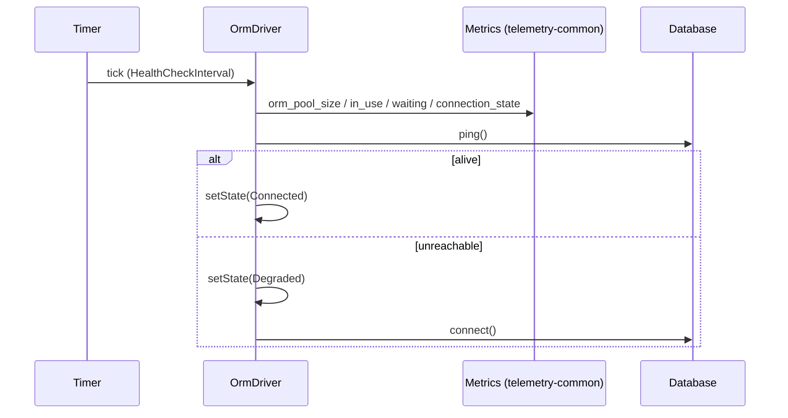

# Observability and resilience

Every `OrmDriver` tracks a `ConnectionState`, probes its database on a timer, and publishes pool gauges and an acquire-time histogram to the shared Prometheus registry. Drivers that opt in also retry a statement after a transport failure, reconnecting with bounded exponential backoff. Use this to expose database health and pool saturation, and to survive a database restart without failing requests.

## How it works

### Health probe

1. `Orm.resolve()` calls `driver.startHealthCheck()` after each connection opens (see [Connections](01-connections.md)). With `Resilience.HealthCheckInterval` at `0` nothing is scheduled. A second call is a no-op.
2. Every `HealthCheckInterval` ms the driver runs one probe. It first calls `publishPoolMetrics()`, which reads `poolMetrics()` and `State` and sets the gauges.
3. It calls `ping()`. On `true` the state becomes `Connected`.
4. On `false` or a thrown error the state becomes `Degraded` and the driver calls `connect()` once. The base class keeps `Degraded` even when that succeeds, until the next successful probe; the MySQL, Postgres and SQLite drivers set `Connected` inside their own `connect()`. A failed reconnect is logged, never thrown.
5. `Orm.dispose()` calls `stopHealthCheck()` on every connection. The timer is `unref()`-ed, so it never keeps the process alive.

### Retry on transport failure

1. A driver that opts in runs each statement through the protected `withReconnect()` loop. `MySqlOrmDriver` and `PostgresOrmDriver` do; `SqliteOrmDriver` and `MsSqlOrmDriver` do not.
2. On success the state becomes `Connected` and the result is returned.
3. On an error, `isRetryableError(err)` decides. A non-retryable error (a syntax error, a constraint violation) is rethrown at once, untouched.
4. On a retryable error the state becomes `Degraded`. The driver waits `backoffDelay(attempt, RetryDelay, MaxRetryDelay)` ms, sets `Connecting`, calls `connect()`, and runs the statement again. A failed `connect()` sets `Degraded` and the loop continues.
5. After `MaxRetries` retries (`MaxRetries + 1` attempts in total) the state becomes `Disconnected` and the last error is thrown.



### Connection states

`ConnectionState` values, read from `driver.State`:

| Value | Meaning |
| --- | --- |
| `Disconnected` (`'disconnected'`) | Initial state, after `disconnect()`, and after the retry loop gives up. |
| `Connecting` (`'connecting'`) | A reconnect inside the retry loop is in progress. |
| `Connected` (`'connected'`) | The last statement or probe succeeded. |
| `Degraded` (`'degraded'`) | A probe failed or a reconnect is in progress. Queries are still attempted. |

Each transition is logged once on the driver's logger (`orm-driver-<Name>`): `Connected` at `info`, `Degraded` and `Disconnected` at `warn`, `Connecting` at `trace`.

### Published metrics

Metrics go into the `Metrics` singleton from `@spinajs/telemetry-common`. `@spinajs/telemetry` re-exports that class, so its `/metrics` endpoint renders these metrics with no wiring. Every metric carries one label, `connection`, set to `db.Connections[].Name`.

| Metric | Constant | Type | Updated | Meaning |
| --- | --- | --- | --- | --- |
| `orm_pool_size` | `ORM_METRIC_POOL_SIZE` | gauge | each probe tick | Open connections, idle and in use. |
| `orm_pool_in_use` | `ORM_METRIC_POOL_IN_USE` | gauge | each probe tick | Connections checked out by a query. |
| `orm_pool_waiting` | `ORM_METRIC_POOL_WAITING` | gauge | each probe tick | Callers waiting for a free connection. |
| `orm_connection_state` | `ORM_METRIC_CONNECTION_STATE` | gauge | each probe tick | `1` when `State` is `Connected`, `0` otherwise. |
| `orm_pool_acquire_seconds` | `ORM_METRIC_ACQUIRE_SECONDS` | histogram | each pool acquire | Seconds spent acquiring a pooled connection. Buckets: `ORM_ACQUIRE_BUCKETS_SECONDS` (0.5 ms to 10 s). |

`ORM_METRIC_PREFIX` (`orm`) and the `ORM_METRIC_KEY_*` constants hold the prefix and the unprefixed names. `ormMetrics()` returns the ORM's `MetricMap`, defined once per `Metrics` instance, or `null` when `Metrics` cannot be resolved. `ormGauge(map, key)` and `ormHistogram(map, key)` narrow an entry of that map.

### Driver support

| Driver | Retry loop | `poolMetrics()` | Acquire histogram | Sets `State` in `connect()` / `disconnect()` |
| --- | --- | --- | --- | --- |
| `MySqlOrmDriver` | yes | yes | yes | yes |
| `PostgresOrmDriver` | yes | yes | yes | yes |
| `SqliteOrmDriver` | no | `Size` only; `InUse` and `Waiting` are always `0` | no | yes |
| `MsSqlOrmDriver` | no | no (base: all `0`) | no | no |

### Query spans

Every statement a builder executes through `SqlDriver.execute` produces one OpenTelemetry span named `db.query`, kind `CLIENT`, on the provider `@spinajs/tracing` owns. Its parent is the active span: the HTTP request, a queue consumer, a scheduler step. A builder that compiles to several statements (a schema builder, a chunked insert) gets one span per statement. Tracing runs in id-only mode by default, so the span carries ids and nothing is recorded or exported until a processor is attached.

| Attribute | Set | Meaning |
| --- | --- | --- |
| `db.system.name` | always | `sqlite`, `postgresql`, `mysql`, `microsoft.sql_server`, or the driver token without its `orm-driver-` prefix. |
| `spina.db.connection` | always | `db.Connections[].Name` of the connection that ran the statement. A select that failed on a read replica and ran again on another connection has two spans. |
| `db.operation.name` | while recording | The statement's first keyword (`SELECT`, `INSERT`, `CREATE`, …). A `WITH` statement is named by its builder. |
| `db.query.text` | while recording | The statement with every literal replaced by `?`, at most 2048 characters. |
| `spina.db.fingerprint` | while recording | 16 hex characters of the statement's shape: literal values, whitespace, letter case and the length of `IN (…)` lists and multi-row `VALUES` do not change it. |
| `db.collection.name` | while recording | The table of a query builder. A raw fragment (`executeSql`) has none. |
| `db.response.returned_rows` | on success | Rows of an array result; for a stream, the rows it yielded. Still incubating in the OTel semantic conventions. |
| `error.type` | on failure | The class name of the error. The span status is `ERROR` with the same class name as its message. |

- Bindings and error messages never reach the span. A driver error often embeds the statement's parameters in its message; the message stays in the log line, which carries the same `traceId`.
- A streamed select (`SelectQueryBuilder.stream()` on a driver that holds a cursor) gets one span that ends when the stream ends: read to the end, left with `break` or `return()`, failed while reading, or failed while closing its cursor. A stream read with `next()` by hand and then dropped without `return()` never runs its cleanup: its cursor stays open until the connection is released, and its span is never ended and therefore never exported. `for await` and `stream()` always call `return()`.
- No span: a direct `executeOnDb()` call, and the transaction control statements (`BEGIN`, `COMMIT`, `ROLLBACK`, savepoints).
- `sanitizeSql()` (exported from `@spinajs/orm`, as is `fingerprint()`) does not strip SQL comments or postgres dollar quoting (`$$…$$`). A quote inside either throws the literal matching off for the rest of that statement. The builders write neither; a raw fragment can.
- Backslash rule: whether `\'` ends a literal depends on the server and its mode. MySQL compiles `O'Brien` in a `CREATE VIEW` as `'O\'Brien'`, and with `NO_BACKSLASH_ESCAPES` the same text ends at `\'`; postgres reads `\'` as an escape only in an `E''` string. Any guess leaks on some connection, so the text is dropped from the literal that holds the first backslash on: `` SELECT * FROM `users` WHERE `Name` = 'O\'Brien' AND `Ssn` = '123' `` becomes `` SELECT * FROM `users` WHERE `Name` = ? ``.
- Double-quote rule: `"name"` is kept as an identifier only on a connection whose quoter writes identifiers in double quotes (postgres, `OrmDriver.ansiQuotedIdentifiers()`). On MySQL and SQLite, which quote with backticks, a double-quoted token is a string and becomes `?`.

### Slow queries

`SlowQueryMiddleware`, a `QueryMiddleware` at order 2000 registered by `@spinajs/orm`, turns every builder whose statements took at least `db.Explain.SlowQueryMs` in total into one `SlowQueryRecord` and hands it to every registered `SlowQuerySink`. It is off by default; the keys are listed in [Connections](01-connections.md#configuration).

| Field | Meaning |
| --- | --- |
| `fingerprint` | The statement's shape, as `spina.db.fingerprint` on the span. |
| `sql` | The sanitized statement (literals are `?`, the backslash and double-quote rules above apply). Several statements of one builder (a chunked insert) are joined with `;\n`. |
| `bindings` | Only with `db.Explain.CaptureBindings`. |
| `driver`, `connection` | The driver token and `db.Connections[].Name` of the connection that ran the statement (a read replica, when the select ran there). |
| `durationMs` | The driver's own measurement, summed over the builder's statements. |
| `at` | When the builder finished. |
| `traceId`, `spanId` | Of the `db.query` span of the first statement, also in id-only mode. |
| `plan` | The `QueryPlan` from `OrmDriver.explain()`, for a single select only. |
| `planError` | Why a planned statement has no plan: `explain rate limit reached`, `driver <token> cannot explain`, or the class name of the EXPLAIN error (followed by its message only with `CaptureBindings`). |

`LogSlowQuerySink` is the default sink: one warning per record on the `orm-slow-query` logger. Register your own next to it; every sink receives every record, and a sink that throws is logged and does not stop the others:

```ts
import { Injectable } from '@spinajs/di';
import { SlowQuerySink } from '@spinajs/orm';
import type { SlowQueryRecord } from '@spinajs/orm';

@Injectable(SlowQuerySink)
export class SlowQueryCollector extends SlowQuerySink {
  public readonly records: SlowQueryRecord[] = [];

  public record(entry: SlowQueryRecord): void {
    this.records.push(entry);
  }
}
```

- Off, the capture costs two boolean checks per statement: the driver keeps no statement, binding or timestamp. `db.Explain` is read once, at the first statement; `SlowQueryMiddleware.reload()` reads it again and forgets every remembered plan.
- The capture runs after `setImmediate`, once the result has gone back to the caller, and holds no reference to the builder. At most 100 captures (`MAX_PENDING_SLOW_QUERY_CAPTURES`) wait or run at once; a slow statement beyond that is not recorded, and the number dropped is logged with the next record.
- A plan is attempted only for a builder with one statement in the select context, on the driver that ran it, with the statement's own bindings (databases cannot plan without them; they are not kept). A plan is remembered for 60 s per connection, `CaptureBindings` mode and fingerprint, for at most 1000 keys; a new key at capacity drops the least recently read plan. Overlapping captures of one key share one EXPLAIN, and at most `db.Explain.MaxPerMinute` EXPLAIN calls run per minute.
- `SlowQueryMiddleware.clock`, a `Clock` from `@spinajs/util` (default `SystemClock`), times the plan cache and the `MaxPerMinute` window. Both read it on every call, so a test can assign a `ManualClock` at any time and move it with `advance(ms)`:

  ```ts
  import { DI } from '@spinajs/di';
  import { QueryMiddleware, SlowQueryMiddleware } from '@spinajs/orm';
  import { ManualClock } from '@spinajs/util';

  const slowQueries = DI.resolve(Array.ofType(QueryMiddleware)).find((m): m is SlowQueryMiddleware => m instanceof SlowQueryMiddleware);
  const clock = new ManualClock(new Date('2026-01-01T00:00:00Z'));
  slowQueries!.clock = clock;

  // ...run the slow select, await slowQueries!.idle()...
  clock.advance(60_000); // the remembered plan has expired: the next capture runs EXPLAIN again
  ```
- An EXPLAIN never runs a second statement. What the builder compiled itself (quoted names, placeholders, the dialect's keywords) is planned as it is. Only SQL the caller wrote, a `RawQuery` anywhere in the builder or an `executeSql` fragment, is checked as text: such a statement with a `;` before its end, a comment (`--`, `/*`, `#`), a `$` or a backslash is recorded without a plan, also where it would have been safe: a `;` inside a string literal, a commented select, the postgres `#>` operator, `LIKE … ESCAPE ''`, a select wrapped in parentheses. `ExecutedStatement.rawSql` says which kind a statement is, and `OrmDriver.explain(sql, bindings, rawSql)` passes it on, so a driver checks the text only where it is caller-written.
- Postgres and MySQL print bound values inside plan conditions. Without `CaptureBindings` every `detail` of the plan is sanitized like `sql` (text from a literal with a backslash on is dropped) and `raw` is `null`; with it, the driver's plan is published as it is.
- `OrmDriver.explain()` runs outside the ambient transaction. On a driver without concurrent transactions (sqlite without a read pool, PGlite) it waits for an open transaction to end: never await it inside one. A capture made while the transaction is still open on PGlite ends with `planError`.
- Streams, direct `executeOnDb()` calls and transaction control statements are not recorded.
- No driver implements `explain()` yet, so every record of a select carries `planError: driver <token> cannot explain`.

## Configuration

| Key | Type | Default | Allowed values | Meaning |
| --- | --- | --- | --- | --- |
| `db.Connections[].Resilience.HealthCheckInterval` | `number` | `30000` | ms, `0` disables | Interval of the health probe. Pool gauges are published on the same tick. |
| `db.Connections[].Resilience.MaxRetries` | `number` | `5` | `>= 0` | Reconnect attempts per failed statement before giving up. |
| `db.Connections[].Resilience.RetryDelay` | `number` | `200` | ms | First backoff delay; doubles on each attempt. |
| `db.Connections[].Resilience.MaxRetryDelay` | `number` | `5000` | ms | Upper bound of the backoff delay. |

Pool sizing (`db.Connections[].Pool.*`) is listed in [Connections](01-connections.md#configuration).

```ts
db: {
  Connections: [
    {
      Name: 'shop',
      Driver: 'orm-driver-mysql',
      Resilience: { HealthCheckInterval: 10000, MaxRetries: 3, RetryDelay: 100, MaxRetryDelay: 2000 },
    },
  ],
}
```

## Services and extension points

| Service | Role | Default implementation | How to override |
| --- | --- | --- | --- |
| `OrmDriver.poolMetrics()` | Point-in-time `IPoolMetrics` (`Size`, `InUse`, `Waiting`). Must never throw. | Base returns `{ Size: 0, InUse: 0, Waiting: 0 }` | Override in a driver that owns a pool. |
| `OrmDriver.observeAcquireSeconds(seconds)` | Records one pool-acquire wait in the histogram. Never throws. | Base implementation | Call it from the driver's acquire callback. |
| `OrmDriver.publishPoolMetrics()` | Sets the four gauges. Never throws. | Base implementation, run on every probe tick | Call it yourself when the probe is disabled. |
| `OrmDriver.isRetryableError(err)` (protected) | Decides whether the retry loop retries. | `isRetryableErrorCode(err)` | Override in a driver subclass to add dialect codes. MySQL and Postgres return `false` inside a transaction. |
| `isRetryableErrorCode(err)` | Walks `err` and its `inner` / `cause` chain (5 levels) for a `code` or `errno` in `RETRYABLE_ERROR_CODES`. | | Not overridden. |
| `RETRYABLE_ERROR_CODES` | `ECONNRESET`, `ECONNREFUSED`, `EPIPE`, `ETIMEDOUT`, `EHOSTUNREACH`, `ENETUNREACH`, `ENOTFOUND`, `PROTOCOL_CONNECTION_LOST`, `PROTOCOL_SEQUENCE_TIMEOUT`, `PROTOCOL_ENQUEUE_AFTER_FATAL_ERROR`, `PROTOCOL_ENQUEUE_AFTER_QUIT`, `ER_CON_COUNT_ERROR`, `ER_LOCK_WAIT_TIMEOUT`, `SQLITE_BUSY` | | Read-only set. |
| `backoffDelay(attempt, base, max)` | `min(base * 2^attempt, max)`. | | Not overridden. |
| `delay(ms)` | Promise-based sleep. | | Not overridden. |

```ts
import { DI } from '@spinajs/di';
import { MySqlOrmDriver } from '@spinajs/orm-mysql';

class ShopMySqlDriver extends MySqlOrmDriver {
  protected isRetryableError(err: unknown): boolean {
    // keep the base rule: a statement inside a transaction is never replayed
    if (this.CurrentTransaction) {
      return false;
    }

    return super.isRetryableError(err) || (err as { code?: unknown } | null)?.code === 'ECONNABORTED';
  }
}

DI.register(ShopMySqlDriver).as('orm-driver-mysql');
```

## Important behaviour

- Only errors matched by `isRetryableError()` are retried: codes in `RETRYABLE_ERROR_CODES`, plus driver additions (MySQL: any error flagged `fatal`; Postgres: its own code set). Any other error is thrown on the first attempt.
- MySQL and Postgres never retry inside `transaction()`: replaying one statement on a fresh connection would apply it outside the transaction.
- The retry loop re-runs writes too. It retries only on transport-level errors, where the driver treats the statement as not having reached the server.
- `SQLITE_BUSY` is in `RETRYABLE_ERROR_CODES`, but `SqliteOrmDriver` does not run the retry loop, so it does not retry.
- Pool gauges are published only on the probe tick. With `HealthCheckInterval: 0` they are never set unless code calls `publishPoolMetrics()`.
- Gauge values are up to `HealthCheckInterval` ms old.
- `default` and alias entries share their driver, so a connection is labelled once, by its `Name`.
- `MsSqlOrmDriver` does not set its state in `connect()`; its `State` reads `Disconnected` until the first successful probe.
- Publishing a metric never throws and never fails a query or a probe, including for a driver built outside DI.

## Best practices

- Alert on `orm_connection_state == 0` and on a rising `orm_pool_waiting`; a slow `orm_pool_acquire_seconds` tail means `Pool.Max` is too small.
- Lower `HealthCheckInterval` when a restart of the database must be detected before the next request hits it.
- Keep `MaxRetries * MaxRetryDelay` below your request timeout, so a caller gets the error instead of a timeout.
- Use readable `Name` values: they become the `connection` label.
- Reuse `isRetryableErrorCode()` in your own jobs instead of matching error messages.

## Patterns and antipatterns

```ts
// Don't: retries every error, so a duplicate-key insert is replayed five times
for (let attempt = 0; attempt < 5; attempt++) {
  try { return await Invoice.insert(invoice); } catch { await delay(1000); }
}

// Do: retry only transport failures, with bounded backoff
for (let attempt = 0; ; attempt++) {
  try { return await Invoice.insert(invoice); }
  catch (err) {
    if (!isRetryableErrorCode(err) || attempt >= 3) throw err;
    await delay(backoffDelay(attempt, 200, 5000));
  }
}
```

```ts
// Don't: disables the probe, so the pool gauges stay empty
Resilience: { HealthCheckInterval: 0 }

// Do: keep the probe on, or publish yourself on your own schedule
Resilience: { HealthCheckInterval: 15000 }
```

## Examples

### List unhealthy connections for a readiness endpoint

```ts sample
import { DI } from '@spinajs/di';
import { ConnectionState, Orm } from '@spinajs/orm';

export async function unhealthyConnections(): Promise<string[]> {
  const orm = await DI.resolve(Orm);
  const unhealthy: string[] = [];

  for (const [name, driver] of orm.Connections) {
    if (driver.State !== ConnectionState.Connected) {
      unhealthy.push(`${name}: ${driver.State}`);
    }
  }

  return unhealthy;
}
```

### Retry a nightly invoice export on transport failures only

```ts sample
import { backoffDelay, delay, isRetryableErrorCode } from '@spinajs/orm';

export async function withTransportRetry<T>(job: () => Promise<T>, maxRetries = 3): Promise<T> {
  for (let attempt = 0; ; attempt++) {
    try {
      return await job();
    } catch (err) {
      if (!isRetryableErrorCode(err) || attempt >= maxRetries) {
        throw err;
      }

      await delay(backoffDelay(attempt, 200, 5000));
    }
  }
}
```

### Read the pool-waiting gauge without the HTTP endpoint

```ts sample
import { DI } from '@spinajs/di';
import { ORM_METRIC_POOL_WAITING } from '@spinajs/orm';
import { Metrics } from '@spinajs/telemetry-common';

export async function poolWaitingLines(): Promise<string[]> {
  const metrics = DI.get(Metrics) ?? DI.resolve(Metrics);
  const exposition = await metrics.render();

  return exposition.split('\n').filter((line) => line.startsWith(`${ORM_METRIC_POOL_WAITING}{`));
}
```

## Related

- [Connections](01-connections.md): where the probe starts and `Pool.*` is configured.
- [Transactions](08-transactions.md): why statements inside a transaction are not retried.
- [`@spinajs/orm-mysql`](../orm-mysql/README.md): retryable `fatal` errors and pool bookkeeping.
- [`@spinajs/orm-sqlite`](../orm-sqlite/README.md): the read-handle pool behind `orm_pool_size`.
- [`@spinajs/orm-sql`](../orm-sql/07-adding-a-sql-dialect.md): implementing `poolMetrics()` in a new driver.
