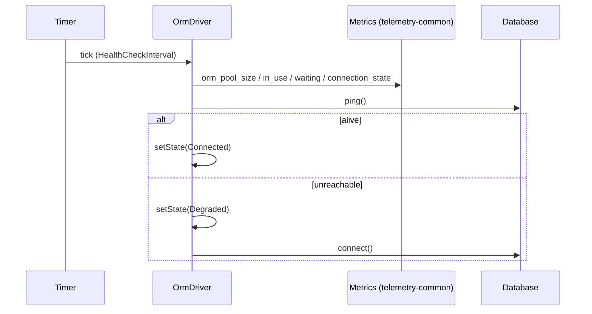

# Observability and resilience

Every `OrmDriver` tracks a `ConnectionState`, probes its database on a timer, and publishes pool gauges and an acquire-time histogram to the shared Prometheus registry. Drivers that opt in also retry a statement after a transport failure, reconnecting with bounded exponential backoff. Use this to expose database health and pool saturation, and to survive a database restart without failing requests.

## How it works

### Health probe

1. `Orm.resolve()` calls `driver.startHealthCheck()` after each connection opens (see [Connections](01-connections.md)). With `Resilience.HealthCheckInterval` at `0` nothing is scheduled. A second call is a no-op.
2. Every `HealthCheckInterval` ms the driver runs one probe. It first calls `publishPoolMetrics()`, which reads `poolMetrics()` and `State` and sets the gauges.
3. It calls `ping()`. On `true` the state becomes `Connected`.
4. On `false` or a thrown error the state becomes `Degraded` and the driver calls `connect()` once. The base class keeps `Degraded` even when that succeeds, until the next successful probe; the MySQL, Postgres and SQLite drivers set `Connected` inside their own `connect()`. A failed reconnect is logged, never thrown.
5. `Orm.dispose()` calls `stopHealthCheck()` on every connection. The timer is `unref()`-ed, so it never keeps the process alive.

### Retry on transport failure

1. A driver that opts in runs each statement through the protected `withReconnect()` loop. `MySqlOrmDriver` and `PostgresOrmDriver` do; `SqliteOrmDriver` and `MsSqlOrmDriver` do not.
2. On success the state becomes `Connected` and the result is returned.
3. On an error, `isRetryableError(err)` decides. A non-retryable error (a syntax error, a constraint violation) is rethrown at once, untouched.
4. On a retryable error the state becomes `Degraded`. The driver waits `backoffDelay(attempt, RetryDelay, MaxRetryDelay)` ms, sets `Connecting`, calls `connect()`, and runs the statement again. A failed `connect()` sets `Degraded` and the loop continues.
5. After `MaxRetries` retries (`MaxRetries + 1` attempts in total) the state becomes `Disconnected` and the last error is thrown.



### Connection states

`ConnectionState` values, read from `driver.State`:

| Value | Meaning |
| --- | --- |
| `Disconnected` (`'disconnected'`) | Initial state, after `disconnect()`, and after the retry loop gives up. |
| `Connecting` (`'connecting'`) | A reconnect inside the retry loop is in progress. |
| `Connected` (`'connected'`) | The last statement or probe succeeded. |
| `Degraded` (`'degraded'`) | A probe failed or a reconnect is in progress. Queries are still attempted. |

Each transition is logged once on the driver's logger (`orm-driver-<Name>`): `Connected` at `info`, `Degraded` and `Disconnected` at `warn`, `Connecting` at `trace`.

### Published metrics

Metrics go into the `Metrics` singleton from `@spinajs/telemetry-common`. `@spinajs/telemetry` re-exports that class, so its `/metrics` endpoint renders these metrics with no wiring. Every metric carries one label, `connection`, set to `db.Connections[].Name`.

| Metric | Constant | Type | Updated | Meaning |
| --- | --- | --- | --- | --- |
| `orm_pool_size` | `ORM_METRIC_POOL_SIZE` | gauge | each probe tick | Open connections, idle and in use. |
| `orm_pool_in_use` | `ORM_METRIC_POOL_IN_USE` | gauge | each probe tick | Connections checked out by a query. |
| `orm_pool_waiting` | `ORM_METRIC_POOL_WAITING` | gauge | each probe tick | Callers waiting for a free connection. |
| `orm_connection_state` | `ORM_METRIC_CONNECTION_STATE` | gauge | each probe tick | `1` when `State` is `Connected`, `0` otherwise. |
| `orm_pool_acquire_seconds` | `ORM_METRIC_ACQUIRE_SECONDS` | histogram | each pool acquire | Seconds spent acquiring a pooled connection. Buckets: `ORM_ACQUIRE_BUCKETS_SECONDS` (0.5 ms to 10 s). |

`ORM_METRIC_PREFIX` (`orm`) and the `ORM_METRIC_KEY_*` constants hold the prefix and the unprefixed names. `ormMetrics()` returns the ORM's `MetricMap`, defined once per `Metrics` instance, or `null` when `Metrics` cannot be resolved. `ormGauge(map, key)` and `ormHistogram(map, key)` narrow an entry of that map.

### Driver support

| Driver | Retry loop | `poolMetrics()` | Acquire histogram | Sets `State` in `connect()` / `disconnect()` |
| --- | --- | --- | --- | --- |
| `MySqlOrmDriver` | yes | yes | yes | yes |
| `PostgresOrmDriver` | yes | yes | yes | yes |
| `SqliteOrmDriver` | no | `Size` only; `InUse` and `Waiting` are always `0` | no | yes |
| `MsSqlOrmDriver` | no | no (base: all `0`) | no | no |

## Configuration

| Key | Type | Default | Allowed values | Meaning |
| --- | --- | --- | --- | --- |
| `db.Connections[].Resilience.HealthCheckInterval` | `number` | `30000` | ms, `0` disables | Interval of the health probe. Pool gauges are published on the same tick. |
| `db.Connections[].Resilience.MaxRetries` | `number` | `5` | `>= 0` | Reconnect attempts per failed statement before giving up. |
| `db.Connections[].Resilience.RetryDelay` | `number` | `200` | ms | First backoff delay; doubles on each attempt. |
| `db.Connections[].Resilience.MaxRetryDelay` | `number` | `5000` | ms | Upper bound of the backoff delay. |

Pool sizing (`db.Connections[].Pool.*`) is listed in [Connections](01-connections.md#configuration).

```ts
db: {
  Connections: [
    {
      Name: 'shop',
      Driver: 'orm-driver-mysql',
      Resilience: { HealthCheckInterval: 10000, MaxRetries: 3, RetryDelay: 100, MaxRetryDelay: 2000 },
    },
  ],
}
```

## Services and extension points

| Service | Role | Default implementation | How to override |
| --- | --- | --- | --- |
| `OrmDriver.poolMetrics()` | Point-in-time `IPoolMetrics` (`Size`, `InUse`, `Waiting`). Must never throw. | Base returns `{ Size: 0, InUse: 0, Waiting: 0 }` | Override in a driver that owns a pool. |
| `OrmDriver.observeAcquireSeconds(seconds)` | Records one pool-acquire wait in the histogram. Never throws. | Base implementation | Call it from the driver's acquire callback. |
| `OrmDriver.publishPoolMetrics()` | Sets the four gauges. Never throws. | Base implementation, run on every probe tick | Call it yourself when the probe is disabled. |
| `OrmDriver.isRetryableError(err)` (protected) | Decides whether the retry loop retries. | `isRetryableErrorCode(err)` | Override in a driver subclass to add dialect codes. MySQL and Postgres return `false` inside a transaction. |
| `isRetryableErrorCode(err)` | Walks `err` and its `inner` / `cause` chain (5 levels) for a `code` or `errno` in `RETRYABLE_ERROR_CODES`. | | Not overridden. |
| `RETRYABLE_ERROR_CODES` | `ECONNRESET`, `ECONNREFUSED`, `EPIPE`, `ETIMEDOUT`, `EHOSTUNREACH`, `ENETUNREACH`, `ENOTFOUND`, `PROTOCOL_CONNECTION_LOST`, `PROTOCOL_SEQUENCE_TIMEOUT`, `PROTOCOL_ENQUEUE_AFTER_FATAL_ERROR`, `PROTOCOL_ENQUEUE_AFTER_QUIT`, `ER_CON_COUNT_ERROR`, `ER_LOCK_WAIT_TIMEOUT`, `SQLITE_BUSY` | | Read-only set. |
| `backoffDelay(attempt, base, max)` | `min(base * 2^attempt, max)`. | | Not overridden. |
| `delay(ms)` | Promise-based sleep. | | Not overridden. |

```ts
import { DI } from '@spinajs/di';
import { MySqlOrmDriver } from '@spinajs/orm-mysql';

class ShopMySqlDriver extends MySqlOrmDriver {
  protected isRetryableError(err: unknown): boolean {
    // keep the base rule: a statement inside a transaction is never replayed
    if (this.CurrentTransaction) {
      return false;
    }

    return super.isRetryableError(err) || (err as { code?: unknown } | null)?.code === 'ECONNABORTED';
  }
}

DI.register(ShopMySqlDriver).as('orm-driver-mysql');
```

## Important behaviour

- Only errors matched by `isRetryableError()` are retried: codes in `RETRYABLE_ERROR_CODES`, plus driver additions (MySQL: any error flagged `fatal`; Postgres: its own code set). Any other error is thrown on the first attempt.
- MySQL and Postgres never retry inside `transaction()`: replaying one statement on a fresh connection would apply it outside the transaction.
- The retry loop re-runs writes too. It retries only on transport-level errors, where the driver treats the statement as not having reached the server.
- `SQLITE_BUSY` is in `RETRYABLE_ERROR_CODES`, but `SqliteOrmDriver` does not run the retry loop, so it does not retry.
- Pool gauges are published only on the probe tick. With `HealthCheckInterval: 0` they are never set unless code calls `publishPoolMetrics()`.
- Gauge values are up to `HealthCheckInterval` ms old.
- `default` and alias entries share their driver, so a connection is labelled once, by its `Name`.
- `MsSqlOrmDriver` does not set its state in `connect()`; its `State` reads `Disconnected` until the first successful probe.
- Publishing a metric never throws and never fails a query or a probe, including for a driver built outside DI.

## Best practices

- Alert on `orm_connection_state == 0` and on a rising `orm_pool_waiting`; a slow `orm_pool_acquire_seconds` tail means `Pool.Max` is too small.
- Lower `HealthCheckInterval` when a restart of the database must be detected before the next request hits it.
- Keep `MaxRetries * MaxRetryDelay` below your request timeout, so a caller gets the error instead of a timeout.
- Use readable `Name` values: they become the `connection` label.
- Reuse `isRetryableErrorCode()` in your own jobs instead of matching error messages.

## Patterns and antipatterns

```ts
// Don't: retries every error, so a duplicate-key insert is replayed five times
for (let attempt = 0; attempt < 5; attempt++) {
  try { return await Invoice.insert(invoice); } catch { await delay(1000); }
}

// Do: retry only transport failures, with bounded backoff
for (let attempt = 0; ; attempt++) {
  try { return await Invoice.insert(invoice); }
  catch (err) {
    if (!isRetryableErrorCode(err) || attempt >= 3) throw err;
    await delay(backoffDelay(attempt, 200, 5000));
  }
}
```

```ts
// Don't: disables the probe, so the pool gauges stay empty
Resilience: { HealthCheckInterval: 0 }

// Do: keep the probe on, or publish yourself on your own schedule
Resilience: { HealthCheckInterval: 15000 }
```

## Examples

### List unhealthy connections for a readiness endpoint

```ts sample
import { DI } from '@spinajs/di';
import { ConnectionState, Orm } from '@spinajs/orm';

export async function unhealthyConnections(): Promise<string[]> {
  const orm = await DI.resolve(Orm);
  const unhealthy: string[] = [];

  for (const [name, driver] of orm.Connections) {
    if (driver.State !== ConnectionState.Connected) {
      unhealthy.push(`${name}: ${driver.State}`);
    }
  }

  return unhealthy;
}
```

### Retry a nightly invoice export on transport failures only

```ts sample
import { backoffDelay, delay, isRetryableErrorCode } from '@spinajs/orm';

export async function withTransportRetry<T>(job: () => Promise<T>, maxRetries = 3): Promise<T> {
  for (let attempt = 0; ; attempt++) {
    try {
      return await job();
    } catch (err) {
      if (!isRetryableErrorCode(err) || attempt >= maxRetries) {
        throw err;
      }

      await delay(backoffDelay(attempt, 200, 5000));
    }
  }
}
```

### Read the pool-waiting gauge without the HTTP endpoint

```ts sample
import { DI } from '@spinajs/di';
import { ORM_METRIC_POOL_WAITING } from '@spinajs/orm';
import { Metrics } from '@spinajs/telemetry-common';

export async function poolWaitingLines(): Promise<string[]> {
  const metrics = DI.get(Metrics) ?? DI.resolve(Metrics);
  const exposition = await metrics.render();

  return exposition.split('\n').filter((line) => line.startsWith(`${ORM_METRIC_POOL_WAITING}{`));
}
```

## Related

- [Connections](01-connections.md): where the probe starts and `Pool.*` is configured.
- [Transactions](08-transactions.md): why statements inside a transaction are not retried.
- [`@spinajs/orm-mysql`](../orm-mysql/README.md): retryable `fatal` errors and pool bookkeeping.
- [`@spinajs/orm-sqlite`](../orm-sqlite/README.md): the read-handle pool behind `orm_pool_size`.
- [`@spinajs/orm-sql`](../orm-sql/07-adding-a-sql-dialect.md): implementing `poolMetrics()` in a new driver.
