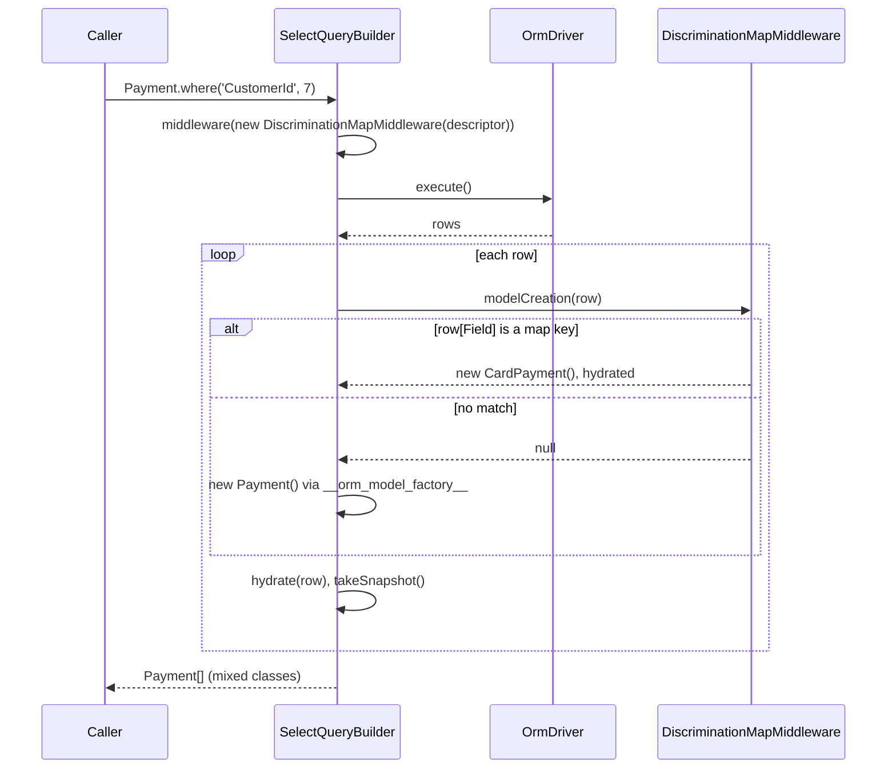

# Discrimination maps

A discrimination map stores several model classes in one table. A column value on each row picks
the class the ORM instantiates for it. Use it when rows of one table differ in behaviour, eg. card
and bank-transfer payments in a `payments` table.

## How it works

1. `@DiscriminationMap(fieldName, entries)` on the queried model sets
   `descriptor.DiscriminationMap.Field` to `fieldName` and fills `DiscriminationMap.Models` with
   one `Key -> Value` pair per entry.
2. Every query builder created for a model (`createQuery()`, behind `Payment.where()`,
   `Payment.all()`, `Payment.get()`, ...) registers a `DiscriminationMapMiddleware` built from that
   model's descriptor. Relation loaders for `@HasMany`, `@HasManyToMany` and recursive `@BelongsTo`
   register one built from the target model's descriptor.
3. The driver executes the query and returns raw rows.
4. For each row, the builder calls `modelCreation(row)` on its middlewares in reverse registration
   order. The first non-`null` result is the instance.
5. `DiscriminationMapMiddleware.modelCreation()` reads `row[Field]`. When the value is truthy and is
   a key of `Models`, it creates `new Value()`, calls `hydrate(row)` and returns it. Otherwise it
   returns `null`.
6. When every middleware returned `null`, the builder creates the queried class through
   `__orm_model_factory__`.
7. The builder hydrates the instance with the row, takes its snapshot and runs the
   `afterHydration()` middlewares.



## Decorators

| Decorator | Target | Options | Effect |
| --- | --- | --- | --- |
| `@DiscriminationMap(fieldName, discriminationMap)` | class | `fieldName: string` — column holding the discriminator; `discriminationMap: IDiscriminationEntry[]` — `{ Key: string, Value: Constructor<ModelBase> }` pairs | Sets `descriptor.DiscriminationMap`. A second application replaces the whole map. |

The map lives on the descriptor as `IDiscriminationMap`:

| Field | Type | Meaning |
| --- | --- | --- |
| `Field` | `string` | Column whose value picks the class. `''` when the model has no map. |
| `Models` | `Map<string, Constructor<ModelBase>> \| null` | Discriminator value to class. `null` when the model has no map. |

## Schema

### `payments` (the example below)

| Column | Type | Meaning |
| --- | --- | --- |
| `Id` | int, primary key | Row key. |
| `CustomerId` | int | Owner of the payment. |
| `Method` | string | Discriminator: `card` or `transfer`. Any other value hydrates as `Payment`. |
| `Amount` | decimal | Payment amount. |
| `CardLast4` | string, nullable | Used by `CardPayment` only. |
| `Iban` | string, nullable | Used by `TransferPayment` only. |

## Services and extension points

| Service | Role | Default implementation | How to override |
| --- | --- | --- | --- |
| `DiscriminationMapMiddleware` | `IBuilderMiddleware` that picks the class per row in `modelCreation()`. `afterQuery()` and `afterHydration()` do nothing. | Constructed with the model descriptor by `createQuery()` and the relation loaders. It is not resolved from DI. | Add your own `IBuilderMiddleware` with `query.middleware()`. It is registered later, so its `modelCreation()` runs first; return `null` to fall through to the map. |

```ts
import { IBuilderMiddleware, ModelBase } from '@spinajs/orm';

// Legacy rows store the method upper-cased ('CARD'), which the map does not match.
class LegacyPaymentMethodMiddleware implements IBuilderMiddleware {
  public afterQuery(data: any[]): any[] {
    return data;
  }

  public modelCreation(row: any): ModelBase | null {
    if (typeof row.Method === 'string' && row.Method.toLowerCase() === 'card') {
      const payment = new CardPayment();
      payment.hydrate(row);
      return payment;
    }

    return null;
  }

  public async afterHydration(_data: ModelBase[]): Promise<void> {}
}

const payments = await Payment.where('CustomerId', customerId).middleware(new LegacyPaymentMethodMiddleware());
```

## Important behaviour

- The lookup is `Map.has()`, so it is exact and type-strict. Keys are strings: a numeric column value
  `1` does not match the key `'1'`, and `'CARD'` does not match `'card'`.
- A falsy discriminator (`null`, `''`, `0`) and a value missing from the map both produce the
  queried class.
- The ORM does **not** write the discriminator. Set the column yourself when you create a row.
- Each mapped class is instantiated with its own descriptor. Without its own `@Model()` it is not in
  `Orm.Models` and gets no table columns, so `hydrate()` cannot apply converters and `toSql()`
  writes nothing.
- Rows built from nested data are not discriminated. `OneToOneRelationHydrator` and
  `OneToManyRelationHydrator` always create the declared target class, eg. for a `@BelongsTo`
  joined into the parent select.
- `model.attach(child)` matches relations by constructor identity. A `CardPayment` is not attached to
  a relation whose target is `Payment`.
- The unit of work's identity map keys rows by table name, so a row reached once as `Payment` and
  once as `CardPayment` is one subject. See [Unit of work](07-unit-of-work.md).
- `@DiscriminationMap` on a subclass replaces the inherited map on the subclass only. The parent's
  map is not changed.
- The query's result type is the queried class. Narrow with `instanceof` to reach subclass members.

## Best practices

- Put the shared columns and `@Primary()` in an abstract base class, and let the queried model and
  each mapped class extend it. The queried model's `@DiscriminationMap` can then reference classes
  that are already declared.
- Give every mapped class `@Connection()` and `@Model()` with the same table as the queried model.
- Store the discriminator as a string column and use the exact stored values as `Key`.
- Query through the class that carries the map. A query on `CardPayment` adds no `Method` filter: it
  returns every row of `payments` and creates a `CardPayment` for each. Add `where('Method', 'card')`
  when you query a mapped class directly.

## Patterns and antipatterns

```ts
// Don't: CardPayment has no @Model, so it is not registered and gets no table columns
export class CardPayment extends PaymentColumns<CardPayment> {
  public CardLast4: string;
}

// Do
@Connection('default')
@Model('payments')
export class CardPayment extends PaymentColumns<CardPayment> {
  public CardLast4: string;
}
```

```ts
// Don't: the discriminator is left empty, so the row reads back as a plain Payment
await new CardPayment({ CustomerId: 7, Amount: 120, CardLast4: '4242' }).insert();

// Do
await new CardPayment({ CustomerId: 7, Method: 'card', Amount: 120, CardLast4: '4242' }).insert();
```

## Examples

### Card and transfer payments in one table

```ts sample
import { Connection, DiscriminationMap, Model, ModelBase, Primary } from '@spinajs/orm';

export abstract class PaymentColumns<M> extends ModelBase<M> {
  @Primary()
  public Id: number;

  public CustomerId: number;

  public Method: string;

  public Amount: number;
}

@Connection('default')
@Model('payments')
export class CardPayment extends PaymentColumns<CardPayment> {
  public CardLast4: string;

  public get Label(): string {
    return `Card **** ${this.CardLast4}`;
  }
}

@Connection('default')
@Model('payments')
export class TransferPayment extends PaymentColumns<TransferPayment> {
  public Iban: string;

  public get Label(): string {
    return `Transfer from ${this.Iban}`;
  }
}

@Connection('default')
@Model('payments')
@DiscriminationMap('Method', [
  { Key: 'card', Value: CardPayment },
  { Key: 'transfer', Value: TransferPayment },
])
export class Payment extends PaymentColumns<Payment> {}

export async function paymentLabels(customerId: number): Promise<string[]> {
  const payments = await Payment.where('CustomerId', customerId);

  return payments.map((p) => {
    if (p instanceof CardPayment || p instanceof TransferPayment) {
      return p.Label;
    }

    return `Payment #${p.Id}`;
  });
}

export async function recordCardPayment(customerId: number, amount: number, last4: string) {
  // The discriminator is an ordinary column: set it explicitly.
  const payment = new CardPayment({ CustomerId: customerId, Method: 'card', Amount: amount, CardLast4: last4 });
  await payment.insert();
  return payment;
}
```

## Related

- [Models](02-models.md): `@Model()`, descriptor inheritance and why each mapped class needs its own decorators.
- [Query builder](05-query-builder.md): query middleware and `IBuilderMiddleware`.
- [Relations](06-relations.md): which relation loaders apply the target's map.
- [Unit of work](07-unit-of-work.md): identity map keyed by table.
- [Converters and hydration](04-converters-and-hydration.md): the hydrators that build nested relation rows.
