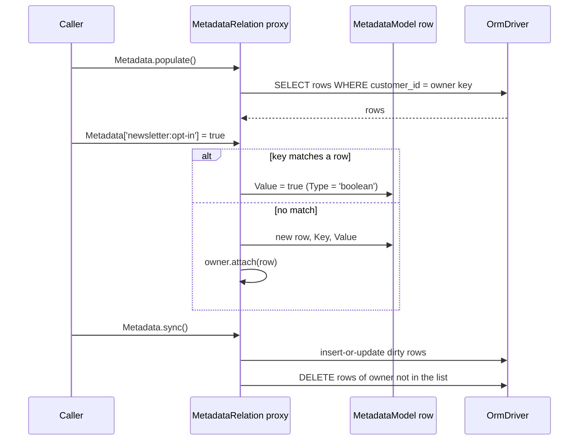

# Metadata models

Metadata models store free-form key/value data for an owner model in a separate table, one row per
key. `MetadataModel` is the row class, and `MetadataRelation` is a `@HasMany` relation that reads
and writes rows by key, eg. `customer.Metadata['newsletter:opt-in'] = true`. Use it for settings and
flags you do not know at design time.

## How it works

1. A row class extends `MetadataModel<T>` and adds `@Connection()` and `@Model()`. It inherits
   `@Primary() Id`, `Key`, `Type` and a `Value` accessor decorated with `@UniversalConverter()`.
2. The owner declares `@HasMany(RowClass, { foreignKey })` on a property typed
   `MetadataRelation<RowClass, Owner>`. `@HasMany` reads the reflected property type, and the
   `__orm_relation_has_many_factory__` keeps it as the relation class.
3. The owner's constructor creates the relation. The `MetadataRelation` constructor returns a
   `Proxy` around the list.
4. Reading `owner.Metadata[key]`:
   - a name that exists on the list (`length`, `push`, `sync`, ...) is returned as is;
   - otherwise `key` is compiled with `glob-to-regexp` and tested against each row's `Key`;
   - no match returns `null`, one match returns its `Value`, several return an array of `Value`s.
5. Writing `owner.Metadata[key] = value`:
   - a name that exists on the list, or a numeric index, is assigned as is;
   - `null` or `undefined` removes every matching row from the list, in memory only;
   - matching rows get the new `Value`; a row whose `Value` is already `===` the new one is skipped;
   - no match creates `new TargetModel()`, sets `Key` and `Value`, and calls `owner.attach(row)`.
6. Assigning `Value` sets `Type` from the value (see [Value types](#value-types)).
7. `owner.Metadata.sync()` persists the list in one transaction. It writes the foreign key on every
   row, inserts or updates dirty rows with `InsertBehaviour.InsertOrUpdate`, then deletes the
   owner's rows that are no longer in the list. A `@SoftDelete()` row class is stamped instead of
   deleted.
8. `owner.Metadata.delete(key)` loads the row with `Key = key` and the owner's foreign key, calls
   `destroy()` on it and removes it from the list.



### Value types

The setter of `Value` picks `Type`. `UniversalValueConverter` stores `Value` as text and parses it
back according to `Type`.

| Value assigned | `Type` set | Stored as | Read back with |
| --- | --- | --- | --- |
| Luxon `DateTime` | `datetime` | `toISO()` | `DateTime.fromISO()` |
| `null`, `undefined` | `string` | `null` / `undefined` as is | as is |
| object or array | `json` | `JSON.stringify()` | `JSON.parse()` |
| `number` | `number` | `toString()` | `parseInt(value, 10)` |
| `boolean` | `boolean` | `'true'` / `'false'` | `value === 'true'` |
| `string` | `string` | as is | as is |

The converter also reads `float` (`parseFloat`), `date` and `time` rows. The setter never assigns
those types; set `Type` on the row yourself.

## Decorators

`MetadataModel` carries its own decorators. A row class adds `@Connection()` and `@Model()`, see
[Models](02-models.md).

| Decorator | Target | Options | Effect |
| --- | --- | --- | --- |
| `@Primary()` on `Id` | inherited property | none | `Id` is the row key. |
| `@UniversalConverter()` on `Value` | inherited accessor | `typeColumn` defaults to `'Type'` | `Value` is converted according to the row's `Type`. |
| `@HasMany(RowClass, options)` | owner property typed `MetadataRelation<...>` | `foreignKey`, `primaryKey`, see [Relations](06-relations.md) | Creates the metadata relation. |

## Schema

### `customers_metadata` (the example below)

| Column | Type | Meaning |
| --- | --- | --- |
| `Id` | int, primary key, auto-increment | Row key. |
| `Key` | string(255), not null | Metadata key, eg. `newsletter:opt-in`. |
| `Type` | enum `number`, `float`, `string`, `json`, `boolean`, `datetime` | How `Value` is parsed. |
| `Value` | text | The value as text. |
| `customer_id` | int, not null, foreign key | Owner key, the relation's `foreignKey`. |

A unique index on `(customer_id, Key)` keeps one row per key and owner.

## Services and extension points

| Service | Role | Default implementation | How to override |
| --- | --- | --- | --- |
| `MetadataModel<T>` | Abstract row class: `Id`, `Key`, `Value`, `Type`. | none, abstract | Extend it per table. Override the `Key` and `Value` accessors when the table uses other column names. |
| `MetadataRelation<R, O>` | `OneToManyRelationList` with the key-access proxy and `delete(key)`. | Picked from the property type by `@HasMany`. | Extend it and type the owner property with the subclass. |

### Lower-case column names

A table with `key` and `value` columns maps them by overriding the accessors, as the ORM's tests do:

```ts
@Connection('default')
@Model('device_metadata')
export class DeviceMetadata extends MetadataModel<DeviceMetadata> {
  @Primary()
  public id: number;

  public device_id: number;

  public key: string;

  public value: string;

  public get Key() {
    return this.key;
  }

  public set Key(v: string) {
    this.key = v;
  }

  public get Value() {
    return this.value;
  }

  public set Value(v: string) {
    this.value = v;
  }
}
```

- The proxy and the dirty tracking then work on `key` and `value`.
- The inherited `@UniversalConverter()` is keyed to `Value`, so a `value` column gets no universal
  conversion.
- `delete(key)` filters on a column named `Key`.

## Important behaviour

- Reads see only rows in the list. Call `owner.Metadata.populate()` (or load the relation with the
  owner query) before reading or writing.
- `sync()` deletes every row of the owner that is not in the list. On an unpopulated relation that
  is every stored row except those written in this session. Use `update()` to insert and update
  without deleting.
- Setting a key to `null` removes it only from the list. The row is deleted on the next `sync()`.
- Assigning to a pattern that matches nothing creates a row whose `Key` is the pattern text, eg.
  `newsletter:*`.
- Glob patterns are anchored. `*` matches any run of characters, so `newsletter:*` matches
  `newsletter:topics` but not `newsletter`.
- Keys that are names on the list (`length`, `push`, `filter`, `find`, `sync`, `update`, `delete`,
  `populate`, `Owner`, `Relation`, ...) and numeric keys never reach the metadata rows.
- A fractional number gets `Type = 'number'` and reads back through `parseInt`, so `1.5` returns `1`.
- The skip check uses `===`, so an equal copy of an object or `DateTime` is assigned again.
- `owner.attach(row)` adds a new row to every relation of the owner whose target is the row class.
- `delete(key)` rejects an empty key, and does nothing when no row matches.

## Best practices

- Add a unique index on `(foreignKey, Key)`. `sync()` and `update()` write with
  `InsertBehaviour.InsertOrUpdate`, so a duplicate key updates the stored row instead of adding one.
- Namespace keys with a prefix (`newsletter:`, `billing:`) so one glob reads or clears a group.
- Store fractional numbers as strings, or set `Type = 'float'` on the row after assigning `Value`.
- Give each row class its own `@Model()`. A subclass without it is not registered and gets no
  table columns.

## Patterns and antipatterns

```ts
// Don't: the relation is empty, so sync() deletes every stored key of this customer
const customer = await Customer.getOrFail(customerId);
customer.Metadata['newsletter:opt-in'] = true;
await customer.Metadata.sync();

// Do
const customer = await Customer.getOrFail(customerId);
await customer.Metadata.populate();
customer.Metadata['newsletter:opt-in'] = true;
await customer.Metadata.sync();
```

```ts
// Don't: Type becomes 'number' and the value reads back as 4
customer.Metadata['billing:discount-rate'] = 4.5;

// Do
customer.Metadata['billing:discount-rate'] = 4.5;
const row = customer.Metadata.find((m) => m.Key === 'billing:discount-rate');
if (row) {
  row.Type = 'float';
}
```

## Examples

### Newsletter preferences for a customer

```ts sample
import { BelongsTo, Connection, HasMany, Hidden, MetadataModel, MetadataRelation, Model, ModelBase, Primary, SingleRelation } from '@spinajs/orm';

@Connection('default')
@Model('customers_metadata')
export class CustomerMetadata extends MetadataModel<CustomerMetadata> {
  @Hidden()
  @BelongsTo('Customer')
  public Customer: SingleRelation<Customer>;

  @Hidden()
  public customer_id: number;
}

@Connection('default')
@Model('customers')
export class Customer extends ModelBase<Customer> {
  @Primary()
  public Id: number;

  public Name: string;

  @HasMany(CustomerMetadata, { foreignKey: 'customer_id' })
  public Metadata: MetadataRelation<CustomerMetadata, Customer>;
}

export async function subscribeToNewsletter(customer: Customer, topics: string[]) {
  await customer.Metadata.populate();

  customer.Metadata['newsletter:opt-in'] = true;
  customer.Metadata['newsletter:topics'] = topics;

  await customer.Metadata.sync();
}

export function newsletterTopics(customer: Customer): string[] {
  return customer.Metadata['newsletter:topics'] ?? [];
}

export async function unsubscribe(customer: Customer) {
  await customer.Metadata.populate();

  // Clears every newsletter:* key from the list; sync() deletes the rows.
  customer.Metadata['newsletter:*'] = null;
  await customer.Metadata.sync();
}

export async function forgetOptIn(customer: Customer) {
  await customer.Metadata.delete('newsletter:opt-in');
}
```

### Migration for the metadata table

```ts sample
import { Migration, OrmDriver, OrmMigration } from '@spinajs/orm';

@Migration('default')
export class CustomerMetadata_2026_10_17_12_00_00 extends OrmMigration {
  public async up(connection: OrmDriver): Promise<void> {
    await connection.schema().createTable('customers_metadata', (table) => {
      table.int('Id').primaryKey().autoIncrement();
      table.string('Key', 255).notNull();
      table.enum('Type', ['number', 'float', 'string', 'json', 'boolean', 'datetime']).notNull();
      table.text('Value');
      table.int('customer_id').notNull();
      table.foreignKey('customer_id').references('customers', 'Id').cascade();
    });

    await connection.index().unique().table('customers_metadata').name('customer_meta_key_idx').columns(['customer_id', 'Key']);
  }

  public async down(connection: OrmDriver): Promise<void> {
    await connection.schema().dropTable('customers_metadata');
  }
}
```

## Related

- [Relations](06-relations.md): `@HasMany`, `OneToManyRelationList`, `populate()`, `sync()` and `update()`.
- [Converters and hydration](04-converters-and-hydration.md): `UniversalValueConverter` and `@UniversalConverter()`.
- [Models](02-models.md): `@Model()`, `@Hidden()` and descriptor inheritance.
- [Unit of work](07-unit-of-work.md): persisting the owner and its metadata with `save()`.
- [Migrations](10-migrations.md): `@Migration()` and `OrmMigration`.
