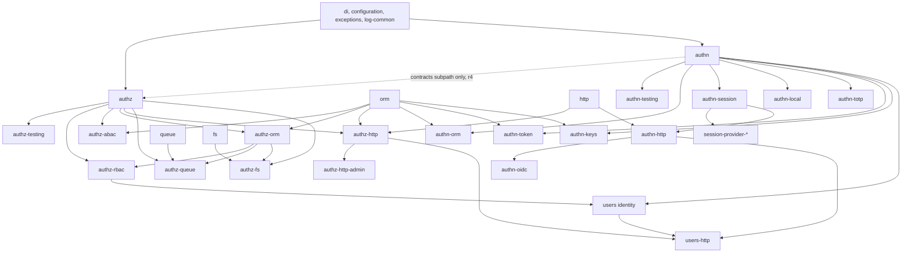

# SpinaJS 3.0 authorization (`@spinajs/authz`) and authentication (`@spinajs/authn`): design

Date: 2026-10-01 (revision r2 the same day; revisions r3 and r4
2026-10-02; r5 syncs the text with the code merged by F0b, F1a, F1 and
F2). The r1 to r4 text was design only; r5 changes no decision, only
names, shapes and locations that the merged code fixed. r6 (2026-10-02)
does the same for what F3, F4 (host), F5, F6, F7 and F7b built
and decided.

- **Source of truth for code facts:** this checkout (`packages/*/package.json` say
  2.0.546; head `f1604f4`; canvas pins 2.0.548 with the same RBAC code paths).
  Paths below are relative to `packages/`.
- **Inputs:** `coderush/canvas/.superpowers/sdd/spinajs-rbac-rewrite-study.md`
  (cited as *study*; §8 = 98-item audit, §9 = fs and adapters),
  `spinajs-authz-v3-plan.md` (cited as *v3 plan*),
  `f06-c6-vs-spinajs-rbac-review.md` (cited as *C6 review*).
- **Execution plan:** `2026-10-01-authz-v3-plan.md` (same folder).
- This design supersedes the v3 plan's single-engine model (§4–§8 there). It
  keeps the v3 plan's no-compat stance, consumer list and test-port ledger.
- **Canvas inputs for r2:** C6 worktree `coderush/canvas-f06-c6` (head
  `1803e0c`): `contracts/ts/server-api/src/reference.ts` (cited as
  *C6 ref*), `fixtures/authz/{capabilities,state,cases}.json` (62 cases),
  `docs/plans/F06-c6-server-api.md` (*C6 plan*, "The evaluation flow").
- **Canvas input for r3:** C8 worktree `coderush/canvas`,
  `docs/plans/F06-c8-plane-api.md` (*C8 plan*: Ed25519 JWS realtime
  tickets, D1–D5).

## Changes in this revision (r6, as built after F3–F7)

The code on `feat/authz-v3` and the reports of F3 (engine, decisions 1–30
of `F3-conventions.md`), (r6, F4) F4 (host, `F4-report.md`), F5 (authz test kit, D-F5-1 to D-F5-11), F6 (authn
contracts, `F6-final-review.md`), F7 and F7b (authn test kit, rules A01–A32,
C8 tickets) are authoritative for everything below. r6 settles open
points and fixes text; it adds no feature. Each item names the section it
changed.

1. **Combination (§7, D17; F3, D-F5-1).** A ceiling or delegate deny does
   not stop the models. The reported reason is the lowest
   `(priority, sortKey)` among all deny sources, core included, so
   `agents_disabled` (100) beats `ceiling` (200). Only the principal gate
   (`SYSTEM`, `UNATTENDED`, a forged `system` or `unattended` principal),
   `unknown_resource` and a forbidden delegate end the check before the
   models. The `intersect` delegate is also asked after the principal's own
   models deny.
2. **`Trace.votes` (§5.4).** The comment said "every routed model". That
   holds only for `explain()`; a `check` may stop early (§7).
3. **L2 key and uncached decisions (§10.1, §10.3).** The key of r2 would
   serve one principal another's decision. It now holds the full principal
   and actor state; §10.1 lists what never reaches the cache.
4. **`sync` (§5.5, §6.3, §6.5 rule 6; F5).** `sync` governs `filterNow` on
   type-level requests only; a `check` may be async for every model. Rule 6
   cannot test "residual is IO-free" (no capability says so); see §6.5.
5. **`neverRead` limits writes too (§7, B17; F3 decision 28).** It leaves
   `read` and `write`, `SYSTEM` included. A permitting vote without `fields`
   contributes every field before `hide` and `neverRead` apply (D-F5-2).
6. **B39 (§5.6, §17).** A vote that holds a `scope.*` ref the engine cannot
   resolve is indeterminate (`model_error`, B04); F3 decision 29.
7. **B22 (§17).** `filterNow` returns `undefined` for an `after-preload`
   model until `preload` has run for the principal the models run with;
   F3 decision 30.
8. **Login CSRF (§22.11, A22; F6 decision 15, F7b).** A22 exempts requests
   without a session cookie, which include `POST /auth/login`,
   `POST /auth/keys/login` and `POST /auth/password/reset`. The origin
   match is exact (no prefix match); `Sec-Fetch-Site: same-site` is refused.
9. **Token profile (§22.3, §22.9; F6 decision 22).** One generic
   `attributes` slot on `StrategyOutcome`, `AuthenticationResult` and
   `PrincipalFactory.principalOf`'s `extra` carries the 2.x token profile
   as `attributes.profile`, with the precedence and source rules of §22.3.
10. **Re-authentication (§22.3, §22.4, A13; F6 decisions 20 and 24).**
    `reauthenticate` stays `boolean`, so a throttled re-authentication
    sends no `Retry-After`. A success counts for its own request only; it
    refreshes no session fact and rotates no id. The failure member of
    `AuthenticationResult` gains `retryAfterSeconds?`, set only for
    `'throttled'`.
11. **Session store (§22.6; F6 decision 6).** `ISession` drops `UserId` and
    gains typed `Subject`, `Impersonator` and `State`; the provider keeps
    `deleteBySubject` and `listBySubject`. See §22.6 for the migration.
12. **OIDC limits (§22.15; F6 decision 19).** Confidential clients only;
    Entra by one tenant GUID; JIT and email linking need the global and the
    per-provider switch; `max_age` and `acr_values` are refused.
13. **Config boot failures (§22.5; F6 decisions 17, 25).** Deliberate
    breaks, listed in §22.5.
14. **Additions to §22.3 and §22.11 (F6).** All additive; listed after the
    §22.3 block and in §22.11.
15. **Rule amendments (§22.17; F7b).** A22, A25, A30 and A31 are tighter:
    an admin reset never returns the secret; an old password is dead after
    a change or an expiry; a CORS preflight never echoes an arbitrary
    origin; the CSRF origin match has no prefix match and no `same-site`.
16. **Two points decided by the human, one open (r6, D3).**
    Decided: a token's role is never above its owner's role. B24 and B07
    hold, and §18.3(g) follows them; the 2.x grant-subset check is not
    ported. Decided: the API snapshot keeps doc comments, so a rule
    written only in a doc comment is frozen after G1 and changes only by
    RFC (D3 changed the snapshot tool to keep them). Open: a last-holder
    check on `deactivate`; B26 covers `AuthzAdmin` commands only (plan C2).
17. **Host as built (§5.7, §6.6.1, §10.3, §13, §15.3; r6, F4).**
    `AuthzDomains.service(name)` returns a `Promise`; `create`,
    `container` and `names` stay synchronous instance methods (§15.3's
    static call was an erratum). `authz()` is synchronous and throws until
    the domain's service has booted. Each domain has its own `Authorizer`
    and at most one `DecisionCache`, merges models level by level and
    subscribes to the `ChangeBus` its container resolves; `AuthzDomains`
    forwards no change. §15.3 lists the per-domain config keys. This
    settles the first two r5 open items (r5 item 9).
18. **`covers` and `summary` read model summaries (§6.1.5, §6.2, B25, B26;
    E1, RFC L1-3).** Before, both ran one check on `$global`, so a target
    whose rights came from a scoped assignment or a pattern grant looked
    empty and could be impersonated. Now the target's set adds the entries of
    every routed model's summary; the holder's set stays its checks. See
    `authz-v3-rfc/L1-3.md` and `authz-v3-rfc/E1-1.md`. Every model that can
    grant below `$global` must implement `summarize`. The holder's fields
    come only from its unconditional permits, so another model's conditional
    permit does not widen what it covers. `covers` is false when a compared
    route plan uses a custom combinator, since one may allow without any
    permit that a summary lists.

## Changes in this revision (r5, as built after F1)

The code on `feat/authz-v3` and the lane reports F0b, F1a, F1 and F2 are
authoritative for everything below. Each item names the section it
changed.

1. **Principal contracts (§4.1, §5.1, D20).** `ResourceType` and
   `ResourceRef` are declared in authn's `principal.ts` (`Ceiling.resources`
   needs them); authz re-exports them by name and adds only `GLOBAL` and
   `resourceKey` (`resource.ts`). `ceilingHash(c: Ceiling | undefined):
   string` returns `''` or a canonical collision-free string, not a short
   hash. `SYSTEM` and `UNATTENDED` are deep-frozen singletons with
   `attributes: {}`; `UNATTENDED.source` is `'unattended'`. `authn`'s
   `typesVersions` points the `contracts` subpath at the CJS typings.
2. **RBAC/ABAC data shapes live in core `data.ts` (§5.8, §6.6.1).**
   `AssignmentSubject`, `Assignment`, `SubjectSelector`, `RuleDef`,
   `LinkDef` and `Policy` are declared in `@spinajs/authz`
   (`AuthzCommand` carries them); authz-rbac and authz-abac re-export them
   as types. `RuleDef.reason` is `DenyReason & { readonly model?: never }`
   (`Omit<DenyReason, 'model'>` erased `code` and `priority`).
3. **Host contracts (§5.5, §5.7).** `AuthzService` and `AuthzDomains` are
   abstract DI tokens in `contracts/service.ts`; F4 implements them.
   `AuthzService.admin(): AuthzAdmin` is new. `export const authz` is left
   to F4. `EvaluationContext.conditions` is `readonly`.
4. **Errors (§5.7, §6.6.1).** `Unauthenticated` extends
   `AuthenticationFailed` (`@spinajs/exceptions` has no `Unauthorized`;
   http maps it to 401). `AccessDenied.decision` is non-enumerable.
   `AuthzAdminFailure(code, message?, field?, options?)` is declared.
5. **Grammar and algebra (§5.2, §5.3, §5.4).** Permission glob rules, the
   linear matcher, field-glob semantics and budgets, Kleene-sound
   `simplify`, fail-closed `bindRefs`, `eq null` never matches, and the
   deny-priority helpers are now stated.
6. **Packages and deps (§4.1, §4.2, §11, §12, §13, §14).** `authz-http`
   depends on `orm` and `di`; `authz-orm` on `di`. Adapter stubs, and the
   queue and fs hook mirrors that L6 and L7 replace, are described.
7. **DI (§15).** `resolveChain` order and its `@PerChildInstance` rule, and
   the owner-container rules for singletons (DI-2), are as built; F2's
   behaviour changes A to H are listed. Facts F2, F4, F5 and F6 describe
   the code before F2.
8. **F0b moves (§4.1.1, §18.1, §22.5).** Three deviations in the package
   moves (token HTTP parts, the 2FA events and `TwoFactorAuthProvider`, the
   `RoleGuard`), the config key split, and the interim package edges that
   break §4.2 until the N and C lanes remove them.
9. **Open items the reports raised (§5.7, §10.3).** `AuthzDomains.create`
   and `service` are synchronous while `AuthzService` resolves
   asynchronously; §15.3 calls `AuthzDomains.create` as a static; the L2
   key omits delegation and authn facts; `DefaultAdminGuard` needs RBAC
   data that its dependency list lacks. None is decided here. (r6, F4)
   F4 settled the first two: `service` is async, and `create` is an
   instance method (§5.7). (r6, F3) The L2 key is settled in §10.1.
   (G1b) The last is settled: `DefaultAdminGuard` lives in
   `@spinajs/authz-rbac`, next to the RBAC data it reads (§4.1, §6.6.2).

## Changes in revision r4 (2026-10-02)

The human answered the eight r3 open questions (H29–H36, §3.1). What
changed:

1. **No `@spinajs/principal` package (H29).** The principal types live in
   `@spinajs/authn` and are exported through the side-effect-free subpath
   `@spinajs/authn/contracts` (§4.1, D20). `authz*` may depend on
   `@spinajs/authn` for these contracts only; `authn*` never depends on
   `authz*`. So `authn-http` drops its `authz-http` dependency: it hands its
   principal to authz-http through `req.storage.AuthnPrincipal`, and the
   authz-backed hooks (impersonation guard, `Access` in login responses,
   role source) move to `users` (D26, §11.1, §22.11).
2. **argon2 keeps the library defaults (H30):** argon2id, 64 MiB, t=3,
   p=4 (argon2 0.44). No cost keys in config; only the concurrency cap
   stays (§22.7, A03, SR-13).
3. **Backoff, not lockout (H31).** Exponential delay per account and per
   IP, capped; no key ever locks. A success resets the account key and
   removes that account's attempts from the IP key, so a login to one's
   own account cannot wipe failures spent on others. Attempts count before
   verification. Parameters in `authn.throttle` (§22.5), rules in §22.13;
   A05 and A06 rewritten; the `authn_throttle` table changes (§22.16).
4. **A voluntary password change keeps API tokens (H32)** and revokes the
   identity's other sessions; new rule A30.
5. **CORS: an empty list allows nothing (H33)**; new rule A31 and a
   migration-guide step (§18.4).
6. **No 2.x patch (H34).** 2.0.549, lanes S1a and S1b, the advisories and
   the 2.x boot warning are gone. Every §23 finding is fixed and tested in
   3.0 lanes; §23.4 says where. The High findings stay open in released
   2.x until apps upgrade (§23.1).
7. **Pending resets and invites survive the upgrade (H35).** The 3.0
   migration hashes the 2.x tokens into `authn_secret` with their expiry;
   the invite marker stays (§22.18, A32).
8. **OIDC ships in 3.0 (H36).** `authn-oidc` (plan lane N10) runs in
   parallel off the critical path; acceptance is a canvas-like setup plus
   presets (§22.15, A27). LDAP and SAML stay later.
9. Open questions r3 1–8 closed; none open (§21).

## Changes in revision r3 (2026-10-02)

The human answered the seven r2 open questions (H21–H27, §3.1) and added a
new requirement: authentication becomes its own module family (H28). What
changed:

1. **Three module families with one direction (H28).** Identity
   (`@spinajs/users*`, config `users.*`), authentication (`@spinajs/authn*`,
   new, config `authn.*`) and authorization (`@spinajs/authz*`, `authz.*`).
   `Principal` and its helpers move to a new zero-dependency package
   `@spinajs/principal`; authz and authn both depend on it and never on
   each other. (r4: superseded by H29; the types live in
   `@spinajs/authn/contracts`.) Final package map and rename table in §4.1
   and §4.1.1; the r2 names `users-http-account`, `users-http-admin` and
   `users-http-token` are gone (never published).
2. **Authentication design (new §22).** `@spinajs/authn` core with
   injectable strategies, sessions, MFA steps, throttle hooks, audit
   stream, account linking and impersonation. 3.0 ships the core,
   `authn-orm`, `authn-session`, `authn-local` (password), `authn-totp`,
   `authn-token` (API tokens, agent tokens, optional JWT bearer),
   `authn-keys` (Ed25519/ECDSA keys, shared JWS rules with canvas C8) and
   `authn-http`. OIDC, LDAP and SAML are later packages with lanes and
   efforts (r4: OIDC moves into 3.0, H36). Behaviour rules A01–A29.
3. **Security review of the 2.x authentication (new §23).** 0 Critical,
   3 High, 9 Medium, 8 Low. Eleven fixes go into a 2.x patch release now
   (plan lanes S1a, S1b); the rest land in the authn lanes. (r4: no 2.x
   patch, H34; every fix lands in 3.0.)
4. **Invalid link never grants (H21).** SpinaJS's deny stands, also for an
   org admin; new rule B42 and a pinned C6 case (canvas work in CV1, K1
   vendors it).
5. **One write path for authz data (H22).** New `AuthzAdmin` management API
   (§6.6): commands for assignments, subject sets, tags, links, rules,
   policies and scope attributes, with validation, guard, transaction,
   version bump, events and audit. Org policies become scope attributes in
   a new `authz_scope_attribute` table. `authz-http-admin` sits on the same
   API. Canvas calls it for every C6 write (table in §6.6.4). Rule B43.
6. **RBAC rules compile to SQL now (H23).** The r2 pre-filter plus
   per-row post-check is gone; §12.4 gives the compilation and its limits
   (DB-stored rules must be in "SQL form"). Rule B44; B06 no longer
   mentions a post-check.
7. **Identity config under `users.*` (H24)**; authentication config under
   `authn.*` (§22.5 gives the reasons). The r2 move of `rbac.password`,
   `rbac.session`, `rbac.token` and 2FA keys to `users.*` is replaced by
   moves to `authn.*`.
8. **Old npm names: `npm deprecate` only (H25)**, no shims (unchanged from
   r2, now binding).
9. **The instance admin has no implicit org rights (H26).** Support goes
   through impersonation and its covers rule only. Rule B45.
10. **`external_sharing` off cuts existing external grants at check time
    (H27).** One `cap` rule (§8.5); rule B46; a pinned C6 case.
11. Open questions r2 1–7 closed; new ones in §21.

## Changes in revision r2 (2026-10-01)

The human answered the nine open questions (H12–H20, §3.1). What changed:

1. **Package renames (H12).** `@spinajs/rbac*` become `@spinajs/users*`
   (identity) and `@spinajs/authz-http-admin` (assignment admin). Table in
   §4.1.1; config keys in §18.1; D8 withdrawn.
2. **`users.Role` dropped in 3.0 (H13)**, by a migration right after the
   copy (§9.2). D13 withdrawn; `User.Role` leaves in lane C1, not R1.
3. **`DbRoleStore` and per-scope role definitions are out of 3.0 (H14).**
   Tables `authz_role`, `authz_role_grant`, column `role_namespace` and
   `RoleDef.namespace` removed; scoped *assignments* stay (§6.1.3, §16.3).
4. **Canvas runs on RBAC + ABAC, no canvas model (H15).** New generic RBAC
   features: ladders (ranked roles), implied roles, subject sets (groups,
   "members of org X"), assignment tags, grant provenance, rules
   (`restrict`, `cap`, `threshold`), share links. New core features: deny
   reason priorities, `inherit` delegation with `actor`, ceiling reason
   codes, scope attributes in conditions, a `wildcard` pattern dialect,
   conditions moved into the core. Rule-by-rule mapping of C6 in §16.3;
   canvas config in §8.5; rules B31–B41 (B41: explain). The `CanvasAccessModel` path is
   gone (§15.3, §16).
5. **List with no permit = 403 (H16)**, unchanged (B20).
6. **Permission case kept (H17)** (§5.2, converter).
7. **ABAC counts in the impersonation subset rule (H18)** (B26,
   `AuthzService.covers`).
8. **Explain route never in production (H19)** (§11.4, B41).
9. **authz-fs ships in 3.0 (H20)**; it is in the release gate (§16.2).
10. Open questions 1–9 closed; new ones in §21.

---

## 1. Summary

- **One small core, several models.** `@spinajs/authz` owns the decision API
  (`check`, `explain`, `filter`), principals, resources, permissions, the
  combination of votes, residual filters (query scoping), adapters and the DI
  host. It knows no model. Models are packages that register
  `AuthorizationModel` implementations through DI.
- **Ships in 3.0:** core, `authz-rbac` (named permissions, role inheritance,
  union of roles, scoped assignments, relations, field sets, resource
  patterns, plus ladders, implied roles, subject sets, tags, provenance,
  rules and share links), `authz-abac` (deny/permit policies), the JSON
  condition language in the core (compiles to SQL), adapters for ORM, HTTP,
  queue and fs, and a test kit with a fake tuple model that proves the
  contract admits ReBAC.
- **Identity** lives in `@spinajs/users*` (from `@spinajs/rbac`, §4.1.1);
  no authorization or authentication code stays there.
- **Authentication** (r3) lives in `@spinajs/authn*` (§22): login methods
  are strategies behind one `AuthnService`; sessions, MFA, throttling,
  audit and impersonation are core services. Its result is a `Principal`,
  whose types authz imports from `@spinajs/authn/contracts` (r4, H29).
  Authz imports nothing else from authn; authn never imports authz.
- **Writes** (r3) of every authz data kind go through `AuthzAdmin`
  (§6.6); the HTTP admin routes and canvas call the same API.
- **Canvas** expresses all of C6 as `authz.*` config, data rows written
  through `AuthzAdmin` and a scope resolver on the RBAC and ABAC models; its
  62 cases plus two pinned r3 cases are a 3.0 release gate (§16.3, plan lane
  K1). No canvas-specific model exists.
- **Later:** `authz-rebac` (Zanzibar-style tuples) when an app needs nested
  sharing graphs. Its config, schema and filter form are fixed now (§6.3, §9).
  Per-scope role definitions (`DbRoleStore`) come later too.
- **Combination:** `deny-overrides` by default; `permit-overrides` and
  `first-applicable` per resource type. Every model answers with two residual
  filters (`permitWhen`, `denyWhen`), so the same algebra serves single checks
  and list queries.
- **Child containers:** usable for domains (fs rules, tenants,
  tests). Two DI changes are needed: merged multi-registration across parent
  and child, and singletons created in the container that owns their
  registration (§15; 2–2.5 days).

---

## 2. Goals and non-goals

### Goals

1. One decision API for every SpinaJS package and app; models are plug-ins.
2. Named permissions `<resource>:<action>` (`user:read`, `fs:write`).
3. Union of a principal's roles; session role switch only narrows.
4. Per-scope (per-org) roles from day one: principal × role × scope, inherited
   down the resource tree.
5. Deny rules and conditions (ABAC) that beat grants under the default
   combinator.
6. Principals beyond users: anonymous, service, link, agent (`onBehalfOf` +
   ceiling), system. Unattended work denied unless it runs as system on
   purpose.
7. Query scoping from the same decision (residual filters compiled to SQL).
8. Read and write field filtering from grants.
9. Explain/trace for every decision; typed deny reasons; audit of bypasses.
10. Resource adapters (ORM, fs, queue) so a module adds policies without
    touching the core.
11. Composition through DI child containers (domains).
12. Fail loud on programming errors; deny by default on data.
13. Ranked roles, caps, restrictions, thresholds, tags and share links as
    RBAC data, enough to express canvas C6 without a custom model (H15).
14. Identity and authorization in separate packages (H12).
15. (r3, H28) Authentication as its own module family with pluggable
    strategies (password, API tokens, public keys and, r4, OIDC in 3.0;
    LDAP, SAML later), each a configurable package on one contract.
16. (r3, H22) One management API for every authz data kind; no app writes
    authz tables directly.
17. (r3, H23) List queries with RBAC rules are pure SQL.
18. (r3; r4, H34) Fix every authentication weakness of §23 in 3.0, with a
    regression test per finding; there is no 2.x patch.

### Non-goals

- No compatibility mode, façade, `accesscontrol`, `notation`, `IGrantsMap`,
  `/grants`, own/any verbs or `scope:` tokens (H11).
- No orm-api (H5); no 2.x branch (H6).
- No general policy language (no Rego/Cedar). Conditions are a JSON tree
  plus named TypeScript functions.
- No ReBAC package, no per-scope role definitions (`DbRoleStore`, H14) and
  no nested groups in 3.0 (subject sets are one level deep; §16).
- ~~No identity behaviour changes~~ (r3: withdrawn by H28). Authentication
  changes where §23 finds a weakness: timing-equal failures, atomic
  throttling, pending (pre-MFA) sessions without a principal, hashed
  secrets at rest, mandatory token expiry, CSRF origin checks. What stays:
  user records and their table, password hashes (rehashed on login),
  session cookies (hashed ids are migrated lazily, so an upgrade does not
  log users out, §22.6), TOTP enrolments (migrated, §22.18), (r4) pending
  password resets and invites (carried over hashed, §22.18), API tokens
  across a voluntary password change (A30).
- No WebAuthn/passkeys, no SCIM, no OAuth2 authorization server in 3.0.
- No change to `@spinajs/http` policy-group semantics (AND inside a group, OR
  between groups, AND across scopes; `http/src/decorators.ts:286-305`,
  `http/src/route-builder.ts:140-157`).

---

## 3. Decisions

### 3.1 The human's decisions (binding)

| # | Decision | Where it lands |
|---|---|---|
| H1 | Union of all of a principal's roles by default | B11; RBAC §6.1 |
| H2 | Unattended work (CLI, cron, queue, socket without user) is denied; system must be explicit | B09; §14 |
| H3 | Config under `authz.*` | §8 |
| H4 | Permission names `resource:action` with a colon | §5.2 grammar |
| H5 | orm-api removed, not rewritten | plan lane L8 |
| H6 | No 2.x maintenance branch | §20 |
| H7 | No other `/grants` consumers | `/grants` removed, §11.5 |
| H8 | `users.Role` moves into the assignment table | §9.2 |
| H9 | A filesystem with no authz config is `off` | B28; §13 |
| H10 | Per-org (per-scope) roles in scope, designed in from the start | §6.1.3, §6.4 |
| H11 | `accesscontrol` dropped; no compatibility mode | throughout |
| H12 | (r2) Rename the `rbac*` packages; identity and authorization apart | §4.1.1, §18.1 |
| H13 | (r2) Drop `users.Role` in 3.0, in the same migration set as the copy | §9.2 |
| H14 | (r2) No DB-stored role definitions (`DbRoleStore`) in 3.0; scoped assignments stay | §6.1.3, §9 |
| H15 | (r2) Canvas uses the SpinaJS RBAC/ABAC models only; no canvas model; conformance with the 62 C6 cases is the acceptance test | §6.1.6, §8.5, §16.3 |
| H16 | (r2) A list query with no permit at all returns 403, as today | B20 |
| H17 | (r2) Permission names keep their case | §5.2 |
| H18 | (r2) ABAC policies count in the impersonation subset rule | B26 |
| H19 | (r2) The explain route is dev/test only; explain stays as an API and in debug logs | §11.4, B41 |
| H20 | (r2) authz-fs ships in 3.0 and sits in the release gate | §13, §16.2 |
| H21 | (r3) An invalid link never grants anything, also to an org admin; SpinaJS's deny stands; a C6 case pins it | B42; §16.3; plan K1, CV1 |
| H22 | (r3) Canvas data lives in the authz tables, written only through the library's management API (services and commands with events, validation, cache invalidation, audit); `authz-http-admin` uses the same API | §6.6; B43 |
| H23 | (r3) RBAC rules compile to SQL now; no pre-filter plus post-check | §12.4; B44 |
| H24 | (r3) Identity config moves to `users.*` | §4.1.1, §18.1 |
| H25 | (r3) Old npm names get `npm deprecate` only, no re-export shims | §4.1.1; plan X1 |
| H26 | (r3) The instance admin has no implicit org rights; support access is impersonation only, under its rules (ABAC counts in the subset rule) | B45, B26 |
| H27 | (r3) `external_sharing` off stops all existing external grants, at check time | §8.5; B46 |
| H28 | (r3) Authentication becomes its own module family; it takes over login, sessions, password reset, activation, 2FA and impersonation login from `rbac*` | §22; A01–A29 |
| H29 | (r4) No `@spinajs/principal` package: the principal types live in `@spinajs/authn` (contracts subpath). `authz*` may depend on `@spinajs/authn` for principal contracts only, never on strategies or sessions; `authn*` never depends on `authz*` | D20, D26; §4.1, §4.2; plan F1, F6, R1 |
| H30 | (r4) argon2 keeps the library defaults; documented; no cost keys beyond what exists | §22.5, §22.7; A03; SR-13 |
| H31 | (r4) No hard lockout: exponential backoff per account and per IP, capped, reset on success | §22.5, §22.13; A05, A06 |
| H32 | (r4) A voluntary password change does not revoke API tokens | §22.7; A30 |
| H33 | (r4) In 3.0 an empty CORS origin list allows nothing | §18.4; A31 |
| H34 | (r4) No 2.x patch release; every §23 fix ships and is tested in 3.0; the High findings stay open in released 2.x until apps upgrade | §23; plan §3c |
| H35 | (r4) Pending password resets and invites survive the upgrade | §22.18; A32 |
| H36 | (r4) Canvas needs OIDC first: `authn-oidc` ships in 3.0, off the critical path; LDAP and SAML stay later | §22.2, §22.15; A27; plan N10 |

### 3.2 Design decisions

| # | Decision | Why |
|---|---|---|
| D1 | Core `@spinajs/authz` holds contracts, engine (`Authorizer`, pure, no DI calls) and DI host (`AuthzService`). Runtime deps: `@spinajs/di`, `@spinajs/exceptions`, `@spinajs/configuration`, `@spinajs/log-common`, (r4) `@spinajs/authn` through its `contracts` subpath only. No ORM, HTTP, argon2 | Models and adapters need one host; headless code can `new Authorizer({...})` |
| D2 | A model answers with residual filters, not booleans | One algebra for `check` with or without a row, and for list scoping; no separate "plan" API per model |
| D3 | Default combinator `deny-overrides`; per-type override | Deny policies must beat grants (B03); some domains want first-applicable routing |
| D4 | Models declare capabilities; the host refuses unsupported routes at boot | Fail loud instead of a silent widening or a 500 at run time |
| D5 | Relations are a core concept (`RelationResolver`), supplied by adapters and models | `own` (owner column), pool and polsat scopes, `self`, file owner metadata and ReBAC relations are the same idea |
| D6 | Ceilings and `onBehalfOf` are applied by the core after combination | Tokens, agents and the role switch narrow every model alike |
| D7 | System principal bypasses all models and is always audited; there is no global "unattended = system" switch | H2 |
| D8 | ~~Identity stays in `@spinajs/rbac*`~~ (r2: withdrawn by H12). Identity lives in `@spinajs/users*`; authorization code lives only in `@spinajs/authz*` | A package named `rbac` that holds no RBAC misleads |
| D9 | `checkSync` is gone. Models may preload per-principal state when a principal enters the ALS; afterwards they answer synchronously if they declare `sync: 'after-preload'` | The ORM `afterQueryCreation` hook is sync (`orm/src/interfaces.ts:1667-1685`) |
| D10 | Permission defs carry the resource types they apply to; a check on another type is a programming error | Prevents `users:update` being asked of a `file` |
| D11 | `PermissionScope` (ALS) removed | Never set server-side; any value skips row checks (`rbac/src/middleware.ts:346-361`) |
| D12 | Unknown role in config or assignment write = error; unknown role on an existing assignment row = ignored with a warning | Replaces "one unknown role fails the whole query" |
| D13 | ~~Column dropped in 3.1~~ (r2: withdrawn by H13). `users.Role` is copied into `authz_assignment` and dropped by the next migration of the same set; its `down` rebuilds the column from `$global` assignments | One source of roles from day one |
| D14 | Session role switch becomes `ceiling.roles` | Keeps the UX, never widens (H1) |
| D15 | (r2) Ranks, caps, restrictions and thresholds live in RBAC, not ABAC | They change or read the effective rank, which only RBAC computes; ABAC stays rank-free |
| D16 | (r2) The condition language (`Condition`, compiler, named functions) moves into the core | RBAC rules and ABAC policies share it; neither imports the other |
| D17 | (r2) Deny reasons carry a priority; the decision reports the lowest. `deny-overrides` evaluates every routed model (m ≤ 3) instead of stopping at the first deny | Deterministic reasons in a fixed order, as C6 needs (`unknown_resource` before `agents_disabled` before `out_of_scope` …) |
| D18 | (r2) Agents use `delegation: 'inherit'`: the delegate's decision, narrowed by the agent's ceiling; the agent is the `actor` | An agent holds no roles of its own; `intersect` would always deny it |
| D19 | (r2) Ceilings are never bypassed, not even by `bypass` roles | Ceilings carry token, agent and link limits; a bypass would widen a bearer credential |
| D20 | (r3; r4, H29; r5 adds `ResourceType`, `ResourceRef`) `ResourceType`, `ResourceRef`, `PrincipalType`, `Principal`, `PrincipalRef`, `AuthnFacts`, `Ceiling`, `SYSTEM`, `UNATTENDED`, `principalKey`, `ceilingHash` live in `@spinajs/authn` (`src/contracts/principal.ts`) and are exported through the subpath `@spinajs/authn/contracts`, which loads no service module and registers nothing in DI; `@spinajs/authz` re-exports them, and it is the only `authz*` package that lists `@spinajs/authn` | One package fewer than r3's `@spinajs/principal`; authz pulls in no strategy or session code (authn core's runtime deps are the four authz already has); authn still never imports authz |
| D26 | (r4) `authn-http` hands its principal to authz-http through `req.storage.AuthnPrincipal`; authz-http's `AuthnPrincipalSource` reads it. The authz-backed authn hooks (`ImpersonationGuard`, `AuthnResponseExtension` for `Access`, `RoleSource`) are implemented in `users` | H29 forbids `authn-http` → `authz-http`; `users` already imports both families |
| D21 | (r3) Authentication config root is `authn.*`, not `users.*` | §22.5: credentials and sessions are not identity data; apps without the users package (machine clients) still configure authn |
| D22 | (r3) `AuthzAdmin` lives in the core with per-kind `AuthzWriteHandler`s registered by the models; stores keep their write methods internal | One entry point for guard, validation, transaction, version bump, events and audit; the core still knows no model (H22) |
| D23 | (r3) Scope attributes (canvas org policies) are authz data in `authz_scope_attribute`, flattened to scalar paths, with a schema per scope type | Canvas writes them through `AuthzAdmin`; SQL can read them for rule compilation (H22, H23) |
| D24 | (r3) DB-stored rules must be in "SQL form" (no `when`, or one scope-attribute comparison; selectors on principal types, ranks, refs); config rules may use any condition | Keeps every rule compilable to SQL (H23); canvas's DB rules (restrictions, branch rules) qualify |
| D25 | (r3) A session that passed the password but not the MFA step is a *pending* session: it yields no principal and accepts only MFA routes | 2.x lets such sessions start impersonation and read the profile (§23 SR-07) |

---

## 4. Architecture

### 4.1 Package map (3.0, r4)

Three families. Arrows in §4.2 show the only allowed directions (r4, H29):
authz imports the principal contracts from `@spinajs/authn/contracts` and
nothing else from authn; authn never imports authz. The glue packages
`users` and `users-http` may import both, and nothing in authz or authn
imports them. (r3's `authn-http` → `authz-http` exception is gone, D26.)

**Shared contract (r4, H29).** No package of its own. `@spinajs/authn`
publishes two entries:

| Entry | Built from | Contents | Loads |
|---|---|---|---|
| `@spinajs/authn/contracts` | `src/contracts/index.ts` | principal contracts (§5.1: `ResourceType`, `ResourceRef`, `PrincipalType`, `PrincipalRef`, `Principal`, `AuthnFacts`, `Ceiling`, `SYSTEM`, `UNATTENDED`, `principalKey`, `ceilingHash`), `IAuthnPrincipalStorage` (F6 adds it; authz then re-exports it by name, because authz-http may not import authn), and the authn contracts of §22.3 | `@spinajs/di` (for `AsyncService`) only; no `@Injectable`, no config, no service module |
| `@spinajs/authn` | `src/index.ts` | everything, incl. the contracts | the services below |

`package.json` of `authn` maps `"./contracts"` to `lib/{mjs,cjs}/contracts/index.js`
with its own `types`, next to `"."`; `typesVersions` points the subpath at
`lib/cjs/contracts/index.d.ts` so node10 resolution finds it (r5). Authz
re-exports the subpath by name (values and `export type`), never with
`export *`, so authn's service contracts do not leak through authz. Authz imports only the subpath, so a
headless authz user (`new Authorizer(...)`) loads no authentication code;
the install adds no package that authz does not already pull in.

**Identity (`users.*`)**

| Package | New? | Contents | Runtime deps |
|---|---|---|---|
| `@spinajs/users` | from `@spinajs/rbac` | `User`, `UserMetadata` (no security keys, A12), lifecycle actions (create, activate, deactivate, ban, unban, delete, expire), lifecycle mails and templates, profile, user CLI, cron, migrations (`RBACInitial_…` kept); implements authn's `IdentityStore` and `PasswordCredentialStore` (column `users.Password`) and `PrincipalFactory`; authz's `UserPrincipalFactory`, `PrincipalAttributeProvider`, `self` relation; `QueueAuthnEventSink` that re-emits authn events under the old queue event names (`UserLogged`, `UserLoginFailed`, …); (r4, D26) the authz-backed authn hooks `AuthzImpersonationGuard`, `AccessResponseExtension` (adds `Access` to login, MFA, role-switch and impersonation answers) and `RbacRoleSource` | authn, authz, authz-rbac, orm, queue, email |
| `@spinajs/users-http` | from `rbac-http-admin` (record routes) and `rbac-http-user` (`/user`, metadata) | `/user` (profile), `/user/metadata` (security keys refused and filtered, A12), `/users/*` admin record routes (list, create, update, delete, activate, deactivate, ban, unban) on `@Access`; `@User()` route arg (identity record) | users, authn-http, authz-http, http |

**Authentication (`authn.*`, §22)**

| Package | New? | Contents | Runtime deps |
|---|---|---|---|
| `@spinajs/authn` | new (r3) | contracts (§22.3) and (r4) the principal contracts (§5.1), both also under the `contracts` subpath; `AuthnService` (flow: throttle → strategy → link → status → MFA → principal → session), strategy registry by config, `MfaPolicy`, `AccountLinkService`, `ImpersonationService`, throttle engine + `MemoryAuthnThrottle`, audit fan-out + `LogAuthnAuditSink`, fresh-auth helper, config schema + old-key detector, in-memory stores for tests | di, configuration, exceptions, log-common |
| `@spinajs/authn-testing` | new (r3, dev) | fakes (identity store, credential store, secret store, clock, MFA step, strategy), strategy conformance suite, behaviour fixtures A01–A32 (r4), C8 golden JWS fixtures (vendored) | authn |
| `@spinajs/authn-orm` | new (r3) | migrations and ORM stores: `authn_identity` (account links), `authn_throttle` (atomic counters), `authn_audit` (`DbAuthnAuditSink`), `authn_secret` (hashed single-use secrets), `authn_mfa` + `authn_recovery_code`, `authn_nonce` (replay cache); data migration of 2.x security metadata (§22.18) | authn, orm |
| `@spinajs/authn-session` | from `rbac` (`session*.ts`) | `SessionIssuer` impl, `SessionProvider` contract, `MemorySessionStore`, expiration strategies, codec, cookie builder, hashed session ids with lazy migration, pending (pre-MFA) state, impersonation block, revoke-by-subject incl. impersonations | authn |
| `session-provider-{db,redis,dynamodb}` | kept names | stores on the `authn-session` contract; hashed keys; subject index incl. impersonator | authn-session (+ orm / redis / aws sdk) |
| `@spinajs/authn-local` | from `rbac` (`auth.ts`, `password.ts`, login, reset, lockout) | `LocalPasswordStrategy`, `Argon2PasswordHasher` (r4: argon2 library defaults, pepper, rehash), password policy, `PasswordService` (change, reset, invite), dummy-hash timing guard | authn, argon2 |
| `@spinajs/authn-totp` | from `rbac-http-user` (`2fa/*`) | `TotpMfaStep` (encrypted secrets, replay guard), recovery codes, TOTP CLI | authn, otpauth |
| `@spinajs/authn-token` | from `rbac-http-token` | `AccessToken` model (table `rbac_access_tokens` kept), `TokenService` (create, list, revoke, revoke all for owner), `TokenStrategy` (hash lookup), agent tokens, `JwtBearerStrategy` (optional), token CLI, migrations | authn, orm, jose |
| `@spinajs/authn-keys` | new (r3) | `KeyRegistry` (`authn_key`), strict `JwsVerifier`/`JwsSigner` (C8 rules), `JwsAssertionStrategy`, `HttpSignatureStrategy` (RFC 9421 subset), challenge-response login | authn, orm |
| `@spinajs/authn-http` | from `rbac-http` and `rbac-http-user` (auth routes) | `AuthnMiddleware`, credential extractors, trusted-proxy client IP, CSRF origin guard, principal resolution (key, then token, then session; r4: result in `req.storage.AuthnPrincipal`, D26), policies (`Authenticated`, `FreshAuth`, `MfaSatisfied`, `NoSession`, `NoImpersonation`), route args (`@Identity`, `@AuthnSession`, `@SessionId`), routes: `/auth/*` (login, logout, whoami, MFA, password, sessions, role switch, impersonation), `/user/tokens`, `/user/keys`, `/authn/admin/*` (credential admin), each enabled only when the matching service is registered | authn, authn-session, http |
| `@spinajs/authn-oidc` | new (r4, H36; was later) | `OidcStrategy` (`oidc:<name>`): discovery, code flow with PKCE S256, ID token validation, claims mapping, account linking through `authn_identity`, optional JIT; presets (Google, Microsoft Entra ID, Keycloak, Auth0, Okta, GitHub as plain OAuth2); routes `GET /auth/oidc/:provider` and `/callback` in authn-http's route group (§22.15) | authn, authn-http, http, jose |

**Authorization (`authz.*`)**

| Package | New? | Contents | Runtime deps |
|---|---|---|---|
| `@spinajs/authz` | new | contracts (§5), `Authorizer` engine, combinators, `ResourceFilter` AST + simplifier + in-memory evaluator, condition language + compiler + named functions (`time.between`, `ip.in`, `glob`, `wildcard`) (D16), scope attributes + (r3) `ScopeAttributeStore` contract and schema registry, deny-reason ordering, field-glob matcher (replaces `notation`), permission registry, trace, L1/L2 caches, `AuthzService` (abstract DI token in the contracts; the host implements it per domain (root and `AuthzDomains.create` containers), F4, r5; r6, F4), `AuthzDomains` (abstract token likewise), ALS principal, `runAs`, re-exports of the principal contracts from `@spinajs/authn/contracts` (r4), config schema + loader + old-key detector, boot validator, in-process `ChangeBus`, (r3) `AuthzAdmin` + `AdminGuard` + `AuthzEventSink` (§6.6) | authn (`contracts` subpath only, r4), di, exceptions, configuration, log-common |
| `@spinajs/authz-testing` | new (dev) | fake models (incl. `FakeTupleModel`), fake adapters and scope resolvers with attributes, model and adapter conformance suites, behaviour fixtures B01–B46, fast-check properties, bench harness, the canvas C6 conformance suite (vendored fixtures plus the two r3 cases, lane K1) | authz |
| `@spinajs/authz-rbac` | new | RBAC model with ladders, implied roles, subject sets, tags, provenance and rules (`restrict`, `cap`, `threshold`); `ConfigRoleStore`, `ConfigRuleStore`, `DbRuleStore`, `DbAssignmentStore`, `DbLinkStore`, link principal factory; write handlers for `AuthzAdmin` (assignments, sets, tags, links, rules); (G1b) `DefaultAdminGuard` (§6.6.2); migrations (`authz_assignment`, `authz_rule`, `authz_rule_subject`, `authz_link`, `authz_version`, `users.Role` copy, `users.Role` drop); `RbacOrmCompiler` (`native:rbac.assignment` with rules, §12.4), `covers()`, CLI `authz:assign/revoke/explain/check-config` | authz, authz-orm, orm, configuration |
| `@spinajs/authz-abac` | new | ABAC model (uses the core condition compiler), `actorTypes`, `ConfigPolicyStore`, `DbPolicyStore`, policy write handler, migration `authz_policy`, `summarize` for the impersonation rule | authz, orm |
| `@spinajs/authz-convert` | new (dev tool) | `spinajs-authz-convert` bin: 2.x `rbac.*` config → `authz.*`, `users.*` and (r3) `authn.*` | configuration |
| `@spinajs/authz-orm` | new | ORM adapter: `@AccessResource`, `@Owner`, `@ScopeColumn`, `@OrmScope` + `OrmScopePolicy`, scope attributes from scope rows, query middleware, filter compiler, field filtering helpers, `DbDecisionAudit` + `authz_audit`, (r3) `DbScopeAttributeStore` + `authz_scope_attribute` | authz, orm, di (r5) |
| `@spinajs/authz-http` | new | `PrincipalSource`, principal middleware, `ServicePrincipalSource`, (r4) `AuthnPrincipalSource`, `LinkPrincipalSource`, `@Access`, `AccessPolicy`, `@AllowAnonymous`, `@Unscoped`, resource extractors, `@CurrentPrincipal`, `AccessController` (`/user/access`, `/user/access/check`), explain route (dev/test only, H19), `ACCESS_DESCRIPTOR`, input/output field filters | authz, http, orm (r5: `fromModel`), di (r5) |
| `@spinajs/authz-http-admin` | new (r2, split from `rbac-http-admin`) | routes over `AuthzAdmin`: `/authz/commands` (batch), `/authz/assignments`, `/authz/links`, `/authz/rules`, `/authz/policies`, `/authz/scopes/:type/:id/attributes` (§6.6.5); (G1b) no guard of its own: `AuthzAdmin` runs whichever `AdminGuard` DI provides; (r5, F0b) until C4 it also holds the 2.x `Roles` controller, the abstract `RoleGuard` and `DefaultRoleGuard` under `src/legacy/` | authz-http, authz |
| `@spinajs/authz-queue` | new | `Initiator` stamping, handler `runAs`, `job` adapter with `initiator` relation, queue-backed `ChangeBus`, (r3) `QueueAuthzEventSink` (`RoleAssigned`, `RoleRevoked`, `AuthzDataChanged`) | authz, queue |
| `@spinajs/authz-fs` | new, in the 3.0 gate (H20) | fs adapter, guarded-fs proxy, `FsDecorator` impl, `FileMetadataStore`, `fs-inherit` model, upload middleware, `fromFsPath` | authz, fs |
| `@spinajs/authz-rebac` | reserved, not in 3.0 | §6.3 | — |

**Later authentication packages (not in 3.0, §22.15)**: `@spinajs/authn-ldap`,
`@spinajs/authn-saml`. (r4: `authn-oidc` moved into 3.0, H36.)

**Changed and removed**

| Package | Change |
|---|---|
| `@spinajs/di` | DI-1, DI-2 (§15) |
| `@spinajs/http` | `ArgInputFilter` hook in `RouteArgs.tryHydrateParam` (+ http-socket copy); (r3) `RealIp` reads `X-Forwarded-For` only from trusted proxies (`http.trustProxy`); CORS with an empty origin list allows no cross-origin request (§23 SR-03, SR-12) |
| `@spinajs/orm` | `QueryMiddleware.order` (authz before intl-orm) |
| `@spinajs/fs`, `fs-s3` | `FsDecorator` hook; `signedUrl(path, { until })` |
| `@spinajs/queue` | `QueueMessageHook` and `JobOptions` (`src/hooks.ts`, G1b); `JobModel.Initiator*` columns |
| `configuration-http`, `configuration-db-source`, `telemetry`, `http-swagger`, `queue-http-progress`, `email`, `http-lazy-file-uploader` | migrated (§11–§14); imports follow the renames |
| `@spinajs/orm-api` | **removed** (H5) |

#### 4.1.1 Package renames (H12, r3)

Where each 2.x package ends up. The r2 interim names (`users-http-account`,
`users-http-admin`, `users-http-token`) were never published and are
dropped.

| 2.x package | 3.0 packages | What moves where |
|---|---|---|
| `@spinajs/rbac` | `@spinajs/users` (identity), `@spinajs/authn-local`, `@spinajs/authn-session`, `@spinajs/authz-rbac` | **users:** `User`, `UserMetadata`, lifecycle actions, mails, templates, profile, user CLI (create, ban, activate, delete, find), cron, migrations. **authn-local:** `auth.ts` (`SimpleDbAuthProvider` → `LocalPasswordStrategy`), `password.ts` (hasher, generator, policy), `login`, `confirmPasswordReset`, `issuePasswordResetToken`, `changeUserPassword`, lockout helpers, CLI `user:password`. **authn-session:** `session.ts`, `session-codec.ts`, `session-expiration.ts`, `regenerateSession`, `revokeUserSessions`. **authz-rbac:** `grant`/`revoke` → `AuthzAdmin.assign/revoke`, CLI `rbac:user-grant/revoke` → `authz:assign/revoke`, default grants → `authz.rbac.roles` fragment. **Deleted (R1):** `permission-service.ts`, `orm-permission.ts`, `middleware.ts`, `ownership.ts`, `util.ts`, `impersonation.ts` (rule now `AuthzService.covers`), the `AccessControl` bootstrap, `User.can*`, `User.Role` (H13) |
| `@spinajs/rbac-http` | `@spinajs/authn-http` (+ `authz-http` replacements) | **authn-http:** session middleware (`RbacMiddleware` → `AuthnMiddleware` + the session principal resolver; r4: handed to authz-http through `req.storage.AuthnPrincipal`), session policies (`AuthorizedPolicy` → `Authenticated`, `LoggedPolicy`, `NotLoggedPolicy`, `NoSessionPolicy`, `AllowGuest`, `BlockGuest`), route args, session context. (r5, F0b) The `TwoFactorAuthProvider` abstract class (→ `MfaStep`) went to `authn-totp`, not `authn-http`, to avoid an `authn-totp` ↔ `authn-http` cycle. **Replaced by authz-http:** `RbacPolicy`, `@Permission`, `@Resource`, `GrantsController`, `AttributeFilter`, `UserDataTransformer` (deleted in R1) |
| `@spinajs/rbac-http-user` | `@spinajs/authn-http`, `@spinajs/authn-totp`, `@spinajs/users-http` | **authn-http:** `LoginController`, `PasswordResetController`, `SessionsController`, `TwoFactorAuth*Controller`s, `ActiveRoleController`, `ImpersonationController` + `ImpersonationService` (→ authn core), logout handlers, `SessionCookies`. (r4) **users:** `services/grants.ts` → `AccessResponseExtension`, the impersonation rule → `AuthzImpersonationGuard`, the role list for the switch → `RbacRoleSource` (D26; F0b parks them in `authn-http`, plan C3 moves them). **authn-totp:** `2fa/Default2FaToken.ts`, `2fa/otpUrl.ts`, `actions/2fa.ts`, 2FA CLI, (r5, F0b) the `User2Fa*` events (not `authn-http/account`, to avoid a cycle). **users-http:** `UserController` (profile part), `UserMetadataController`, `UserMetadataService`, `FilterableUserMetadata` |
| `@spinajs/rbac-http-admin` | `@spinajs/users-http`, `@spinajs/authn-http`, `@spinajs/authz-http-admin` | **users-http:** `Users`, `Profile` controllers, lifecycle routes of `Security` (activate, deactivate, ban, unban). **authn-http:** credential routes of `Security` (password, reset request, expire password, 2FA reset/enable/disable) under `/authn/admin/users/:uuid/*` with a target guard (A25). **authz-http-admin:** `Roles` controller → assignment routes on `AuthzAdmin`; `RoleGuard`/`DefaultRoleGuard` → `AdminGuard` (core) and `DefaultAdminGuard` (authz-rbac, G1b). (r5, F0b) Until C4, the 2.x `Roles` controller, the abstract `RoleGuard` (`interfaces.ts`) and `DefaultRoleGuard` sit in `authz-http-admin/src/legacy/`, not in `users-http`, to avoid a cycle; `users-http` imports `RoleGuard` from there |
| `@spinajs/rbac-http-token` | `@spinajs/authn-token`, `@spinajs/authn-http` | **authn-token:** model, generator, validation, role policy (→ ceiling builder), CLI, migrations (class names kept). **authn-http** (r5, F0b: the whole token HTTP layer, i.e. controllers, `middlewares.ts`, `policies/**` and `dto/**`, sits in `authn-http/src/token/`; leaving policies and middleware in `authn-token` made an `authn-token` ↔ `authn-http` cycle)**:** `AccessTokenController` (`/user/tokens`), `TokenAuthMiddleware` → the token principal resolver (r4: handed over through `req.storage.AuthnPrincipal`), `NoTokenAuthPolicy`, `NoImpersonationPolicy`. **Deleted:** `TokenPolicy` |
| `@spinajs/session-provider-*` | same names | now implement the `authn-session` contract |
| `@spinajs/orm-api` | — | removed (H5) |

Rules for the move:
- DB table names stay (`users`, `users_metadata`, `user_sessions`,
  `rbac_access_tokens`, …) and migration class names stay
  (`RBACInitial_2022_06_28_01_13_00`, `RbacHttpTokenInitial_…`, …): the
  ORM keys its migration history by class name, so a renamed class would
  run again. New migrations get new names.
- (r3, H24) Identity config moves from `rbac.*` to `users.*` (`rbac.user`,
  `rbac.email`, `rbac.actions`, `rbac.roles`' descriptions are dropped);
  authentication config moves to `authn.*` (`rbac.auth`, `rbac.password`,
  `rbac.session`, `rbac.twoFactorAuth`, `rbac.otpauth`, `rbac.token`
  generator and header keys, `rbac.impersonation.requirePassword`; table in
  §22.5); authorization keys move to `authz.*` (§18.1). Any key left under
  `rbac.*` fails boot.
- (r5, F0b) As built, config files stay in `<pkg>/src/config/` (the loader
  scans only `lib/*/config`), split by reader. Identity keys moved with the
  same sub-path (`rbac.user.profile` → `users.user.profile`). Authn keys
  moved only where §22.5's target keeps the shape and meaning:
  `authn.session.*`, `authn.local.{hasher,policy,generator,reset,invite,expiration}`,
  `authn.mfa.totp.*`, `authn.token.*`, `authn.impersonation.requirePassword`.
  Still under `rbac.*` until the N lanes rewrite their readers: `rbac.auth`
  (→ `authn.strategies`), `rbac.twoFactorAuth` (→ `authn.mfa`),
  `rbac.password.blockAfterAttempts|lockoutTime` (→ `authn.throttle`, H31).
  The interim `authn.*` values keep their 2.x shapes (for example
  `authn.local.hasher.service` is the 2.x provider name). So "any `rbac.*`
  key fails boot" can only be switched on after the C lanes.
- (H25) The old npm names get `npm deprecate` pointing at the new ones
  (plan X1); no re-export shims.
- DI class names stay where the class keeps its job (`SessionProvider`,
  `MemorySessionStore`, `AbsoluteExpiration`, `SlidingCappedExpiration`);
  only package paths change. Classes that change their job get new names
  (`SimpleDbAuthProvider` → `LocalPasswordStrategy`,
  `TwoFactorAuthProvider` → `MfaStep`, `RbacMiddleware` →
  `AuthnMiddleware`).

### 4.2 Dependency graph

(r5) The graph and the direction rules are the target. After F0b some
package edges break them until the lane named in
`authz-v3-rfc/F0b-interim-deps.md` removes each (for example `authn-http`
→ `users`, `authn-token` → `users`, `authz-http-admin` → `users`); R1 greps
for any that remain. `authz-http` also depends on `orm`, and `authz-http`
and `authz-orm` on `di`.



Direction rules (r4, H29; checked by grep gates in plan R1):
- No `@spinajs/authn*` package lists an `@spinajs/authz*` or
  `@spinajs/users*` dependency. No exception: `authn-http` hands its
  principal over through `req.storage.AuthnPrincipal` (D26).
- Only `@spinajs/authz` lists `@spinajs/authn`, and its sources import
  only `@spinajs/authn/contracts`; the other `authz*` packages take the
  principal types from `@spinajs/authz`. No `authz*` package lists an
  `authn-*` package (strategies, sessions, http) or `@spinajs/users*`.
- Strategy packages (`authn-local`, `-totp`, `-token`, `-keys`, `-oidc`) never
  import each other; `authn-http` calls them through the service contracts
  in `@spinajs/authn` (`PasswordService`, `TokenService`, `KeyRegistry`,
  `MfaStep`) and enables a route group only when its service is registered.

The authz core imports no model and no adapter. Adapters never import
models. Models import an adapter only to register a native compiler for
their own residual op (`authz-rbac` → `authz-orm` for
`native:rbac.assignment`); the adapter exposes `abstract class
OrmNativeCompiler { op; compile(args, builder, model, principal) }` for that.
Everything else meets through core contracts and DI.

### 4.3 Request flow

```
http request
 → (r3) authn-http: trusted-proxy client IP; CSRF origin guard for cookie
     requests with unsafe methods (A22); AuthnMiddleware restores the
     session (hashed id) and verifies bearer/signature credentials through
     AuthnService (throttled, audited), and puts the resulting principal in
     req.storage.AuthnPrincipal (r4, D26)
 → PrincipalMiddleware (authz-http): sources by order (r4: service 40,
     authn 50 = the principal authn-http resolved from a key, token or
     session — a pending MFA session yields none, link 110 wraps it as a
     companion, app sources)
     → req.storage.Principal; models preload(principal) (RBAC assignments)
 → policy gate: AccessPolicy reads @Access metadata
     resource = extractor(req) | type-level ref
     decision = authz(domain).check({ principal, permission, resource, subject? })
     anonymous & not @AllowAnonymous → 401; !allowed → 403 { permission, resource, reason }
     allowed with residual → pass; ORM/adapter enforces the residual
 → route args + action inside storage.run (http/src/route-builder.ts:250)
     ORM: authz-orm middleware applies filter(principal, '<type>:read|update|delete', type)
     fs: guarded proxy checks each IO call
     queue: emits carry Initiator
 → response: output field filter (if @Access(..., { fields: 'filter' }))
```

Outside HTTP: `authz().runAs(principal | SYSTEM, reason, fn)`; queue
handlers run as `Initiator` or system when the job says so; otherwise the
principal is `unattended` and every check denies.

---

## 5. Core interfaces (`@spinajs/authz`)

Names and signatures below are the frozen contract (gate G1 in the plan).
(r4, H29) The principal types of §5.1 live in `@spinajs/authn` and are
exported through `@spinajs/authn/contracts` (D20); `@spinajs/authz`
re-exports them; the authentication contracts are in §22.3.

### 5.1 Principals and resources

(r5) `ResourceType` and `ResourceRef` are declared in authn's `principal.ts`,
next to the rest of this block, because `Ceiling.resources` needs them and
authn must not import authz. `@spinajs/authz` re-exports them and declares
only `GLOBAL` and `resourceKey` (`contracts/resource.ts`).

```ts
export type ResourceType = string;                 // 'users', 'file', 'ArrowCampaign', 'job', 'dir'  (authn principal.ts)
export interface ResourceRef {                     // (authn principal.ts)
  readonly type: ResourceType;
  readonly id?: string;                            // absent = type-level (collections, "some row")
}
export const GLOBAL: ResourceRef;                  // { type: '$global' }; authz resource.ts

export type PrincipalType = 'user' | 'anonymous' | 'unattended' | 'system' | 'service' | 'link' | 'agent' | 'group' | (string & {});
export interface PrincipalRef { readonly type: PrincipalType; readonly id: string }

export interface Principal extends PrincipalRef {
  readonly authenticated: boolean;                 // false: anonymous, unattended; true for a link bearer
  readonly source: string;                         // 'session' | 'token' | 'link' | 'runAs' | 'queue' | app
  readonly onBehalfOf?: Principal;                 // agents, delegated tokens; answer ≤ delegate's
  readonly delegation?: 'intersect' | 'inherit';   // (r2) with onBehalfOf; default 'intersect' (D18)
  readonly companions?: readonly PrincipalRef[];   // (r2) identities that also speak in this request (the signed-in user behind a link)
  readonly ceiling?: Ceiling;
  readonly attributes: Readonly<Record<string, unknown>>;  // pool, profile, ip, org_only...
  readonly identity?: unknown;                     // the User model or app object; opaque to the core
  readonly authn?: AuthnFacts;                     // (r3) set by authn; conditions read 'principal.authn.*'
}

export interface AuthnFacts {                      // (r3) principal contracts; r4: @spinajs/authn/contracts
  readonly method: string;                         // 'password' | 'token' | 'jws' | 'http-signature' | 'oidc' | 'ldap' | 'saml'
  readonly strategy: string;                       // configured strategy name: 'local', 'token', 'keys', 'oidc:google'
  readonly assurance: 'aal1' | 'aal2';             // aal2 when an MFA step passed
  readonly mfa: readonly string[];                 // passed steps: ['totp']
  readonly authenticatedAt: Date;                  // fresh-auth checks (A13)
  readonly impersonator?: PrincipalRef;            // set while impersonating (A20)
  readonly sessionHandle?: string;                 // hashed session id, for audit and "this device"
}

export interface Ceiling {
  readonly roles?: readonly string[];              // RBAC role filter (token roles, role switch)
  readonly permissions?: readonly string[];        // globs: 'file:*', 'project:read'
  readonly resources?: readonly ResourceRef[];     // each covers itself and its descendants; [] covers nothing
  readonly expiresAt?: Date;
  readonly reason?: string;                        // (r2) deny code when the ceiling fails; default 'ceiling' ('out_of_scope', 'link_invalid')
}

export const SYSTEM: Principal;                    // { type: 'system', id: 'system', authenticated: true, source: 'runAs', attributes: {} }
export const UNATTENDED: Principal;                // { type: 'unattended', id: 'unattended', authenticated: false, source: 'unattended', attributes: {} }
export const principalKey: (p: PrincipalRef) => string;   // 'user:42'
export const resourceKey: (r: ResourceRef) => string;     // 'file:uploads:a/b.pdf'; authz resource.ts
export const ceilingHash: (c: Ceiling | undefined) => string;   // (r5) '' for none; else a canonical string (L2 cache key part)
```

Decisions as built (F1a, F1):
- `SYSTEM` and `UNATTENDED` are deep-frozen singletons; §10.1 compares them
  by identity.
- `principalKey` escapes `%` and `:` in the type part only (`'user:42'`
  stays readable) and is injective. `resourceKey` escapes `%`, `:` and `/`
  in the type part, leaves the id raw, and treats an absent or `null` id as
  type-level (`'file'` against `'file:'`); it is injective too.
- `ceilingHash` is a canonical collision-free JSON tuple, not a short hash:
  sets sorted and de-duplicated, an absent field differs from `[]`, an
  invalid `Date` differs from absent, `reason` is included. A hash would
  need `node:crypto`, and the contracts entry may import only
  `@spinajs/di`; a collision would serve one principal another's cached
  decision. `null` read back from JSON counts as absent, in `ceilingHash`
  and `resourceKey`; F3's ceiling evaluator must use the same `== null` rule.

### 5.2 Permissions

Grammar (H4): `<resource>:<action>`; resource `[A-Za-z][A-Za-z0-9_.-]*`
(dots for sub-resources: `user.metadata`, `user.tokens`), action
`[A-Za-z][A-Za-z0-9_.-]*`. Globs only in grants, policies, rules and
ceilings: `user:*`, `user.*:read`, `*`. Case is kept and compared exactly
(H17; yourscreen uses `ArrowCampaign`); the converter copies names verbatim
and warns when two names differ only in case. Canvas maps its capability
`file.edit` to `file:edit` (§8.5).

(r5, F1) A glob is `*`, or `<res>:<act>` where a `*` in either part stands
for any run of characters except `:`. `**` is invalid. The matcher is
linear (no regular expression, so no ReDoS). Invalid names and globs throw
`AuthzConfigError`. The helpers are `isPermission`, `parsePermission`,
`isPermissionGlob`, `compilePermissionGlob`, `matchesPermission`, and the
frozen `PERMISSION_PATTERN` and `PERMISSION_GLOB_PATTERN`.

```ts
export type Permission = string;

export interface PermissionDef {
  readonly name: Permission;                       // 'fs:write'
  readonly resource: string;                       // 'fs'      (parsed)
  readonly action: string;                         // 'write'   (parsed)
  readonly types: readonly ResourceType[];         // resource types it may be checked on; default [resource]
  readonly implies?: readonly Permission[];        // 'fs:write' implies 'fs:stat'
  readonly fields?: boolean;                       // grants/policies may carry field sets
  readonly description?: string;
  readonly source: string;                         // 'config' | 'adapter:orm' | 'model:rbac' ...
}

export abstract class PermissionRegistry {
  abstract get(name: Permission): PermissionDef | undefined;
  abstract require(name: Permission): PermissionDef;          // throws UnknownPermission (B02)
  abstract match(glob: string): readonly PermissionDef[];
  abstract impliedBy(name: Permission): readonly Permission[];
  abstract all(): readonly PermissionDef[];
}
```

### 5.3 Residual filters

A residual is a predicate over one resource of a known type. `TRUE` means
"all rows", `FALSE` "none".

```ts
export type FilterOp = 'true' | 'false' | 'and' | 'or' | 'not' | 'cmp' | 'relation' | 'under' | `native:${string}`;

export type Value = string | number | boolean | null | readonly (string | number)[] | { readonly ref: string };
// ref: 'principal.id' | 'principal.attributes.pool' | 'actor.type' | 'env.now'
//    | (r2) 'scope.<type>.<path>': attribute of the nearest ancestor of that type (§5.6), e.g. 'scope.org.policies.public_links'

export type ResourceFilter =
  | { readonly op: 'true' } | { readonly op: 'false' }
  | { readonly op: 'and' | 'or'; readonly args: readonly ResourceFilter[] }
  | { readonly op: 'not'; readonly arg: ResourceFilter }
  | { readonly op: 'cmp'; readonly field: string; readonly cmp: 'eq' | 'ne' | 'in' | 'nin' | 'lt' | 'lte' | 'gt' | 'gte' | 'like' | 'glob' | 'wildcard' | 'null' | 'notnull'; readonly value?: Value }
    // glob: segment-aware ('*' stops at '/', '**' crosses it); (r2) wildcard: '*' is any run of characters, '/' included (C6 branch rules)
  | { readonly op: 'relation'; readonly relation: string }          // the current principal holds `relation` on the row
  | { readonly op: 'under'; readonly scopes: readonly ResourceRef[] } // the row has one of these as an ancestor (or is one); a scope without id matches any node of its type
  | { readonly op: `native:${string}`; readonly args?: unknown };    // compiled by a registered NativeFilter

export const TRUE: ResourceFilter; export const FALSE: ResourceFilter;
export function and(...f: ResourceFilter[]): ResourceFilter;      // simplifying constructors
export function or(...f: ResourceFilter[]): ResourceFilter;
export function not(f: ResourceFilter): ResourceFilter;
export function simplify(f: ResourceFilter): ResourceFilter;      // constant folding, flattening, dedupe
export function bindRefs(f: ResourceFilter, scope: { principal: Principal; env: Readonly<Record<string, unknown>> }): ResourceFilter;
export const CORE_FILTER_OPS: readonly FilterOp[];                 // (r5) the non-native ops every model may use

export abstract class NativeFilter {                               // escape hatch for SQL a model owns; declared in model.ts
  abstract readonly op: `native:${string}`;
  abstract matches(args: unknown, subject: unknown, ref: ResourceRef, ctx: EvaluationContext): boolean | Promise<boolean>;
}
```

Residual semantics as built (F1):
- `simplify` uses only rewrites that hold in Kleene three-valued logic (SQL
  `NULL` semantics): no complement elimination, absorption, De Morgan or
  reordering. It returns the `TRUE` and `FALSE` singletons.
- `bindRefs` fails closed by polarity: a missing, `null` or malformed ref
  makes the leaf `FALSE` at an even `not` depth and `TRUE` at an odd one.
  Its input must be the final combined allow residual. `actor.*` and
  `scope.*` refs stay for the engine.
- `eq`, `ne`, `in` and `nin` with a literal `null` never match. Null tests
  are `cmp: 'null'` and `'notnull'`; a compiler must never emit `IS NULL`
  for `eq null`.
- Wide junctions: build them with one `and(...parts)` call. Condition depth
  and size need a cap in L3/L1b; a tree too deep to process throws and the
  caller fails closed.

### 5.4 Requests, votes, decisions, trace

```ts
export interface DecisionRequest {
  readonly principal: Principal;                   // under 'inherit' delegation: the delegate
  readonly actor?: Principal;                      // (r2) the principal that made the request when it differs (the agent)
  readonly permission: Permission;
  readonly resource: ResourceRef;
  readonly subject?: unknown;                      // loaded row/object: residual is evaluated against it
  readonly env?: Readonly<Record<string, unknown>>;// ip, now, mfa, user agent
  readonly explain?: boolean;
}

export interface FieldSet { readonly read?: readonly string[]; readonly write?: readonly string[]; readonly hide?: readonly string[] }
export interface DenyReason {
  readonly code: string; readonly model?: string;
  readonly priority?: number;                      // (r2) lower wins (D17); default per code, table below
  readonly sortKey?: string;                       // (r2) tie-break, compared by code point (branch rule pattern)
  readonly [k: string]: unknown;
}
// core codes: no_access, unknown_resource, ceiling, delegate, unattended, anonymous, model_error, needs_subject, residual_false
// RBAC codes (r2): role_too_low{ladder, role, needed}, tag_missing{tag}, provenance{needed}, rule codes from config

export interface Vote {
  readonly model: string;
  readonly permitWhen: ResourceFilter;             // FALSE = grants nothing
  readonly denyWhen: ResourceFilter;               // FALSE = denies nothing
  readonly denies?: readonly { readonly when: ResourceFilter; readonly reason: DenyReason }[];  // (r2) one per deny source; OR = denyWhen
  readonly error?: string;                         // set ⇒ indeterminate (B04)
  readonly reason?: DenyReason;                    // why it does not permit
  readonly roles?: Readonly<Record<string, string>>; // (r2) RBAC: effective role per ladder on the resource
  readonly fields?: FieldSet;
  readonly validUntil?: Date;
  readonly cacheable: boolean;                     // false when it read env (time, ip)
  readonly trace?: readonly TraceStep[];
}

export type CombiningAlgorithm = 'deny-overrides' | 'permit-overrides' | 'first-applicable';

export interface Decision {
  readonly allowed: boolean;                       // true also when a residual remains
  readonly permission: Permission;
  readonly resource: ResourceRef;
  readonly principal: PrincipalRef;
  readonly actor?: PrincipalRef;                   // (r2)
  readonly residual: ResourceFilter;               // TRUE when unconditional; FALSE when denied
  readonly fields: { readonly read: readonly string[]; readonly write: readonly string[] };
  readonly roles: Readonly<Record<string, string>>; // (r2) effective role per ladder (C6 Decision.role = roles.project)
  readonly reason?: DenyReason;                    // the deny reason with the lowest (priority, sortKey)
  readonly validUntil?: Date;
  readonly domain: string;
  readonly trace?: Trace;
}

export interface TraceStep { readonly by: 'core' | string; readonly step: string; readonly note: string; readonly data?: unknown }
export interface Trace {
  readonly domain: string;
  readonly algorithm: CombiningAlgorithm;
  readonly models: readonly string[];              // routed, in order
  readonly votes: readonly Vote[];                 // (r6) every vote the run produced: all routed models in explain(), possibly fewer in a check that stopped early
  readonly steps: readonly TraceStep[];
  readonly durationMs: number;
}
```

Default reason priorities (r2, D17). Rules and policies may set their own;
canvas's values are in §8.5.

| Priority | Source |
|---|---|
| 0 | `unknown_resource`, `unattended`, `anonymous` (core) |
| 100 | ABAC deny policies with `priority` set below the ceiling (e.g. `agents_disabled`) |
| 200 | ceiling (`ceiling.reason`), `delegate` |
| 300 | RBAC `threshold` rules that set it (link validity) |
| 400 / 410 / 420 / 430 / 440 | RBAC `no_access` / `role_too_low` / `tag_missing` / `provenance` / `role_too_low` on the provenance rank |
| 500 | ABAC deny policies (default), `needs_subject` |
| 600 | RBAC `threshold` rules (default) |
| 900 | `model_error`, `residual_false` |

As built (r5, F1): `DEFAULT_DENY_PRIORITY` holds the per-code defaults
(`role_too_low` 410, `tag_missing` 420, `provenance` 430, and so on);
rows that depend on the source (ABAC 100 and 500, `threshold` 300 and 600,
`role_too_low` on the provenance rank 440, a ceiling with its own reason)
come from `DenyReason.priority`. `UNKNOWN_DENY_PRIORITY` is 500, the value
of an unlisted code. `denyPriority(reason)` resolves it.
`compareDenyReasons` orders by priority, `sortKey`, `code`, `model`, then
the payload (keys sorted), all strings in code-point order, so equal
priorities still sort the same in any input order (B36).
`AccessDenied.decision` is non-enumerable, so it never reaches the 403
body; the body is built from the decision explicitly.

Field globs (r5, F1): most specific wins; `unionFieldGlobs` and
`subtractFieldGlobs` are exact. A work budget (1.5M steps, 1000 globs, 32
segments) throws `AuthzConfigError`; the engine treats that as deny and
caches `Decision.fields` per decision. `filterObject` follows
`JSON.stringify` semantics: `toJSON` first, cycles throw, denied subtrees
are not read, and values come back JSON-shaped.

### 5.5 Models and combinators

```ts
export interface ModelCapabilities {
  readonly effects: readonly ('permit' | 'deny')[];
  readonly residuals: readonly FilterOp[];         // ops its votes may contain
  readonly sync: 'always' | 'after-preload' | 'never';   // (r6) governs filterNow on type-level requests only; a check may be async whatever it says
  readonly fields: boolean;
  readonly needsSubject: boolean;                  // some answers need the row and cannot be residualised
  readonly principalTypes?: readonly PrincipalType[];
  readonly resourceTypes?: readonly ResourceType[] | '*';
}

export interface ModelInitContext {
  readonly domain: string;
  readonly config: <T>(path: string, dflt?: T) => T;          // reads authz.<model.name>.*
  readonly permissions: PermissionRegistry;
  registerPermissions(defs: readonly Omit<PermissionDef, 'source'>[]): void;
  registerNativeFilter(f: NativeFilter): void;
  registerRelation(r: RelationResolver): void;
}

export interface EvaluationContext {
  readonly domain: string;
  readonly now: Date;
  readonly permissions: PermissionRegistry;
  ancestors(ref: ResourceRef): Promise<readonly ResourceRef[] | null>;   // memoised per request
  attributes(ref: ResourceRef): Promise<Readonly<Record<string, unknown>> | null>;  // (r2) scope attributes, memoised per request
  readonly conditions: ConditionCompiler;          // (r2) core compiler (§5.9); (r5) readonly
  relation(type: ResourceType, name: string): RelationResolver | undefined;
  check(req: Omit<DecisionRequest, 'explain'>): Promise<Decision>;      // for models that delegate (fs-inherit)
  readonly cache: Map<string, unknown>;            // per-request scratch, per model namespace
  trace(step: Omit<TraceStep, 'by'>): void;
}

export abstract class AuthorizationModel {
  abstract readonly name: string;                  // unique per domain: 'rbac' | 'abac' | 'fs-inherit' | 'fs-abac'
  abstract readonly capabilities: ModelCapabilities;
  abstract init(ctx: ModelInitContext): Promise<void> | void;
  /** Static routing: may this model have an opinion on (permission, type)? Called at boot and on version change. */
  abstract applies(permission: PermissionDef, type: ResourceType): boolean;
  abstract evaluate(req: DecisionRequest, ctx: EvaluationContext): Vote | Promise<Vote>;
  preload?(principal: Principal, ctx: EvaluationContext): Promise<void>;
  summarize?(principal: Principal, at: ResourceRef, ctx: EvaluationContext): Promise<ModelSummary>;
  invalidate?(tags: readonly string[]): void;
  version?(): string;                              // changes ⇒ host recompiles routes, drops L2
  dispose?(): Promise<void>;
}

export interface ModelSummary {
  readonly model: string;
  readonly roles?: ReadonlyArray<{ role: string; scope: ResourceRef; expiresAt?: string }>;
  readonly permissions: ReadonlyArray<{ name: Permission; conditional: boolean; fields?: FieldSet }>;
}

export abstract class Combinator {                 // three built-ins; apps may add one
  abstract readonly name: string;
  abstract combine(votes: readonly Vote[]): { allow: ResourceFilter; deciding?: Vote };
}

export interface RoutePlan {                       // compiled at boot per (permission, type)
  readonly algorithm: string;
  readonly models: readonly AuthorizationModel[];
}
```

### 5.6 Adapters, scope and relations

```ts
export abstract class ResourceAdapter<T = unknown> {
  abstract readonly kind: string;                  // 'orm' | 'fs' | 'queue' | app
  abstract readonly types: readonly ResourceType[];
  abstract accepts(target: unknown): target is T;
  abstract refOf(target: T): ResourceRef | Promise<ResourceRef>;
  /** [self, parent, ..., GLOBAL]; null = unknown resource. */
  abstract ancestors(ref: ResourceRef): Promise<readonly ResourceRef[] | null>;
  scopeAttributes?(ref: ResourceRef): Promise<Readonly<Record<string, unknown>> | null>;  // (r2) values for 'scope.<type>.*' refs
  load?(ref: ResourceRef): Promise<unknown | null>;            // subject loader for definite answers
  attribute?(subject: unknown, field: string): unknown;        // in-memory 'cmp' reads; default subject[field]
  relations?(): readonly RelationResolver[];
  permissions?(): readonly Omit<PermissionDef, 'source'>[];
  operations?(): Readonly<Record<string, Permission | readonly Permission[]>>;  // proxies, docs
  /** Filter ops this adapter compiles into its query language; undefined = not list-scoped. */
  readonly compiles?: readonly FilterOp[];
}

export abstract class ScopeResolver {              // for types without an adapter (app trees; canvas org/project/file/branch)
  abstract readonly types: readonly ResourceType[];
  abstract ancestors(ref: ResourceRef): Promise<readonly ResourceRef[] | null>;
  /** (r2) Attributes of one node for 'scope.<type>.*' and 'resource.*' refs (canvas: org policies, branch name). Must fill defaults. */
  attributes?(ref: ResourceRef): Promise<Readonly<Record<string, unknown>> | null>;
}
// Unregistered type: ancestors = [ref, GLOBAL]; attributes = {}. A type a boot-time adapter starts listing after boot is refused: using it throws AuthzConfigError.
// (r6, G1b) A missing scope attribute, or a scope.<type>.* ref the engine cannot resolve (unknown node; a type-level request for a type other than $global), makes the vote indeterminate: B04, fail closed, reason model_error (B39).
// (r6, F3) The model_error names the ref. A ref left in the combined residual binds by polarity (missing ⇒ FALSE under an even number of `not`, TRUE under an odd number).

/** (r3, D23) Scope attributes as authz data. ctx.attributes(ref) = schema defaults ⊕ adapter/resolver attributes ⊕ store rows (store wins). */
export interface ScopeAttributeSchema {
  readonly scopeType: ResourceType;                // 'org'
  readonly schema: object;                         // JSON schema of the attribute object, scalars at the leaves
  readonly defaults: Readonly<Record<string, unknown>>;   // canvas DEFAULT_ORG_POLICIES under 'policies'
}
export abstract class ScopeAttributeStore {        // DbScopeAttributeStore in authz-orm (authz_scope_attribute)
  abstract get(ref: ResourceRef): Promise<Readonly<Record<string, unknown>>>;   // nested object rebuilt from flat paths
  abstract version(): Promise<string>;
}

export abstract class RelationResolver {           // ownership and every other relation
  abstract readonly type: ResourceType;
  abstract readonly relation: string;              // 'owner' | 'self' | 'pool' | 'polsat' | 'initiator' | 'editor'
  abstract holds(principal: Principal, ref: ResourceRef, subject?: unknown): boolean | Promise<boolean>;
}
```

### 5.7 Host, stores, cache, bus, audit, errors

(r5, F1) `AuthzService` and `AuthzDomains` are abstract DI tokens in
`contracts/service.ts`; F4 implements them as `@Injectable` subclasses
(`@PerChildInstance()` for the service) and adds `authz()`, which sits
outside the API snapshot ((r6, F4) it stays out).

```ts
export abstract class AuthzService extends AsyncService {   // the implementation is @PerChildInstance()
  abstract readonly domain: string;                // 'root' or a child domain name
  // every member below is abstract in the contract; `abstract` is dropped for reading
  current(): Principal;                            // ALS principal, else UNATTENDED
  runAs<T>(principal: Principal, reason: string, fn: () => Promise<T>): Promise<T>;
  check(req: CheckInput): Promise<Decision>;
  can(principal: Principal, permission: Permission, resource?: ResourceRef | object, subject?: unknown): Promise<boolean>;
  assert(principal: Principal, permission: Permission, resource?: ResourceRef | object, subject?: unknown): Promise<Decision>; // throws AccessDenied
  checkMany(principal: Principal, permissions: readonly Permission[], resource?: ResourceRef | object): Promise<ReadonlyMap<Permission, Decision>>;
  filter(principal: Principal, permission: Permission, type: ResourceType): Promise<ResourceFilter>;
  filterNow(principal: Principal, permission: Permission, type: ResourceType): ResourceFilter | undefined; // undefined ⇒ a model needs IO
  explain(req: CheckInput): Promise<Decision>;     // trace on, all models evaluated
  summary(principal: Principal, at?: ResourceRef): Promise<AccessSummary>;
  /** (r2, H18) holder's combined permission set at `at` (all models, incl. ABAC) strictly contains target's; impersonation rule (B26). */
  covers(holder: Principal, target: Principal, at?: ResourceRef): Promise<boolean>;
  preload(principal: Principal): Promise<void>;
  invalidate(tags: readonly string[]): void;
  models(): readonly AuthorizationModel[];
  admin(): AuthzAdmin;                             // (r5) this domain's AuthzAdmin; (r6, F4) (await AuthzDomains.service(name)).admin() reaches a per-domain variant (§6.6.1)
}
export type CheckInput = Omit<DecisionRequest, 'resource'> & { readonly resource?: ResourceRef | object };
export function authz(domain?: string): AuthzService;   // (r6, F4) default 'root'; host, not in the API snapshot; synchronous: the booted service, else throws AuthzConfigError

export abstract class AuthzDomains {               // root singleton; abstract token (r5)
  abstract create(name: string, parent?: string): IContainer; // child of 'root' by default
  abstract container(name: string): IContainer;
  // Async: a domain's models are registered after create(), and AuthzService is an AsyncService.
  abstract service(name: string): Promise<AuthzService>;   // (r6, F4)
  abstract names(): readonly string[];
}

export interface AccessSummary {                   // GET /user/access
  readonly principal: PrincipalRef;
  readonly ceiling?: Ceiling;
  readonly models: readonly ModelSummary[];
  readonly permissions: ReadonlyArray<{ name: Permission; conditional: boolean; fields?: FieldSet }>; // GLOBAL, combined
}

export abstract class DecisionCache {              // L2; in-memory LRU default
  abstract get(key: string): Decision | undefined;
  abstract set(key: string, d: Decision, tags: readonly string[], ttlMs: number): void;
  abstract invalidate(tags: readonly string[]): void;
}
export interface AuthzChange { readonly domain?: string; readonly tags: readonly string[]; readonly actor?: PrincipalRef; readonly at: Date }
export abstract class ChangeBus {                  // in-process default; queue-backed in authz-queue
  abstract publish(change: AuthzChange): Promise<void>;
  abstract subscribe(fn: (c: AuthzChange) => void): () => void;
}
export abstract class DecisionAudit {              // log default; DbDecisionAudit in authz-orm
  abstract record(e: { kind: 'deny' | 'runAs' | 'unscoped' | 'explain' | 'system' | 'admin'; principal: PrincipalRef; permission?: Permission; resource?: ResourceRef; reason?: string; trace?: Trace; command?: unknown }): void | Promise<void>;   // (r3) 'admin': one entry per AuthzAdmin command
}

export class AuthzConfigError extends Error {}     // boot/programming errors
export class UnknownPermission extends AuthzConfigError {}
export class AccessDenied extends Forbidden { readonly decision: Decision }   // 403; (r5) `decision` is non-enumerable
export class Unauthenticated extends AuthenticationFailed {}                  // 401; (r5) @spinajs/exceptions has no Unauthorized; http maps AuthenticationFailed to 401
export class NeedsAsync extends Error {}           // filterNow could not answer synchronously
```

(r6, F4; settles the F1 open point) `service()` is async: a domain's
models are registered on its container after `create()`, and
`AuthzService` is an `AsyncService`. `create()`, `container()` and
`names()` stay synchronous instance methods; resolve `AuthzDomains` from
DI to call them. `create()` needs `Configuration` resolved first.
Register a child's models before its first `service()` call; a booted
domain does not see later registrations.

- `authz(domain = 'root')` never resolves anything. It returns the
  domain's booted service, or throws `AuthzConfigError` telling the caller
  to await `DI.resolve(AuthzService)` or `AuthzDomains.service(name)`
  first. Code outside a request injects or resolves `AuthzService` at boot.
- Only the root container and containers made by `AuthzDomains.create`
  are domains. Resolving `AuthzService` in any other child throws.
- Each domain has one `Authorizer` and at most one `DecisionCache`. The default
  `DecisionCache` is a root factory: each domain gets a fresh
  `LruDecisionCache`. Boot fails when the resolved cache was already used
  by an `Authorizer`. `authz.cache.maxEntries: 0` means no L2 and keeps
  L1; `ttlSeconds: 0` turns off L1 as well.

### 5.8 Model-package store contracts (frozen with the core)

(r5, F1) The data shapes `AssignmentSubject`, `Assignment`,
`SubjectSelector`, `RuleDef`, `LinkDef` and `Policy` are declared once, in
`@spinajs/authz` `contracts/data.ts`, because `AuthzCommand` (§6.6.1)
carries them and the core cannot import a model package. `authz-rbac` and
`authz-abac` re-export them with `export type`. `Condition` sits in
`conditions/contracts.ts` of the core (§5.9). The block below keeps the
original grouping for reading. The ReBAC `Tuple` and `TupleStore` shapes
are declared in `authz-testing/src/rebac.ts` for the fakes; the reserved
`authz-rebac` package does not exist yet. The native op names are
constants in authz-rbac: `RBAC_ASSIGNMENT_OP`, `RBAC_THRESHOLD_OP` and
`RBAC_RESIDUALS` (the core ops, then the two native ops, in §6.1.4 order).

```ts
// @spinajs/authz-rbac (r5: AssignmentSubject, Assignment, SubjectSelector, RuleDef and LinkDef are declared in @spinajs/authz and re-exported)
export interface GrantDef {
  readonly permission: string; readonly relation?: string | readonly string[];
  readonly on?: readonly ResourcePattern[]; readonly fields?: FieldSet;
  readonly requiresTag?: string;                   // (r2) the principal's live tag set must hold it, else tag_missing{tag} (canvas add-ons)
  readonly grantedAt?: readonly ResourceType[];    // (r2) only assignments made at these scope types count, else provenance (canvas project_wide)
}
export interface ResourcePattern { readonly type: ResourceType; readonly id?: string }   // glob with {principal.*} templates
export interface LadderDef {                        // (r2) ranked roles, weakest first; rank = index
  readonly name: string; readonly roles: readonly string[];
  readonly resourceTypes?: readonly ResourceType[]; // where the ladder's grants apply; default all
}
export interface ImpliedRole {                      // (r2) holding this role also gives `role` (org admin ⇒ project maintainer)
  readonly role: string; readonly at: 'self-and-descendants' | 'descendants';
  readonly tags?: readonly string[]; readonly bypass?: readonly ('restrict' | 'cap')[];   // never the ceiling (D19)
}
export interface RoleDef {
  readonly name: string;                           // (r2) no namespace: role definitions are global in 3.0 (H14)
  readonly ladder?: string;                        // (r2) member of this ladder; holds the grants of every lower ladder role
  readonly extends: readonly string[]; readonly grants: readonly GrantDef[];
  readonly implies?: readonly ImpliedRole[];       // (r2)
  readonly subjectSet?: boolean;                   // (r2) holders form a subject set others can be assigned to (§6.1.3)
  readonly assignable: boolean; readonly scopeTypes?: readonly ResourceType[];
  readonly description?: string; readonly source: string;
}
/** (r2) Subject of an assignment: a principal, or the set of holders of `role` at `scope` (one level; never nested). */
export type AssignmentSubject = PrincipalRef | { readonly set: { readonly role: string; readonly scope: ResourceRef } };
export interface Assignment {
  readonly id: string; readonly subject: AssignmentSubject; readonly role: string;
  readonly scope: ResourceRef; readonly tags?: readonly string[];     // (r2) tags: add-ons
  readonly expiresAt?: Date | null; readonly grantedBy?: PrincipalRef; readonly source: string;
}
export interface SubjectSelector {                  // (r2) which principals a rule applies to; all fields AND
  readonly principalTypes?: readonly PrincipalType[];   // the principal or a companion has one of these types
  readonly actorTypes?: readonly PrincipalType[];
  readonly refs?: readonly PrincipalRef[];
  readonly rank?: { readonly ladder: string; readonly at: ResourceType; readonly lt?: string; readonly eq?: string; readonly gte?: string }; // effective rank at the nearest ancestor of type `at`; no role = below every role
  readonly when?: Condition;
}
export interface RuleDef {                          // (r2) RBAC rules (D15)
  readonly id: string; readonly kind: 'restrict' | 'cap' | 'threshold';
  readonly scope: ResourceRef;                      // applies at this node and below; GLOBAL for config rules
  readonly resourceTypes?: readonly ResourceType[]; // only requests on these types (branch rules: ['branch'])
  readonly subjects?: SubjectSelector;
  readonly when?: Condition;                        // principal.*, actor.*, env.*, scope.*, resource.* refs
  readonly expiresAt?: Date | null; readonly source: string;
  // restrict: assignments made strictly above `scope` are dropped unless their subject matches `allow`
  readonly allow?: readonly AssignmentSubject[];
  // cap: clamp rank and/or strip tags of matching assignments
  readonly ladder?: string; readonly maxRole?: string | { readonly ref: string } | null;   // null drops the assignment
  readonly stripTags?: boolean;
  readonly assignments?: { readonly scopeTypes?: readonly ResourceType[]; readonly subjectTypes?: readonly PrincipalType[] };
  // threshold: matching permissions need rank ≥ minRole (deciding rank of the permission, or `ladder` at `at`)
  readonly permissions?: readonly string[]; readonly resource?: Condition;   // e.g. { attr: 'resource.name', wildcard: 'release/*' }
  readonly minRole?: string | { readonly ref: string }; readonly at?: ResourceType;
  readonly reason?: DenyReason & { readonly model?: never };   // code, payload, priority, sortKey; (r5) Omit<DenyReason,'model'> erased code and priority (index signature)
}
export interface LinkDef {                          // (r2) share link: bearer secret + scope + expiry; its grant is an assignment to link:<id>
  readonly id: string; readonly scope: ResourceRef; readonly expiresAt?: Date | null;
  readonly attributes: Readonly<Record<string, unknown>>;   // e.g. { org_only: true }
  readonly createdBy?: PrincipalRef;
}
export abstract class RoleStore { abstract readonly name: string; abstract load(): Promise<{ roles: readonly RoleDef[]; ladders: readonly LadderDef[] }>; abstract version(): Promise<string> }
export abstract class RuleStore { abstract readonly name: string; abstract forPath(path: readonly ResourceRef[], at: Date): Promise<readonly RuleDef[]>; abstract version(): Promise<string> }
export abstract class AssignmentStore {
  abstract readonly name: string;
  abstract forSubjects(subjects: readonly AssignmentSubject[], at: Date): Promise<readonly Assignment[]>;
  abstract holders(role: string, scope: ResourceRef, at: Date): Promise<readonly AssignmentSubject[]>;   // AdminGuard last-holder
  abstract byId(id: string): Promise<Assignment | null>;   // (G1b) AdminGuard, id-only commands; expired rows too
  // (r3) the write methods below are called only by the RBAC write handlers of AuthzAdmin (§6.6), inside its transaction
  assign?(a: Omit<Assignment, 'id' | 'source'>, actor: PrincipalRef, tx: AuthzTx): Promise<Assignment>;
  revoke?(id: string, actor: PrincipalRef, tx: AuthzTx): Promise<void>;
}
export abstract class LinkStore {                   // (r2)
  abstract byToken(token: string): Promise<LinkDef | null>;   // compares hashes in constant time
  abstract byId(id: string): Promise<LinkDef | null>;
  create?(l: Omit<LinkDef, 'id'>, grant: { role: string; tags?: readonly string[] }, actor: PrincipalRef, tx: AuthzTx): Promise<{ link: LinkDef; token: string }>;   // (r3) via AuthzAdmin only
  revoke?(id: string, actor: PrincipalRef, tx: AuthzTx): Promise<void>;
}
export abstract class SubjectResolver {            // default: principal + companions + subject sets (§6.1.3)
  abstract subjects(p: Principal): Promise<readonly AssignmentSubject[]> | readonly AssignmentSubject[];
}

// @spinajs/authz-abac (r5: Policy is declared in @spinajs/authz and re-exported)
export interface Policy {
  readonly id: string; readonly effect: 'permit' | 'deny';
  readonly permissions: readonly string[];         // globs
  readonly resourceTypes?: readonly ResourceType[]; readonly principalTypes?: readonly PrincipalType[];
  readonly actorTypes?: readonly PrincipalType[];  // (r2) matches DecisionRequest.actor (agents under 'inherit')
  readonly scope?: ResourceRef;                    // applies at this node and below (per-org policies)
  readonly when?: Condition; readonly fields?: FieldSet;
  readonly reason?: string; readonly priority?: number;   // (r2) default 500
  readonly expiresAt?: Date | null; readonly source: string;
}
export abstract class PolicyStore { abstract readonly name: string; abstract load(): Promise<readonly Policy[]>; abstract version(): Promise<string> }

// @spinajs/authz-rebac (reserved; shape fixed now; r5: declared in authz-testing/src/rebac.ts)
export interface Tuple { readonly object: ResourceRef; readonly relation: string; readonly subject: PrincipalRef | { readonly object: ResourceRef; readonly relation: string } }
export abstract class TupleStore {
  abstract read(object: ResourceRef, relation: string): Promise<readonly Tuple[]>;
  abstract reverse(subject: PrincipalRef, relation: string, objectType: ResourceType): Promise<readonly ResourceRef[]>;
  abstract write(add: readonly Tuple[], remove: readonly Tuple[], actor: PrincipalRef): Promise<string>;   // returns version
}
```

### 5.9 Conditions (core, r2, D16)

```ts
// @spinajs/authz (moved from authz-abac)
export type Condition =
  | { readonly all: readonly Condition[] } | { readonly any: readonly Condition[] } | { readonly not: Condition }
  | { readonly attr: string; readonly [op: string]: unknown }
    // attr: 'principal.*' | 'actor.*' | 'resource.*' | 'env.*' | 'scope.<type>.*'
    // op: eq ne in nin lt lte gt gte like glob wildcard null; a value may be { ref }
  | { readonly fn: string; readonly args?: Readonly<Record<string, unknown>> };
export abstract class ConditionFunction {
  abstract readonly name: string;                  // 'time.between'
  abstract evaluate(args: unknown, ctx: { principal: Principal; actor?: Principal; env: Readonly<Record<string, unknown>> }): boolean;
}
export abstract class ConditionCompiler {
  /** principal.*, actor.*, env.*, scope.* are bound now; resource.* becomes a residual 'cmp'. */
  abstract compile(c: Condition, req: DecisionRequest, ctx: EvaluationContext): Promise<{ filter: ResourceFilter; cacheable: boolean; needsSubject: boolean }>;
}
```

`scope.<type>.<path>` reads `attributes()` of the nearest ancestor of
`<type>` on the request's path. When the resource has an id it is a
constant; on a type-level request (lists) it is a constant only when every
row shares that ancestor, otherwise the condition needs the subject (B19).
`resource.*` on a request with an id and no subject is bound from
`attributes()` of the resource itself when its type has a scope resolver
(canvas `branch` → `{ name }`); otherwise it stays a residual `cmp`.

---

## 6. Models

### 6.1 RBAC (`@spinajs/authz-rbac`, 3.0)

#### 6.1.1 What it holds

Roles with grants, `extends` (a DAG), `assignable: false` packages,
optional `scopeTypes` (where a role may be assigned), assignments
subject × role × scope with expiry and tags, grants with relation, resource
patterns and field sets. Since r2 also (all generic, all data):

- **Ladders** (`authz.rbac.ladders`): ordered roles, weakest first. A ladder
  role holds the grants of every role below it; the effective role on a
  ladder is the highest live one ("highest grant wins"). `resourceTypes`
  limits where the ladder's grants apply.
- **Implied roles** (`RoleDef.implies`): holding a role also gives another
  role at the same scope and below, with tags; `bypass` exempts that
  contribution from `restrict` and `cap` rules (org owner/admin ⇒ project
  maintainer).
- **Subject sets**: an assignment may name "every holder of role R at
  scope S" (`{ set: { role, scope } }`) instead of a principal. Groups are
  `group.member` at `group:<id>`; "members of org 7" is `org.member` at
  `org:7`. One level only: a set is never a member of another set.
- **Tags** on assignments (canvas add-ons) and `GrantDef.requiresTag`.
- **Provenance**: `GrantDef.grantedAt` counts only assignments made at the
  listed scope types (canvas `project_wide`).
- **Rules** (`authz.rbac.rules`, `authz_rule` rows, or an app `RuleStore`):
  `restrict` (an allow-list at a node drops inherited assignments), `cap`
  (clamp a rank, strip tags) and `threshold` (a permission needs a minimum
  rank; with a condition and a resource pattern). Rules may read scope
  attributes (`scope.org.policies.*`).
- **Share links** (§6.1.6).

Not in 3.0: per-scope role definitions (`DbRoleStore`, namespaced roles;
H14), nested subject sets, deny grants (deny lives in ABAC and in rules).

#### 6.1.2 Evaluation

```
compile (boot, RoleStore/RuleStore version change):
  ladders → rank tables; a ladder role implicitly extends the role below it
  expand extends (cycle/unknown ⇒ AuthzConfigError, B12); expand implies
  index[role] → grants grouped by permission (globs expanded against the registry, implies expanded)
  needed[(permission, ladder)] = lowest ladder role whose grants hold the permission
preload(principal):
  S = SubjectResolver.subjects(p)          # self, companions, then { set } for every live subject-set role they hold (ladder: a higher role counts)
  A = AssignmentStore.forSubjects(S, now)  → L1; L2 per subject (TTL 60 s, tag subject:<t>:<id>)
evaluate(req):
  path = ctx.ancestors(req.resource)                         # null ⇒ unknown_resource (core)
  1 collect    live = A where scope ∈ path, not expired, role ∈ ceiling.roles (if set);
               add implied roles (at self-and-descendants / descendants), with their tags and bypass marks
  2 restrict   for each restrict rule at node n ∈ path whose `when` holds:
               drop a ∈ live with a.scope strictly above n, unless a.subject ∈ allow or a carries bypass
  3 cap        for each cap rule on the path matching subjects/assignments/`when`:
               a.rank := min(a.rank, maxRole) on its ladder; stripTags ⇒ a.tags := ∅ (bypass skips)
  4 aggregate  rank[ladder] = max over live; rankAt[types] = max over live made at those scope types;
               tags = ∪ live tags; roles = names of rank[] (Vote.roles)
  per permission (grants g of req.permission reachable from live roles, ladder resourceTypes applied):
  5 grant      no g ⇒ no_access (400); ladder g with rank < needed ⇒ role_too_low{ladder, role, needed} (410)
  6 tag        g.requiresTag ∉ tags ⇒ tag_missing{tag} (420)
  7 provenance g.grantedAt: no live assignment made at those types ⇒ provenance{needed} (430);
               rankAt < needed ⇒ role_too_low{ladder, role: rankAt, needed} (440)
  8 threshold  every threshold rule on the path matching permission, subjects, `when` and `resource`:
               deciding rank (rankAt for a g with grantedAt, else rank; or `ladder` at the `at` ancestor) < minRole
               ⇒ the rule's reason (priority default 600, sortKey) as a deny entry
  9 residual   permitWhen = OR over passing g of AND(relation(g.relation…), pattern(g.on));
               denyWhen = OR of step-8 entries; Vote.denies lists them; reason = min (priority, sortKey)
               fields = ∪ g.fields ; validUntil = min a.expiresAt
  type-level request (no id): path = [type, GLOBAL]; GLOBAL assignments decide directly; scoped assignments
    add native:rbac.assignment to permitWhen (rows whose ancestors carry the assignment); (r3, H23) its args
    carry the rule part too (restrict, cap, tags, provenance, thresholds), and denyWhen carries the threshold
    rules as native:rbac.threshold; authz-orm compiles both to SQL (§12.4); no post-check, no needsSubject
```

Relation `R` in a grant becomes `{ op: 'relation', relation: R }`; several
relations OR (B15). Pattern `on: [{ type: 'dir', id: 'uploads:users/{principal.id}' }]`
becomes `under` (prefix) or `cmp glob` on the id after `{principal.*}`
substitution; a missing attribute matches nothing (B16).

Steps 5–8 run in this order and each failing step adds a deny entry with its
priority, so the reported reason does not depend on evaluation order (D17).
A role with no rank (outside every ladder) is checked in step 5 only.

#### 6.1.3 Per-scope roles (H10) and subject sets

- An assignment at scope `S` applies to `S` and to every resource whose
  ancestors contain `S` (B13). `org.admin` assigned at `org:7` grants
  `project:update` on `project:42` when `project:42` → `org:7` in the
  ancestors that the adapter or scope resolver returns
  (`@ScopeColumn('org_id', 'org')`).
- Role definitions are global (H14): `org.admin` means the same in every
  org; what differs per org is who holds it and which rules apply there.
  Per-scope definitions (an org's own `editor`) wait for `DbRoleStore`
  (later; the 3.0 tables leave room for it without a data migration).
- Subject sets: `SubjectResolver` (default `RbacSubjectResolver`) returns the
  principal, its companions, and `{ set: { role, scope } }` for each live
  assignment of a `subjectSet: true` role the principal holds (a higher role
  of the same ladder counts). A `group` principal speaks for
  `{ set: { role: 'group.member', scope: group:<id> } }`
  (`authz.rbac.groupPrincipal`). The preload reads assignments for all of
  them in one query.
- Lists: for `filter(p, 'project:read', 'project')`, RBAC emits
  `native:rbac.assignment` with the roles that grant the permission and the
  principal's subject keys. authz-orm compiles it with the model's
  `@ScopeColumn`s:

```sql
EXISTS (SELECT 1 FROM authz_assignment a
        WHERE ((a.subject_type = :t AND a.subject_id = :id AND a.subject_role = '')
            OR (a.subject_type, a.subject_id, a.subject_role) IN (:subject_sets))
          AND a.role IN (:roles) AND (a.expires_at IS NULL OR a.expires_at > :now)
          AND ((a.scope_type = 'project' AND a.scope_id = t.id)
            OR (a.scope_type = 'org'     AND a.scope_id = t.org_id)))
```

  No IO is needed to build it, so `filterNow` answers after preload.
- `authz_assignment` columns map one-to-one onto a tuple
  (`scope#role@subject`, subject sets as `org:7#org.member`), so a later
  ReBAC model reads RBAC assignments as tuples through a view (§6.4).

#### 6.1.4 Capabilities

`effects: ['permit', 'deny']` (deny only from rules), `residuals: ['true','false','and','or','not','relation','under','cmp','native:rbac.assignment','native:rbac.threshold']`,
`sync: 'after-preload'` (rules from `ConfigRuleStore`; a `DbRuleStore` is
read at preload per path prefix and cached for single checks; lists read
`authz_rule` inside the SQL), `fields: true`, (r3) `needsSubject: false`,
`resourceTypes: '*'`.

#### 6.1.5 Extras the consumers need

`RbacService.covers(holder: Principal | readonly string[], wanted: readonly string[], at?: ResourceRef): boolean`
(`AdminGuard`); `rolesOf(principal, at)`; `grantsOf(role)`;
`linkPrincipal(id, companion?)`. (r3, H22) Writes (`assign`, `revoke`,
`createLink`, `revokeLink`, tags, rules) are not on `RbacService`; they are
`AuthzAdmin` commands (§6.6) served by the RBAC write handlers, which emit
`RoleAssigned`/`RoleRevoked { subject, role, scope, actor, expiresAt }` and
`AuthzChange`. Impersonation uses `AuthzService.covers` instead (H18).

(E1, RFC L1-3) `summarize` lists each permission per type at `$global`. Its
field set is the union of the fields of every grant that permits some row;
a vote keeps its own field rule.

#### 6.1.6 Share links (r2)

- A link is a `LinkDef` row (`authz_link`: id, token hash, scope, expiry,
  attributes) plus a normal assignment to subject `link:<id>` (role, tags).
  The `link.create` command of `AuthzAdmin` (§6.6) writes both in one
  transaction and returns the token once.
- `linkPrincipal(id, companion?)` builds `{ type: 'link', id,
  authenticated: true, companions: [companion], ceiling: { resources:
  [scope], expiresAt, reason: 'link_invalid' }, attributes }`. An unknown or
  revoked id yields `ceiling.resources: []`, so every check denies with
  `link_invalid`.
- (r3, H21) An invalid link never grants anything, whoever carries it. An
  org admin or owner who opens an expired link is denied `link_invalid` for
  that request, although the same person is allowed without the link: the
  link principal replaces the session principal, and its ceiling is never
  bypassed (D19). The admin's own access never travels through a dead link
  (B42).
- `LinkPrincipalSource` (authz-http, order 110) reads the token from
  `authz.http.links` (query parameter, header or cookie), calls
  `linkPrincipal` with the session principal (if any) as companion, and
  replaces it for this request.
- A link's access is the union of the link's assignment and the companion's
  own (subjects join), always inside the link ceiling (D19). Per-org link
  rules ("members only", "public links off", "links at most commenter") are
  `cap` and `threshold` rules (§8.5).

### 6.2 ABAC (`@spinajs/authz-abac`, 3.0)

- Policies (§5.8) from `ConfigPolicyStore` (`authz.abac.policies`) and
  optionally `DbPolicyStore` (`authz_policy`). Indexed at load by
  (permission glob → defs, resource type).
- `evaluate`: for matching policies whose `scope` is on the path and whose
  `principalTypes` (against the principal and its companions) and
  `actorTypes` (against `req.actor`) match, compile `when` with the core
  `ConditionCompiler` (§5.9, D16):
  - `principal.*`, `actor.*`, `env.*`, `scope.*` → constants (bound now);
  - `resource.<field>` → `cmp` on the field (residual);
  - `fn` → evaluated now when its args reference no `resource.*`, else the
    policy needs the subject.
  - `permitWhen = OR(permit policies' conditions)`; `denyWhen = OR(deny
    policies' conditions)`; one `Vote.denies` entry per deny policy with its
    `reason` and `priority` (default 500); `fields.hide` from deny policies
    with `fields`.
- `summarize(principal, at)` lists the permissions its permit policies give
  at `at`, with conditions bound for that principal and now.
  (E1, RFC L1-3) At `$global` it judges each permission per type of the
  permission. It lists as conditional a scoped permit, a permit whose
  condition is false now but reads the session, env, time or a function, a
  permit that fails only on `actorTypes`, and a permit whose
  `principalTypes` match only through a companion the principal carries now.
  `fields` is the union of the fields of every permit found, `*` for a
  permit without fields. Deny policies add no entry and remove none.
  `AuthzService.covers` and `summary` read it (H18, B25, B26).
- No subject and a residual it cannot express → for deny policies,
  `denyWhen = TRUE` with reason `needs_subject` (fail closed); for permit
  policies, `permitWhen = FALSE`. Boot warns for such policies on list-scoped
  types (B19).
- `cacheable: false` when a bound `env.*` value changes per call (time, ip).
- Capabilities: `effects: ['permit','deny']`,
  `residuals: ['true','false','and','or','not','cmp','under']`,
  `sync: 'always'` (config store) or `'after-preload'` (DB store),
  `fields: true`, `needsSubject: true`.

### 6.3 ReBAC (`@spinajs/authz-rebac`, reserved)

- Tuples `object#relation@subject` (subject = principal or `object#relation`
  userset); schema per object type with relations and permissions written as
  rewrites: `|` union, `&` intersection, `-` exclusion, `rel->perm` tuple to
  userset (§8.4).
- `evaluate`: rewrite tree walk with memo and `maxDepth` (default 8), one
  indexed read per hop, batched per level. Residual for a type-level request:
  `native:rebac.check` compiled to `WITH RECURSIVE` (or nested `EXISTS` when
  the schema has no recursive userset).
- Capabilities: `effects: ['permit']` (exclusion is internal),
  `residuals: ['true','false','or','native:rebac.check']`, `sync: 'never'`
  (r6: `sync` concerns type-level requests only, so `filterNow` refuses the
  model; its residual is IO-free), `fields: false`.
- Not in 3.0: no known app needs nested sharing graphs. Canvas does not
  either (r2 recheck, §16.3: one level of groups, a fixed org → project →
  file → branch tree). The test kit's `FakeTupleModel` implements this
  contract over an in-memory tuple set and runs the model conformance suite,
  so the core cannot drift away from it.

### 6.4 Per-scope roles: RBAC versus ReBAC

| Concern | RBAC (3.0) | ReBAC (later) |
|---|---|---|
| Fact | `authz_assignment(subject, role, scope)` | tuple `scope#role@subject` |
| Inheritance down the tree | adapter or scope resolver `ancestors()` + scope match | schema arrows `file.project->edit` |
| Role order ("maintainer ⊇ editor") | ladders (rank) and `extends` (union semantics, H1) | computed usersets `edit = maintainer \| editor` |
| Groups | subject sets, one level (r2) | userset `group#member`, recursive |
| Caps, restrictions, thresholds | RBAC rules (r2) | exclusion `-`; caps have no tuple form |
| Per-org role definitions | later (`DbRoleStore`, H14) | per-object relations; no role definitions |
| Lists | one `EXISTS` on assignments with scope columns, rules compiled in (r3, §12.4) | recursive SQL or a precomputed index |
| Cost | flat, cheap, explainable | graph walk; needs depth limits and caching |

Per-scope RBAC is ReBAC restricted to depth-one role relations on scope
objects plus the adapter's ancestor chain. ReBAC subsumes it; the
`authz_assignment` ↔ tuple mapping lets a future ReBAC model read existing
assignments through `CREATE VIEW authz_tuple_rbac AS SELECT scope_type AS object_type,
scope_id AS object_id, role AS relation, subject_type, subject_id, subject_role AS subject_relation
FROM authz_assignment`. Apps without graphs keep the simpler model.

### 6.5 Capability checks at boot (D4)

For every domain, after `init()` of all models and adapters, the host builds
the route table `(permission, type) → RoutePlan` and refuses (`AuthzConfigError`):

1. a model listed in `authz.combine` that is not registered in the domain;
2. two models with one `name` in one domain level (a child may override a
   parent's model by name, §15);
3. two adapters claiming one type;
4. a model whose `residuals` include an op that the type's adapter does not
   `compile` while the type is list-scoped (`compiles` defined), or that no
   in-memory evaluator exists for (`native:*` without a `NativeFilter`);
5. `first-applicable` with a model whose `effects` is empty;
6. a type with `relationScope: 'join'` routed to a model with
   `sync: 'never'` whose residual is not IO-free (r6: `ModelCapabilities`
   has no field that says a residual is IO-free, so F3 refuses every such
   route and no fixture refuses a `sync: 'never'` model at boot, D-F5-9;
   L4 raises an RFC if ReBAC needs the exception);
7. a grant, policy, rule or `@Access` naming an unregistered permission
   (B02), or a permission checked on a type outside `PermissionDef.types`
   (D10);
8. a relation used in a grant with no `RelationResolver` for that type;
9. (r2) a role in two ladders, a ladder role with `extends` to a higher role
   of its own ladder, a rule or `implies` naming an unknown ladder or role,
   a `subjectSet` role outside every ladder that `rank` selectors use;
10. (r2) a `scope.<type>.*` ref or a rule `at: <type>` for a type that no
    adapter or scope resolver can return as an ancestor.
11. (r3) a list-scoped type whose rules or grants use a `glob` pattern that
    SQL cannot express (anything beyond a fixed prefix plus one trailing
    `*` or `**`), or a config rule whose `when` reads `resource.*` fields
    that are not columns of the type (§12.4).

### 6.6 Management API (`AuthzAdmin`, r3, H22)

Every write of authz data goes through one service. It is a command bus
with typed commands, a guard, validators, one transaction per batch, a
version bump, events, cache invalidation and audit. No app, canvas
included, writes `authz_*` tables, and the stores' write methods are not
public API (B43).

#### 6.6.1 Contract (`@spinajs/authz`, frozen at G1)

```ts
export type AuthzCommand =
  // assignments (principals and subject sets)
  | { readonly kind: 'assignment.grant'; readonly subject: AssignmentSubject; readonly role: string; readonly scope: ResourceRef;
      readonly tags?: readonly string[]; readonly expiresAt?: Date | null;
      readonly replaceLadder?: boolean }           // revoke the subject's other roles of the same ladder at this scope (canvas "change role")
  | { readonly kind: 'assignment.revoke'; readonly id: string }
  | { readonly kind: 'assignment.revokeWhere'; readonly scope: ResourceRef; readonly subject?: AssignmentSubject; readonly role?: string }
  | { readonly kind: 'assignment.setTags' | 'assignment.addTags' | 'assignment.removeTags'; readonly id: string; readonly tags: readonly string[] }
  | { readonly kind: 'assignment.setExpiry'; readonly id: string; readonly expiresAt: Date | null }
  // subject sets: sugar over assignments of subjectSet roles (group.member at group:G, org.member at org:O)
  | { readonly kind: 'set.addMember'; readonly set: { readonly role: string; readonly scope: ResourceRef }; readonly member: PrincipalRef; readonly expiresAt?: Date | null }
  | { readonly kind: 'set.removeMember'; readonly set: { readonly role: string; readonly scope: ResourceRef }; readonly member: PrincipalRef }
  // share links
  | { readonly kind: 'link.create'; readonly scope: ResourceRef; readonly role: string; readonly tags?: readonly string[];
      readonly expiresAt?: Date | null; readonly attributes?: Readonly<Record<string, unknown>> }
  | { readonly kind: 'link.update'; readonly id: string; readonly expiresAt?: Date | null; readonly attributes?: Readonly<Record<string, unknown>>; readonly role?: string; readonly tags?: readonly string[] }
  | { readonly kind: 'link.revoke'; readonly id: string }
  // RBAC rules (scoped rows; config rules stay in config)
  | { readonly kind: 'rule.put'; readonly rule: Omit<RuleDef, 'source'> }   // insert or replace by id; must be in SQL form (D24)
  | { readonly kind: 'rule.delete'; readonly id: string }
  // ABAC policies (scoped rows)
  | { readonly kind: 'policy.put'; readonly policy: Omit<Policy, 'source'> }
  | { readonly kind: 'policy.delete'; readonly id: string }
  // scope attributes (canvas org policies)
  | { readonly kind: 'scope.setAttributes'; readonly scope: ResourceRef; readonly patch: Readonly<Record<string, unknown>> }   // deep merge; null deletes a path
  | { readonly kind: 'scope.replaceAttributes'; readonly scope: ResourceRef; readonly attributes: Readonly<Record<string, unknown>> }
  // lifecycle of a scope node (project or file deleted)
  | { readonly kind: 'scope.forget'; readonly scope: ResourceRef };          // assignments, links, rules, policies and attributes AT this scope

export type AuthzCommandResult =
  | { readonly ok: true; readonly kind: AuthzCommand['kind']; readonly id?: string; readonly token?: string /* link.create only, shown once */; readonly affected: number }
  | { readonly ok: false; readonly kind: AuthzCommand['kind']; readonly error: AuthzAdminError };
export interface AuthzAdminError { readonly code: string; readonly message: string; readonly field?: string }
// codes: unknown_role, not_assignable, wrong_scope_type, unknown_ladder, unknown_permission, rule_not_compilable,
//        invalid_attributes, not_found, forbidden, escalation, last_holder, self_lockout, protected_role, conflict

/** (r5) Thrown by write handlers, AdminGuard and AuthzCommandValidator; AuthzAdmin reports it as an AuthzAdminError.
 *  The typed sugar methods of AuthzAdmin throw it when their command fails. */
export class AuthzAdminFailure extends Error { constructor(code: string, message?: string, field?: string, options?: ErrorOptions) }

export interface AuthzAdminOptions {
  readonly reason?: string;                        // goes to audit
  readonly idempotencyKey?: string;                // a retried batch with the same key returns the first result
  readonly dryRun?: boolean;                       // validate and guard, then roll back (admin UIs)
}

export abstract class AuthzAdmin {                 // root singleton; per-domain variants via (await AuthzDomains.service(name)).admin() (r6, F4)
  /** All commands in one transaction; the first failure rolls back the batch and is reported with its index. */
  abstract execute(actor: Principal, commands: readonly AuthzCommand[], opts?: AuthzAdminOptions): Promise<readonly AuthzCommandResult[]>;
  // typed sugar over execute([one command])
  abstract assign(actor: Principal, a: Omit<Extract<AuthzCommand, { kind: 'assignment.grant' }>, 'kind'>, opts?: AuthzAdminOptions): Promise<Assignment>;
  abstract revoke(actor: Principal, id: string, opts?: AuthzAdminOptions): Promise<void>;
  abstract createLink(actor: Principal, l: Omit<Extract<AuthzCommand, { kind: 'link.create' }>, 'kind'>, opts?: AuthzAdminOptions): Promise<{ link: LinkDef; token: string }>;
  abstract revokeLink(actor: Principal, id: string, opts?: AuthzAdminOptions): Promise<void>;
  abstract setTags(actor: Principal, assignmentId: string, tags: readonly string[], opts?: AuthzAdminOptions): Promise<void>;
  abstract putRule(actor: Principal, rule: Omit<RuleDef, 'source'>, opts?: AuthzAdminOptions): Promise<void>;
  abstract deleteRule(actor: Principal, id: string, opts?: AuthzAdminOptions): Promise<void>;
  abstract putPolicy(actor: Principal, policy: Omit<Policy, 'source'>, opts?: AuthzAdminOptions): Promise<void>;
  abstract deletePolicy(actor: Principal, id: string, opts?: AuthzAdminOptions): Promise<void>;
  abstract setScopeAttributes(actor: Principal, scope: ResourceRef, patch: Readonly<Record<string, unknown>>, opts?: AuthzAdminOptions): Promise<void>;
  abstract forgetScope(actor: Principal, scope: ResourceRef, opts?: AuthzAdminOptions): Promise<void>;
  // reads for admin UIs (guarded by the matching ':read' permission)
  abstract list(actor: Principal, q: AuthzAdminQuery): Promise<{ items: readonly unknown[]; total: number }>;
}
export type AuthzAdminQuery =
  | { readonly kind: 'assignments'; readonly scope?: ResourceRef; readonly subject?: AssignmentSubject; readonly role?: string; readonly includeExpired?: boolean; readonly page?: { limit: number; offset: number } }
  | { readonly kind: 'links' | 'rules' | 'policies'; readonly scope?: ResourceRef; readonly page?: { limit: number; offset: number } }
  | { readonly kind: 'attributes'; readonly scope: ResourceRef };

/** One per command kind family; registered by the model that owns the data (RBAC: assignment, set, link, rule; ABAC: policy; core: scope). */
export abstract class AuthzWriteHandler {
  abstract readonly kinds: readonly AuthzCommand['kind'][];
  abstract validate(c: AuthzCommand, ctx: AdminContext): Promise<void>;          // throws AuthzAdminFailure(code)
  /** What the actor must hold. Id-only commands (revoke, tags, expiry) carry no scope, so the handler may load the row to find it (G1b). */
  abstract permission(c: AuthzCommand, ctx: AdminContext): { permission: Permission; resource: ResourceRef } | Promise<{ permission: Permission; resource: ResourceRef }>;
  abstract apply(c: AuthzCommand, ctx: AdminContext, tx: AuthzTx): Promise<{ id?: string; token?: string; affected: number; tags: readonly string[]; events: readonly AuthzEvent[] }>;
}
export abstract class AdminGuard {                 // DefaultAdminGuard in @spinajs/authz-rbac (G1b); was RoleGuard (r2)
  abstract check(actor: Principal, c: AuthzCommand, ctx: AdminContext): Promise<void>;   // escalation, last holder, self-lockout, protected roles
}
export abstract class AuthzCommandValidator {      // app hook, Array.ofType; canvas: refuse external invites when its product rule says so
  abstract validate(actor: Principal, c: AuthzCommand, ctx: AdminContext): Promise<void>;
}
export interface AuthzEvent { readonly type: string; readonly domain: string; readonly actor: PrincipalRef; readonly at: Date; readonly data: Readonly<Record<string, unknown>> }
export abstract class AuthzEventSink { abstract publish(events: readonly AuthzEvent[]): Promise<void> }   // after commit; Array.ofType
export interface AuthzTx { readonly driver: unknown }                        // the ORM transaction handle, opaque to the core
export interface AdminContext { readonly domain: string; readonly now: Date; readonly authz: AuthzService; readonly reason?: string }
```

#### 6.6.2 What one command goes through

```
execute(actor, commands, opts):
  idempotencyKey seen ⇒ return stored results
  for each command c (index i):
    h = handler for c.kind (none ⇒ AuthzConfigError at boot for configured kinds; at call ⇒ not_found)
    h.validate(c)                       # roles exist and are assignable at the scope type (B12, B13), ladders known,
                                        # rule in SQL form (D24), policy and rule conditions compile, attribute patch
                                        # matches the scope type's ScopeAttributeSchema, tags non-empty strings
    AuthzCommandValidator[*].validate   # app rules
    { permission, resource } = await h.permission(c, ctx)   # (G1b) may load the row of an id-only command
    authz().check(actor, permission, resource) must allow (SYSTEM passes, audited)
    AdminGuard.check(actor, c)          # B26 RoleGuard part, generalised to every kind
  begin transaction
    for each c: out_i = h.apply(c, tx)
    bump authz_version(domain)
  commit
  ChangeBus.publish({ tags: ∪ out_i.tags })   # L2 and model caches drop entries (B27)
  AuthzEventSink[*].publish(∪ out_i.events)   # authz-queue: RoleAssigned, RoleRevoked, AuthzDataChanged
  DecisionAudit.record({ kind: 'admin', principal: actor, command: c with secrets removed, reason }) per command
  return results (link tokens included once; never in events or audit)
```

Permissions checked per command (defaults; `authz.admin.permissions`
overrides per kind and per scope type, so canvas maps them to its own
capabilities):

| Command kinds | Permission | Resource |
|---|---|---|
| `assignment.*`, `set.*` | `authz:assignments.manage` | the assignment scope |
| `link.*` | `authz:links.manage` | the link scope |
| `rule.*` | `authz:rules.manage` | the rule scope |
| `policy.*` | `authz:policies.manage` | the policy scope |
| `scope.setAttributes`, `scope.replaceAttributes` | `authz:scope.manage` | the scope |
| `scope.forget` | `authz:scope.forget` | the scope |
| `list` | `authz:<kind>.read` | the scope, or GLOBAL |

`DefaultAdminGuard` (config `authz.admin.guard`, from r2's
`authz.admin.roleGuard`): the actor `covers` the role it grants at that
scope (no escalation; for ladder roles, rank ≤ the actor's rank there); a
system role is never granted through the API; no self-lockout; the last
holder of `privilegedPermission` at GLOBAL keeps it; links and rules may
not grant or require a role above the actor's own at that scope.

(G1b) `DefaultAdminGuard` lives in `@spinajs/authz-rbac`, which registers
it: it reads roles and ladders (`RoleStore`), assignments by subject and
by id and the holders of a role (`AssignmentStore`), subject sets
(`SubjectResolver`) and `RbacService.covers`/`rolesOf`. `authz-http-admin`
and the core know only `AdminGuard`. authz-rbac's config fragment ships
the `authz.admin.guard` defaults of §8.2; without it the key is absent,
which fails closed like an unregistered name (below): an app without
authz-rbac that uses `AuthzAdmin` registers its own guard. Boot never depends on a guard: the host resolves
`AuthzAdmin` during its own boot, and apps without authz-rbac must still
boot. `AuthzAdmin` resolves the service named in
`authz.admin.guard.service` lazily, on its first call (`execute`, a sugar
method or `list`), and keeps it. When no service is registered under that
name, that call and every later one fail closed with an
`AuthzConfigError` naming `authz.admin.guard.service`; no command runs
unguarded and there is no permissive fallback. The guard must not inject
`AuthzService` eagerly: the service resolves `AuthzAdmin` during its own
boot, which would deadlock (F4). It reads `ctx.authz` or resolves the
service lazily.

#### 6.6.3 Data kinds and storage

| Kind | Rows | Handler package |
|---|---|---|
| assignment, subject set, tags | `authz_assignment` (tags normalised as `,a,b,` text for SQL `LIKE`) | authz-rbac |
| link | `authz_link` + its assignment | authz-rbac |
| rule | `authz_rule` + `authz_rule_subject` (flattened `allow` lists and `refs` selectors) | authz-rbac |
| policy | `authz_policy` | authz-abac |
| scope attributes | `authz_scope_attribute` (one row per scalar leaf path) | authz core handler, `DbScopeAttributeStore` in authz-orm |

#### 6.6.4 Canvas C6 writes (what S3 calls)

Canvas calls `AuthzAdmin` as the acting user (its own capability check runs
inside, through `authz.admin.permissions` mapped to C6 capabilities:
`assignment.*` at project and file → `grants:manage`, or `grants:invite`
for grants up to the actor's role; `link.*` → `grants:manage`; `rule.*` at
file and project → `project:settings`; `scope.*` at org → `org:manage`;
`set.*` (group members) at group → `org:manage`).
Background jobs (imports, org deletion) use `runAs(SYSTEM, reason)`.

| C6 operation | `AuthzAdmin` call |
|---|---|
| Grant a role on a project or file to a user | `assign({ subject: user:U, role, scope: project:P \| file:F, tags: addons, replaceLadder: true })` |
| Grant to a group | `assign({ subject: { set: { role: 'group.member', scope: group:G } }, role, scope, tags, replaceLadder: true })` |
| Change a grant's role or add-ons | `assign(..., replaceLadder: true)`; add-ons only: `setTags(id, addons)` or `execute([{ kind: 'assignment.addTags', id, tags }])` |
| Remove a grant | `revoke(id)` or `execute([{ kind: 'assignment.revokeWhere', scope, subject }])` |
| Invite an external person | account exists: as "grant a role"; no account: `users.create(...)` and authn invite (§22.7), then `assign` in the same request; an `AuthzCommandValidator` refuses it while the org's `external_sharing` is off (product rule; access itself is cut by the cap rule, B46) |
| Add an org member / change org role | `assign({ subject: user:U, role: 'org.member' \| 'org.admin' …, scope: org:O, replaceLadder: true })` |
| Add a group member | `execute([{ kind: 'set.addMember', set: { role: 'group.member', scope: group:G }, member: user:U }])` |
| Project default role for org members | `assign({ subject: { set: { role: 'org.member', scope: org:O } }, role, scope: project:P, tags: defaultAddons(role), replaceLadder: true })` |
| Create a share link | `createLink({ scope: project:P \| file:F, role, tags, expiresAt, attributes: { org_only } })` → `{ link, token }` (token once) |
| Revoke a share link | `revokeLink(id)` |
| Restrict a file | `putRule({ id: 'restrict:file:F', kind: 'restrict', scope: file:F, allow: [...] })`; lift: `deleteRule(id)` |
| Branch protection | two `putRule` threshold rows (§8.5 data rows); remove: `deleteRule` |
| Change an org policy | `setScopeAttributes(org:O, { policies: { public_links: false } })` (validated against canvas's `OrgPolicies` schema; publishes `scope:org:O`) |
| Add an add-on | `setTags` / `assignment.addTags` on the grant |
| Agent token scope | not authz data: `TokenService.create({ owner: user:U, kind: 'agent', scope: { permissions, resources }, expiresAt })` in authn-token (§22.9); revoke: `TokenService.revoke(uuid)` |
| Delete a file, project or org | `forgetScope(file:F)` per removed node, in one `execute` batch with the domain delete's ids |

#### 6.6.5 HTTP admin routes (`authz-http-admin`)

All on `AuthzAdmin` with the caller's principal as actor:

| Route | Command |
|---|---|
| `POST /authz/commands` `{ commands, reason?, idempotencyKey?, dryRun? }` | `execute` (max 100 commands) |
| `GET /authz/assignments?scope=&subject=&role=` | `list({ kind: 'assignments' })` |
| `POST /authz/assignments`, `DELETE /authz/assignments/:id`, `PATCH /authz/assignments/:id` (tags, expiry) | `assignment.*` |
| `GET/POST /authz/links`, `PATCH/DELETE /authz/links/:id` | `link.*` (token in the POST response only) |
| `GET/PUT/DELETE /authz/rules[/:id]` | `rule.*` |
| `GET/PUT/DELETE /authz/policies[/:id]` | `policy.*` |
| `GET/PATCH/PUT /authz/scopes/:type/:id/attributes` | `scope.*` |

`@Access` on these routes only checks that the caller is authenticated;
the per-command permission and guard run inside `AuthzAdmin`, so the HTTP
path and an in-process caller see the same rules.


---

## 7. Combination and residual algebra

For model *i*: `P_i = permitWhen_i`, `D_i = denyWhen_i`. Indeterminate
(`error` set, or a throw, or `authz.engine.modelTimeoutMs` exceeded, default
2000) ⇒ `P_i = FALSE`, `D_i = TRUE` (B04).

| Algorithm | Allow residual |
|---|---|
| `deny-overrides` (default) | `OR_i(P_i) ∧ ¬OR_i(D_i)` |
| `permit-overrides` | `OR_i(P_i ∧ ¬D_i)` (indeterminate models drop out) |
| `first-applicable` (config order) | `OR_i( P_i ∧ ¬D_i ∧ AND_{j<i} ¬(P_j ∨ D_j) )` |

Then `simplify`. `TRUE` ⇒ allowed, unconditional. `FALSE` ⇒ denied; reason
(r2, D17) = the entry with the lowest `(priority, sortKey)` among the
`Vote.denies` entries whose `when` holds, the core's own denials (ceiling,
delegate) and the non-permit reasons of the models; `no_access` when none.
Otherwise allowed with `residual`; if the
request has a `subject`, the core evaluates the residual against it
(`cmp` via the adapter's `attribute`, `relation` via `RelationResolver.holds`,
`under` via `ancestors`, `native:*` via `NativeFilter.matches`) and returns
a definite answer with reason `residual_false` or the failing relation.

Short-circuit (non-explain): (r2) deny-overrides no longer stops at the
first deny; it evaluates every routed model (m ≤ 3) so the reason is the
lowest-priority one (D17). (r6, D-F5-1) Before the models run, only the
principal gate (`SYSTEM`, `UNATTENDED`, a forged `system` or `unattended`
principal), `unknown_resource` and a forbidden delegate end the check. A
ceiling deny or a delegate deny does not: the models still run, and the
reason with the lowest `(priority, sortKey)` wins whichever source it
comes from (B36). permit-overrides stops when some `P_i ∧ ¬D_i = TRUE`;
first-applicable at the first model with `P_i ∨ D_i = TRUE`. Order of
evaluation never changes the answer or the reason.

Fields: `read`/`write` = union over models whose `P_i ≠ FALSE` and that
contributed to the allow; minus every `hide` from models whose `D_i ≠ FALSE`;
minus `authz.fields.neverRead` (default `['Password']`) from `read` and
from `write` (B17; r6, F3 decision 28: `SYSTEM` too). A permitting vote
without `fields` contributes every field (`*`) before `hide` and
`neverRead` apply (D-F5-2). Field sets do not vary per row within one vote
(same limit as 2.x).

Around combination the core applies, in order (the reasons enter the
priority order above, so a model deny with a lower priority, such as
`agents_disabled`, is still the one reported):

1. **System:** `SYSTEM` skips all models; decision `TRUE`, audited (D7).
2. **Unattended:** `UNATTENDED` ⇒ deny `unattended` without consulting models (B09).
   (r6) A principal of type `system` or `unattended` that is not the
   singleton gets the same denial.
3. **Ceiling:** permission not matching `ceiling.permissions`, resource not
   under `ceiling.resources`, or `now ≥ ceiling.expiresAt` ⇒ deny with code
   `ceiling.reason ?? 'ceiling'`, priority 200. `ceiling.roles` is passed to
   models (RBAC filters roles) (B07). Never bypassed (D19). (r6) The denial
   is one candidate reason (priority 200); it does not skip the models.
4. **Delegate:** with `onBehalfOf`:
   - `delegation: 'intersect'` (default; delegated tokens):
     `residual := residual ∧ residual(delegate)` for the same permission and
     resource; delegate deny ⇒ deny `delegate`. (r6) The delegate is
     asked even when the principal's own models denied. A delegate that
     is `SYSTEM`, `UNATTENDED` or of type `system` or `unattended` is
     denied `delegate` without running the models.
   - (r2) `delegation: 'inherit'` (agents, D18): the models run once with
     `principal = delegate` and `actor = the agent`; the agent's own ceiling
     still applies (step 3) and ABAC `actorTypes` policies see the agent.
     The decision never exceeds the delegate's.
   Depth ≤ 2 (B08, B37).

---

## 8. Config (`authz.*`)

### 8.1 Core

```ts
export default {
  authz: {
    permissions: {                                   // apps declare; adapters and models add theirs at boot
      'user:read':        { fields: true },
      'user:update':      { fields: true },
      'users:read':       { fields: true },
      'users:update':     { fields: true },
      'user:impersonate': {},
      'ArrowCampaign:read': { fields: true },
    },
    combine: {
      default: { algorithm: 'deny-overrides', models: ['rbac', 'abac'] },
      types: { 'job': { algorithm: 'first-applicable', models: ['queue-initiator', 'rbac'] } },
    },
    domains: {                                       // child containers (§15); models registered by the module that owns the domain
      fs: { parent: 'root', combine: { default: { algorithm: 'deny-overrides', models: ['rbac', 'abac', 'fs-abac', 'fs-inherit'] } } },
    },
    principals: {
      anonymous: { enabled: true },                  // false ⇒ no anonymous principal; @AllowAnonymous routes 401
      roleSwitch: { requirePassword: [] },           // ceiling semantics (D14)
    },
    fields: { neverRead: ['Password'], write: { mode: 'strip' } },   // 'strip' | 'reject'
    engine: { explain: false, modelTimeoutMs: 2000, maxDelegation: 2 },
    cache: { maxEntries: 10000, ttlSeconds: 60 },
    audit: { denials: true, runAs: true, unscoped: true, service: 'LogDecisionAudit' },
    bus: { service: 'InProcessChangeBus' },          // 'QueueChangeBus' with authz-queue
    http: {
      explainRoute: { enabled: false, permission: 'authz:explain' },  // never registered in production (H19, B41)
      links: { query: 'link', header: 'X-Authz-Link', cookie: null },  // (r2) LinkPrincipalSource
    },
  },
};
```

Merge rules: SpinaJS config merge concatenates arrays, so package fragments
add grants and policies. `revoke: ['user.tokens:delete']` on a role removes a
package grant after merge. AJV validates every `authz.*` key. (r2) Any key
under `rbac.*` fails boot with a message that names `spinajs-authz-convert`:
authorization keys (`rbac.grants`, `rbac.roles`, `rbac.defaultRole`,
`rbac.enableGuestAccount`, `rbac.requireKnownRole`, `rbac.systemRole`,
`rbac.roleColumn`, `rbac.roleSwitch`, `rbac.impersonation.protectedRoles`,
`rbac.admin.roleGuard`, `rbac.token.rolePolicy`, `rbac.token.excludedRoles`)
move to `authz.*`; (r3) identity keys (`rbac.user`, `rbac.email`,
`rbac.actions`) move to `users.*` (H24) and authentication keys
(`rbac.auth`, `rbac.password`, `rbac.session`, `rbac.twoFactorAuth`,
`rbac.otpauth`, `rbac.token.generator|prefix|length|headerName`,
`rbac.impersonation.requirePassword`) move to `authn.*` (§22.5).

### 8.2 RBAC

```ts
authz: {
  rbac: {
    roles: {
      guest: { grants: [{ permission: 'user:read', relation: 'self', fields: { read: ['Login'] } }] },
      user:  { grants: [
        { permission: 'user:read',   relation: 'self', fields: { read: ['*', '!Password'] } },
        { permission: 'user:update', relation: 'self', fields: { write: ['Email', 'Password'] } },
        { permission: 'user.metadata:*', relation: 'owner' },
        { permission: 'fs:*',    on: [{ type: 'dir', id: 'uploads:users/{principal.id}' }] },
        { permission: 'fs:read', relation: 'owner', on: [{ type: 'fs', id: 'uploads' }] },
      ] },
      'admin.users': { assignable: false, grants: ['users:*', 'user.metadata:*'] },
      admin:  { extends: ['admin.users'], grants: ['user:impersonate', 'authz:explain'] },
      'org.admin':  { scopeTypes: ['org'], grants: ['org:*', 'project:*'] },
      'org.member': { scopeTypes: ['org'], grants: ['org:read', 'project:read'] },
    },
    ladders: {},                            // (r2) e.g. { project: { roles: ['viewer', 'editor'] } }; canvas in §8.5
    rules: [],                              // (r2) restrict | cap | threshold (§5.8)
    groupPrincipal: { role: 'group.member', scopeType: 'group' },   // (r2) what a 'group' principal speaks for
    defaultRoles: ['user'],                 // new users (was rbac.defaultRole)
    anonymousRoles: ['guest'],              // anonymous principal
    serviceRoles: { 'service:telemetry': ['telemetry'] },
    stores: { roles: ['ConfigRoleStore'], assignments: ['DbAssignmentStore'],
              rules: ['ConfigRuleStore'],   // (r2) + 'DbRuleStore' for scoped rules (authz_rule)
              links: ['DbLinkStore'] },     // (r2)
    // no 'DbRoleStore' in 3.0 (H14)
    cache: { assignmentsTtlSeconds: 60 },
    migration: { roleColumn: 'Role' },      // read by the users.Role copy migration, which the drop migration follows (H13)
  },
  admin: {                                  // (r3) AuthzAdmin (§6.6); r2's roleGuard becomes guard
    guard: { service: 'DefaultAdminGuard', privilegedPermission: 'users:update', protectSystemRole: true,
             preventEscalation: true, preventSelfLockout: true, preventLastPrivilegedRemoval: true },
    permissions: {},                        // per command kind and scope type, e.g. { 'assignment.*': { project: 'grants:manage' } }
    maxBatch: 100,
  },
  scopes: { attributes: {} },               // (r3) ScopeAttributeSchema per scope type (canvas registers 'org' in code)
  impersonation: { permission: 'user:impersonate', protectedRoles: ['admin'] },   // who may impersonate whom; mechanics in authn.impersonation (§22.14)
  token: { rolePolicy: { service: 'OwnRolesTokenRolePolicy' }, excludedRoles: ['route.*'] },
}
```

String grants are shorthand for `{ permission }`.

### 8.3 ABAC

```ts
authz: {
  abac: {
    policies: [
      { id: 'mfa-admin-writes', effect: 'deny', permissions: ['users:update', 'users:delete'],
        when: { not: { attr: 'principal.authn.assurance', eq: 'aal2' } }, reason: 'mfa_required' },   // (r3) authn facts, §5.1
      { id: 'protected-metadata', effect: 'deny', permissions: ['user.metadata:update', 'user.metadata:delete'],
        when: { attr: 'resource.Key', glob: 'security.*' }, reason: 'protected_key' },
      { id: 'agents-office-hours', effect: 'deny', actorTypes: ['agent'], permissions: ['*'],
        when: { not: { fn: 'time.between', args: { from: '08:00', to: '18:00', tz: 'Europe/Warsaw' } } } },
      { id: 'pool-campaigns', effect: 'permit', permissions: ['ArrowCampaign:read'],
        when: { attr: 'resource.platform_type', eq: { ref: 'principal.attributes.pool' } } },
      { id: 'hide-salary', effect: 'deny', permissions: ['users:read'], principalTypes: ['service'], fields: { hide: ['Salary'] } },
    ],
    stores: ['ConfigPolicyStore'],          // + 'DbPolicyStore' for per-org policies (scope column)
  },
}
```

`agents-office-hours` uses `actorTypes`: under `inherit` delegation the
models see the delegate as the principal and the agent as the actor.

### 8.4 ReBAC (reserved shape)

```ts
authz: {
  rebac: {
    schema: {
      group:   { relations: { member: 'user | group#member' } },
      org:     { relations: { owner: 'user', admin: 'user | group#member', member: 'user | group#member' },
                 permissions: { manage: 'owner | admin', view: 'manage | member' } },
      project: { relations: { org: 'org', maintainer: 'user | group#member', editor: 'user | group#member', viewer: 'user | group#member | link' },
                 permissions: { edit: 'maintainer | editor | org->manage', view: 'edit | viewer | org->view' } },
      file:    { relations: { project: 'project', editor: 'user | link', viewer: 'user | link' },
                 permissions: { edit: 'editor | project->edit', view: 'edit | viewer | project->view' } },
    },
    permissions: { 'file:edit': 'file#edit', 'file:read': 'file#view', 'project:update': 'project#edit' },
    maxDepth: 8,
    stores: ['DbTupleStore'],
  },
}
```

### 8.5 Canvas C6 as RBAC + ABAC config (r2, H15)

Canvas generates the `permissions` and `roles` parts at boot from
`fixtures/authz/capabilities.json` (C6 stays the source of the table); the
rest is fixed config. Capability `x.y` maps to permission `x:y`; `export`
maps to `project:export`. Each row: `min_role` → the ladder role that
grants it; `addon` → `requiresTag`; `project_wide` → `grantedAt: PW`;
`branch_write` → the permission lists of the branch rules; `org_role` → a
grant on `org.admin` or `org.owner`.

```ts
const PW = ['project', 'org'];               // project-derived access (C6 project_wide)
authz: {
  permissions: { /* 30 entries, generated: 'project:read': { types: ['org', 'project', 'file', 'branch'] }, ... */
    'org:manage': { types: ['org', 'project', 'file', 'branch', 'group'] },   // (K1-1) group members are written at group:G
  },
  combine: { default: { algorithm: 'deny-overrides', models: ['rbac', 'abac'] } },
  rbac: {
    ladders: {
      project: { roles: ['viewer', 'commenter', 'editor', 'maintainer'], resourceTypes: ['project', 'file', 'branch'] },
      org:     { roles: ['org.file_guest', 'org.guest', 'org.member', 'org.admin', 'org.owner'] },
    },
    roles: {                                  // generated from capabilities.json
      viewer:     { ladder: 'project', grants: ['project:read', 'project:export', { permission: 'inspect:view', requiresTag: 'inspect' },
                    { permission: 'code:view', requiresTag: 'code' }, 'history:read', { permission: 'repo:read', grantedAt: PW },
                    'presence:join', { permission: 'library:read', grantedAt: PW }, 'library:render'] },
      commenter:  { ladder: 'project', grants: ['comment:create', 'comment:resolve', { permission: 'mr:comment', grantedAt: PW }] },
      editor:     { ladder: 'project', grants: ['file:edit', 'version:save', 'version:restore', /* PW: */ 'mr:approve', 'branch:create',
                    'mr:create', 'repo:push', 'file:manage', 'library:use', 'branch:merge', 'grants:invite'] },   // PW ones carry grantedAt: PW
      maintainer: { ladder: 'project', grants: [/* PW: */ 'library:publish', 'project:settings', 'grants:manage', 'project:delete'] },
      'org.file_guest': { ladder: 'org', grants: [] },
      'org.guest':      { ladder: 'org', grants: [] },
      'org.member':     { ladder: 'org', subjectSet: true, grants: [] },
      'org.admin':      { ladder: 'org', grants: ['org:manage', 'audit:read'],
                          implies: [{ role: 'maintainer', at: 'self-and-descendants', tags: ['inspect', 'code'], bypass: ['restrict', 'cap'] }] },
      'org.owner':      { ladder: 'org', grants: ['org:billing'] },          // inherits org.admin's grants and implies
      'group.member':   { subjectSet: true, grants: [] },
    },
    rules: [
      { id: 'file-grant-cap', kind: 'cap', ladder: 'project', maxRole: 'editor', assignments: { scopeTypes: ['file'] } },
      { id: 'link-cap',       kind: 'cap', ladder: 'project', maxRole: 'commenter', assignments: { subjectTypes: ['link'] } },
      { id: 'link-org-cap',   kind: 'cap', ladder: 'project', maxRole: { ref: 'scope.org.policies.max_link_role' }, assignments: { subjectTypes: ['link'] } },
      { id: 'guest-cap',      kind: 'cap', ladder: 'project', maxRole: 'editor', subjects: { rank: { ladder: 'org', at: 'org', eq: 'org.guest' } } },
      { id: 'guest-org-cap',  kind: 'cap', ladder: 'project', maxRole: { ref: 'scope.org.policies.guest_max_role' }, subjects: { rank: { ladder: 'org', at: 'org', eq: 'org.guest' } } },
      { id: 'external-cap',   kind: 'cap', ladder: 'project', maxRole: { ref: 'scope.org.policies.external_max_role' },
        subjects: { principalTypes: ['user'], rank: { ladder: 'org', at: 'org', lt: 'org.guest' } } },
      // (r3, H27) external_sharing off: every assignment of an external user under the org is dropped at check time;
      // link assignments are untouched (public_links governs them); the deny reason is no_access (B46)
      { id: 'external-sharing-off', kind: 'cap', ladder: 'project', maxRole: null,
        subjects: { principalTypes: ['user'], rank: { ladder: 'org', at: 'org', lt: 'org.guest' } },
        assignments: { subjectTypes: ['user', 'group'] },
        when: { attr: 'scope.org.policies.external_sharing', eq: false } },
      { id: 'guest-addons',   kind: 'cap', stripTags: true, subjects: { principalTypes: ['user'], rank: { ladder: 'org', at: 'org', lt: 'org.member' } },
        when: { attr: 'scope.org.policies.addons_for_guests', eq: false } },
      { id: 'link-addons',    kind: 'cap', stripTags: true, assignments: { subjectTypes: ['link'] },
        when: { attr: 'scope.org.policies.addons_for_guests', eq: false } },
      { id: 'link-members-only', kind: 'threshold', permissions: ['*'], subjects: { principalTypes: ['link'] },
        when: { any: [{ attr: 'principal.attributes.org_only', eq: true }, { attr: 'scope.org.policies.public_links', eq: false }] },
        ladder: 'org', at: 'org', minRole: 'org.guest', reason: { code: 'link_invalid', priority: 300 } },
      { id: 'no-download', kind: 'threshold', permissions: ['project:export', 'repo:read'], minRole: 'editor',
        when: { attr: 'scope.org.policies.viewers_may_download', eq: false }, reason: { code: 'policy', rule: 'no_download' } },
      { id: 'editors-may-not-invite', kind: 'threshold', permissions: ['grants:invite'], minRole: 'maintainer',
        when: { attr: 'scope.org.policies.editors_may_invite', eq: false }, reason: { code: 'policy', rule: 'editors_may_not_invite' } },
      { id: 'delete-needs-org-admin', kind: 'threshold', permissions: ['project:delete'], ladder: 'org', at: 'org', minRole: 'org.admin',
        when: { attr: 'scope.org.policies.maintainers_may_delete', eq: false }, reason: { code: 'policy', rule: 'delete_needs_org_admin' } },
    ],
    stores: { roles: ['ConfigRoleStore'], assignments: ['DbAssignmentStore'], rules: ['ConfigRuleStore', 'DbRuleStore'], links: ['DbLinkStore'] },
  },
  abac: {
    policies: [
      { id: 'agents-disabled', effect: 'deny', actorTypes: ['agent'], permissions: ['*'],
        when: { attr: 'scope.org.policies.agents_allowed', eq: false }, reason: 'agents_disabled', priority: 100 },
    ],
  },
}
```

(r3, H26) The instance roles (`admin`, `admin.users`, …) hold no grant on
`org`, `project`, `file` or `branch` and imply no org or project role.
Canvas config must not add such an `implies`. Support staff reach an org's
data only by impersonating a member, under the impersonation rules (B26,
B45, §22.14).

**Data rows** (what S3 writes through `AuthzAdmin`, §6.6.4; the conformance
lane loads `state.json` through the same commands):

| C6 fact | Row |
|---|---|
| Org member with org role R | assignment `user:U` → `org.R` at `org:O` |
| Group member | assignment `user:U` → `group.member` at `group:G` |
| Project or file grant to a user or group | assignment `user:U` or `{ set: group.member @ group:G }` → role at `project:P` / `file:F`, tags = add-ons |
| Project `org_default_role` (not `none`) | assignment `{ set: org.member @ org:O }` → role at `project:P`, tags = `defaultAddons(role)` |
| File restriction | `restrict` rule at `file:F`, `allow` = the grantees |
| Branch rule (pattern, push_role, merge_role) | two `threshold` rules at `project:P`, `resourceTypes: ['branch']`, `resource: { attr: 'resource.name', wildcard: pattern }`: branch-write permissions without `branch:merge` need `push_role`; `branch:merge` needs `merge_role`; reason `{ code: 'branch_protected', pattern, needed, priority: 700, sortKey: pattern }` |
| Share link | `authz_link` row (scope, expiry, `{ org_only }`) + assignment `link:L` → role at its scope, tags = add-ons |
| Org policies | (r3) `authz_scope_attribute` rows of `org:O` under `policies.*`, written by `scope.setAttributes`; defaults from the `org` `ScopeAttributeSchema` canvas registers (`DEFAULT_ORG_POLICIES`) |
| Agent session | `agent` principal from an authn-token agent token (§22.9): `onBehalfOf` = user, `delegation: 'inherit'`, ceiling `{ permissions: scope capabilities, resources: files ?? projects, reason: 'out_of_scope' }` |

Canvas code that remains: the scope resolver (org → project → file →
branch ancestors and the branch `name`, and `group:G` → `[group:G,
org:O]` so an org admin can add group members; r3: org policies are
no longer served by it), the `org` attribute schema, the generator from
`capabilities.json`, a translation facade that implements C6's `Authz`
over `authz().check()` (shapes and code names only; §16.3), and the S3
write calls of §6.6.4. No decision logic, no SQL on `authz_*` tables.

---

## 9. DB schema and migrations

Portable over sqlite, mysql, postgres, mssql: `varchar`, `text` for JSON,
`datetime`. All `created_at` not null; `expires_at` null = never.

### 9.1 Tables

```sql
-- authz-rbac: AuthzRbac_2026_10_01_00_00_00
create table authz_assignment (
  id             varchar(36)  primary key,
  subject_type   varchar(32)  not null,  subject_id varchar(64) not null,
  subject_role   varchar(128) not null default '',     -- (r2) '' = a principal; else a subject set: holders of subject_role at (subject_type, subject_id)
  role           varchar(128) not null,
  scope_type     varchar(64)  not null default '$global', scope_id varchar(64) not null default '',
  tags           varchar(512) not null default '',      -- (r3) add-ons normalised as ',code,inspect,' (sorted) so SQL tests a tag with LIKE '%,code,%'
  expires_at     datetime null, granted_by varchar(100) null, source varchar(32) not null default 'db',
  created_at     datetime not null
);
create unique index authz_assignment_uq      on authz_assignment (subject_type, subject_id, subject_role, role, scope_type, scope_id);
create index        authz_assignment_scope   on authz_assignment (scope_type, scope_id, role);
create index        authz_assignment_expires on authz_assignment (expires_at);
-- (r2, H14) no authz_role / authz_role_grant / role_namespace in 3.0; DbRoleStore adds them later
create table authz_rule (                                -- (r2) DbRuleStore: scoped restrict | cap | threshold rules
  id varchar(160) primary key, kind varchar(16) not null,
  scope_type varchar(64) not null default '$global', scope_id varchar(64) not null default '',
  definition text not null,                              -- JSON RuleDef without id/scope (single checks, admin reads)
  -- (r3, H23, D24) the SQL form: what list compilation reads without parsing JSON
  ladder varchar(64) null, max_rank int null, max_ref varchar(160) null, drops boolean not null default false,
  strip_tags boolean not null default false, min_rank int null, min_ref varchar(160) null, at_type varchar(64) null,
  permissions varchar(1024) null,                        -- ',file:edit,branch:merge,' or ',*,'
  resource_types varchar(255) null, subject_types varchar(255) null, scope_types varchar(255) null,   -- ',branch,' style lists
  resource_field varchar(64) null, resource_like varchar(512) null,                                -- wildcard/glob compiled to LIKE (escaped)
  when_path varchar(160) null, when_op varchar(8) null, when_value varchar(255) null,               -- at most one scope-attribute comparison
  reason_code varchar(64) null, priority int null, sort_key varchar(255) null,
  expires_at datetime null, created_by varchar(100) null, created_at datetime not null
);
create index authz_rule_scope on authz_rule (scope_type, scope_id, kind);
create table authz_rule_subject (                        -- (r3) restrict 'allow' lists and SubjectSelector.refs, flattened
  rule_id varchar(160) not null, list varchar(8) not null,   -- 'allow' | 'refs'
  subject_type varchar(32) not null, subject_id varchar(64) not null, subject_role varchar(128) not null default '',
  primary key (rule_id, list, subject_type, subject_id, subject_role)
);
create table authz_scope_attribute (                     -- (r3, D23) scope attributes (canvas org policies), one row per scalar leaf
  scope_type varchar(64) not null, scope_id varchar(64) not null, path varchar(160) not null,   -- 'policies.public_links'
  value_json varchar(1024) not null,                     -- JSON scalar as written ('false', '"commenter"', '3')
  value_text varchar(255) null, value_num decimal(20,6) null,   -- typed copies for SQL comparisons
  updated_by varchar(100) null, updated_at datetime not null,
  primary key (scope_type, scope_id, path)
);
create table authz_link (                                -- (r2) DbLinkStore
  id varchar(36) primary key, token_hash varchar(128) not null,
  scope_type varchar(64) not null, scope_id varchar(64) not null,
  attributes text null, expires_at datetime null, revoked_at datetime null,
  created_by varchar(100) null, created_at datetime not null
);
create unique index authz_link_token on authz_link (token_hash);
create table authz_version (domain varchar(64) primary key, version bigint not null);   -- bumped on every write

-- authz-rbac: AuthzRbacUserRoles_2026_10_01_00_01_00  (H8)
-- for each users row: split users.<roleColumn> (comma set) → one authz_assignment row
--   (subject user:<users.Id>, scope $global, source 'users.Role'); idempotent (unique index).
-- authz-rbac: AuthzRbacDropUserRole_2026_10_01_00_02_00  (r2, H13)
-- alter table users drop column <roleColumn>; refuses to run when a users row has a role with no assignment
--   (copy incomplete). down(): re-adds the column and fills it from $global user assignments.

-- authz-abac: AuthzAbac_2026_10_01_00_00_00
create table authz_policy (
  id varchar(64) primary key, effect varchar(8) not null,          -- permit | deny
  permissions text not null, resource_types text null, principal_types text null,
  scope_type varchar(64) not null default '$global', scope_id varchar(64) not null default '',
  condition text null, fields text null, reason varchar(64) null,
  expires_at datetime null, created_by varchar(100) null, created_at datetime not null
);
create index authz_policy_scope on authz_policy (scope_type, scope_id);

-- authz-orm: AuthzAudit_2026_10_01_00_00_00 (optional; only with DbDecisionAudit)
create table authz_audit (id varchar(36) primary key, at datetime not null, kind varchar(16) not null,
  principal varchar(100) not null, permission varchar(160) null, resource varchar(255) null,
  reason varchar(255) null, trace text null);
create index authz_audit_at on authz_audit (at);

-- (r3) authn tables (authn-orm, authn-token, authn-keys, session providers): §22.16

-- queue: QueueJobInitiator_2026_10_01_00_00_00 (connection 'queue', queue/src/models/JobModel.ts:62-64)
alter table queue_jobs add InitiatorType varchar(32) null;  alter table queue_jobs add InitiatorId varchar(64) null;

-- authz-fs: AuthzFsObject_2026_10_01_00_00_00 (optional; OrmFileMetadataStore)
create table fs_object (fs varchar(64) not null, path varchar(512) not null, owner_type varchar(32) null,
  owner_id varchar(64) null, scope_type varchar(64) null, scope_id varchar(64) null, tags text null,
  created_at datetime not null, primary key (fs, path));

-- authz-rebac (reserved): authz_tuple
create table authz_tuple (object_type varchar(64) not null, object_id varchar(64) not null, relation varchar(64) not null,
  subject_type varchar(32) not null, subject_id varchar(64) not null, subject_relation varchar(64) not null default '',
  expires_at datetime null, created_at datetime not null,
  primary key (object_type, object_id, relation, subject_type, subject_id, subject_relation));
create index authz_tuple_subject on authz_tuple (subject_type, subject_id, relation);
```

### 9.2 Migration rules

- (r2, H13) `users.Role` is dropped in 3.0: `AuthzRbacUserRoles` copies,
  `AuthzRbacDropUserRole` (next timestamp, same package, so the order is
  fixed) drops. Back up before upgrading; rolling back to 2.x needs the
  drop's `down()` first. No other 3.0 migration deletes data.
- Each package owns its migrations; class names follow the existing
  `Name_YYYY_MM_DD_HH_MM_SS` convention (`users/src/migrations/RBACInitial_2022_06_28_01_13_00.ts`,
  name kept after the rename because migration history is keyed by class
  name, §4.1.1).
- Every write through a store bumps `authz_version(domain)` in the same
  transaction and publishes `AuthzChange` after commit. (r3) Stores write
  only inside an `AuthzAdmin` transaction (§6.6.2).
- (r3) `authz_scope_attribute` lives in authz-orm's migration
  `AuthzScopeAttribute_2026_10_02_00_00_00`; `authz_rule_subject` and the
  rule columns are part of authz-rbac's first migration (nothing is
  released yet, so no alter is needed).

---

## 10. Decision algorithm, complexity, caching

### 10.1 `check`

```
check(input):
  p     = input.principal ?? current()
  def   = registry.require(permission)                         # B02
  ref   = resource ? (isRef ? resource : adapterFor(resource).refOf(resource)) : { type: def.resource }
  assert ref.type ∈ def.types ∪ {'$global'}                    # D10
  if p is SYSTEM     → TRUE, audit                             # D7
  if p is UNATTENDED → deny unattended                         # B09
  key = (domain, principalState(p), actorState, permission, resourceKey(ref), versionVector)   # (r6) see below
  L1 (request ALS) hit → return ; L2 hit (only if every vote cacheable) → return
  plan  = routes[(permission, ref.type)]                       # compiled at boot
  votes = evaluate plan.models with short-circuit (explain: all), each under timeout
  allow = combinator(plan.algorithm)(votes) ; simplify
  allow = applyCeiling(p, allow) ; allow = allow ∧ delegate(p.onBehalfOf)
  subject? → evaluate residual against it
  decision = build(fields, reason, validUntil = min votes.validUntil)
  L1.set ; L2.set(ttl = min(cache.ttl, validUntil - now), tags) if cacheable
  audit denials ; return
filter(p, perm, type) = check(p, perm, { type }).residual, refs bound, simplified
```

(r6, F3) The L2 key of r2 held only the principal's key and `ceilingHash`,
so it served one principal another's decision. The key joins `domain`, the
principal state, the actor state, `permission`, `resourceKey(ref)` and the
version vector with `\u0000`. The principal state is the canonical JSON
(sorted keys) of `type`, `id`, `authenticated`, `source`, `ceilingHash`,
`delegation`, the `onBehalfOf` state (recursive), the sorted `principalKey`s
of `companions`, `attributes`, and the `authn` facts (`method`, `strategy`,
`assurance`, sorted `mfa`, `authenticatedAt`, `impersonator`,
`sessionHandle`). `identity` is not in it. A decision is never cached when:

- it has a `subject`, or it comes from `explain()`;
- a vote is not `cacheable`, or a delegate decision is not;
- the principal holds a value with no canonical JSON form (function, class
  instance other than `Date`, bigint, non-finite number, cycle);
- the residual read a ref the key does not cover before binding: `env.*`,
  `identity.*`, `onBehalfOf.*`, `companions.*`, a list element such as
  `ceiling.roles.0` (the key stores lists as sorted sets; a whole list is
  safe). Safe paths are `type`, `id`, `authenticated`, `source`,
  `delegation`, `attributes.*`, `ceiling.*`, `authn.(method | strategy |
  assurance | mfa | authenticatedAt | sessionHandle)` and
  `authn.impersonator.(type | id)` of the principal or the actor;
- it is faulted: an indeterminate vote, an engine fault, a failed or
  timed-out load (also a scope attribute load a model asked for), a degraded
  load, a rejected host call, or a faulted nested decision anywhere in the
  request scope (decisions 22 to 24, 18);
- `SYSTEM` made the request;
- `ttl = min(cacheTtlSeconds, validUntil − now)` is not positive.

A module-wide invalidation generation stops a check that overlapped an
`invalidate()` from storing its decision. When a model's `version()`
changes, the engine recompiles the routes and drops the whole domain L2.

### 10.2 Complexity

Let *m* = routed models (≤ 3), *d* = ancestors (≤ 5), *a* = live assignments
of the principal, *g* = grants of those roles for the permission, *q* =
policies matching (permission, type), *h* = ReBAC hops.

| Part | Cost |
|---|---|
| Core | O(m) votes + O(size of residual) simplify; L1/L2 lookups O(1) |
| RBAC | preload: one indexed query per principal per TTL (subject sets included); check: O(d + a) set lookups + O(r·a) for *r* rules on the path (restrict, cap) + O(g + r_p) per permission; compile: O(roles × grants) per version. Canvas: d ≤ 5, a ≈ 5, r ≈ 12 |
| ABAC | O(q) condition compilations (cached per policy version, refs bound per call); `fn` cost by function |
| ReBAC (later) | O(b^h) worst case, bounded by `maxDepth`, memoised per request; list: one recursive query |
| `checkMany(n)` | one preload + n × (route + votes); RBAC answers from the same in-memory assignments; steps 1–4 of §6.1.2 run once per resource (C6 `grantedCapabilities` = one `checkMany(30)`) |
| (r3) list with RBAC rules | one SQL statement: an outer `EXISTS` over `authz_assignment` per grant route plus correlated `EXISTS` on `authz_rule`/`authz_rule_subject`/`authz_scope_attribute` keyed by the row's `@ScopeColumn`s (§12.4); building it is O(g + r_c) with r_c config rules; no per-row work in Node |

### 10.3 Caching and invalidation

| Level | Holds | Key / scope | Invalidation |
|---|---|---|---|
| L0 | compiled routes, RBAC role and ladder index, config rules, ABAC compiled policies | per domain, per model `version()` | version change; `AuthzChange` |
| L1 | decisions, ancestors, scope attributes, preloaded principal state, RBAC steps 1–4 per resource | request ALS (`IAuthzAsyncStorage.AuthzCache`) | request end |
| L2 | decisions with all votes `cacheable` | domain LRU; TTL = min(config, `validUntil`) | tags `subject:<t>:<id>`, `scope:<t>:<id>`, `role:<name>`, `policy:<id>`, `rule:<id>`, `link:<id>`, `model:<name>`; scope attribute changes publish `scope:<t>:<id>` (canvas org policy edits) |
| Model | RBAC assignments per subject; ReBAC check memo | model-owned | `invalidate(tags)` |

(r6, F3; settles the r5 open point of F1a) §10.1 now holds the key: it
covers `onBehalfOf`, `delegation`, `companions` and the `authn` facts, and
a residual that reads a ref outside the key is not cached. F3 compares
`SYSTEM` and `UNATTENDED` by identity and denies any principal of type
`system` or `unattended` that is not the singleton: a second copy of
authn, or dual ESM and CJS loading, would otherwise let a foreign
`UNATTENDED` skip the B09 short-circuit. `Authorizer.invalidate` passes
`subject:`, `link:`, `model:` and `scope:` tags to the L2 (a `scope:` tag
also adds `scope:*`). Any other tag (`role:`, `policy:`, `rule:`, unknown)
flushes the whole domain L2, because votes carry no tags. Host rule (F4):
one `Authorizer` and one `DecisionCache` per domain; a rebuilt `Authorizer`
gets a fresh cache. (r6, F4) A cache instance an `Authorizer` has used is
never adopted again (§5.7).

Stores publish `AuthzChange { domain?, tags }` on the `ChangeBus` after
commit. (r6, F4) Every `AuthzService` in every domain subscribes to the
`ChangeBus` its container resolves and calls `invalidate(tags)` on its L2
and its models (B27). `AuthzDomains` forwards nothing. A change with
domain `d` reaches `d` and its descendants; one without a domain reaches
all. A domain buffers the changes that arrive during its boot and applies
them once it ends. A domain that registers its own bus does not hear the
root bus. The queue-backed bus (authz-queue) carries changes to other
nodes; one registered in root reaches every domain.

---

## 11. HTTP integration (`@spinajs/authz-http`)

### 11.1 Principals

```ts
export abstract class PrincipalSource {
  abstract readonly name: string;
  abstract readonly order: number;                 // lower first; first non-null wins
  abstract authenticate(req: Request): Promise<Principal | null>;
}
```

| Source | Package | Order | Principal |
|---|---|---|---|
| `ServicePrincipalSource` | authz-http (config-driven) | 40 (r4; was 60) | `service:<name>` from a header token (`authz.http.services`), e.g. telemetry, yourscreen v1/v2 header tokens |
| `AuthnPrincipalSource` (r4, D26) | authz-http | 50 | the principal authn-http left in `req.storage.AuthnPrincipal`; authn-http resolves it in this order: key (r3 order 45: the key owner, `user`, `service` or `agent` per the key record, with the key's `scope` as ceiling, §22.10), token (r3 order 50: `user` with `ceiling.roles` = the token's roles and the `Scope` JSON; `Scope.agent: true` ⇒ `agent` with `onBehalfOf` = owner and `delegation: 'inherit'`, ceiling reason `out_of_scope`, B24, B37; JWT bearer ⇒ the linked user, §22.9), session (r3 order 100: `user`; `ceiling.roles = [session.ActiveRole]` after a role switch, D14; `authn` facts from the session; a pending MFA session yields `null`, D25). `attributes` come from `PrincipalAttributeProvider`s (pool, profile) through `PrincipalFactory` |
| `LinkPrincipalSource` (r2) | authz-http | 110 | when a link token is present (`authz.http.links`): `RbacService.linkPrincipal(id, session principal)` replaces the principal (§6.1.6, B38) |
| app sources | app | any | e.g. canvas agent sessions (if not on tokens) |
| fallback | authz-http | — | `anonymous` when `authz.principals.anonymous.enabled`, else none (401 on `@Access`) |

`PrincipalMiddleware` stores the principal in `req.storage.Principal`, then
calls `authz().preload(principal)`. Session restore and user lookup run
under `runAs(SYSTEM, 'session-restore')` because the user model may carry
`@AccessResource('users')` (study §8.1 #4, #7); (r4) authn-http cannot call
`runAs`, so the lookup sits in `users`' `PrincipalFactory` and
`IdentityStore`, which wrap it (plan C1, C3). `@User()` (users-http)
keeps returning the identity record; `@CurrentPrincipal()` returns the
principal; (r3) `@Identity()` (authn-http) returns the authenticated
`IdentityRef` and its `AuthnFacts`.

(r3) ~~The authn sources are ordinary `PrincipalSource`s registered by
`authn-http`.~~ (r4, D26) authn-http cannot import authz-http, so it
writes its result to `req.storage.AuthnPrincipal` (typed by
`IAuthnPrincipalStorage` in `@spinajs/authn/contracts`) and authz-http's
`AuthnPrincipalSource` reads it. authz-http does not know which strategy
produced the principal. The service source moved from 60 to 40 because the
authn slot now covers both tokens (r3: 50) and sessions (r3: 100): a
configured service header wins over any authn credential. Owner roles and
the token role policy narrow a token principal inside RBAC (`ceiling.roles`
removes roles the owner lacks, B07; `authz.token.rolePolicy` applies to
principals with `authn.method: 'token'`, plan C5).

### 11.2 `@Access`

```ts
export interface AccessOptions {
  resource?: ResourceExtractor;                    // default: type-level ref of the permission's resource
  also?: readonly Class<BasePolicy>[];             // same policy group (AND) (B23)
  domain?: string;                                 // authz domain; default 'root'
  subject?: 'load' | 'none';                       // 'load': adapter.load(ref) ⇒ definite 403 instead of a residual
  fields?: 'filter' | 'none';                      // apply decision.fields.read to the response
}
export type ResourceExtractor = (req: Request) => ResourceRef | object | Promise<ResourceRef | object>;
export function Access(permission: Permission | readonly Permission[], opts?: AccessOptions): ClassDecorator & MethodDecorator;
export function AllowAnonymous(): ClassDecorator & MethodDecorator;
export function Unscoped(reason: string): MethodDecorator;        // ORM residuals not applied; audited (B09)
export function fromParam(param: string, type: ResourceType, opts?: { by?: string }): ResourceExtractor;
export function fromBody(path: string, type: ResourceType): ResourceExtractor;
export function fromQuery(param: string, type: ResourceType): ResourceExtractor;
export function fromModel(model: Class<ModelBase>, param: string): ResourceExtractor;   // ref from @AccessResource; (r5) the reason authz-http depends on orm
export const ACCESS_DESCRIPTOR: unique symbol;    // Symbol.for('authz:access'); read by http-swagger
```

`AccessPolicy`: anonymous principal on a route without `@AllowAnonymous` ⇒
401; several permissions ⇒ any of them; decision stored in
`req.storage.AuthzDecision` for the input/output field filters and for ORM.
Any authenticated principal passes the authentication part (session, token,
service, link), so `TokenPolicy` and its OR wiring
(`rbac-http-token/src/policies/TokenPolicy.ts:9-81`) disappear;
`NoTokenAuthPolicy` stays for session-only routes. 403 body:
`{ error: 'forbidden', permission, resource, reason }` (reason with its
payload, without `priority`/`sortKey`); the trace appears only outside
production, when `authz.engine.explain` is on and the caller holds
`authz:explain` (B23, B41).

### 11.3 Field filters

- **Input:** the `ArgInputFilter` hook in `http/src/route-args/RouteArgs.ts`
  (design from `2026-09-28-rbac-field-filtering-on-deserialization.md`, built
  on `decision.fields.write` instead of `accesscontrol` attributes);
  `strip` or `reject` mode (B17).
  (L5) A body arg holding a value or a list that is not all records is one
  field, checked by its parameter name; an object or a list of records is a
  record, checked against the root field globs, so a named object param such
  as `@Body() settings: object` is matched as a record, not as `settings.*`
  (by design: `fields.neverRead` must hold for record DTOs next to other
  body args). Routes without `@Access` are not filtered;
  `@UnfilteredInput(reason)` opts a route out.
- **Output:** `AuthzFieldTransformer` registered as `DataTransformer`
  (resolved at `http/src/responses.ts:217`) filters models of the decided
  type with `decision.fields.read`; replaces `UserDataTransformer`'s manual
  `delete Password` (`rbac-http/src/transformers.ts:12-26`).

### 11.4 Endpoints

| Route | Policy | Returns |
|---|---|---|
| `GET /user/access` | authenticated or anonymous | `AccessSummary` (B25) |
| `POST /user/access/check` | authenticated | `{ checks: [{ permission, resource? }] }` → decisions without traces, max 100 |
| `GET /authz/explain?principal=&permission=&resource=` | `@Access('authz:explain')`, off by default; dev/test only (H19) | `Decision` with `Trace` |

Login, 2FA completion, role switch and impersonation responses (r3: routes
in authn-http, §22.11) carry `Access: AccessSummary` instead of `Grants`
(study §8.1 #40–44); (r4, D26) authn-http runs the registered
`AuthnResponseExtension`s, and `users` registers the one that adds `Access`
from `AuthzService.summary()`.

**Explain in production (r2, H19).** `AccessController` does not register
the explain route when the app environment is production (SpinaJS
configuration `env`, else `NODE_ENV`); a request gets 404, and boot logs a
warning if `authz.http.explainRoute.enabled` is `true` there. 403 bodies
never carry a trace in production. `authz().explain()` stays available to
code (CLI `authz:explain`, tests), and with `authz.engine.explain` the
traces go to the log at debug level only (B41).

Admin routes for every authz data kind live in `authz-http-admin` and call
`AuthzAdmin` (r3, §6.6.5); the link token is returned once.

### 11.5 Removed

`@Resource`, `@Permission`, `RbacPolicy`, `checkRbacPermission`,
`checkUserPermission`, `checkRoutePermission`, `GrantsController` (`GET
/grants`), `/user/grants`, `IGrantsMap`, `FilterAttribute`,
`@SkipModelPermission`, `ACL_CONTROLLER_DESCRIPTOR`, swagger
`x-rbac-*` (replaced by `x-authz-permission`, `x-authz-resource`).

---

## 12. ORM integration (`@spinajs/authz-orm`)

### 12.1 Decorators

```ts
export function AccessResource(type: ResourceType, opts?: { relationScope?: 'where' | 'join'; permissions?: { read?: Permission; create?: Permission; update?: Permission; delete?: Permission } }): ClassDecorator;
// default permissions: `${type}:read|create|update|delete`; several models may share one type (B21)
export function Owner(): PropertyDecorator;                        // relation 'owner' on the model's type
export function ScopeColumn(column: string, scopeType: ResourceType): PropertyDecorator;  // ancestors + 'under' + native:rbac.assignment
export function OrmScope(model: Class<ModelBase>, relation: string): ClassDecorator;
export abstract class OrmScopePolicy<T extends ModelBase = ModelBase> {
  abstract scope(query: IWhereBuilder<T>, principal: Principal, op: 'read' | 'update' | 'delete'): void;
  authorizeCreate?(query: InsertQueryBuilder, principal: Principal): void | Promise<void>;   // stamp or throw
  authorizeUpdate?(query: UpdateQueryBuilder, values: Record<string, unknown>, principal: Principal): void | Promise<void>;
  holds?(principal: Principal, row: T): boolean | Promise<boolean>;  // default: scoped EXISTS by primary key
}
export function filterFields<T>(decision: Decision, data: T, mode: 'read' | 'write'): { data: Partial<T>; removed: string[] };
export function registerAccessResource(model: Class<ModelBase>, type: ResourceType, opts?: Parameters<typeof AccessResource>[1]): void; // for models a package does not own (JobModel, DbConfig)
export function ownsBy<T>(type: ResourceType, relation: string, fn: (p: Principal, row: T) => boolean): RelationResolver;   // in-memory relation for rule classes
export abstract class OrmNativeCompiler {          // a model compiles its own native op
  abstract readonly op: `native:${string}`;
  abstract compile(args: unknown, builder: IWhereBuilder<unknown>, model: Class<ModelBase>, principal: Principal): void;
}
```

### 12.2 Query scoping

`AuthzQueryMiddleware extends QueryMiddleware` (order 100; intl-orm runs
after it through the new `QueryMiddleware.order`; today the order is DI
order, `orm/src/builders.ts:70`, study §8.1 #74):

- `afterQueryCreation(builder)`: model has no `@AccessResource` ⇒ nothing
  (B21). Principal `SYSTEM` or route `@Unscoped` ⇒ nothing, audited.
  `UNATTENDED` ⇒ throw `AccessDenied(unattended)` (B09). Else
  `filterNow(principal, perm(builder), type)`: `TRUE` ⇒ nothing; `FALSE` ⇒
  throw `AccessDenied` (403, as in 2.x; a list with no permit at all is not
  an empty list, H16); residual ⇒ compile into the builder (`where`, or
  `JOIN ON` for `relationScope: 'join'`); `undefined` (needs IO) ⇒ mark the
  builder; a join sub-builder ⇒ `AuthzConfigError` (prevented at boot, §6.5
  rule 6).
- `beforeQueryExecution(builder)`: marked builders compile the awaited
  `filter()`; inserts: `TRUE` ⇒ pass; residual with `relation: 'owner'` ⇒
  stamp the `@Owner` column; other relation ⇒ that `OrmScopePolicy.authorizeCreate`;
  `cmp` residual ⇒ check the inserted values; otherwise 403 (B20). Updates
  under a relation residual ⇒ `authorizeUpdate(values)` so a row cannot leave
  its scope (yourscreen `PolsatCampaignUpdateGuard`).
- Compiler: `cmp` → `where(column, op, value)`; `and`/`or`/`not` → nested
  where groups; `relation` → `@Owner` column = principal id, or the
  registered `OrmScopePolicy.scope`; `under` → `@ScopeColumn` `IN`; 
  `native:*` → the registered `OrmNativeCompiler` (authz-rbac's emits the
  `EXISTS` of §6.1.3); unknown op ⇒ boot error.
- Many-to-many junction builders and `clone()` skip `afterQueryCreation`
  (`orm/src/relations.ts:175-199,368`; `builders.ts:1350`); the middleware
  applies the residual to the target builder and tests pin it.
- ~~(r2) Post-check~~ (r3, H23: removed). RBAC rules compile into the
  same SQL (§12.4). Pages are exact; there is no `partial` flag.

### 12.3 Adapter

`OrmResourceAdapter` (`kind: 'orm'`): `types` from every `@AccessResource`;
`refOf(model)` = `{ type, id: String(pk) }`; `ancestors` from `@ScopeColumn`
values (loads the row when only an id is known; memoised per request);
`scopeAttributes(ref)` (r2) = the columns of a scope row listed in
`@AccessResource(type, { attributes: ['policies'] })`, JSON columns parsed;
`load(ref)` by pk under `runAs(SYSTEM)`; `relations()` = `owner` plus every
`@OrmScope`; `compiles` = all ops above. (r3) Attributes stored as authz
data come from `DbScopeAttributeStore` and override row columns (§5.6).

### 12.4 RBAC rules in SQL (r3, H23)

`RbacOrmCompiler` turns the RBAC vote of a type-level request into one SQL
predicate. Single checks keep the in-memory pipeline of §6.1.2; the B06
property (`check ⇔ filter`, B44) keeps the two in step.

**What is known when the SQL is built** (no IO; `filterNow` still answers
after preload, B22): the principal's subject keys *S* (self, companions,
subject sets), its live assignments (for `rank` selectors), the ceiling
roles, the ladder rank tables, implied roles with their tags and `bypass`
marks, the config rules with `principal.*`, `actor.*` and `env.*` bound.
**What varies per row**: the row's path, given by its `@ScopeColumn`s
(`t.id`, `t.project_id`, `t.org_id`, … in ancestor order), the
assignments of *S* on that path, the DB rules on that path, and the scope
attributes of its ancestors.

**Building blocks** (generated per type from its scope columns):

| Block | SQL |
|---|---|
| `onPath(x)` | `x.scope_type = '$global' OR (x.scope_type = 'org' AND x.scope_id = t.org_id) OR (x.scope_type = 'project' AND x.scope_id = t.project_id) OR …` |
| `below(a, x)` | `x` is on the path strictly below `a`'s scope: a `CASE` on `a.scope_type` that lists the deeper path columns |
| `rank(a)` | `CASE a.role WHEN 'viewer' THEN 0 WHEN 'commenter' THEN 1 … END` per ladder; implied roles add `WHEN 'org.admin' THEN 3` for the implying ladder role (with its tags and bypass mark as constants) |
| `attr(k, path)` | `COALESCE((SELECT sa.value_text FROM authz_scope_attribute sa WHERE sa.scope_type = 'k' AND sa.scope_id = t.k_id AND sa.path = :path), :default)` |
| `restricted(a)` | `EXISTS (SELECT 1 FROM authz_rule r WHERE r.kind = 'restrict' AND below(a, r) AND whenSql(r) AND NOT EXISTS (SELECT 1 FROM authz_rule_subject rs WHERE rs.rule_id = r.id AND rs.list = 'allow' AND (rs.subject_type, rs.subject_id, rs.subject_role) = (a.subject_type, a.subject_id, a.subject_role)))`; `false` for bypass assignments |
| `capped(a, k)` | the assignment's rank after caps is below `k`: config caps become constant conditions on `a`'s columns (and `attr()` for `maxRole: { ref }`); DB caps become `EXISTS (SELECT 1 FROM authz_rule r WHERE r.kind = 'cap' AND onPath(r) AND r.ladder = :L AND (r.drops OR r.max_rank < k OR rank(attr(r.max_ref)) < k) AND …)` |
| `stripped(a)` | the same with `strip_tags` |
| `subjectIn(a)` | `(a.subject_type, a.subject_id, a.subject_role) IN (:S)` |

**A grant route** (permission *p*, granting role needed *n* on ladder *L*,
optional `requiresTag` *g*, optional `grantedAt` *G*) compiles to:

```sql
EXISTS (SELECT 1 FROM authz_assignment a
         WHERE subjectIn(a) AND (a.expires_at IS NULL OR a.expires_at > :now) AND onPath(a)
           AND rank(a) >= :n AND NOT capped(a, :n) AND NOT restricted(a)
           [AND a.scope_type IN (:G)])                       -- provenance (430/440)
[AND EXISTS (SELECT 1 FROM authz_assignment b
              WHERE subjectIn(b) AND live(b) AND onPath(b) AND NOT restricted(b)
                AND b.tags LIKE '%,g,%' AND NOT stripped(b))] -- requiresTag (420)
```

"Highest live role ≥ needed" is "some live role ≥ needed", so the rank
aggregation of §6.1.2 step 4 becomes an `EXISTS`, and tags (a union) become
a second `EXISTS`. Several grant routes OR. **Threshold rules** go to
`denyWhen`: for each config threshold rule, `whenSql AND resourceSql AND NOT
EXISTS (assignment with deciding rank ≥ minRole)`; for DB threshold rules,
`EXISTS (SELECT 1 FROM authz_rule r WHERE r.kind = 'threshold' AND onPath(r)
AND r.permissions LIKE '%,p,%' AND resourceSql(r) AND whenSql(r) AND NOT
EXISTS (assignment with rank ≥ COALESCE(r.min_rank, rank(attr(r.min_ref)))))`.
Patterns: `wildcard` → `LIKE` with `%` for `*` and escaped `%`, `_`;
`glob` only when it is a fixed prefix with one trailing `*` or `**`
(otherwise boot rule §6.5.11 and the `rule_not_compilable` write error).

**Limits that keep it compilable** (D24): DB rules carry at most one
scope-attribute comparison in `when` and selectors on principal types,
`rank` and `refs`; their SQL-form columns (§9.1) are filled by the rule
write handler. Config rules may use any condition: their `principal.*`,
`actor.*`, `env.*` parts are constants, their `scope.*` parts become
`attr()`, and their `resource.*` parts must name columns.

**Sizes.** For canvas `file:read` over a project: one outer `EXISTS` per
grant route (≤ 3), each with ≤ 3 correlated sub-queries, plus 7 threshold
clauses; all keyed by indexed columns (`authz_assignment_scope`,
`authz_rule_scope`, the `authz_scope_attribute` primary key). Gate: listing
1,000 files on Postgres takes at most twice the r2 plain `EXISTS` query
(plan release gate 7).

**Work.** Plan lane L4b (5–6 dev-days) plus +1 day in L2 for the SQL-form
columns and `authz_rule_subject`; L4 loses its post-check task (−1 day).
Net +5–6 dev-days against r2.

---

## 13. fs adapter (`@spinajs/authz-fs`)

Ships in 3.0 and is part of the release gate (r2, H20). As study §9 with
these changes:

- Permission names `fs:read`, `fs:stat`, `fs:list`, `fs:write`, `fs:delete`,
  `fs:share`; `types: ['fs', 'dir', 'file']`; `fs:read` and `fs:write` imply
  `fs:stat`.
- `@spinajs/fs` gains `abstract class FsDecorator { order; decorate(raw, cfg): fs }`;
  `fsService.resolve()` (`fs/src/index.ts:24-66`) applies
  `DI.resolve(Array.ofType(FsDecorator))` to each provider before
  `asMapValue('__file_provider_instance__', …)` (`index.ts:61`).
- `AuthzFsDecorator` returns the raw instance when `authz.fs.<name>` is
  missing or `mode: 'off'` (H9, B28); otherwise a `Proxy` (keeps `instanceof
  fsNative`, `http/src/route-args/FromForm.ts:115`, and `Options.basePath`,
  `http/src/response-methods/file.ts:94`).
- Each filesystem may name a domain: `authz.fs.uploads.domain: 'fs'`. The
  authz-fs bootstrap creates it with `create('fs')` on the resolved
  `AuthzDomains` and registers there, (r6, F4) before the first
  `service('fs')` call, `FsInheritModel` (name `fs-inherit`: permits `fs:<op>` on a file when
  `ctx.check(principal, '<parent type>:<mapped op>', parent)` permits for the
  domain parent from `FsPathResolver`) and, if configured, an ABAC model with
  fs-only policies (`authz.fs.policies`, model name `fs-abac`). Root never
  sees these models (B29).
- Operation table, `FileMetadataStore` (owner relation), signed URL TTL
  `min(asked, signedUrl.maxTtlSeconds, decision.validUntil)`, upload
  middleware, `fromFsPath`: study §9.3–9.5 unchanged except names.
  (r5, F1) `fromFsPath` returns a structural extractor, because authz-fs has
  no `authz-http` dependency. Until lane L7 adds `FsDecorator` to
  `@spinajs/fs`, authz-fs holds a mirror of it; L7 replaces the mirror
  with a re-export (a contract change: integrator approval at G1, or an RFC).

```ts
authz: { fs: {
  uploads: { mode: 'enforce', domain: 'fs', metadata: 'OrmFileMetadataStore', stampOwner: true,
             resolver: 'TaskAttachmentPathResolver', inherit: { 'fs:read': 'read', 'fs:write': 'update', 'fs:delete': 'update' },
             signedUrl: { maxTtlSeconds: 900 },
             policies: [{ id: 'public', effect: 'permit', permissions: ['fs:read', 'fs:stat'], when: { attr: 'resource.id', glob: 'uploads:public/**' } }] },
  invoices: { mode: 'audit' },              // decide, log, allow
} }                                          // any other fs: off
```

---

## 14. Queue, unattended work, system

### 14.1 Unattended (H2)

- `current()` returns `UNATTENDED` when the ALS has no principal. Checks deny
  it with reason `unattended`; ORM queries on `@AccessResource` models throw
  (B09). Queries on models without a resource (sessions, jobs, config rows
  without configuration-http) are unaffected, as today.
- The only ways to act as system: `authz().runAs(SYSTEM, reason, fn)`,
  `@Job({ runAs: 'system' })`, and `@Unscoped(reason)` on an HTTP route. All
  are audited with the reason. There is no config switch that turns
  unattended into system.
- Entry points that must call `runAs` (plan lanes C1, C6, C9, L6): users CLI
  commands (`users/src/cli/*`, 2.x `rbac/src/cli/*`), `configuration-db-source` polling when
  `DbConfig` carries `@AccessResource('configuration')`
  (`configuration-http/src/bootstrap.ts:22-27`), session restore and user
  lookup, password reset (r3: `authn-http/src/account/controllers/PasswordResetController.ts`, 2.x `rbac-http-user/src/controllers/PasswordResetController.ts:62-77`),
  `getSystemUser`, migrations, `@Task` bodies (`tasks/src/decorators.ts:31`)
  that touch scoped models. CLI and tasks get no hook: commands wrap their
  body explicitly.
- Sockets (`http-socket`): no principal source is wired in 3.0 unless the app
  registers one, so ORM queries on scoped models in socket handlers fail
  closed instead of running unchecked (study §8.1 #88).
- Electron IPC (`electron/src/ipc.ts:9-119`): out of scope; the renderer runs
  `runAs(SYSTEM, 'electron-ipc')`, stated in the release notes.

### 14.2 Queue (`@spinajs/authz-queue` + hook in `@spinajs/queue`)

```ts
// @spinajs/queue
export abstract class QueueMessageHook {
  abstract beforeEmit(message: IQueueMessage): void | Promise<void>;          // QueueService.emit (queue/src/interfaces.ts:57)
  abstract aroundHandle<T>(message: IQueueMessage, next: () => Promise<T>): Promise<T>;  // consumer, around ev.execute (queue/src/index.ts:191)
}
export interface JobOptions { runAs?: 'initiator' | 'system' }               // @Job(opts?); today @Job() takes none (queue/src/decorators.ts:14)
```

(G1b) Both types live in `@spinajs/queue` (`src/hooks.ts`, exported from
its barrel); authz-queue re-exports them from its frozen `api.ts`
(approved at G1), so their signatures are frozen through the authz-queue
snapshot. authz-queue declares only the `Initiator` interface
(`{ type, id, ceiling? }`), which needs authz types. After a JSON
broker, `Initiator.ceiling.expiresAt` must be revived to a `Date`.

- `beforeEmit`: stamps `message.Initiator = { type, id, ceiling? }` from
  `current()` (skips `UNATTENDED`; `SYSTEM` stamps `system`).
- `aroundHandle`: `runAs: 'initiator'` ⇒ rebuild the principal (user principal
  factory for `user`, `SYSTEM` for `system`; ceiling restored) and run under
  it; `runAs: 'system'` ⇒ `runAs(SYSTEM, 'job:<name>')`; default ⇒
  `UNATTENDED` (B30).
- `JobModel` gains `InitiatorType`, `InitiatorId`; `@AccessResource('job')`
  with relation `initiator`; `job:read` granted to `user` with relation
  `initiator` by the package config fragment. `queue-http-progress`
  `GET jobs/v1/:jobId/status` gets `@Access('job:read', { resource:
  fromParam('jobId', 'job') })` (study §8.1 #87).
- `http-lazy-file-uploader` `LazyUploadJob` runs with `runAs: 'initiator'`.
- `QueueChangeBus` publishes `AuthzChange` on `authz.bus.topic`.

---

## 15. Child-container composition

### 15.1 DI facts (`packages/di/src`, checked by experiment on `lib/mjs`)

(r5) The table describes the code before F2 (DI-1, DI-2). Facts F2, F4, F5
and F6 changed as §15.2 says; the others hold.

| # | Fact | Code |
|---|---|---|
| F1 | `child()` creates a container whose `Parent` is the creator; the parent tracks children and disposes them first | `container.ts:57-63, 73-104, 168-178` |
| F2 | Type lookup walks parents only when the child has no entry under that key; an entry in the child fully replaces the parent's list (no merge). Experiment: root `[Rbac, Abac]`, child registers `FsAbac` ⇒ `resolve(Array.ofType(Model))` in child = `[FsAbac]` | `registry.ts:59-75` |
| F3 | Cache lookup also walks parents; a singleton already cached in an ancestor is reused | `container-cache.ts:67-92, 123-124` |
| F4 | A singleton first resolved through a child is created and cached in the child; the root later creates a second instance (experiment: child-first instances `!==` root instances) | `container-cache.ts:214-224` |
| F5 | Resolving a parent-registered type in a child writes `Registry.register(sName, t)` into the child, so the child now owns a list for that key and stops seeing later root registrations (experiment: after root registers `C`, child still resolves `[A, B]`) | `container.ts:398` |
| F6 | `@PerChildInstance()` caches only locally ⇒ one instance per container; a singleton consumer resolved in root first is handed to children with root's dependencies (experiment 8/9) | `decorators.ts:235-239`; `container-cache.ts:123-124` |
| F7 | Factories and `NewInstance` are never cached | `container.ts:352-354, 394-396` |
| F8 | Each container caches itself under `Container`, so `@Inject(Container)` gets the resolving container | `container-cache.ts:17-23`; `test/di.test.ts:387-395` |
| F9 | `@Injectable(as)` always registers in the root container; there is no decorator for a child | `decorators.ts:72-79` → `root.ts:104-106` |
| F10 | `@LazyInject` resolves from the root | `decorators.ts:208-223` |
| F11 | `resolve(Array.ofType(X))` returns `Promise<X[]>` when any element is an `AsyncService` | `container.ts:278-307, 483-491` |
| F12 | `@AutoinjectService(path)` picks implementations by config `service` name among the types registered in the resolving container (works in a child; returns a `Map` by `ServiceName` for arrays) | `configuration/src/decorators.ts:116-166`; `container.ts:516-556` |
| F13 | Precedent: each ORM driver owns a child container with its own converters | `orm/src/driver.ts:119-124` |
| F14 | ORM query middlewares resolve from the root per builder | `orm/src/builders.ts:70` |

`ResolveFromFactory` does not exist in this version; factories are
registered as arrow functions with `register(fn).as(name)` (e.g.
`rbac/src/index.ts:84-139`).

### 15.2 Verdict

- **Override** (replace a model in a child) works today: register under the
  same key in the child (F2).
- **Add** without touching the root does not: a child registration hides all
  parent models (F2). **Isolation** works (the root never sees child
  registrations).
- **Singletons** shared by root and children are fragile: resolution order
  decides whether a child gets the shared instance or a private one (F4, F5).
- Hence two DI changes (plan foundation F2, 2–2.5 days):
  - **DI-1 `resolveChain`** (built in F2).
    `IContainer.resolveChain<T>(type: Class<T>): ResolveChainResult<T>`
    (also `DI.resolveChain`), `IContainer.getRegisteredTypesChain(type)`
    (the merged types) and `Registry.getTypesChain(type)` (entries of
    `IChainRegistration { type, container }`). Order: ancestors first, each
    in registration order; a descendant entry with the same type name
    replaces the ancestor entry in place; child-only entries come last;
    factories are never deduplicated; an empty chain gives `[]`. Each entry
    resolves in its owner container, with no registry write;
    `@PerChildInstance` entries resolve in the calling container. The
    result is a `Promise` when the base or any element is an
    `AsyncService`, and a plain array or a `Promise` otherwise, so authz
    callers `await` it. Unlike `Array.ofType`, it returns factory and
    `NewInstance` results. `Array.ofType` behaviour is unchanged, except
    that `get(Array.ofType(X))` now honours `parent` (walks parents by
    default; a public API change).
  - **DI-2 owner-container singletons** (built in F2).
    The owner is the nearest container, from the resolving one upward,
    with an explicit registry entry for the key; with none, the resolving
    container owns it (needed by the `@Inject(Container)` test, F8).
    `Singleton`, `PerInstance` and `PerInstanceCheck` are created and
    cached in the owner, with the owner's dependencies, `Container` and
    events. `PerChildContainer`, `NewInstance` and factories are unchanged.
    A non-owner never writes its registry (F5 fixed). The registry tracks
    implicit keys (the self entry a resolve writes for an unregistered
    type); only explicit registrations make an owner. A container that owns
    a key reads only its own cache, so "same name: child replaces" works
    even when root cached that name. A child's `Array.ofType` over an
    ancestor list is delegated to the owner when no element is
    `PerChildInstance`, so the owner's collection cache serves it. Only
    `orm/src/driver.ts:119` uses `child()` in the repo, with child-owned
    converters.
  - **Behaviour changes later lanes must know (F2).** (A) A root-registered
    singleton first resolved through a child lives in root with root's
    dependencies and survives `child.dispose()`; test kits must clear root's
    cache, not use `DI.child()`, to get fresh singletons. (B) A child cannot
    change the dependencies of a root-owned singleton: register the class
    and its consumers in the child; `@AutoinjectService` inside a root
    singleton does not see child-only implementations. (C) `get(Array.ofType(X))`
    honours `parent`. (D) `di.resolved.*` for delegated singletons fires on
    the owner (root). (E) `child.uncache(Svc)` is a no-op for delegated
    singletons. (F) `resolveChain` returns factory and `NewInstance`
    results. (G) The result type is `T[] | Promise<T[]>` for a non-async
    base. (H) Child-only models must not use
    `@Injectable(AuthorizationModel)`; root models may.
  - No decorator for child registration (F9): a domain's owner registers
    imperatively (`container.register(FsAbacModel).as(AuthorizationModel)`).
    Child-only models must not carry `@Injectable(AuthorizationModel)`.

### 15.3 How authz uses it

- The `AuthzService` implementation is `@PerChildInstance()` (the contract
  is an abstract token, §5.7); it injects `Container` (F8) and
  takes models from `container.resolveChain(AuthorizationModel)`, adapters
  from `resolveChain(ResourceAdapter)`, relations, native filters and
  combinators likewise. A model listed in `authz.domains.<name>.disable` is
  dropped.
- (r6, F4) Model merge, level by level, root first: drop the level's
  `disable` names, then add its own models. A model with an ancestor's
  `name` replaces it in place; two models with one name in one level go
  to `validateBoot` (rule 2). `disable` is cumulative; a name that no
  ancestor registers logs a warning. `validateBoot` runs per domain on the
  merged list. A model's `init` runs once per instance; the host records
  what it registered and replays it in every other domain that lists the
  model. The last domain that lists a model disposes it.
- `AuthzDomains` (root singleton) creates named children, keeps
  `name → container`, resolves their `AuthzService` ((r6, F4) async), and
  disposes them with the root. (r6, F4) It forwards no `AuthzChange`: each
  domain subscribes to the `ChangeBus` its container resolves (§10.3).
- Config per domain: `authz.domains.<name>.combine` overrides
  `authz.combine`; model sections stay under `authz.<model>.*` unless the
  domain's owner passes a different path to its model. (r6, F4)
  `authz.domains.<name>.*` also overrides `engine`, `fields`, `cache` and
  `audit`, adds to `permissions`, and drops models by `disable`. A domain
  inherits its parent's values. `bus` and `principals` come from the root
  only.
- Examples:
  - **fs:** §13 (`fs-inherit`, `fs-abac` in domain `fs`).
  - **canvas (r2):** no child domain and no canvas model are needed; canvas
    runs RBAC and ABAC in the root domain with the config of §8.5 and its
    scope resolver. Routes use
    `@Access('file:edit', { resource: fromParam('id', 'file') })`. A child
    domain stays possible if canvas wants its rules isolated from instance
    roles later.
  - **tests:** (r6, F4) `await DI.resolve(Configuration); const domains = await DI.resolve(AuthzDomains); const c = domains.create('test'); c.register(FakeModel).as(AuthorizationModel); const svc = await domains.service('test');`
    (register before the first `service()` call); dispose after the test;
    nothing leaks into root.
  - **tenants:** possible (one domain per tenant) but not built; per-org
    roles and policies already cover the known cases (§6.1.3, `authz_policy.scope_*`).

---

## 16. Models for the known apps; recommendation

### 16.1 Coverage

| Need | App | Covered by |
|---|---|---|
| Named roles, `extends`, packages (`assignable: false`) | yourscreen, boxtime, canvas instance roles | RBAC |
| Own / pool / polsat row scoping | yourscreen | RBAC grant relation + `@OrmScope` |
| Field rules (`!Password`, protected metadata) | all | RBAC `fields`; ABAC deny |
| Per-scope roles (pool, org) | yourscreen (later), canvas | RBAC scoped assignments |
| Token narrowing, active-role switch | yourscreen, all | core ceiling |
| Service principals (telemetry, v1/v2 header tokens) | yourscreen, telemetry | `ServicePrincipalSource` + RBAC `serviceRoles` |
| Ordered project and org roles, highest grant wins | canvas | RBAC ladders (r2) |
| Caps (file ≤ editor, guest, external, link), add-ons, `project_wide`, branch rules, org-policy switches, restrictions | canvas | RBAC rules, tags, provenance (r2); scope attributes |
| Org/project/file grants, groups, org default role | canvas | RBAC scoped assignments + subject sets (r2) |
| Share links | canvas | RBAC links + `LinkPrincipalSource` (r2) |
| Agents (`on_behalf_of` + scope), `agents_allowed` | canvas | core `inherit` delegation + ceiling; ABAC `actorTypes` deny |
| Structured deny reasons in a fixed order | canvas | reason codes with priorities (D17) |
| List scoping for canvas tables | canvas | `native:rbac.assignment` with rules compiled to SQL (r3, §12.4) |
| Writes of grants, links, rules, policies, org policies | canvas, all admin UIs | `AuthzAdmin` (r3, §6.6) |
| `external_sharing` cutting live grants | canvas | `cap` rule with `maxRole: null` at check time (r3, H27) |
| Login, sessions, MFA, API and agent tokens, machine keys | all | authn (r3, §22) |
| Blob storage per file | canvas | authz-fs with a canvas `FsPathResolver` |
| Exports/thumbnails as initiator | canvas | authz-queue |
| Deny policies, MFA/IP/time conditions | fs rules, protected metadata, agent hours | ABAC |
| Nested sharing graphs (folders, nested groups) | none | ReBAC, later |

### 16.2 Recommendation

- **3.0:** core, RBAC (with the r2 features), ABAC, ORM, HTTP, queue and fs
  (H20: authz-fs is in the release gate). ABAC ships because it carries
  deny (B18), conditions and fs rules, and because a second real model keeps
  the combination contract honest.
- **Later:** ReBAC when an app needs graph-shaped sharing; per-scope role
  definitions (`DbRoleStore`, H14). (r3: SQL compilation of RBAC rules moved
  into 3.0, H23.)
- **Canvas: RBAC + ABAC, not ReBAC, not a canvas model (H15).** Canvas's
  hard parts are rank-based (caps, thresholds, add-ons, branch rules); r2
  adds them to RBAC as generic features, so canvas writes config and rows
  and keeps no decision code. ReBAC recheck (r2): canvas has one level of
  groups, a fixed four-level tree and no folder inheritance; subject sets
  and the scope resolver cover them. Revisit ReBAC if canvas adds nested
  groups, team spaces with their own sharing, or folders.

### 16.3 C6 rule by rule (r2)

Sources: *C6 ref* `evaluate()` and the C6 plan's evaluation flow (steps
1–10); every one of the 62 cases was traced through §6.1.2 with the
config of §8.5.

| # | C6 rule | Generic 3.0 feature | Cases |
|---|---|---|---|
| 1 | Resolve org/project/file/branch; unknown id or a branch whose file is not in the project ⇒ `unknown_resource` | `ScopeResolver.ancestors` returning `null` (core) | unknown file |
| 2a | Agents: org `agents_allowed` off ⇒ `agents_disabled` | ABAC deny policy with `actorTypes: ['agent']`, condition on `scope.org.policies.agents_allowed`, priority 100 (actor, scope attributes, reason priority: new) | org policy disables agents |
| 2b | Agent scope: project, file and capability in the task ⇒ else `out_of_scope` | ceiling `{ permissions, resources, reason: 'out_of_scope' }` (ceiling reason: new) | 3 out-of-scope cases |
| 2c | Agent evaluated as its delegator; never above it | `delegation: 'inherit'` (new) | acts as delegator, never exceeds |
| 3 | Org-level capabilities: admin/owner (`org.manage`, `audit.read`), owner (`org.billing`) ⇒ else `org_role_needed`; allowed role reported as `maintainer` | org ladder grants on `org.admin` / `org.owner` (ladders: new); role from the implied `maintainer` at the org itself; facade renames `role_too_low`/`no_access` on an org-ladder permission to `org_role_needed` | admin manages, billing owner-only, owner handles billing, members cannot read audit |
| 3b | Any other capability on an org resource ⇒ `no_access` | project ladder `resourceTypes: ['project', 'file', 'branch']` (ladders: new) | none (no case) |
| 4 | Org owner/admin ⇒ maintainer with both add-ons, skipping restriction and caps | `implies` with `tags` and `bypass: ['restrict', 'cap']` (new) | owner everywhere, admin deletes, admin bypasses restriction |
| 5a | Project grants to users and groups; highest grant wins | scoped assignments; subject sets for groups (new); ladder max (new) | group grant beats default |
| 5b | Org default role for org members (not guests, not file guests) | assignment to `{ set: org.member @ org:O }` at the project (subject sets: new) | member default, file guest gets none |
| 5c | Project link: exists, unexpired, covers the resource ⇒ else `link_invalid` | link principal with ceiling `{ resources: [scope], expiresAt, reason: 'link_invalid' }` (links, ceiling reason: new) | expired link, file link covers one file |
| 5d | Link used by a member when `org_only` or public links off ⇒ else `link_invalid` | `threshold` rule on the org ladder, `principalTypes: ['link']`, priority 300 (rules: new) | org-only refuses anonymous / admits members, public links off |
| 5e | Link role ≤ `max_link_role` and ≤ commenter | two `cap` rules on link assignments, one reading `scope.org.policies.max_link_role` | policy caps the link role |
| 6 | Restricted file: unlisted principals lose project-derived access | `restrict` rule with `allow` (new) | restriction drops access, listed user keeps it |
| 7 | File grants capped at editor; file link; role = highest; add-ons = union | `cap` with `assignments.scopeTypes: ['file']`; tags (new) | file grant edits, external comments, code add-on travels, inspect independent |
| 7b | No role ⇒ `no_access` | RBAC step 5 | file-only does not open project, outsider sees no other file |
| 8a | Guests capped at `guest_max_role`, never above editor | two `cap` rules with `rank: { ladder: 'org', eq: 'org.guest' }` selector (new) | guest capped, guest never maintainer |
| 8b | Externals (signed-in, no org role or file guest) capped at `external_max_role` | `cap` with `principalTypes: ['user']`, `rank lt org.guest` | external capped at commenter, outsider reads |
| 8c | `addons_for_guests` off: guests and externals lose add-ons; a link's own add-ons go; a member keeps own add-ons through a link | two `cap` rules with `stripTags` and a `when` on scope attributes | strips guest / external / link add-ons, member keeps own |
| 9a | Role ≥ `min_role` ⇒ else `role_too_low{role, needed}` | ladder threshold, step 5 (priority 410) | default cannot edit, view link cannot comment, … |
| 9b | Add-on held ⇒ else `addon_missing` | `requiresTag` ⇒ `tag_missing` (420), facade renames | viewer default has no inspect, link carries inspect |
| 9c | Project-wide capability needs project-derived access ⇒ else `file_only`; then project-derived role ≥ `min_role` | `grantedAt: ['project', 'org']` ⇒ `provenance` (430) then `role_too_low` on that rank (440) (new) | file-only cannot branch, file link not project access, file grant does not raise project-wide |
| 9d | Policies `no_download`, `editors_may_not_invite`, `delete_needs_org_admin`, on the project-derived role for project-wide capabilities | `threshold` rules with `when` on scope attributes; the deciding rank is the provenance rank when the grant has `grantedAt` (new) | the six policy cases |
| 10 | Branch rules: `*` = any run incl. `/`; push or merge role; checked in code-point order of pattern, first failure reported | `threshold` rows at the project with `resourceTypes: ['branch']`, `wildcard` match (new), `sortKey: pattern` | the five branch cases |
| — | Group principal holds its own grants | `group` principal speaks for its member set (`authz.rbac.groupPrincipal`) | group principal holds its grant |
| — | `Decision.role` = effective role | `Decision.roles.project` (new) | every allow |
| — | Fixed reason order of steps 1–10 | reason priorities (D17) | agent and policy cases |
| — | (r3, H27) `external_sharing` off | `cap` rule `external-sharing-off` (`maxRole: null`, externals' user and group assignments, `when` the org attribute is `false`), evaluated at every check; invitations are also refused by a canvas `AuthzCommandValidator` | r3 pinned case "external sharing off cuts an existing external grant" (`no_access`) |
| — | (r3, H21) Invalid link carried by an org admin | link ceiling, never bypassed (D19) | r3 pinned case "expired link denies an org admin" (`link_invalid`) |
| — | `grantedCapabilities` (30 calls) | `checkMany(30)` | — |

**What does not fit cleanly** (none breaks a case; all 62 pass):

1. **Shapes.** C6's `Principal`, `Resource`, `Decision` and four reason
   names differ from SpinaJS's. A canvas facade (`SpinaAuthz extends Authz`,
   about 150 lines) maps them: `tag_missing{tag}` → `addon_missing{addon}`,
   `provenance` → `file_only`, org-ladder `role_too_low`/`no_access` →
   `org_role_needed`, drop `ladder`. It holds no decision.
2. **Org admin with an invalid link.** C6 checks the admin shortcut before
   the link (an org admin with an expired link is allowed). SpinaJS
   ceilings are never bypassed (D19), so it answers `link_invalid`. (r3,
   H21) SpinaJS's answer is the spec: a pinned case
   (`extra-cases.json` in K1, appended to canvas `cases.json` in CV1) and a
   change of C6's reference evaluator order in CV1. Closed.
3. **Link principal asking an org-level capability.** C6 answers
   `org_role_needed`, SpinaJS `link_invalid` (ceiling priority 200). Both
   deny; only the reason differs. No case.
4. **Agent scope with both projects and files.** C6 requires the resource
   in a listed project *and* a listed file; a ceiling's `resources` is
   any-of. The agent source checks at creation that every listed file lies
   in a listed project, then sets `resources` = files (or projects when
   `files` is null). Same answers, one write-time check.
5. **Capability names.** `export` has no dot; the generator maps it to
   `project:export`.

### 16.4 What this means for canvas C6 (r2)

- **Reference evaluator:** `evaluate()`/`ReferenceAuthz` become a test oracle
  only. Recommended: keep them in `@canvas/server-api` as the oracle for a
  differential property test (random states, SpinaJS vs reference), since 62
  fixed cases cannot catch everything a mutation test can. They are never
  wired into `apps/api` at run time. Dropping them after conformance is
  possible; then `cases.json` alone is the spec.
- **Contract types stay as data:** `Capability`, `CAPABILITY_NAMES`, `Role`,
  `ROLES`, `OrgRole`, `Addon`, `capabilities.json`, `OrgPolicies` (the shape
  of org scope attributes), `Principal`, `Resource`, `Decision`,
  `DenyReason`, `Authz` (the seam canvas code calls; its implementation is
  the facade). C2, C3 and C8 see no contract change (r3: apps/api may sign C8
  tickets with `authn-keys`, same bytes).
- **Superseded:** the C6 review's hybrid split (instance roles in SpinaJS,
  document access in C6) and the study's `EngineAuthz`/stages design. All
  access goes through `@spinajs/authz`.
- **Fixtures (r3):** two appended cases, H21 (expired link with an org
  admin companion ⇒ `link_invalid`) and H27 (`external_sharing: false` ⇒
  an existing external grant gives `no_access`). C6's `reference.ts`
  changes to check the link before the admin shortcut and to read
  `external_sharing` (CV1 task). K1 runs 64 cases.
- **Canvas-side work** (lane CV1 in the plan, r3; r4: 8–12 with OIDC): config
  generator from `capabilities.json` (0.5–1), scope resolver over canvas
  tables (ancestors and branch name only) plus the `org` attribute schema
  (0.75–1.25), S3 writes every C6 fact through `AuthzAdmin` (§6.6.4) and an
  `AuthzCommandValidator` for external invites (2–3), agent tokens through
  authn-token `TokenService` (0.5–1), facade + `runAuthzConformance` (64
  cases, plus list conformance) on Postgres in `apps/api` (1–1.5), routes on
  `@Access` and login/session through authn-http (1.5–2), (r4) OIDC login
  through `authn-oidc` with the canvas provider config (0.5–1), the two
  pinned cases and the reference evaluator change (0.5), docs (0.5). The SpinaJS
  lane K1 already proves the config, the command-driven state load and the
  facade in memory and on SQLite, so canvas copies them.
- **C8 (r3):** apps/api can sign realtime tickets with `authn-keys`'
  `JwsSigner` (same header, claims and JWK rules as C8 D1–D5); plan lane N7
  vendors the C8 golden tickets to prove byte-equal signing (§22.10).

## 17. Behaviour spec

Each rule becomes at least one named test in `authz-testing`
(`behaviour/Bxx-*.spec.ts`), written before the code that satisfies it.
Acceptance tests in the plan cite these numbers. Rules changed in r2 are
marked (r2); B31–B41 are new. (r3) B05, B06, B26 and B40 change; B42–B46
are new. Authentication rules A01–A32 (r4) are in §22.17 and live in
`authn-testing`.

| # | Rule |
|---|---|
| B01 | No routed model permits ⇒ `allowed: false`, reason `no_access`. |
| B02 | An unregistered permission in `@Access`, a grant, a policy, a rule, an adapter or `check()` ⇒ `AuthzConfigError`/`UnknownPermission` at boot or call; never `false`. A permission checked on a type outside `PermissionDef.types` ⇒ `AuthzConfigError`. |
| B03 | `deny-overrides`: any deny wins over any permit. `permit-overrides`: a permit not denied by its own model wins. `first-applicable`: the first model (config order) that permits or denies decides. Evaluation order never changes the answer. |
| B04 | A model that throws, sets `error` or exceeds `modelTimeoutMs` is indeterminate: deny under deny-overrides and first-applicable (reason `model_error`, model name), ignored under permit-overrides when another model permits; logged at error. |
| B05 | (r3) Boot refuses the combinations of §6.5 (eleven rules), each with a message naming domain, model, type and permission. |
| B06 | (r2) Without a subject a conditional permit returns `allowed: true` with a non-`TRUE` residual; with a subject the residual is evaluated and the answer is definite. For every row r: `check(subject = r).allowed` ⇔ r ∈ rows(`filter`) (property test on SQLite and Postgres, also with RBAC rules on the type; r3: no post-check, B44). |
| B07 | (r2) Ceiling narrows only: permission outside `ceiling.permissions`, resource not under `ceiling.resources`, or `now ≥ expiresAt` ⇒ deny with `ceiling.reason` (default `ceiling`); `ceiling.roles` removes RBAC roles; a ceiling never adds access and no role bypasses it. |
| B08 | (r2) `onBehalfOf` with `delegation: 'intersect'`: allowed only if the delegate is allowed on the same permission and resource; residuals are AND-ed. Delegation deeper than `maxDelegation` ⇒ `AuthzConfigError`. (`inherit`: B37.) |
| B09 | No principal ⇒ `UNATTENDED`: every check denies (`unattended`) and every query on an `@AccessResource` model throws. `runAs(SYSTEM, reason)`, `@Job({ runAs: 'system' })` and `@Unscoped(reason)` are the only bypasses; `SYSTEM` consults no model; each bypass is audited with its reason. |
| B10 | Anonymous request with `authz.principals.anonymous.enabled` ⇒ `anonymous` principal with `authz.rbac.anonymousRoles`; `@Access` on a route without `@AllowAnonymous` ⇒ 401 before any model runs. |
| B11 | RBAC effective roles = every live assignment of the principal's subjects at GLOBAL or at an ancestor of the resource; permissions = union of their grants (H1). |
| B12 | `extends` inherits grants (and `implies`) transitively; cycles, unknown roles and `assignable: false` targets of an assignment ⇒ `AuthzConfigError` (config) or `InvalidArgument` (write); an unknown role on a stored assignment is ignored with a warning. |
| B13 | (r2) An assignment at scope S applies to S and its descendants only; a role with `scopeTypes` cannot be assigned elsewhere. Role definitions are global (H14). |
| B14 | Expired assignments, rules, links (and expired ABAC policies) contribute nothing; `decision.validUntil` = earliest expiry among contributors; L2 TTL ≤ `validUntil`. |
| B15 | A grant with relation R ⇒ residual `relation(R)`; several relations OR; a grant without relation ⇒ unconditional; relations resolve through the type's `RelationResolver` (owner column, `@OrmScope`, `self`, file metadata, job initiator). |
| B16 | Resource patterns `on:` limit a grant to matching resources (fs prefixes and globs); `{principal.*}` templates substitute principal fields; a missing attribute matches nothing. |
| B17 | `decision.fields.read/write` = union over permitting votes minus `hide` from denying votes minus `authz.fields.neverRead` (from read and from write, r6); `!X` negations and `A.*` work; output filter keeps only readable fields; input outside `write` is stripped (or 400 in `reject` mode). |
| B18 | (r2) An ABAC deny policy beats an RBAC permit under deny-overrides; an ABAC permit policy grants on its own; targets match by permission glob, resource type, principal type, actor type and scope. |
| B19 | (r2) Conditions on `resource.*` with constant or `principal.*`/`actor.*`/`env.*`/`scope.*` refs become residuals (or constants when the resource attributes are known); a deny whose condition needs the subject and none is given ⇒ deny `needs_subject`; a permit in that case ⇒ no permit; boot warns when such a policy targets a list-scoped type. |
| B20 | (r2) ORM select/update/delete on an `@AccessResource` model: `TRUE` ⇒ no WHERE; residual ⇒ compiled WHERE (OR/AND preserved; JOIN ON with `relationScope: 'join'`); `FALSE` ⇒ `AccessDenied` (403; a list with no permit at all is 403, not an empty list, H16). Inserts: owner relation ⇒ stamp; other relation ⇒ `authorizeCreate`; none ⇒ 403. Updates under a relation ⇒ `authorizeUpdate(values)`; moving a row out of scope ⇒ 403. |
| B21 | A model without `@AccessResource` is never checked; several models may share a type; junction and cloned builders get the target's residual. |
| B22 | `filterNow` answers synchronously after `preload` for models with `sync: 'after-preload'`; it returns `undefined` (never a guess) when a model needs IO, and (r6) when a model with `sync: 'after-preload'` has not been preloaded for the principal the models run with (the delegate under `inherit`); async checks are not gated. |
| B23 | (r2) `@Access` and its `also` policies are one policy group (AND); several permissions in one `@Access` = any of; a separate `@Policy` stays OR; denial ⇒ 403 `{ permission, resource, reason }`; no trace in production, and elsewhere only when explain is enabled and the caller holds `authz:explain`. |
| B24 | (r2) Token principal roles = token roles ∩ owner's roles ∩ role policy; `Scope` sets ceiling permissions/resources; agent tokens yield `agent` with `onBehalfOf` = owner, `delegation: 'inherit'` and ceiling reason `out_of_scope`; never above the owner. Session role switch sets `ceiling.roles` only. |
| B25 | `GET /user/access` returns principal, ceiling, roles with scope and expiry (and ladder ranks), and GLOBAL permissions with `conditional` and fields; login, 2FA, role switch and impersonation responses carry the same object. |
| B26 | (r2, H18) Impersonation needs `user:impersonate`; the target's combined GLOBAL permission set (every model, ABAC permit and deny policies included, conditions bound for each principal and now; an unconditional entry covers a conditional one) must be a strict subset of the caller's (equal ⇒ refused); protected roles refused (r3, A20: also fresh auth, an MFA-satisfied session and a maximum duration). AdminGuard (r3; r2 RoleGuard), for every `AuthzAdmin` command: role exists and is assignable at the scope; system role never assignable via API; actor `covers` the role at that scope; no self-lockout; the last holder of `privilegedPermission` at GLOBAL keeps it. |
| B27 | (r2) Every store write (assignments, rules, links, policies) bumps `authz_version(domain)` and publishes `AuthzChange { tags }` after commit; every domain's L2 and models drop matching entries; `RoleAssigned`/`RoleRevoked` carry actor and scope. |
| B28 | A filesystem with no `authz.fs.<name>` entry or `mode: 'off'` is the raw provider; `enforce` maps every IO method to a permission (study §9.3) and throws for unmapped methods unless `SYSTEM`; `audit` decides, logs and allows; `resolvePath`, `tmppath`, `tmpname` are not checks. |
| B29 | A domain's model list = parent models merged with its own (same name ⇒ child replaces; `disable` removes); the parent never sees child models; disposing the domain disposes its `AuthzService` and caches. |
| B30 | Queue: emitted messages carry `Initiator`; handlers run as initiator (`runAs: 'initiator'`), as system (`runAs: 'system'`) or unattended (default); job status is readable only by its initiator or holders of an unconditional `job:read`. |
| B31 | (r2) Ladders: a ladder role holds the grants of every lower role; the effective role per ladder is the highest live one after restrictions and caps (`Decision.roles`); a ladder grant below its needed role ⇒ `role_too_low{ladder, role, needed}` with `needed` = the lowest granting role; no live role ⇒ `no_access`; ladder grants apply only to the ladder's `resourceTypes`. |
| B32 | (r2) `implies` adds the implied role at the declared scopes with its tags; `bypass` exempts only that contribution from `restrict`/`cap` rules, never from the ceiling. |
| B33 | (r2) Subject sets: an assignment to `{ set: R @ S }` applies to every principal holding R (or a higher role of R's ladder) at S; a `group` principal speaks for its member set; a companion's subjects join the principal's; sets are one level deep. |
| B34 | (r2) `requiresTag` ⇒ `tag_missing{tag}` when the tag union of the live assignments lacks it; `grantedAt` ⇒ `provenance` when no live assignment was made at those scope types, else `role_too_low` on the rank from those assignments. The checks run in the order role, tag, provenance, provenance rank. |
| B35 | (r2) Rules: `restrict` drops assignments made strictly above its node unless their subject is allowed; `cap` clamps the rank (the minimum of all matching caps) or strips tags, and `maxRole: null` drops; `threshold` denies matching permissions when the deciding rank (the provenance rank for `grantedAt` grants, else the effective rank, or `ladder` at `at`) is below `minRole`; `when`, `subjects`, `resourceTypes` and `resource` patterns (`glob`, `wildcard`) select rules; scope attribute refs (`maxRole: { ref }`) resolve per request. |
| B36 | (r2) The reported deny reason is the one with the lowest `(priority, sortKey)` among all deny sources (core, every routed model, every failing rule); it does not depend on model or rule order; `deny-overrides` evaluates every routed model. |
| B37 | (r2) `delegation: 'inherit'`: the decision is the delegate's for the same permission and resource, inside the agent's ceiling; the agent is the `actor` (ABAC `actorTypes`, `actor.*`); the agent's own assignments are ignored; the answer never exceeds the delegate's. |
| B38 | (r2) Links: the token resolves to a `link` principal with ceiling = link scope and expiry (reason `link_invalid`); unknown or revoked ⇒ every check denies `link_invalid`; access = the link's assignment ∪ the companion user's own, inside the ceiling; the token is stored hashed and shown once. |
| B39 | (r2) Scope attributes: `scope.<type>.*` reads the nearest ancestor of that type through the scope resolver or the ORM adapter; a missing attribute, or a ref the engine cannot resolve (node unknown, type-level request for another type than `$global`), makes the vote indeterminate (B04, fail closed; `model_error`, r6); a change publishes `scope:<t>:<id>`. |
| B40 | (r3) Canvas conformance: the config of §8.5, a scope resolver over `state.json`, and the C6 facade give the expected `Decision` for all 62 cases of `fixtures/authz/cases.json` plus the two r3 cases of `extra-cases.json` (64), in memory and with the data written through `AuthzAdmin` into authz tables on SQLite; `checkMany` over the 30 permissions equals 30 single checks; for every principal in the cases, `filter` over the state's projects and files returns exactly the resources whose `check` allows. |
| B41 | (r2, H19) In production the explain route is not registered (404) and 403 bodies carry no trace; `authz().explain()` still returns a trace; with `authz.engine.explain` traces are logged at debug level only. |
| B42 | (r3, H21) An unknown, revoked or expired link never grants anything: every check under the link principal denies `link_invalid`, also when the companion is an org admin or owner who would be allowed without the link. |
| B43 | (r3, H22) Authz data changes only through `AuthzAdmin`: each command is validated (roles, scope types, ladders, SQL form of DB rules, condition syntax, attribute schema), checked against the actor's permission at the command's scope and the AdminGuard, applied with the rest of its batch in one transaction (all or nothing), followed by a version bump, `AuthzChange`, events and one audit entry; a retried batch with the same idempotency key has no second effect; a link token appears only in the command result. |
| B44 | (r3, H23) Lists on types with RBAC rules are pure SQL: no row is checked in Node and no page is shorter than its limit; for every row, `check` ⇔ `filter` (B06) holds with restrict, cap (constant, attribute ref, strip, drop) and threshold (constant, ref, ladder/at, wildcard pattern) rules from config and from `authz_rule`; a DB rule outside SQL form is refused at write (`rule_not_compilable`). |
| B45 | (r3, H26) Instance roles carry no grant on scoped resource types and imply no scoped role; an instance admin without an org assignment gets `no_access` on that org's resources; support access is only through impersonation under B26. |
| B46 | (r3, H27) Scope-attribute switches act at check time: with `external_sharing: false` every check by an external user under that org loses the user's own and group assignments (deny `no_access`), links stay governed by `public_links`; setting it back restores access; the change invalidates caches through `scope:org:<id>`. |

As built (E1, RFC L1-3; the rows above stay verbatim, the kit checks them):

- B25: A name that a model summary lists but the check at `at` denies is listed with `conditional: true`; its fields are the union of the summary entries' fields less `neverRead`.
- B26: The holder's set is its checks only. The target's set is its checks plus the entries of every routed model's summary (at `$global`, the models routed for each type of the permission), under the target's ceilings. At `$global` both sides are compared on the `$global` node and on `{ type: T }` for each type T of the permission. A summary entry is covered only by a holder that is unconditional on every compared ref and holds the entry's fields. The target's deny policies never drop a summary entry (a deny may rest on session facts that change under impersonation; RFC E1-1). `covers` is false when a model routed for the target gives no summary (no `summarize`, a failure, a timeout or a malformed one).

---

## 18. Migration guide (2.x → 3.0)

### 18.1 Config

(r5, F0b) The `rbac.*` to `users.*` and `authn.*` moves are partly done
in the packages; §4.1.1 lists which keys moved and which stay under
`rbac.*` until the N lanes (`rbac.auth`, `rbac.twoFactorAuth`,
`rbac.password.blockAfterAttempts|lockoutTime`). The table is the target.

| 2.x | 3.0 |
|---|---|
| `rbac.grants.R.X['v:any'] = ['*']` | `authz.rbac.roles.R.grants: ['X:v']` |
| `rbac.grants.R.X['v:own'] = ['*']` | `{ permission: 'X:v', relation: 'owner' }` (`'self'` for the user's own row) |
| `'v:own': ['scope:polsat']` | `{ permission: 'X:v', relation: 'polsat' }` |
| attribute globs `['*', '!Password']` | `fields: { read: [...] }` on read grants, `fields: { write: [...] }` on create/update grants |
| `$extend: [...]` | `extends: [...]` |
| package roles never assigned (`admin.users`, `route.*`) | `assignable: false` |
| `rbac.roles: [{ Name }]` | key in `authz.rbac.roles` (case as granted; the converter warns on `Admin` vs `admin`) |
| `rbac.defaultRole` | `authz.rbac.defaultRoles` (new users) and `authz.rbac.anonymousRoles` |
| `rbac.enableGuestAccount` | `authz.principals.anonymous.enabled` |
| `rbac.systemRole`, `rbac.roleColumn`, `rbac.requireKnownRole` | removed (system is a principal; roles live in `authz_assignment`; unknown roles always fail) |
| `rbac.roleSwitch.requirePassword` | `authz.principals.roleSwitch.requirePassword` |
| virtual `'user:impersonate': { 'create:any' }` + `rbac.impersonation.protectedRoles` | permission `user:impersonate` + `authz.impersonation.protectedRoles` |
| `rbac.admin.roleGuard.privilegedResource/Action` | `authz.admin.guard.privilegedPermission: 'users:update'` (r3: `roleGuard` → `guard`) |
| `rbac.token.rolePolicy`, `rbac.token.excludedRoles` | `authz.token.*` |
| (r3, H24) `rbac.user`, `rbac.email`, `rbac.actions` (identity) | `users.*`, same sub-path |
| (r3) `rbac.auth`, `rbac.password.*`, `rbac.session.*`, `rbac.twoFactorAuth`, `rbac.otpauth`, `rbac.token.prefix|length|headerName|lastUsedUpdateInterval`, `rbac.impersonation.requirePassword` (authentication) | `authn.*` by the table in §22.5 (e.g. `rbac.session.cookie` → `authn.session.cookie`, `rbac.password.blockAfterAttempts` → `authn.throttle.login.account.free`) |
| (r4, H31) `rbac.password.lockoutTime` (hard lock) | removed: no key locks; the nearest knob is `authn.throttle.login.account.maxDelayMs` (the converter warns) |
| (r4, H33) `http.cors.origins: []` (2.x reflects any origin, with credentials) | same key; empty now allows no cross-origin request (A31); list every origin a browser client uses |
| `telemetry.auth.policies.x: 'RbacPolicy'` | `'AccessPolicy'` + `telemetry.auth.permissions.x: 'telemetry:read'` |
| `users.Role` column | `authz_assignment` rows at `$global`; (r2) the column is dropped by the next migration (H13) |

**Packages (r3, H12, H28).** Replace dependencies and imports by the table
in §4.1.1: `@spinajs/rbac` → `@spinajs/users` + `@spinajs/authn-local` +
`@spinajs/authn-session`; `@spinajs/rbac-http` → `@spinajs/authn-http`;
`@spinajs/rbac-http-user` → `@spinajs/authn-http` + `@spinajs/authn-totp`
+ `@spinajs/users-http`; `@spinajs/rbac-http-admin` → `@spinajs/users-http`
+ `@spinajs/authn-http` + `@spinajs/authz-http-admin`;
`@spinajs/rbac-http-token` → `@spinajs/authn-token` + `@spinajs/authn-http`.
A typical session-based app depends on `users`, `users-http`, `authn`,
`authn-orm`, `authn-session`, `authn-local`, `authn-http`, `authz`,
`authz-rbac`, `authz-orm`, `authz-http` and one `session-provider-*`
((r4) plus `authn-oidc` for SSO). Queue
events `UserRoleGranted`/`UserRoleRevoked` become `RoleAssigned`/
`RoleRevoked`; the other user events keep their names through `users`'
`QueueAuthnEventSink`. Table names and old migration class names do not
change.

### 18.2 Code

| 2.x | 3.0 |
|---|---|
| `@Resource('X')` + `@Permission(['readAny','readOwn'])` | `@Access('X:read')` |
| `@Policy(TokenPolicy)` above `@Permission` | delete the line; `@Access` accepts token principals |
| `@Permission(['updateOwn'], TwoFactorAuthEnabled)` | `@Access('user:update', { also: [TwoFactorAuthEnabled] })` |
| `@SkipModelPermission()` | `@Unscoped('reason')` or `runAs(SYSTEM, 'reason', fn)` |
| `user.canReadAny('X').granted`, `checkUserPermission`, `probeGrant`, `checkRbacPermission` | `await authz().can(authz().current(), 'X:read')` |
| `permission.filter(data)` | `filterFields(decision, data, 'read')` |
| `PermissionService` / `ResourceRules<T>.owns()` | `RelationResolver` (or `ownsBy(type, relation, fn)`) + `authz().assert(...)`; app errors via `errorFor(reason)` |
| `@OrmResource`, `@ResourceOwner` | `@AccessResource`, `@Owner` |
| `@OrmPermission(M, 'x') class P extends OrmPermissionPolicy` | `@OrmScope(M, 'x') class P extends OrmScopePolicy` with `(query, principal, op)` |
| `effectiveRoles(user, storage)`, `req.storage.ActiveRole` | `principal.ceiling?.roles`; `rbac.rolesOf(principal, at)` |
| `grant(user, role)`, `revoke`, CLI `rbac:user-grant` | (r3) `AuthzAdmin.assign(actor, ...)` / `revoke`, CLI `authz:assign user:<id> <role> [--scope t:id] [--expires]` |
| `GET /grants`, `/user/grants`, `Grants` in login | `GET /user/access`, `Access` in login, `POST /user/access/check` |
| `DI.get('AccessControl')`, `import 'accesscontrol'` | removed; `authz()`; RBAC introspection via `RbacService` |
| (r2) `user.Role`, `users.Role` in raw SQL, `withRole` | `rbac.rolesOf(principal)`, `AssignmentStore.holders(role, scope)` or a join on `authz_assignment` (the column is gone) |
| (r2) `import { … } from '@spinajs/rbac'` and the other `rbac*` packages | the new names of §4.1.1 |
| (r2) `UserRoleGranted`/`UserRoleRevoked` subscribers | `RoleAssigned`/`RoleRevoked` (`subject`, `role`, `scope`, `actor`, `expiresAt`) |
| (r3) `login(email, password)`, `SimpleDbAuthProvider.authenticate` | `AuthnService.authenticate({ kind: 'password', login, password }, ctx)` |
| (r3) `passwordChangeRequest`, `confirmPasswordReset`, `changeUserPassword` | `PasswordService.requestReset`, `.redeemReset`, `.change` (authn-local) |
| (r3) `SessionProvider`, `UserSession`, `regenerateSession`, `revokeUserSessions` | the same names from `@spinajs/authn-session`; `SessionIssuer.rotate`, `.revokeAll(subject)` |
| (r3) `TwoFactorAuthProvider`, `Default2FaToken`, `auth2Fa` | `MfaStep`, `TotpMfaStep` (authn-totp), `AuthnService.completeMfa` |
| (r3) `validateToken`, `createToken`, `@Policy(NoTokenAuthPolicy)` | `TokenService.validate/create` (authn-token), `NoTokenAuthPolicy` from authn-http |
| (r3) `LoggedPolicy`, `AuthorizedPolicy` | `Authenticated` (any principal source; pending MFA sessions do not pass), `FreshAuth(seconds)` for sensitive routes |
| (r3) metadata keys `2fa:*`, `user:pwd_reset:*`, `user:login:*` | gone from `users_metadata`; TOTP secrets move to `authn_mfa`, (r4) pending reset and invite tokens to `authn_secret` (hashed, expiry kept); throttle state is dropped (§22.18). `user:invite:pending` stays (identity lifecycle, reserved prefix, A12) |

### 18.3 yourscreen-backend worked examples

Paths are under `Screennetwork/agentic_development/agent-3/yourscreen-backend/packages`.

**(a) Role with `$extend` and `scope:polsat`** (`backend/src/config/rbac.ts:344-361`):

```ts
// 2.x
'polsat.backoffice': {
  $extend: ['user', 'route.home', 'route.salesman', 'route.campaigns', 'client.sn', 'localisations.read', 'location.subscriptions', 'campaign.internal'],
  ArrowV1CampaignView: { 'read:own': ['scope:polsat'], 'create:own': ['scope:polsat'], 'update:own': ['scope:polsat'], 'delete:own': ['scope:polsat'] },
  ArrowCampaign:       { 'create:own': ['scope:polsat'], 'read:own': ['scope:polsat'], 'update:own': ['scope:polsat'], 'delete:own': ['scope:polsat'] },
  ArrowClient:         { 'create:any': ['*'] },
}
// 3.0 (converter output)
'polsat.backoffice': {
  extends: ['user', 'route.home', 'route.salesman', 'route.campaigns', 'client.sn', 'localisations.read', 'location.subscriptions', 'campaign.internal'],
  grants: [
    { permission: 'ArrowV1CampaignView:*', relation: 'polsat' },
    { permission: 'ArrowCampaign:*',       relation: 'polsat' },
    'ArrowClient:create',
  ],
}
```

The comment at `:347` ("no `$extend` package may grant these resources
`['*']`") becomes obsolete: an inherited unconditional grant on
`ArrowCampaign:read` would still widen the role (union, H1), but now visibly,
and `authz:check-config --explain-role polsat.backoffice` lists it.

**(b) Scope policy** (`backend/src/rbac/policies/polsat.ts:46-68`):

```ts
// 3.0
@OrmScope(ArrowCampaign, 'polsat')
export class ArrowCampaignPolsatPolicy extends OrmScopePolicy<ArrowCampaign> {
  scope(q: IWhereBuilder<ArrowCampaign>, p: Principal) { polsatManagedWithinPool(q, p.attributes.pool as string | undefined); }
  authorizeCreate(q: InsertQueryBuilder, p: Principal) { q.forceColumn('campaign_management_company', 'polsat'); /* pool, author as before */ }
  authorizeUpdate(q: UpdateQueryBuilder, values: Record<string, unknown>) { assertStaysInScope('campaign_management_company', [values.campaign_management_company], 'polsat'); }
}
```

`PolsatCampaignUpdateGuard` (a separate `QueryMiddleware`, `:72+`) is
deleted; `authorizeUpdate` replaces it.

**(c) Controller** (`backend/src/controllers/yourscreen/campaign/Campaigns.ts:53-87`):

```ts
// 2.x
@Resource('ArrowCampaign') export class Campaigns extends BaseController {
  @Get('/') @Policy(TokenPolicy) @Permission(['readAny', 'readOwn']) getCampaigns(...) {}
  @Put(':campaign') @Policy(TokenPolicy) @Permission(['updateAny', 'updateOwn']) updateCampaign(@FromModel() campaign: ArrowCampaign, ...) {}
}
// 3.0
export class Campaigns extends BaseController {
  @Get('/') @Access('ArrowCampaign:read') getCampaigns(...) {}
  @Put(':campaign') @Access('ArrowCampaign:update', { resource: fromModel(ArrowCampaign, 'campaign') }) updateCampaign(...) {}
}
```

The 13-line comment about decorator order and the OR trap (`:40-52`) goes.

**(d) Rules class** (`features/src/campaigns/rules.ts:48-60`): `CampaignCommentPermission.owns()`
becomes `ownsBy('ArrowCampaignComments', 'author', (p, c) => c.addedBy === p.identity.Id)`;
the service calls `await authz().assert(authz().current(), 'ArrowCampaignComments:update', comment)`
and maps `decision.reason` to its own errors with `errorFor`.

**(e) Effective roles** (`common/src/helpers/AccountTypes.ts:167-177`): the
helper's three cases become principal fields: `ActiveRole` ⇒
`ceiling.roles`; token `Profile` ⇒ `attributes.profile` set when
authn-http resolves the token principal; otherwise RBAC roles. Its ~17 callers read
`rbac.rolesOf(authz().current())` for decisions and
`principal.attributes.profile` for scoping, which keeps the invariant in its
comment (a profile never widens a decision).

**(f) Header-token policies that set the system user**
(`policies/legacy/v1/Token.ts:7`, `v2/TokenV2Api.ts:7`): become
`ServicePrincipalSource` entries `service:legacy-v1`, `service:api-v2` with
their own roles in `authz.rbac.serviceRoles`, instead of borrowing `system`.

**(g) Token role policy** (`services/GrantSubsetTokenRolePolicy.ts:26`):
the 2.x grant-subset check is not ported. A token's roles are the token's
roles ∩ the owner's roles ∩ `authz.token.rolePolicy` (B24); `ceiling.roles`
drops roles the owner lacks (B07). A role the owner lacks grants nothing,
even when the owner's grants cover it. (r6, D3) Decided by the human: a
token's role is never above its owner's role.

**(h) Frontend** (`yourscreen-frontend/src/lib/auth/acl.ts:22-60`):
`new AccessControl({ _user: grants })` and `HasAccess(resource, action)`
become `hasAccess(access, 'PrimeSpot:read')` from the 60-line client helper
over `AccessSummary.permissions` (`conditional` = "only rows in scope").

**(i) Pools.** 3.0 port: keep `User.Pool` and expose it as
`principal.attributes.pool` (a `PrincipalAttributeProvider`). Follow-up: per-scope
roles (`salesman` at `pool:primespot`) collapse the 14 root roles to about 5
roles × pools and remove the isolation rule and the duplicated package lists.

### 18.4 Steps for an app

1. (r3) Replace dependencies and imports (§4.1.1, §18.1 packages
   paragraph); `@spinajs/rbac*` names have no shims (H25).
2. `npx spinajs-authz-convert src/config` → `authz.generated.ts`,
   `users.generated.ts` (identity keys) + (r3) `authn.generated.ts`
   (authentication keys) +
   `authz.warnings.md`.
3. Apply the decorator table (search and replace for names; `@Permission`
   lists need the table).
4. Replace runtime checks; port `OrmPermissionPolicy` classes; add `runAs`
   at unattended entry points (`spinajs authz:check-config --unattended`
   lists models with `@AccessResource` that were queried without a principal
   in the last test run's audit log). Remove every read of `users.Role`.
5. While the column still exists, list the users who gain access by union
   (H1): `select Id, Login, Role from users where Role like '%,%'`.
6. Back up the database, then run migrations: they copy `users.Role` into
   `authz_assignment` and drop the column (H13); (r3) they also move TOTP
   secrets into `authn_mfa` (needs `authn.mfa.encryptionKey` set before
   the run), (r4) carry pending password resets and invites over as
   hashed `authn_secret` rows with their 2.x expiry (links already mailed
   keep working once, A32), drop throttle state from `users_metadata`
   (§22.18), and widen `user_sessions.SessionId` for hashed ids.
7. (r3) Set the new secrets: `authn.local.pepper` (optional),
   `authn.mfa.encryptionKey`, a real `http.cookie.secret`; set
   `http.trustProxy` to the proxy hops in front of the app.
8. (r4, H33) **CORS.** 2.x answers every origin with credentials when
   `http.cors.origins` is empty; 3.0 then allows no cross-origin request
   (A31). List every origin your browser clients use in
   `http.cors.origins` (and in `authn.http.csrf.allowedOrigins` for
   cookie sessions); same-origin apps need nothing. `authn:check-config`
   warns about an empty list.
9. Update clients to `Access`; (r3) clients that relied on a pending 2FA
   session reading `/auth` (whoami) or starting impersonation must finish
   the MFA step first (D25).
10. Run the app's suite, `spinajs authz:check-config` and (r3)
   `spinajs authn:check-config` (strategies, secrets, proxy and CORS
   settings).

---

## 19. Security fixes folded in

(r3) The review of the 2.x *authentication* code is §23. (r4, H34) Every
fix lands in 3.0 lanes; there is no 2.x patch (§23.4).

| Finding (study §8) | Fix |
|---|---|
| #20 no ALS principal ⇒ ORM checks off (CLI, cron, queue, sockets, config polling) | `UNATTENDED` denies (B09); explicit `runAs` |
| #21 `PermissionScope` fail-open | removed (D11) |
| SJ-c `*` absorbs `scope:x` across `$extend` | relations are grant fields; no globs over scopes (B15) |
| Q5 `User.can` all roles vs routes active role | one union model (B11); switch = ceiling (B24) |
| #59–68 orm-api: every model exposed, unchecked deletes, unawaited ownership, relation IDOR, mass assignment | orm-api removed (H5) |
| #4, #7, #31, #47 bypass by class choice or skip flags | `@Unscoped(reason)` / `runAs` only, audited (B09) |
| #10, #25, #38 field rules outside grants, dead attribute lists, manual `delete Password` | `fields` live in grants; `neverRead`; output/input filters (B17) |
| #54, #56 token profile as row scope; TokenPolicy OR trap | principal attributes; `@Access` accepts tokens; no separate policy (B23, B24) |
| #26 events without actor | actor and scope on role events (B27) |
| #73 junction and clone builders skip the hook | residual applied to the target builder (B21) |
| #74 intl-orm middleware order by DI order | `QueryMiddleware.order` |
| #81–83, #91–93 fs, uploads, downloads, attachments unchecked | authz-fs (B28); email attachments read through the guarded fs under the sending principal |
| #87 job status readable by any job id | `job:read` + `initiator` relation (B30) |
| yourscreen `GET files/download` for any signed-in user (study §8.5) | authz-fs with `FsPathResolver` to the campaign |
| yourscreen header tokens borrowing the system user | service principals (§18.3 f) |
| Adjacent, not authz: `http.cookie.secret` public default, CORS empty origin list with credentials, `RealIp` trusting `X-Forwarded-For` | (r3) no longer "separate": §23 SR-03, SR-12, SR-16 fix them, all in 3.0 (r4, H34) |

---

## 20. Risks

| Risk | Effect | Mitigation |
|---|---|---|
| Big-bang upgrade with no 2.x branch (H6) | every app changes config, decorators, checks, clients at once | converter, guide, canaries (boxtime, canvas `apps/api`) before the tag; yourscreen-backend lane scheduled with the release |
| Silent widening by union (H1) | multi-role users see more | SQL check in §18.4; `authz:check-config --explain-role`; release note |
| Unattended deny breaks jobs and CLI on upgrade | failures at run time, not boot | fail loud (`AccessDenied: unattended` with model and stack); audit-log driven `--unattended` report; queue `runAs` lane in 3.0 |
| Residual algebra bug widens access | data leak | B06 property test (check ⇔ filter) on SQLite and Postgres; simplifier fuzzed against brute-force truth tables; combinator laws as properties |
| Model contract churn after the freeze | lanes rework | foundation includes the real engine and a fake tuple model; changes after G1 need an RFC note and lane-owner acks |
| DI-2 changes singleton behaviour | an app that relied on child-first instances changes | only `orm/src/driver.ts:119` uses `child()` in-repo; release note; DI tests |
| `filterNow` returns `undefined` on join builders in production | 500s | boot rule §6.5.6; B22 property |
| Lockstep 3.0 for packages without changes | churn | one version line; release note lists packages with no API change |
| Explain leaks policy | information disclosure | explain route never registered in production (H19, B41); gated by `authz:explain` elsewhere; 403 bodies carry codes and payloads only |
| (r2) `users.Role` dropped in 3.0 (H13) | no plain redeploy back to 2.x; apps with raw SQL on the column break | backup step in §18.4; the drop refuses to run on an incomplete copy; `down()` rebuilds the column; canaries |
| (r2) Package renames (H12) | every import and dependency changes; old npm names stop at 2.x | mechanical rename in the foundation (plan F0b) before any lane starts; `npm deprecate` with pointers; guide table |
| (r2) RBAC grows ranks and rules | a bug in caps, restrictions or reason order widens access or misreports | each rule a B-test (B31–B36, r3: B42–B46); the 64 C6 cases as a gate (B40); property "adding a cap or restrict never widens"; B06 with rules |
| ~~(r2) List post-check~~ (r3) RBAC rules compiled to SQL (H23) | a compiler bug widens lists; complex SQL is slow on large tables | B44 and B06 with every rule kind on SQLite and Postgres (MySQL and MSSQL nightly); K1 list conformance over the C6 state; DB rules limited to SQL form (D24); bench gate on 1,000 rows |
| (r3) Authentication split into nine packages (H28; r4: ten with `authn-oidc`) | more packages to wire; an app that forgets one has no login route | `authn:check-config` lists missing strategies and secrets; the converter writes `authn.generated.ts`; the guide lists the package set per app type (§18.1) |
| (r3) Hardened authentication changes behaviour | clients that used a pending 2FA session, apps without `http.trustProxy`, apps relying on reflected CORS | release notes; migration-guide steps (r4: CORS A31, backoff A06); `authn:check-config` |
| (r3) Secret migration (TOTP to `authn_mfa`; r4: resets and invites to `authn_secret`) | users lose 2FA or a pending reset, or the migration stores secrets unencrypted | migration refuses to run without `authn.mfa.encryptionKey`; up/down tests; count checks (enrolled before = after; live resets and invites before = secret rows after) |
| (r4, H34) No 2.x patch | SR-01, SR-02 and SR-03 stay exploitable in released 2.x until each app upgrades | the maintainer's decision; 3.0 fixes and tests every finding (plan §3c); the release notes say so |
| (r4, H36) OIDC in 3.0 | one more security-sensitive package in the release | A27 tests against a Keycloak container and a fake IdP; X1's review covers it; the lane has about five days of slack |
| (r3) `AuthzAdmin` becomes the only write path | apps with direct inserts break | stores keep no public write methods; release note; canvas CV1 uses it from day one |

---

## 21. Open questions

Closed in r2 (answers in §3.1): 1 → H12, 2 → H13, 3 → H14, 4 → H15,
5 → H16, 6 → H17, 7 → H18, 8 → H19, 9 → H20.

Closed in r3 (answers in §3.1): r2 open 1 (invalid link with an org admin)
→ H21; 2 (canvas data source) → H22; 3 (lists with RBAC rules) → H23;
4 (identity config root) → H24; 5 (old npm names) → H25; 6 (instance admin
and canvas orgs) → H26; 7 (`external_sharing`) → H27.

Closed in r4 (answers in §3.1): r3 open 1 (argon2 cost) → H30: the
library defaults; 2 (lockout) → H31: backoff, no lock; 3 (tokens on a
voluntary change) → H32: kept; 4 (CORS default) → H33: empty allows
nothing; 5 (shared contract package) → H29: the types live in
`@spinajs/authn/contracts`; 6 (2.x patch) → H34: none, everything in 3.0;
7 (pending resets and invites) → H35: carried over hashed; 8 (first SSO
consumer) → H36: canvas, OIDC in 3.0.

Open (r4): none.

---

## 22. Authentication (`@spinajs/authn*`, r3, H28)

### 22.1 Boundaries

| Concern | Family | Answers |
|---|---|---|
| Identity | `users*` | Who exists: user records, profile, lifecycle (create, activate, ban, delete), lifecycle mails |
| Authentication | `authn*` | Who is calling and how sure we are: credentials, strategies, sessions, MFA, tokens, keys, linking, impersonation, throttling, audit |
| Authorization | `authz*` | What that caller may do: models, decisions, residuals, management |

Authn's output is a `Principal` (with `AuthnFacts`, §5.1); authz's input is
a `Principal`. (r4, H29) The principal types live in authn's contracts
subpath; authz imports that subpath and nothing else from authn, and authn
imports nothing from authz (D20, D26).
Identity plugs into authn through two contracts (`IdentityStore`,
`PasswordCredentialStore`) and into authz through `UserPrincipalFactory` and
the `self` relation; both are implemented in `users`. (r4) `users` also
implements the authn hooks that need authz: `ImpersonationGuard`,
`AuthnResponseExtension` (adds `Access`) and `RoleSource`.

### 22.2 What ships when (YAGNI)

| Package | When | Why |
|---|---|---|
| `authn`, `authn-testing`, `authn-orm`, `authn-session`, `authn-http` | 3.0 | the frame every strategy needs |
| `authn-local` (password) | 3.0 | the current login; moved and hardened (§23) |
| `authn-totp` | 3.0 | the current 2FA; moved and hardened |
| `authn-token` (API tokens, PATs, agent tokens; JWT bearer optional) | 3.0 | current tokens; canvas agent tokens (C6 2b/2c) need it at IC2 |
| `authn-keys` (Ed25519/ECDSA keys, JWS assertions, HTTP signatures) | 3.0 | canvas runner and server-to-server calls; shares C8's JWS rules |
| `authn-oidc` (generic OIDC/OAuth2 client + presets) | 3.0 (r4, H36; r3: later) | canvas needs SSO first; a parallel lane off the critical path (plan N10) |
| `authn-ldap` (bind, group sync) | later | on-premise customers only |
| `authn-saml` | later, only on a customer demand | costly to do safely (XML signatures); OIDC covers most IdPs |

Each later package has a lane with an effort in the plan (§7b there), so it
can be scheduled when an app asks. (r4: OIDC's lane N10 is in 3.0, plan §3b.)

### 22.3 Core contracts (`@spinajs/authn`, frozen at G1)

```ts
// (r4) This file and principal.ts are exported through '@spinajs/authn/contracts'.
import type { Principal, PrincipalRef, Ceiling, AuthnFacts } from './principal';

/** Raw credentials as extracted from a request or passed by code. */
export type Credentials =
  | { readonly kind: 'password'; readonly login: string; readonly password: string }
  | { readonly kind: 'bearer'; readonly token: string }                       // spt_… API token or a JWT
  | { readonly kind: 'jws-assertion'; readonly jws: string }                  // client assertion signed by a registered key
  | { readonly kind: 'http-signature'; readonly request: SignedRequest }     // RFC 9421 subset
  | { readonly kind: 'key-challenge'; readonly keyId: string; readonly challengeId: string; readonly signature: string }
  | { readonly kind: 'external'; readonly provider: string; readonly payload: Readonly<Record<string, unknown>> }   // OIDC code, SAML response, LDAP bind (later)
  | { readonly kind: string; readonly [k: string]: unknown };
export interface SignedRequest { readonly method: string; readonly targetUri: string; readonly headers: Readonly<Record<string, string>>; readonly body?: Uint8Array }

export interface AuthnContext {                    // facts about the attempt, filled by authn-http or the caller
  readonly ip?: string;                            // from the trusted-proxy chain only (A05)
  readonly userAgent?: string;
  readonly now: Date;
  readonly session?: SessionHandle;                // present when completing MFA or re-authenticating
  readonly purpose: 'login' | 'request' | 'reauth' | 'link';
}

export interface IdentityRef { readonly type: 'user' | 'service' | (string & {}); readonly id: string }   // users.Uuid for users
export interface ExternalSubject { readonly provider: string; readonly subject: string; readonly email?: string; readonly emailVerified?: boolean; readonly claims?: Readonly<Record<string, unknown>> }

export type AuthenticationResult =
  | { readonly status: 'success'; readonly identity: IdentityRef; readonly facts: Omit<AuthnFacts, 'authenticatedAt'>;
      readonly ceiling?: Ceiling;                  // token scope, key scope
      readonly delegation?: { readonly onBehalfOf: IdentityRef; readonly mode: 'inherit' | 'intersect' };   // agent tokens
      readonly attributes?: Readonly<Record<string, unknown>>;   // (r6) StrategyOutcome.attributes, same rules; the session keeps none
      readonly session?: SessionHandle }           // set when an interactive login issued one
  | { readonly status: 'mfa_required'; readonly pending: SessionHandle; readonly steps: readonly string[] }
  | { readonly status: 'failure'; readonly reason: AuthnFailure; readonly retryAfterSeconds?: number };   // never thrown for bad credentials; (r6) the delay is set only for 'throttled'
export type AuthnFailure = 'invalid_credentials' | 'throttled' | 'unsupported_credentials' | 'expired' | 'revoked' | 'not_linked';
// The reason goes to audit only; HTTP answers one shape for all of them (A02).

/** A login method. Registered with @Injectable(AuthenticationStrategy); selected by authn.strategies. */
export abstract class AuthenticationStrategy extends AsyncService {
  abstract readonly name: string;                  // 'local' | 'token' | 'jwt' | 'keys' | 'oidc:google'
  abstract readonly kinds: readonly string[];      // credential kinds it accepts
  abstract readonly interactive: boolean;          // true: may start a session (password, oidc); false: per request (token, signature)
  /** Throttle keys this attempt counts against (account key needs the login string). */
  abstract throttleKeys(c: Credentials, ctx: AuthnContext): readonly ThrottleKey[];
  /** Verify only; no session, no MFA, no events: AuthnService does those. Must take the same time for unknown accounts (A02). */
  abstract verify(c: Credentials, ctx: AuthnContext): Promise<StrategyOutcome>;
}
export type StrategyOutcome =
  | { readonly ok: true; readonly identity?: IdentityRef; readonly external?: ExternalSubject;   // one of the two
      readonly method: string; readonly ceiling?: Ceiling;
      readonly delegation?: { readonly onBehalfOf: IdentityRef; readonly mode: 'inherit' | 'intersect' };
      readonly attributes?: Readonly<Record<string, unknown>> }   // (r6) merged into Principal.attributes; rules below
  | { readonly ok: false; readonly reason: AuthnFailure };

/** The entry point. One per app (root container). */
export abstract class AuthnService extends AsyncService {
  abstract authenticate(c: Credentials, ctx: AuthnContext): Promise<AuthenticationResult>;
  abstract completeMfa(pending: SessionHandle, step: string, response: string, ctx: AuthnContext): Promise<AuthenticationResult>;
  abstract reauthenticate(session: SessionHandle, c: Credentials, ctx: AuthnContext): Promise<boolean>;   // fresh auth (A13); (r6) counts for the current request only, no Retry-After
  abstract principalOf(result: Extract<AuthenticationResult, { status: 'success' }>): Promise<Principal>;   // via PrincipalFactory
  abstract strategies(): readonly AuthenticationStrategy[];
}

// --- identity side (implemented by @spinajs/users) ---
export interface IdentityStatus { readonly exists: boolean; readonly active: boolean; readonly banned: boolean; readonly deleted: boolean; readonly invitePending?: boolean }
export abstract class IdentityStore {
  abstract findByLogin(login: string): Promise<IdentityRef | null>;          // email or login name
  abstract status(id: IdentityRef): Promise<IdentityStatus>;
  abstract display(id: IdentityRef): Promise<{ email?: string; name?: string }>;   // for mails and audit
  provision?(external: ExternalSubject): Promise<IdentityRef>;              // JIT for OIDC/LDAP/SAML (later), off by default; (r6) optional, not abstract
}
export abstract class PasswordCredentialStore {
  abstract get(id: IdentityRef): Promise<string | null>;                    // the stored hash
  abstract set(id: IdentityRef, hash: string, expected?: string | null): Promise<boolean>;  // (RFC N3-1) with `expected`: atomic compare-and-set (null: no password), answers whether it wrote; without: unconditional, true
}
export abstract class PrincipalFactory {           // users: UserPrincipalFactory; apps: service and agent principals
  abstract principalOf(id: IdentityRef, facts: AuthnFacts, extra: { ceiling?: Ceiling; onBehalfOf?: Principal; delegation?: 'inherit' | 'intersect'; attributes?: Readonly<Record<string, unknown>> }): Promise<Principal>;
}

// --- linking (one identity, many external subjects) ---
export interface IdentityLink { readonly id: string; readonly identity: IdentityRef; readonly provider: string; readonly subject: string; readonly email?: string; readonly linkedAt: Date; readonly lastUsedAt?: Date }
export abstract class IdentityLinkStore {          // DbIdentityLinkStore in authn-orm (authn_identity)
  abstract find(provider: string, subject: string): Promise<IdentityLink | null>;
  abstract list(identity: IdentityRef): Promise<readonly IdentityLink[]>;
  abstract link(identity: IdentityRef, external: ExternalSubject): Promise<IdentityLink>;
  abstract unlink(id: string): Promise<void>;
}

// --- sessions (implemented by @spinajs/authn-session) ---
export interface SessionHandle { readonly id: string /* raw, only in memory and the cookie */; readonly state: 'pending' | 'active' }
export abstract class SessionIssuer {
  abstract issue(identity: IdentityRef, facts: AuthnFacts, opts?: { pending?: { steps: readonly string[] } }): Promise<SessionHandle>;
  abstract restore(rawId: string): Promise<{ handle: SessionHandle; identity: IdentityRef; facts: AuthnFacts; data: ReadonlyMap<string, unknown> } | null>;
  abstract rotate(h: SessionHandle): Promise<SessionHandle>;               // new id, same data (fixation)
  abstract elevate(h: SessionHandle, facts: Partial<AuthnFacts>): Promise<SessionHandle>;   // pending → active, aal2; rotates
  abstract set(h: SessionHandle, key: string, value: unknown): Promise<void>;   // ActiveRole, impersonation block
  abstract revoke(h: SessionHandle): Promise<void>;
  abstract revokeAll(subject: IdentityRef, opts?: { except?: SessionHandle; includeImpersonations?: boolean }): Promise<number>;
  abstract revokeHandle(subject: IdentityRef, handle: string): Promise<boolean>;   // (r6) owner-bound: the handle must belong to the subject
  abstract list(subject: IdentityRef, opts?: { current?: SessionHandle }): Promise<readonly { handle: string /* hashed */; createdAt: Date; lastSeenAt: Date; ip?: string; userAgent?: string; current?: boolean }[]>;
}

// --- MFA ---
export abstract class MfaStep {                    // TotpMfaStep in authn-totp; later: WebAuthn, email code
  abstract readonly name: string;                  // 'totp'
  abstract enrolled(id: IdentityRef): Promise<boolean>;
  abstract beginEnrolment(id: IdentityRef): Promise<{ provisioning: string }>;   // shown to the owner only
  abstract confirmEnrolment(id: IdentityRef, response: string): Promise<{ recoveryCodes?: readonly string[] }>;
  abstract verify(id: IdentityRef, response: string): Promise<boolean>;    // counts into throttle via AuthnService
  verifyRecovery?(id: IdentityRef, code: string): Promise<boolean>;         // (r6) optional; single use
  regenerateRecoveryCodes?(id: IdentityRef): Promise<readonly string[]>;    // (r6) optional; fresh auth by the caller, codes shown once, old ones void
  abstract disable(id: IdentityRef): Promise<void>;
}
export abstract class MfaPolicy {                  // DefaultMfaPolicy: required when enrolled; 'force' makes enrolment mandatory
  abstract required(id: IdentityRef, facts: Pick<AuthnFacts, 'method' | 'strategy'>): Promise<readonly string[]>;
}

// --- single-use secrets (reset, invite, email confirm, key challenge) ---
export abstract class SecretStore {                // DbSecretStore in authn-orm (authn_secret: SHA-256 only)
  abstract issue(identity: IdentityRef, purpose: string, ttlSeconds: number): Promise<string>;   // returns the raw secret once; replaces older ones of that purpose
  abstract redeem(identity: IdentityRef, purpose: string, raw: string): Promise<boolean>;         // constant time; single use
}

// --- throttling (r4, H31: backoff, never a lock) ---
export interface ThrottleKey { readonly kind: 'ip' | 'account' | 'account-ip' | 'global' | (string & {}); readonly value: string }
export type ThrottleFlow = 'login' | 'mfa' | 'reset' | 'reauth';
export abstract class AuthnThrottle {              // MemoryAuthnThrottle (core), DbAuthnThrottle (authn-orm); Redis later
  /** Counts the attempt before verification and claims its slot atomically; a refused attempt is not counted (A05, A06). */
  abstract attempt(keys: readonly ThrottleKey[], flow: ThrottleFlow, ctx: AuthnContext): Promise<{ allowed: true } | { allowed: false; retryAfterSeconds: number }>;
  /** Resets the account key and removes that account's attempts from the IP key (A06). */
  abstract succeed(keys: readonly ThrottleKey[], flow: ThrottleFlow): Promise<void>;
}

// --- audit and events ---
export interface AuthnEvent {
  readonly type: AuthnEventType; readonly at: Date; readonly outcome: 'success' | 'failure';
  readonly identity?: IdentityRef; readonly actor?: PrincipalRef; readonly strategy?: string; readonly reason?: string;
  readonly ip?: string; readonly userAgent?: string; readonly session?: string /* hashed */; readonly data?: Readonly<Record<string, unknown>>;   // never secrets
}
export type AuthnEventType =
  | 'login' | 'logout' | 'mfa.challenge' | 'mfa.verify' | 'mfa.enrol' | 'mfa.disable' | 'reauth'
  | 'session.issue' | 'session.rotate' | 'session.revoke' | 'session.expire'
  | 'password.change' | 'password.reset.request' | 'password.reset' | 'invite.redeem'
  | 'token.create' | 'token.use' | 'token.revoke' | 'key.register' | 'key.use' | 'key.revoke'
  | 'identity.link' | 'identity.unlink' | 'impersonation.start' | 'impersonation.end' | 'impersonation.expire' | 'throttle.block';
export abstract class AuthnEventSink { abstract publish(e: AuthnEvent): Promise<void> }   // Array.ofType: LogAuthnAuditSink, DbAuthnAuditSink, QueueAuthnEventSink (users)

// --- impersonation ---
export abstract class ImpersonationGuard {        // r4: AuthzImpersonationGuard in users (AuthzService.covers + protected roles)
  abstract allowed(actor: Principal, target: IdentityRef): Promise<{ ok: true } | { ok: false; code: 'forbidden' | 'protected_role' | 'escalation' }>;
}

// --- (r4, D26) hand-off to authz-http and hooks that users implements with authz ---
export interface IAuthnPrincipalStorage {         // req.storage keys written by AuthnMiddleware
  AuthnPrincipal?: Principal | null;              // null: no or pending credentials; authz-http's AuthnPrincipalSource reads it
}
export abstract class AuthnResponseExtension {    // Array.ofType; users: AccessResponseExtension adds `Access`
  abstract extend(kind: 'login' | 'mfa' | 'role-switch' | 'impersonation' | 'whoami', principal: Principal, body: Record<string, unknown>): Promise<void>;
}
export abstract class RoleSource {                // users: RbacRoleSource over the RBAC summary; none registered ⇒ role switch off
  abstract rolesOf(principal: Principal): Promise<readonly { role: string; requirePassword: boolean }[]>;
}
export abstract class ExternalLoginHook {         // Array.ofType; after a successful external login (OIDC): e.g. an app syncs group claims
  abstract afterLogin(identity: IdentityRef, external: ExternalSubject): Promise<void>;
}

// --- service contracts that authn-http calls (implemented by the strategy packages) ---
export abstract class PasswordService { /* change, requestReset, redeemReset, invite, policy() */ }
export abstract class TokenService { /* create, list, revoke, revokeAllFor, validate */ }
export abstract class KeyRegistry { /* register, list, revoke, byId, challenge */ }
```

(r6, F6) As built, beyond the block above (all additive; names and
signatures are in `packages/authn/src/contracts/`):

- **Service contracts in full.** Plain abstract classes (not
  `AsyncService`), with `ctx: AuthnContext` on every mutating method.
  `PasswordService.change(id, oldPassword, newPassword, session, ctx)` needs
  an active session and returns it rotated; `check`, `set` and
  `expire(id, PasswordExpiry, ctx)` are new; no method returns a reset
  secret. An aged password keeps tokens; an admin reset revokes them under
  `reset.revokeTokens`. `JwsSigner.publicKeys()` is new; the verifier
  returns codes and never throws. Key challenges stand alone and are
  throttled with a typed refusal. `TokenScope` is narrowed to
  `{ permissions, resources, agent }`; agent tokens take no roles and no
  profile.
- **Types and names.** Password, token, key and JWS types (for example
  `PasswordRefusal`, `TokenRecord`, `KeyChallenge`, `JwsErrorCode`), root
  exports `AUTHN_CONFIGURATION_SCHEMA`, `AUTHN_LEGACY_KEYS`,
  `AuthnLegacyKey`; the full list is in `F6-final-review.md`.
- **Recovery codes.** A recovery code enters as
  `completeMfa(pending, 'recovery', code, ctx)`, so no step may be named
  `'recovery'` (the schema refuses it). `verifyRecovery?` and
  `regenerateRecoveryCodes?` serve `/auth/mfa/recovery` and
  `/user/mfa/recovery-codes`.
- **`attributes` rules.** ABAC may read them, so they count as asserted by
  the strategy. A strategy sets only keys it owns (today `profile`), from
  server-side records or validated claims, never from raw request input.
  Keys that `PrincipalFactory` or a `PrincipalAttributeProvider` derives
  win. They apply to per-request credentials; sessions do not keep them.
- **Throttling per request (F6 decision 21).** There is no `'request'`
  flow. A non-interactive strategy returns `account` and `account-ip` keys
  from a stable, non-secret credential id (token id, `kid`) and counts in
  `login`, so every API request writes the throttle store twice; N1 and N4
  measure it. Throttle stores keep keyed hashes of key values.
- **Events.** `AuthnEventType` keeps its 27 members. An admin MFA reset is
  audited as `mfa.disable` with `actor`, so `QueueAuthnEventSink` derives
  `User2FaReset` from it.
- **Not decided in the contract:** `ok: true` with neither `identity` nor
  `external` is a failure in N1; strategies need runtime guards because
  `Credentials` does not narrow by `kind`; the status of agent and service
  identities (`IdentityStore.status`) is an N1 question.

### 22.4 The flow

```
AuthnService.authenticate(c, ctx):
  s = strategy for c.kind among authn.strategies           # none ⇒ failure unsupported_credentials (A01)
  keys = s.throttleKeys(c, ctx) + { ip }                   # r4: no global key by default
  t = throttle.attempt(keys, 'login')                      # counts first, claims the slot (A05)
  !t.allowed ⇒ audit throttle.block ; failure throttled (A02 answer + Retry-After; nothing verified, nothing counted)
  r = s.verify(c, ctx)                                     # timing-equal for unknown accounts
  r.ok false ⇒ audit login failure ; failure               # the attempt is already counted
  id = r.identity ?? links.find(r.external) ?? (authn.linking.jit && s.linkingFor(r.external).jit ? identities.provision(r.external) : null)   # K6: both switches
  id null ⇒ failure not_linked
  st = identities.status(id) ; !active | banned | deleted ⇒ failure invalid_credentials (audit keeps the real reason)
  s.interactive && r.external ⇒ every ExternalLoginHook.afterLogin(id, r.external)   # K6, RFC N10-1
    a throw ⇒ failure invalid_credentials (audit hook_error) ; no link by email, no session
  throttle.succeed(keys, 'login')                          # account key reset; its attempts leave the IP key (A06)
  if s.interactive:
    steps = mfaPolicy.required(id, facts)
    steps non-empty ⇒ pending = sessions.issue(id, facts, { pending: { steps } }) ; audit mfa.challenge ; mfa_required
    h = sessions.issue(id, facts{ assurance: 'aal1' }) ; audit login, session.issue ; success { session: h }
  else success (per request; no session) ; audit token.use / key.use (sampled, authn.audit.sampleUse)

completeMfa(pending, step, response):
  throttle.attempt({ account, account-ip, ip }, 'mfa') ; step.verify ; fail ⇒ audit mfa.verify failure ; ok ⇒ throttle.succeed
  h = sessions.elevate(pending, { assurance: 'aal2', mfa: [step] })   # rotates the id (A07)
```

(K5, K6) Per-request strategies (`interactive: false`: API tokens, JWT
bearers, key assertions, HTTP signatures) differ in two ways. They count
only their failures: the service calls `throttle.peek` before verify (a
delay refuses as above; nothing is counted), verifies, and calls
`attempt` only after a failure (any non-success); a success calls
`succeed` as above. And their `account` key is scoped by the client IP
(`request:<credential id>|<ip>`): credential ids such as key ids travel in
clear, so a credential-wide key would let anyone keep a victim's key or
token in backoff. Failures from one IP delay that credential from that
IP only; the `ip` key and its rules do not change. Trade-off: the peek
and the later count are two steps, so a parallel burst of wrong
credentials is verified in full and adds one backoff step, not one per
request. Per-request strategies must therefore take only credentials
nobody can guess online (128 bits or more, or a signature); a strategy
over a weaker secret sets `interactive: true` or brings its own gate.

`authn-http` turns `success` into a `Principal` (through `PrincipalFactory`)
for authz-http's `PrincipalMiddleware`, and every outcome into one HTTP
shape: 200 with `Access` (§11.4), 401 `E_AUTH_FAILED` for every failure, or
200 `{ MfaRequired: ['totp'] }` with the pending cookie.

### 22.5 Config (`authn.*`) and why not `users.*`

The answer to "where does authentication config live" is a new root,
`authn.*` (D21):
- Credentials, sessions, MFA, throttling and keys describe how a request
  proves who it is, not what a user record holds. Mixing them into
  `users.*` repeats the 2.x `rbac.*` mix that H12 and H24 undo.
- Machine-only apps (a canvas runner gateway, a telemetry service) use
  `authn-keys` or `authn-token` without `@spinajs/users`; their config must
  not live under the root of a package they do not install.
- One root per family (`users.*`, `authn.*`, `authz.*`) gives one AJV
  schema owner per root and one old-key detector per family.

```ts
export default {
  authn: {
    strategies: [                                  // @AutoinjectService('authn.strategies'): Map by service name (§15.1 F12)
      { name: 'local', service: 'LocalPasswordStrategy' },
      { name: 'token', service: 'TokenStrategy' },
      // { name: 'jwt',  service: 'JwtBearerStrategy' },
      // { name: 'keys', service: 'JwsAssertionStrategy' }, { name: 'keys-http', service: 'HttpSignatureStrategy' },
    ],
    local: {
      hasher: { service: 'Argon2PasswordHasher', maxConcurrent: 8 },   // r4, H30: cost = argon2 library defaults (§22.7); no cost keys
      pepper: { secret: null, version: 1 },        // secret ref (env/aws protocol); null = no pepper
      policy: { minLength: 8, maxLength: 128, rule: null, blocklist: null },   // rule: JSON schema (was rbac.password.validation.rule)
      generator: { length: 16, characters: ['abcdefghijklmnopqrstuvwxyz', 'ABCDEFGHIJKLMNOPQRSTUVWXYZ', '0123456789'] },
      reset: { ttlSeconds: 3600, url: '', revokeTokens: true },
      invite: { ttlSeconds: 900 },
      expiration: { enabled: false, maxAgeDays: 31 },   // was rbac.password.expiration
    },
    session: {
      service: 'MemorySessionStore',               // or DbSessionStore / RedisSessionStore / DynamoDbSessionProvider
      expiration: { service: 'SlidingCappedExpiration', ttl: 30, maxLifetime: 480 },   // minutes
      pendingTtlSeconds: 300,                      // pre-MFA session (D25)
      cookie: { name: 'ssid', hostPrefix: 'auto', secure: 'auto', sameSite: 'strict' },   // 'auto': on unless env is development/test
      hashIds: true,                               // (r6) false fails boot: ids are always hashed (SR-18)
    },
    mfa: {
      policy: { service: 'DefaultMfaPolicy', force: false, forceForRoles: [] },
      steps: [{ name: 'totp', service: 'TotpMfaStep' }],
      encryptionKey: { secret: null },             // required when any step stores secrets
      totp: { issuer: 'SpinaJS', algorithm: 'SHA1', digits: 6, period: 30, window: 1, recoveryCodes: 10 },
    },
    throttle: {                                    // r4, H31: backoff per key, never a lock (§22.13)
      service: 'DbAuthnThrottle',                  // K6: unset ⇒ the only throttle besides MemoryAuthnThrottle (DbAuthnThrottle with authn-orm imported); 'MemoryAuthnThrottle' for one instance
      // after `free` counted attempts on a key, attempt n+1 waits min(baseDelayMs × 2^(n − free), maxDelayMs) after attempt n
      login:  { account: { free: 5,  baseDelayMs: 1000,  maxDelayMs: 60000 },     // 1 s, 2 s, 4 s … 60 s
                ip:      { free: 20, baseDelayMs: 1000,  maxDelayMs: 300000 } },  // … 5 min
      mfa:    { account: { free: 3,  baseDelayMs: 1000,  maxDelayMs: 300000 },
                ip:      { free: 20, baseDelayMs: 1000,  maxDelayMs: 300000 } },
      reset:  { account: { free: 1,  baseDelayMs: 60000, maxDelayMs: 3600000 },   // every request counts (each sends a mail)
                ip:      { free: 5,  baseDelayMs: 10000, maxDelayMs: 900000 } },
      reauth: { account: { free: 3,  baseDelayMs: 1000,  maxDelayMs: 300000 } },
      resetAfterSeconds: 86400,                    // a key with no counted attempt for this long starts from zero
      global: null,                                // optional { free, baseDelayMs, maxDelayMs }; off: one attacker could slow every login
    },
    freshAuth: { maxAgeSeconds: 300 },
    token: { prefix: 'spt_', length: 32, maxTtlDays: 90, defaultTtlDays: 30, agentMaxTtlMinutes: 1440, headerName: 'x-api-key', lastUsedUpdateInterval: 60 },
    jwt: { issuers: [] },                          // [{ issuer, audience, jwksUri | keys, algorithms: ['EdDSA','ES256','RS256'], clockSkewSeconds: 30, subjectClaim: 'sub', provider: 'jwt:<issuer>', linking: { jit: false } }]   // K6: JIT needs this and authn.linking.jit
    keys: { algorithms: ['EdDSA', 'ES256'], assertion: { typ: 'spinajs-client+jwt', audience: null, maxLifetimeSeconds: 300, skewSeconds: 30 },
            httpSignature: { maxAgeSeconds: 300, requiredComponents: ['@method', '@target-uri', 'content-digest'] } },
    linking: { jit: false, byVerifiedEmail: false },
    impersonation: { requirePassword: true, requireMfa: true, maxMinutes: 60 },
    audit: { sinks: ['LogAuthnAuditSink', 'DbAuthnAuditSink'], sampleUse: 0.01, hashIdentifiers: true },
    http: {
      trustProxy: null,                            // falls back to http.trustProxy
      csrf: { enabled: true, allowedOrigins: [] }, // same origin always allowed
      routes: { prefix: 'auth' },
    },
  },
};
```

(r6, F6) The AJV schema `AUTHN_CONFIGURATION_SCHEMA` fails boot on
`token.length` below 32, an empty `token.prefix`, `totp.digits` below 6,
password bounds outside 8–128, `session.hashIds: false` and an
`mfa.steps[].name` of `'recovery'`. It adds the key `token.generation`
(2.x `rbac.token.generation`). `trustProxy` is a hop count or a list of
CIDRs. Throttle defaults live in the schema, and N1 keeps its config file
equal to them. Bounds left open on purpose: `token.maxTtlDays` (SR-08 says
at most 90), `totp.window`, `assertion.skewSeconds`, `baseDelayMs: 0`.

Old keys (converter `spinajs-authz-convert` writes `authn.generated.ts`).
(r5, F0b) The packages already read the moved keys with their 2.x value
shapes (for example `authn.local.hasher.service` is the 2.x provider name,
`authn.local.expiration.passwordExpirationTime`); N1 to N3 change the
shapes to the block above. Package defaults still ship `rbac.*` keys for
the unmoved ones, and `users.user.profile` is the identity key M1 and C1
use.

| 2.x key | 3.0 key |
|---|---|
| `rbac.auth.service` | `authn.strategies` (`local`) |
| `rbac.password.service`, `.validation.*`, `.generator` | `authn.local.hasher.service`, `.policy`, `.generator` |
| `rbac.password.passwordResetWaitTime`, `.invite.waitTime`, `.resetUrl` | `authn.local.reset.ttlSeconds`, `.invite.ttlSeconds`, `.reset.url` |
| `rbac.password.blockAfterAttempts`, `.lockoutTime` | `authn.throttle.login.account.free`; `lockoutTime` is dropped with a warning (no lock, H31) |
| `rbac.password.expiration` | `authn.local.expiration` |
| `rbac.session.*` | `authn.session.*` (same sub-paths) |
| `rbac.twoFactorAuth.{enabled,forceUser,service}`, `rbac.otpauth.*` | `authn.mfa.steps`, `.policy.force`, `.totp.*` |
| `rbac.token.{prefix,length,headerName,lastUsedUpdateInterval}` | `authn.token.*` |
| `rbac.impersonation.requirePassword` | `authn.impersonation.requirePassword` |
| `rbac.user`, `rbac.email`, `rbac.actions` | `users.*` (identity, H24) |

### 22.6 Sessions (`authn-session`)

- Moved from `rbac/src/session*.ts` with the cookie builder; class names
  kept (`SessionProvider`, `MemorySessionStore`, the three expiration
  strategies).
- Ids: 128 bits from `randomBytes(16)` as base64url (uuid v4 gives 122);
  stores keep `sha256(id)`. Lazy migration: `restore(raw)` looks up the
  hash, then the raw id; a hit on the raw id is re-saved under the hash and
  the raw row deleted, so 2.x sessions survive the upgrade (A07).
- (r6, F6) The store contract is reshaped: `ISession` drops `UserId` and
  gains typed `Subject`, `Impersonator` and `State`; `deleteByUser` and
  `listByUser` become `deleteBySubject` and `listBySubject`. `SessionIssuer`
  hashes ids, so stores never see a raw 3.0 id. Impersonation start and
  end issue a new session; `set` refuses reserved keys. The listed handle
  is a one-way value from the storage key; it equals
  `AuthnFacts.sessionHandle` and `AuthnEvent.session`. `list(subject)` also
  shows sessions in which someone impersonates the subject, with the
  impersonator's IP and user agent, and the subject may revoke them (as in
  2.x). A migrated 2.x session is `aal1` with `authenticatedAt` = its
  `Creation`, so MFA users step up or log in again after the upgrade. The
  DB migration needs more columns than the one below lists (N2).
- States: `pending` (after the password, before MFA; TTL
  `pendingTtlSeconds`; yields no principal, D25) and `active`.
- Rotation on login, `elevate` (MFA), role switch, impersonation start and
  end; `revokeAll(subject, { includeImpersonations: true })` also ends
  sessions in which the subject is the impersonator (index by impersonator,
  §23 SR-06).
- Cookie: `HttpOnly` always; `Secure` and the `__Host-` prefix on unless
  the app env is development or test; `SameSite=Strict` default; signed
  with `http.cookie.secret`, which must not be the public default outside
  development and test (A24).
- `session-provider-db`: migration `UserSessionIdHash_2026_10_02_00_00_00`
  widens `SessionId` to 64 and adds `ImpersonatorId` (indexed); redis and
  dynamodb keep a second set per impersonator.

### 22.7 Password (`authn-local`)

- `LocalPasswordStrategy`: `throttleKeys` = account (normalised login) and
  account-ip; looks the account up through `IdentityStore.findByLogin`;
  unknown ⇒ verify against a fixed dummy hash made at boot with the same
  parameters (A02); known ⇒ `Argon2PasswordHasher.verify`, then
  `needsRehash` (params or pepper version changed) ⇒ rehash and store (A03).
- (r4, H30) Cost: the argon2 library defaults, as in 2.x
  (`rbac/src/password.ts` calls `argon.hash(input)` with no options). For
  argon2 0.44 they are argon2id, memory 65,536 KiB (64 MiB), time cost 3,
  parallelism 4, 32-byte hash, 16-byte salt; a stored hash (after any
  pepper prefix) starts with `$argon2id$v=19$m=65536,t=3,p=4$`. No config key sets them. A test pins
  that prefix, so an argon2 upgrade that changes the defaults fails CI and
  is a conscious change; `needsRehash` then upgrades hashes on login. Peak
  memory is `maxConcurrent` × 64 MiB (512 MiB at the default 8); small
  hosts lower `maxConcurrent`, not the cost.
- Pepper: `HMAC-SHA256(pepper, password)` before argon2, with the version
  in the stored hash's prefix (`$sp1$…`) so the pepper can rotate.
- Policy: no trimming, 8–128 characters everywhere (create, change, reset,
  login), optional JSON-schema rule and an optional `PasswordBlocklist`
  hook (e.g. a k-anonymity breach check in the app) (A04).
- `PasswordService`: `change(id, old, new)` (fresh auth inline; revokes
  other sessions, keeps tokens); `requestReset(login)` (answers at once,
  issues through `SecretStore` purpose `reset`, mail rendered at send time,
  per-IP and per-account backoff, A11); `redeemReset(login, secret, new)`
  (single use; revokes all sessions and, with `reset.revokeTokens`, all API
  tokens); `invite(id)` (purpose `invite`; redeeming activates through
  `IdentityStore` callbacks in `users`). (r4) `redeemReset` accepts a
  secret of purpose `reset`, or `invite` while the identity has a pending
  invite, so the one reset route serves both, as in 2.x, and links mailed
  before the upgrade keep working (A32).
- (r4, H32) `change` keeps every API and agent token: a voluntary change
  is not a sign of compromise, and tokens are listed and revoked on their
  own routes. It revokes the identity's other sessions (incl. those where
  it is the impersonator) and rotates the current one (A30). A reset and an
  admin-triggered reset still revoke tokens (A11, A25); a ban stops them
  through the owner check on every use (A14).
- Concurrency cap: at most `hasher.maxConcurrent` argon2 operations; the
  rest queue (memory DoS, §23 SR-03).

### 22.8 MFA (`authn-totp`)

- `TotpMfaStep` on `otpauth`: secrets in `authn_mfa`, AES-256-GCM under
  `authn.mfa.encryptionKey` (key id stored with the cipher text for
  rotation); accepted time step stored, so a code works once (A10).
- Ten recovery codes at enrolment, stored as SHA-256, single use.
- Enrolment needs fresh auth; disabling needs fresh auth and a valid code
  or recovery code; an admin can reset MFA (with the target guard, A25) but
  never receives a secret.
- `MfaPolicy`: required when enrolled; `force` makes enrolment part of the
  first login (the pending session may call only the enrol and confirm
  routes); `forceForRoles` asks for the roles through the `RoleSource`
  contract, which `users` implements over the RBAC summary (r4, D26).

### 22.9 Tokens (`authn-token`)

- From `rbac-http-token`; table `rbac_access_tokens` and its migration
  class names kept. New migration `AuthnTokenScope_2026_10_02_00_00_00`
  adds `Scope` (JSON `Ceiling` plus `agent`), `Kind` (`pat`, `agent`,
  `service`), `RevokedAt`, `LastUsedIp`.
- Format `spt_` + 32 random bytes base64url; stored as SHA-256 (high-entropy
  secret, so a fast hash is right); lookup by hash; plaintext returned once
  and never logged (A14).
- `TokenService.create(owner, { name, roles?, scope?, kind, expiresAt })`:
  expiry mandatory, at most `maxTtlDays` (agent tokens at most
  `agentMaxTtlMinutes`); the HTTP route requires fresh auth (A13);
  `revokeAllFor(owner)` on password reset.
- Agent tokens (canvas C6 2b/2c): `Scope.agent: true` ⇒ authn-http's token resolver
  builds an `agent` principal with `onBehalfOf` = owner,
  `delegation: 'inherit'`, ceiling `{ permissions, resources, reason:
  'out_of_scope' }` (B24, B37, A15). Canvas checks at creation that listed
  files lie under listed projects (§16.3 misfit 4).
- (r6, F6) The 2.x token `Profile` stays: it travels as
  `attributes.profile` through the `attributes` slot of §22.3, so a pinned
  token keeps its pin (§18.3(e)). The token resolver goes through
  `AuthnService.authenticate`, not `TokenService`.
- `JwtBearerStrategy` (optional, `authn.jwt.issuers`): `jose` with an
  algorithm allow-list per issuer (never `none`, never HMAC with a public
  key), `aud`, `exp`/`nbf` with skew ≤ 60 s, JWKS cached and refreshed on an
  unknown `kid` at most once a minute; `sub` maps to an identity through
  `authn_identity` (provider `jwt:<issuer>`), unknown ⇒ `not_linked`
  unless JIT is on (A16).

### 22.10 Public keys (`authn-keys`) and canvas C8

- `KeyRegistry` over `authn_key`: Ed25519 (`OKP`/`Ed25519`, RFC 8037) and
  ECDSA P-256 (`EC`/`P-256`) JWKs only; `kid` 1–64 of `[A-Za-z0-9._-]`; the
  algorithm is fixed on the key record and never read from a token header;
  RFC 7638 thumbprint unique; owner is a user, a service or an agent; an
  optional `scope` ceiling; expiry and revocation (A17).
- Registration: a user registers a key with fresh auth and a signature over
  a server challenge (proof of possession); services and runners are
  registered by an admin route or the CLI `authn:key-add`.
- `JwsVerifier`: compact JWS, header exactly `{ alg, kid, typ }`, checks in
  the order and with the codes of C8 D4 (`malformed`, `bad_header`,
  `unknown_key`, `bad_signature`, `invalid_claims`, `wrong_issuer`,
  `wrong_audience`, `expired`, `not_yet_valid`), Ed25519 verified with
  `node:crypto` (strict, 64-byte signatures). `JwsSigner` writes the same
  shape. The C8 golden tickets are vendored into `authn-testing`: the signer
  must reproduce them byte for byte and the verifier must reject each
  invalid one with the same code, so canvas apps/api can sign realtime
  tickets with `authn-keys` and the Rust data plane keeps verifying them.
- `JwsAssertionStrategy` (machine clients, the canvas runner,
  server-to-server): `Authorization: Bearer <jws>` with `typ`
  `spinajs-client+jwt`, claims `iss` = key owner, `aud` = this service,
  `iat`, `exp` (lifetime ≤ 300 s), `jti` single use within its lifetime
  (`authn_nonce`).
- `HttpSignatureStrategy` (RFC 9421 subset): `Signature-Input` and
  `Signature` headers; covered components must include `@method`,
  `@target-uri`, `content-digest` (RFC 9530, checked against the body) when
  there is a body, and parameters `created`, `expires` (≤ 300 s), `nonce`,
  `keyid`; algorithms `ed25519` and `ecdsa-p256-sha256` (A18).
- Challenge-response login (`POST /auth/keys/challenge` → nonce, `POST
  /auth/keys/login` with a signature) for CLIs that want a session.

### 22.11 HTTP integration (`authn-http`)

- **Middlewares** (`ServerMiddleware`, ordered): `ClientIp` (trusted proxy,
  replaces `RealIp`'s logic for authn), `CsrfOriginGuard` (A22),
  `AuthnMiddleware` (session restore, credential extractors → `AuthnService`).
- **Credential extractors** (`Array.ofType(CredentialExtractor)`, ordered):
  signed request headers → `http-signature`; `Authorization: Bearer` with a
  three-part value and `typ` `spinajs-client+jwt` → `jws-assertion`, other
  three-part values → `bearer` for `JwtBearerStrategy`, `spt_` values →
  `bearer` for `TokenStrategy`; `x-api-key` → `bearer`. A request with a
  valid session ignores bearer credentials (as 2.x).
- (r6, F6) Additions in `authn-http/src/api.ts`: `AuthnIdentity`,
  `AuthnPrincipalResolver` with `KeyPrincipalResolver` (order 45),
  `TokenPrincipalResolver` (50) and `SessionPrincipalResolver` (100), and
  the storage keys `ClientIp` and `AuthnSession`. `FreshAuth` passes only
  session principals. The five 2.x names F0b moved (`NotLoggedPolicy`,
  `NoTokenAuthPolicy`, `NoImpersonationPolicy`, `FromSession`,
  `SessionId`) stay exported from the moved code until N8a swaps them.
  The route table has no route that issues `register` key challenges (N8b
  adds one), and §4.1's authn-http row needs these policy names.
  `PrincipalMiddleware` must run after Order 5 (L5).
- **Principal hand-off** (r4, D26): `AuthnMiddleware` resolves key, then
  token, then session credentials into one `Principal` through
  `PrincipalFactory` and writes it to `req.storage.AuthnPrincipal`;
  authz-http's `AuthnPrincipalSource` (order 50) reads it (§11.1).
  authn-http lists no `authz*` package.
- **Hooks** (r4): `ImpersonationGuard`, `RoleSource` and
  `AuthnResponseExtension`s come from DI; `users` registers the
  authz-backed ones. Without them impersonation and role switch are off
  and answers carry no `Access`.
- **Policies**: `Authenticated` (an authn principal exists; a pending
  session fails), `FreshAuth(maxAgeSeconds?)`, `MfaSatisfied`,
  `NoSession`, `NotLoggedPolicy`, `NoTokenAuthPolicy`,
  `NoImpersonationPolicy`. `LoggedPolicy` and `AuthorizedPolicy` are gone
  (`Authenticated` replaces both; D25).
- **Route args**: `@Identity()`, `@AuthnSession()`, `@SessionId()`,
  `@FromSession(key)`.
- **Routes** (each group registered only when its service is):

| Route | Policy | Service |
|---|---|---|
| `POST /auth/login`, `POST /auth/logout`, `GET /auth` | none / `Authenticated` / `Authenticated` | `AuthnService` |
| `POST /auth/mfa/verify`, `POST /auth/mfa/recovery` | pending session | `AuthnService.completeMfa` |
| `GET/POST /user/mfa`, `/user/mfa/confirm`, `/user/mfa/disable`, `/user/mfa/recovery-codes` | `Authenticated` + `FreshAuth` | `MfaStep` |
| `GET /auth/password/policy`, `POST /auth/password/reset-request`, `POST /auth/password/reset`, `PATCH /user/password` | none / none / none / `FreshAuth` | `PasswordService` |
| `GET /user/sessions`, `DELETE /user/sessions/:handle`, `DELETE /user/sessions` (others) | `Authenticated` | `SessionIssuer` |
| `GET/POST /user/tokens`, `DELETE /user/tokens/:uuid` | `Authenticated` (+ `FreshAuth` to create) | `TokenService` |
| `GET/POST /user/keys`, `DELETE /user/keys/:kid`, `POST /auth/keys/challenge`, `POST /auth/keys/login` | as above | `KeyRegistry` |
| `GET/POST/DELETE /auth/impersonate` | `Authenticated` + `MfaSatisfied` + `FreshAuth` (start) | `ImpersonationService` |
| `GET/POST /auth/active-role` | `Authenticated` (+ `FreshAuth` for `requirePassword` roles) | session + `RoleSource` (r4) |
| `/authn/admin/users/:uuid/{password-reset,mfa-reset,sessions,tokens}` | `@Access('users:credentials')` + target guard (A25) | the services above |

### 22.12 Account linking and the identity table

- `authn_identity` holds external subjects only; the local password is the
  users row itself. One identity has any number of links; `(provider,
  subject)` is unique (A19).
- Linking needs the identity's own active session with fresh auth
  (`purpose: 'link'`); matching by email happens only when the provider says
  the email is verified and `authn.linking.byVerifiedEmail` is on.
- (K6) The core provisions (JIT) or links by verified email only when the
  global `authn.linking` switch and the strategy's own switch for that
  provider are both on: OIDC `providers.<name>.linking`, JWT
  `issuers[i].linking.jit` (a bearer JWT never links by email). A strategy
  gives its switches through `linkingFor(external)`
  (`ExternalLinkingStrategy`, `@spinajs/authn`); one without it gets
  neither, so JIT turned on for one provider never opens another.
- Unlinking refuses to remove the last usable credential (no password, no
  other link, no key).

### 22.13 Throttling (r4: no lockout), audit, events

- `DbAuthnThrottle` (authn-orm) and `MemoryAuthnThrottle` (core) keep one
  row per key (`authn_throttle`, §22.16). (r4: r3's window counter and
  capped lock are replaced by the backoff below.)
- (r4, H31) **Backoff, never a lock.** Default keys are `account`
  (normalised login, known or not) and `ip` (trusted-proxy chain only);
  `account-ip` is kept for bookkeeping and gates nothing. Each counted
  attempt n on a key sets its next allowed time to `last_attempt_at +
  min(baseDelayMs × 2^(n − free), maxDelayMs)` once n ≥ `free` (zero
  before). Rules:
  - (K6) A per-request strategy's `account` key is
    `request:<credential id>|<ip>`, not the credential alone (§22.4):
    failures sent from one IP never delay the credential's owner
    elsewhere. Interactive strategies keep the credential-wide key
    `login:<account>`; the prefixes keep a login string from naming a
    per-request key.
  - Count before verify: `attempt()` counts and claims the slot in one
    compare-and-set (`UPDATE … SET attempts = :n + 1, last_attempt_at =
    :now, next_allowed_at = :next WHERE k = :k AND attempts = :n AND
    next_allowed_at <= :now`, insert-if-missing, bounded retry), so N
    parallel attempts on a fresh key let exactly `free` through and then
    one per slot (A05). The delay is computed in Node, so the SQL stays
    portable over the four drivers. (K5) Exception: per-request
    strategies count only their failures, after verify (§22.4), so their
    parallel bursts get no atomic per-key bound; they take only
    credentials nobody can guess online.
  - An attempt before the next allowed time is refused at once: no
    verification, no count, the A02 answer plus `Retry-After`. Unknown
    logins are throttled the same way, so `Retry-After` reveals nothing
    about the account. The server never sleeps on a request.
  - A success resets the `account` key and subtracts that account's
    `account-ip` count from the `ip` key, then deletes `account-ip`. An
    attacker who logs into an own account from the same IP clears only
    that account's attempts, never the failures spent on other accounts.
  - A key with no counted attempt for `resetAfterSeconds` starts from
    zero. The cap keeps the owner able to log in: after any number of
    attacker failures the owner waits at most `maxDelayMs` (60 s for
    `login.account`).
  - The same rules apply to the `mfa`, `reset` and `reauth` flows with
    their own parameters (§22.5); for `reset` every request counts and
    only time clears the keys. The `global` key is off by default.
- Audit: every `AuthnEvent` goes to every `AuthnEventSink`; `LogAuthnAuditSink`
  and `DbAuthnAuditSink` are on by default; `users` adds
  `QueueAuthnEventSink`, which re-emits `UserLogged`, `UserLoginFailed`,
  `UserPasswordChanged`, `UserPasswordChangeRequest`,
  `UserImpersonationStarted/Ended`, `User2FaEnabled/Disabled/Passed/Reset`
  so 2.x subscribers keep working (A21).

### 22.14 Impersonation

- `ImpersonationService` (authn core) owns the session block (moved from
  `rbac-http-user`); `ImpersonationGuard` decides, and (r4, D26) `users`'
  `AuthzImpersonationGuard` implements B26 (`user:impersonate`, protected
  roles, `AuthzService.covers` with ABAC, H18, H26).
- Start: `Authenticated` + `MfaSatisfied` + fresh auth (password when
  `requirePassword`); rotates the session; principal = target with
  `authn.impersonator` set; audit `impersonation.start`.
- End: explicit stop, logout, `maxMinutes` reached (`impersonation.expire`
  on the next request), or any revocation of the impersonator
  (`revokeAll(impersonator, { includeImpersonations: true })` on ban,
  deactivate, password change (other sessions, A30) or reset; a lost `user:impersonate` ends it
  on the next request) (A20).

### 22.15 Federated login (r4: OIDC in 3.0; LDAP and SAML later)

**`@spinajs/authn-oidc`** (lane N10, 6–8 dev-days; r4, H36: in 3.0, off the
critical path). Generic OIDC and OAuth2
client: discovery (`/.well-known/openid-configuration`), authorization code
flow with PKCE S256, `state` and `nonce` single use (`authn_nonce`), ID
token validation (`iss`, `aud`, `azp`, `exp`, `iat`, `nonce`, algorithm
allow-list, `at_hash` when present), userinfo, claims-to-identity mapping
(`claims: { email, name, groups }`), JIT provisioning through
`IdentityStore.provision` (off by default); no implicit flow; presets:
Google, Microsoft Entra ID, Keycloak, Auth0, Okta, and GitHub (OAuth2 only,
no ID token) (A27). Config `authn.oidc.providers.<name>`; strategy name
`oidc:<name>`; routes `GET /auth/oidc/:provider` and
`GET /auth/oidc/:provider/callback` in the package's own controller folder,
registered into authn-http's route group.

(r4) Group claims no longer go to `AuthzAdmin` from this package (authn
never imports authz, H29): the mapped claims reach every
`ExternalLoginHook` (§22.3), and an app that wants group sync implements
one that calls `AuthzAdmin` (`set.addMember`). The 3.0 acceptance is a
canvas-like setup: one generic provider configured only by its issuer URL
(discovery), code flow with PKCE S256, full ID token validation, claims
mapped to email and name, login of a user already linked in
`authn_identity`, first login refused with `not_linked` while JIT is off,
explicit linking from a fresh session (A19), unlinking the last
credential refused; plus each preset resolving against recorded discovery
documents. Tests run against a Keycloak container and a fake IdP (bad
`iss`, `aud`, `nonce`, expired token, `alg: none`, replayed `state`).

**`@spinajs/authn-ldap`** (lane N11, 5–6 dev-days). Bind authentication
with `ldapts`: LDAPS or StartTLS required (plain refused unless `insecure:
true` in development), search for the user DN with escaped filters (RFC
4515), bind as that DN, refuse empty passwords and anonymous binds, map
attributes to the identity, JIT or link-only; group membership passed to
`ExternalLoginHook`s on login and listed by a scheduled job (r4: an app's
hook writes subject sets through `AuthzAdmin`; authn imports no authz,
H29); AD presets
(`userPrincipalName`, nested groups via `LDAP_MATCHING_RULE_IN_CHAIN`)
(A28). Config `authn.ldap.directories.<name>`.

**`@spinajs/authn-saml`** (lane N12, 6–8 dev-days, only on demand). SP-initiated
SSO with `@node-saml/node-saml`: signed assertions required, audience,
recipient, `NotOnOrAfter`, `InResponseTo` and a replay cache, metadata
import, signature-wrapping defences from the library kept on (A29). Config
`authn.saml.providers.<name>`.

(r6, F6) Limits of the contract: confidential clients only (no public
clients); Microsoft Entra ID by one tenant GUID (multi-tenant later);
JIT provisioning and linking by verified email each need the global
`authn.linking` switch and the per-provider switch; `max_age` and
`acr_values` are refused; `requiredClaims` is added; a throwing
`ExternalLoginHook` fails the login, so hooks must be idempotent. The
package exports the runtime lists `OIDC_PRESET_IDS` and
`OIDC_SIGNING_ALGORITHMS`. N10 keeps the state in a flow cookie (single use
in `authn_nonce`) and checks at boot the tenant, the provider names, a
subject mapping that is not `email`, `upn` or `login`, and the redirects.

All three (OIDC in 3.0, LDAP and SAML later) implement `AuthenticationStrategy` with `interactive: true`,
return `ExternalSubject`s, and use `authn_identity` for linking; none
changes the core.

### 22.16 Tables (authn)

```sql
-- authn-orm: AuthnInitial_2026_10_02_00_00_00
create table authn_identity (id varchar(36) primary key, identity_type varchar(16) not null, identity_id varchar(64) not null,
  provider varchar(128) not null, subject varchar(255) not null, email varchar(255) null, email_verified boolean not null default false,
  attributes text null, linked_at datetime not null, last_used_at datetime null);
create unique index authn_identity_subject on authn_identity (provider, subject);
create index authn_identity_owner on authn_identity (identity_type, identity_id);
create table authn_throttle (k varchar(255) primary key, attempts int not null, last_attempt_at datetime not null,   -- r4: backoff, no lock
  next_allowed_at datetime not null, updated_at datetime not null);
create table authn_audit (id varchar(36) primary key, at datetime not null, type varchar(32) not null, outcome varchar(8) not null,
  identity varchar(100) null, actor varchar(100) null, strategy varchar(64) null, reason varchar(64) null,
  ip varchar(64) null, user_agent varchar(255) null, session varchar(64) null, data text null);
create index authn_audit_at on authn_audit (at); create index authn_audit_identity on authn_audit (identity, at);
create table authn_secret (id varchar(36) primary key, identity varchar(100) not null, purpose varchar(32) not null,
  secret_hash char(64) not null, expires_at datetime not null, used_at datetime null, created_at datetime not null);
create unique index authn_secret_hash on authn_secret (secret_hash); create index authn_secret_owner on authn_secret (identity, purpose);
create table authn_mfa (identity varchar(100) not null, step varchar(32) not null, secret_enc text not null, key_id varchar(32) not null,
  confirmed_at datetime null, last_step bigint null, created_at datetime not null, primary key (identity, step));
create table authn_recovery_code (id varchar(36) primary key, identity varchar(100) not null, code_hash char(64) not null, used_at datetime null);
create table authn_nonce (k varchar(160) primary key, expires_at datetime not null);   -- jti, HTTP signature nonces, OIDC state
-- authn-orm: AuthnFromUserMetadata_2026_10_02_00_01_00 (§22.18)
-- authn-keys: AuthnKeys_2026_10_02_00_00_00
create table authn_key (kid varchar(64) primary key, owner_type varchar(16) not null, owner_id varchar(64) not null,
  alg varchar(16) not null, jwk text not null, thumbprint varchar(64) not null, scope text null, name varchar(128) null,
  expires_at datetime null, revoked_at datetime null, last_used_at datetime null, created_by varchar(100) null, created_at datetime not null);
create unique index authn_key_thumb on authn_key (thumbprint);
-- authn-token: AuthnTokenScope_2026_10_02_00_00_00 (table name kept)
alter table rbac_access_tokens add Scope text null; alter table rbac_access_tokens add Kind varchar(16) not null default 'pat';
alter table rbac_access_tokens add RevokedAt datetime null; alter table rbac_access_tokens add LastUsedIp varchar(64) null;
-- session-provider-db: UserSessionIdHash_2026_10_02_00_00_00 (SessionId to varchar(64), ImpersonatorId + index)
```

### 22.17 Behaviour rules (authentication)

Each rule becomes at least one named test in `authn-testing`
(`behaviour/Axx-*.spec.ts`), written before the code. A28 and A29 belong to
the later packages; (r4) A27 ships in 3.0 (H36); A05 and A06 are rewritten
for backoff (H31); A30–A32 are new.

| # | Rule |
|---|---|
| A01 | Credentials go to the strategy listed in `authn.strategies` that accepts their kind; no strategy ⇒ `unsupported_credentials`; an unlisted strategy never runs; an unknown service name fails boot. |
| A02 | Every authentication failure (unknown account, wrong secret, throttled, banned, inactive, deleted, not linked) gives the caller the same answer (HTTP 401 `E_AUTH_FAILED`); (r4) a throttled answer also carries `Retry-After`, alike for known and unknown logins; an unknown account costs the same hash work as a known one (timing within 10 % at p50 over 200 tries in the test); the real reason reaches audit only. |
| A03 | (r4) Passwords are hashed with argon2id at the argon2 library defaults (0.44: m = 64 MiB, t = 3, p = 4), which no config key changes; a test pins the stored prefix `$argon2id$v=19$m=65536,t=3,p=4$`; with a pepper, HMAC-SHA256 under the pepper comes first and its version is stored; a hash with other parameters or an older pepper version is rehashed on the next successful login; at most `maxConcurrent` hashes run at once. |
| A04 | Passwords are never trimmed; 8 ≤ length ≤ 128 on create, change, reset and login; the policy rule and the blocklist apply whenever a password is set. |
| A05 | (r4) Attempts are counted before verification, atomically per key (`account` and `ip` by default): of N parallel attempts on a fresh key exactly `free` are verified, then one per backoff slot; a refused attempt is neither verified nor counted; (K5) per-request strategies count only their failures, after verify, so parallel requests on a valid credential never back off and a burst of failures is verified in full (they take only unguessable credentials), and (K6) their `account` key is per credential and IP, so failures from another IP never delay the owner; the IP comes from the trusted-proxy chain only (a client-set `X-Forwarded-For` without a trusted hop is ignored). |
| A06 | (r4, H31) No key ever locks. After `free` counted attempts, attempt n + 1 on a key is allowed only `min(baseDelayMs × 2^(n − free), maxDelayMs)` after attempt n (defaults §22.5: account 5 free, 1 s doubling to 60 s; IP 20 free, 1 s doubling to 5 min); earlier attempts get the A02 answer with `Retry-After`; a success resets the account key and removes that account's attempts from the IP key; a key idle for `resetAfterSeconds` starts from zero; after any number of failures by others, the owner logs in within `maxDelayMs`; `mfa`, `reset` and `reauth` follow the same rules with their own parameters. |
| A07 | Session ids have ≥ 128 bits from a CSPRNG and are stored hashed; a 2.x raw id is migrated on first use without logging the user out; the id changes on login, MFA completion, role switch and impersonation start and end; the cookie is HttpOnly always, Secure and `__Host-` unless the env is development or test, SameSite Strict by default. |
| A08 | Idle and absolute timeouts are enforced by the store; logout deletes the session and clears the cookie; reset, ban and deactivation revoke all sessions of the identity, and (r4) a password change all but the current one (A30), including sessions where it is the impersonator. |
| A09 | After a password with MFA required, the session is pending: it yields no principal (authz sees anonymous), accepts only MFA routes (and enrolment routes under `force`), and expires after `pendingTtlSeconds`. |
| A10 | TOTP codes count into the throttle; a code (time step) is accepted once; recovery codes are single use and stored hashed; secrets are encrypted at rest; enrolment needs fresh auth; disabling needs fresh auth and a valid code or recovery code; an admin reset never returns a secret. |
| A11 | Reset, invite and other single-use secrets have ≥ 128 bits, are stored as SHA-256, are bound to one purpose and identity, expire, and only the latest per purpose is live; a redeemed or expired secret fails with the A02-style opaque answer; redemption revokes all sessions and, with `reset.revokeTokens`, all API tokens; a reset request answers at once with the same body and timing whether or not the account exists. |
| A12 | Authentication state (password hash, MFA secrets, single-use secrets, throttle state) is never stored in, read from or written through identity metadata; the metadata API refuses and hides any reserved key prefix. |
| A13 | Password change, MFA enrol and disable, token and key creation, impersonation start and switching to a `requirePassword` role need `authenticatedAt` within `freshAuth.maxAgeSeconds` or an inline re-authentication; failed re-authentications count into the `reauth` throttle. (r6, F6) An inline re-authentication counts for its own request only: it refreshes no session fact and rotates no id, and a throttled one sends no `Retry-After`. |
| A14 | API tokens have ≥ 256 bits, a prefix, SHA-256 at rest, an expiry no later than `maxTtlDays`, and can be revoked; each use checks expiry, revocation and the owner's status; the plaintext is shown once and never logged. |
| A15 | A token with `Scope.agent` yields an `agent` principal with `onBehalfOf` = owner, `delegation: 'inherit'` and a ceiling with reason `out_of_scope`; its expiry is at most `agentMaxTtlMinutes` (B24, B37). |
| A16 | A JWT bearer is accepted only from a configured issuer, with an allowed algorithm (never `none`, never HMAC with a public key), the configured audience, and `exp`/`nbf` within the skew; an unknown `kid` refreshes the JWKS at most once a minute; `sub` maps through `authn_identity`; an unknown subject fails unless JIT is on. |
| A17 | Keys are Ed25519 or P-256 only; the algorithm comes from the key record, never from the token; the JWS header is exactly `{ alg, kid, typ }`; checks run in C8 D4 order and report its codes; assertions live ≤ 300 s; a `jti` is accepted once within its lifetime; a revoked key fails on the next request. |
| A18 | An HTTP signature covers `@method`, `@target-uri` and (with a body) `content-digest`, carries `created`, `expires` ≤ 300 s ahead, `nonce` and `keyid`; the nonce is single use; the digest matches the body. |
| A19 | One identity may hold many links; `(provider, subject)` is unique; linking needs the identity's own fresh session (or a verified email with `byVerifiedEmail` on); unlinking the last usable credential is refused. |
| A20 | Impersonation needs `Authenticated`, `MfaSatisfied`, fresh auth and the B26 guard; it ends on stop, logout, `maxMinutes`, or any revocation of the impersonator; the principal carries `authn.impersonator`; start, end and expiry are audited. |
| A21 | Every authentication event reaches every audit sink; the DB sink is on by default; events never carry passwords, tokens, secrets or raw session ids; identifiers in logs are keyed hashes. |
| A22 | A cookie-authenticated request with an unsafe method passes only when `Origin` (or, without it, `Sec-Fetch-Site: same-origin`) is the app's own origin or listed in `authn.http.csrf.allowedOrigins`; otherwise 403 before any controller; token-, key- and signature-authenticated requests are exempt; CORS with credentials needs an explicit origin list (r4: A31). (r6, F6, F7b) A request without a session cookie is exempt too, which includes `POST /auth/login`, `POST /auth/keys/login` and `POST /auth/password/reset`; the origin match is exact (scheme, host and port): an origin that only starts with the app's or a listed origin (`https://app.example.com.evil.example.net`) fails; `Sec-Fetch-Site: same-site` is refused. |
| A23 | A successful result becomes a `Principal` through `PrincipalFactory` with `authn` facts (method, strategy, assurance, MFA steps, `authenticatedAt`, impersonator, session handle); authz conditions can read `principal.authn.*`. |
| A24 | Secrets (cookie secret, pepper, MFA key) refuse public or missing values at boot unless the env is development or test; `authn:check-config` reports missing strategies, secrets, proxy and CORS settings. |
| A25 | Credential admin routes (reset password, reset MFA, revoke sessions, revoke tokens) need `users:credentials` and pass only when the actor covers the target (B26 strict subset) and the target holds no protected role. (r6, F7b) A refused call has no effect (the password still works, the MFA is still enrolled, the sessions and tokens stay live). An allowed password reset never returns the secret, in any body or header, also when no mail was sent, and leaves the old password unusable; an allowed sessions revoke ends the target's sessions, an allowed tokens revoke ends its tokens. |
| A26 | Role switch accepts only a role the principal holds (r4: from `RoleSource`, which `users` implements over the authz summary), sets `ceiling.roles`, needs fresh auth for `requirePassword` roles and rotates the session. |
| A27 | (r4: 3.0, OIDC) Discovery, code flow with PKCE S256, single-use `state` and `nonce`, full ID token validation (`iss`, `aud`, `azp`, `exp`, `iat`, `nonce`, algorithm allow-list, `at_hash` when present), claims mapping, linking through `authn_identity` (A19), JIT only when configured, presets; no implicit flow; a failure is the A02 answer. |
| A28 | (later, LDAP) TLS required, escaped search filters, bind as the found DN, no empty-password or anonymous bind, group membership handed to `ExternalLoginHook`s (r4). |
| A29 | (later, SAML) Signed assertions, audience, recipient, `NotOnOrAfter`, `InResponseTo`, replay cache. |
| A30 | (r4, H32) A voluntary password change (`PasswordService.change`, `PATCH /user/password`) keeps every API and agent token of the identity working; it revokes every other session of the identity, including sessions where it is the impersonator, and rotates the current one; a reset (A11) and an admin credential reset (A25) still revoke tokens when `reset.revokeTokens` is on (default). (r6, F7b) After a change, an admin expiry or an aged-password expiry the old password no longer logs in and the new one does. |
| A31 | (r4, H33) With `http.cors.origins` empty or absent, no cross-origin request gets CORS headers: no `Access-Control-Allow-Origin`, no reflected `Origin`, no allow headers on preflights; a listed origin matches exactly (scheme, host, port; no prefix match) and is echoed with `Vary: Origin`; `*` is accepted only without credentials; `authn:check-config` warns when the list is empty. (r6, F7b) A preflight follows the same list: it never echoes an arbitrary origin, and an origin that is not listed gets no `Access-Control-Allow-Origin`. |
| A32 | (r4, H35) An upgrade keeps pending password resets and invites: each unexpired 2.x reset or invite token becomes one `authn_secret` row (SHA-256 of the token, purpose `reset` or `invite`, the 2.x expiry); no clear token stays in `users_metadata`; a link mailed before the upgrade redeems once through `POST /auth/password/reset` until its old expiry, then fails like any expired secret; expired and malformed entries are dropped; the counts before and after match. |

### 22.18 Data migration from 2.x

- `AuthnFromUserMetadata_2026_10_02_00_01_00` (authn-orm): for each user
  with `2fa:token`: encrypt into `authn_mfa` (`confirmed_at` set when
  `2fa:enabled` is true); delete `2fa:*`, `user:2fa:*` and `user:login:*`
  from `users_metadata`. Refuses to run without
  `authn.mfa.encryptionKey`; checks that the count of enrolled users is the
  same before and after; `down()` decrypts back into metadata.
- (r4, H35) Pending resets and invites, same migration. In 2.x an invite
  is a reset token plus the marker `user:invite:pending`, and both live in
  `users_metadata`: `user:pwd_reset:token` (a uuid v4 in clear),
  `user:pwd_reset:start_date`, `user:pwd_reset:wait_time` (seconds). For
  each user with a token:
  - expiry = start date + wait time; a missing start date (SR-17), a
    missing wait time or an expiry in the past drops the entry;
  - otherwise insert `authn_secret { identity: 'user:<Uuid>', purpose:
    'invite' when the marker is set, else 'reset', secret_hash:
    sha256(token), expires_at: expiry, created_at: start date }`;
  - delete every `user:pwd_reset:*` and `user:pwd:reset` key; keep
    `user:invite:pending`, which is identity lifecycle state owned by
    `users` (reserved prefix, A12) and tells `redeemReset` to accept the
    `invite` purpose and `users` to activate on redemption.
  The migration counts live entries before and rows inserted after and
  fails on a mismatch. A carried-over secret keeps its 122 bits (uuid v4)
  until it expires; new secrets have ≥ 128 (A11). `down()` cannot restore
  a clear token from its hash: it deletes the carried rows and prints the
  affected users, who request a new link. Deferred mails still in the
  queue keep their clear link (SR-09) and it works, because its hash is
  now in `authn_secret`.
- Password hashes stay in `users.Password`; they are rehashed on the next
  login when the pepper is set or changed (r4: the argon2 cost stays the
  library default, so 2.x hashes match it).
- Sessions migrate lazily (§22.6). API tokens keep working; tokens without
  `ExpiresAt` get `CreatedAt + maxTtlDays` at migration, listed in the
  release notes.

---

## 23. Security review of current authentication (r3)

### 23.1 Scope and method

- **Code:** this checkout (`packages/*/package.json` 2.0.546, head
  `f1604f4`; the auth code paths are the same in 2.0.548, which canvas,
  yourscreen and boxtime run). Paths below are relative to `packages/`.
- **Read in full:** `rbac/src/{auth,password,session,session-expiration,actions}.ts`,
  `rbac/src/config/rbac.ts`, `rbac/src/models/{User,UserMetadata}.ts`,
  `rbac-http/src/{middlewares,policies/*}.ts`, every controller, service,
  policy and action in `rbac-http-user/src`, `rbac-http-admin/src/controllers/Users/Security.ts`,
  `rbac-http-token/src/{generator,middlewares,actions,models/AccessToken}.ts`,
  `session-provider-{db,redis}/src`, `http/src/{middlewares/{Cors,RealIp,Throttle},config/http}.ts`,
  `email/src/index.ts`.
- **Not present in 2.x:** remember-me (no long-lived login cookie; the
  session cookie is the only one), self-registration (accounts come from
  admins or the CLI; activation is the invite link), WebAuthn.
- **Dependencies** (lock file): `argon2` 0.44.0, `express` 5.2.1,
  `cookie-parser` 1.4.7, `otpauth` 9.4.0, `uuid` 9.0.1, `jsonwebtoken`
  9.0.3 (not used by the auth packages). None has a published advisory
  that applies to the way SpinaJS uses it. `accesscontrol` 2.2.1 has had
  no release since 2018; 3.0 removes it (H11).
- **Severity:** Critical = unauthenticated account takeover or auth
  bypass; High = takeover or bypass with a weak precondition, or an
  attack that works at internet scale; Medium = needs a session, a
  privilege, an unusual config or a second weakness; Low = defence in
  depth.

**Result: 0 Critical, 3 High, 9 Medium, 8 Low.** (r4, H34) There is no 2.x
patch: every finding is fixed and tested in 3.0 (§23.4). The High findings
SR-01, SR-02 and SR-03 stay exploitable in released 2.x until apps upgrade
to 3.0; this was the maintainer's decision.

### 23.2 What is already right

Login mints a new session id (`rbac-http-user/src/controllers/LoginController.ts:68-73`);
2FA completion, role switch and impersonation rotate the id
(`rbac/src/session.ts:211-222`); the cookie is always `HttpOnly`, signed,
`SameSite=Strict` by default (`rbac/src/session.ts:111-137`); idle 30 min
and absolute 8 h timeouts (`rbac/src/config/rbac.ts:305-313`); logout
deletes the server-side session and sends `Clear-Site-Data`
(`rbac-http-user/src/handlers/DefaultLogoutHandler.ts:32-48`); password
change, reset, ban and deactivation revoke the user's sessions
(`rbac/src/actions.ts:214-224`); session ids are hashed in logs
(`rbac/src/session.ts:193-195`); reset tokens are 122-bit, expire, are
compared in constant time and burned on use (`rbac/src/actions.ts:868,948-985,999-1010`);
login and reset answer one opaque error (`LoginController.ts:173-178`,
`PasswordResetController.ts:108-114`); API tokens are 256-bit, prefixed and
stored as SHA-256 (`rbac-http-token/src/generator.ts:19-26`) and re-check
the owner on every request (`rbac-http-token/src/actions.ts:303-332`);
2FA failures count into the lockout (`rbac-http-user/src/actions/2fa.ts:115-134`).

### 23.3 Findings

| ID | Sev. | Finding | Where (file:line) | Fix | Ships in |
|---|---|---|---|---|---|
| SR-01 | **High** | **Reset tokens and TOTP secrets are readable through the generic metadata routes.** `UserMetadataService.list/getByKey` return raw `users_metadata` rows; the hidden-key filter exists only in `User.dehydrateWithRelations`. Anyone holding `user.metadata` read-any (the default `admin.users` role) calls the public `POST /auth/password/reset-request` for any user, including other admins and the system user, then reads `user:pwd_reset:token` from `GET /user/:uuid/metadata/user:pwd_reset:token` and sets a new password: takeover that skips the impersonation rules and leaves no impersonation trace. A stolen session (owner route `GET /user/metadata/:key`) reads its own reset token and `2fa:token`, so the thief sets a new password without the old one and copies the second factor. | `rbac-http-user/src/services/UserMetadataService.ts:45-62`; routes `rbac-http-user/src/controllers/UserMetadataController.ts:43-53,67-73,163-173,185-189`; filter only in `rbac/src/models/User.ts:320-328`; hidden list `rbac/src/models/User.ts:204`, `rbac-http-user/src/index.ts:51-58` | Security state leaves `users_metadata` (A12, §22.18); the metadata service and both route families hide every reserved prefix in `list` and `getByKey` (404 for a hidden key) | 3.0: SEC1, N3, N4, N5, C2 |
| SR-02 | **High** | **The write guard for security metadata misses the real 2FA keys, and delete has no guard.** `USER_SECURITY_METADATA_KEYS` lists `user:2fa:token`, but `Default2FaToken` stores `2fa:token`, `2fa:enabled`, `2fa:otp`. `POST /user/metadata {Key:'2fa:enabled', Value:false}` turns 2FA off without the password that `POST /user/2fa/disable` demands; an admin can plant a known `2fa:token` on any account; `DELETE …/metadata/:id` deletes any key, protected or not. | `rbac/src/models/User.ts:158,204` vs `rbac-http-user/src/2fa/Default2FaToken.ts:9-13`; `rbac-http-user/src/services/UserMetadataService.ts:74,105,123-125`; bypassed check `rbac-http-user/src/controllers/TwoFactorAuthUserController.ts:183-190` | Protect by prefix (`2fa:`, `user:2fa:`, `user:pwd_reset:`, `user:login:`, `user:ban:`, `user:invite:`) in `assertNoProtectedMetadata`; check the key of the addressed row in `update` and `delete` (A12) | 3.0: SEC1, C1, C2 |
| SR-03 | **High** | **No effective rate limit on the unauthenticated auth routes.** `ThrottleMiddleware` is off by default, and when on it keys on `req.storage.realIp`, which `RealIp` takes from the first `X-Forwarded-For` entry, which any client sets. Only the per-account lockout remains: credential stuffing (one try per account) is unlimited, reset mails can be sent without limit, and every attempt on a known account costs a 64 MiB argon2 hash (memory exhaustion by concurrency). | `http/src/config/http.ts:89-92`; `http/src/middlewares/RealIp.ts:19`; `http/src/middlewares/Throttle.ts:146-147`; per-account only `rbac/src/actions.ts:1257-1285` | `http.trustProxy` (hops or CIDRs; default none ⇒ socket address) honoured by `RealIp` and `ClientIp`; `AuthnThrottle` with per-account and per-IP backoff on every auth flow (A05, A06); cap concurrent argon2 hashes (A03) | 3.0: N1, N3, N4, N8a |
| SR-04 | Medium | **Login timing tells which accounts exist.** An unknown identifier fails in `loginLookup` before any hash; a known one pays a full argon2 verify (tens of ms). The reset request differs the same way (DB writes and a mail for known addresses only). The 401 body is the same, the latency is not. | `rbac/src/actions.ts:1191-1199` (lookup), `rbac/src/auth.ts:46-51`; reset `rbac-http-user/src/controllers/PasswordResetController.ts:62-76` → `rbac/src/actions.ts:866-881` | Verify against a fixed dummy argon2 hash when the account is unknown; queue the reset work and answer before it runs (A02, A11) | 3.0: N3 |
| SR-05 | Medium | **Lockout counter is read-modify-write, and any known account can be locked by anyone.** Parallel attempts all read the same count, so a burst exceeds `blockAfterAttempts`; the same holds for 2FA codes. Conversely, five (three with `rbac-http-user`'s config) wrong passwords lock the real owner out for 15 minutes, repeatable forever with no IP limit (SR-03). | `rbac/src/actions.ts:1275-1284`; `rbac-http-user/src/actions/2fa.ts:118-134`; thresholds `rbac/src/config/rbac.ts:286-292`, `rbac-http-user/src/config/rbac-http.ts:62` | Count before verifying with an atomic compare-and-set in `authn_throttle`; exponential backoff per account and per IP, capped, no lock, so nobody can lock the owner out (A05, A06; H31) | 3.0: N1, N4 |
| SR-06 | Medium | **An impersonation outlives the impersonator's revocation.** Starting it hands `session.UserId` to the target; banning, deactivating or changing the password of the impersonator calls `deleteByUser(impersonatorId)`, which misses that session. The session middleware restores the impersonator without checking that the account is still active or still holds `user:impersonate`. No maximum duration (`ImpersonationStartedAt` is stored, never enforced). | `rbac-http-user/src/services/ImpersonationService.ts:66-88` (`:83`); `rbac/src/actions.ts:214-224`; `rbac-http/src/middlewares.ts:110-113` | Index impersonating sessions by impersonator too and revoke them with the impersonator; on restore, end the impersonation when the impersonator is inactive, banned or lost the permission; `authn.impersonation.maxMinutes` (default 60) (A20) | 3.0: N1, N2 |
| SR-07 | Medium | **A session that passed the password but not 2FA can act.** It is `Logged`, so routes under `LoggedPolicy` run: `POST /auth/impersonate` (with only the password the attacker already has), `POST /auth/active-role`, `GET /auth` (full profile). The middleware also loads the user into `req.storage.User` for every route, so any app route without `RbacPolicy`/`AuthorizedPolicy` sees an authenticated user. | `rbac-http-user/src/controllers/ImpersonationController.ts:103-104`; `rbac-http-user/src/controllers/ActiveRoleController.ts:62-63`; `rbac-http-user/src/controllers/LoginController.ts:239-262`; `rbac-http/src/middlewares.ts:104` | Pending sessions yield no principal and accept only MFA routes; `GET /auth` answers only `{ MfaRequired }` while pending (D25, A09) | 3.0: N2, N8a |
| SR-08 | Medium | **API tokens survive a password reset, need no re-authentication to mint, and never expire by default.** `changeUserPassword` revokes sessions only, so a token minted from a stolen session keeps working after the owner resets the password; `POST /user/tokens` asks for no password; `ExpiresAt` is optional with no upper bound. | `rbac/src/actions.ts:1052-1056`; `rbac-http-token/src/controllers/AccessTokenController.ts:121-124`; `rbac-http-token/src/models/AccessToken.ts:57-66` | Revoke the owner's tokens on a password *reset* (`authn.local.reset.revokeTokens`, default true; a voluntary change keeps them, A30, H32); fresh auth to mint, mandatory expiry, at most 90 days (A11, A13, A14) | 3.0: N3, N6, N8b |
| SR-09 | Medium | **Reset/invite tokens and TOTP secrets are stored in clear.** A read of `users_metadata` (backup, replica, SQL injection elsewhere) gives live reset links and every second factor. The reset token also sits in clear in the deferred-mail queue payload (with `queue-orm-transport`, a DB row). | `rbac/src/actions.ts:866-876`; `rbac-http-user/src/2fa/Default2FaToken.ts:81-87`; `rbac/src/actions.ts:170-180` → `email/src/index.ts:120-138` | Store SHA-256 of single-use secrets (`authn_secret`); encrypt TOTP secrets with AES-256-GCM under `authn.mfa.encryptionKey` (`authn_mfa`); send the mail with the token rendered at send time from an id, not in the queued model | 3.0: N3, N4, N5, C9 |
| SR-10 | Medium | **User-admin routes have no target guard.** Anyone with `users` update can set the password of any account, including admins and the system user, and enable 2FA on it and receive its otpauth secret. Impersonation protects the same targets (protected roles, strict subset); these routes do not, so a lower admin takes over a higher one. | `rbac-http-admin/src/controllers/Users/Security.ts:118-122,196-199`; impersonation rule `rbac/src/impersonation.ts:40-76` | Credential admin routes need `users:credentials` and the target guard (protected roles, strict subset via `AuthzService.covers`); an admin MFA reset returns no secret, the owner enrols (A10, A25) | 3.0: N8b, C3 |
| SR-11 | Medium | **No audit trail by default.** Login, login failure, impersonation start and end are queue events routed to `BlackHoleQueueClient`; impersonation start writes no log line. After an incident nobody can tell who impersonated whom. | `rbac/src/config/rbac.ts:21-48`; `rbac-http-user/src/controllers/ImpersonationController.ts:174-187` | `AuthnEvent` stream to every sink, with the DB sink and the log sink on by default (hashed identifiers; actor, target, IP for impersonation) (A21) | 3.0: N1, N4 |
| SR-12 | Medium | **CSRF defence is SameSite only, and CORS reflects any origin with credentials.** No token or origin check exists. With `http.cors.origins` empty, every origin is allowed with `credentials: true`. `SameSite=Strict` stops cross-*site* requests, but not sibling subdomains (same site), and an app that sets `sameSite: 'lax'` or `'none'` is open. | `http/src/middlewares/Cors.ts:45-56`; cookie defaults `rbac/src/session.ts:119-125` | Origin check (`Origin` / `Sec-Fetch-Site`) on unsafe methods for cookie-authenticated requests (A22); CORS with an empty list allows nothing (A31, H33) | 3.0: N8a |
| SR-13 | Low | argon2 parameters are the library defaults by accident (`argon2id`, 64 MiB, t=3, p=4 in 0.44); no pepper; hashes are never upgraded on login. | `rbac/src/password.ts:47-61` | (r4, H30) Keep the library defaults on purpose: documented (§22.7) and pinned by a test on the stored prefix; optional pepper (HMAC before hashing, versioned); `needsRehash` on login (A03) | 3.0: N3 |
| SR-14 | Low | Passwords are trimmed and length limits disagree: login cuts at 64, the reset form at 32, creation has none, so a long password set at creation can never log in, and spaces at the ends are silently dropped. | `rbac/src/actions.ts:1144,1022,609-612`; `rbac/src/auth.ts:40`; `rbac-http-user/src/dto/password-reset-dto.ts:30` | No trimming; one limit 8–128 everywhere (A04) | 3.0 N3 |
| SR-15 | Low | A TOTP code can be used again inside its window (window 1 ⇒ about 90 s). | `rbac-http-user/src/2fa/Default2FaToken.ts:45-59`; `rbac-http-user/src/config/rbac-http.ts:37` | Store the last accepted time step; refuse it and older ones (A10) | 3.0 N5 |
| SR-16 | Low | The `Secure` flag and the public-cookie-secret refusal depend on `NODE_ENV=production`; a deployment without it sends the session cookie over http and boots with the public secret. | `rbac/src/config/rbac.ts:339`; `rbac-http/src/middlewares.ts:45-56` | Decide on the configuration `env` with "secure unless development or test" (A07, A24) | 3.0 N2, N8a |
| SR-17 | Low | Redeeming a reset for an account with no pending reset throws a `TypeError` (500) instead of the opaque 400, which tells a caller whether a reset is pending. | `rbac/src/actions.ts:945-948` | Treat a missing start date as an invalid token; the upgrade drops such entries (§22.18) | 3.0: N3, N4 |
| SR-18 | Low | Session ids are stored as plain keys in the session stores. The cookie signature limits the damage (a stolen id still needs the cookie secret), but a store read plus a leaked secret is a takeover of every session. | `session-provider-db/src/models/DbSession.ts:6-7`; `session-provider-redis/src/index.ts:28` | Store SHA-256 of the id; migrate lazily on restore (§22.6) | 3.0 N2 |
| SR-19 | Low | Failed logins and resets log the submitted email (personal data in logs). | `rbac-http-user/src/controllers/LoginController.ts:171`; `rbac-http-user/src/controllers/PasswordResetController.ts:72,102,106` | Log a keyed hash of the identifier; the audit stream keeps the identity id | 3.0 N1, N8a |
| SR-20 | Low | Password confirmations for impersonation, role switch and 2FA changes do not count into the lockout, so a session holder can guess the password without limit. | `rbac-http-user/src/controllers/ImpersonationController.ts:168`; `rbac-http-user/src/controllers/ActiveRoleController.ts:88`; `rbac-http-user/src/controllers/TwoFactorAuthUserController.ts:290-291` | Route every re-authentication through the throttled fresh-auth path (A13) | 3.0 N8a |

### 23.4 Where the fixes land (r4, H34)

There is no 2.x patch: r3's 2.0.549, its lanes S1a and S1b, the GitHub
advisories and the 2.x CORS boot warning are dropped. Every finding is
fixed in the 3.0 lane named in the "Ships in" column of §23.3. Each High
and Medium finding also gets a regression test named after it
(`SR-01 …`) that replays the 2.x attack against 3.0 and must fail before
the fix; plan §3c lists lane, task and test per finding, and the X1
security review checks that list. SR-01 and SR-02 touch code no authn
lane owns (`users` and `users-http` metadata), so the plan adds a small
lane SEC1 for them at gate G1. The 3.0 release notes list the findings and
say that 2.x stays as it is.
