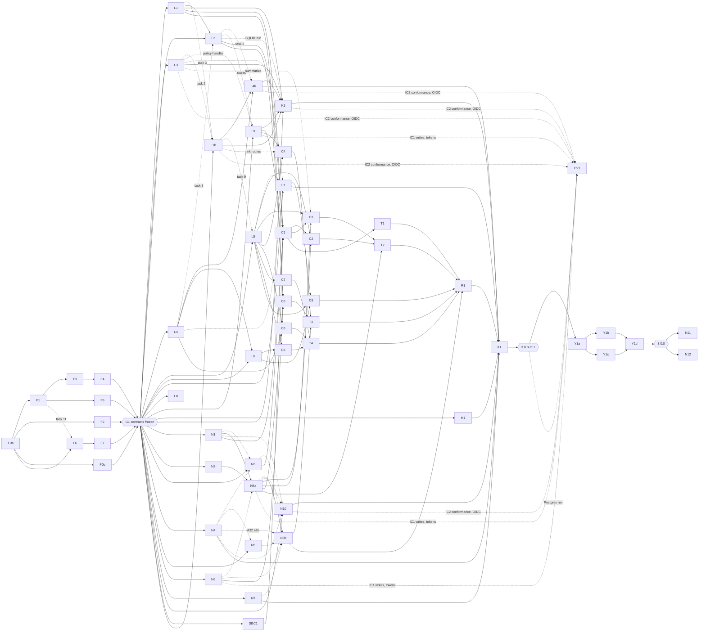

# SpinaJS 3.0 authorization and authentication: execution plan

Date: 2026-10-01 (revision r2 the same day; revisions r3, r4 and r6
2026-10-02). Plan only; no source file was edited.

- **Design:** `2026-10-01-authz-v3-design.md` (cited as *design §n*).
  Behaviour rules B01–B46 are design §17; authentication rules A01–A32 are
  design §22.17; the security review findings SR-01–SR-20 are design §23.
- **How to use:** a foundation track runs first, in series. When gate G1
  ("contracts frozen") passes, lanes run in parallel. A lane section plus
  the design doc is enough for one agent to execute that lane. §0a says
  where to start.

## Changes in this revision (r6, as built after F3–F7)

F3 (engine), F5 (authz test kit), F6 (authn contracts), F7 and F7b (authn
test kit, rules A01–A32, C8 tickets) are built. Their reports and the
lane notes in `.authz-sdd/` are authoritative over this plan. The task
lists below stay as planned; this section and the lane edits it names record
what changed. The design (r6) holds the decisions behind them.

1. **Rule assignments F7 asked for.**
   - A20 (core part) goes to N1 (task 9).
   - A05, A08 and A15 go to N8a (task 8).
   - A08 (lifecycle part) goes to C1 (acceptance).
   - A13 (local part) goes to N3 (task 8).
2. **Fixture parts no lane named (F5).** Each part below now sits in the lane
   that owns the behaviour. A lane runs it from its own package tests.

   | Part | Lane | Why |
   |---|---|---|
   | B02.core, B22.core, B26.core | F3 | The engine builds the check, `filterNow` and `covers`; F3 ran all three green. |
   | B05.rbac | L1 | Boot rule 8 (a grant's relation needs a resolver) fires when the RBAC model compiles its grants. |
   | B06.rbac | L1 | The type-level `native:rbac.assignment` residual is L1 task 10. |
   | B02.rules, B05.rules, B06.rules | L1b | Rules, their boot rules 9 and 10 and the type-level rule residual are L1b tasks 6 and 8. |
   | B05.ladders | L1b | Boot rule 9 for ladders is L1b task 1. |
   | B12.implies | L1b | Implied roles are L1b task 3. |
   | B02.abac, B05.abac, B14.abac, B26.abac | L3 | Policies name permissions (task 4, 6), carry `scope.*` conditions that rule 10 checks (task 2), expire (task 6) and count in `covers` through `summarize` (task 7). |
   | B05.orm | L4 | Rule 6 needs `@AccessResource` models with `relationScope: 'join'`; L4 proposes the case by RFC (D-F5-9). |
   | B05.sql | L4b | Rule 11 is L4b task 7. |
   | B02.http, B09.http | L5 | `@Access` and `@Unscoped(reason)` are L5 task 4. |
   | B39.store, B46.store, B46.cache | L9 | Scope attributes are written through `scope.setAttributes` and stored by `DbScopeAttributeStore` (task 5). |
   | B27.policyEvents | L9 | `policy.put` and `policy.delete` run through L9's ABAC handler (task 4). |
   | B12.http | C4 | The write cases go through `POST /authz/commands`. |
   | B16.fs | L7 | The part needs the RBAC model; L7 now depends on L1. |
   | B02.adapter (G1b) | L7 | Only the fs adapter declares `operations()` (its operation table, design §13); L7 proposes the case. |
3. **F3 hand-offs.** L4 gets the relation and SQL hand-offs (see its section).
   F4, L1, L1b, L3 and L5 read the "Hand-offs" of `F3-report.md` before
   they start (one `Authorizer` and one `DecisionCache` per domain, the
   model guide: a model throws or times out on missing data and never
   votes no, memoises a load's promise, keys its caches on everything its
   answer depends on). F3's acceptance now also runs B02, B22 and B26
   (core).
4. **F7 hand-offs.**
   - N2 and N4 compute "now" in Node (`ctx.now` or `Date`), never SQL `now()`.
   - N7 fixes the challenge signing input and the assertion `iss` format,
     accepts the kit's RFC 9421 label `sig1` with no `alg`, and takes the
     C8 tickets from `loadC8Fixtures()`.
   - N8a and N8b settle the 401 body (where `E_AUTH_FAILED` sits) and who
     enforces `users:credentials` on the A25 routes.
   - Other open points are in the "Known gaps for lanes" table of the
     `authn-testing` README (two `bearer` strategies, `pepper.previous`,
     the meaning of `impersonation.requireMfa`, the boot signal for a
     secret-storing MFA step, the JWT JIT switch, the OIDC JIT default, the
     A12 prefix list, route builders for B5 http paths). The owning lane
     decides each one.
5. **Open items from F5, with proposed owners** (the integrator confirms;
   none is decided here, except the token roles: r6, D3).
   - The `C2 → C2` rewrites (`users-controller`, `z-controller-refresh`)
     have no T lane. Proposed owner: T2, which already writes
     `users-http/test/v3` and depends on C2; the effort needs a re-check.
   - The 3.0 home of the token roles and profiles read routes
     (`GET /user/tokens/roles`, `/profiles`) is open. They answer from
     `authz.token.rolePolicy`, which authn-http cannot load. Proposed owner:
     C2 (users-http may depend on both families), reading C5's policy API
     (dotted edge C5 to C2).
   - (r6, D3) Decided by the human, no longer open: token roles against
     design §18.3(g). B24 and B07 hold: a role the owner lacks grants
     nothing. §18.3(g) follows them; the grant-subset check is not ported.
     C5 task 5 carries it.
   - Also open (F5): a last-privileged-holder check on `deactivateUser`
     (B26 covers `AuthzAdmin` commands only). Proposed owner: C2.

## Changes in this revision (2026-10-02 r4)

The human's answers H29–H36 (design §3.1) change the plan as follows:

1. **No `@spinajs/principal` (H29).** F0a creates no `principal` package
   and gives `packages/authn/package.json` a `./contracts` export. F1
   task 11 writes the principal types into
   `packages/authn/src/contracts/principal.ts`. Only `authz` lists
   `@spinajs/authn`, and its sources import only `@spinajs/authn/contracts`.
   `authn-http` drops `authz-http`: it writes `req.storage.AuthnPrincipal`,
   which L5's new `AuthnPrincipalSource` reads (N8a no longer waits for
   L5). C3 moves the authz-backed hooks (impersonation guard, `Access` in
   answers, role source) into `packages/users/src/authn/**`. The R1 grep
   gates check the new direction.
2. **argon2 library defaults (H30):** N3 task 1 pins them by test; no
   cost keys in config.
3. **Backoff, not lockout (H31):** N1 task 4 and N4 task 2 count attempts
   before verification, delay per account and per IP exponentially up to
   a cap, and reset on success; A05 and A06 are rewritten.
4. **A password change keeps API tokens (H32):** rule A30, in N3 and N8b.
5. **CORS: an empty list allows nothing (H33):** rule A31 in N8a; M1
   writes the guide step.
6. **No 2.x patch (H34):** S1a, S1b, 2.0.549, IC-2x and the advisories are
   gone. §3c now maps every SR finding to a 3.0 lane, task and named
   regression test, and adds lane **SEC1** (1.5–2 d, at G1) for SR-01 and
   SR-02 in `users` and `users-http`. Gate item 10 changes.
7. **Pending resets and invites carried over (H35):** N4 task 4
   (+0.5 d), an end-to-end test in N8b; rule A32.
8. **OIDC in 3.0 (H36):** lane N10 (6–8 d) moves from §7b into §3b. Under
   the cap of 14 it starts at ~15.5 and keeps about five days of slack
   before X1, so the critical path does not move; X1 waits for it. F0a
   adds its skeleton, F6 its contracts and the `ExternalLoginHook`. CV1
   gains an OIDC task (+0.5–1 d, canvas side).
9. **Re-estimate:** foundation **21–23.5 dev-days** (F6 +0.5, F7 +0.25;
   still **10 days elapsed**); 3.0 total **152–186.5 dev-days** (was
   142.75–174.75); critical path unchanged at **28.25–33.25 working
   days**; max parallelism **20 agents** unconstrained, **14** with the
   stagger in §10.

## Changes in revision r3 (2026-10-02)

The human's answers H21–H28 (design §3.1) change the plan as follows:

1. **Authentication split (H28).** Foundation gains **F6** (authn
   contracts, 2–2.5 d) and **F7** (authn test kit, 1.5–2 d); F1 gains the
   `@spinajs/principal` extraction (r4: no such package, H29), the
   `AuthzAdmin` contracts and `ScopeAttributeStore` (+0.5 d); F0a adds the
   new skeletons (+0.25 d);
   F0b moves the five `rbac*` packages to their final homes instead of the
   r2 interim names (+0.5 d). Contracts of both families freeze at G1.
2. **Nine authn lanes in wave 1:** N1 core, N2 sessions, N3 password, N4
   authn-orm, N5 TOTP, N6 tokens, N7 public keys, N8a HTTP glue, N8b
   strategy routes (34–42.5 d).
3. **Two 2.x security lanes, S1a (High findings) and S1b (Medium),** on
   `master` from day 0, released as 2.0.549 (5.5–7 d; not part of the 3.0
   total). (r4: dropped, H34; see §3c.)
4. **`AuthzAdmin` (H22):** new lane **L9** (4–5 d); C4 becomes the
   `authz-http-admin` routes on it; K1 and CV1 load and write data through
   it.
5. **RBAC rules to SQL (H23):** new lane **L4b** (5–6 d); L2 +1 d (SQL-form
   rule columns, `authz_rule_subject`, normalised tags); L4 −1 d (post-check
   task removed).
6. **K1 +1 d:** the two pinned cases (H21, H27), state loaded through
   `AuthzAdmin`, list conformance over SQL. **M1 +1 d:** converter writes
   `authn.*`; authn guide.
7. **Wave 2 reshaped:** C1 grows (identity contracts, code moved out); C2
   becomes `users-http`; C3 becomes "authn-http on authz"; C5 shrinks to
   the token ceiling on authz; T2 and T3 retarget.
8. **Later lanes (after 3.0):** N10 OIDC (6–8 d), N11 LDAP (5–6 d), N12
   SAML (6–8 d). (r4: N10 moved into 3.0, H36.)
9. **Re-estimate:** foundation 20.25–22.75 dev-days (**10 days elapsed**);
   3.0 total **142.75–174.75 dev-days** (was 93.5–113.5); critical path
   **28.25–33.25 working days** (was 26–30.5); max parallelism **18
   agents** unconstrained, **14** with the stagger in §10 (no change to the
   critical path).

## Changes in revision r2 (2026-10-01)

The human's answers H12–H20 (design §3.1) changed the plan as follows:

1. **Package renames (H12).** New foundation step **F0b** renames
   `rbac` → `users`, `rbac-http` → `users-http`, `rbac-http-user` →
   `users-http-account`, `rbac-http-admin` → `users-http-admin`,
   `rbac-http-token` → `users-http-token`, before any lane starts. F0a adds
   `authz-http-admin`; lane C4 moves the role routes and `RoleGuard` there.
   (r3: superseded by the final homes in F0b.)
2. **`users.Role` dropped in 3.0 (H13).** L2 writes the drop migration
   right after the copy; C1 (not R1) removes `User.Role`.
3. **`DbRoleStore` removed (H14).** The L2 cut line is gone (−1 d), as are
   `authz_role*` and namespaces.
4. **Canvas on RBAC + ABAC (H15).** New lane **L1b** (ranks, subject sets,
   tags, provenance, rules, links; 6–7 d) and new lane **K1** (canvas C6
   conformance, 62 cases, in the release gate; 3–4 d). Core work grows in
   F1, F3, F5; L2, L3, L4, L5 gain tasks. CV1 (canvas side) is rewritten:
   no canvas model, 7–10 dev-days, starts at IC2.
5. **H16, H17** need no work beyond tests (B20, permission grammar).
6. **H18:** C3 uses `AuthzService.covers` (F3) with ABAC `summarize` (L3).
7. **H19:** L5 refuses the explain route in production (B41).
8. **H20:** L7 (authz-fs) is in the release gate and on the graph to X1.
9. Re-estimate: foundation 15.5–16.5 dev-days (9 days elapsed), 3.0 total
   **93.5–113.5 dev-days** (was 77–95), critical path **26–30.5 working
   days** (was 24–29), max parallelism **11 agents** (was 10).

---

## 0. Summary

| Item | Value |
|---|---|
| Foundation (serial, F0a–F7) | 21–23.5 dev-days of work, **10 working days elapsed** with 4–5 agents |
| Wave 1 authz (L1, L1b, L2–L9, L4b, M1, K1) | 59–73 dev-days |
| Wave 1 authn (N1–N7, N8a, N8b, r4: N10) | 40.5–51 dev-days |
| Wave 1 security (r4: SEC1) | 1.5–2 dev-days |
| Wave 2 (C1–C9) + wave 2b (T1–T4) | 26–31.5 dev-days |
| Wave 3 (R1, X1) | 4–5.5 dev-days, 2 agents |
| **SpinaJS 3.0 total** | **152–186.5 dev-days** (no cut line; authz-fs, the authn 3.0 packages incl. OIDC, the canvas conformance lane and every design §23 fix included) |
| **Critical path** | F0a → F1 → F3 → F4 → L2 → C1 → C2 → T2 → R1 → X1 = **28.25–33.25 working days** to 3.0.0-rc.1 |
| **Max parallelism** | 20 agents unconstrained (days 10–11.75); **14** with the stagger of §10 |
| yourscreen-backend (Y1a–d, other repo) | 10.5–14.5 dev-days, 4 agents, ~8.5–11.5 days elapsed after RC; 3.0.0 final waits for it |
| canvas (CV1, other repo) | 8–12 dev-days; writes and agent tokens from IC1 (`3.0.0-alpha.1`), conformance and OIDC from IC2; Postgres conformance after RC |
| Later authn packages (N11 LDAP, N12 SAML) | 11–14 dev-days, independent lanes after 3.0.0 |

Where the +9.25–11.75 dev-days against r3 come from: N10 OIDC moved in
(+6–8), SEC1 (+1.5–2), F6 and F7 (+0.75: hand-off and hook contracts, OIDC
contracts, backoff config, new fixtures), N4 (+0.5: carried-over resets
and invites), M1 (+0.5: guide steps, OIDC docs). The 2.x lanes S1a and S1b
(5.5–7 d, outside the r3 total) are gone. The r3 breakdown against r2 is in
the r3 change list above.

## 0a. Ready to start (r4)

- **First step:** F0a (skeleton, 0.75 d), one agent, alone. Nothing else
  starts before it merges.
- **Branch and worktree:** `feat/authz-v3` off `origin/master`, in the
  worktree `C:\Users\grzch\SourceCodes\Spinajs\authz-v3`:
  `git fetch origin` then
  `git worktree add -b feat/authz-v3 C:\Users\grzch\SourceCodes\Spinajs\authz-v3 origin/master`.
  Every later step and lane branches from `feat/authz-v3` in its own
  worktree (rule §1.1), e.g. `C:\Users\grzch\SourceCodes\Spinajs\authz-v3-F1`
  on `authz/F1-contracts`.
- **Parallel foundation steps (from day ~0.75, when F0a merges):** F1 (the
  main line, then F3 → F4), F2, F0b and F6: four agents. F1 does task 11
  (principal contracts) first, about half a day in; F6 imports it. F7
  starts when F6 ends (~day 3.5), F5 when F1 ends (~day 4).
- **Gate G1 "contracts frozen":** about day 10 (9.75–10.25 working days,
  set by F0a → F1 → F3 → F4), when every G1 condition in §2 holds; tag
  `authz-v3-g1` and the `3.0.0-contracts.0` prereleases.
- **Lanes that start at G1 (cap of 14):** L1, L2, L3, L4, L5, L6, L8, L9,
  N1, N2, N3, N6, N7 and SEC1. Then L1b after L1 task 3 (~day 11.5); L7,
  M1, K1, N4 and N5 at ~14.5; N10 and L4b at ~15.5. Without the cap, L7,
  M1, K1, N4, N5 and N10 also start at G1 (20 agents).

---

## 1. Working rules for every agent

1. **Branches.** Integration branch `feat/authz-v3` off `origin/master`
   (worktree `C:\Users\grzch\SourceCodes\Spinajs\authz-v3`, §0a). Each lane
   works in its own git worktree on `authz/<lane-id>-<slug>` (e.g.
   `authz/L1-rbac-model`) branched from the current `feat/authz-v3`. Rebase
   on `feat/authz-v3` before asking to merge. The integrator merges in the
   order given per lane. Agents do not push unless the integrator asks.
2. **TDD loop per task:** write the test (red) → implement → run the package
   tests with output to a file
   (`npm run test --workspace=packages/<pkg> > $TMP/<lane>-test.txt 2>&1`,
   then read the file) → commit. One commit per task, conventional style as
   in this repo: `feat(authz-rbac): compile role definitions`.
3. **Contracts are frozen after G1.** A lane that needs a change to
   `packages/authz/src/contracts/**`,
   `packages/authz-*/src/contracts.ts`, `packages/authz-*/src/api.ts`,
   (r3) `packages/authn/src/contracts/**`, `packages/authn-*/src/contracts.ts`
   or `packages/authn-http/src/api.ts` writes `docs/plans/authz-v3-rfc/<lane>-<n>.md`
   (problem, change, affected lanes) and stops that task until the integrator
   approves and merges the change on `feat/authz-v3`. (r6, D3) The doc
   comments of the declarations in those files are part of the frozen
   contract: `scripts/api-snapshot.mjs` keeps them in
   `packages/*/etc/*.api.md`, so changing one needs an RFC like a signature
   change. This covers every declaration the snapshot holds, also those of
   files the entries import and of re-exported declarations; it does not
   cover a doc on the same line as the token before it, docs inside a
   constant's value, or a constant whose declared type drops them.
4. **Behaviour fixtures** live in `@spinajs/authz-testing` (F5). A lane runs
   the B-rules it owns from its own package tests:
   `runBehaviour(['B11', 'B12'], () => harness)`. A lane never edits
   `authz-testing`; a broken fixture is an RFC. Exception: K1 owns
   `packages/authz-testing/{test,fixtures}/canvas-c6/**`. (r3) Authn rules
   A01–A27 and (r4) A30–A32 live in `@spinajs/authn-testing` (F7) and are
   run the same way:
   `runAuthnBehaviour(['A02', 'A05'], () => harness)`.
   (G1b) A lane that runs fixtures through the host does not write its own
   host harness: it uses `hostHarness` from `@spinajs/authz-testing`, wiring
   its models and handles through the options `register` and `extend`
   (kit README, "Shared host harness").
5. **Old APIs are not deleted by consumer lanes.** Consumer lanes stop using
   them and mark them `@deprecated`; R1 deletes them after every consumer has
   merged. This keeps `feat/authz-v3` building after every merge. Exception
   (r2, H13): C1 removes `User.Role`, because L2's migration drops the
   column.
6. **Tests of old behaviour.** A consumer lane moves old test files that the
   ledger classes as *rewrite* into `test/legacy-v2/` (excluded in the
   package's `.mocharc`). The T lane for that package writes the replacements
   in `test/v3/` (or in the package that now owns the behaviour, under
   `test/ported/`) and deletes the `legacy-v2` file. Every old `it` has a line
   in `packages/<pkg>/test/LEDGER.md`.
7. **Never commit `package-lock.json`.** Lanes add dependencies to their own
   `package.json` only; the integrator runs `npm install` after each merge
   and commits the lock file.
8. **Done** = lane acceptance tests green, package suite green, `tsc -b
   tsconfig.build.json` green on the rebased branch, LEDGER lines updated.
9. **Package names (r3).** After F0b, only the final names exist in the
   tree (design §4.1.1): `users`, `users-http`, `authn-*`, `authz-*`. 2.x
   paths in design citations say `rbac*` and mean the same files before the
   move. Code that F0b moved into a package whose lane later moves it again
   (for example password code that F0b leaves in `users` and N3 moves to
   `authn-local`) is copied by the N lane and deleted by the C lane that owns
   the source package.
10. **Dependency direction (r3; r4, H29).** No lane adds an
    `@spinajs/authz*` or `@spinajs/users*` dependency to an `authn*`
    package (no exception any more), nor an `authn-*` or `users*`
    dependency to an `authz*` package. Only `packages/authz/package.json`
    lists `@spinajs/authn`, and `authz*` sources import only
    `@spinajs/authn/contracts` (design §4.2). R1's grep gates check it.
11. **Security findings (r4, H34).** No 2.x patch; no lane works on
    `master`. Each design §23 finding is fixed in the lane that owns its
    code, and each High and Medium finding has a regression test named
    `SR-xx …` in that lane that replays the 2.x attack (§3c). A lane is
    not done while one of its SR tests is red.

### Shared files and how they are serialized

| File | Owner | Rule |
|---|---|---|
| `package.json` (root), `tsconfig.build.json`, `tsconfig.build.cjs.json`, `scripts/publish-all.mjs`, `scripts/bump-all.mjs` | F0a, then F0b, then the integrator | F0a adds all new packages (incl. `fast-check` devDependency); F0b moves the five `rbac*` entries; L8 sends its removal of `orm-api` lines (`tsconfig.build.json:59`, `tsconfig.build.cjs.json:59`) as part of its merge; nobody else edits them |
| `package-lock.json` | integrator | rule 7 |
| `packages/authz*/src/index.ts`, (r3) `packages/authn*/src/index.ts`, (r4) `packages/authn/src/contracts/index.ts` barrels and the `exports` map of `packages/authn/package.json` (`.` and `./contracts`) | F0a | written once; re-export lane-owned sub-barrels (`model/index.ts`, `stores/index.ts`, `conditions/index.ts`, `admin/index.ts`, `flow/index.ts`, …) |
| (r4) `packages/authn/src/contracts/principal.ts`, `packages/authz/src/contracts/**`, `packages/authz-*/src/contracts.ts`, `packages/authz-orm/src/api.ts`, `packages/authz-http/src/api.ts` | F1 | frozen at G1; RFC only |
| (r3) `packages/authn/src/contracts/**` (r4: except `principal.ts`), `packages/authn-*/src/contracts.ts` (r4: incl. `authn-oidc`), `packages/authn-http/src/api.ts` | F6 | frozen at G1; RFC only |
| `packages/authz/src/conditions/**` (except the frozen `contracts.ts` there) | L3 | lane-owned folder inside the core package (D16) |
| (r3) `packages/authz/src/admin/**` (except contracts) | L9 | lane-owned folder inside the core package (D22) |
| `packages/authz-rbac/src/model/**` | L1, then L1b | L1b owns `model/{ladder,sets,rules,links}/**` and edits L1's `model/evaluate.ts` only after L1 task 3 merges |
| (r3) `packages/authz-rbac/src/orm/**` | L2 (assignment compiler base), then L4b (`orm/compile/**`) | L4b starts after L2 task 8 merges |
| (r3) `packages/authz-rbac/src/admin/**`, `packages/authz-abac/src/admin/**` | L9 | write handlers |
| `packages/http-socket/src/interfaces.ts` | L5, then C9 | C9 starts after L5 merges |
| (r3) `packages/http/src/middlewares/{RealIp,Cors,Throttle}.ts`, `packages/http/src/config/http.ts` | N8a | (r4) no 2.x lane any more |
| (r4) `packages/users/src/models/User.ts` (reserved key list), `assertNoProtectedMetadata` in `packages/users/src/actions.ts`, `packages/users-http/src/{services/UserMetadataService.ts,controllers/UserMetadataController.ts}` | SEC1, then C1 (users) and C2 (users-http) | C1 and C2 start after SEC1 merges and keep its tests |
| (r4) `packages/users/src/authn/**` | C3 | carved out of C1's `packages/users/src/**`; C1 adds the one export line for it |
| (r3) `packages/authn-http/src/**` | N8a, then N8b | N8b owns `src/{password,mfa,token,keys,admin}/**`; N8a owns everything else |
| `packages/users/src/index.ts`, `packages/users/package.json` | C1, then R1 | R1 after C1 |
| `packages/users-http/src/index.ts` | C2, then R1 | R1 after C2 |
| `RELEASE_NOTES.md`, package versions | X1 | — |
| `docs/authz/**`, (r3) `docs/authn/**` | M1, then X1 | X1 after M1 |

---

## 2. Foundation track (serial)

Agents: one on F0a → F1 → F3 → F4 (the main line); from the end of F0a one
on F2 (DI), one on F0b (moves) and one on F6 (authn contracts) in parallel
with F1; one on F5 from the end of F1 and one on F7 from the end of F6.
F0a first, alone (§0a).

### F0a — skeleton (0.75 d)

- **Owns:** root files in the table above; new package skeletons
  `packages/{authz,authz-testing,authz-rbac,authz-abac,authz-orm,authz-http,authz-http-admin,authz-queue,authz-fs,authz-convert}/`
  and (r3) `packages/{authn,authn-testing,authn-orm,authn-session,authn-local,authn-totp,authn-token,authn-keys,authn-http}/`,
  (r4) `packages/authn-oidc/`; no `packages/principal/` (H29)
  (`package.json` 3.0.0-alpha.0 with runtime deps from design §4.1,
  `tsconfig.{json,mjs.json,cjs.json}`, `.mocharc.json`, `.eslintrc.cjs`,
  `src/index.ts` barrels, empty `test/`). (`users`, `users-http` and
  `authn-http`'s moved code come from F0b; F0a creates `authn-http` empty and
  F0b fills it.)
- **Tasks:** (1) create `feat/authz-v3` from `origin/master` in the
  worktree of §0a; (2) copy the package skeleton of `packages/rbac`
  (configs only) twenty times; (3) add references to both build tsconfigs
  and to the publish/bump scripts; (4) add `fast-check` to root
  devDependencies; (5) (r4) give `packages/authn/package.json` a second
  export `"./contracts"` (`types`, `import`, `require` from
  `lib/{mjs,cjs}/contracts/index.*`) and a `src/contracts/index.ts`
  barrel that re-exports only files inside `src/contracts/`
  (`principal.ts` from F1, the rest from F6);
  `packages/authz/package.json` lists `@spinajs/authn`; (6) `tsc -b tsconfig.build.json` green; commit
  `chore(authz): add authz and authn package skeletons`.
- **Output:** empty packages that build.

### F0b — package moves (2–2.5 d, r3; parallel with F1, F2 and F6)

- **Owns:** `packages/{rbac,rbac-http,rbac-http-user,rbac-http-admin,rbac-http-token}/**`
  (moved), the import lines that name them in every other package
  (`configuration-http`, `orm-api`, `session-provider-{db,redis,dynamodb}`,
  tests), their entries in the root files above, mentions in `README.md`.
- **Depends on:** F0a.
- **Tasks (mechanical; no behaviour change; `git mv` keeps history):**
  1. Whole-package moves: `rbac` → `users`; `rbac-http` → `authn-http`
     (into the F0a skeleton); `rbac-http-token` → `authn-token`.
  2. Split moves by file, per design §4.1.1: `rbac-http-user/src/{controllers/{Login,PasswordReset,Sessions,TwoFactorAuth,TwoFactorAuthUser,ActiveRole,Impersonation}Controller.ts,services/{ImpersonationService,SessionCookies,grants}.ts,handlers/**,logout.ts,policies/**,dto/**,events/**}`
     → `authn-http/src/account/**`; `rbac-http-user/src/{2fa/**,actions/2fa.ts,cli/**}` →
     `authn-totp/src/**`; `rbac-http-user/src/{controllers/{User,UserMetadata}Controller.ts,services/UserMetadataService.ts,models/FilterableUserMetadata.ts}`
     → `users-http/src/**`; `rbac-http-admin/src/controllers/Users/{Users,Profile,Security}.ts`,
     `interfaces.ts`, `config/**` → `users-http/src/admin/**`;
     `rbac-http-admin/src/{controllers/Users/Roles.ts,services/RoleGuard.ts}` →
     `authz-http-admin/src/legacy/**`; `rbac-http-token/src/controllers/**`
     → `authn-http/src/token/**`. Merge the config files and
     `package.json` dependency lists of split packages.
  3. Rewrite imports (`from '@spinajs/rbac'` 221 sites, `rbac-http` 60,
     `rbac-http-user` 2 at the time of writing; recount with `rg`). Interim
     dependencies that break the design §4.2 direction (`authn-http` →
     `users`, `authn-token` → `users`) are allowed until R1 and listed in
     `docs/plans/authz-v3-rfc/F0b-interim-deps.md`. (r4) The moved
     `services/grants.ts`, impersonation rule and role-list code stay
     parked in `authn-http/src/account/**`; C3 moves them to `users`.
  4. Config keys: identity keys `rbac.user|email|actions` → `users.*`
     (H24); authentication keys → `authn.*` by design §22.5's table;
     authorization keys (`rbac.grants`, `rbac.roles`, `rbac.defaultRole`, …)
     stay until their C lanes.
  5. Keep table names and migration class names (design §4.1.1).
  6. Full test run of every moved package and their dependents (output to
     a file); `tsc -b` green; commit `refactor(users)!: move rbac packages
     to users, authn and authz homes`.
- **Acceptance:** every suite that passed before passes; `rg
  "@spinajs/rbac" packages` returns nothing; the interim-deps list matches
  `package.json` files.

### F1 — contracts (3–3.5 d)

- **Owns:** (r4) `packages/authn/src/contracts/principal.ts`, `packages/authz/src/contracts/**`, `packages/authz/src/conditions/contracts.ts`,
  `packages/authz-rbac/src/contracts.ts`,
  `packages/authz-abac/src/contracts.ts`, `packages/authz-orm/src/api.ts`,
  `packages/authz-http/src/api.ts`, `packages/authz-queue/src/api.ts`,
  `packages/authz-fs/src/api.ts`, `packages/authz/test/contracts/**`.
- **Tasks (each: test → implement → verify → commit):**
  1. Principals and resources (design §5.1): types, `GLOBAL`, `SYSTEM`,
     `UNATTENDED`, `principalKey`, `resourceKey` (escaping of `:` and `/`);
     (r2) `delegation`, `companions`, `Ceiling.reason`.
  2. Permission grammar and `PermissionDef` (§5.2): parser with the regex,
     glob matcher for permission globs; tests for `user.metadata:read`,
     `ArrowCampaign:read` (case kept, H17), invalid names.
  3. `ResourceFilter` AST, constructors, `simplify`, `bindRefs` (§5.3), (r2)
     `cmp: 'wildcard'`, `scope.*` refs; tests: constant folding, flattening,
     double negation, idempotence; fast-check property "simplify preserves
     truth table" over 6 boolean atoms.
  4. Field-glob matcher (`*`, `!X`, `A.*`, arrays) replacing `notation`; union
     and subtraction; `filterObject(fields, data)`.
  5. Votes, decisions, trace, errors (§5.4, §5.7 errors); (r2) `actor`,
     `DenyReason.priority/sortKey`, `Vote.denies`, `Vote.roles`,
     `Decision.roles`, the default priority table.
  6. Abstract classes: `AuthorizationModel`, `ModelCapabilities`,
     `ModelInitContext`, `EvaluationContext` (+ `attributes`, `conditions`),
     `Combinator`, `ResourceAdapter` (+ `scopeAttributes`), `ScopeResolver`
     (+ `attributes`), `RelationResolver`, `NativeFilter`,
     `PermissionRegistry`, `DecisionCache`, `ChangeBus`, `DecisionAudit`,
     `AccessSummary`, `ModelSummary`, `AuthzService.covers` (§5.5–§5.7).
  7. (r2) Core conditions (§5.9): `Condition`, `ConditionFunction`,
     `ConditionCompiler` in `conditions/contracts.ts`.
  8. Model-package contracts (§5.8): RBAC (`GrantDef` with `requiresTag`,
     `grantedAt`; `LadderDef`, `ImpliedRole`, `RoleDef` without namespace,
     `AssignmentSubject`, `Assignment` with tags, `SubjectSelector`,
     `RuleDef`, `LinkDef`, `RoleStore`, `RuleStore`, `AssignmentStore`,
     `LinkStore`, `SubjectResolver`), ABAC (`Policy` with `actorTypes`,
     `priority`; `PolicyStore`), ReBAC (`Tuple`, `TupleStore`, in
     `authz-testing` only).
  9. Adapter API stubs with final signatures that throw `not implemented`:
     authz-orm (§12.1 incl. `registerAccessResource`, `ownsBy`,
     `OrmNativeCompiler`, `attributes` option), authz-http (§11.1–§11.2:
     `PrincipalSource`, `LinkPrincipalSource`, `Access`, `AccessOptions`,
     extractors, `AllowAnonymous`, `Unscoped`, `CurrentPrincipal`,
     `ACCESS_DESCRIPTOR`), authz-queue (`QueueMessageHook` shape mirrored,
     `JobOptions`), authz-fs (`FsDecorator` mirror, `FileMetadataStore`,
     `FsPathResolver`, `fromFsPath`).
  10. `api-extractor`-style snapshot: `packages/authz*/etc/*.api.md` generated
      from `tsc --declaration` output and committed; (r6, D3) it keeps doc
      comments; CI fails when it changes without an RFC file.
  11. (r3, D20; r4, H29; done first, about half a day, because F6 imports
      it) Principal contracts in `packages/authn/src/contracts/principal.ts`:
      `PrincipalType`, `PrincipalRef`, `Principal` with `AuthnFacts`,
      `Ceiling`, `SYSTEM`, `UNATTENDED`, `principalKey`, `ceilingHash`
      (task 1 keeps the resource half); `@spinajs/authz` lists
      `@spinajs/authn` and re-exports them from `@spinajs/authn/contracts`;
      a test loads `@spinajs/authn/contracts` as mjs and cjs and checks that
      it imports nothing outside `src/contracts/` except `@spinajs/di` and
      registers nothing in DI.
  12. (r3, H22) `AuthzAdmin` contracts (design §6.6.1): `AuthzCommand`,
      results, errors, options, `AuthzAdmin`, `AuthzWriteHandler`,
      `AdminGuard`, `AuthzCommandValidator`, `AuthzEvent`, `AuthzEventSink`,
      `AuthzTx`, `AdminContext`, `AuthzAdminQuery`; `DecisionAudit` kind
      `admin`; store write methods take `AuthzTx`.
  13. (r3, D23) `ScopeAttributeSchema`, `ScopeAttributeStore`; RBAC native
      op `native:rbac.threshold` in the registry of FilterOps.
- **Output:** every exported name and signature in design §5, §6.6.1,
  §11.2, §12.1, §14.2 compiles.

### F2 — DI changes (2–2.5 d, parallel with F1)

- **Owns:** `packages/di/src/{container.ts,registry.ts,container-cache.ts,interfaces.ts,root.ts}`,
  `packages/di/test/child-chain.test.ts`, `packages/di/test/owner-singleton.test.ts`.
- **Tasks:**
  1. Test (red): the experiment cases of design §15.1 F2, F4, F5 as mocha
     tests (child adds a type ⇒ list hides parent; child-first singleton ⇒
     two instances; child stops seeing later root registrations).
  2. DI-1: `Registry.getTypesChain(service)` and
     `IContainer.getRegisteredTypesChain`, `IContainer.resolveChain<T>(type: Class<T>): T[] | Promise<T[]>`
     (own → parents; a child type with the same class name replaces the
     parent's; each type resolved in its owner container); `DI.resolveChain`
     in `root.ts`. Tests: merge, override by name, async services, empty
     chain.
  3. DI-2: in `resolveType`, find the container that owns the registration
     (walk `Parent` with `getTypes(name, false)`); for `Singleton`,
     `PerInstance`, `PerInstanceCheck` delegate creation and caching to that
     container; stop `Registry.register(sName, t)` (`container.ts:398`) in a
     non-owner container. `PerChildContainer`, `NewInstance`, factories
     unchanged. Turn the red tests from task 1 green (except "child list
     hides parent", which stays the documented behaviour of `Array.ofType`).
  4. Run the full `packages/di` suite (`di.test.ts` has the existing child
     tests at `:387-395`, `:705-790`, `:984-1201`) and `packages/orm` suite
     (only in-repo `child()` user, `orm/src/driver.ts:119`).
  5. Commit `feat(di): resolveChain merges registrations across child containers`
     and `fix(di): singletons are created in the container that owns their registration`.
- **Acceptance:** B29 (DI part) in `packages/di/test/child-chain.test.ts`.

### F3 — engine (3.5 d)

- **Owns:** `packages/authz/src/engine/**`, `packages/authz/test/engine/**`.
- **Tasks:**
  1. `PermissionRegistryImpl` (register, require, match, impliedBy, types).
  2. Route compiler: `(permission, type) → RoutePlan` from models'
     `applies()` and a combine config object (no DI yet).
  3. Combinators: deny-overrides, permit-overrides, first-applicable as pure
     functions over `Vote[]` (design §7); properties: order independence
     (B03), indeterminate handling (B04), `first-applicable` with all-FALSE
     votes = FALSE.
  4. `Authorizer` (pure class, constructor-injected models, adapters,
     relations, native filters, scope resolvers, registry, caches, clock,
     audit): `check`, `filter`, `filterNow`, `explain`, `checkMany`,
     `summary` (combines `ModelSummary`), `covers` (r2, H18: strict subset of
     combined summaries; unconditional covers conditional), per-model
     timeout.
  5. (r2) Reason selection: collect `Vote.denies`, model reasons and core
     denials, report the lowest `(priority, sortKey)`; deny-overrides
     evaluates every routed model (D17, B36 core part).
  6. Residual evaluation against a subject (`cmp` via adapter `attribute`,
     `relation` via resolver, `under` via ancestors, `native` via
     `NativeFilter`) (B06 in-memory part).
  7. SYSTEM, UNATTENDED, ceiling with `reason`, `onBehalfOf` with
     `intersect` and (r2) `inherit` delegation, `actor` on the request
     (B07, B08, B09 core part, B37 core part).
  8. (r2) `EvaluationContext.attributes` over adapters and scope resolvers,
     memoised per request; missing attribute ⇒ indeterminate (B39 core
     part).
  9. Fields combination, `neverRead` (B17 core part).
  10. L1 (request map passed in), L2 LRU with tags and TTL from `validUntil`
      (B14 cache part); `invalidate(tags)`.
  11. Boot validator: the ten rules of design §6.5 (B05).
- **Acceptance:** B01, B02 (core), B03, B04, B05, B06 (in-memory), B07, B08,
  B09 (core), B14 (cache), B17 (core), B22 (core), B26 (core), B36 (core),
  B37 (core), B39 (core) — run against
  fake models from F5 (F3 and F5 meet at the end; until then F3 uses local
  fakes).

### F4 — host (2.5 d)

- **Owns:** `packages/authz/src/host/**` (G1b: the config schema and loader moved from
  `src/config/` to `src/host/config/`; configuration loads `lib/*/config/**` as config files),
  `packages/authz/test/host/**`.
- **Tasks:**
  1. ALS storage contract `IAuthzAsyncStorage { Principal, AuthzCache, AuthzDecision, Unscoped }`
     over the DI-singleton `AsyncLocalStorage` (same instance as
     `http/src/route-builder.ts:246-250`, `log/src/context.ts:20-30`);
     `current()`, `runAs(principal, reason, fn)` with audit.
  2. `AuthzService` (`@PerChildInstance()`, injects `Container`, collects
     models/adapters/scope resolvers/relations/native filters/combinators
     with `resolveChain`, builds an `Authorizer`, runs `init()` of models and
     the boot validator in `resolve()`); `authz(domain?)`.
  3. `AuthzDomains`: `create`, `container`, `service`, `names`; (G1b) no fan-out:
     each domain subscribes to the `ChangeBus` its container resolves and
     `AuthzDomains` forwards nothing (design §10.3); disposal (B29).
  4. Config: AJV schema for `authz.*` core keys (design §8.1) registered
     like other packages; per-domain overrides; old-key detector for every
     `rbac.*` key (design §8.1) failing boot with the converter's name.
     (r2) The detector ships switched off (`authz.config.rejectLegacyKeys:
     false`) because the repo's own packages still carry `rbac.*` keys until
     their C lanes; R1 turns it on.
  5. `InProcessChangeBus`, `LogDecisionAudit`, default `DecisionCache`;
     (r2) `isProduction()` helper (configuration `env`, else `NODE_ENV`) for
     H19.
  6. Test: two domains, child adds a model, parent unaffected; fake model in
     a test domain disposed after the test.
- **Acceptance:** B09 (runAs/audit), B27 (in-process bus), B29.

### F5 — test kit, fixtures, ledger (3 d, from the end of F1)

- **Owns:** `packages/authz-testing/**` (except K1's `canvas-c6` folders),
  `packages/*/test/LEDGER.md` (creation only; after F0b, under the new
  package names).
- **Tasks:**
  1. Fakes: `StaticModel` (scripted votes, with `denies` and priorities),
     `FakeRbacModel` (tiny role map), `FakeTupleModel` (in-memory tuples with
     union/arrow rewrites, emits `native:fake.tuple`), `FakeAdapter`
     (in-memory rows with ancestors and relations), (r2)
     `FakeScopeResolver` (tree + attributes), `FakePrincipalSource` mirror.
  2. Model conformance suite `runModelConformance(factory)`: capability
     honesty (never emits an undeclared op; `sync` claims hold), residual vs
     subject agreement on random rows, `invalidate` effect, determinism,
     (r2) reason determinism under shuffled model order.
  3. Adapter conformance `runAdapterConformance(factory)`: `refOf`/`ancestors`
     consistency, `compiles` honesty, B06 check ⇔ filter property hook.
  4. Behaviour fixtures B01–B46 (r3) as parameterised suites
     `behaviour/Bxx-*.spec.ts`, each with a `Harness` interface (what it needs:
     an `AuthzService`, a way to seed roles/rules/links/policies/rows and
     scope attributes, an HTTP client when relevant). Exported
     `runBehaviour(ids, harnessFactory)`. B40 is a stub that K1 fills.
  5. fast-check arbitraries: principals, ceilings, filters, votes, role
     graphs, (r2) ladders, caps, restrictions.
  6. Bench harness (`bench/`): baseline numbers recorded from 2.0.546
     (`probeGrant` warm, ORM select with `RbacModelPermissionMiddleware`) in
     `bench/BASELINE.md`.
  7. Ledgers: one `LEDGER.md` per package listing every old `it` title with
     class move/adapt/rewrite/drop (v3 plan §10.2 counts: 157/289/311/15
     plus configuration-http 37, http-swagger 7) and the target lane.

### F6 — authn contracts (2.5–3 d, r3; r4 +0.5; parallel with F1)

- **Owns:** `packages/authn/src/contracts/**` (except F1's `principal.ts`),
  `packages/authn-*/src/contracts.ts` (r4: incl. `authn-oidc`),
  `packages/authn-http/src/api.ts`, `packages/authn/test/contracts/**`,
  `packages/authn/etc/*.api.md`.
- **Depends on:** F0a; F1 task 11 (`contracts/principal.ts`) for the
  `Principal` import (F6 starts on the rest and adds the import when task
  11 merges, about half a day in).
- **Inputs:** design §5.1 (`AuthnFacts`), §22.3, §22.5, §22.11, (r4) §22.13,
  §22.15, §22.17.
- **Tasks (each: test → implement → verify → commit):**
  1. `Credentials`, `AuthnContext`, `IdentityRef`, `ExternalSubject`,
     `AuthenticationResult`, `AuthnFailure`, `StrategyOutcome`.
  2. `AuthenticationStrategy`, `AuthnService` (abstract, signatures only),
     `PrincipalFactory`.
  3. Identity side: `IdentityStatus`, `IdentityStore`,
     `PasswordCredentialStore`; linking: `IdentityLink`, `IdentityLinkStore`.
  4. Sessions: `SessionHandle`, `SessionIssuer`; the moved `SessionProvider`
     and `ISession` contract (signatures from `rbac/src/interfaces.ts`, plus
     `deleteBySubject(… includeImpersonations)`).
  5. MFA: `MfaStep`, `MfaPolicy`; secrets: `SecretStore`; throttle (r4):
     `ThrottleKey`, `ThrottleFlow`, `AuthnThrottle.attempt/succeed`; audit:
     `AuthnEvent`, `AuthnEventType`, `AuthnEventSink`; `ImpersonationGuard`.
  6. Service contracts authn-http calls: `PasswordService`, `TokenService`,
     `KeyRegistry` with full method signatures (design §22.7, §22.9,
     §22.10), `JwsVerifier`, `JwsSigner`, `CredentialExtractor`.
  7. authn-http API stubs that throw `not implemented`: policies
     (`Authenticated`, `FreshAuth`, `MfaSatisfied`, `NoSession`,
     `NotLoggedPolicy`, `NoTokenAuthPolicy`, `NoImpersonationPolicy`),
     route args (`@Identity`, `@AuthnSession`, `@SessionId`,
     `@FromSession`), `CsrfOriginGuard`, `ClientIp`, (r4) the key, token
     and session principal resolvers and the `AuthnMiddleware` stub that
     writes `req.storage.AuthnPrincipal`.
  8. Config schema skeleton for `authn.*` (AJV, design §22.5, r4: with the
     backoff keys and `authn.oidc.providers`) and the old-key table for the
     detector (shipped off, like authz's).
  9. API snapshot for `authn*` packages, with doc comments (r6, D3); CI rule
     as F1 task 10.
  10. (r4, D26) Hand-off and hooks: `IAuthnPrincipalStorage`,
      `AuthnResponseExtension`, `RoleSource`, `ExternalLoginHook`; OIDC
      contracts in `authn-oidc/src/contracts.ts` (`OidcProviderConfig`,
      `OidcPreset`, claims mapping).
- **Output:** every exported name and signature in design §22.3 and §22.11
  compiles.

### F7 — authn test kit (1.75–2.25 d, r3; r4 +0.25; from the end of F6)

- **Owns:** `packages/authn-testing/**`.
- **Tasks:**
  1. Fakes: `FakeIdentityStore` (users with status flags),
     `MemoryPasswordCredentialStore`, `MemorySecretStore`, `FakeClock`,
     `FakeMfaStep` (scripted codes), `FakeStrategy`, `MemorySessionIssuer`,
     `MemoryLinkStore`, in-memory event sink that records events.
  2. Strategy conformance suite `runStrategyConformance(factory)`: timing
     equality for unknown accounts (A02), no session or event side effects
     from `verify`, declared kinds honoured, throttle keys stable.
  3. Behaviour fixtures A01–A27 and (r4) A30–A32 as parameterised suites
     `behaviour/Axx-*.spec.ts` with a `Harness` (an `AuthnService`, a way to
     seed identities, credentials, tokens, keys, and an HTTP client when
     relevant); exported `runAuthnBehaviour(ids, harnessFactory)`.
  4. Vendor the canvas C8 golden tickets (`fixtures/c8/`, with the canvas
     commit in `SOURCE.md`; checksum test) for N7.
  5. Timing helper (p50 comparison over N runs, tolerant on CI) and a
     concurrency helper (N parallel attempts) for A02 and A05; (r4) a
     backoff checker that drives `FakeClock` through the expected delay
     sequence for given parameters (A06).
  6. (r4) 2.x-shaped `users_metadata` fixtures for A32: a live reset, a
     live invite (token plus `user:invite:pending`), an expired reset and
     a reset without a start date.

### Gate G1 — contracts frozen

All must hold on `feat/authz-v3`:

1. F0a–F7 merged; `tsc -b` green; all `authz*` packages export the design
   §5 and §6.6.1 names, (r4) `@spinajs/authn/contracts` the §5.1 and §22.3
   names and loads no service module, all `authn*` packages the §22.3 and
   §22.11 names; API snapshots (r6, D3: with doc comments) committed.
2. F0b merged: no `rbac*` package left; every suite that passed on
   `master` passes.
3. Engine tests green with fake models; B01, B03–B09, B14, B17, B36, B37,
   B39 core parts green.
4. `FakeTupleModel` passes the model conformance suite (the contract admits
   ReBAC); (r3) `FakeStrategy` passes the strategy conformance suite.
5. DI-1 and DI-2 merged with their tests; full `di` and `orm` suites green.
6. Every lane owner (or the integrator for them) has read its lane section
   and confirmed its inputs exist.
7. Tag `authz-v3-g1` and prereleases `3.0.0-contracts.0` of
   `@spinajs/authz`, `@spinajs/authz-testing`, (r3) `@spinajs/authn` (r4:
   with its `contracts` entry) and `@spinajs/authn-testing` for canvas.

After G1 the rule in §1.3 applies.

---

## 3. Wave 1 lanes (start at G1)

### L1 — authz-rbac model, base (5–6 d)

- **Owns:** `packages/authz-rbac/src/model/**` (except L1b's sub-folders),
  `packages/authz-rbac/test/model/**`,
  `packages/authz-rbac/test/behaviour.model.test.ts`.
- **Depends on:** G1. **Inputs:** design §5, §5.8 RBAC, §6.1.1–§6.1.5, §6.5,
  §7, §8.2.
- **Outputs:** `RbacModel` (name `rbac`), `RbacService` (`covers`,
  `rolesOf`, `grantsOf`; r3: writes are L9's `AuthzAdmin` handlers),
  in-memory `NativeFilter` for `native:rbac.assignment`,
  `RbacModel.summarize`, the evaluation pipeline that L1b extends.
- **Tasks:**
  1. Compile roles: `extends` DAG, cycles, unknown roles, `assignable`,
     `scopeTypes` (B12). Commit `feat(authz-rbac): compile role definitions`.
  2. Expand grant permission globs against the registry and `implies`;
     unknown permission ⇒ `UnknownPermission` (B02).
  3. `evaluate` with GLOBAL assignments only: union, `no_access` (B01, B11);
     pipeline with named steps 1–9 of design §6.1.2 as hooks (L1b fills
     2–4 and 6–8). **L1b starts when this task merges.**
  4. Scoped assignments via `ctx.ancestors` (B13).
  5. Expiry and `validUntil` (B14).
  6. Relation residuals, OR of several (B15).
  7. Resource patterns with `{principal.*}` templates → `under` / `cmp glob` (B16).
  8. Field sets (B17, RBAC part).
  9. `ceiling.roles` filter (B07, RBAC part).
  10. Type-level request: `native:rbac.assignment` residual + in-memory
      `NativeFilter` (B06 with `FakeAdapter`).
  11. `preload` over the principal and its companions with per-subject cache
      (tags `subject:<t>:<id>`), `sync: 'after-preload'` honoured (B22),
      `invalidate`.
  12. `covers`, `rolesOf`, `grantsOf`, `summarize`.
  13. `runModelConformance(() => new RbacModel(...))` and
      `runBehaviour(['B01','B02','B05','B06','B07','B11','B12','B13','B14','B15','B16','B17','B22'], rbacHarness)`
      with an in-memory `AssignmentStore` test double. (r6) Parts B05.rbac
      (boot rule 8) and B06.rbac (task 10) are new in the list.
- **Acceptance:** the suites in task 13 green.
- **Merge order:** task 3 merges early (it unblocks L1b); the lane merges
  before L2.

### L1b — authz-rbac ranks, subject sets, rules and links (6–7 d, r2)

- **Owns:** `packages/authz-rbac/src/model/{ladder,sets,rules,links}/**`,
  `packages/authz-rbac/src/stores/config-rule-store.ts`,
  `packages/authz-rbac/test/{ladder,sets,rules,links}/**`; edits L1's
  `model/evaluate.ts` hook points only.
- **Depends on:** L1 task 3 (pipeline); L3 task 2 for `when` and `resource`
  conditions (dotted; until then rules take constant conditions only).
- **Inputs:** design §5.8, §5.9, §6.1.2, §6.1.3, §6.1.6, §7, §8.5, §16.3.
- **Tasks:**
  1. Ladders: rank tables, implicit extends to the lower role (grants and
     `implies`), `needed[(permission, ladder)]`, ladder `resourceTypes`; boot
     rules §6.5.9 (B31, B05 part).
  2. Aggregation: effective rank per ladder after steps 2–3, `Vote.roles`,
     `role_too_low{ladder, role, needed}` (B31).
  3. Implied roles with tags and `bypass` marks (B32).
  4. Subject sets: `RbacSubjectResolver` (self, companions, sets from live
     `subjectSet` roles, ladder-aware), `group` principal via
     `authz.rbac.groupPrincipal`; preload in one query (B33).
  5. Tags and `requiresTag`; provenance `grantedAt` and the provenance rank
     (B34).
  6. Rules: `ConfigRuleStore` with AJV schema; `SubjectSelector` incl. rank
     predicates; `restrict`; `cap` (ref values, `stripTags`, `null` drops);
     `threshold` (deciding rank, `ladder`/`at`, `resourceTypes`, `resource`
     patterns with `wildcard`, `when`) (B35).
  7. Reason entries in `Vote.denies` with priorities and sort keys (B36 RBAC
     part).
  8. Type-level requests on types with rules: `needsSubject` for the rule
     part (B06 with rules).
  9. Links: `RbacService.linkPrincipal(id, companion?)` over `LinkStore`;
     `MemoryLinkStore` test double (B38 model part); (r3) an invalid link
     with an org-admin companion denies `link_invalid` (B42).
  10. Properties: adding a `cap` or `restrict` never widens; ladder max =
      union of the grants of the held roles; reason independent of rule
      order.
  11. `runModelConformance` + `runBehaviour(['B02','B05','B06','B12','B31','B32','B33','B34','B35','B36','B38','B42','B46'], rbacHarness)`
      (r6: parts B02.rules, B05.ladders, B05.rules, B06.rules, B12.implies);
      (r3) the `external-sharing-off` cap of design §8.5 as a fixture (B46).
- **Acceptance:** task 11 green; the K1 in-memory run (when K1 is ready)
  green.
- **Merge order:** after L1; before K1's final run, before L4b's final
  run and before C4's link routes.

### L2 — authz-rbac stores, migrations, CLI (5.5–6.5 d)

- **Owns:** `packages/authz-rbac/src/{stores,migrations,cli,orm,events}/**`
  (except `stores/config-rule-store.ts` and L4b's `orm/compile/**`),
  `packages/authz-rbac/test/{stores,migrations,cli}/**`.
- **Depends on:** G1; L4 for task 8 only (the `OrmNativeCompiler` base
  class is a frozen stub, so code compiles before L4 merges; its SQLite
  test lands once L4 merges); L1 for task 10; (r3) L9 task 2 for task 9
  (the CLI calls `AuthzAdmin`; dotted).
- **Inputs:** design §5.8, §6.1.3, §6.1.6, §6.6.3, §8.2, §9, §12.4.
- **Tasks:**
  1. `ConfigRoleStore`: reads `authz.rbac.roles` and `authz.rbac.ladders`,
     string shorthand, `revoke` after merge, AJV schema for `authz.rbac.*`,
     `version()` = config hash.
  2. Migration `AuthzRbac_2026_10_01_00_00_00`: `authz_assignment` (with
     `subject_role`, r3: normalised `tags` text), `authz_rule` (r3: with the
     SQL-form columns of design §9.1), (r3) `authz_rule_subject`,
     `authz_link`, `authz_version` (sqlite + postgres tests). No
     `authz_role*` (H14).
  3. `DbAssignmentStore`: `forSubjects` (principals and subject sets,
     expiry), `holders`, (G1b) `byId` (expired rows too); (r3)
     `assign`/`revoke` take an `AuthzTx` and are called only by L9's RBAC
     handlers; tag normalisation (`,a,b,`, sorted,
     deduplicated); version bump inside the transaction (B27 store part).
  4. Migration `AuthzRbacUserRoles_2026_10_01_00_01_00` copying
     `users.<authz.rbac.migration.roleColumn>` into `$global` assignments;
     idempotent; test with 3 users × 0/1/2 roles.
  5. (r2, H13) Migration `AuthzRbacDropUserRole_2026_10_01_00_02_00`:
     refuses on an incomplete copy; drops the column; `down()` re-adds and
     fills it from `$global` user assignments; up/down tests on sqlite and
     postgres.
  6. `DbRuleStore` (`forPath` by scope keys, version); (r3) `toSqlForm(rule)`
     fills the SQL-form columns and `authz_rule_subject` rows, or throws
     `rule_not_compilable` (D24); round-trip tests JSON ⇔ columns.
  7. `DbLinkStore` (token hashed with a keyed hash, constant-time compare,
     `byId`, `create` writes the link and its assignment in one
     `AuthzTx`, `revoke`) (B38 store part).
  8. `RbacOrmCompiler` base: `native:rbac.assignment` → `EXISTS` over
     `@ScopeColumn`s and subject sets without rules (design §6.1.3); tested
     against SQLite with a fixture model once L4 merges. **L4b starts when
     this task merges.**
  9. CLI `authz:assign <type:id> <role> [--scope t:id] [--expires ISO] [--tags a,b]`,
     `authz:revoke`, `authz:explain <type:id> <permission> [t:id]`,
     `authz:check-config [--explain-role R] [--unattended]`; each runs under
     `runAs(SYSTEM, 'cli')`; (r3) writes go through `AuthzAdmin`.
  10. Integration test with L1 (and L1b once merged): config roles + DB
      assignments, rules and links end to end.
- **Acceptance:** B12, B13 (write path), B14 (store), B27 (store), B38
  (store); migration tests on sqlite and postgres, incl. the drop and its
  `down()`; (r3) SQL-form round trip for every rule shape in design §8.5.
- **Merge order:** after L1; before C1, L4b's final run and L9's DB tests.

### L3 — authz-abac and core conditions (5–6 d)

- **Owns:** `packages/authz-abac/**` except `src/contracts.ts` and
  `src/index.ts`; (r2) `packages/authz/src/conditions/**` except
  `contracts.ts`; `packages/authz/test/conditions/**`.
- **Depends on:** G1. **Inputs:** design §5.8 ABAC, §5.9, §6.2, §7, §8.3, §9.
- **Tasks:**
  1. Condition validator (AJV) and parser in the core; unknown `fn` ⇒ config
     error.
  2. `ConditionCompiler`: `principal.*`/`actor.*`/`env.*`/`scope.*` bound,
     `resource.*` → `cmp` or bound from resource attributes, `all/any/not` →
     `and/or/not`, `glob` and (r2) `wildcard`; truth-table property vs a
     direct evaluator. **L1b's rule conditions start when this merges.**
  3. Named functions `time.between`, `ip.in` (CIDR), `glob`, `wildcard`;
     `cacheable: false` when `env` is read.
  4. Policy index (permission glob × type × principal type × (r2) actor
     type), `scope` on path.
  5. `evaluate`: `permitWhen`, `denyWhen`, `Vote.denies` with `priority`,
     `fields.hide`, `needs_subject` rules (B18, B19).
  6. `ConfigPolicyStore`; `DbPolicyStore` + migration `AuthzAbac_2026_10_01_00_00_00`;
     version bump + `AuthzChange`.
  7. (r2, H18) `summarize(principal, at)` for `AuthzService.covers`.
  8. Conformance + `runBehaviour(['B02','B03','B04','B05','B14','B17','B18','B19','B26','B36','B39'], abacHarness)`
     combined with `FakeRbacModel` under all three algorithms (r6: parts
     B02.abac, B05.abac, B14.abac, B26.abac).
- **Acceptance:** suites in task 8; migration test on sqlite.
- **Merge order:** task 2 early (unblocks L1b); the lane any time in wave 1.

### L4 — authz-orm (5.5–7.5 d)

- **Owns:** `packages/authz-orm/**` (except `src/api.ts`, `src/index.ts`),
  `packages/orm/src/interfaces.ts` (only `QueryMiddleware.order`),
  `packages/orm/src/builders.ts` (only the sort at `:70`),
  `packages/intl-orm/src/index.ts` (only the middleware's `order`).
- **Depends on:** G1. **Inputs:** design §6.1.3, §6.5, §12, §14.1.
- **Tasks:**
  1. `QueryMiddleware.order` (default 0, ascending) in orm; intl-orm order
     1000; test that authz runs first (study §8.1 #74).
  2. Decorators and `registerAccessResource`; registry keyed by model; several
     models per type (B21).
  3. `OrmResourceAdapter`: `types`, `accepts`, `refOf`, `ancestors` from
     `@ScopeColumn` (memoised), `load` under `runAs(SYSTEM)`, `attribute`,
     (r2) `scopeAttributes` from `@AccessResource(type, { attributes })`
     (B39 ORM part).
  4. Relations: `owner` from `@Owner`; `@OrmScope` → resolver with default
     `holds` (scoped `EXISTS` by pk); `ownsBy`.
  5. Compiler: `cmp` (incl. `wildcard`), `and/or/not`, `relation`, `under`,
     `native:*` via `OrmNativeCompiler`s; unknown op ⇒ boot error; join
     placement.
  6. Middleware `afterQueryCreation` (`filterNow`, unattended, SYSTEM,
     `Unscoped`), `beforeQueryExecution` (deferred filters, insert stamping,
     `authorizeCreate`, `authorizeUpdate`) (B09, B20 incl. 403 on no permit,
     H16, B22).
  7. Junction and `clone()` builders (`orm/src/relations.ts:175-199,368`,
     `builders.ts:1350`) (B21).
  8. ~~(r2) Post-check~~ (r3, H23: removed; rules compile in L4b). Instead:
     the compiler hook that lets an `OrmNativeCompiler` emit correlated
     sub-queries against other tables (needed by L4b), with a test using a
     fake native op.
  9. `filterFields`; `DbDecisionAudit` + migration `AuthzAudit_…`.
  10. B06 property (check ⇔ filter) on SQLite and Postgres with `FakeRbacModel`,
      `FakeTupleModel` (its native op compiled by a test compiler) and an
      ABAC-like `StaticModel` (r3: the rule-bearing type moves to L4b).
  11. `runAdapterConformance` + `runBehaviour(['B05','B06','B09','B20','B21','B22','B39'], ormHarness)`
      (r6: part B05.orm, case by RFC; `runAdapterConformance` needs a
      `query` hook that runs a compiled filter).
- **Hand-offs from F3 (r6).**
  - `relation` and `native:*` ops in a residual refer to `Decision.principal`,
    which is the delegate under `inherit`. Compile them for that principal
    and check its type. Get it with the exported
    `resolveDelegation(principal, actor, maxDelegation).principal`, or read
    `Decision.principal` from `check()`.
  - Decide whose id the middleware stamps on insert (principal or actor).
  - Make SQL match the in-memory evaluator (the reference semantics):
    Kleene logic; never compile `eq null` to `IS NULL`; `in` and `nin` as an
    OR of equalities, with `in []` false and `nin []` true folded before
    the column is read; coercion of canonical numeric strings and of
    booleans against 0 and 1; `LIKE` case-sensitive with `\` as escape
    (`LIKE … ESCAPE '\'`, binary collation); `under` with a type-level scope
    matches any node of that type.
  - Feed `joinTypes` to `validateBoot`.
- **Acceptance:** task 11 on sqlite and postgres (docker-compose services
  already in the repo root).
- **Merge order:** any time; IC1 needs it.

### L4b — RBAC rules compiled to SQL (5–6 d, r3, H23)

- **Owns:** `packages/authz-rbac/src/orm/compile/**`,
  `packages/authz-rbac/test/orm-compile/**`.
- **Depends on:** L2 task 8 (compiler base), L4 task 5 and task 8 (compiler
  and correlated sub-query hook), L1b task 6 (rule semantics; dotted: each
  rule kind starts when L1b lands it; constant conditions first, scope
  attributes after L3 task 2 and L9 task 5).
- **Inputs:** design §6.1.2, §6.5 rule 11, §9.1, §12.4; the in-memory RBAC
  pipeline as the oracle.
- **Outputs:** `RbacOrmCompiler` for `native:rbac.assignment` with rules and
  `native:rbac.threshold`; boot rule §6.5.11; the type-level vote no longer
  sets `needsSubject`.
- **Tasks:**
  1. Path model per `@AccessResource` type: ordered `@ScopeColumn`s,
     `onPath`, `below(a, x)`; tests for org → project → file → branch.
  2. Rank expressions per ladder (`CASE`), implied roles with their tags and
     `bypass` marks, ceiling roles as a constant filter.
  3. Grant routes: one `EXISTS` per (ladder grant, needed rank); provenance
     (`a.scope_type IN`); `requiresTag` as a second `EXISTS` with `LIKE`.
  4. `restrict` from config and from `authz_rule` + `authz_rule_subject`
     (`allow`), skipped for bypass assignments.
  5. `cap`: constant `maxRole`, `maxRole: { ref }` through
     `authz_scope_attribute`, `stripTags`, `maxRole: null` (drop); subject
     selectors (`principalTypes`, `rank` as constant scope-id lists from the
     preloaded assignments, `refs`), assignment selectors.
  6. `threshold` into `denyWhen` as `native:rbac.threshold`: deciding rank
     (provenance rank, ladder/at), `permissions` lists, `resourceTypes`,
     `wildcard` → `LIKE` with escaping, prefix `glob`, `when` with one
     scope-attribute comparison (DB rules) or any bound condition (config).
  7. Boot rule §6.5.11 (patterns and `resource.*` conditions SQL cannot
     express) with messages naming domain, type and rule (r6: fixture part
     B05.sql; the SQL follows the in-memory semantics listed in L4's F3
     hand-offs).
  8. B06/B44 property: random states with every rule kind on SQLite and
     Postgres, 2,000 runs; `check(subject = row)` ⇔ row in `filter`;
     MySQL and MSSQL in the nightly job.
  9. Bench: 1,000 canvas files, `file:read` list ≤ 2× the plain `EXISTS`
     query on Postgres (release gate 7).
- **Acceptance:** B06 and B44 on SQLite and Postgres with the full canvas
  config of design §8.5; K1 list conformance (task 9 there) green.
- **Merge order:** after L1b and L2; before K1's final run and X1.

### L5 — authz-http (5.5–7.5 d)

- **Owns:** `packages/authz-http/**` (except `src/api.ts`, `src/index.ts`),
  `packages/http/src/route-args/RouteArgs.ts` (hook call),
  `packages/http/src/arg-input-filter.ts` (new), the export line in
  `packages/http/src/index.ts`, the hydration copy in
  `packages/http-socket/src/interfaces.ts`.
- **Depends on:** G1; L1b task 9 for task 11's end-to-end test (dotted; the
  task itself runs against a fake `linkPrincipal`).
- **Inputs:** design §4.3, §11, §14.1;
  `2026-09-28-rbac-field-filtering-on-deserialization.md` (hook design).
- **Tasks:**
  1. `ArgInputFilter` in http (no-op without registrations) + http-socket copy;
     existing http tests unchanged.
  2. `PrincipalMiddleware`: sources by order, anonymous fallback, ALS store,
     `preload` (B10); (r4, D26) `AuthnPrincipalSource` (order 50) returns
     `req.storage.AuthnPrincipal`, which authn-http writes (tested here
     with a stub that sets it).
  3. `ServicePrincipalSource` from `authz.http.services` (constant-time
     token compare; r4: order 40, design §11.1).
  4. `@Access` metadata on `ACCESS_DESCRIPTOR`, policy-group placement
     identical to today's `@Permission` (2.x `rbac-http/src/decorators.ts:156-172`)
     (B23); `AllowAnonymous`; `Unscoped(reason)` (audited, B09).
  5. `AccessPolicy`: 401/403 bodies with the reason payload, any-of
     permissions, decision in ALS, `subject: 'load'`, `domain` (B23).
  6. Extractors `fromParam`, `fromBody`, `fromQuery`, `fromModel`;
     `@CurrentPrincipal`.
  7. `AuthzInputFieldFilter` (strip/reject) and `AuthzFieldTransformer`
     (B17 HTTP part).
  8. `AccessController`: `GET /user/access`, `POST /user/access/check`
     (B25 endpoint part).
  9. (r2, H19) Explain route: off by default; never registered in
     production (`isProduction()`), warning at boot when enabled there; no
     trace in 403 bodies in production (B41).
  10. Swagger metadata helper reading `ACCESS_DESCRIPTOR` (consumed by C7).
  11. (r2) `LinkPrincipalSource` (order 110; query, header, cookie per
      `authz.http.links`; session principal as companion) (B38 HTTP part).
  12. `runBehaviour(['B02','B09','B10','B17','B23','B25','B38','B41'], httpHarness)` with
      `FakeRbacModel` and a fake session source (r6: parts B02.http, B09.http).
- **Merge order:** any time; IC1 needs it; before C2–C9.

### L6 — queue, unattended entry points (3–4 d)

- **Owns:** `packages/queue/src/**` (hook, `@Job(opts)`, `JobModel` columns,
  migration), `packages/authz-queue/**` (except api/index),
  `packages/http-lazy-file-uploader/src/**`.
- **Depends on:** G1; L4 for task 4.
- (G1b) `QueueMessageHook` and `JobOptions` already exist in
  `queue/src/hooks.ts`, and authz-queue's `api.ts` re-exports them
  (approved at G1). Their signatures are frozen through the authz-queue
  snapshot: changing them needs an RFC although `packages/queue/src/**` is
  L6's. Add the `Initiator` field that task 3 stamps to `IQueueMessage` in
  `@spinajs/queue` itself: `api-snapshot --check` rejects a
  `declare module '@spinajs/queue'` augmentation.
- **Tasks:**
  1. Wire the existing `QueueMessageHook` (G1b): resolved with
     `Array.ofType` in `QueueService.emit`
     (`queue/src/interfaces.ts:57`) and around `ev.execute`
     (`queue/src/index.ts:191`); `@Job(opts?: JobOptions)`
     (`queue/src/decorators.ts:14`).
  2. `JobModel.InitiatorType/InitiatorId` + migration on connection `queue`
     (table `queue_jobs`, `JobModel.ts:62-64`).
  3. authz-queue hook: stamp `Initiator`; `aroundHandle` with
     `runAs: 'initiator' | 'system'`, default unattended (B30, B09).
  4. `registerAccessResource(JobModel, 'job')`, `initiator` relation, config
     fragment granting `job:read` with relation `initiator` to `user`.
  5. `QueueChangeBus` (B27 across two in-memory transports).
  6. `LazyUploadJob` with `runAs: 'initiator'`.
  7. `runBehaviour(['B09','B27','B30'], queueHarness)`.
- **Merge order:** after L4.

### L7 — authz-fs (5–6 d; in the release gate, H20)

- **Owns:** `packages/fs/src/{index.ts,interfaces.ts}` (hook + `signedUrl`),
  `packages/fs-s3/src/index.ts` (TTL), `packages/authz-fs/**` (except api/index).
- **Depends on:** G1; L4 (task 5), L3 (task 7), L5 (task 9); (r6) L1 for
  B16.fs.
- **Inputs:** design §13; study §9.
- **Tasks:**
  1. `FsDecorator` applied in `fsService.resolve()` before
     `asMapValue('__file_provider_instance__')` (`fs/src/index.ts:61`);
     `signedUrl` on `fs`; `fs-s3` TTL parameter.
  2. Path normalisation and refs (`..` above root refused, `\` → `/`).
  3. Proxy guard with the operation table; modes off/audit/enforce (B28);
     unmapped method throws unless `SYSTEM`. (G1b) The table's permissions
     reach boot rule 7 (design §6.5) as `permissionRefs` through
     `AuthzContributor`, so an unregistered one fails boot (B02.adapter).
  4. Permissions `fs:*` with `types` and `implies`.
  5. `OrmFileMetadataStore` (+ migration `fs_object`), `S3ObjectMetadataStore`;
     `owner` relation; stamping on write.
  6. Domain `fs` via `AuthzDomains.create`; `FsInheritModel` with
     `FsPathResolver` (B29).
  7. `fs-abac` policies in the domain (uses authz-abac).
  8. Upload middleware; signed-URL gate (`fs:share`, TTL rule).
  9. `fromFsPath` extractor.
  10. Tests on local, temp-over-local and S3 (localstack, as `fs-s3` tests do);
      `runBehaviour(['B02','B16','B28','B29'], fsHarness)` (G1b: part
      B02.adapter, the case L7 proposes for its operation table).
- **Merge order:** last in wave 1, before IC2. (r2) It must merge before X1;
  a late L7 delays the RC instead of moving to 3.0.x.

### L8 — remove orm-api (0.5 d)

- **Owns:** `packages/orm-api/**` (deletion), its lines in the build tsconfigs
  and publish/bump scripts (handed to the integrator with the merge), mentions
  in `README.md`.
- **Depends on:** G1.
- **Tasks:** (1) `rg -n "orm-api" packages docs scripts` and list consumers
  (expected none, H5); (2) delete; (3) build green; commit
  `chore(orm-api): remove package`.
- **Merge order:** any time.

### L9 — `AuthzAdmin` management API (4–5 d, r3, H22)

- **Owns:** `packages/authz/src/admin/**` (except contracts),
  `packages/authz-rbac/src/admin/**`, `packages/authz-abac/src/admin/**`,
  `packages/authz-orm/src/scope-attributes/**` (`DbScopeAttributeStore`,
  migration `AuthzScopeAttribute_2026_10_02_00_00_00`),
  `packages/authz/test/admin/**`.
- **Depends on:** G1; L2 tasks 3, 6, 7 for the DB-backed handlers (dotted;
  the handlers run against memory stores first); L3 task 6 for the policy
  handler (dotted).
- **Inputs:** design §5.6 (scope attributes), §6.6, §8.2 (`authz.admin`),
  §9.1, §10.3.
- **Outputs:** `AuthzAdmin` implementation (root and per domain),
  `DefaultAdminGuard` (G1b: in `packages/authz-rbac/src/admin/**`,
  registered by authz-rbac), handlers for every command kind, `DbScopeAttributeStore`,
  `LogAuthzEventSink`; the API `authz-http-admin` (C4), K1 and canvas call.
- **Tasks:**
  1. Command bus: handler registry by kind (`resolveChain`), per-command
     validate → app validators → permission check → guard; batch in one
     transaction; first failure rolls back and reports its index;
     `idempotencyKey` store (in `authz_version`'s connection, table
     `authz_admin_idempotency`, 24 h); `dryRun` (B43).
  2. Sugar methods (`assign`, `revoke`, `createLink`, `revokeLink`,
     `setTags`, `putRule`, `deleteRule`, `putPolicy`, `deletePolicy`,
     `setScopeAttributes`, `forgetScope`) and `list` queries with paging.
  3. RBAC handlers: `assignment.*` (incl. `replaceLadder`, tags, expiry),
     `set.*`, `link.*` (token only in the result), `rule.*` (SQL form via
     L2's `toSqlForm`), events `RoleAssigned`/`RoleRevoked`/`LinkCreated`/
     `LinkRevoked`/`RuleChanged`.
  4. ABAC handler: `policy.*` (condition compiles, permissions known).
  5. Scope attributes: `ScopeAttributeSchema` registry (`authz.scopes.attributes`
     and code registration), `scope.setAttributes` (deep merge, `null`
     deletes), `scope.replaceAttributes`, flattening to scalar paths,
     `DbScopeAttributeStore.get`, merge into `EvaluationContext.attributes`
     (store wins), tag `scope:<t>:<id>` (B39, B46 cache part).
  6. `scope.forget`: deletes assignments, links, rules, policies and
     attributes at a scope in one transaction.
  7. `DefaultAdminGuard` (from r2 `DefaultRoleGuard`): escalation via
     `covers` and ladder rank at the scope, system role, self-lockout, last
     privileged holder, links and rules not above the actor (B26 guard
     part); `authz.admin.permissions` mapping per kind and scope type.
     (G1b) The guard lives in `packages/authz-rbac/src/admin/**` and
     reads `RoleStore`, `AssignmentStore` (`forSubjects`, `holders`,
     `byId`), `SubjectResolver` and `RbacService`; it reads `ctx.authz`
     or resolves `AuthzService` lazily, never injects it eagerly (F4: boot
     deadlock). authz-rbac's config fragment ships the `authz.admin.guard`
     defaults. `AuthzAdmin` resolves the guard lazily on its first call;
     when the key is absent or no guard is registered under
     `authz.admin.guard.service`, every
     call fails closed with an `AuthzConfigError` naming the key, and boot
     is untouched (design §6.6.2).
     (G1b) Open: 3.0 has no `rbac.systemRole` and SYSTEM is a principal, so
     L9 decides what `authz.admin.guard.protectSystemRole` protects (e.g.
     refuses roles with `assignable: false`) or drops the key from design §8.2.
  8. After commit: version bump, `ChangeBus.publish`, `AuthzEventSink`s,
     `DecisionAudit` kind `admin` with secrets removed (B27, B43).
  9. `runBehaviour(['B26','B27','B39','B43','B46'], adminHarness)` on memory
     stores and on SQLite (after L2) (r6: parts B27.policyEvents,
     B39.store, B46.store, B46.cache).
- **Acceptance:** B43, B26 (guard part), B27 (events) on memory and SQLite;
  a canvas-shaped scenario (every row of design §6.6.4) as one test.
- **Merge order:** any time after L2; before C4, K1's final run and IC1.

### M1 — converter and migration guide (5–6 d; r4 +0.5)

- **Owns:** `packages/authz-convert/**`, `docs/authz/**`, (r3) `docs/authn/**`.
- **Depends on:** G1 (config shapes of both families frozen).
- **Inputs:** design §4.1.1, §8, §18, (r3) §22.5, §22.18.
- **Tasks:**
  1. Load an app's config dir with the SpinaJS configuration loader
     (merges, env); read merged `rbac.*`.
  2. Grants → roles/grants/relations/fields (design §18.1); `scope:` tokens
     → relations; `$extend` → `extends`; never-assigned roles → `assignable:
     false`; collect permissions into `authz.permissions`; names verbatim
     (H17), warning on case-only differences.
  3. Old keys → new keys (principals, admin, impersonation, token); identity
     keys → `users.*` (H24) in `users.generated.ts`; (r3) authentication
     keys → `authn.*` by design §22.5's table in `authn.generated.ts`
     (lockout → throttle backoff with a warning about the changed meaning).
  4. Warnings file: own-grants without `@ResourceOwner`, absorbed `scope:`
     (behaviour change), declared roles without grants, case mismatches,
     roles held together by users (needs DB; optional `--db`; read before
     the drop migration); (r3) missing `http.trustProxy`, empty CORS
     origins, public cookie secret, tokens without expiry (with `--db`).
  5. Golden tests: default 2.0.546 config (`rbac/src/config/rbac.ts:121-185`,
     plus `rbac-http-user/src/config/rbac-http.ts`) and a yourscreen-shaped
     fixture (anonymised copy of the `polsat.backoffice`/`yourscreen.supersalesman`
     blocks).
  6. `docs/authz/README.md` (concepts, config, models incl. ladders and
     rules, adapters, `AuthzAdmin`) and `docs/authz/migration-guide.md`
     (design §18 expanded with the package table, the decorator table and
     the steps, incl. backup before the `users.Role` drop).
  7. (r3) `docs/authn/README.md` (strategies, sessions, MFA, tokens, keys,
     throttling, audit, the package set per app type) and the authn part of
     the migration guide (keys, secrets to set, data migration of §22.18,
     behaviour changes of §23). (r4) Explicit guide steps for CORS (A31,
     design §18.4 step 8), backoff instead of lockout (A06; `lockoutTime`
     dropped), tokens kept on a password change (A30), carried-over resets
     and invites (A32) and the argon2 defaults (A03); the converter maps
     `blockAfterAttempts` to `authn.throttle.login.account.free` and warns
     on `lockoutTime`; `docs/authn/oidc.md` (providers, presets, linking,
     `ExternalLoginHook`).
- **Merge order:** any time; X1 finalises.

### K1 — canvas C6 conformance (4–5 d, r3, in the release gate)

- **Owns:** `packages/authz-testing/test/canvas-c6/**`,
  `packages/authz-testing/fixtures/canvas-c6/**`.
- **Depends on:** G1 (tasks 1–5 against contracts and fakes); L1, L1b, L3
  (task 6); L2, L9 (task 7); (r3) L4b (task 9).
- **Inputs:** design §6.6.4, §8.5, §16.3, §16.4; canvas worktree
  `coderush/canvas-f06-c6` at `1803e0c`: `fixtures/authz/*.json`,
  `contracts/ts/server-api/src/{access,authz,state,reference,conformance}.ts`.
- **Tasks:**
  1. Vendor `capabilities.json`, `state.json`, `cases.json` with the canvas
     commit in a `SOURCE.md`; a test pins their checksums. (r3) Add
     `extra-cases.json` with the two pinned cases: H21 "expired link denies
     an org admin" (`link_invalid`) and H27 "external sharing off cuts an
     existing external grant" (`no_access`), each marked "pending upstream
     (CV1)".
  2. Config generator `canvasAuthzConfig(capabilities)` → design §8.5
     (incl. `external-sharing-off`); snapshot test.
  3. `CanvasScopeResolver` over `state.json`: org → project → file → branch,
     `null` for unknown ids and for a branch whose file is in another
     project; branch `name`; (r3) the `org` `ScopeAttributeSchema` with C6
     defaults (org policies come from the store, not the resolver).
  4. State loader: (r3) builds one `AuthzAdmin.execute` batch per org from
     orgs, groups, grants, default roles, restrictions, branch rules, links
     and org policies (design §6.6.4) and runs it as `SYSTEM`.
  5. Facade `C6Facade` (test code; local copies of C6's types): principal,
     capability and resource mapping; agent principal with `inherit` and
     ceiling; link principal via `linkPrincipal`; decision mapping and the
     four code renames of design §16.3.
  6. Run the 62 + 2 cases in memory; one line per mismatch (B40, B42, B46).
  7. Same with the DB stores on SQLite, state written through `AuthzAdmin`.
  8. `checkMany` over the 30 permissions equals 30 single checks for every
     (principal, resource) in the cases; mutation smoke: removing any one
     config rule fails at least one case.
  9. (r3) List conformance: for every principal in the cases, `filter` on
     SQLite over the state's projects and files (ORM fixture models with
     `@ScopeColumn`s) returns exactly the resources whose `check` allows
     (B40 list part, B44).
- **Acceptance:** B40 green in memory and on SQLite (64/64), list
  conformance green.
- **Merge order:** after L1b, L4b and L9; before X1.

---

## 3b. Wave 1 lanes: authentication (r3, start at G1)

All N lanes test against `authn-testing` fakes first and swap in real
neighbours when those merge (dotted edges in §8). Rule numbers are design
§22.17; finding numbers are design §23.

### N1 — authn core (4–5 d)

- **Owns:** `packages/authn/src/{service,flow,registry,throttle,audit,link,impersonation,freshauth,config}/**`,
  `packages/authn/test/**` (except `contracts/`).
- **Depends on:** G1.
- **Inputs:** design §22.3, §22.4, §22.5, §22.12, §22.13, §22.14; §23
  SR-03, SR-05, SR-06, SR-11, SR-19.
- **Outputs:** `DefaultAuthnService`, strategy registry, `DefaultMfaPolicy`,
  `MemoryAuthnThrottle`, `LogAuthnAuditSink`, `AccountLinkService`,
  `ImpersonationService`, fresh-auth helper, config loader and old-key
  detector.
- **Tasks:**
  1. Strategy registry from `authn.strategies` with
     `@AutoinjectService` (Map by service name); unknown name fails boot;
     dispatch by credential kind (A01).
  2. The flow of design §22.4: throttle attempt (r4: counted before verify,
     no wait), verify, link, status, MFA, session issue, principal via
     `PrincipalFactory`; one failure shape (A02, A23).
  3. `completeMfa`, `reauthenticate`, fresh-auth helper (A09 core part,
     A13).
  4. (r4, H31) `MemoryAuthnThrottle`: count before verify; per-key
     exponential backoff (`free`, `baseDelayMs`, `maxDelayMs`,
     `resetAfterSeconds`) per flow; a refused attempt is neither verified
     nor counted; success resets the account key and subtracts its
     `account-ip` count from the IP key; no lock (A05, A06 core part).
     Tests with `FakeClock`: the delay sequence, an early attempt refused
     and not counted, the owner logs in within `maxDelayMs` after 10,000
     failures by others, a success on an own account leaves other
     accounts' failures on the IP key, decay after `resetAfterSeconds`, the
     `mfa`, `reset` and `reauth` parameters; tests `SR-03 credential
     stuffing from one IP backs off`, `SR-05 parallel burst verifies only
     free attempts`, `SR-05 attacker cannot lock the owner out` (§3c).
  5. Audit fan-out to `Array.ofType(AuthnEventSink)`; `LogAuthnAuditSink`
     with keyed hashes of identifiers; no secrets (A21).
  6. `AccountLinkService` over `IdentityLinkStore` (A19).
  7. `ImpersonationService`: start, stop, `maxMinutes`, end on impersonator
     revocation (via `SessionIssuer.revokeAll(… includeImpersonations)`),
     `authn.impersonator` fact (A20 core part).
  8. Config schema for `authn.*` (AJV), secret checks per env (A24),
     old-key detector (off until R1).
  9. `runAuthnBehaviour(['A01','A02','A05','A06','A09','A13','A19','A20','A21','A23','A24'], coreHarness)`
     (r6: A20 core part is new; the kit pins `impersonation.requireMfa`
     true with an aal2 admin session, so N1 and N8a define what that key
     means).
- **Merge order:** any time; before N8a, C1 and IC1.

### N2 — authn-session and session providers (4–5 d)

- **Owns:** `packages/authn-session/**` (except contracts),
  `packages/session-provider-{db,redis,dynamodb}/**`.
- **Depends on:** G1.
- **Inputs:** design §22.6, §22.16; 2.x `rbac/src/session*.ts` (moved into
  `users` by F0b; N2 copies, C1 deletes); §23 SR-06, SR-16, SR-18.
- **Tasks:**
  1. Move `UserSession`, codec, expiration strategies, cookie builder into
     `authn-session`; class names kept.
  2. `SessionIssuer` over `SessionProvider`: issue (pending/active), restore,
     rotate, elevate, set, revoke, revokeAll (incl. impersonations), list
     (A07, A08). (r6, F7) Take "now" in Node (`Date`), never SQL `now()`:
     these methods take no `ctx`, and the kit controls time through
     `Date`.
  3. 128-bit ids, hashed storage, lazy migration of raw 2.x ids (test with a
     2.x-shaped row in each provider) (A07).
  4. Pending state with `pendingTtlSeconds` (A09 store part).
  5. Cookie: `Secure`/`__Host-` "auto" by app env, `SameSite` default,
     signature with the cookie secret (A07, A24).
  6. Providers: db migration `UserSessionIdHash_2026_10_02_00_00_00`
     (`SessionId` 64, `ImpersonatorId` + index); redis and dynamodb
     impersonator sets; tests per provider (localstack/redis containers as
     today).
  7. `runAuthnBehaviour(['A07','A08','A09'], sessionHarness)` for each
     provider.
- **Merge order:** any time; before N8a and C9.

### N3 — authn-local: password (4–5 d)

- **Owns:** `packages/authn-local/**` (except contracts).
- **Depends on:** G1; N1 (integration task 8, dotted); N4 (DB secret store,
  dotted).
- **Inputs:** design §22.7, §22.5; 2.x `rbac/src/{auth,password}.ts`, the
  login, reset and lockout parts of `rbac/src/actions.ts` (moved into
  `users` by F0b); §23 SR-04, SR-08 (reset part), SR-13, SR-14, SR-17.
- **Tasks:**
  1. `Argon2PasswordHasher` (r4, H30): the argon2 library defaults with no
     cost options and no cost config keys; a test pins the stored prefix
     `$argon2id$v=19$m=65536,t=3,p=4$`; pepper with version prefix,
     `needsRehash`, concurrency cap `maxConcurrent` (A03; `SR-03 at most
     maxConcurrent hashes run`).
  2. Password policy: no trimming, 8–128, JSON-schema rule, blocklist hook;
     generator moved (A04).
  3. `LocalPasswordStrategy`: `findByLogin`, dummy hash for unknown
     accounts, throttle keys, rehash on success (A02, A03).
  4. `PasswordService.change` (fresh auth inline; r4, H32: revokes the
     other sessions incl. impersonations, rotates the current one, keeps
     every API and agent token; A30).
  5. `requestReset` / `redeemReset` / `invite` on `SecretStore` (purpose
     bound, hashed, single use, latest only), immediate answer, mail with
     the secret rendered at send time, revocation of sessions and tokens on
     redemption, missing-reset case as an opaque failure (A11, SR-17);
     (r4) `redeemReset` accepts purpose `invite` while the identity has a
     pending invite (A32).
  6. Password expiry (`authn.local.expiration`) moved from `rbac`'s cron.
  7. CLI `authn:password <login>` (was `rbac:user-password`).
  8. `runStrategyConformance` + `runAuthnBehaviour(['A02','A03','A04','A11','A13','A30'], localHarness)`
     (r6: A13 local part is new; "rehash under an older pepper version"
     needs a `pepper.previous` key or the clause dropped, N1 and N3
     decide).
- **Merge order:** after N1; before C1 and N8b.

### N4 — authn-orm (3.5–4.5 d; r4 +0.5)

- **Owns:** `packages/authn-orm/**` (except contracts).
- **Depends on:** G1.
- **Inputs:** design §22.13, §22.16, §22.18.
- **Tasks:**
  1. Migration `AuthnInitial_2026_10_02_00_00_00` (all authn-orm tables of
     §22.16) on sqlite and postgres.
  2. (r4, H31) `DbAuthnThrottle`: count-before-verify compare-and-set on
     `attempts` and `next_allowed_at` (delay computed in Node), insert if
     missing with a bounded retry; success resets the account row and
     subtracts the `account-ip` count from the IP row in one transaction;
     50 parallel attempts on a fresh key verify exactly `free` on sqlite and
     postgres (A05, A06 store part). (r6, F7) Take "now" in Node in every
     store (`succeed` and `DbSecretStore` take no `ctx`), never SQL `now()`.
  3. `DbIdentityLinkStore`, `DbSecretStore` (SHA-256 only), `DbNonceStore`,
     `DbMfaStore` (cipher text only; encryption is N5's), `DbAuthnAuditSink`.
  4. Data migration `AuthnFromUserMetadata_2026_10_02_00_01_00` (§22.18):
     TOTP secrets encrypted into `authn_mfa`, security keys removed from
     `users_metadata`, count check, refusal without the key, `down()`.
     (r4, H35) Pending resets and invites carried into `authn_secret`
     (SHA-256 of the 2.x token, purpose `reset` or `invite`, the 2.x
     expiry). Test with F7's fixtures: the live reset and the live invite
     become one row each with the right purpose and expiry,
     `DbSecretStore.redeem` accepts the old token once, the expired entry
     and the one without a start date are dropped, no `user:pwd_reset:*`
     key remains, `user:invite:pending` stays, the count check fails on a
     planted mismatch, `down()` removes the carried rows and prints the
     users (A32; `SR-09 no clear secret in users_metadata`). (r6, F7b) The
     secret store keys carried rows as `user:<uuid>`: the kit redeems
     `{ type: 'user', id: uuid }`.
  5. Store conformance tests from `authn-testing`.
- **Merge order:** any time; before N8b's DB integration, (r4) N10's
  linking test and IC2.

### N5 — authn-totp (2.5–3 d)

- **Owns:** `packages/authn-totp/**` (except contracts).
- **Depends on:** G1; N4 task 3 (`DbMfaStore`, dotted).
- **Inputs:** design §22.8; 2.x `rbac-http-user/src/{2fa,actions/2fa.ts}` (moved
  by F0b); §23 SR-01, SR-02 (2FA part), SR-09, SR-15.
- **Tasks:**
  1. `TotpMfaStep` on `otpauth`: AES-256-GCM secrets with key id, replay
     guard on the time step (A10).
  2. Recovery codes: 10 at confirmation, SHA-256, single use.
  3. Enrol, confirm, disable; admin reset returns no secret.
  4. CLI `authn:mfa-reset <login>` (was `rbac:user-2fa-*`), QR helper kept.
  5. `runAuthnBehaviour(['A10'], totpHarness)`.
- **Merge order:** any time; before N8b.

### N6 — authn-token (4–5 d)

- **Owns:** `packages/authn-token/**` (except contracts).
- **Depends on:** G1.
- **Inputs:** design §22.9; 2.x `rbac-http-token/src/**` (moved by F0b);
  §23 SR-08.
- **Tasks:**
  1. Migration `AuthnTokenScope_2026_10_02_00_00_00` (`Scope`, `Kind`,
     `RevokedAt`, `LastUsedIp`); expiry back-fill for tokens without
     `ExpiresAt` (§22.18).
  2. `TokenService`: create (mandatory expiry ≤ `maxTtlDays`), list,
     revoke, `revokeAllFor(owner)`, validate (hash lookup, revocation,
     expiry, owner status) (A14).
  3. `TokenStrategy` (`bearer` with prefix, `x-api-key`); last-used stamp
     throttled.
  4. Agent tokens: `Kind: 'agent'`, `Scope.agent`, ≤ `agentMaxTtlMinutes`,
     `delegation` in the outcome (A15).
  5. `JwtBearerStrategy` with `jose`: issuers, algorithm allow-list,
     audience, skew, JWKS cache and refresh limit, `sub` via links (A16).
  6. Token CLI moved (`authn:token-create|delete|delete-expired`).
  7. `runStrategyConformance` ×2 + `runAuthnBehaviour(['A14','A15','A16'], tokenHarness)`.
- **Merge order:** any time; before N8a's token source test, C5 and IC1.

### N7 — authn-keys (5–6 d)

- **Owns:** `packages/authn-keys/**` (except contracts).
- **Depends on:** G1; F7 task 4 (C8 fixtures).
- **Inputs:** design §22.10; canvas `docs/plans/F06-c8-plane-api.md` D1–D5.
- **Tasks:**
  1. Migration `AuthnKeys_2026_10_02_00_00_00`; `KeyRegistry` (Ed25519 and
     P-256 JWKs, RFC 7638 thumbprints, pinned algorithm, expiry, revoke).
  2. `JwsVerifier` with C8's order and codes; `JwsSigner`; the C8 golden
     tickets reproduced byte for byte and every invalid one rejected with
     its code (A17). (r6, F7b) Load them with `loadC8Fixtures()` from
     `authn-testing`: 3 valid tickets reproduced byte for byte, 23 invalid
     ones rejected with their `JwsErrorCode`.
  3. `JwsAssertionStrategy` (`typ`, `aud`, lifetime ≤ 300 s, `jti` single
     use in `authn_nonce` or memory) (A17).
  4. `HttpSignatureStrategy` (RFC 9421 subset, RFC 9530 `Content-Digest`,
     nonce) (A18). (r6, F7) Fix the signature label and the `alg`
     parameter; the kit signs with label `sig1` and no `alg`, and N7 must
     accept that.
  5. Challenge-response: challenge issue (via `SecretStore` purpose
     `key-challenge`) and verify; proof of possession at registration.
     (r6, F7) Fix the proof and challenge signing input and the assertion
     `iss` format (A17: not frozen; the kit's `KeyProofPort` and
     `AssertionPort` take them from this lane) and document both for CLI
     clients.
  6. CLI `authn:key-add|list|revoke`.
  7. `runStrategyConformance` ×2 + `runAuthnBehaviour(['A17','A18'], keysHarness)`.
- **Merge order:** any time; before N8b and IC2.

### N8a — authn-http: glue, sessions, impersonation (4–5 d)

- **Owns:** `packages/authn-http/src/**` except N8b's folders
  (`src/{password,mfa,token,keys,admin}/**`); `packages/http/src/middlewares/{RealIp,Cors}.ts`
  and `packages/http/src/config/http.ts` (r3 defaults).
- **Depends on:** N1, N2; N6 (task 4, dotted). (r4, D26) No L5 dependency:
  authn-http lists no `authz*` package; IC1's end-to-end run joins it
  with L5's `AuthnPrincipalSource`.
- **Inputs:** design §4.3, §11.1, §22.11, §22.14; 2.x `rbac-http/src/**`
  and the account controllers moved by F0b; §23 SR-06, SR-07, SR-12,
  SR-16, SR-19, SR-20.
- **Tasks:**
  1. `ClientIp` (trusted proxy hops or CIDRs) and `http` defaults: `RealIp`
     honours `http.trustProxy`; (r4, H33) CORS by A31: an empty list allows
     nothing, exact origin match with `Vary: Origin`, `*` never with
     credentials (A05 IP part, A31; `SR-03 spoofed X-Forwarded-For is
     ignored`, `SR-12 empty CORS list sends no CORS headers`).
  2. `CsrfOriginGuard` (A22).
  3. `AuthnMiddleware` and credential extractors (session cookie, bearer
     forms, `x-api-key`, signature headers).
  4. (r4, D26) Principal resolution: key, then token, then session, one
     `Principal` through `PrincipalFactory`, written to
     `req.storage.AuthnPrincipal`. Session: pending ⇒ `null`,
     `ceiling.roles` from `ActiveRole`, `authn` facts. Token:
     `ceiling.roles` = the token's roles, the `Scope` ceiling, agent
     principals (C5 adds the RBAC-side narrowing). Key: the owner with the
     key's scope (A09, A15, A23).
  5. Policies and route args (`Authenticated`, `FreshAuth`, `MfaSatisfied`,
     `NoSession`, `NotLoggedPolicy`, `NoTokenAuthPolicy`,
     `NoImpersonationPolicy`; `@Identity`, `@AuthnSession`, `@SessionId`,
     `@FromSession`); `LoggedPolicy`/`AuthorizedPolicy` marked
     `@deprecated` for R1.
  6. Routes: login, logout, whoami (pending ⇒ only `MfaRequired`), MFA
     verify and recovery for pending sessions, sessions list/revoke, role
     switch through `RoleSource` (fresh auth for `requirePassword` roles,
     A26), impersonation start/stop/state through `ImpersonationGuard`
     (A20); answers run the registered `AuthnResponseExtension`s (r4, D26:
     C3 supplies the authz-backed ones in `users`).
  7. One failure shape for every login error (A02 HTTP part); every
     re-authentication through the throttled fresh-auth path (SR-20).
  8. `runAuthnBehaviour(['A02','A05','A07','A08','A09','A15','A20','A22','A23','A26','A31'], httpHarness)`
     with fakes for strategies, `RoleSource` and `ImpersonationGuard`
     (r4: no authz in this lane). (r6, F7) A05, A08 and A15 are new in the
     list. Settle where `E_AUTH_FAILED` sits in the 401 body and list the
     per-request keys in the harness's `volatileBodyFields`; supply a
     test-only probe route that answers `ProbeBody` (`principal`,
     `clientIp`, `hits`) after all middlewares. A31 first runs its config
     part here (a `checkConfig` with topic `cors`, level `warning`). With
     N8b, settle who enforces `users:credentials` and the target rule on
     the A25 routes. (r6, F6) The five 2.x exports F0b moved are swapped
     for `api.ts`'s; `MfaStep` routes check `handle.state`; impersonation
     enforces `requireMfa`; the retired `RbacMiddleware` and
     `TokenAuthMiddleware` go.
- **Merge order:** after N1 and N2; before N8b, C2, C3, C5 and IC1.

### N8b — authn-http: strategy routes and credential admin (3.5–4.5 d)

- **Owns:** `packages/authn-http/src/{password,mfa,token,keys,admin}/**`,
  their tests.
- **Depends on:** N8a; N3, N5, N6, N7 (each route group after its service
  merges; dotted); (r4) N4 task 4 for the A32 end-to-end test (dotted).
- **Inputs:** design §22.7–§22.11; §23 SR-08, SR-10.
- **Tasks:**
  1. Password routes: policy, reset request (immediate answer, backoff per
     IP and account), reset, `PATCH /user/password` (fresh auth) (A11).
     (r4) `PATCH /user/password` keeps API tokens and revokes the other
     sessions (A30); a 2.x reset link and a 2.x invite link carried over
     by N4's migration each redeem once through `POST /auth/password/reset`,
     and the invite activates the user (A32 end to end).
  2. MFA routes: status, enrol, confirm, disable, recovery codes (fresh
     auth) (A10).
  3. Token routes (`/user/tokens`): list, create (fresh auth, max TTL),
     revoke (A13, A14).
  4. Key routes (`/user/keys`, `/auth/keys/*`): register with proof of
     possession, list, revoke, challenge login (A17).
  5. Credential admin routes `/authn/admin/users/:uuid/*` with
     `@Access('users:credentials')` and the target guard (A25, SR-10).
  6. Each group registered only when its service is (boot test with and
     without each strategy package).
  7. `runAuthnBehaviour(['A10','A11','A13','A14','A17','A25','A30','A32'], httpHarness)`
     against the real strategy packages on SQLite. (r6, F7) Settle the
     inline re-authentication field of `POST /user/tokens`, the body shape
     of `GET /user/tokens`, and who enforces `users:credentials` and the
     target rule on the A25 routes without an authz dependency (C3 supplies
     the guard; the kit has `ActorsPort.admin({ credentialsRight })` and a
     `targetGuard` port). Provide the route builders `passwordChange`,
     `passwordReset` and `login` that the A27, A30 and A32 http rows need.
     (r6, F6) Add the route that issues `register` key challenges.
- **Merge order:** after N8a; before C5, T2 and IC2.

### N10 — authn-oidc (6–8 d; r4, H36: in 3.0, off the critical path)

- **Owns:** `packages/authn-oidc/**` (except `src/contracts.ts`).
- **Depends on:** G1 (starts against `authn-testing` fakes; at ~15.5 under
  the cap of 14, §10); N1 (`AccountLinkService`, dotted), N4
  (`DbIdentityLinkStore`, `DbNonceStore`, dotted) and N8a (route group,
  session issue, dotted) for tasks 5 and 8.
- **Inputs:** design §22.3, §22.12, §22.15, A02, A19, A27; OpenID Connect
  Core 1.0, Discovery 1.0, RFC 7636 (PKCE), RFC 9700 (OAuth 2.0 security
  BCP).
- **Outputs:** `OidcStrategy` (`oidc:<name>`), presets, routes
  `GET /auth/oidc/:provider` and `/callback` registered into authn-http's
  route group; mapped claims (incl. groups) passed to every
  `ExternalLoginHook`. The package lists no `authz*` package (group sync
  through `AuthzAdmin` is an app's hook).
- **Tasks:**
  1. Provider config `authn.oidc.providers.<name>` with AJV schema;
     discovery with cache and refresh; JWKS cache, refreshed on an unknown
     `kid` at most once a minute.
  2. Code flow with PKCE S256; `state` and `nonce` single use in
     `authn_nonce` (a memory store until N4 merges); no implicit flow.
  3. ID token validation: `iss`, `aud`, `azp`, `exp`, `iat`, `nonce`,
     algorithm allow-list (never `none`, never HMAC with a public key),
     `at_hash` when present; userinfo.
  4. Claims mapping (`email`, `name`, `groups`) to an `ExternalSubject`;
     `ExternalLoginHook` fan-out; JIT through `IdentityStore.provision`
     only when configured.
  5. Linking through `AccountLinkService` and `authn_identity` (A19): a
     linked user logs in; first login fails `not_linked` while JIT is off;
     linking from a fresh session; unlinking the last credential refused.
  6. Presets: Google, Microsoft Entra ID, Keycloak, Auth0, Okta, GitHub
     (OAuth2 only, no ID token); each resolved against a recorded discovery
     document.
  7. `runStrategyConformance` + `runAuthnBehaviour(['A02','A19','A27'], oidcHarness)`;
     fake-IdP negative cases: wrong `iss`, wrong `aud`, wrong `nonce`,
     expired token, `alg: none`, replayed `state`.
  8. Canvas-like acceptance: an app with one generic provider configured
     only by its issuer URL logs in through authn-http and gets a session,
     against a Keycloak container (a docker-compose service for the test)
     on SQLite and Postgres.
- **Acceptance:** tasks 7 and 8 green.
- **Merge order:** after N4 and N8a; before IC2 and X1.

---

## 3c. Security findings in 3.0 (r4, H34; replaces r3's 2.x lanes S1a and S1b)

No 2.x version ships and no lane works on `master`. Every design §23
finding is fixed in a 3.0 lane. Each High and Medium finding has at least
one regression test named `SR-xx <attack>` in the owning lane: it replays
the 2.x attack against 3.0 and must fail before the fix (rule §1.11). X1's
security review checks this table line by line.

### SEC1 — metadata guard in users and users-http (1.5–2 d, at G1)

- **Owns:** `packages/users/src/models/User.ts` (reserved key list only),
  `assertNoProtectedMetadata` in `packages/users/src/actions.ts`,
  `packages/users-http/src/{services/UserMetadataService.ts,controllers/UserMetadataController.ts}`,
  their tests.
- **Depends on:** G1 (F0b's moves).
- **Inputs:** design §23 SR-01, SR-02; A12.
- **Tasks:**
  1. One list of reserved prefixes (`2fa:`, `user:2fa:`, `user:pwd_reset:`,
     `user:pwd:`, `user:login:`, `user:ban:`, `user:invite:`);
     `assertNoProtectedMetadata` checks by prefix.
  2. `list` and `getByKey` hide reserved keys in both route families
     (admin `/user/:uuid/metadata` and owner `/user/metadata`); 404 for a
     hidden key; `update` and `delete` check the key of the addressed row.
  3. Tests, each red on the moved 2.x code before the fix: `SR-01 admin
     reads another user's reset token`, `SR-01 owner reads own 2fa
     secret`, `SR-02 2fa:enabled write by owner`, `SR-02 delete protected
     row by id`.
- **Acceptance:** task 3 green; `users` and `users-http` suites green.
- **Merge order:** before C1 and C2; they keep its tests when they move the
  routes onto `@Access`.

### Finding → lane → test

| Finding | Sev. | 3.0 lane and task | Regression tests |
|---|---|---|---|
| SR-01 | High | SEC1 1–3; C2 2 (kept on `@Access`); N3 5, N5 1, N4 4 (secrets leave `users_metadata`) | `SR-01 admin reads another user's reset token`, `SR-01 owner reads own 2fa secret` |
| SR-02 | High | SEC1 1–3; C1 11 | `SR-02 2fa:enabled write by owner`, `SR-02 delete protected row by id` |
| SR-03 | High | N8a 1 (`ClientIp`, `RealIp`); N1 4, N4 2 (backoff); N3 1 (hash cap) | `SR-03 spoofed X-Forwarded-For is ignored`, `SR-03 credential stuffing from one IP backs off`, `SR-03 at most maxConcurrent hashes run` |
| SR-04 | Medium | N3 3, 5 | `SR-04 unknown login costs a hash`, `SR-04 reset request answers before the work` |
| SR-05 | Medium | N1 4, N4 2 | `SR-05 parallel burst verifies only free attempts`, `SR-05 attacker cannot lock the owner out` |
| SR-06 | Medium | N1 7; N2 2, 6 | `SR-06 banning the impersonator ends the impersonation`, `SR-06 impersonation expires after maxMinutes` |
| SR-07 | Medium | N2 4; N8a 4, 6 | `SR-07 pending session cannot impersonate`, `SR-07 pending whoami shows only MfaRequired` |
| SR-08 | Medium | N3 5; N6 2; N8b 3 | `SR-08 reset revokes tokens`, `SR-08 minting a token needs fresh auth`, `SR-08 token without expiry refused` |
| SR-09 | Medium | N3 5; N4 3, 4; N5 1; C9 | `SR-09 no clear secret in users_metadata`, `SR-09 queued mail holds no secret`, `SR-09 TOTP secret encrypted at rest` |
| SR-10 | Medium | N8b 5; C3 2 | `SR-10 lower admin cannot reset a higher admin's password`, `SR-10 admin MFA reset returns no secret` |
| SR-11 | Medium | N1 5; N4 3 | `SR-11 login and impersonation are audited by default` |
| SR-12 | Medium | N8a 1, 2 | `SR-12 empty CORS list sends no CORS headers`, `SR-12 cross-origin cookie POST refused` |
| SR-13 – SR-20 | Low | N3 1, 2, 5 (SR-13, SR-14, SR-17); N5 1 (SR-15); N2 3, 5 and N8a 1 (SR-16, SR-18); N1 5 and N8a 7 (SR-19, SR-20) | the A-rule tests A03, A04, A07, A10, A11, A13, A21, A24 |

---

## 4. Wave 2 lanes: in-repo consumers

All consumer lanes follow §1.5 and §1.6. Package names are the r3 names
(design §4.1.1).

### C1 — users (identity) (4.5–5.5 d)

- **Owns:** `packages/users/src/**` except the files R1 deletes
  (`permission-service.ts`, `orm-permission.ts`, `middleware.ts`, `util.ts`,
  `impersonation.ts`, `ownership.ts`) and (r4) C3's `src/authn/**`;
  `packages/users/test/**` move/adapt files and `.mocharc.json`.
- **Depends on:** L1, L2; (r3) N1, N3 (the password and session code they
  copied is deleted here); L9 (default-role assignment through `AuthzAdmin`);
  (r4) SEC1 (its metadata guard and tests are kept).
- **Tasks:**
  1. `UserPrincipalFactory.principalOf(user, { ceiling? })` (authz) and
     `PrincipalFactory` (authn) on one class; `PrincipalAttributeProvider`
     contract (pool, profile).
  2. `self` relation resolver on `user`/`users`.
  3. `create(user, roles?)` assigns `authz.rbac.defaultRoles` through
     `AuthzAdmin.assign` as `SYSTEM` (B12 write path); invites through
     authn-local's `PasswordService.invite`.
  4. Factories (2.x `rbac/src/index.ts:84-139`): system user lookup and guest
     user under `runAs(SYSTEM, …)`; remove the `AccessControl` bootstrap
     *use* (R1 deletes the code).
  5. `getUsersByRole`, `withRole` → `AssignmentStore.holders` /
     assignment joins.
  6. (H13) Remove `User.Role`, `rbac.roleColumn` reads and every query on
     the column; tests that seeded `Role` seed assignments instead.
  7. Delete `UserRoleGranted`/`UserRoleRevoked` and their emitters;
     `RoleAssigned`/`RoleRevoked` replace them (B27).
  8. Delete users CLI `rbac:user-grant/revoke` (replaced by `authz:assign`);
     `user:create --roles` uses `AuthzAdmin` under `runAs(SYSTEM, 'cli')`.
  9. Default config: move `rbac.grants` defaults (2.x `config/rbac.ts:131-172`)
     to an `authz.rbac.roles` fragment (`guest`, `user`, `admin.users`,
     `admin`), with `fields` from the old attribute lists; remove the
     remaining authorization `rbac.*` keys; identity keys under `users.*`.
  10. (r3) Implement `IdentityStore` (find by login, status incl. ban
      duration and invite marker, display) and `PasswordCredentialStore`
      (`users.Password`); `QueueAuthnEventSink` mapping authn events to the
      old queue event names.
  11. (r3) Delete from `users` the code N1, N2, N3 copied: `auth.ts`,
      `password.ts`, `session*.ts`, login/reset/lockout parts of
      `actions.ts`, their CLI commands; keep lifecycle actions and mails;
      the reserved metadata prefixes refuse writes (A12; r4: SEC1's guard,
      kept); C1 adds the export line for C3's `src/authn/index.ts`.
  12. Mark `User.can*`, `probeGrant`, `effectiveRoles`, `PermissionService`,
      `ResourceRules`, `OrmPermission*`, `AccessControl` export `@deprecated`.
  13. Move/adapt tests per `LEDGER.md`; rewrite-class files to `test/legacy-v2/`.
- **Acceptance:** B10 (anonymous roles), B12, B27 (events); A08 (lifecycle
  part, r6), A12 (identity part); authn's identity-store conformance tests
  from `authn-testing`;
  users move/adapt tests green.
- **Merge order:** first in wave 2.

### C2 — users-http (2.5–3 d, r3)

- **Owns:** `packages/users-http/src/**`, `packages/users-http/test/**`.
- **Depends on:** C1; L5; N8a; (r6, proposal) C5, dotted, for task 5.
- **Tasks:**
  1. `/user` profile routes (from `UserController`, without password and
     grants routes) on `@Access('user:read|update')` with relation `self`;
     `@User()` route arg.
  2. `/user/metadata` and `/user/:uuid/metadata` on `@Access`; reserved
     prefixes refused on write, hidden on read, checked on update and delete
     by the addressed row (A12; r4: keeps SEC1's guard and its SR-01 and
     SR-02 tests on the new routes).
  3. `/users/*` admin record routes (`Users`, `Profile`, lifecycle part of
     `Security`: activate, deactivate, ban, unban) on `@Access('users:*')`
     variants; `FilterableUserMetadata` on `@AccessResource('user.metadata')`.
  4. Adapt tests; `test/legacy-v2/` for rewrite-class files.
  5. (r6, proposal; the integrator confirms) `GET /user/tokens/roles` and
     `/profiles` answer from C5's token role policy (F5 open item: the
     routes have no home yet).
  6. (r6, proposal) Decide the last-privileged-holder and self-lockout
     checks on `deactivateUser` (B26 covers `AuthzAdmin` commands only);
     the design gets a line for the outcome.
- **Acceptance:** B17 (user fields), B23, A12 (HTTP part).
- **Merge order:** after C1; before T2.

### C3 — authz-backed authn hooks in users (2–2.5 d, r3; r4: moved from authn-http to users, D26)

- **Owns:** `packages/users/src/authn/**` and its tests; the deletion of
  the code F0b parked in `packages/authn-http/src/account/**`
  (`services/grants.ts`, the impersonation rule, the role list) after N8a
  merges.
- **Depends on:** N8a, C1, L5; L3 task 7 (dotted; `summarize` for H18).
- **Tasks:**
  1. `AccessResponseExtension` (authn's `AuthnResponseExtension`):
     `buildUserWithAccess` from `authz().summary()`; login, MFA completion,
     role switch, impersonation and whoami answers carry `Access` (B25).
  2. `AuthzImpersonationGuard` (authn's `ImpersonationGuard`):
     `user:impersonate`, protected roles, `AuthzService.covers` over the
     combined GLOBAL permissions, ABAC included (B26, H18, H26); N8b's
     credential admin routes use the same rule as their target guard (A25,
     `SR-10 lower admin cannot reset a higher admin's password`).
  3. `RbacRoleSource` (authn's `RoleSource`) from the RBAC summary, with
     `requirePassword` per role; role switch and `forceForRoles` read it
     (B24, A26).
  4. `IdentityStore` lookups for login and reset run under
     `runAs(SYSTEM, …)` where they touch `@AccessResource` models.
  5. Delete the parked code from `authn-http`; adapt the moved account
     tests; afterwards `authn-http/package.json` lists no `users` or
     `authz*` package (its F0b interim entry is closed).
- **Acceptance:** B24, B25, B26 (impersonation, with an ABAC deny policy in
  the fixture), B45 (instance admin without org rights), A26;
  `rg -l '"@spinajs/(authz|users)' packages/authn-http/package.json` empty.

### C4 — authz-http-admin (3–3.5 d, r3)

- **Owns:** `packages/authz-http-admin/**` (except `src/index.ts`).
- **Depends on:** L9, L5; L1b (dotted; link routes).
- **Tasks:**
  1. Routes of design §6.6.5 on `AuthzAdmin`: `POST /authz/commands`,
     assignments, links (token once), rules, policies, scope attributes;
     `@Access` checks authentication only; per-command permission and
     guard inside `AuthzAdmin`. (G1b) The package uses only the abstract
     `AdminGuard` from `@spinajs/authz` and never lists `authz-rbac` for
     the guard; `DefaultAdminGuard` is authz-rbac's (L9).
  2. Delete `src/legacy/**` (2.x `Roles` controller, `RoleGuard` and
     `DefaultRoleGuard`, moved by F0b) after porting their tests to the
     new routes.
  3. Swagger descriptions for the command shapes.
  4. Adapt tests.
- **Acceptance:** B12 (http part, r6), B13 (via API), B26 (guard via HTTP),
  B27, B38 (admin), B43 (HTTP path equals in-process path).

### C5 — token principals on authz (1.5–2 d, r3)

- **Owns:** `packages/authz-rbac/src/token/**` and its tests. (r4, D26)
  The token ceiling builder stays in N8a's `authn-http` code and imports
  no authz.
- **Depends on:** N6, N8a, L1, L2.
- **Tasks:**
  1. (r4) RBAC side of the token ceiling: `ceiling.roles` (the token's
     roles, set by authn-http) already drops roles the owner lacks (B07);
     `authz.token.rolePolicy` and `excludedRoles` apply in
     `rolesOf`/`covers` to principals with `authn.method: 'token'` (no
     grants map) (B24).
  2. `Scope` → ceiling permissions/resources; agent tokens → `inherit`
     delegation (B07, B08, B37) end to end with RBAC.
  3. Remove `TokenPolicy` uses from moved token controllers; keep
     `NoTokenAuthPolicy`, `NoImpersonationPolicy`.
  4. Adapt tests.
  5. (r6, D3) The human decided: B24 and B07 hold, and design §18.3(g)
     follows them. Implement and test "never above the owner" as task 1
     says, with no grant-subset path.
- **Acceptance:** B07, B08, B24 (token), B37 (agent token), A15.

### C6 — configuration-http, configuration-db-source (1–1.5 d)

- **Owns:** `packages/configuration-http/**`, `packages/configuration-db-source/**`.
- **Depends on:** L4, L5.
- **Tasks:** `DbConfig` via `registerAccessResource(DbConfig, 'configuration')`
  (`configuration-http/src/bootstrap.ts:22-27`); controller on
  `@Access('configuration:read|update', { resource: fromModel(DbConfig, …) })`;
  config fragment adds grants to `admin` instead of `admin.configuration`
  `$extend` (`config/configuration-http.ts:15-37`); polling and persistence
  under `runAs(SYSTEM, 'config-poll')`; adapt tests.
- **Acceptance:** B09 (polling), B20 (DbConfig), B23.

### C7 — telemetry, http-swagger (1.5 d)

- **Owns:** `packages/telemetry/**`, `packages/http-swagger/**`.
- **Depends on:** L5.
- **Tasks:** `TelemetryAccessPolicy` reading `telemetry.auth.permissions.<endpoint>`
  for the config-named policy slots (`telemetry/src/config/telemetry.ts:23-42`);
  telemetry token → `service:telemetry` via `ServicePrincipalSource`
  (constant-time compare; the development skip stays explicit); swagger
  `x-authz-permission`, `x-authz-resource` from `ACCESS_DESCRIPTOR`
  (`openapi-builder.ts:256-278,352-357` replaced); adapt `swagger-rbac` tests.
- **Acceptance:** B23 (config-named policy), swagger snapshot test.

### C8 — queue-http-progress (1 d)

- **Owns:** `packages/queue-http-progress/**`.
- **Depends on:** L5, L6.
- **Tasks:** `@Access('job:read', { resource: fromParam('jobId', 'job') })` on
  `JobsControllers.ts:5-41`; tests: own job 200, other user's job 403/404,
  admin with unconditional `job:read` 200.
- **Acceptance:** B30 (status).

### C9 — email, log, sockets, electron (1.5–2 d)

- **Owns:** `packages/email/src/**`, `packages/email-smtp-transport/src/**`,
  `packages/log/src/context.ts`, `packages/http-socket/src/**` (after L5),
  `packages/electron/src/ipc.ts`.
- **Depends on:** L5, L6; L7 (attachment task; L7 ships in 3.0, H20).
- **Tasks:** attachments read under the sending principal (`fs:read` check
  when the fs is guarded; `email.attachments.check`); (r3) deferred mails
  carry no secret in the queued model (a render-time callback by id, design
  §23 SR-09; the session-provider test moved to N2); log context adds scalar `Principal`
  (`type:id`) instead of `ActiveRole`; optional `SocketPrincipalSource` hook
  in http-socket, documented default = unattended; electron IPC wraps calls in
  `runAs(SYSTEM, 'electron-ipc')`.
- **Acceptance:** B09 (socket and email paths).

---

## 5. Wave 2b: test port lanes

Each T lane owns `test/v3/**`, `test/legacy-v2/**` (deletion) and
`test/LEDGER.md` of its packages, plus `test/ported/**` in the authz package
that now owns the behaviour. IDOR suites first, intent kept verbatim. A
rewritten test may change an expectation only where the design says so; the
ledger line names the rule (e.g. `active-role` → B24/D14).

| Lane | Packages and rewrite-class suites | Depends on | Effort |
|---|---|---|---|
| **T1** | users (2.x rbac): `permission-service` 32, `orm-permission-policy` 31, `orm-permission-registry` 10, `orm-rbac` 9, `active-role` 4, `clone-rbac` 5, `m2m-rbac` 5, `create/write-ownership-idor` 6, `impersonation` 9, `system-user-factory` 4, `user` 44 → `authz-orm/test/ported`, `authz-rbac/test/ported`, `users/test/v3`; drop `unwind-grants`, `collect-permissions` with ledger lines | C1 | 2.5–3 d |
| **T2** | (r3) 2.x rbac-http → authz-http/test/ported (`descriptor-inheritance` 16, `rbac-policy-unknown-role` 4, `rbac-middleware` 6) and authn-http/test/v3 (`session-context` 2); 2.x rbac-http-user → authn-http/test/v3 (`active-role` 10, `impersonation` 16, `session-context` 4, `controller-override` 3) and users-http/test/v3 (`user-controller-db` 12; r6, proposal: also the `C2 → C2` rewrites of `users-controller` and `z-controller-refresh`) | C2, C3, N8a | 2–2.5 d |
| **T3** | (r3) 2.x rbac-http-admin `route-contract` 12 → users-http and authz-http-admin; 2.x rbac-http-token `controller-roles` 16, `controller` 11, `middleware` 15, `policies` 10, `role-policy-actions` 8, `token-policy-e2e` 7 → authn-token, authn-http and authz-rbac (token ceiling) | C4, C5, N8b | 2–2.5 d |
| **T4** | configuration-http `configuration` (37, 11 grant refs), http-swagger `swagger-rbac` (7), telemetry policy tests, queue-http-progress | C6, C7, C8 | 1 d |

Acceptance for each: package suite green; `test/legacy-v2/` empty and removed;
every `LEDGER.md` line has a target test name or a drop reason.

---

## 6. Wave 3

### R1 — purge (1–1.5 d)

- **Owns:** deletion of the files listed under C1 and C2; `packages/users/src/index.ts`
  and `packages/users-http/src/index.ts` export lines for them;
  `accesscontrol` and `notation` in every `package.json`;
  `User.can*` methods; `IRbacAsyncStorage.PermissionScope`
  and `SkipModelPermissionCheck`; `ACL_CONTROLLER_DESCRIPTOR`; `TokenPolicy`
  (if unused); (r3) `LoggedPolicy`, `AuthorizedPolicy`, the F0b interim
  dependencies (`docs/plans/authz-v3-rfc/F0b-interim-deps.md` must end
  empty); the defaults of `authz.config.rejectLegacyKeys` and (r3)
  `authn.config.rejectLegacyKeys` → `true`.
- **Depends on:** C1–C9, T1–T4, (r3) N8b.
- **Tasks:** delete; build; full test run; grep gates:
  `rg -n "from '(accesscontrol|notation)'|IGrantsMap|PermissionScope|SkipModelPermission|probeGrant|@Permission\(|@Resource\(|\bRbacPolicy\b|\bLoggedPolicy\b|\bAuthorizedPolicy\b|@spinajs/rbac" packages/*/src --glob '!packages/authz-convert/**' --glob '!**/*.md'`
  must be empty, doc comments included (reword a comment that still names
  a 2.x API). Three 3.0 doc comments hit it and no earlier R1 step removes
  them, so R1 final rewords them: `authn-http/src/api.ts:23`
  (`Authenticated`, "Replaces LoggedPolicy and AuthorizedPolicy"; frozen,
  so it needs an RFC and a regenerated `etc/authn-http.api.md`),
  `authn-http/src/policies/v3/principal.ts:21` (the same sentence) and
  `authz-http/src/access/decorators.ts:33` (`@Permission`, `RbacPolicy`).
  `rg -l '"(accesscontrol|notation)"' packages/*/package.json` must be
  empty too. (R1a) The gate leaves out `authz-convert`, which reads
  2.x names as text on purpose, and matches imports rather than the bare
  word `notation`, which hits "annotation" and "dot notation" in `http`,
  `http-swagger` and `configuration-aws-secretmanager-protocol`;
  (r4, H29) dependency direction (design §4.2), each gate must hold:
  - `rg -l '"@spinajs/(authz|users)' packages/authn*/package.json` is
    empty (no exception any more);
  - `rg -n '"@spinajs/authn' packages/authz*/package.json` prints one line,
    `packages/authz/package.json` with `"@spinajs/authn"` (no `authn-*`);
  - `rg -nP "from '@spinajs/authn(?!/contracts')" packages/authz*/src` is
    empty;
  - `rg -l '"@spinajs/users' packages/authz*/package.json` is empty;
  - the contracts-subpath import test of F1 task 11 passes.
  Then boot every package's test app with both legacy-key detectors on; commit
  `refactor(users)!: remove accesscontrol-based authorization`.

### X1 — release candidate (3–4 d)

- **Owns:** `RELEASE_NOTES.md`, versions (via `scripts/bump-all.mjs`),
  `docs/authz/**` and `docs/authn/**` final pass, `bench/RESULTS.md` in
  authz-testing and authn-testing.
- **Depends on:** R1, M1, K1, L7, (r3) L4b, N4, N7, (r4) N10.
- **Tasks:** release notes (H1 widening note, unattended deny, package
  moves with the table, `users.Role` drop and backup, removed packages and
  endpoints, explain route dev/test only; r3: `AuthzAdmin` as the only
  write path, rules in SQL, the authn package set, the authentication
  behaviour changes of design §23 and §22.18, secrets to set; r4: no 2.x
  patch, so the §23 findings stay open in 2.x and the notes say to
  upgrade; CORS (A31), backoff instead of lockout (A06), tokens kept on a
  password change (A30), resets and invites carried over (A32), argon2
  defaults (A03), OIDC); run bench vs
  `BASELINE.md`; canaries (boxtime-payment suite, canvas `apps/api` boot and
  tests after the moves); security review of `engine/**`, combinators, RBAC
  rules and reason ordering, ORM compiler incl. L4b's SQL, `AuthzAdmin`,
  `LinkPrincipalSource`, `AccessPolicy` and (r3) every authn lane (r4: incl.
  N10 and SEC1) by someone outside those lanes, checked line by line
  against §3c's table, design §23, A01–A27 and A30–A32; prepare `npm deprecate` for
  the five old package names (run at 3.0.0 final, H25); tag `3.0.0-rc.1`.

---

## 7. App lanes (other repositories)

### Y1 — yourscreen-backend (10.5–14.5 d, after `3.0.0-rc.1`)

Repo: `Screennetwork/agentic_development/agent-3/yourscreen-backend` (+
`yourscreen-frontend`). Design §18.3 holds the worked examples.

| Sub-lane | Owns | Depends | Effort |
|---|---|---|---|
| **Y1a** config, packages and principals | package moves (design §4.1.1); identity keys to `users.*`, (r3) authentication keys to `authn.*` (converter output), `http.trustProxy`, CORS origins, secrets; `backend/src/config/rbac.ts` → `authz.ts` (converter output, review of warnings), `route.*` → `route.<x>:view` permissions, packages `assignable: false`, `authz.rbac.serviceRoles`, pool `PrincipalAttributeProvider` over `common/src/models/UserModel.ts:77-97`; reads of `users.Role` removed | RC | 3–4 d |
| **Y1b** ORM | 12 `@OrmResource` → `@AccessResource`; 14 policies (`backend/src/rbac/policies/*`, `features/src/player-content/permissions.ts`) → `@OrmScope`; `PolsatCampaignUpdateGuard` → `authorizeUpdate`; `grant-scopes.ts`, `polsatBound`, `inner-comments.ts` → decision residual relations | Y1a | 2–3 d |
| **Y1c** HTTP and services | 166 `@Permission` + 37 `@Resource` → `@Access`; delete 91 `@Policy(TokenPolicy)`; header-token policies → service principals; 24 rules classes → relations + `assert` + `errorFor`; `effectiveRoles` helper; `GrantSubsetTokenRolePolicy`, `ScopedRoleGuard` (→ `AdminGuard`); `GET files/download` through authz-fs with a `FsPathResolver`; (r3) login and 2FA client flow on the pending-session answers, token expiry | Y1a | 3.5–4.5 d |
| **Y1d** tests and frontend | ~91 test files; effective-grants snapshot from `summary()`; `yourscreen-frontend/src/lib/auth/acl.ts` → client helper over `Access.permissions`; (r3) frontend MFA step and CSRF origin | Y1b, Y1c (tests), Y1a (frontend) | 2–3 d |

Fixes found here go into `3.0.0-rc.n`. **3.0.0 final waits for Y1 green.**

### CV1 — canvas on SpinaJS authz and authn (8–12 d, r3; r4 +0.5–1 for OIDC; writes from IC1, conformance and OIDC from IC2)

Repo: canvas (S3 lane area, `apps/api`). No canvas model: canvas uses the
config of design §8.5 and writes every C6 fact through `AuthzAdmin`
(design §6.6.4; H15, H22).

| Task | Effort |
|---|---|
| Config generator from `capabilities.json` (copy of K1's), incl. `external-sharing-off` | 0.5–1 d |
| Scope resolver over canvas tables (ancestors, branch name); the `org` `ScopeAttributeSchema` with `DEFAULT_ORG_POLICIES` | 0.75–1.25 d |
| S3 writes every C6 fact through `AuthzAdmin` (grants, members, groups, default roles, links, restrictions, branch rules, org policies, `forgetScope` on deletes); `AuthzCommandValidator` refusing external invites while `external_sharing` is off; `authz.admin.permissions` mapped to C6 capabilities | 2–3 d |
| Agent tokens through `TokenService` (`Kind: 'agent'`, `Scope`), file-under-project check at creation | 0.5–1 d |
| C6 facade `SpinaAuthz extends Authz` (copy of K1's) + `runAuthzConformance` (64 cases + list conformance) on Postgres in `apps/api` | 1–1.5 d |
| Routes on `@Access` with extractors; link routes behind `LinkPrincipalSource`; login, sessions and MFA through authn-http | 1.5–2 d |
| (r4, H36) OIDC login through `authn-oidc`: the canvas provider config, linking existing canvas users in `authn_identity`, an `ExternalLoginHook` if canvas syncs groups through `AuthzAdmin` | 0.5–1 d |
| (r3) Append the two pinned cases (H21, H27) to `fixtures/authz/cases.json`; `reference.ts` checks the link before the admin shortcut and reads `external_sharing` | 0.5 d |
| Docs: R14 and the C6 review's hybrid split marked superseded; `ReferenceAuthz` used in tests only | 0.5 d |

Acceptance: `runAuthzConformance` 64/64 and list conformance on Postgres
against the SpinaJS engine; `ReferenceAuthz` imported by no runtime module;
no SQL on `authz_*` tables in canvas code. Not a 3.0.0 gate (K1 is).

---

## 7b. Later authentication lanes (r3, after 3.0.0, design §22.15)

Each lane is independent, starts from the 3.0 contracts and ships as a new
package in a 3.x minor release. (r4: N10 OIDC moved into 3.0, §3b, H36.)

### N11 — authn-ldap (5–6 d)

- **Owns:** `packages/authn-ldap/**`.
- **Depends on:** 3.0.0.
- **Inputs:** design §22.15; RFC 4511, RFC 4515.
- **Outputs:** `LdapBindStrategy` (`ldap:<name>`), group sync job, AD preset.
- **Tasks:** `ldapts` client with LDAPS/StartTLS and CA config; escaped
  search filter; bind as found DN; empty-password and anonymous refusal;
  attribute mapping; link-only or JIT; group membership to
  `ExternalLoginHook`s on login and from a scheduled job (`@Task`) (r4:
  no `AuthzAdmin` import, H29); AD nested groups; tests against
  an OpenLDAP container.
- **Acceptance:** A28; A02; A05 (throttle keys per directory).
- **Merge order:** any 3.x minor.

### N12 — authn-saml (6–8 d, only on a customer demand)

- **Owns:** `packages/authn-saml/**`.
- **Depends on:** 3.0.0.
- **Inputs:** design §22.15; SAML 2.0 Web Browser SSO profile.
- **Outputs:** `SamlStrategy` (`saml:<name>`), SP metadata route, ACS route.
- **Tasks:** `@node-saml/node-saml` wiring; signed assertions required;
  audience, recipient, `NotOnOrAfter`, `InResponseTo`, replay cache in
  `authn_nonce`; metadata import; linking; tests against a SimpleSAMLphp
  container, including signature-wrapping samples.
- **Acceptance:** A29; A02; A19.
- **Merge order:** any 3.x minor.

---

## 8. Dependency graph

Dotted edges: a task inside the lane waits; the lane starts earlier.

---

## 9. Critical path

| Step | Days (min–max) | Ends at (mid) |
|---|---|---|
| F0a skeleton | 0.75 | 0.75 |
| F1 contracts | 3–3.5 | 4 |
| F3 engine | 3.5 | 7.5 |
| F4 host → G1 | 2.5 | 10 |
| L2 rbac stores (L1 ends ~15.5; L2 merges after it) | 5.5–6.5 | 16 |
| C1 users identity (N1, N3 end ~14.5; L9 ~14.5) | 4.5–5.5 | 21 |
| C2 users-http (N8a ends ~19) | 2.5–3 | 23.75 |
| T2 test port (C3 ends ~23.25) | 2–2.5 | 26 |
| R1 purge (N8b ends ~23, T3 ~25.25) | 1–1.5 | 27.25 |
| X1 release candidate | 3–4 | 30.75 |
| **Total to RC** | **28.25–33.25** | |

Near-critical:
- N1 (4–5) → N8a (4–5) → N8b (3.5–4.5) → T3 (2–2.5) ends ~25.25; R1
  starts ~26: under one day of slack. This is the authn path.
- (r4) N10 (6–8) from ~15.5 under the cap ends ~22.5 (after N4 ~18.5 and
  N8a ~19); X1 starts ~27.25: about five days. Started at G1 it would end
  ~19.5–20 (eight days). OIDC does not lengthen the critical path.
- (r4) SEC1 (1.5–2) from G1 ends ~11.75; C1 starts ~16: about four days.
- L1 → C1: L1 ends ~15.5, half a day before L2.
- N8a → C2: two days of slack (C2 waits for C1).
- L1 task 3 → L1b (6–7) → L4b (5–6, from ~15.5 on L1b's rule tasks, final
  run after L1b at ~18) → K1 final ~22; X1 starts ~27.25: about five days.
- L9 (4–5) → C4 (3–3.5) ends ~19.75, then waits for N8b in T3: slack.
- L4 (5.5–7.5) → C6 → T4: about seven days. L7 (deferred start ~14.5)
  ends ~20, C9 ~21.75: about five days.

Shortening the path: split L2 between two agents (stores and handlers'
tables vs. migrations, compiler base and CLI) saves about two days; start
C1 tasks 1–2 and 10 against the frozen contracts at G1 saves about one;
split N8b across two agents (password+MFA vs tokens+keys+admin) removes
the authn near-critical path. F0b, F2, F5, F6, F7, SEC1 and N10 are off
the path.

After RC: Y1a (3–4) → Y1b ∥ Y1c (3.5–4.5) → Y1d (2–3) ≈ 8.5–11.5 days to
3.0.0.

---

## 10. Parallelism per wave

| Window (working days, mid estimates) | Lanes active | Agents |
|---|---|---|
| 0–0.75 | F0a | 1 |
| 0.75–4 | F1, F2, F0b, F6; F7 from ~3.5 | 4–5 |
| 4–10 | F3 → F4, F5, F7, F2 and F0b finishing | 3–5 |
| 10–11.75 | L1, L2, L3, L4, L5, L6 (non-ORM tasks), L8, L9, N1, N2, N3, N6, N7, SEC1 | **14** (20 unconstrained) |
| 11.75–14.5 | the same plus L1b (L8 and SEC1 done) | **13** (19 unconstrained) |
| 14.5–19 | L1, L1b, L2, L3, L4, L5, L9, N7, N8a (to ~15.5 for L1, L3, N7); deferred starts: L7, M1, K1, N4, N5; N10 and L4b from ~15.5; C1 from ~16; C6, C7, C8 from ~16.5 | **14** at ~14.5–15.5, then 12–14 |
| 19–23.75 | N8b, C2, C3, C4, C5, C9, T1, T4, K1 final runs, L7, M1 and N10 finishing | 8–11 |
| 23.75–27.25 | T2, T3; R1 | 2–3 |
| 27.25–30.75 | X1 | 1–2 |
| after RC | Y1a, then Y1b ∥ Y1c, then Y1d; CV1 Postgres run | 1 → 2 → 1 (+1 canvas) |

Max parallelism: **20 agents** (r4: +N10, +SEC1) if every wave-1 lane
starts at G1 (days 10–11.75). The recommended cap is **14**: start L7, M1,
K1 (tasks 1–5), N4 and N5 at ~14.5 instead of day 10, and N10 and L4b at
~15.5 (after L1, L3 and N7 merge). Each of them has at least four days of
slack (L7 → C9, M1 → X1, K1 → X1, N4 → N8b's DB tests, N5 → N8b's MFA
routes, N10 → X1, L4b → K1 → X1), so the critical path does not move.

---

## 11. Integration checkpoints

| Id | When (mid) | Condition | Release |
|---|---|---|---|
| **IC0 = G1** | day 10 | §2 gate (incl. F0b, F6, F7) | `3.0.0-contracts.0` (authz, authz-testing, authn with its `contracts` entry, authn-testing) |
| **IC1** | day 19.5 | L1, L2, L4, L5, L9, N1, N2, N3, N6, N8a merged. End-to-end test in `authz-testing/e2e`: `POST /auth/login` (authn-local) → hashed session → `req.storage.AuthnPrincipal` → (r4) `AuthnPrincipalSource` → `@Access` → RBAC (config roles + DB assignments written by `AuthzAdmin`) → ORM residual on SQLite and Postgres → field filter; an agent token → `agent` principal with `inherit`; B01–B17, B20–B23, B43 and A01–A09, A14, A15, A23 green; `users.Role` copy and drop migrations green | `3.0.0-alpha.1` |
| **IC2** | day 24 | L1b, L3, L4b, L6, L7, K1, N4, N5, N7, N8b, (r4) N10, SEC1, C1–C9 merged; whole repo builds; no `accesscontrol` import outside the R1 file list; B18–B46, A01–A27 and A30–A32 green; every SR test of §3c green; K1 64/64 and list conformance in memory and on SQLite; OIDC canvas-like acceptance against Keycloak; boxtime-payment boots on alpha | `3.0.0-alpha.2` |
| **IC3** | day 27.5 | T1–T4 and R1 merged; ledgers complete; grep gates empty (incl. dependency direction); both legacy-key detectors on; full suite green on sqlite and postgres | — |
| **RC** | day 31 | X1 | `3.0.0-rc.1` |

At each checkpoint the integrator runs the full suite from a clean clone
(output to a file), records failures as issues assigned to the owning lane,
and freezes merges until the checkpoint is green.

---

## 12. Release gate for 3.0.0

1. B01–B46, A01–A27 and (r4) A30–A32 green in CI; ORM rules on sqlite and postgres;
   (r3) B44 and B06 green in the MySQL and MSSQL nightly jobs for the last
   three nights.
2. Properties: B06/B44 check ⇔ filter (2,000 runs per CI run, every rule
   kind), combinator laws, simplifier truth tables, `FakeTupleModel`
   conformance, "a cap or restrict never widens", (r3) throttle atomicity
   under 50 parallel attempts (A05), timing equality for unknown accounts
   (A02), (r4) backoff delay monotone and capped, and no lock: the owner
   logs in within `maxDelayMs` after any number of failures (A06).
3. (H15, r3) **Canvas conformance (K1): 64/64 cases** (62 + the H21 and H27
   cases) in memory and on SQLite with the config of design §8.5, state
   written through `AuthzAdmin`, plus list conformance.
4. (H20) **authz-fs (L7) merged**; B28 on local, temp and S3.
5. Every ledger line resolved; no `test/legacy-v2/` left.
6. Grep gates of R1 empty, incl. the dependency direction; both
   legacy-key detectors on.
7. Bench: warm `check` p99 ≤ 2 × 2.0.546 `probeGrant` p99; `checkMany(30)`
   warm ≤ 1 ms (also for the canvas config on a 5-level path); ORM select
   overhead ≤ 10 % against the bench model; (r3) canvas `file:read` list over
   1,000 files with rules ≤ 2 × the plain `EXISTS` query on Postgres; session
   restore ≤ 1 ms warm (memory and redis); token validation ≤ 1 ms warm.
8. Canaries: boxtime-payment suite green; canvas `apps/api` boots and passes
   its tests after the moves; **yourscreen-backend (Y1) suite green**.
9. Converter and migration guides (authz and authn) published; release
   notes list behaviour changes (H1, H2, H12, H13, H19; r3: H21–H28 and the
   authentication changes of design §23; r4: H29–H36).
10. (r4, H34) Security review signed off (X1), authn lanes, N10 and SEC1
    included; every High and Medium finding of design §23 has its §3c
    regression test green on `feat/authz-v3`. No 2.x release is part of
    the gate.
11. `users.Role` migrations: up and down tested on sqlite and postgres;
    (r3) `AuthnFromUserMetadata` up and down with the enrolment count check
    and (r4) the carried-over resets and invites (A32);
    explain route absent in a production-mode boot test (B41); a pending
    MFA session yields no principal in a production-mode boot test (A09).

---

## 13. What canvas can use, and when

| When (mid) | Canvas gets | Canvas does |
|---|---|---|
| G1, day 10 | frozen contracts incl. ladders, rules, links, conditions, `AuthzAdmin` commands, authn contracts (r4: incl. OIDC); `Authorizer`; `authz-testing`, `authn-testing` (`3.0.0-contracts.0`) | reviews design §6.6.4, §8.5 and §16.3 against S3's plans; (r4) sends N10 its OIDC provider settings for the canvas-like acceptance |
| IC1, day 19.5 | `@Access`, principal sources, ORM residuals, `/user/access`, `AuthzAdmin` with DB stores, login and sessions through authn-http, agent tokens (`3.0.0-alpha.1`) | CV1 starts: S3 writes through `AuthzAdmin`, agent tokens, routes on `@Access` against fakes for rules |
| IC2, day 24 | ranks, subject sets, rules (SQL lists), links, ABAC with scope attributes, K1's proven config, facade, resolver and command-driven state load (64 cases, memory and SQLite), MFA, keys (C8-compatible signer), queue initiator, authz-fs, (r4) OIDC (`authn-oidc`) (`3.0.0-alpha.2`) | CV1 conformance and OIDC tasks; the two pinned cases and the reference change; `FsPathResolver` from blob paths to file refs (~1–2 d, outside CV1) |
| RC, day 31 | everything in 3.0 | CV1 Postgres conformance; `apps/api`: package moves, `rbac.roles` → `authz.rbac.roles`, identity keys → `users.*`, authentication keys → `authn.*`; migrations copy and drop `users.Role` and move TOTP secrets (~1 d) |
| later | ReBAC only if canvas adds nested groups or folder sharing; per-org role definitions (`DbRoleStore`) if a per-org capability matrix becomes a product goal | — |

C6 itself stays free of SpinaJS: the reference evaluator remains a test
oracle in `@canvas/server-api`, and only the S3 server imports the core.
