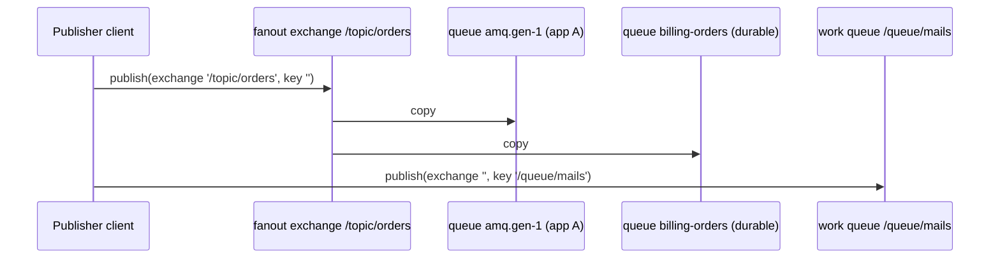

# Channel topology

The transport maps each queue channel string onto an AMQP primitive. A channel that starts with the topic prefix (`/topic/` by default) is a durable fanout exchange: every subscriber gets every message. Any other channel is a durable work queue: each message goes to one consumer.

The client declares what it needs on first use. You do not create exchanges or queues on the broker yourself.

## How it works

### Channel to primitive

| Channel | Publish to | Subscribe with | Semantics |
| --- | --- | --- | --- |
| starts with `options.topicPrefix` (`/topic/`) | fanout exchange named like the channel, `durable: true`; routing key `''` | a queue bound to that exchange with key `''` | Events, pub-sub. Every bound queue gets a copy. |
| anything else, eg. `/queue/mails` | the default exchange `''`, routing key = channel, into a queue named like the channel, `durable: true` | the same queue | Jobs. Consumers of one queue compete; one gets each message. |

The channel string is used as the exchange or queue name as is, slashes included.

### Subscribe

1. `QueueService.consume(MessageClass, ...)` calls `subscribe(MessageClass, callback, subscriptionId, durable)`. A raw `subscribe('/queue/x', callback)` works too.
2. `subscribe()` turns a message class into its channels with `getChannelForMessage()`, which reads `queue.routing`; see [Routing](#routing).
3. For each channel it stores a subscription descriptor keyed by the channel, and for a topic with a `subscriptionId` by channel and `subscriptionId`. When the key is already in the map, the callback joins that descriptor: one broker consumer serves every message class on the queue and runs their callbacks in turn. The same message class (or a second raw `subscribe()` of the same channel) is skipped with the warning `Channel <channel> already subscribed !`.
4. `startConsumer()` calls `assertSubscriptionQueue()`, which picks the queue:

   | Channel kind | `subscriptionId` | `durable` | Queue consumed | Queue options |
   | --- | --- | --- | --- | --- |
   | work queue | any | any | the channel name | `durable: true` |
   | topic | none | `false` | server-named (`amq.gen-...`) | `durable: false`, `exclusive: true`, `autoDelete: true` |
   | topic | set | `false` | `subscriptionId` | `durable: false`, `exclusive: false`, `autoDelete: true` |
   | topic | set | `true` | `subscriptionId` | `durable: true`, `exclusive: false`, `autoDelete: false` |
   | topic | none | `true` | none | throws `InvalidArgument('subscriptionId cannot be empty if using durable subscriptions')` |

5. For a topic, the queue is bound to the fanout exchange.
6. `ConsumeChannel.consume(queue, handler, { noAck: false })` starts the consumer and the consumer tag is stored. Each delivery is parsed, passed to the callback and acked or failed; see [Retry and dead-letter](04-retry-and-dead-letter.md).

After a reconnect, `replaySubscriptions()` runs step 4 to 6 again for every stored descriptor.

### Unsubscribe

`unsubscribe(channelOrMessage, removeDurable?)` removes the callbacks of that message class (all callbacks for a raw channel). When none are left on a descriptor, it removes the descriptor and cancels the consumer. The queue stays unless `removeDurable` is `true`: a durable queue keeps collecting messages until the next `subscribe()` with the same `subscriptionId`. With `removeDurable`, the durable topic subscription queue is deleted after the consumer is cancelled.

### Routing

`getChannelForMessage()` comes from `QueueClient` in `@spinajs/queue`:

| `queue.routing[<message name>]` | Channels |
| --- | --- |
| unset | `defaultQueueChannel` for jobs, `defaultTopicChannel` for events; a warning is logged |
| `'/topic/orders'` | that channel |
| `{ channel: '/queue/mails', deadLetterChannel: '/queue/mails-dead' }` | `channel`, or the default when unset |
| an array of the above | every channel, without duplicates |

`emit()` publishes to every channel of the message; `subscribe()` consumes from every one. The `connection` key of a route picks the `QueueService` connection; see [`@spinajs/queue`](../queue/README.md).



## Configuration

| Key | Type | Default | Allowed values | Meaning |
| --- | --- | --- | --- | --- |
| `queue.connections[].defaultTopicChannel` | `string` | none | a channel with the topic prefix | Channel for events with no route. |
| `queue.connections[].defaultQueueChannel` | `string` | none | a channel without the topic prefix | Channel for jobs with no route. |
| `queue.connections[].options.topicPrefix` | `string` | `/topic/` | any prefix | Channels starting with it are fanout exchanges. |
| `queue.connections[].options.prefetch` | `number` | `1` | `>= 0`; `0` means no limit | Unacked messages each consumer may hold. |
| `queue.routing.<MessageName>` | `string \| object \| array` | none | see [Routing](#routing) | Channels for a message class, by class name. |

```ts
// config/queue.ts
export default {
  queue: {
    default: 'rabbit',
    routing: {
      OrderPlaced: '/topic/orders',
      SendInvoiceMail: { channel: '/queue/mails', deadLetterChannel: '/queue/mails-dead' },
      StockChanged: ['/topic/stock', '/topic/audit'],
    },
    connections: [
      {
        service: 'AmqpQueueClient',
        name: 'rabbit',
        host: 'amqp://rabbitmq.internal',
        defaultTopicChannel: '/topic/default',
        defaultQueueChannel: '/queue/default',
        options: { prefetch: 10 },
      },
    ],
  },
};
```

## Services and extension points

| Service | DI token and lifetime | Default implementation | Alternatives | How to replace or extend |
| --- | --- | --- | --- | --- |
| Channel kind | `protected isTopic(channel): boolean` | `channel.startsWith(TopicPrefix)` | | Override, eg. to treat a second prefix as topics |
| Topic prefix | `protected get TopicPrefix(): string` | `options.topicPrefix ?? '/topic/'` | | Config key, or override the getter |
| Work queue declaration | `protected assertQueue(channel, name): Promise<string>` | `assertQueue(name, { durable: true })`, once per connection | quorum, lazy or priority queues | Override; keep adding `name` to `AssertedQueues` |
| Exchange declaration | `protected assertExchange(channel, name): Promise<void>` | `assertExchange(name, 'fanout', { durable: true })`, once per connection | | Override; publish and bind still use routing key `''` |
| Subscription queue | `protected assertSubscriptionQueue(channel, subscriptionId?, durable?): Promise<string>` | the table in [Subscribe](#subscribe) | | Override, eg. to add a TTL or a length limit to durable subscription queues |
| Prefetch | `protected get Prefetch(): number` | `options.prefetch ?? 1` | | Config key, or override the getter |
| Consumer start | `protected startConsumer(descriptor)` | assert, consume, ack or fail | | Override and call `super.startConsumer(descriptor)`; the descriptor type is not exported |
| Channel routing | `public getChannelForMessage(message)` (from `QueueClient`) | `queue.routing` lookup | | Override, eg. to derive channels from a tenant field |

`AssertedQueues`, `AssertedExchanges` and `AssertedRetryQueues` are protected `Set<string>` caches, cleared on every (re)connect.

### Work queue declaration: custom implementation

Override `assertQueue()` to change how work queues and dead-letter queues are declared. The sample declares quorum queues, which RabbitMQ replicates across cluster nodes, and treats channels under `/exchange/` as topics too.

```ts sample
import { Injectable, NewInstance } from '@spinajs/di';
import { QueueClient } from '@spinajs/queue';
import { AmqpQueueClient } from '@spinajs/queue-amqp-transport';
import { Channel, ConfirmChannel } from 'amqplib';

@NewInstance()
@Injectable(QueueClient)
export class QuorumAmqpQueueClient extends AmqpQueueClient {
  protected isTopic(channel: string): boolean {
    return super.isTopic(channel) || channel.startsWith('/exchange/');
  }

  protected async assertQueue(channel: Channel | ConfirmChannel, name: string): Promise<string> {
    if (!this.AssertedQueues.has(name)) {
      await channel.assertQueue(name, { durable: true, arguments: { 'x-queue-type': 'quorum' } });
      this.AssertedQueues.add(name);
    }

    return name;
  }
}

// config/queue.ts
export const config = {
  queue: {
    default: 'rabbit',
    connections: [
      {
        service: 'QuorumAmqpQueueClient',
        name: 'rabbit',
        host: 'amqp://rabbitmq.internal',
        defaultTopicChannel: '/topic/default',
        defaultQueueChannel: '/queue/quorum-default',
      },
    ],
  },
};
```

A queue that already exists with other arguments makes the broker close the channel with `PRECONDITION_FAILED`. Use new queue names, or delete the old queues first.

## Important behaviour

- Message classes sharing a channel (eg. two unrouted events on `defaultTopicChannel`) share one consumer per queue. Every delivery runs the callback of each class; `QueueService.consume()` callbacks skip messages of other names. The message is acked once all callbacks resolve and failed when one rejects.
- A topic subscription with a `subscriptionId` but `durable: false` uses a shared, auto-deleted queue. Every process using that `subscriptionId` competes for its messages, so each event reaches one of them. The queue is deleted when its last consumer leaves.
- A transient topic subscription with no `subscriptionId` gets a fresh exclusive queue on each connect. Events published while the client is disconnected are lost for it.
- A durable subscription queue is deleted only by `unsubscribe(..., true)`. Otherwise messages pile up while nothing consumes them.
- Work queues and exchanges are always declared `durable: true`. Whether a message survives a broker restart depends on its `Persistent` flag; see [Publishing](03-publishing.md).
- `prefetch` applies per consumer on the consume channel. With the default `1`, a slow job blocks the next delivery to that consumer, but other consumers keep working.
- Each queue or exchange is declared once per connection; the cache is cleared on reconnect so the declarations run again on the new channels.

## Best practices

- Name channels by purpose, eg. `/queue/invoice-mails` or `/topic/orders`, and give every consumed message class its own route.
- Use durable subscriptions for events a service must not miss while it restarts, eg. billing listening to `OrderPlaced`. Give each consuming service its own `subscriptionId`.
- Raise `options.prefetch` for many short jobs; keep `1` for long jobs so work spreads across consumers.
- Use `@Event({ durable: true })` on the event class rather than passing `durable` at every `consume()` call.

## Patterns and antipatterns

```ts
// Don't: both events fall back to defaultTopicChannel; every consumer of that channel
// receives, and filters out, all events published to it
await queue.consume(OrderPlaced, onOrderPlaced);
await queue.consume(OrderCancelled, onOrderCancelled);

// Do: route each consumed event to its own channel
// queue.routing: { OrderPlaced: '/topic/order-placed', OrderCancelled: '/topic/order-cancelled' }
await queue.consume(OrderPlaced, onOrderPlaced);
await queue.consume(OrderCancelled, onOrderCancelled);
```

```ts
// Don't: one subscriptionId shared by two services; each event reaches only one of them
await queue.consume(OrderPlaced, chargeCard, 'orders', true); // billing service
await queue.consume(OrderPlaced, reserveStock, 'orders', true); // warehouse service

// Do: one subscriptionId per consuming service
await queue.consume(OrderPlaced, chargeCard, 'billing-order-placed', true);
await queue.consume(OrderPlaced, reserveStock, 'warehouse-order-placed', true);
```

## Examples

### Keep billing events while the billing service is down

```ts sample
import { DI } from '@spinajs/di';
import { Event, QueueEvent, QueueService } from '@spinajs/queue';

@Event({ durable: true })
export class InvoiceIssued extends QueueEvent {
  public InvoiceId: string;
  public Amount: number;
}

// config/queue.ts: routing: { InvoiceIssued: '/topic/invoices' }

export async function startBilling() {
  const queue = await DI.resolve(QueueService);

  // queue "billing-invoice-issued" is durable and bound to the fanout exchange "/topic/invoices"
  await queue.consume<InvoiceIssued>(
    InvoiceIssued,
    async (invoice) => {
      console.log(`Booking invoice ${invoice.InvoiceId}: ${invoice.Amount}`);
    },
    'billing-invoice-issued',
  );
}

export async function stopBilling() {
  const queue = await DI.resolve(QueueService);

  // cancels the consumer; the durable queue keeps collecting invoices
  await queue.stopConsuming(InvoiceIssued);
}
```

### Honour message priority

`Priority` is sent as the AMQP priority, but a queue only orders by priority when it is declared with `x-max-priority`. The sample declares every work queue with ten priority levels.

```ts sample
import { Injectable, NewInstance } from '@spinajs/di';
import { QueueClient } from '@spinajs/queue';
import { AmqpQueueClient } from '@spinajs/queue-amqp-transport';
import { Channel, ConfirmChannel } from 'amqplib';

@NewInstance()
@Injectable(QueueClient)
export class PriorityAmqpQueueClient extends AmqpQueueClient {
  protected async assertQueue(channel: Channel | ConfirmChannel, name: string): Promise<string> {
    if (!this.AssertedQueues.has(name)) {
      await channel.assertQueue(name, { durable: true, arguments: { 'x-max-priority': 10 } });
      this.AssertedQueues.add(name);
    }

    return name;
  }
}
```

## Related

- [Publishing](03-publishing.md): how a message reaches these exchanges and queues.
- [Retry and dead-letter](04-retry-and-dead-letter.md): the retry queues and dead-letter queues the client declares on failure.
- [Extending the AMQP client](05-extending-the-amqp-client.md): registering a subclass such as `QuorumAmqpQueueClient`.
- [`@spinajs/queue`](../queue/README.md): `queue.routing`, `@Event`, `@Job` and `QueueService.consume()`.
- [`@spinajs/queue-stomp-transport`](../queue-stomp-transport/README.md): the STOMP transport with the same channel convention.
