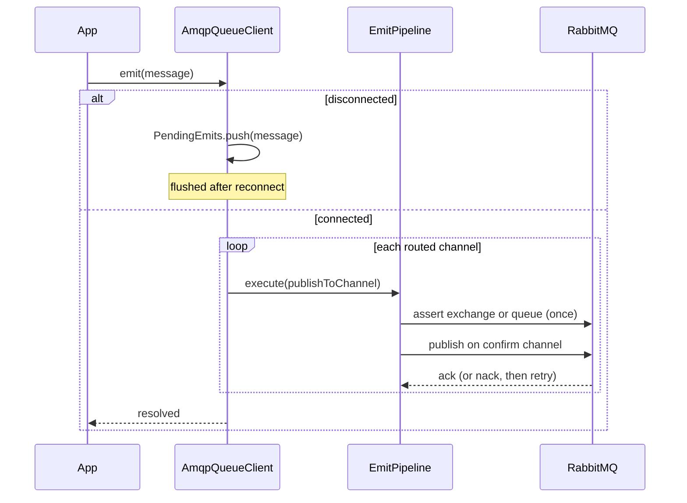

# Publishing

`emit()` publishes one message to every channel it is routed to and resolves only after the broker confirms each publish. Each publish runs through a retry and timeout pipeline. Messages emitted while the client is disconnected wait in memory and go out after the reconnect.

## How it works

1. `QueueService.emit(message)`, `MyEvent.emit(...)` or `MyJob.emit(...)` (all from `@spinajs/queue`) pick the connection and call `AmqpQueueClient.emit(message)`. `QueueService` sets `JobId` on jobs before that.
2. `warnOnUnsupportedScheduling()` logs a warning when `ScheduleDelay`, `ScheduleCron`, `SchedulePeriod` or `ScheduleRepeat` is set. The message is still sent at once.
3. While `IsConnected` is `false`, the message goes into `PendingEmits` and the returned promise waits. `flushPendingEmits()` publishes it after the next successful connect and settles the promise.
4. `publishMessage()` resolves the channels with `getChannelForMessage()`, serializes the message with `JSON.stringify()` and builds the publish options:

   | AMQP property | Value |
   | --- | --- |
   | `persistent` | `!!message.Persistent` |
   | `contentType` | `application/json` |
   | `correlationId` | `message.JobId`, when set |
   | `priority` | `message.Priority`, when not `0` |

5. For each channel, in order, `EmitPipeline.execute()` runs `publishToChannel()`. It declares the exchange or queue once (see [Channel topology](02-channel-topology.md)) and calls `publishWithConfirm()`.
6. `publishWithConfirm()` publishes on the confirm channel and resolves on the broker ack. A broker nack rejects with the amqplib error, or with `UnexpectedServerError('Broker nacked message on <destination>')`.
7. The pipeline retries a failed attempt; each attempt is bounded by `receiptTimeout`. When all attempts fail, `emit()` rejects with the last error.



### Emit pipeline

`buildEmitPipeline()` builds the pipeline once, when the client is constructed:

| Strategy | Order | Setting | Source |
| --- | --- | --- | --- |
| Retry | outer | `MaxRetryAttempts` | `options.emitRetries ?? 3` |
| | | `Delay` | `retryDelay` when `> 0`, else `200` ms |
| | | `MaxDelay` | `30000` ms |
| | | `BackoffType`, `UseJitter` | `Exponential`, `true` |
| Timeout | inner, per attempt | timeout | `receiptTimeout ?? 5000` ms |

## Configuration

| Key | Type | Default | Allowed values | Meaning |
| --- | --- | --- | --- | --- |
| `queue.connections[].receiptTimeout` | `number` (ms) | `5000` | `> 0` | Time one publish attempt may wait for the broker ack. |
| `queue.connections[].retryDelay` | `number` (ms) | `0` (`200` for emits) | `>= 0` | Base delay of the emit retry. Also the base of consumer job retries; see [Retry and dead-letter](04-retry-and-dead-letter.md). |
| `queue.connections[].options.emitRetries` | `number` | `3` | `>= 0` | Retries after the first publish attempt. |

```ts
// config/queue.ts
export default {
  queue: {
    connections: [
      {
        service: 'AmqpQueueClient',
        name: 'rabbit',
        host: 'amqp://rabbitmq.internal',
        receiptTimeout: 2000,
        retryDelay: 500,
        defaultTopicChannel: '/topic/default',
        defaultQueueChannel: '/queue/default',
        options: { emitRetries: 5 },
      },
    ],
  },
};
```

## Services and extension points

| Service | DI token and lifetime | Default implementation | Alternatives | How to replace or extend |
| --- | --- | --- | --- | --- |
| Emit pipeline | `protected buildEmitPipeline(): ResiliencePipeline<void>`, stored in `protected EmitPipeline` | retry, then timeout | add a circuit breaker, a concurrency limit, a fallback | Override; it runs from a field initializer, so read only `this.Options` in it |
| Message publish | `protected publishMessage(message): Promise<void>` | steps 4 to 7 | delayed delivery, compression, extra headers | Override; call `super.publishMessage(message)` for the default path |
| Channel publish | `protected publishToChannel(channel, buffer, options)` | declare, then `publishWithConfirm()` | | Override, eg. to add headers to `options` |
| Confirmed publish | `protected publishWithConfirm(exchange, routingKey, content, options)` | `PublishChannel.publish()` with an ack callback | | Call it from your own publish code to keep the confirm guarantee |
| Scheduling warning | `protected warnOnUnsupportedScheduling(message)` | warns on any `Schedule*` field | | Override when a subclass supports some of them |
| Pending buffer | `protected PendingEmits`, `protected flushPendingEmits()` | unbounded array, flushed after connect | | Override `emit()` to reject instead of buffering |

### Emit pipeline: custom implementation

Override `buildEmitPipeline()` to change how a publish is retried or bounded. The sample adds a circuit breaker so that, while the broker keeps failing, emits fail fast instead of each waiting for every retry.

```ts sample
import { Injectable, NewInstance } from '@spinajs/di';
import { QueueClient } from '@spinajs/queue';
import { AmqpQueueClient } from '@spinajs/queue-amqp-transport';
import { BackoffType, ResiliencePipeline, ResiliencePipelineBuilder } from '@spinajs/util';

@NewInstance()
@Injectable(QueueClient)
export class GuardedAmqpQueueClient extends AmqpQueueClient {
  protected buildEmitPipeline(): ResiliencePipeline<void> {
    // runs during construction: only this.Options is available here
    const timeout = this.Options.receiptTimeout ?? 5000;

    return new ResiliencePipelineBuilder<void>()
      .addCircuitBreaker({ FailureRatio: 0.5, MinimumThroughput: 10, SamplingDuration: 30000, BreakDuration: 15000 })
      .addRetry({ MaxRetryAttempts: 2, Delay: 250, BackoffType: BackoffType.Exponential, UseJitter: true })
      .addTimeout(timeout)
      .build();
  }
}

// config/queue.ts
export const config = {
  queue: {
    default: 'rabbit',
    connections: [
      {
        service: 'GuardedAmqpQueueClient',
        name: 'rabbit',
        host: 'amqp://rabbitmq.internal',
        receiptTimeout: 2000,
        defaultTopicChannel: '/topic/default',
        defaultQueueChannel: '/queue/default',
      },
    ],
  },
};
```

### Message publish: delayed delivery with the RabbitMQ plugin

The transport has no delayed delivery. With the `rabbitmq_delayed_message_exchange` plugin enabled on the broker, a subclass can add it for work queues: publish to an `x-delayed-message` exchange with an `x-delay` header, bound to the work queue.

```ts sample
import { Injectable, NewInstance } from '@spinajs/di';
import { IQueueJob, IQueueMessage, QueueClient } from '@spinajs/queue';
import { AmqpQueueClient } from '@spinajs/queue-amqp-transport';
import { Options } from 'amqplib';

@NewInstance()
@Injectable(QueueClient)
export class DelayedAmqpQueueClient extends AmqpQueueClient {
  protected warnOnUnsupportedScheduling(message: IQueueMessage): void {
    if (message.ScheduleCron || message.SchedulePeriod || message.ScheduleRepeat) {
      super.warnOnUnsupportedScheduling(message);
    }
  }

  protected async publishMessage(message: IQueueMessage): Promise<void> {
    const queues = this.getChannelForMessage(message);
    if (!message.ScheduleDelay || queues.some((q) => this.isTopic(q))) {
      return super.publishMessage(message);
    }

    const content = Buffer.from(JSON.stringify(message));
    const options: Options.Publish = {
      persistent: !!message.Persistent,
      contentType: 'application/json',
      correlationId: (message as IQueueJob).JobId,
      headers: { 'x-delay': message.ScheduleDelay },
    };

    for (const queue of queues) {
      const exchange = `${queue}.delayed`;

      await this.EmitPipeline.execute(async () => {
        await this.PublishChannel.assertExchange(exchange, 'x-delayed-message', { durable: true, arguments: { 'x-delayed-type': 'direct' } });
        await this.assertQueue(this.PublishChannel, queue);
        await this.PublishChannel.bindQueue(queue, exchange, queue);
        await this.publishWithConfirm(exchange, queue, content, options);
      });
    }
  }
}
```

With `service: 'DelayedAmqpQueueClient'` on the connection, `SendReminder.emit({ ... }, { ScheduleDelay: 60000, ... })` reaches the work queue after one minute.

## Important behaviour

- `emit()` resolves after the broker acks, so a persistent job that `emit()` returned for is on the broker.
- A retry after a timeout can publish the same message twice: the first attempt may still be acked. `QueueService` skips a job whose tracking row is already finished (`queue.deduplicate`), so jobs stay idempotent. Events have no such check.
- A message routed to several channels is published channel by channel. When a later channel fails, the earlier ones already have the message.
- `PendingEmits` has no size limit and no timeout. An `emit()` during a long outage waits until the reconnect. When `dispose()` runs first, the promise never settles.
- `Persistent` decides whether the broker writes the message to disk. `QueueJob.emit()` sets it to `true` unless you pass `false`; `QueueEvent.emit()` leaves it unset, which publishes events as non-persistent.
- `Priority` has no effect on queues declared without `x-max-priority`, which is the default; see [Channel topology](02-channel-topology.md#honour-message-priority).
- The body is the JSON of the whole message object. Luxon `DateTime` fields such as `CreatedAt` become ISO strings.
- Scheduling fields are not honoured: the message is delivered at once and a warning is logged on each emit.

## Best practices

- Keep `receiptTimeout` below any caller deadline. A request that emits a job waits up to `(emitRetries + 1) × receiptTimeout` plus the retry delays when the broker is slow.
- Emit jobs through `MyJob.emit()` and keep the returned `JobId`; it is also the AMQP `correlationId`, which you can search for in the broker tools.
- Give messages that must not be lost `Persistent: true`, and keep events that are only notifications non-persistent.

## Patterns and antipatterns

```ts
// Don't: fire and forget; a broker failure is an unhandled rejection and the job is lost silently
void SendInvoiceMail.emit({ InvoiceId: invoice.Id });

// Do: await the emit and decide what a failure means for the caller
try {
  await SendInvoiceMail.emit({ InvoiceId: invoice.Id });
} catch (err) {
  await markInvoiceMailPending(invoice.Id, err);
}
```

## Examples

### Enqueue a job and track it

```ts sample
import { Job, QueueJob } from '@spinajs/queue';

@Job()
export class GenerateMonthlyReport extends QueueJob {
  public CustomerId: number;
  public Month: string;

  public async execute(progress: (p: number) => Promise<void>): Promise<unknown> {
    await progress(50);
    return { url: `/reports/${this.CustomerId}/${this.Month}.pdf` };
  }
}

// config/queue.ts: routing: { GenerateMonthlyReport: '/queue/reports' }

export async function requestReport(customerId: number, month: string) {
  // resolves after RabbitMQ confirmed the message on "/queue/reports"
  const jobId = await GenerateMonthlyReport.emit({ CustomerId: customerId, Month: month, RetryCount: 3 });
  return jobId;
}
```

## Related

- [Channel topology](02-channel-topology.md): where each channel's messages land.
- [Retry and dead-letter](04-retry-and-dead-letter.md): what happens when the consumer fails.
- [AMQP connection](01-amqp-connection.md): the reconnect that flushes buffered emits.
- [`@spinajs/queue`](../queue/README.md): `QueueService.emit()`, `QueueJob`, `QueueEvent` and job deduplication.
- [`@spinajs/util`](../util/README.md): `ResiliencePipelineBuilder` and its strategies.
