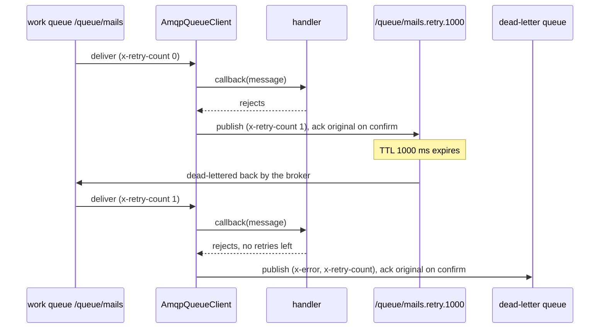

# Retry and dead-letter

Every delivery is acked manually. A handler that resolves acks the message. A failed job is retried through a broker-side TTL queue with exponential backoff, up to its `RetryCount`, then moved to a dead-letter queue. A failed event is dropped. A message that is not valid JSON goes straight to the dead-letter queue.

## How it works

1. The consumer started by `startConsumer()` receives a delivery. A `null` delivery (consumer cancelled by the broker) is ignored.
2. It parses the body with `JSON.parse()`. On failure, `deadLetterRaw()` sends the raw body to `defaultQueueDeadLetterChannel`; see step 7.
3. It calls the subscription callback. For `QueueService` subscriptions that runs the handler or `QueueJob.execute()` and rethrows job errors after recording the attempt.
4. The callback resolves: the message is acked on the channel it was delivered on (`settleMessage()`), even when a reconnect has replaced `ConsumeChannel` meanwhile.
5. The callback rejects: `handleFailedMessage()` decides.
   - An event, or any message on a topic channel: logged as a warning and acked. No retry, no dead-letter.
   - A job with `attempt < RetryCount`, where `attempt` is the `x-retry-count` header (`0` when missing): `retryJob()` runs, step 6.
   - A job with no retries left: `deadLetterRaw()` with `getDeadLetterChannelForMessage(message)`, step 7.
6. `retryJob()` computes `delay = retryBackoff(attempt + 1)` and declares the retry queue `<work queue>.retry.<delay>`. It publishes the original body there on the confirm channel with `x-retry-count` set to `attempt + 1`, and acks the original once the broker confirmed the copy. When the TTL expires, the broker dead-letters the message back to the work queue through the default exchange. If declaring or publishing fails, the original is nacked without requeue.
7. `deadLetterRaw()` with a dead-letter channel declares it as a durable queue, publishes the body with the extra headers below on the confirm channel, and acks the original once the broker confirmed it. If that fails, the original is nacked without requeue. With no dead-letter channel it logs a warning and acks: the message is dropped.



### Backoff

`retryBackoff(attempt)` returns `retryDelay × 2^(attempt - 1)` ms, or `0` when `retryDelay` is `0` or unset.

| Attempt | `retryDelay: 1000` | `retryDelay: 0` |
| --- | --- | --- |
| 1 | `1000` ms, queue `<q>.retry.1000` | `0` ms, queue `<q>.retry.0` |
| 2 | `2000` ms, queue `<q>.retry.2000` | `0` ms |
| 3 | `4000` ms, queue `<q>.retry.4000` | `0` ms |

### Queues and headers

| Queue | Declared by | Options |
| --- | --- | --- |
| `<work queue>.retry.<delay>` | `assertRetryQueue()` | `durable: true`, `x-message-ttl: <delay>`, `x-dead-letter-exchange: ''`, `x-dead-letter-routing-key: <work queue>` |
| dead-letter channel | `assertQueue()` | `durable: true` |

| Header | Set on | Value |
| --- | --- | --- |
| `x-retry-count` | retried and dead-lettered jobs | the attempt number |
| `x-error` | dead-lettered messages | the error message of the failure |

Retry and dead-letter messages keep the original headers, are `persistent` and have `contentType: application/json`. Retried messages also keep their `priority`.

## Configuration

| Key | Type | Default | Allowed values | Meaning |
| --- | --- | --- | --- | --- |
| `queue.connections[].retryDelay` | `number` (ms) | `0` | `>= 0` | Base of the job retry backoff. Also the base delay of emit retries; see [Publishing](03-publishing.md). |
| `queue.connections[].defaultQueueDeadLetterChannel` | `string` | none | a work-queue channel | Dead-letter queue for jobs with no routed one, and for unparseable messages. Unset means drop. |
| `queue.routing.<JobName>.deadLetterChannel` | `string` | none | a work-queue channel | Dead-letter queue for one job class. |
| `RetryCount` on the job | `number` | `0` | `>= 0` | Retries after the first execution; set when emitting. |

```ts
// config/queue.ts
export default {
  queue: {
    routing: {
      SendInvoiceMail: { channel: '/queue/mails', deadLetterChannel: '/queue/mails-dead' },
    },
    connections: [
      {
        service: 'AmqpQueueClient',
        name: 'rabbit',
        host: 'amqp://rabbitmq.internal',
        retryDelay: 1000,
        defaultTopicChannel: '/topic/default',
        defaultQueueChannel: '/queue/default',
        defaultQueueDeadLetterChannel: '/queue/dead-letter',
      },
    ],
  },
};
```

## Services and extension points

| Service | DI token and lifetime | Default implementation | Alternatives | How to replace or extend |
| --- | --- | --- | --- | --- |
| Retry schedule | `protected retryBackoff(attempt): number` | `retryDelay × 2^(attempt - 1)` | fixed buckets, a capped curve | Override; each distinct delay creates one retry queue |
| Failure policy | `protected handleFailedMessage(msg, message, channel, err, consumeChannel?)` | events dropped, jobs retried then dead-lettered | dead-letter events, never retry some errors | Override; call `super.handleFailedMessage(...)` for the default path. Pass `consumeChannel` (the delivering channel) on |
| Retry publish | `protected retryJob(msg, message, workQueue, nextAttempt, reason, consumeChannel?)` | confirmed publish to the TTL queue, then ack | | Override, eg. to add headers |
| Dead-letter publish | `protected deadLetterRaw(msg, dlq, channel, reason, attempt?, consumeChannel?)` | confirmed publish to the queue, then ack; ack only when `dlq` is unset | send to an exchange, store in a DB | Override; always ack or nack `msg`, with `settleMessage(consumeChannel, msg, ack)` |
| Ack / nack | `protected settleMessage(channel, msg, ack)` | ack, or nack without requeue, on the delivering channel; a closed channel is logged | | Override |
| Retry queue declaration | `protected assertRetryQueue(workQueue, delay): Promise<string>` | TTL queue per delay | | Override; keep `x-dead-letter-routing-key` pointing at `workQueue` |
| Dead-letter channel lookup | `public getDeadLetterChannelForMessage(message)` (from `QueueClient`) | routed `deadLetterChannel`, else `defaultQueueDeadLetterChannel` | | Override |

### Failure policy: custom implementation

Override `handleFailedMessage()` to change what happens after a handler fails. The sample dead-letters failed events instead of dropping them, skips retries for `InvalidArgument` errors, which a retry cannot fix, and uses a fixed retry schedule so only four retry queues exist per work queue.

```ts sample
import { Injectable, NewInstance } from '@spinajs/di';
import { InvalidArgument } from '@spinajs/exceptions';
import { IQueueMessage, QueueClient, QueueMessageType } from '@spinajs/queue';
import { AmqpQueueClient } from '@spinajs/queue-amqp-transport';
import { Channel, ConsumeMessage } from 'amqplib';

const RETRY_SCHEDULE_MS = [60_000, 5 * 60_000, 30 * 60_000, 2 * 60 * 60_000];

@NewInstance()
@Injectable(QueueClient)
export class StrictAmqpQueueClient extends AmqpQueueClient {
  protected retryBackoff(attempt: number): number {
    return RETRY_SCHEDULE_MS[Math.min(attempt, RETRY_SCHEDULE_MS.length) - 1];
  }

  protected handleFailedMessage(msg: ConsumeMessage, message: IQueueMessage, channel: string, err: unknown, consumeChannel?: Channel): void {
    const reason = err instanceof Error ? err.message : String(err);

    if (message.Type !== QueueMessageType.Job) {
      this.deadLetterRaw(msg, this.getDeadLetterChannelForMessage(message), channel, reason, undefined, consumeChannel);
      return;
    }

    if (err instanceof InvalidArgument) {
      const attempt = Number(msg.properties.headers?.['x-retry-count'] ?? 0);
      this.deadLetterRaw(msg, this.getDeadLetterChannelForMessage(message), channel, reason, attempt, consumeChannel);
      return;
    }

    super.handleFailedMessage(msg, message, channel, err, consumeChannel);
  }
}

// config/queue.ts
export const config = {
  queue: {
    default: 'rabbit',
    connections: [
      {
        service: 'StrictAmqpQueueClient',
        name: 'rabbit',
        host: 'amqp://rabbitmq.internal',
        defaultTopicChannel: '/topic/default',
        defaultQueueChannel: '/queue/default',
        defaultQueueDeadLetterChannel: '/queue/dead-letter',
      },
    ],
  },
};
```

## Important behaviour

- Retry and dead-letter copies go through the confirm channel and the original is acked only after the broker confirmed the copy. A reconnect between the two leaves both: the copy is on the broker and the original is redelivered, so the job can run once more.
- A nack without requeue on a work queue with no `x-dead-letter-exchange` makes the broker discard the message. That happens when declaring a retry or dead-letter queue, or publishing the copy, fails.
- `RetryCount` is read from the message body; the attempt count from the `x-retry-count` header. A job emitted without `RetryCount` is never retried.
- A job routed to a topic channel is treated as an event on failure: dropped, not retried.
- Retries have no jitter. Jobs that failed together are retried together.
- Every distinct delay creates a durable retry queue that stays on the broker. A custom `retryBackoff()` with random or continuous values creates many queues.
- An unparseable message always goes to `defaultQueueDeadLetterChannel`; routed dead-letter channels are not used for it, because the message name is unknown.
- A retried message re-enters at the tail of the work queue, behind messages queued meanwhile.
- `QueueService` writes the attempt and the `retrying` or `dead` status to the job row before the transport retries; the two counters agree as long as `RetryCount` is not changed between attempts.
- Acks and nacks go to the channel that delivered the message. When a handler finishes after a reconnect, that channel is closed: the ack fails with a logged warning and the broker, which has already requeued the original, delivers it again; job deduplication in `QueueService` covers finished jobs.

## Best practices

- Always set `defaultQueueDeadLetterChannel`; without it, poison messages and exhausted jobs are dropped with only a log line.
- Set `retryDelay` when jobs call flaky services. With `0`, retries come back at once and burn through `RetryCount` in milliseconds.
- Watch the dead-letter queue size in the broker. Read `x-error` and `x-retry-count` to see why and after how many attempts a job died.
- Re-publish dead-lettered jobs to their work queue after a fix, with `x-retry-count` removed so they get their full retries again.

## Patterns and antipatterns

```ts
// Don't: catch every error inside the job; the transport sees success and never retries
public async execute() {
  try {
    await this.callPaymentProvider();
  } catch (err) {
    console.error(err);
  }
}

// Do: let the error reach the transport so it retries, then dead-letters
public async execute() {
  await this.callPaymentProvider();
}
```

## Examples

### Retry a payment capture three times, one minute apart and doubling

```ts sample
import { Job, QueueJob } from '@spinajs/queue';

@Job()
export class CapturePayment extends QueueJob {
  public PaymentId: string;

  public async execute(): Promise<unknown> {
    const response = await fetch(`https://payments.internal/captures/${this.PaymentId}`, { method: 'POST' });
    if (!response.ok) {
      throw new Error(`Capture of ${this.PaymentId} failed with HTTP ${response.status}`);
    }

    return { captured: true };
  }
}

// config/queue.ts
export const config = {
  queue: {
    default: 'payments',
    routing: {
      CapturePayment: { channel: '/queue/payment-captures', deadLetterChannel: '/queue/payment-captures-dead' },
    },
    connections: [
      {
        service: 'AmqpQueueClient',
        name: 'payments',
        host: 'amqp://rabbitmq.internal',
        retryDelay: 60_000, // retries after 1, 2 and 4 minutes
        defaultTopicChannel: '/topic/default',
        defaultQueueChannel: '/queue/default',
      },
    ],
  },
};

export async function capture(paymentId: string) {
  return CapturePayment.emit({ PaymentId: paymentId, RetryCount: 3 });
}
```

## Related

- [Channel topology](02-channel-topology.md): the work queues and consumers this flow runs on.
- [Publishing](03-publishing.md): `retryDelay` also drives emit retries.
- [Extending the AMQP client](05-extending-the-amqp-client.md): registering a subclass such as `StrictAmqpQueueClient`.
- [`@spinajs/queue`](../queue/README.md): job tracking, `QueueJob.onFailed()` and the `retrying` and `dead` statuses.
