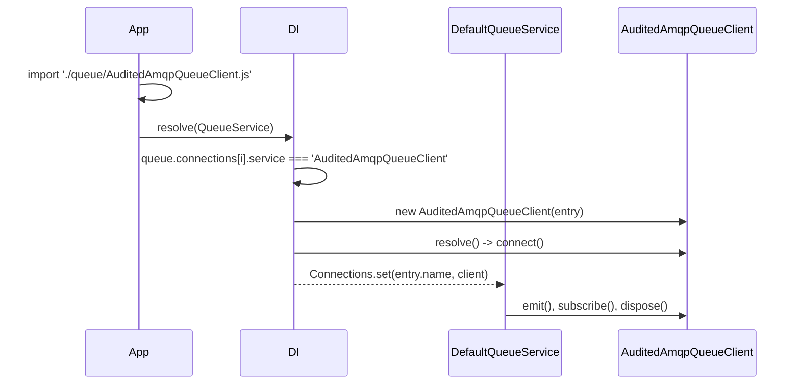

# Extending the AMQP client

`AmqpQueueClient` is registered under the `QueueClient` token and selected per connection by class name. Subclass it to change how it connects, declares topology, publishes or handles failures, then name the subclass in `service`. You can also swap the class for every `AmqpQueueClient` connection at once, without touching config.

## How it works

1. **Registration.** `@Injectable(QueueClient)` adds `AmqpQueueClient` to the `QueueClient` list when the package is imported. `@PerInstanceCheck()` with `__checkInstance__()` from `QueueClient` keys cached instances by the entry `name`. The package also registers a [factory](06-client-factory.md) under the `AmqpQueueClient` key.
2. **Your subclass.** Decorate it `@Injectable(QueueClient)`; `@Injectable()` does not carry over from the parent. Decorate it `@NewInstance()` as well; see [Important behaviour](#important-behaviour).
3. **Import.** The decorators run when the module is imported. Import it from the app entry or a bootstrapper before `QueueService` resolves.
4. **Select.** Set `service: '<ClassName>'` on the `queue.connections` entries that should use it. `@AutoinjectService` compares `service` with the class name of each `QueueClient` registration and throws `ServiceNotFound('Service <name> is not registered in DI container')` when none matches.
5. **Build.** DI calls `new Subclass(entry)` and then `resolve()`, which connects. The factory of `AmqpQueueClient` does not run for a subclass.
6. **Use.** `DefaultQueueService` keeps the instance in its `Connections` map under the entry `name` and calls `emit()`, `subscribe()`, `unsubscribe()` and `dispose()` on it.



### Two ways to plug in

| Goal | Registration | Config | Factory runs |
| --- | --- | --- | --- |
| Use the subclass on chosen connections | `@Injectable(QueueClient)` on the subclass | `service: 'MySubclass'` on those entries | no |
| Use the subclass on every `service: 'AmqpQueueClient'` connection | `DI.register(MySubclass).as(AmqpQueueClient)` | unchanged | no |
| Keep the factory for the subclass | `DI.register(myFactory).as(MySubclass)`; see [Client factory](06-client-factory.md) | `service: 'MySubclass'` | yours |

## Configuration

| Key | Type | Default | Allowed values | Meaning |
| --- | --- | --- | --- | --- |
| `queue.connections[].service` | `string` | none, required | class name of a `QueueClient` registration | Selects the class for the entry. |
| `queue.connections[].options.<custom key>` | any | none | any | Reaches the instance as `this.Options.options.<key>`. Also passed to amqplib as a socket option. |
| `queue.connections[].<custom key>` | any | none | any | Reaches the instance as `this.Options.<key>` (cast `this.Options`, its type is `IQueueConnectionOptions`). |

## Services and extension points

| Service | DI token and lifetime | Default implementation | Alternatives | How to replace or extend |
| --- | --- | --- | --- | --- |
| Queue transport | `QueueClient`, selected by class name from `queue.connections[].service`; `@PerInstanceCheck()` keyed by `name` | `AmqpQueueClient` | `BlackHoleQueueClient` (`@spinajs/queue`), `StompQueueClient` (`@spinajs/queue-stomp-transport`), `SqsQueueClient` (`@spinajs/queue-sqs-transport`), your subclass, your own `QueueClient` | Register a class `@Injectable(QueueClient)` and name it in `service` |
| `AmqpQueueClient` key | the `AmqpQueueClient` class; factory, new instance per resolve | the [client factory](06-client-factory.md) | your class or factory | `DI.register(X).as(AmqpQueueClient)`; the last registration wins |
| Connection | `createConnection()`, `buildConnectionTarget()`, `connectOptionsFromFields()`, `connect()` | see [AMQP connection](01-amqp-connection.md) | | Override |
| Reconnect | `ReconnectDelay` getter, `onConnectionLost()`, `scheduleReconnect()` | fixed delay, forever | | Override |
| Topology | `isTopic()`, `TopicPrefix`, `assertQueue()`, `assertExchange()`, `assertSubscriptionQueue()`, `Prefetch`, `startConsumer()` | see [Channel topology](02-channel-topology.md) | | Override |
| Publish | `buildEmitPipeline()`, `publishMessage()`, `publishToChannel()`, `publishWithConfirm()`, `warnOnUnsupportedScheduling()` | see [Publishing](03-publishing.md) | | Override |
| Failure handling | `handleFailedMessage()`, `retryJob()`, `deadLetterRaw()`, `retryBackoff()`, `assertRetryQueue()` | see [Retry and dead-letter](04-retry-and-dead-letter.md) | | Override |
| Public API | `emit()`, `subscribe()`, `unsubscribe()`, `dispose()`, `resolve()` | | | Override and call `super` |
| Routing | `getChannelForMessage()`, `getDeadLetterChannelForMessage()` (from `QueueClient`) | `queue.routing` lookup | | Override |
| Logger | `protected Log`, `@Logger('queue')` (from `QueueClient`) | the `queue` logger | | Configure `logger.rules` for `queue` |

Protected state a subclass can read:

| Member | Type | Holds |
| --- | --- | --- |
| `Options` (public) | `IQueueConnectionOptions` | The connection entry, custom keys included |
| `ClientId` (public getter) | `string` | `Options.clientId ?? Options.name` |
| `IsConnected` (public getter) | `boolean` | `true` between a successful connect and a drop or dispose |
| `Connection` | amqplib `ChannelModel` | The current connection |
| `PublishChannel` | amqplib `ConfirmChannel` | Channel for publishing with confirms |
| `ConsumeChannel` | amqplib `Channel` | Channel for consumers, acks, retries and dead-letters |
| `Subscriptions` | `Map<string, descriptor>` | Subscriptions by channel, replayed on reconnect |
| `AssertedQueues`, `AssertedExchanges`, `AssertedRetryQueues` | `Set<string>` | Names declared on the current connection |
| `PendingEmits` | array | Emits waiting for a connection |
| `EmitPipeline` | `ResiliencePipeline<void>` | The publish pipeline |
| `Routing` | `IQueueMessageRoutingOptions` | `queue.routing` (from `QueueClient`) |

### Queue transport: custom implementation

The sample stamps every published message with the sending service and tenant in AMQP headers, logs how long each handler took, and reads a custom `serviceName` key from the connection entry.

```ts sample
import { Constructor, Injectable, NewInstance } from '@spinajs/di';
import { IQueueMessage, QueueClient, QueueMessage } from '@spinajs/queue';
import { AmqpQueueClient } from '@spinajs/queue-amqp-transport';
import { Options } from 'amqplib';

@NewInstance()
@Injectable(QueueClient)
export class AuditedAmqpQueueClient extends AmqpQueueClient {
  protected get ServiceTag(): string {
    return (this.Options.options?.serviceName as string | undefined) ?? this.ClientId;
  }

  protected async publishToChannel(channel: string, buffer: Buffer, options: Options.Publish): Promise<void> {
    const message = JSON.parse(buffer.toString()) as IQueueMessage & { TenantId?: string };

    await super.publishToChannel(channel, buffer, {
      ...options,
      appId: this.ServiceTag,
      headers: { ...options.headers, 'x-tenant-id': message.TenantId ?? 'none' },
    });
  }

  public async subscribe(
    channelOrMessage: string | Constructor<QueueMessage>,
    callback: (e: IQueueMessage) => Promise<void>,
    subscriptionId?: string,
    durable?: boolean,
  ): Promise<void> {
    const timed = async (message: IQueueMessage) => {
      const started = Date.now();
      try {
        await callback(message);
      } finally {
        this.Log.info({ messageName: message.Name, ms: Date.now() - started }, 'Handled ${messageName} in ${ms} ms');
      }
    };

    return super.subscribe(channelOrMessage, timed, subscriptionId, durable);
  }
}

// config/queue.ts
export const config = {
  queue: {
    default: 'rabbit',
    connections: [
      {
        service: 'AuditedAmqpQueueClient',
        name: 'rabbit',
        host: 'amqp://rabbitmq.internal',
        defaultTopicChannel: '/topic/default',
        defaultQueueChannel: '/queue/default',
        options: { serviceName: 'billing-api' },
      },
    ],
  },
};
```

`QueueService.consume()` calls `subscribe()` with a message class and a raw caller with a channel string, so an override of `subscribe()` or `unsubscribe()` takes `string | Constructor<QueueMessage>`, as `AmqpQueueClient` does.

### Swap the class for every AMQP connection

Register the subclass under the `AmqpQueueClient` key. It is the last registration under that key, after the factory, so it wins. Every entry with `service: 'AmqpQueueClient'` then builds the subclass; config stays as it is.

```ts sample
import '@spinajs/queue-amqp-transport';
import { DI, NewInstance } from '@spinajs/di';
import { AmqpQueueClient } from '@spinajs/queue-amqp-transport';

@NewInstance()
export class SlowReconnectAmqpQueueClient extends AmqpQueueClient {
  protected get ReconnectDelay(): number {
    return 30_000;
  }
}

DI.register(SlowReconnectAmqpQueueClient).as(AmqpQueueClient);
```

## Important behaviour

- A subclass without `@Injectable(QueueClient)` is not found by `service`: `@Injectable()` registers only the class it decorates.
- `service` is matched against `class.name`. A minifier that renames classes breaks the lookup; keep class names in production builds.
- Give subclasses `@NewInstance()`. With the inherited `@PerInstanceCheck()`, two `queue.connections` entries naming the same subclass resolve to a single instance: only the first entry connects, and the second name is missing from `QueueService`.
- A subclass resolved by DI skips the [client factory](06-client-factory.md), so `ClientId` is `clientId` from config, else `name`, not `<app>-<env>-<name>`.
- `buildEmitPipeline()` runs from a field initializer of `AmqpQueueClient`, before the subclass's own fields are set. Read only `this.Options` in it.
- `ISubscriptionDescriptor`, the type of `Subscriptions` values and of the `startConsumer()` argument, is not exported. Use `Parameters<AmqpQueueClient['startConsumer']>[0]` to name it.
- Overrides of the `assert*` methods must keep adding names to the `Asserted*` sets, or every publish declares again (one broker round trip each).

## Best practices

- Override the narrowest hook: `retryBackoff()` rather than `handleFailedMessage()`, `assertQueue()` rather than `startConsumer()`.
- Call `super` and add to it, so fixes in `AmqpQueueClient` still reach your subclass.
- Put custom keys under `options` only when amqplib does not know them as socket options; `this.Options.<key>` keeps them out of the socket call.
- Test a subclass without a broker by overriding `createConnection()` to return a fake, as `test/amqp-transport.unit.test.ts` does.

## Patterns and antipatterns

```ts
// Don't: no @Injectable(QueueClient); service: 'TracedAmqpQueueClient' throws ServiceNotFound
export class TracedAmqpQueueClient extends AmqpQueueClient {}

// Do: register the subclass under QueueClient, with one instance per connection entry
@NewInstance()
@Injectable(QueueClient)
export class TracedAmqpQueueClient extends AmqpQueueClient {}
```

## Examples

### Test a subclass without a broker

```ts sample
import { Injectable, NewInstance } from '@spinajs/di';
import { QueueClient } from '@spinajs/queue';
import { AmqpQueueClient } from '@spinajs/queue-amqp-transport';
import { ChannelModel, Options } from 'amqplib';

@NewInstance()
@Injectable(QueueClient)
export class InMemoryAmqpQueueClient extends AmqpQueueClient {
  public published: { exchange: string; routingKey: string; body: string }[] = [];

  protected async createConnection(_target: string | Options.Connect, _socketOptions: Record<string, unknown>): Promise<ChannelModel> {
    const channel = {
      prefetch: async () => undefined,
      assertQueue: async (name: string) => ({ queue: name }),
      assertExchange: async (name: string) => ({ exchange: name }),
      bindQueue: async () => undefined,
      consume: async () => ({ consumerTag: 'test' }),
      publish: (exchange: string, routingKey: string, content: Buffer, _options: unknown, done: (err: unknown) => void) => {
        this.published.push({ exchange, routingKey, body: content.toString() });
        done(null);
        return true;
      },
      close: async () => undefined,
    };

    return {
      on: () => undefined,
      createConfirmChannel: async () => channel,
      createChannel: async () => channel,
      close: async () => undefined,
    } as unknown as ChannelModel;
  }
}
```

## Related

- [Client factory](06-client-factory.md): the factory behind `service: 'AmqpQueueClient'` and how to keep one for a subclass.
- [AMQP connection](01-amqp-connection.md), [Channel topology](02-channel-topology.md), [Publishing](03-publishing.md), [Retry and dead-letter](04-retry-and-dead-letter.md): each hook in context, with a sample.
- [`@spinajs/queue`](../queue/README.md): the `QueueClient` contract for writing a transport from scratch.
- [`@spinajs/di`](../di/README.md): `@Injectable`, lifetimes and factories.
- [`@spinajs/configuration`](../configuration/README.md): `@AutoinjectService`, which selects the class by `service`.
