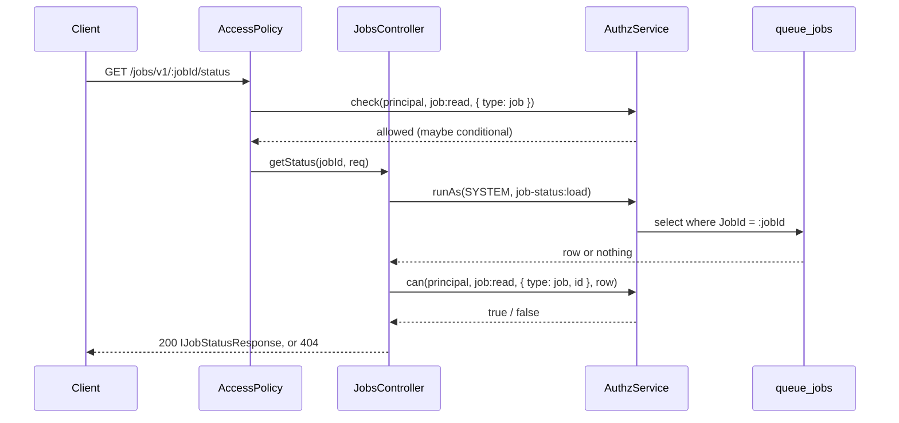

# Job status route

`GET jobs/v1/:jobId/status` returns the status, progress, phase, result and error of one queue job. Use it to drive a progress bar or to wait for a long job (export, import, report) that a request started.

## How it works

1. `FilesystemControllerSource` of `@spinajs/http` finds `JobsController` in the directory the package config adds to `system.dirs.controllers`, and `Controllers` mounts it at `jobs/v1` (after `http.controllers.route.prefix`, when set).
2. `AccessPolicy` from `@spinajs/authz-http` runs the route's `@Access('job:read')`:
   1. it stores the route's authz domain in `req.storage.AuthzHttpRoute` (`root` by default);
   2. without `req.storage.Principal`, or with an unauthenticated principal, it answers 401;
   3. it checks `job:read` on the type `{ type: 'job' }`. A principal that holds `job:read` on no job at all gets 403. A conditional grant (`job:read` on `owner`) passes; the row check comes later.
3. `JobsController.getStatus(jobId, req)` calls `authzOf(req)`: the root `AuthzService` for the `root` domain, else `AuthzDomains.service(domain)`.
4. It loads the row with `JobModel.select().where('JobId', jobId).first()` inside `authz.runAs(SYSTEM, 'job-status:load', ...)`, so the ORM's authz scope does not filter the lookup.
5. `canRead(req, row)` calls `authz.can(principal, 'job:read', { type: 'job', id: String(row.Id) }, row)`. The resource id is the integer `Id`, not the `JobId` UUID, and the loaded row is the subject, so the `owner` relation is evaluated without a second load.
6. An unknown `JobId` and a row the principal may not read both throw `ResourceNotFound`, which answers 404.
7. Otherwise it maps the row to `IJobStatusResponse` and returns `Ok` (200).



## Decorators

`JobsController` carries these decorators; you meet them again when you redeclare the route in a subclass.

| Decorator | Target | Options | Effect |
| --- | --- | --- | --- |
| `@BasePath('jobs/v1')` | class `JobsController` | path | Mounts the controller at `jobs/v1`. |
| `@Get(':jobId/status')` | method `getStatus` | path | The route. |
| `@Access('job:read')` | method `getStatus` | `AccessOptions` of `@spinajs/authz-http`; none set, so domain `root` and a type-level resource | Requires a principal and `job:read` on some job. |
| `@Param()` | parameter `jobId` | none | The `:jobId` path segment, a string. |
| `@Req()` | parameter `req` | none | The request, for `req.storage`. |

## Configuration

The package ships one config file. It has no keys of its own.

| Key | Type | Default | Allowed values | Meaning |
| --- | --- | --- | --- | --- |
| `system.dirs.controllers` | `string[]` | the package adds `<WORKSPACE_ROOT_PATH or cwd>/node_modules/@spinajs/queue-http-progress/lib/<mjs or cjs>/controllers` | absolute directories | Where `FilesystemControllerSource` finds `JobsController`. `mjs` is picked in an ES module build, `cjs` in CommonJS. |

```ts
// What the package's lib/<mjs|cjs>/config/queue-http-progress.js contributes.
export default {
  system: {
    dirs: {
      controllers: ['/srv/app/node_modules/@spinajs/queue-http-progress/lib/mjs/controllers'],
    },
  },
};
```

Config arrays concatenate across files, so an app config cannot remove this directory. To unmount the route, see [Unmount the route](02-customising-the-status-route.md#unmount-the-route).

Keys of `@spinajs/queue` that change what this route reports:

| Key | Type | Default | Allowed values | Meaning |
| --- | --- | --- | --- | --- |
| `queue.progress.minDelta` | `number` | `5` | 0-100 | A non-final progress update without `phase` or `message` is persisted only when it moved at least this many percent... |
| `queue.progress.minInterval` | `number` | `1000` | milliseconds | ...or this much time passed since the last persisted write. |
| `queue.retention.enabled` | `boolean` | `false` | `true`, `false` | When on, old terminal rows are purged; the route then answers 404 for them. |
| `queue.retention.maxAge` | `number` | not set | milliseconds | Age of the terminal rows the retention service deletes. |

## Schema

The route reads `JobModel` of `@spinajs/queue` (connection `queue`). It writes nothing.

### `queue_jobs`

| Column | Type | Meaning |
| --- | --- | --- |
| `Id` | integer, primary key | The authz resource id of the job (`{ type: 'job', id: String(Id) }`). |
| `JobId` | string, unique | The id `QueueJob.emit()` returns; the `:jobId` route parameter. |
| `Status` | `JobStatus` | `created`, `executing`, `retrying`, `success`, `error` or `dead`. |
| `Progress` | number | 0-100. |
| `Phase`, `Message` | string, nullable | Meta the job passes to its progress callback. |
| `Result` | JSON | What `execute()` returned, on success. |
| `LastError` | string | Message of the last failed run. |
| `Attempt`, `MaxAttempts` | number | Failed runs so far; allowed runs (`RetryCount + 1`). |
| `InitiatorType`, `InitiatorId` | string, nullable | The job's owner, stamped by `@spinajs/authz-queue`. |
| `CreatedAt`, `FinishedAt` | datetime | Row creation; time of success. |

### Response: `IJobStatusResponse`

| Field | Type | Source column | Present when |
| --- | --- | --- | --- |
| `jobId` | `string` | `JobId` | always |
| `status` | `JobStatus` | `Status` | always |
| `progress` | `number` | `Progress` | always |
| `result` | `unknown` | `Result` | the column is not null |
| `phase` | `string` | `Phase` | the column is not null |
| `message` | `string` | `Message` | the column is not null |
| `error` | `string` | `LastError` | `status` is `retrying`, `dead` or `error` |
| `attempt` | `number` | `Attempt` | always |
| `maxAttempts` | `number` | `MaxAttempts` | always |
| `createdAt` | `DateTime` | `CreatedAt` | always |
| `finishedAt` | `DateTime` | `FinishedAt` | the job succeeded |

### Status codes

| Code | When |
| --- | --- |
| 200 | The row exists and `canRead()` allows it. |
| 401 | No principal, or an unauthenticated one. Body `{ error: 'unauthenticated', message }`. |
| 403 | The principal holds `job:read` on no job at all. |
| 404 | No row with this `JobId`, or a row the principal may not read. Both answer the same body except for the echoed id. |

## Services and extension points

| Service | DI token and lifetime | Default implementation | Alternatives | How to replace or extend |
| --- | --- | --- | --- | --- |
| `JobsController` | Not decorated for DI; `Controllers` registers it as `BaseController` and resolves it as a singleton | `JobsController` | none shipped | Subclass it and `DI.register(Mine).as(JobsController)` before `Controllers` resolves; override `canRead()` or `authzOf()`. See [Customising the status route](02-customising-the-status-route.md). |

## Important behaviour

- The row exists only after a consumer received the job: `@spinajs/queue` inserts it on first receipt, not on `emit()`. Between emit and pickup the route answers 404. A client must retry a 404 for a while before it gives up.
- An unknown job and a job of another user answer alike (404), so the route does not reveal which `JobId`s exist.
- The owner check needs the job's initiator. A job emitted outside a request (no principal in the async context) has no `InitiatorType` and `InitiatorId`; only a principal with an unconditional `job:read` can read it.
- `error` is hidden while a retried job is `executing` again, even though `LastError` still holds the previous failure.
- `finishedAt` is set only on success. A `dead` job has no `finishedAt`.
- `attempt` counts failed runs: it is `0` while the first run executes.
- `progress` can lag up to `queue.progress.minDelta` percent or `queue.progress.minInterval` ms behind the job, because writes are throttled. A change of `phase` or `message`, and 100%, are always written.
- `createdAt` and `finishedAt` are luxon `DateTime` on the server and ISO 8601 strings in the JSON body.
- `result` returns whatever `execute()` returned, to every principal that may read the job. Keep secrets out of job results.

## Best practices

- Return the `JobId` from the route that emits the job, as `jobId` or as a ready `statusUrl`; the client has no other way to learn it.
- Emit jobs inside the authenticated request, so `@spinajs/authz-queue` stamps the caller as the owner and the default `user` grant lets them poll.
- Report `phase` and `message` in the progress callback; they reach the client at once and give a progress bar its label.
- Poll with a fixed interval of about `queue.progress.minInterval`; faster polling sees the same throttled value.
- Treat `success`, `error` and `dead` as final; `retrying` is not.

## Patterns and antipatterns

```ts
// Don't: one 404 does not mean the job is gone; the consumer may not have picked it up yet.
const res = await fetch(`/jobs/v1/${jobId}/status`);
if (res.status === 404) throw new Error('job lost');

// Do: retry a 404 a bounded number of times, then give up.
for (let tries = 0; tries < 30; tries++) {
  const res = await fetch(`/jobs/v1/${jobId}/status`);
  if (res.status !== 404) return res;
  await new Promise((r) => setTimeout(r, 1000));
}
```

```ts
// Don't: emitted from a cron callback, the job has no initiator, so its user cannot poll it.
setInterval(() => InvoiceExportJob.emit({ Month: '2026-09' }), 86_400_000);

// Do: emit from the request that the user made, and return the id.
@Post('export')
public async export() {
  return new Ok({ jobId: await InvoiceExportJob.emit({ Month: '2026-09' }) });
}
```

## Examples

### Poll a job from a browser client

```ts sample
import type { IJobStatusResponse } from '@spinajs/queue-http-progress';

// Dates arrive as ISO strings in JSON.
export type JobStatusJson = Omit<IJobStatusResponse, 'createdAt' | 'finishedAt'> & { createdAt?: string; finishedAt?: string };

const FINAL = ['success', 'error', 'dead'];

export async function waitForJob(jobId: string, onProgress: (s: JobStatusJson) => void): Promise<JobStatusJson> {
  let notFound = 0;

  for (;;) {
    const res = await fetch(`/api/jobs/v1/${encodeURIComponent(jobId)}/status`, { credentials: 'include' });

    if (res.status === 200) {
      const status = (await res.json()) as JobStatusJson;
      onProgress(status);
      if (FINAL.includes(status.status)) return status;
    } else if (res.status === 404 && ++notFound < 30) {
      // Not picked up by a consumer yet, or not ours: retry for 30 s.
    } else {
      throw new Error(`Job ${jobId}: HTTP ${res.status}`);
    }

    await new Promise((resolve) => setTimeout(resolve, 1000));
  }
}

export async function exportInvoices(bar: HTMLProgressElement, label: HTMLElement) {
  const { jobId } = (await (await fetch('/api/invoices/export', { method: 'POST', credentials: 'include' })).json()) as { jobId: string };

  const done = await waitForJob(jobId, (s) => {
    bar.value = s.progress;
    label.textContent = s.message ?? s.phase ?? s.status;
  });

  if (done.status !== 'success') {
    label.textContent = `Export failed: ${done.error ?? 'unknown error'}`;
  }
}
```

The example assumes `http.controllers.route.prefix` is `api`.

### Report phases from a long job

```ts sample
import { Job, JobProgressCallback, QueueJob } from '@spinajs/queue';

@Job({ runAs: 'initiator' })
export class ProductImportJob extends QueueJob {
  public Rows!: string[];

  public async execute(progress: JobProgressCallback) {
    await progress(0, { phase: 'validating', message: `${this.Rows.length} rows` });

    for (let i = 0; i < this.Rows.length; i++) {
      // ... import one row ...
      // Throttled by queue.progress.minDelta / minInterval; the route sees every 5% at most once a second.
      await progress(Math.floor(((i + 1) / this.Rows.length) * 100));
    }

    await progress(100, { phase: 'done', message: 'Import finished' });
    return { imported: this.Rows.length };
  }
}
```

## Related

- [Customising the status route](02-customising-the-status-route.md): replace or extend `JobsController`.
- [`@spinajs/queue`](../queue/README.md): job tracking, `JobModel`, progress throttling and retention.
- [Controller discovery](../http/03-controller-discovery.md): how `system.dirs.controllers` mounts the route.
- [`@spinajs/authz-http`](../../packages/authz-http/README.md): `@Access`, `AccessPolicy` and the 401 and 403 bodies.
- [`@spinajs/authz-queue`](../../packages/authz-queue/README.md): the `job` resource, its `owner` relation and the default `job:read` grant.
