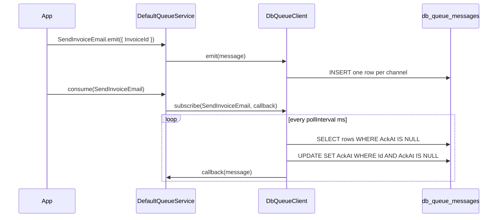

# Database-backed transport

A queue transport that stores messages in a database table and polls it, so jobs and events survive a restart without a message broker. This package plans one but ships none; build it as a custom `QueueClient` from `@spinajs/queue`, as this page shows.

Use it for tests, single-host deployments and small projects. For high throughput or many consumers, use a broker transport such as `@spinajs/queue-stomp-transport`.

## How it works

1. `DefaultQueueService` resolves its connections from `queue.connections` with `@AutoinjectService('queue.connections', QueueClient)`. Each entry's `service` names a class registered as `QueueClient`; the entry itself is the constructor argument (`IQueueConnectionOptions`).
2. `QueueClient.ServiceName` returns `Options.name`, so the service keys the connection map by the entry's `name`. `QueueService.get('db')` returns it.
3. `QueueJob.emit()` and `QueueEvent.emit()` reach `QueueService.emit()`, which picks connections by `queue.routing` (or `queue.default`) and calls `client.emit(message)`.
4. Your `emit()` writes one row per channel from `QueueClient.getChannelForMessage(message)`.
5. `QueueService.consume(MessageClass)` calls `client.subscribe(MessageClass, callback)`. Your `subscribe()` starts a poller per channel.
6. Each poll reads unacknowledged rows, claims each row with a conditional update, and passes the stored message to the callback.
7. The callback runs the job inside `QueueService`. When it throws, the service rethrows so the transport decides: retry, or move the row to `QueueClient.getDeadLetterChannelForMessage()`.



## Configuration

`queue.connections[]` entries are `IQueueConnectionOptions` from `@spinajs/queue`. The keys a database transport uses:

| Key | Type | Default | Allowed values | Meaning |
| --- | --- | --- | --- | --- |
| `queue.connections[].service` | `string` | none | class name registered as `QueueClient` | Which transport class to create. |
| `queue.connections[].name` | `string` | none | any unique name | Connection name; key in `QueueService` and value of `queue.default`. |
| `queue.connections[].defaultQueueChannel` | `string` | none | any channel name | Channel for jobs with no `queue.routing` entry. |
| `queue.connections[].defaultTopicChannel` | `string` | none | any channel name | Channel for events with no `queue.routing` entry. |
| `queue.connections[].defaultQueueDeadLetterChannel` | `string` | none | any channel name | Fallback dead-letter channel used by `getDeadLetterChannelForMessage()`. |
| `queue.connections[].options` | `any` | none | transport-defined | Free-form options; the sample below reads `options.pollInterval` (ms, default `1000`). |
| `queue.default` | `string` | `'black-hole'` | a connection `name` | Connection used for messages without routing. |

```ts
queue: {
  default: 'db',
  connections: [
    {
      service: 'DbQueueClient',
      name: 'db',
      defaultQueueChannel: 'jobs',
      defaultTopicChannel: 'events',
      defaultQueueDeadLetterChannel: 'jobs-dead',
      options: { pollInterval: 500 },
    },
  ],
},
db: {
  Connections: [
    {
      Driver: 'orm-driver-sqlite',
      Filename: './data/queue.sqlite',
      Name: 'queue-db',
      Migration: { OnStartup: true },
    },
  ],
},
```

## Schema

### `db_queue_messages`

Created by the migration in the sample below, on the `queue-db` connection.

| Column | Type | Meaning |
| --- | --- | --- |
| `Id` | `int`, primary key, auto increment | Delivery order within a channel. |
| `Channel` | `string(128)`, not null | Channel the message was routed to. |
| `Payload` | `text`, not null | The `IQueueMessage` as JSON. |
| `CreatedAt` | `dateTime`, not null | Insert time. |
| `AckAt` | `dateTime`, nullable | Claim time; `NULL` while the row waits for a consumer. |

## Services and extension points

| Service | DI token and lifetime | Default implementation | Alternatives | How to replace or extend |
| --- | --- | --- | --- | --- |
| Queue transport | `QueueClient` (abstract, `@spinajs/queue`); `@NewInstance()`, one instance per `queue.connections` entry, matched by `__checkInstance__()` on `Options.name` | `BlackHoleQueueClient` (`service: 'BlackHoleQueueClient'`, drops every message) | `@spinajs/queue-stomp-transport`, `@spinajs/queue-amqp-transport`, `@spinajs/queue-sqs-transport`; this package ships none | Decorate your class `@Injectable(QueueClient)` and `@NewInstance()`, then set `queue.connections[].service` to its class name. Subclass it to change one step. |

`QueueClient` members a transport implements or reuses:

| Member | Kind | Role |
| --- | --- | --- |
| `emit(message)` | abstract | Store or send the message. Resolve only once the message is durable. |
| `subscribe(channelOrClass, callback, subscriptionId?, durable?)` | abstract, two overloads | Start delivering a channel, or every channel routed for a message class. |
| `unsubscribe(channelOrClass, removeDurable?)` | abstract, two overloads | Stop delivery. |
| `resolve()` / `dispose()` | `AsyncService` hooks | Open and close resources; `DefaultQueueService.dispose()` disposes every connection. |
| `getChannelForMessage(message)` | inherited | Channels from `queue.routing`, else `defaultQueueChannel` or `defaultTopicChannel`. |
| `getDeadLetterChannelForMessage(message)` | inherited | Dead-letter channel from routing, else `defaultQueueDeadLetterChannel`. |
| `Options`, `Log`, `Routing` | inherited | Connection entry, `queue` logger, `queue.routing` config. |

### Queue transport: custom implementation

Register the class before `QueueService` resolves: an `import` of the file at startup is enough, because `@Injectable(QueueClient)` registers at class definition. The migration registers the same way, so `Orm` picks it up through `DiRegistryMigrationSource`.

```ts sample
import { DateTime } from 'luxon';
import { Constructor, DI, Injectable, NewInstance } from '@spinajs/di';
import { Connection, CreatedAt, Json, Migration, Model, ModelBase, OrmDriver, OrmMigration, OrmMigrator, Primary } from '@spinajs/orm';
import { IQueueMessage, Job, QueueClient, QueueJob, QueueMessage, QueueService } from '@spinajs/queue';

@Migration('queue-db')
export class DbQueueMessages_2026_10_17_00_00_00 extends OrmMigration {
  public async up(connection: OrmDriver): Promise<void> {
    await connection.schema().createTable('db_queue_messages', (table) => {
      table.increments('Id');
      table.string('Channel', 128).notNull();
      table.text('Payload').notNull();
      table.dateTime('CreatedAt').notNull();
      table.dateTime('AckAt');
    });
  }

  public async down(connection: OrmDriver): Promise<void> {
    await connection.schema().dropTable('db_queue_messages').ifExists();
  }
}

@Connection('queue-db')
@Model('db_queue_messages')
export class QueuedMessage extends ModelBase<QueuedMessage> {
  @Primary()
  public Id: number;

  public Channel: string;

  @Json()
  public Payload: IQueueMessage;

  @CreatedAt()
  public CreatedAt: DateTime;

  public AckAt: DateTime | null;
}

type Delivery = (message: IQueueMessage) => Promise<void>;

@NewInstance()
@Injectable(QueueClient)
export class DbQueueClient extends QueueClient {
  protected Pollers = new Map<string, NodeJS.Timeout>();
  protected Busy = new Set<string>();

  protected get PollInterval(): number {
    return this.Options.options?.pollInterval ?? 1000;
  }

  public async emit(message: IQueueMessage): Promise<void> {
    for (const channel of this.getChannelForMessage(message)) {
      await QueuedMessage.insert({ Channel: channel, Payload: message, CreatedAt: DateTime.now() });
    }
  }

  public async subscribe(channel: string | Constructor<QueueMessage>, callback: Delivery): Promise<void> {
    for (const c of this.channelsOf(channel)) {
      if (!this.Pollers.has(c)) {
        this.Pollers.set(c, setInterval(() => void this.poll(c, callback), this.PollInterval));
      }
    }
  }

  public unsubscribe(channel: string | Constructor<QueueMessage>): void {
    for (const c of this.channelsOf(channel)) {
      clearInterval(this.Pollers.get(c));
      this.Pollers.delete(c);
    }
  }

  public async dispose(): Promise<void> {
    this.Pollers.forEach((timer) => clearInterval(timer));
    this.Pollers.clear();
  }

  protected channelsOf(channel: string | Constructor<QueueMessage>): string[] {
    return typeof channel === 'string' ? [channel] : this.getChannelForMessage(channel);
  }

  protected async poll(channel: string, callback: Delivery): Promise<void> {
    // setInterval does not wait for a slow batch; skip the tick instead of delivering twice.
    if (this.Busy.has(channel)) {
      return;
    }

    this.Busy.add(channel);
    try {
      const pending: QueuedMessage[] = await QueuedMessage.where('Channel', channel).whereNull('AckAt').orderBy('Id').take(50);
      for (const row of pending) {
        await this.deliver(row, callback);
      }
    } finally {
      this.Busy.delete(channel);
    }
  }

  protected async deliver(row: QueuedMessage, callback: Delivery): Promise<void> {
    // The conditional update is the claim: of several consumer processes, only one changes the row.
    const claim = await QueuedMessage.update({ AckAt: DateTime.now() }).where('Id', row.Id).whereNull('AckAt');
    if (claim.RowsAffected === 0) {
      return;
    }

    try {
      await callback(row.Payload);
    } catch (err) {
      await this.onDeliveryFailed(row, err);
    }
  }

  protected async onDeliveryFailed(row: QueuedMessage, err: unknown): Promise<void> {
    const deadLetter = this.getDeadLetterChannelForMessage(row.Payload);
    this.Log.warn({ id: row.Id, channel: row.Channel, error: err }, 'Message ${id} on ${channel} failed');

    if (deadLetter) {
      await QueuedMessage.update({ Channel: deadLetter, AckAt: null }).where('Id', row.Id);
    } else {
      await QueuedMessage.update({ AckAt: null }).where('Id', row.Id);
    }
  }
}

@Job()
export class SendInvoiceEmail extends QueueJob {
  public InvoiceId: number;

  public async execute(): Promise<unknown> {
    return { sent: this.InvoiceId };
  }
}

export async function startInvoiceMailer(): Promise<void> {
  // queue-db migrates on startup: model queries on it throw until the migrator resolved
  await DI.resolve(OrmMigrator);
  const queue = await DI.resolve(QueueService);

  await queue.consume(SendInvoiceEmail);
  await SendInvoiceEmail.emit({ InvoiceId: 42 });
}
```

### Queue transport: extend instead of replace

Subclass `DbQueueClient` and override one protected step. The subclass registers as its own `QueueClient`; point `service` at its class name. The base class stays usable for other connections.

| Method | Override to |
| --- | --- |
| `poll(channel, callback)` | Change batch size, ordering (priority, `ScheduleDelay`) or the poll strategy. |
| `deliver(row, callback)` | Change how a row is claimed, for example with a lease column instead of `AckAt`. |
| `onDeliveryFailed(row, err)` | Change the retry policy: count attempts, delay, or delete. |
| `channelsOf(channel)` | Map message classes to channels differently from `queue.routing`. |

```ts
@NewInstance()
@Injectable(QueueClient)
export class PurgingDbQueueClient extends DbQueueClient {
  // Acknowledged rows are never read again; deleting them keeps the poll query cheap.
  protected async deliver(row: QueuedMessage, callback: (message: IQueueMessage) => Promise<void>): Promise<void> {
    await super.deliver(row, callback);
    await QueuedMessage.destroy(row.Id).whereNotNull('AckAt');
  }
}
```

## Important behaviour

- Delivery is at least once. A process that dies after the claim and before the callback leaves the row claimed; add a lease timeout in `deliver()` if that matters.
- The claim (`UPDATE ... WHERE Id = ? AND AckAt IS NULL`) keeps two consumer processes from running the same row, as long as the database applies single-row updates atomically.
- `QueueService` rethrows a failed job so the transport sees the failure. A job the service marks `dead` is terminal: with `queue.deduplicate` on (the default), its next delivery returns without running and without throwing, so the release-and-retry loop in `onDeliveryFailed()` ends.
- `emit()` resolves after the insert. This meets the `QueueClient` contract for persistent jobs: the promise resolves once the message is stored.
- `@NewInstance()` with `__checkInstance__()` gives one client per `queue.connections` entry, so two entries with the same `service` and different `name` poll independently.
- Polling adds latency up to `options.pollInterval` and one query per subscribed channel per tick, also when the table is empty.

## Best practices

- Put the queue table on its own connection (`queue-db` above) so a long application transaction never blocks the claim updates.
- Read transport settings from `this.Options.options`, not from a separate config path, so each `queue.connections` entry tunes its own client.
- Use `getChannelForMessage()` and `getDeadLetterChannelForMessage()` instead of hard-coded channel names; then `queue.routing` keeps working with your transport.
- Clear every timer in `dispose()`. `DefaultQueueService.dispose()` calls it on shutdown; a live `setInterval` keeps the process alive.

## Patterns and antipatterns

```ts
// Don't: read-then-update lets two consumers pick the same row between the SELECT and the UPDATE
const row = await QueuedMessage.where('Channel', channel).whereNull('AckAt').first();
await callback(row.Payload);
await QueuedMessage.update({ AckAt: DateTime.now() }).where('Id', row.Id);

// Do: claim with a conditional update and run the callback only when the update changed the row
const claim = await QueuedMessage.update({ AckAt: DateTime.now() }).where('Id', row.Id).whereNull('AckAt');
if (claim.RowsAffected === 1) {
  await callback(row.Payload);
}
```

```ts
// Don't: fire-and-forget emit; a crash before the insert loses a persistent job
public async emit(message: IQueueMessage): Promise<void> {
  void QueuedMessage.insert({ Channel: 'jobs', Payload: message });
}

// Do: await the write and route through getChannelForMessage()
public async emit(message: IQueueMessage): Promise<void> {
  for (const channel of this.getChannelForMessage(message)) {
    await QueuedMessage.insert({ Channel: channel, Payload: message, CreatedAt: DateTime.now() });
  }
}
```

## Related

- [Event transport schema](01-event-transport-schema.md): the inactive design this package ships in source.
- [`@spinajs/queue`](../queue/README.md): `QueueClient`, `QueueService`, routing, jobs and events.
- [Migrations](../orm/10-migrations.md): how the sample migration is discovered at `Orm.resolve()` and applied by `OrmMigrator`'s boot pass.
- [Query builder](../orm/05-query-builder.md): `where()`, `whereNull()`, `orderBy()`, `take()` and update builders used by the poller.
- [`@spinajs/queue-amqp-transport`](../queue-amqp-transport/README.md): a broker transport with the same `QueueClient` contract.
