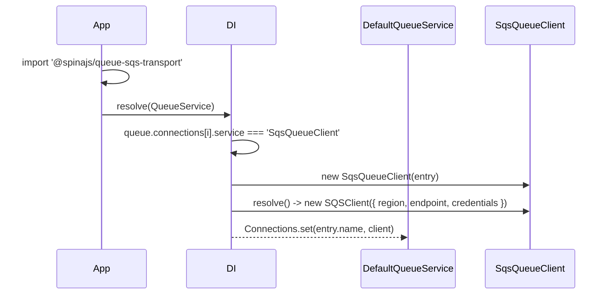

# SQS connection

A `queue.connections` entry with `service: 'SqsQueueClient'` becomes one `SqsQueueClient`. The client wraps one `SQSClient` from `@aws-sdk/client-sqs`; there is no socket to open, so a connection never "connects" and never reconnects.

## How it works

1. **Registration on import.** Importing `@spinajs/queue-sqs-transport` runs `@Injectable(QueueClient)` on `SqsQueueClient`, which registers the class under `QueueClient` and under itself.
2. **Selection.** `DefaultQueueService` (from `@spinajs/queue`) has `@AutoinjectService('queue.connections', QueueClient)`. For each entry, DI finds the `QueueClient` registration whose class name equals `entry.service`.
3. **Construction.** DI resolves `SqsQueueClient` with `[entry]`. `@PerInstanceCheck()` caches one instance per `entry.name`; on a miss DI calls `new SqsQueueClient(entry)` and awaits `client.resolve()`.
4. **`SqsQueueClient.resolve()`** builds `this.Sqs = new SQSClient({ region, endpoint, credentials })` from `entry.options` and logs `SQS queue client <name> resolved` on the `queue` logger. It makes no AWS call and validates no queue URL.
5. **Registration in the service.** `DefaultQueueService` stores the client in its `Connections` map under `entry.name` (`QueueClient.ServiceName`).

Errors on the way:

- `entry.service` with no matching class throws `ServiceNotFound('Service <name> is not registered in DI container')` when `QueueService` resolves. The usual cause is a missing `import '@spinajs/queue-sqs-transport'`.
- Bad credentials, a wrong region or a missing queue do **not** fail at boot. They show up on the first `emit()` (rejected promise) or as receive errors in the poll loop.



## Configuration

The connection entry is the whole object in `queue.connections[]`. SQS settings live in its `options` bag, typed `ISqsConnectionOptions`.

| Key | Type | Default | Allowed values | Meaning |
| --- | --- | --- | --- | --- |
| `queue.connections[].service` | `string` | none, required | `'SqsQueueClient'` or the class name of a registered subclass | Selects the transport class. |
| `queue.connections[].name` | `string` | none, required | unique per app | Connection name. Routing entries and `QueueService.get(name)` use it. |
| `queue.connections[].defaultQueueChannel` | `string` | none | SQS queue URL | Where a job goes when `queue.routing` has no entry (or an entry without `channel`) for it. |
| `queue.connections[].defaultTopicChannel` | `string` | none | SQS queue URL | Same, for events. |
| `queue.connections[].options.region` | `string` | SDK default (`AWS_REGION`, shared config) | AWS region | Passed to `SQSClient`. |
| `queue.connections[].options.endpoint` | `string` | SDK default (the AWS endpoint for the region) | URL | Custom endpoint, for example LocalStack `http://localhost:4566`. |
| `queue.connections[].options.credentials` | `{ accessKeyId: string; secretAccessKey: string }` | SDK default credential chain | static key pair | Static credentials. Leave unset to use env vars, a profile, an instance role or IRSA. |
| `queue.connections[].options.waitTimeSeconds` | `number` | `20` | `0`-`20` (SQS limit) | Long-poll wait of each `ReceiveMessage`. See [Consuming messages](03-consuming-messages.md). |
| `queue.connections[].options.maxMessages` | `number` | `1` | `1`-`10` (SQS limit) | `MaxNumberOfMessages` per receive. |
| `queue.connections[].options.visibilityTimeout` | `number` | the queue's own setting | `0`-`43200` seconds (SQS limit) | `VisibilityTimeout` per receive: how long a failed message stays hidden before redelivery. |
| `queue.connections[].options.receiveErrorBackoffMs` | `number` | `500` | `>= 0` (negative is clamped to `0`) | First sleep after a failed receive. |
| `queue.connections[].options.receiveErrorBackoffMaxMs` | `number` | `10000` | `>= receiveErrorBackoffMs` (lower is raised to it) | Cap of the doubling receive-error sleep. |

Keys of `IQueueConnectionOptions` the SQS transport reads **nowhere**: `login`, `password`, `host`, `port`, `queue`, `clientId`, `credentialProvider`, `reconnectDelay`, `heartbeatIncoming`, `heartbeatOutgoing`, `connectionTimeout`, `receiptTimeout`, `debug`, `retryDelay` and `defaultQueueDeadLetterChannel`. `options.queueUrl` is declared (deprecated) on `ISqsConnectionOptions` but is not read either; use `defaultQueueChannel`, `defaultTopicChannel` or `queue.routing`.

```ts
// config/queue.ts
export default {
  queue: {
    default: 'sqs',
    routing: {
      SendInvoiceJob: 'https://sqs.eu-central-1.amazonaws.com/123456789012/invoices',
    },
    connections: [
      {
        service: 'SqsQueueClient',
        name: 'sqs',
        defaultQueueChannel: 'https://sqs.eu-central-1.amazonaws.com/123456789012/jobs',
        defaultTopicChannel: 'https://sqs.eu-central-1.amazonaws.com/123456789012/events',
        options: {
          region: 'eu-central-1',
          waitTimeSeconds: 20,
          maxMessages: 5,
          visibilityTimeout: 120,
          receiveErrorBackoffMs: 1000,
          receiveErrorBackoffMaxMs: 30000,
        },
      },
    ],
  },
};
```

## Services and extension points

| Service | DI token and lifetime | Default implementation | Alternatives | How to replace or extend |
| --- | --- | --- | --- | --- |
| Queue transport | `QueueClient`, selected by class name from `queue.connections[].service`; `@PerInstanceCheck()`, one instance per connection `name`, built when `QueueService` resolves | `SqsQueueClient` | `BlackHoleQueueClient` (`@spinajs/queue`), AMQP and STOMP transports, your subclass | Register a class `@Injectable(QueueClient)` and name it in `service`; see [Extending the SQS client](04-extending-the-sqs-client.md) |
| AWS client | `protected Sqs: SQSClient`, built in `resolve()` | `new SQSClient({ region, endpoint, credentials })` | | Override `resolve()` in a subclass; see [rotating credentials](04-extending-the-sqs-client.md#rotate-credentials-from-a-secret-store) |
| Logger | `protected Log`, `@Logger('queue')` (from `QueueClient`) | the `queue` logger | | Configure `logger.rules` for `queue` |
| Routing table | `protected Routing`, `@Config('queue.routing')` (from `QueueClient`) | `queue.routing` | | Edit config; read live on every `emit()` and `subscribe()` |

## Important behaviour

- **One client per connection name.** `SqsQueueClient` is decorated `@PerInstanceCheck()`, so `DI.resolve(SqsQueueClient, [entry])` with the `name` of a connection `QueueService` already built returns that same client. Prefer `QueueService.get('sqs')`: it needs no entry.
- **Boot does no network I/O.** A typo in a queue URL or region surfaces only on the first send or receive.
- **The `SQSClient` is shared** by all sends and all poll loops of one connection. `dispose()` destroys it.
- **Credentials resolve lazily.** With no `options.credentials`, the SDK default chain runs on the first request, not in `resolve()`.

## Best practices

- Leave `options.credentials` unset in AWS. An instance role, ECS task role or IRSA gives rotating credentials through the SDK default chain.
- Put queue URLs in `queue.routing` and keep `defaultQueueChannel` as a catch-all. A routing-only connection (no defaults) is valid; `resolve()` checks no destination.
- Use one connection per AWS account and region. A routing entry `{ channel, connection }` sends a message type to a second connection.
- For local development, run LocalStack (`packages/queue-sqs-transport/test/docker-compose.yml`) and set `options.endpoint`, `options.region` and dummy `options.credentials`.

## Patterns and antipatterns

```ts
// Don't: repeats the connection entry; a different name builds a client QueueService does not know about.
const client = await DI.resolve(SqsQueueClient, [{ service: 'SqsQueueClient', name: 'sqs' }]);

// Do: use the instance QueueService built at boot.
const queue = await DI.resolve(QueueService);
const client = queue.get('sqs');
```

```ts
// Don't: queueUrl is declared on ISqsConnectionOptions but never read.
{ service: 'SqsQueueClient', name: 'sqs', options: { queueUrl: 'https://sqs.../jobs' } }

// Do
{ service: 'SqsQueueClient', name: 'sqs', defaultQueueChannel: 'https://sqs.../jobs' }
```

## Examples

### Run against LocalStack in development

```ts sample
import '@spinajs/queue-sqs-transport';
import { FrameworkConfiguration } from '@spinajs/configuration';

const LOCALSTACK = process.env.SQS_ENDPOINT ?? 'http://localhost:4566';

export class DevQueueConfiguration extends FrameworkConfiguration {
  protected onLoad(): unknown {
    return {
      queue: {
        default: 'sqs-local',
        routing: {
          SendWelcomeEmailJob: `${LOCALSTACK}/000000000000/welcome-emails`,
        },
        connections: [
          {
            service: 'SqsQueueClient',
            name: 'sqs-local',
            options: {
              region: 'us-east-1',
              endpoint: LOCALSTACK,
              credentials: { accessKeyId: 'test', secretAccessKey: 'test' },
              // short long-poll so the worker shuts down fast in dev
              waitTimeSeconds: 1,
            },
          },
        ],
      },
    };
  }
}
```

### Two AWS regions, one app

```ts sample
import '@spinajs/queue-sqs-transport';
import { DI } from '@spinajs/di';
import { QueueService } from '@spinajs/queue';

export const config = {
  queue: {
    default: 'sqs-eu',
    routing: {
      // goes to the default connection
      GenerateReportJob: 'https://sqs.eu-central-1.amazonaws.com/123456789012/reports',
      // goes to the US connection
      SyncUsCrmJob: {
        connection: 'sqs-us',
        channel: 'https://sqs.us-east-1.amazonaws.com/123456789012/crm-sync',
      },
    },
    connections: [
      { service: 'SqsQueueClient', name: 'sqs-eu', options: { region: 'eu-central-1' } },
      { service: 'SqsQueueClient', name: 'sqs-us', options: { region: 'us-east-1' } },
    ],
  },
};

export async function usClient() {
  const queue = await DI.resolve(QueueService);
  return queue.get('sqs-us');
}
```

## Related

- [Publishing messages](02-publishing-messages.md): how `defaultQueueChannel`, `defaultTopicChannel` and `queue.routing` become queue URLs.
- [Consuming messages](03-consuming-messages.md): what `waitTimeSeconds`, `maxMessages`, `visibilityTimeout` and the backoff keys change.
- [Extending the SQS client](04-extending-the-sqs-client.md): replacing the class or registering a factory.
- [`@spinajs/queue`](../queue/README.md): the `queue` config block, `QueueService` and routing.
