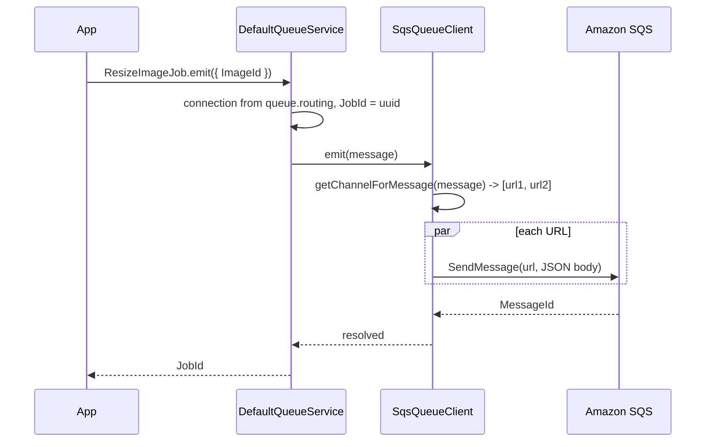

# Publishing messages

`SqsQueueClient.emit()` sends one queue message to every SQS queue URL its routing resolves to, as a JSON body. You do not call it directly: `QueueEvent.emit()`, `QueueJob.emit()` and `QueueService.emit()` from `@spinajs/queue` pick the connection and call it.

## How it works

1. **Caller.** `ResizeImageJob.emit({ ... })` builds an `IQueueMessage` (`Name` is the class name, `Type` is `JOB` or `EVENT`). `DefaultQueueService.emit()` picks the connections from `queue.routing[Name].connection` (default: `queue.default`) and, for a job, stamps `JobId` with a UUID.
2. **Queue URLs.** `SqsQueueClient.emit()` calls `QueueClient.getChannelForMessage(message)`:
   - a string entry in `queue.routing[Name]` is the URL;
   - an object entry uses its `channel`;
   - an array entry yields every URL, de-duplicated;
   - no entry, or an entry without `channel`, falls back to `defaultQueueChannel` for jobs and `defaultTopicChannel` for events, with a `No routing for event <Name> found` warning when there is no entry.
3. **Body.** `JSON.stringify(message)`: every field of the message goes into the body, `CreatedAt` as an ISO string.
4. **Send.** One `SendMessageCommand({ QueueUrl, MessageBody })` per URL, in parallel through the shared `SQSClient`. Each send is traced on the `queue` logger.
5. **Result.** The promise resolves when SQS has accepted the message on every URL. That is SQS's durable custody, which satisfies the `QueueClient.emit()` contract for persistent jobs.

Errors: any rejected `SendMessage` (unknown queue, access denied, throttling, a body over the SQS size limit, an `undefined` URL) rejects `emit()` with the AWS SDK error. Sends to the other URLs are not cancelled, so a fan-out can be partly delivered. There is no retry in the transport; the SDK applies its own retry strategy first.



## Configuration

| Key | Type | Default | Allowed values | Meaning |
| --- | --- | --- | --- | --- |
| `queue.routing.<MessageName>` | `string \| { channel?, connection?, deadLetterChannel? } \| array of these` | none | SQS queue URLs | Destination queues of a message type. `deadLetterChannel` is ignored by this transport. |
| `queue.connections[].defaultQueueChannel` | `string` | none | SQS queue URL | Fallback URL for jobs. |
| `queue.connections[].defaultTopicChannel` | `string` | none | SQS queue URL | Fallback URL for events. |

```ts
// config/queue.ts
export default {
  queue: {
    routing: {
      // one queue
      ResizeImageJob: 'https://sqs.eu-central-1.amazonaws.com/123456789012/image-resize',
      // fan-out to two queues on the same connection
      OrderPlaced: [
        'https://sqs.eu-central-1.amazonaws.com/123456789012/billing-events',
        'https://sqs.eu-central-1.amazonaws.com/123456789012/shipping-events',
      ],
    },
  },
};
```

## Message body

The body is the message object as JSON. A job emitted with `ResizeImageJob.emit({ ImageId: 'img-42' })` arrives as:

```json
{
  "Persistent": true,
  "ImageId": "img-42",
  "Type": "JOB",
  "CreatedAt": "2026-10-17T09:30:00.000+02:00",
  "Name": "ResizeImageJob",
  "JobId": "5f0c1d2e-8a51-4b8e-9c55-3c1f0e7f6a10"
}
```

`Name`, `Type` and `JobId` let the consumer rebuild the message; see [Consuming messages](03-consuming-messages.md). Producers in other languages can send the same shape to a queue a SpinaJS worker consumes.

## Services and extension points

| Service | DI token and lifetime | Default implementation | Alternatives | How to replace or extend |
| --- | --- | --- | --- | --- |
| Send | `public async emit(message: IQueueMessage)` on `SqsQueueClient` | `SendMessage` with URL and JSON body only | FIFO subclass in [Extending the SQS client](04-extending-the-sqs-client.md#send-to-fifo-queues) | Override `emit()`; reuse `this.getChannelForMessage()` and `this.Sqs` |
| Destination lookup | `public getChannelForMessage(message)` from `QueueClient` | `queue.routing`, then connection defaults | | Override in a subclass to compute URLs (per tenant, per region) |

## Important behaviour

- **SQS ignores the scheduling and priority fields.** `ScheduleDelay`, `SchedulePeriod`, `ScheduleRepeat`, `ScheduleCron` and `Priority` travel in the JSON body, but no `DelaySeconds` or other SQS attribute is set. A message is visible at once (or after the queue's own delivery delay).
- **No message attributes.** Everything is in the body; no `MessageAttributes` are sent.
- **FIFO queues reject these sends.** A `.fifo` queue requires `MessageGroupId`, which `emit()` does not set. Subclass as in [Send to FIFO queues](04-extending-the-sqs-client.md#send-to-fifo-queues).
- **An "event" is still a queue message.** Each SQS message is delivered to one consumer. For pub/sub, route the event to one queue per subscribing service (an array entry), or fan out with SNS and unwrap it on the consumer.
- **Routing is read live.** `getChannelForMessage()` reads `queue.routing` through `@Config` on every call; a `Configuration.set()` takes effect on the next emit.
- **Missing destination fails at send time.** With no routing entry and no matching default, the URL is `undefined` and the SDK rejects the send.

## Best practices

- Route every message type explicitly in `queue.routing`. The default-channel fallback logs a warning on every emit.
- Keep message fields JSON-safe. Class instances, `Map`, `Set` and `BigInt` do not survive `JSON.stringify`; only `CreatedAt` is turned back into a `DateTime` on receive.
- Keep payloads small and pass ids. The body counts against the SQS message size limit; store large data in S3 or the database.
- Give each job type its own queue. Types that share a URL share one poll loop and are handled one at a time; see [Consuming messages](03-consuming-messages.md#important-behaviour).

## Patterns and antipatterns

```ts
// Don't: SQS ignores ScheduleDelay, the job runs immediately.
await SendReminderJob.emit({ UserId: 7 }, { ScheduleDelay: 3600_000 } as IMessageOptions);

// Do: set a delivery delay on the queue, or emit later from a scheduler.
await SendReminderJob.emit({ UserId: 7 });
```

```ts
// Don't: two job types on one queue URL - only the first consume() subscribes,
// and it deletes the other type's messages.
queue: { routing: { ResizeImageJob: jobsUrl, SendInvoiceJob: jobsUrl } }

// Do: one queue per job type.
queue: { routing: { ResizeImageJob: resizeUrl, SendInvoiceJob: invoicesUrl } }
```

## Examples

### Fan an order event out to billing and shipping

```ts sample
import '@spinajs/queue-sqs-transport';
import { Event, QueueEvent } from '@spinajs/queue';

export const config = {
  queue: {
    default: 'sqs',
    routing: {
      OrderPlaced: [
        'https://sqs.eu-central-1.amazonaws.com/123456789012/billing-events',
        'https://sqs.eu-central-1.amazonaws.com/123456789012/shipping-events',
      ],
    },
    connections: [{ service: 'SqsQueueClient', name: 'sqs', options: { region: 'eu-central-1' } }],
  },
};

@Event()
export class OrderPlaced extends QueueEvent {
  public OrderId: number;
  public Total: number;
}

export async function placeOrder(orderId: number, total: number) {
  // resolves once both queues accepted the message
  await OrderPlaced.emit({ OrderId: orderId, Total: total });
}
```

### Emit a job and return its id for progress tracking

```ts sample
import '@spinajs/queue-sqs-transport';
import { Job, QueueJob } from '@spinajs/queue';

@Job()
export class ExportInvoicesJob extends QueueJob {
  public Month: string;

  public async execute() {
    return { file: `invoices-${this.Month}.csv` };
  }
}

export async function requestExport(month: string): Promise<string | undefined> {
  // the JobId rides in the SQS body; the consumer creates the queue_jobs row
  return ExportInvoicesJob.emit({ Month: month, RetryCount: 3 });
}
```

## Related

- [SQS connection](01-sqs-connection.md): `defaultQueueChannel`, `defaultTopicChannel` and the AWS client.
- [Consuming messages](03-consuming-messages.md): the other end of the body format.
- [Extending the SQS client](04-extending-the-sqs-client.md): FIFO sends and custom destination lookup.
- [`@spinajs/queue`](../queue/README.md): `QueueEvent`, `QueueJob`, `IMessageOptions` and routing.
