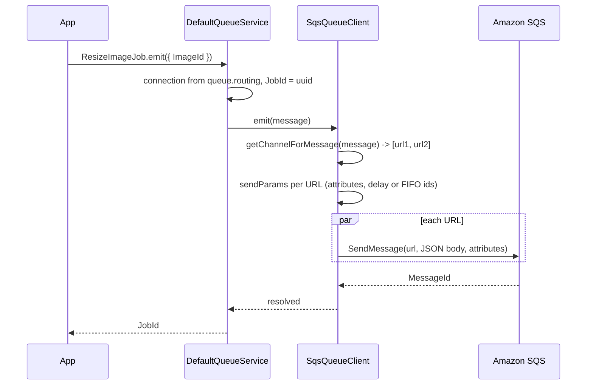

# Publishing messages

`SqsQueueClient.emit()` sends one queue message to every SQS queue URL its routing resolves to, as a JSON body with message attributes. You do not call it directly: `QueueEvent.emit()`, `QueueJob.emit()` and `QueueService.emit()` from `@spinajs/queue` pick the connection and call it.

## How it works

1. **Caller.** `ResizeImageJob.emit({ ... })` builds an `IQueueMessage` (`Name` is the class name, `Type` is `JOB` or `EVENT`). `DefaultQueueService.emit()` picks the connections from `queue.routing[Name].connection` (default: `queue.default`) and, for a job, stamps `JobId` with a UUID.
2. **Queue URLs.** `SqsQueueClient.emit()` calls `QueueClient.getChannelForMessage(message)`:
   - a string entry in `queue.routing[Name]` is the URL;
   - an object entry uses its `channel`;
   - an array entry yields every URL, de-duplicated;
   - no entry, or an entry without `channel`, falls back to `defaultQueueChannel` for jobs and `defaultTopicChannel` for events, with a `No routing for event <Name> found` warning when there is no entry.
3. **Body.** `JSON.stringify(message)`: every field of the message goes into the body, `CreatedAt` as an ISO string.
4. **Parameters.** `sendParams(url, message, { delayMs: message.ScheduleDelay })` builds the `SendMessageCommandInput` of every URL first: the [attributes](#message-attributes), the [delay](#delays) on a standard queue, the [group and deduplication ids](#fifo-queues) on a `.fifo` queue. A FIFO URL without a group id throws here, before anything is sent.
5. **Send.** One `sendMessage(input)` (a `SendMessageCommand`) per URL, in parallel through the shared `SQSClient`. Each send is traced on the `queue` logger.
6. **Result.** The promise resolves when SQS has accepted the message on every URL. That is SQS's durable custody, which satisfies the `QueueClient.emit()` contract for persistent jobs.

Errors: any rejected `SendMessage` (unknown queue, access denied, throttling, a body over the SQS size limit, an `undefined` URL) rejects `emit()` with the AWS SDK error. Sends to the other URLs are not cancelled, so a fan-out can be partly delivered. There is no retry in the transport; the SDK applies its own retry strategy first.



## Configuration

| Key | Type | Default | Allowed values | Meaning |
| --- | --- | --- | --- | --- |
| `queue.routing.<MessageName>` | `string \| { channel?, connection?, deadLetterChannel?, groupBy? } \| array of these` | none | SQS queue URLs | Destination queues of a message type. `deadLetterChannel` is ignored by this transport. |
| `queue.routing.<MessageName>.groupBy` | `string` | none | a message field name | The field whose value is the `MessageGroupId` of a send to a `.fifo` URL. Required for those sends, read by no other. |
| `queue.connections[].defaultQueueChannel` | `string` | none | SQS queue URL | Fallback URL for jobs. |
| `queue.connections[].defaultTopicChannel` | `string` | none | SQS queue URL | Fallback URL for events. |

```ts
// config/queue.ts
export default {
  queue: {
    routing: {
      // one queue
      ResizeImageJob: 'https://sqs.eu-central-1.amazonaws.com/123456789012/image-resize',
      // fan-out to two queues on the same connection
      OrderPlaced: [
        'https://sqs.eu-central-1.amazonaws.com/123456789012/billing-events',
        'https://sqs.eu-central-1.amazonaws.com/123456789012/shipping-events',
      ],
    },
  },
};
```

## Message body

The body is the message object as JSON. A job emitted with `ResizeImageJob.emit({ ImageId: 'img-42' })` arrives as:

```json
{
  "Persistent": true,
  "ImageId": "img-42",
  "Type": "JOB",
  "CreatedAt": "2026-10-17T09:30:00.000+02:00",
  "Name": "ResizeImageJob",
  "JobId": "5f0c1d2e-8a51-4b8e-9c55-3c1f0e7f6a10"
}
```

`Name`, `Type` and `JobId` let the consumer rebuild the message; see [Consuming messages](03-consuming-messages.md). Producers in other languages can send the same shape to a queue a SpinaJS worker consumes.

## Message attributes

Every send carries `MessageAttributes` of `DataType: 'String'`, built by `toMessageAttributes(message, extra)`, in this order:

1. The standard headers of `@spinajs/queue` that the message has: `x-spinajs-message-id` (from `MessageId`), then `x-retry-count`, `x-error`, `x-original-destination` and `traceparent` when they are in `Headers`.
2. `x-spinajs-not-before`, on a [delayed](#delays) send only. The transport writes it; the same name in `Headers` is not sent.
3. The other `Headers` entries, in their order.

SQS takes at most 10 attributes and refuses some of them, so the transport leaves out:

- every attribute after the tenth;
- a name that does not match `[A-Za-z0-9_.-]{1,256}`, starts or ends with `.`, contains `..`, or starts with `AWS.` or `Amazon.` (any case);
- an empty value, a value that is not a string, and a value with a character SQS refuses (control characters other than tab, CR and LF, `U+FFFE`, `U+FFFF`, a lone surrogate);
- an attribute that would take the names, types and values past 8 KiB, since attributes count towards the SQS message size. A smaller one after it is still sent.

A header left out is not lost: the JSON body carries `Headers` whole. The attributes carry nothing that is not in the body, but anyone with `sqs:ReceiveMessage` on the queue can read both, so keep secrets out of `Headers` as you keep them out of the body.

## FIFO queues

A send to a URL that ends with `.fifo` gets:

- `MessageGroupId`: the value of the message field that the route's `groupBy` names. A string is used as it is, a finite number as its decimal string.
- `MessageDeduplicationId`: the `MessageId`. A `MessageId` that SQS would refuse (over 128 characters, or a character other than ASCII letters, digits and punctuation) is replaced by its SHA-256 in hex, so one `MessageId` still gives one deduplication id.
- No `DelaySeconds` and no `x-spinajs-not-before`: FIFO queues take no per-message delay. A `ScheduleDelay` is logged as a warning and the message is sent at once.

`emit()` throws `InvalidArgument` before it sends to any URL when:

- the route has no `groupBy`, or it is not a non-blank string: `<Name>: a message sent to an SQS FIFO queue needs queue.routing.<Name>.groupBy, the message field whose value is the MessageGroupId`;
- the field holds neither a non-empty string nor a finite number: `<Name>: the groupBy field <field> holds no MessageGroupId ( a non-empty string or a number )`;
- the value is one SQS refuses, over 128 characters or with a space or a non-ASCII character: `<Name>: the groupBy field <field> holds a MessageGroupId SQS refuses ( 1 to 128 ASCII letters, digits or punctuation )`.

Only sending needs `groupBy`. A service that only consumes a FIFO queue subscribes without it.

```ts
// config/queue.ts: one ordered stream per customer
export default {
  queue: {
    routing: {
      OrderPlaced: { channel: 'https://sqs.eu-central-1.amazonaws.com/123456789012/orders.fifo', groupBy: 'CustomerId' },
    },
  },
};
```

## Delays

On a standard queue, `ScheduleDelay` (milliseconds) becomes `DelaySeconds = min(ceil(ms / 1000), 900)`. A delay that is not a positive number is no delay, and one above 2^31 - 1 ms is capped there, as on every queue transport.

SQS delays a message by 15 minutes at most. For a longer `ScheduleDelay`, the send also carries `x-spinajs-not-before` = now + `ScheduleDelay` (epoch milliseconds). A consumer that receives the message before then sends it again with the remaining delay and deletes the original, without running the handler; see [Consuming messages](03-consuming-messages.md#delayed-messages). That consumer needs `sqs:SendMessage` on the queue it consumes.

## Services and extension points

| Service | DI token and lifetime | Default implementation | Alternatives | How to replace or extend |
| --- | --- | --- | --- | --- |
| Send | `public async emit(message: IQueueMessage)` on `SqsQueueClient` | `sendParams()` per URL, then `sendMessage()` | a custom group id in [Extending the SQS client](04-extending-the-sqs-client.md#choose-the-fifo-group-yourself) | Override `sendParams()`, `groupIdOf()` or `sendMessage()` |
| Destination lookup | `public getChannelForMessage(message)` from `QueueClient` | `queue.routing`, then connection defaults | | Override in a subclass to compute URLs (per tenant, per region) |

## Important behaviour

- **`ScheduleDelay` works on standard queues only.** See [Delays](#delays). `SchedulePeriod`, `ScheduleRepeat`, `ScheduleCron` and `Priority` travel in the JSON body and change nothing.
- **Attributes are a copy.** Everything is in the body; the attributes repeat the standard headers and as many other headers as SQS takes.
- **A FIFO send needs `groupBy`.** Without it `emit()` throws before anything is sent; see [FIFO queues](#fifo-queues). When the outbox takes the message (an emit inside a transaction, or `queue.outbox.mode: 'always'`), that throw happens in the outbox relay, after the commit.
- **An "event" is still a queue message.** Each SQS message is delivered to one consumer. For pub/sub, route the event to one queue per subscribing service (an array entry), or fan out with SNS and unwrap it on the consumer.
- **Routing is read live.** `getChannelForMessage()` reads `queue.routing` through `@Config` on every call; a `Configuration.set()` takes effect on the next emit.
- **Missing destination fails at send time.** With no routing entry and no matching default, the URL is `undefined` and the SDK rejects the send.

## Best practices

- Route every message type explicitly in `queue.routing`. The default-channel fallback logs a warning on every emit.
- Keep message fields JSON-safe. Class instances, `Map`, `Set` and `BigInt` do not survive `JSON.stringify`; only `CreatedAt` is turned back into a `DateTime` on receive.
- Keep payloads small and pass ids. The body counts against the SQS message size limit; store large data in S3 or the database.
- Give each job type its own queue. Types that share a URL share one poll loop and are handled one at a time; see [Consuming messages](03-consuming-messages.md#important-behaviour).

## Patterns and antipatterns

```ts
// Don't: group a FIFO queue by a field every message shares - the whole queue
// becomes one ordered stream, handled one message at a time.
queue: { routing: { OrderPlaced: { channel: ordersFifoUrl, groupBy: 'Name' } } }

// Do: group by the entity whose messages must stay in order.
queue: { routing: { OrderPlaced: { channel: ordersFifoUrl, groupBy: 'CustomerId' } } }
```

```ts
// Don't: two job types on one queue URL - only the first consume() subscribes,
// and it deletes the other type's messages.
queue: { routing: { ResizeImageJob: jobsUrl, SendInvoiceJob: jobsUrl } }

// Do: one queue per job type.
queue: { routing: { ResizeImageJob: resizeUrl, SendInvoiceJob: invoicesUrl } }
```

## Examples

### Fan an order event out to billing and shipping

```ts sample
import '@spinajs/queue-sqs-transport';
import { Event, QueueEvent } from '@spinajs/queue';

export const config = {
  queue: {
    default: 'sqs',
    routing: {
      OrderPlaced: [
        'https://sqs.eu-central-1.amazonaws.com/123456789012/billing-events',
        'https://sqs.eu-central-1.amazonaws.com/123456789012/shipping-events',
      ],
    },
    connections: [{ service: 'SqsQueueClient', name: 'sqs', options: { region: 'eu-central-1' } }],
  },
};

@Event()
export class OrderPlaced extends QueueEvent {
  public OrderId: number;
  public Total: number;
}

export async function placeOrder(orderId: number, total: number) {
  // resolves once both queues accepted the message
  await OrderPlaced.emit({ OrderId: orderId, Total: total });
}
```

### Emit a job and return its id for progress tracking

```ts sample
import '@spinajs/queue-sqs-transport';
import { Job, QueueJob } from '@spinajs/queue';

@Job()
export class ExportInvoicesJob extends QueueJob {
  public Month: string;

  public async execute() {
    return { file: `invoices-${this.Month}.csv` };
  }
}

export async function requestExport(month: string): Promise<string | undefined> {
  // the JobId rides in the SQS body; the consumer creates the queue_jobs row
  return ExportInvoicesJob.emit({ Month: month, RetryCount: 3 });
}
```

## Related

- [SQS connection](01-sqs-connection.md): `defaultQueueChannel`, `defaultTopicChannel` and the AWS client.
- [Consuming messages](03-consuming-messages.md): the other end of the body format.
- [Extending the SQS client](04-extending-the-sqs-client.md): the send seams, a custom FIFO group and custom destination lookup.
- [`@spinajs/queue`](../queue/README.md): `QueueEvent`, `QueueJob`, `IMessageOptions` and routing.
