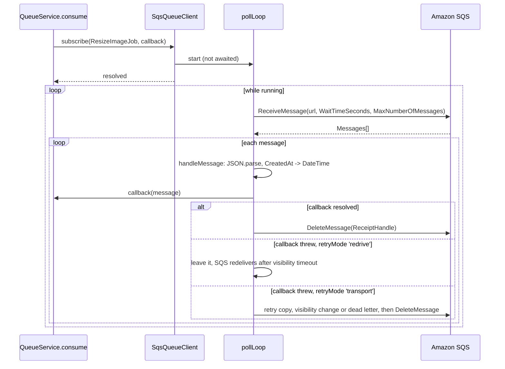

# Consuming messages

`SqsQueueClient.subscribe()` starts one long-poll loop per SQS queue URL. Each received message is parsed, handed to the callback, and deleted from the queue when the callback succeeds. What happens to a failed message depends on `options.retryMode` ([Retry modes](#retry-modes)): by default it comes back after the visibility timeout and the queue's redrive policy moves it to a dead-letter queue; in `'transport'` mode the transport retries and dead-letters it by the [delivery decision](../queue/11-delivery-contract.md) of `@spinajs/queue`.

## How it works

1. **Caller.** `QueueService.consume(ResizeImageJob)` (from `@spinajs/queue`) calls `subscribe(ResizeImageJob, callback)` on each connection routed for that message. You can also call `subscribe('<queue URL>', callback)` on a client directly.
2. **Queue URLs.** A string argument is the URL. A message class goes through `getChannelForMessage()`, as on [publish](02-publishing-messages.md#how-it-works).
3. **One loop per URL.** An empty or `undefined` URL (no routing entry and no default channel) makes `subscribe()` throw `InvalidArgument` before any loop starts. In `'transport'` mode `subscribe()` then [checks the redrive policy](#fifo-queues-in-transport-mode) of every FIFO URL, and may throw too. For each URL, `subscribe()` stores a descriptor in `this.Subscriptions` and starts `pollLoop(desc)` without awaiting it. A URL that already has a loop gets the new callback added to that loop instead, keyed by the message class name (or by the URL for a string subscribe); the same key twice is skipped with a `SQS queue <url> already subscribed !` warning. `subscribe()` resolves at once.
4. **Receive.** `pollLoop()` sends `ReceiveMessageCommand({ QueueUrl, WaitTimeSeconds, MaxNumberOfMessages, VisibilityTimeout, MessageAttributeNames: ['All'], MessageSystemAttributeNames: ['ApproximateReceiveCount', 'MessageGroupId'] })` with the descriptor's abort signal. The call waits up to `waitTimeSeconds` for messages. The system attributes arrive in `Message.Attributes`.
5. **Handle, one at a time.** For each message in the batch, in order, `handleMessage(desc, m)`, where `m` is an `SqsReceived` (`Body`, `ReceiptHandle`, `MessageId`, `MessageAttributes`, `Attributes`):
   1. `JSON.parse(m.Body)`. An unparseable body, or a non-object result (`null`, number, string, boolean), goes to `handleUnparseable()`: in `'redrive'` mode it logs `Unparseable SQS message` and leaves the message; in `'transport'` mode it dead-letters it.
   2. A string `CreatedAt` becomes a luxon `DateTime` (`DateTime.fromISO`).
   3. `readMessageAttributes(m.MessageAttributes)`. A body without `MessageId` takes it from `x-spinajs-message-id`. The standard headers among the attributes are merged into `Headers`, the attributes winning; other attributes are not.
   4. `attemptOf()`: the received copy's `x-retry-count`, or on a FIFO queue in `'transport'` mode `ApproximateReceiveCount - 1`, which is then written to `Headers['x-retry-count']`.
   5. On a standard queue, an `x-spinajs-not-before` still in the future: the message is [sent again and deleted](#delayed-messages), and the callback does not run.
   6. `await desc.callback(message)`, which runs every callback subscribed on the URL in turn.
   7. A callback throws: `handleFailure()`. A `crash: true` error is logged and the message left as it is. Otherwise `'redrive'` mode logs `Handler failed for <Name>` and leaves the message (nack), and `'transport'` mode runs `decideDelivery()` and `executeDecision()`.
   8. All callbacks succeed: `deleteMessage(url, receiptHandle)`, a `DeleteMessageCommand` (ack). A failed delete is logged as `ack/delete failed ... it will redeliver`.
6. **Loop.** Back to step 4 until the descriptor stops running.
7. **Stop.** `unsubscribe()` or `dispose()` clears `desc.running` and aborts the in-flight receive; the loop exits after the message it is handling and sets `desc.exited = true`. `dispose()` waits for every loop to exit before it destroys the `SQSClient`.

What `QueueService.consume()`'s callback does with the message (job tracking, deduplication, `execute()`, `onFailed()`) is documented in [`@spinajs/queue`](../queue/README.md). The transport only sees "resolved" (delete) or "threw" (leave, or decide in `'transport'` mode).



### Receive errors and backoff

When `ReceiveMessage` throws (throttling, network failure, deleted queue, revoked credentials) and the loop is still running:

1. Log `SQS receive error on <url>, backing off <n>ms` as a warning.
2. Sleep `backoff` ms in `backoffSleep()`. The sleep ends early when the subscription is aborted.
3. Double `backoff`, up to `receiveErrorBackoffMaxMs`.
4. Retry the receive. The first successful receive resets `backoff` to `receiveErrorBackoffMs`.

With the defaults the sleeps go 500, 1000, 2000, 4000, 8000, 10000, 10000 ms and so on. The loop never gives up on its own.

### Delivery and failure semantics

In the default `'redrive'` mode:

| Outcome | Transport action | What SQS does next |
| --- | --- | --- |
| Callback resolves | `DeleteMessage` | Message is gone. |
| Callback resolves, delete fails | logs an error | Redelivers after the visibility timeout (duplicate). |
| Callback throws | nothing | Redelivers after the visibility timeout; after `maxReceiveCount` receives the redrive policy moves it to the DLQ. |
| Body is not JSON, or JSON but not an object | logs an error | Same as a throw: redelivery, then DLQ. |
| No redrive policy on the queue | | The message is redelivered until the queue's retention period ends. |

### Retry modes

`options.retryMode` says who retries and dead-letters a failed message. A connection runs every queue in the mode it names; no queue falls back to the other one.

| Failure | `'redrive'` (default) | `'transport'` |
| --- | --- | --- |
| A job fails | Left for the visibility timeout; the redrive policy dead-letters it after `maxReceiveCount` receives, without headers | Decided by `decideDelivery()`: retried with the route's `backoff` until `maxRetries`, then dead-lettered with `x-error`, `x-retry-count` and `x-original-destination` |
| A job throws `NonRetryableError` or `PermanentJobFailure` | Left; the redelivered copy finds its row `dead` and is deleted without running | Dead-lettered at once |
| An event fails | Left, as a job | Deleted (`onEventFailure: 'drop'`, the default), or retried and dead-lettered as a job under `onEventFailure: 'retry'` |
| The body is not a JSON object | Left, as a job | Dead-lettered as it is; the dead letter keeps the received `x-spinajs-message-id` attribute |
| `RedeliverLater` (an in-flight or failed dedup claim) | Left; its `delayMs` is not used, the visibility timeout is | Redelivered after `delayMs`, with `x-retry-count` unchanged |
| `crash: true` | Logged and left as it is: no decision, no delete, no visibility change | The same |

On a standard queue in `'transport'` mode:

- **Retry:** a copy is sent to the same queue with the decision's headers and `DelaySeconds = min(ceil(delayMs / 1000), 900)`, plus [`x-spinajs-not-before`](#delayed-messages) beyond 900 s. The original is then deleted.
- **Dead letter:** the original body goes to the route's `deadLetterChannel`, or the connection's `defaultQueueDeadLetterChannel`, with the decision's headers and `x-original-destination`; the original is then deleted. Without a dead-letter URL the message is deleted with a warning, as on AMQP and STOMP.
- **Drop:** the message is deleted, with a warning.

A dead-letter queue of a standard queue must be standard, and of a FIFO queue FIFO, as AWS requires for a redrive.

In `'redrive'` mode keep `maxReceiveCount` at 2 or more: with 1, the first failure, and every `RedeliverLater` of event deduplication, moves the message to the dead-letter queue.

### FIFO queues in transport mode

A FIFO queue refuses a per-message delay and drops a re-send whose deduplication id it saw in the last 5 minutes, so a retry keeps the message:

- **Attempts come from the receive count.** The attempt is `ApproximateReceiveCount - 1`; the handler sees it as `x-retry-count` in `Headers`, as on the other transports.
- **A retry extends the visibility:** `ChangeMessageVisibility` with `min(ceil(delayMs / 1000), 39600)` seconds. The order within the message's group holds. The cap is 11 hours: SQS allows 12 hours of visibility counted from the receive, and the handler has used some of it. A retry carries no `x-error`; only the dead letter does.
- **A dead letter** goes to the dead-letter queue in the `MessageGroupId` the message was received in, with `MessageDeduplicationId = <MessageId>:dead` (`<SQS message id>:dead` for an unparseable body), then the original is deleted. No `groupBy` is needed.
- **A `RedeliverLater` and a crash each use one attempt.** Both raise the receive count, where the decision table says "attempt unchanged". Both are rare on FIFO: SQS deduplicates sends and holds a group while one of its messages is in flight.

**The redrive check at subscribe.** In `'transport'` mode `subscribe()` reads the `RedrivePolicy` of every FIFO URL (`GetQueueAttributes`) before it starts a poll loop. `maxRetries` is the route's value for a message class and 0 for a raw URL.

| The queue's redrive policy | Result |
| --- | --- |
| None | Subscribed. Nothing on the AWS side competes with the transport's count. |
| `maxReceiveCount > maxRetries + 1` | Subscribed. |
| `maxReceiveCount <= maxRetries + 1` | `subscribe()` throws `InvalidArgument`, so `consume()` fails the boot: `FIFO queue <url> ( connection <name> ) has a redrive policy with maxReceiveCount <n>, but its route asks for maxRetries <r>: in transport retry mode AWS would dead-letter the message before the transport does. Raise maxReceiveCount above <r + 1>, lower the route's maxRetries, or remove the redrive policy`. |
| Cannot be read (no `sqs:GetQueueAttributes`, or no readable `maxReceiveCount`) | Subscribed, with a warning naming the queue and the permission. The queue runs unchecked: if its `maxReceiveCount` is too small, AWS dead-letters messages without headers. |

Leave headroom above `maxRetries + 1` for forced redeliveries and crashes, which each use one receive.

**A job's own `RetryCount`** wins over the route's `maxRetries`, and is known only when the message arrives. When it asks for more retries than a checked queue's `maxReceiveCount` holds, the message is decided with `maxReceiveCount - 2` retries, the most the check would have accepted, and the transport dead-letters it with its headers one receive before AWS would move it without them. An error is logged once per queue and job name, with both numbers. The job's `queue_jobs` row keeps the `MaxAttempts` of the emitted `RetryCount`, so it ends as `retrying`, not `dead`. A queue whose policy could not be read is not capped.

### At least once

In `'transport'` mode a retry and a dead letter are a send followed by a delete. When the send fails, nothing is deleted and the message comes back after the visibility timeout. When the delete fails after the send, there are two copies with independent counters. A failed send, delete or visibility change is logged by the poll loop; the message is never lost by it.

### No topic fan-out

An SQS queue hands each message to one consumer. One queue URL has one poll loop per connection, and every callback on it runs in turn, so there are no per-subscriber copies to retry. For fan-out, subscribe several queues to an SNS topic, outside this transport. The conformance suite skips its fan-out case on SQS for that reason.

### Delayed messages

A producer that emits with a `ScheduleDelay` above 900 s sends the message with the SQS maximum of 900 s and an `x-spinajs-not-before` attribute (epoch milliseconds); see [Publishing messages](02-publishing-messages.md#delays). When this consumer receives it from a standard queue before that moment, `handleMessage()`:

1. sends it again through `sendParams(url, message, { notBefore })`: `DelaySeconds` is the time left, at most 900, and the attribute is kept;
2. deletes the received copy;
3. returns without running the callback.

This is the one send the consume side makes, so the consumer needs `sqs:SendMessage` on the queue it consumes. Without it the send fails, `pollLoop()` logs the error, and the message comes back after each visibility timeout until it is due. Each of those rounds is a receive, so a small `maxReceiveCount` can move it to the dead-letter queue first.

A FIFO queue takes no per-message delay, so the attribute is never sent there and is ignored on receipt. A value that is not a number, or that is later than now + 2^31 - 1 ms (the longest delay a producer writes), is ignored too, and the message is handled at once.

For a `QueueJob` consumed through `QueueService`, a failed attempt marks the `queue_jobs` row `retrying` or, after `RetryCount` retries, `dead`, then rethrows. With `queue.deduplicate` on (the default), the next delivery of a `dead` job finds a terminal row, returns without running, and the transport deletes it. So a job runs at most `RetryCount + 1` times, or fewer if the queue's `maxReceiveCount` is lower.

## Configuration

| Key | Type | Default | Allowed values | Meaning |
| --- | --- | --- | --- | --- |
| `queue.connections[].options.waitTimeSeconds` | `number` | `20` | `0`-`20` | Long-poll wait. Lower values make `dispose()` in tests faster but cost more empty receives. |
| `queue.connections[].options.maxMessages` | `number` | `1` | `1`-`10` | Messages per receive. They are handled one after another, not in parallel. |
| `queue.connections[].options.visibilityTimeout` | `number` | the queue's setting | `0`-`43200` seconds | Hide time of each received message. Must exceed the longest handler time times `maxMessages`. |
| `queue.connections[].options.receiveErrorBackoffMs` | `number` | `500` | `>= 0` | First sleep after a failed receive. |
| `queue.connections[].options.receiveErrorBackoffMaxMs` | `number` | `10000` | `>= receiveErrorBackoffMs` | Cap of the doubling sleep. |
| `queue.connections[].options.retryMode` | `string` | `'redrive'` | `'redrive'`, `'transport'` | Who retries and dead-letters a failed message; see [Retry modes](#retry-modes). |

Set on the SQS queue itself, not in SpinaJS: the redrive policy (`deadLetterTargetArn`, `maxReceiveCount`), the default visibility timeout, the message retention period and the delivery delay.

### IAM actions

| Action | On | Needed for |
| --- | --- | --- |
| `sqs:ReceiveMessage`, `sqs:DeleteMessage` | every queue the service consumes | receiving and acking |
| `sqs:SendMessage` | every queue the service sends to | `emit()` |
| `sqs:SendMessage` | a consumed queue whose messages can carry `x-spinajs-not-before` (a producer's `ScheduleDelay` above 900 s) | the [re-send of a message not yet due](#delayed-messages) |

`'transport'` mode sends from the consume side and needs these too:

| Action | On | Needed for | Without it |
| --- | --- | --- | --- |
| `sqs:SendMessage` | the consumed standard queue | the delayed retry copy | The send fails and `pollLoop()` logs it. The message comes back after each visibility timeout with the same `x-retry-count`, so the handler runs again every time and the message never reaches `exhausted`. Only an AWS redrive policy or the retention period ends it. |
| `sqs:SendMessage` | the dead-letter queue URL | the dead letter | The send fails, the original is not deleted, and the handler runs again after each visibility timeout. Only an AWS redrive policy or the retention period ends it. |
| `sqs:ChangeMessageVisibility` | the consumed FIFO queue | the retry delay | The change fails and is logged. The retry comes after the queue's own visibility timeout instead of the backoff; the receive count still rises, so the message still ends as a dead letter. |
| `sqs:GetQueueAttributes` | the consumed FIFO queue | the redrive check at subscribe | A warning at subscribe; the queue runs unchecked. |

`'redrive'` mode needs none of them. A wrong `defaultQueueDeadLetterChannel` URL behaves like the second row.

```ts
// config/queue.ts
export default {
  queue: {
    connections: [
      {
        service: 'SqsQueueClient',
        name: 'sqs',
        options: {
          region: 'eu-central-1',
          maxMessages: 10,
          // ten 20 s jobs handled one by one: 200 s, plus margin
          visibilityTimeout: 300,
        },
      },
    ],
  },
};
```

## Services and extension points

| Service | DI token and lifetime | Default implementation | Alternatives | How to replace or extend |
| --- | --- | --- | --- | --- |
| Subscribe | `public async subscribe(channelOrMessage, callback)` | one detached `pollLoop()` per URL, shared by every callback on it | | Override to validate URLs or add per-subscription setup, then call `super.subscribe()` |
| Poll loop | `protected async pollLoop(desc)` | sequential receive, handle, backoff | | Override to process a batch in parallel; keep the "never reject" guard |
| Message handler | `protected async handleMessage(desc, m: SqsReceived)` | parse, rehydrate `CreatedAt`, read the attributes, re-send a message not yet due, callback, delete | SNS unwrapping in [Extending the SQS client](04-extending-the-sqs-client.md#consume-messages-fanned-out-from-sns) | Override, change `m.Body` or wrap the callback, call `super.handleMessage(desc, m)` |
| Failure handling | `protected handleFailure()`, `handleUnparseable()`, `executeDecision()`, `checkFifoRedrive()`, `withinReceiveLimit()` | the [retry modes](#retry-modes) | | See [Extending the SQS client](04-extending-the-sqs-client.md#failure-handling-in-transport-mode) |
| Error sleep | `protected backoffSleep(ms, signal)` | abortable `setTimeout` | | Override to add jitter |
| Stop | `protected stop(desc)`, `public unsubscribe()`, `public async dispose()` | clear `running`, abort the receive; `dispose()` also waits for the loops | | Override `dispose()`, call `super.dispose()` |

`desc` is the subscription descriptor, the exported `ISqsSubscriptionDescriptor`: `url`, `callback`, `handlers` (the subscribed callbacks by key), `running`, `controller` (`AbortController`) and `exited`.

## Important behaviour

- **One poll loop per queue URL per connection.** Message types that share a URL share its loop: each message goes to every callback on the URL, and `QueueService.consume()`'s callback skips other types (`e.Name !== event.name`). A message whose type nobody consumed is still deleted once the callbacks resolve, so route only consumed types to a shared queue.
- **At-least-once delivery.** A crash between the callback and the delete, a failed delete (also after a retry copy or dead letter was sent), or a visibility timeout shorter than the handler causes a second delivery. Handlers must be idempotent; job deduplication in `@spinajs/queue` covers jobs.
- **Sequential per URL.** Messages of one queue are handled one at a time, also with `maxMessages > 1`. Parallelism comes from more queues, more connections, more processes, or a `pollLoop()` override.
- **Visibility timeout and batch size.** With `maxMessages: 10`, the tenth message waits for the other nine; its timeout runs meanwhile. A too-short `visibilityTimeout` redelivers it to another worker before it is handled.
- **The loop never rejects.** Every error is caught and logged on the `queue` logger; nothing reaches `unhandledRejection`. Watch the `queue` logs for receive errors.
- **A missing URL fails fast, a wrong one loops forever.** `subscribe()` throws `InvalidArgument` when a message has no URL (no routing entry and no default channel). A URL that is set but wrong keeps failing receives with backoff up to the cap.
- **Poison messages are kept, not deleted.** In `'redrive'` mode an unparseable or non-object body stays until the redrive policy moves it; in `'transport'` mode it is dead-lettered as it is. Either way producer bugs leave evidence in the DLQ, unless no dead-letter URL is configured in `'transport'` mode.
- **Subscribing to a FIFO queue needs no `groupBy`.** Only sending to one does. A message received from a FIFO queue is handled like any other.
- **`subscriptionId` and `durable` are ignored.** SQS has no durable subscriptions; the queue itself is durable.
- **`unsubscribe()` does not wait, `dispose()` does.** Both abort the receive. A handler that is already running finishes; `dispose()` waits for it and its delete before destroying the `SQSClient`, so a slow handler delays shutdown.
- **`unsubscribe(MessageClass)` removes only that class's callback.** The loop of a URL stops when no callback is left. `unsubscribe('<queue URL>')` stops the loop and drops every callback on it.

## Best practices

- Configure a dead-letter queue with a redrive policy on every consumed queue. Without it a failing message cycles until the retention period ends.
- Set `maxReceiveCount` above the job's `RetryCount + 1`, so `QueueService` can mark the job `dead` and call `onFailed()` before SQS moves the message. In `'transport'` mode a FIFO queue's subscription checks this; a standard queue's copies start a new receive count, so there the redrive policy only catches what the transport could not send.
- Set `visibilityTimeout` per connection to more than `maxMessages` times your slowest handler.
- Keep `waitTimeSeconds` at `20` in production. Long polling cuts empty receives and cost.
- In tests, use `waitTimeSeconds: 1` so `dispose()` and process exit are fast.

## Patterns and antipatterns

```ts
// Don't: swallow handler errors - the message is acked and the failure is lost.
await queue.consume(ImportCsvJob, async () => {
  try { await importer.run(); } catch { /* ignore */ }
});

// Do: let it throw; SQS redelivers and the redrive policy dead-letters it.
await queue.consume(ImportCsvJob, async () => {
  await importer.run();
});
```

```ts
// Don't: rely on maxMessages for throughput - the batch is handled serially
// and long batches outlive the visibility timeout.
options: { maxMessages: 10 }

// Do: keep batches small, scale out with more worker processes.
options: { maxMessages: 1, visibilityTimeout: 120 }
```

## Examples

### Run a worker that processes image jobs

```ts sample
import '@spinajs/queue-sqs-transport';
import { DI } from '@spinajs/di';
import { Job, QueueJob, QueueService } from '@spinajs/queue';

@Job()
export class ResizeImageJob extends QueueJob {
  public ImageId: string;

  public async execute(progress: (p: number) => Promise<void>) {
    await progress(50);
    // a throw here leaves the SQS message for redelivery
    return { thumbnail: `${this.ImageId}-320.webp` };
  }
}

export async function startImageWorker() {
  const queue = await DI.resolve(QueueService);
  await queue.consume(ResizeImageJob);

  process.once('SIGTERM', async () => {
    // stops every poll loop, waits for running handlers, destroys the SQSClient
    await queue.dispose();
  });
}
```

### Read a queue written by another system

`subscribe()` takes a raw URL. The body must be a JSON object; `CreatedAt` is optional.

```ts sample
import '@spinajs/queue-sqs-transport';
import { DI } from '@spinajs/di';
import { IQueueMessage, QueueService } from '@spinajs/queue';

const PAYMENTS_URL = 'https://sqs.eu-central-1.amazonaws.com/123456789012/payment-notifications';

export async function listenForPayments(onPaid: (orderId: number) => Promise<void>) {
  const queue = await DI.resolve(QueueService);
  const sqs = queue.get('sqs');

  await sqs.subscribe(PAYMENTS_URL, async (message: IQueueMessage) => {
    const { orderId } = message as unknown as { orderId?: number };
    if (typeof orderId !== 'number') {
      // throwing leaves it for the DLQ instead of deleting it
      throw new Error('payment notification without orderId');
    }
    await onPaid(orderId);
  });
}
```

## Related

- [Publishing messages](02-publishing-messages.md): the body format this side parses.
- [SQS connection](01-sqs-connection.md): all connection keys.
- [Extending the SQS client](04-extending-the-sqs-client.md): overriding `handleMessage()`, `pollLoop()` and `dispose()`.
- [`@spinajs/queue`](../queue/README.md): `QueueService.consume()`, job tracking, deduplication and `onFailed()`.
