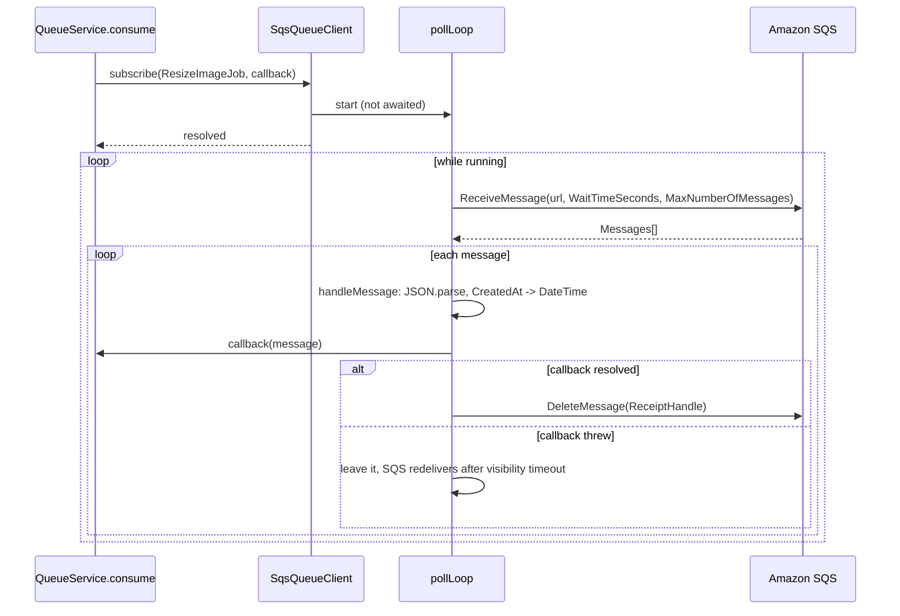

# Consuming messages

`SqsQueueClient.subscribe()` starts one long-poll loop per SQS queue URL. Each received message is parsed, handed to the callback, and deleted from the queue only when the callback succeeds. Failed messages come back after the visibility timeout; the queue's redrive policy moves them to a dead-letter queue.

## How it works

1. **Caller.** `QueueService.consume(ResizeImageJob)` (from `@spinajs/queue`) calls `subscribe(ResizeImageJob, callback)` on each connection routed for that message. You can also call `subscribe('<queue URL>', callback)` on a client directly.
2. **Queue URLs.** A string argument is the URL. A message class goes through `getChannelForMessage()`, as on [publish](02-publishing-messages.md#how-it-works).
3. **One loop per URL.** An empty or `undefined` URL (no routing entry and no default channel) makes `subscribe()` throw `InvalidArgument` before any loop starts. For each URL, `subscribe()` stores a descriptor in `this.Subscriptions` and starts `pollLoop(desc)` without awaiting it. A URL that already has a loop gets the new callback added to that loop instead, keyed by the message class name (or by the URL for a string subscribe); the same key twice is skipped with a `SQS queue <url> already subscribed !` warning. `subscribe()` resolves at once.
4. **Receive.** `pollLoop()` sends `ReceiveMessageCommand({ QueueUrl, WaitTimeSeconds, MaxNumberOfMessages, VisibilityTimeout })` with the descriptor's abort signal. The call waits up to `waitTimeSeconds` for messages.
5. **Handle, one at a time.** For each message in the batch, in order, `handleMessage(desc, m)`:
   1. `JSON.parse(m.Body)`. Unparseable body: log `Unparseable SQS message`, leave it on the queue.
   2. A non-object result (`null`, number, string, boolean): log `Non-object SQS message body`, leave it on the queue.
   3. A string `CreatedAt` becomes a luxon `DateTime` (`DateTime.fromISO`).
   4. `await desc.callback(message)`, which runs every callback subscribed on the URL in turn.
   5. A callback throws: log `Handler failed for <Name>`, leave the message (nack).
   6. All callbacks succeed: `DeleteMessageCommand({ QueueUrl, ReceiptHandle })` (ack). A failed delete is logged as `ack/delete failed ... it will redeliver`.
6. **Loop.** Back to step 4 until the descriptor stops running.
7. **Stop.** `unsubscribe()` or `dispose()` clears `desc.running` and aborts the in-flight receive; the loop exits after the message it is handling and sets `desc.exited = true`. `dispose()` waits for every loop to exit before it destroys the `SQSClient`.

What `QueueService.consume()`'s callback does with the message (job tracking, deduplication, `execute()`, `onFailed()`) is documented in [`@spinajs/queue`](../queue/README.md). The transport only sees "resolved" (delete) or "threw" (leave).



### Receive errors and backoff

When `ReceiveMessage` throws (throttling, network failure, deleted queue, revoked credentials) and the loop is still running:

1. Log `SQS receive error on <url>, backing off <n>ms` as a warning.
2. Sleep `backoff` ms in `backoffSleep()`. The sleep ends early when the subscription is aborted.
3. Double `backoff`, up to `receiveErrorBackoffMaxMs`.
4. Retry the receive. The first successful receive resets `backoff` to `receiveErrorBackoffMs`.

With the defaults the sleeps go 500, 1000, 2000, 4000, 8000, 10000, 10000 ms and so on. The loop never gives up on its own.

### Delivery and failure semantics

| Outcome | Transport action | What SQS does next |
| --- | --- | --- |
| Callback resolves | `DeleteMessage` | Message is gone. |
| Callback resolves, delete fails | logs an error | Redelivers after the visibility timeout (duplicate). |
| Callback throws | nothing | Redelivers after the visibility timeout; after `maxReceiveCount` receives the redrive policy moves it to the DLQ. |
| Body is not JSON, or JSON but not an object | logs an error | Same as a throw: redelivery, then DLQ. |
| No redrive policy on the queue | | The message is redelivered until the queue's retention period ends. |

For a `QueueJob` consumed through `QueueService`, a failed attempt marks the `queue_jobs` row `retrying` or, after `RetryCount` retries, `dead`, then rethrows. With `queue.deduplicate` on (the default), the next delivery of a `dead` job finds a terminal row, returns without running, and the transport deletes it. So a job runs at most `RetryCount + 1` times, or fewer if the queue's `maxReceiveCount` is lower.

## Configuration

| Key | Type | Default | Allowed values | Meaning |
| --- | --- | --- | --- | --- |
| `queue.connections[].options.waitTimeSeconds` | `number` | `20` | `0`-`20` | Long-poll wait. Lower values make `dispose()` in tests faster but cost more empty receives. |
| `queue.connections[].options.maxMessages` | `number` | `1` | `1`-`10` | Messages per receive. They are handled one after another, not in parallel. |
| `queue.connections[].options.visibilityTimeout` | `number` | the queue's setting | `0`-`43200` seconds | Hide time of each received message. Must exceed the longest handler time times `maxMessages`. |
| `queue.connections[].options.receiveErrorBackoffMs` | `number` | `500` | `>= 0` | First sleep after a failed receive. |
| `queue.connections[].options.receiveErrorBackoffMaxMs` | `number` | `10000` | `>= receiveErrorBackoffMs` | Cap of the doubling sleep. |

Set on the SQS queue itself, not in SpinaJS: the redrive policy (`deadLetterTargetArn`, `maxReceiveCount`), the default visibility timeout, the message retention period and the delivery delay.

```ts
// config/queue.ts
export default {
  queue: {
    connections: [
      {
        service: 'SqsQueueClient',
        name: 'sqs',
        options: {
          region: 'eu-central-1',
          maxMessages: 10,
          // ten 20 s jobs handled one by one: 200 s, plus margin
          visibilityTimeout: 300,
        },
      },
    ],
  },
};
```

## Services and extension points

| Service | DI token and lifetime | Default implementation | Alternatives | How to replace or extend |
| --- | --- | --- | --- | --- |
| Subscribe | `public async subscribe(channelOrMessage, callback)` | one detached `pollLoop()` per URL, shared by every callback on it | | Override to validate URLs or add per-subscription setup, then call `super.subscribe()` |
| Poll loop | `protected async pollLoop(desc)` | sequential receive, handle, backoff | | Override to process a batch in parallel; keep the "never reject" guard |
| Message handler | `protected async handleMessage(desc, m)` | parse, rehydrate `CreatedAt`, callback, delete | SNS unwrapping in [Extending the SQS client](04-extending-the-sqs-client.md#consume-messages-fanned-out-from-sns) | Override, change `m.Body` or wrap the callback, call `super.handleMessage(desc, m)` |
| Error sleep | `protected backoffSleep(ms, signal)` | abortable `setTimeout` | | Override to add jitter |
| Stop | `protected stop(desc)`, `public unsubscribe()`, `public async dispose()` | clear `running`, abort the receive; `dispose()` also waits for the loops | | Override `dispose()`, call `super.dispose()` |

`desc` is the subscription descriptor: `url`, `callback`, `handlers` (the subscribed callbacks by key), `running`, `controller` (`AbortController`) and `exited`. Its interface is not exported; type it in a subclass as `Parameters<SqsQueueClient['handleMessage']>[0]`.

## Important behaviour

- **One poll loop per queue URL per connection.** Message types that share a URL share its loop: each message goes to every callback on the URL, and `QueueService.consume()`'s callback skips other types (`e.Name !== event.name`). A message whose type nobody consumed is still deleted once the callbacks resolve, so route only consumed types to a shared queue.
- **At-least-once delivery.** A crash between the callback and the delete, a failed delete, or a visibility timeout shorter than the handler causes a second delivery. Handlers must be idempotent; job deduplication in `@spinajs/queue` covers jobs.
- **Sequential per URL.** Messages of one queue are handled one at a time, also with `maxMessages > 1`. Parallelism comes from more queues, more connections, more processes, or a `pollLoop()` override.
- **Visibility timeout and batch size.** With `maxMessages: 10`, the tenth message waits for the other nine; its timeout runs meanwhile. A too-short `visibilityTimeout` redelivers it to another worker before it is handled.
- **The loop never rejects.** Every error is caught and logged on the `queue` logger; nothing reaches `unhandledRejection`. Watch the `queue` logs for receive errors.
- **A missing URL fails fast, a wrong one loops forever.** `subscribe()` throws `InvalidArgument` when a message has no URL (no routing entry and no default channel). A URL that is set but wrong keeps failing receives with backoff up to the cap.
- **Poison messages are kept, not deleted.** An unparseable or non-object body stays until the redrive policy moves it, so producer bugs leave evidence in the DLQ.
- **`subscriptionId` and `durable` are ignored.** SQS has no durable subscriptions; the queue itself is durable.
- **`unsubscribe()` does not wait, `dispose()` does.** Both abort the receive. A handler that is already running finishes; `dispose()` waits for it and its delete before destroying the `SQSClient`, so a slow handler delays shutdown.
- **`unsubscribe(MessageClass)` removes only that class's callback.** The loop of a URL stops when no callback is left. `unsubscribe('<queue URL>')` stops the loop and drops every callback on it.

## Best practices

- Configure a dead-letter queue with a redrive policy on every consumed queue. Without it a failing message cycles until the retention period ends.
- Set `maxReceiveCount` above the job's `RetryCount + 1`, so `QueueService` can mark the job `dead` and call `onFailed()` before SQS moves the message.
- Set `visibilityTimeout` per connection to more than `maxMessages` times your slowest handler.
- Keep `waitTimeSeconds` at `20` in production. Long polling cuts empty receives and cost.
- In tests, use `waitTimeSeconds: 1` so `dispose()` and process exit are fast.

## Patterns and antipatterns

```ts
// Don't: swallow handler errors - the message is acked and the failure is lost.
await queue.consume(ImportCsvJob, async () => {
  try { await importer.run(); } catch { /* ignore */ }
});

// Do: let it throw; SQS redelivers and the redrive policy dead-letters it.
await queue.consume(ImportCsvJob, async () => {
  await importer.run();
});
```

```ts
// Don't: rely on maxMessages for throughput - the batch is handled serially
// and long batches outlive the visibility timeout.
options: { maxMessages: 10 }

// Do: keep batches small, scale out with more worker processes.
options: { maxMessages: 1, visibilityTimeout: 120 }
```

## Examples

### Run a worker that processes image jobs

```ts sample
import '@spinajs/queue-sqs-transport';
import { DI } from '@spinajs/di';
import { Job, QueueJob, QueueService } from '@spinajs/queue';

@Job()
export class ResizeImageJob extends QueueJob {
  public ImageId: string;

  public async execute(progress: (p: number) => Promise<void>) {
    await progress(50);
    // a throw here leaves the SQS message for redelivery
    return { thumbnail: `${this.ImageId}-320.webp` };
  }
}

export async function startImageWorker() {
  const queue = await DI.resolve(QueueService);
  await queue.consume(ResizeImageJob);

  process.once('SIGTERM', async () => {
    // stops every poll loop, waits for running handlers, destroys the SQSClient
    await queue.dispose();
  });
}
```

### Read a queue written by another system

`subscribe()` takes a raw URL. The body must be a JSON object; `CreatedAt` is optional.

```ts sample
import '@spinajs/queue-sqs-transport';
import { DI } from '@spinajs/di';
import { IQueueMessage, QueueService } from '@spinajs/queue';

const PAYMENTS_URL = 'https://sqs.eu-central-1.amazonaws.com/123456789012/payment-notifications';

export async function listenForPayments(onPaid: (orderId: number) => Promise<void>) {
  const queue = await DI.resolve(QueueService);
  const sqs = queue.get('sqs');

  await sqs.subscribe(PAYMENTS_URL, async (message: IQueueMessage) => {
    const { orderId } = message as unknown as { orderId?: number };
    if (typeof orderId !== 'number') {
      // throwing leaves it for the DLQ instead of deleting it
      throw new Error('payment notification without orderId');
    }
    await onPaid(orderId);
  });
}
```

## Related

- [Publishing messages](02-publishing-messages.md): the body format this side parses.
- [SQS connection](01-sqs-connection.md): all connection keys.
- [Extending the SQS client](04-extending-the-sqs-client.md): overriding `handleMessage()`, `pollLoop()` and `dispose()`.
- [`@spinajs/queue`](../queue/README.md): `QueueService.consume()`, job tracking, deduplication and `onFailed()`.
