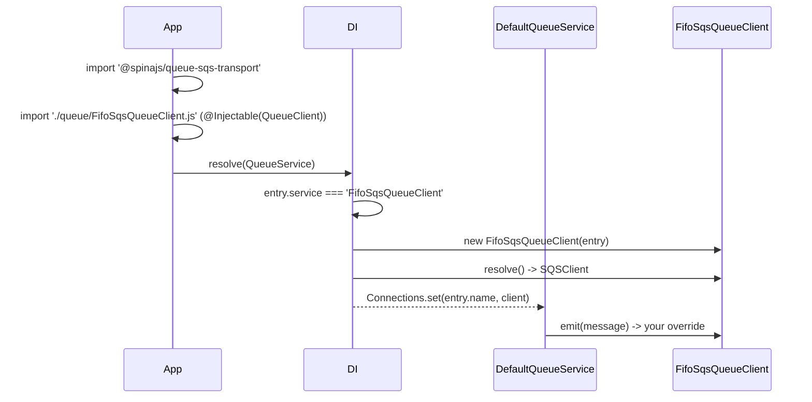

# Extending the SQS client

`SqsQueueClient` is a plain `QueueClient` subclass with protected hooks for every step: building the AWS client, sending, the poll loop, handling one message, sleeping after errors and stopping. Subclass it to change one step, register a connection factory to change how clients are built, or write your own `QueueClient` for a different broker.

## How it works

Two registrations decide which object a `queue.connections` entry becomes:

| Registration | Made by | Token | Effect |
| --- | --- | --- | --- |
| `@Injectable(QueueClient)` on `SqsQueueClient` | `connection.ts`, on import | `QueueClient` and `SqsQueueClient` | Makes `service: 'SqsQueueClient'` selectable. |
| `@PerInstanceCheck()` on `SqsQueueClient` | `connection.ts` | lifetime | One cached instance per connection `name` (`__checkInstance__` compares `options.name`), when DI builds the class itself. The package registers no factory, so that is the default. |

Resolution, step by step:

1. `DefaultQueueService` reads `queue.connections` through `@AutoinjectService('queue.connections', QueueClient)`.
2. For each entry, DI lists the `QueueClient` registrations and picks the class whose `name` equals `entry.service`. No match throws `ServiceNotFound`.
3. DI resolves that class with `[entry]`. If something else is registered under the class later, the last registration wins: a factory runs as a function, a class is built with `new Class(entry)` and `await instance.resolve()`.
4. The instance lands in `QueueService`'s `Connections` map under `entry.name`.

So you have four ways in:

| You want to | Do this | Config change |
| --- | --- | --- |
| Change behaviour for some connections | Subclass, decorate `@PerInstanceCheck()` and `@Injectable(QueueClient)`, name it in `service` | `service: 'FifoSqsQueueClient'` on those entries |
| Change behaviour for every SQS connection | Subclass, then `DI.register(Sub).as(SqsQueueClient)` after importing the package | none |
| Change how clients are built (defaults, wrapping) | `DI.register(myFactory).as(SqsQueueClient)` after importing the package | none |
| Talk to another broker | Extend `QueueClient` from `@spinajs/queue`, decorate `@Injectable(QueueClient)` | `service: '<YourClass>'` |

Register before `QueueService` resolves. A registration made after that does not change the clients that already exist.



## Configuration

| Key | Type | Default | Allowed values | Meaning |
| --- | --- | --- | --- | --- |
| `queue.connections[].service` | `string` | none, required | class name of a `QueueClient` registration | Selects the subclass for this connection. |
| `queue.connections[].options.<custom key>` | any | none | any | Extra keys reach the instance in `this.Options.options`; a subclass reads its own settings there. |

```ts
// config/queue.ts
export default {
  queue: {
    connections: [
      { service: 'SqsQueueClient', name: 'sqs', options: { region: 'eu-central-1' } },
      {
        service: 'FifoSqsQueueClient',
        name: 'sqs-fifo',
        defaultQueueChannel: 'https://sqs.eu-central-1.amazonaws.com/123456789012/ledger.fifo',
        options: { region: 'eu-central-1', messageGroupId: 'ledger' },
      },
    ],
  },
};
```

## Services and extension points

| Service | DI token and lifetime | Default implementation | Alternatives | How to replace or extend |
| --- | --- | --- | --- | --- |
| Queue transport | `QueueClient`, selected by class name from `queue.connections[].service`; one per entry | `SqsQueueClient` | `BlackHoleQueueClient`, AMQP and STOMP transports, your subclass | `@Injectable(QueueClient)` on a subclass, name it in `service` |
| SQS client class | `SqsQueueClient` token; `@PerInstanceCheck()` keyed by `options.name` | `SqsQueueClient` | your subclass | `DI.register(Sub).as(SqsQueueClient)` after importing the package; replaces it for every `service: 'SqsQueueClient'` entry |
| Connection factory | none by default; a factory registered `.as(SqsQueueClient)` runs as a new instance on every resolve | DI builds the class | | `DI.register(myFactory).as(SqsQueueClient)`; see [Register a connection factory](#register-a-connection-factory) |
| AWS client setup | `public async resolve()`, sets `protected Sqs: SQSClient` | `new SQSClient({ region, endpoint, credentials })` | | Override; assign `this.Sqs` yourself or call `super.resolve()` and keep it |
| Send | `public async emit(message)` | `SendMessage` per routed URL | FIFO send below | Override; use `this.getChannelForMessage()` and `this.Sqs` |
| Destination lookup | `public getChannelForMessage(message)` (from `QueueClient`) | `queue.routing`, then connection defaults | | Override to compute URLs |
| Subscribe | `public async subscribe(channelOrMessage, callback)` | one `pollLoop()` per URL, shared by every callback on it | | Override, call `super.subscribe()` |
| Poll loop | `protected async pollLoop(desc)` | sequential receive and handle with backoff | | Override; must never reject, it runs detached |
| Message handler | `protected async handleMessage(desc, m)` | parse, `CreatedAt` to `DateTime`, callback, delete | SNS unwrap below | Override, call `super.handleMessage(desc, m)` |
| Error sleep | `protected backoffSleep(ms, signal)` | abortable `setTimeout` | | Override to add jitter |
| Stop | `protected stop(desc)`, `unsubscribe()`, `dispose()` | clear `running`, abort; `dispose()` waits for the loops, then destroys `SQSClient` | | Override `dispose()`, call `super.dispose()` last |

Protected state a subclass can use:

| Member | From | Holds |
| --- | --- | --- |
| `Options` (public) | `QueueClient` | The connection entry; SQS settings and your custom keys in `Options.options` |
| `Sqs` | `SqsQueueClient` | The `SQSClient`, set in `resolve()` |
| `Subscriptions` | `SqsQueueClient` | `Map<url, desc>` of live poll loops |
| `Log` | `QueueClient` | The `queue` logger |
| `Routing` | `QueueClient` | `queue.routing`, read live |

The descriptor type `desc` (`url`, `callback`, `handlers`, `running`, `controller`, `exited`) is not exported. In an override, take it from the parent signature: `...args: Parameters<SqsQueueClient['handleMessage']>`.

### Queue transport: custom implementation

Subclass `SqsQueueClient` when the transport still talks to SQS and you change one step. Rules that keep the subclass working:

- Decorate it `@PerInstanceCheck()` **and** `@Injectable(QueueClient)`. `@Injectable()` registers only the class it decorates. Any DI decorator on the subclass (`@Autoinject`, `@Config`) gives it its own descriptor with the default `Singleton` lifetime, so restate `@PerInstanceCheck()` or two connections share one instance.
- Import the module before `QueueService` resolves, for example from your bootstrap code.
- `@Autoinject` properties are filled only when DI builds the class. A factory that calls `new` skips them.
- Keep `pollLoop()` and `handleMessage()` free of unhandled rejections. They run detached; a throw that escapes is lost or crashes the process.

#### Send to FIFO queues

A FIFO queue rejects `SendMessage` without `MessageGroupId`. This subclass sets the group from a custom `options.messageGroupId` key (default: the message name) and uses the `JobId` as deduplication id. For events, which have no `JobId`, enable content-based deduplication on the queue.

```ts sample
import { SendMessageCommand } from '@aws-sdk/client-sqs';
import { Injectable, PerInstanceCheck } from '@spinajs/di';
import { IQueueMessage, QueueClient } from '@spinajs/queue';
import { SqsQueueClient } from '@spinajs/queue-sqs-transport';

@PerInstanceCheck()
@Injectable(QueueClient)
export class FifoSqsQueueClient extends SqsQueueClient {
  public async emit(message: IQueueMessage): Promise<void> {
    const body = JSON.stringify(message);
    const groupId = (this.Options.options?.messageGroupId as string | undefined) ?? message.Name;
    const dedupId = (message as IQueueMessage & { JobId?: string }).JobId;

    await Promise.all(
      this.getChannelForMessage(message).map((QueueUrl) =>
        this.Sqs.send(
          new SendMessageCommand({
            QueueUrl,
            MessageBody: body,
            MessageGroupId: groupId,
            MessageDeduplicationId: dedupId,
          }),
        ),
      ),
    );
  }
}

// config/queue.ts: select the subclass on the FIFO connection only
export const config = {
  queue: {
    default: 'sqs',
    routing: {
      PostLedgerEntryJob: { connection: 'sqs-fifo', channel: 'https://sqs.eu-central-1.amazonaws.com/123456789012/ledger.fifo' },
    },
    connections: [
      { service: 'SqsQueueClient', name: 'sqs', options: { region: 'eu-central-1' } },
      { service: 'FifoSqsQueueClient', name: 'sqs-fifo', options: { region: 'eu-central-1', messageGroupId: 'ledger' } },
    ],
  },
};
```

#### Consume messages fanned out from SNS

An SNS subscription without raw message delivery wraps the SpinaJS body in an SNS envelope (`{ "Type": "Notification", "TopicArn": ..., "Message": "<original body>" }`). This subclass unwraps it before the default handler parses, acks and dispatches. The override replaces the client for every `service: 'SqsQueueClient'` entry.

```ts sample
import '@spinajs/queue-sqs-transport';
import { DI, PerInstanceCheck } from '@spinajs/di';
import { SqsQueueClient } from '@spinajs/queue-sqs-transport';

function unwrapSnsEnvelope(body: string | undefined): string | undefined {
  if (!body) {
    return body;
  }

  try {
    const parsed = JSON.parse(body) as { Type?: unknown; TopicArn?: unknown; Message?: unknown };
    if (parsed?.Type === 'Notification' && typeof parsed.TopicArn === 'string' && typeof parsed.Message === 'string') {
      return parsed.Message;
    }
  } catch {
    // not JSON: the default handler logs it and leaves it for the DLQ
  }

  return body;
}

@PerInstanceCheck()
export class SnsAwareSqsQueueClient extends SqsQueueClient {
  protected async handleMessage(...args: Parameters<SqsQueueClient['handleMessage']>): Promise<void> {
    const [desc, m] = args;
    return super.handleMessage(desc, { ...m, Body: unwrapSnsEnvelope(m.Body) });
  }
}

// After the package import above, so it is the last registration under SqsQueueClient.
DI.register(SnsAwareSqsQueueClient).as(SqsQueueClient);
```

#### Rotate credentials from a secret store

`SQSClient` accepts a credentials provider function and calls it again when the returned `expiration` passes. Override `resolve()` to build the client with one; the static `options.credentials` key is then unused.

```ts sample
import { readFile } from 'node:fs/promises';
import { SQSClient } from '@aws-sdk/client-sqs';
import { Injectable, PerInstanceCheck } from '@spinajs/di';
import { QueueClient } from '@spinajs/queue';
import { ISqsConnectionOptions, SqsQueueClient } from '@spinajs/queue-sqs-transport';

interface IRotatedSqsOptions extends ISqsConnectionOptions {
  // JSON file kept fresh by a sidecar: { accessKeyId, secretAccessKey, sessionToken, expiresAt }
  credentialsFile: string;
}

@PerInstanceCheck()
@Injectable(QueueClient)
export class RotatingCredentialsSqsQueueClient extends SqsQueueClient {
  public async resolve(): Promise<void> {
    const o = this.Options.options as IRotatedSqsOptions;

    this.Sqs = new SQSClient({
      region: o.region,
      endpoint: o.endpoint,
      credentials: async () => {
        const raw = JSON.parse(await readFile(o.credentialsFile, 'utf8')) as {
          accessKeyId: string;
          secretAccessKey: string;
          sessionToken?: string;
          expiresAt: string;
        };

        return {
          accessKeyId: raw.accessKeyId,
          secretAccessKey: raw.secretAccessKey,
          sessionToken: raw.sessionToken,
          expiration: new Date(raw.expiresAt),
        };
      },
    });

    this.Log.info({ connection: this.Options.name }, 'SQS client ${connection} uses rotating credentials');
  }
}

export const config = {
  queue: {
    default: 'sqs',
    connections: [
      {
        service: 'RotatingCredentialsSqsQueueClient',
        name: 'sqs',
        options: { region: 'eu-central-1', credentialsFile: '/var/run/secrets/sqs-credentials.json' },
      },
    ],
  },
};
```

### Register a connection factory

Register a factory to change how every `SqsQueueClient` is built without subclassing: fill defaults from app config, wrap the client, or add logging. The factory must return a resolved client. Register it after importing the package.

```ts sample
import '@spinajs/queue-sqs-transport';
import { Configuration } from '@spinajs/configuration';
import { DI, IContainer } from '@spinajs/di';
import { IQueueConnectionOptions } from '@spinajs/queue';
import { ISqsConnectionOptions, SqsQueueClient } from '@spinajs/queue-sqs-transport';

// Every SQS connection defaults to the app-wide `aws.region` and `aws.endpoint`.
DI.register(async (container: IContainer, options: IQueueConnectionOptions) => {
  const cfg = container.get(Configuration)!;

  const sqsOptions: ISqsConnectionOptions = {
    region: cfg.get<string>('aws.region', 'eu-central-1'),
    endpoint: cfg.get<string | undefined>('aws.endpoint', undefined),
    ...(options.options as ISqsConnectionOptions | undefined),
  };

  const client = new SqsQueueClient({ ...options, options: sqsOptions });
  await client.resolve();
  return client;
}).as(SqsQueueClient);
```

## Important behaviour

- **Last registration wins.** A factory or class registered `.as(SqsQueueClient)` replaces the class for every `service: 'SqsQueueClient'` entry. Register it after importing `@spinajs/queue-sqs-transport`.
- **DI builds the class by default.** With no factory registered, `SqsQueueClient` and a subclass selected by `service` are built with `@PerInstanceCheck()`: one instance per connection `name`, `resolve()` awaited, `@Autoinject` and `@Config` properties filled.
- **A factory bypasses the cache.** Factories always produce a new instance, so a client built by your factory is not cached per name despite `@PerInstanceCheck()`. `QueueService` resolves each connection once, so this only bites direct `DI.resolve(SqsQueueClient, ...)` calls.
- **`resolve()` must set `this.Sqs`.** Every other method uses it; an override that skips both the assignment and `super.resolve()` fails on the first send or receive.
- **Hooks run on detached loops.** `pollLoop()` and `handleMessage()` have no caller to catch errors. The default implementations catch everything; overrides must too.
- **Replacing a class registered under `SqsQueueClient` does not register it under `QueueClient`.** `service: 'SqsQueueClient'` still matches the original class name, then DI follows the registration to your subclass.

## Best practices

- Change one hook and call `super`. `handleMessage()` holds the ack and nack contract; wrap it instead of copying it.
- Read subclass settings from `this.Options.options` and type them with an interface that extends `ISqsConnectionOptions`.
- Prefer a `service`-selected subclass when only some connections need it; prefer `DI.register(Sub).as(SqsQueueClient)` when all of them do.
- Test subclasses against LocalStack with `packages/queue-sqs-transport/test/docker-compose.yml`, as the package tests do.

## Patterns and antipatterns

```ts
// Don't: a subclass without @Injectable(QueueClient) is invisible to `service` lookup,
// and with only @Autoinject it silently becomes a Singleton shared by every connection.
export class AuditedSqsQueueClient extends SqsQueueClient {
  @Autoinject(AuditLog) protected Audit: AuditLog;
}

// Do
@PerInstanceCheck()
@Injectable(QueueClient)
export class AuditedSqsQueueClient extends SqsQueueClient {
  @Autoinject(AuditLog) protected Audit: AuditLog;
}
```

```ts
// Don't: copy handleMessage() to add one step - the copy drifts from the ack contract.
protected async handleMessage(desc, m) { /* 40 copied lines */ }

// Do: wrap it.
protected async handleMessage(...args: Parameters<SqsQueueClient['handleMessage']>) {
  const started = Date.now();
  await super.handleMessage(...args);
  this.Log.trace({ ms: Date.now() - started }, 'SQS message handled in ${ms}ms');
}
```

## Examples

### Add jitter to the receive-error backoff

Many workers that lose SQS at the same time retry in lockstep. Randomize each sleep between half and the full computed delay.

```ts sample
import { Injectable, PerInstanceCheck } from '@spinajs/di';
import { QueueClient } from '@spinajs/queue';
import { SqsQueueClient } from '@spinajs/queue-sqs-transport';

@PerInstanceCheck()
@Injectable(QueueClient)
export class JitteredSqsQueueClient extends SqsQueueClient {
  protected backoffSleep(ms: number, signal: AbortSignal): Promise<void> {
    const jittered = Math.round(ms / 2 + Math.random() * (ms / 2));
    return super.backoffSleep(jittered, signal);
  }
}

export const config = {
  queue: {
    default: 'sqs',
    connections: [{ service: 'JitteredSqsQueueClient', name: 'sqs', options: { region: 'eu-central-1' } }],
  },
};
```

## Related

- [SQS connection](01-sqs-connection.md): the default registration and every connection key.
- [Publishing messages](02-publishing-messages.md): what the default `emit()` does.
- [Consuming messages](03-consuming-messages.md): what the default `subscribe()`, `pollLoop()` and `handleMessage()` do.
- [`@spinajs/queue`](../queue/README.md): the `QueueClient` contract and `BlackHoleQueueClient`.
- [`@spinajs/di`](../di/README.md): `@Injectable`, `@PerInstanceCheck`, factory registrations and resolution order.
