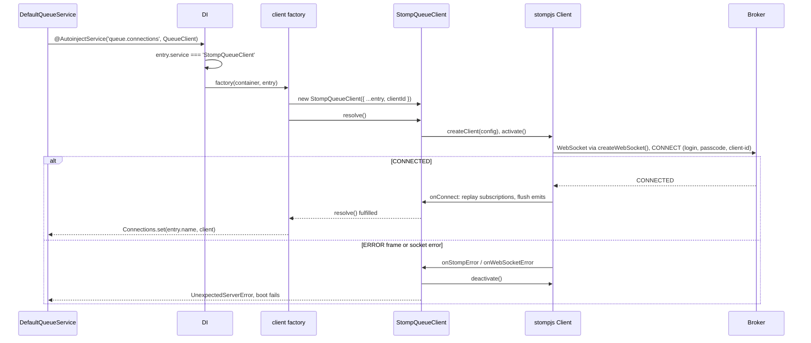

# STOMP connection

A `queue.connections` entry with `service: 'StompQueueClient'` becomes one `StompQueueClient`: a `stompjs` client over a `ws` WebSocket to the broker. This page covers how the entry selects the client, the first connect at boot, heartbeats and reconnect, readiness checks and shutdown.

## How it works

Boot, when `DefaultQueueService` from `@spinajs/queue` resolves:

1. `@AutoinjectService('queue.connections', QueueClient)` reads every entry and looks for a class registered under `QueueClient` whose name equals `entry.service`. `StompQueueClient` is registered there by `@Injectable(QueueClient)` when the package is imported.
2. DI resolves `StompQueueClient` with the entry as its options. The last registration under `StompQueueClient` is the [client factory](05-client-factory-and-client-id.md), so the factory runs:
   1. it reads `app.name` (default `'no-app'`) and `process.env.APP_ENV` (default `'development'`) from `Configuration`, or throws `InvalidOperation` when there is no `Configuration`;
   2. it calls `new StompQueueClient({ ...entry, clientId: entry.clientId ?? '<app.name>-<APP_ENV>-<entry.name>' })`;
   3. it awaits `client.resolve()` and returns the client.
3. `StompQueueClient.resolve()` rejects with `InvalidArgument` when `host` is empty. Otherwise it builds the `stompjs` `Client` through `createClient(config)`:
   - `brokerURL` is `host`; `connectHeaders` carry `login`, `passcode` (from `password`) and `client-id`;
   - `reconnectDelay`, `heartbeatIncoming`, `heartbeatOutgoing` and `connectionTimeout` come from the entry or their defaults;
   - `webSocketFactory` calls `createWebSocket()`, which opens `new WebSocket(host, <STOMP protocol versions>)` from `ws`;
   - every key of `entry.options` is spread last and overrides the values above.
4. It sets `client.debug` to log `stompjs` output at `trace`, or at `debug` when `entry.debug` is `true`.
5. When `entry.credentialProvider` is set, it installs `beforeConnect`, which asks the [credential provider](04-credential-providers.md) for fresh credentials before every connect. A provider that fails before the first connect deactivates the client and rejects `resolve()` with `UnexpectedServerError`; after it, the reconnect goes ahead with the previous credentials.
6. It installs `onConnect`, `onStompError`, `onWebSocketError`, `onWebSocketClose`, `onDisconnect` and `onUnhandledMessage`, then calls `client.activate()`.
7. `onConnect` replays all tracked subscriptions, flushes emits buffered while disconnected and resolves `whenReady()` callers. The first `onConnect` resolves `resolve()`.
8. A broker `ERROR` frame (`onStompError`, eg. a bad login) or a WebSocket error (`onWebSocketError`) **before** the first connect deactivates the client and rejects `resolve()` with `UnexpectedServerError`. The boot fails; there is no retry at boot.
9. `DefaultQueueService` stores the client in its connection map under `entry.name`.

After the first connect, errors are only logged. A dropped socket logs its close code and reason; `stompjs` reconnects after `reconnectDelay` and step 7 runs again.



## Configuration

Each entry of `queue.connections` that uses this transport:

| Key | Type | Default | Allowed values | Meaning |
| --- | --- | --- | --- | --- |
| `queue.connections[].service` | `string` | none, required | `'StompQueueClient'` or the class name of a [subclass](06-extending-the-stomp-client.md) | Selects this transport. |
| `queue.connections[].name` | `string` | none, required | unique per app | Connection name: the key in `QueueService.get(name)`, the target of `queue.default` and `queue.routing.*.connection`, and part of the `client-id`. |
| `queue.connections[].host` | `string` | none, required | `ws://` or `wss://` URL | Broker WebSocket endpoint, eg. `ws://activemq:61614/ws`. |
| `queue.connections[].login` | `string` | `undefined` | | STOMP `login` header. |
| `queue.connections[].password` | `string` | `undefined` | | STOMP `passcode` header. |
| `queue.connections[].clientId` | `string` | `undefined` | | `client-id` header. The shipped factory uses it when set, else `<app.name>-<APP_ENV>-<name>`; see [Client factory](05-client-factory-and-client-id.md). Built without the factory, it falls back to `name`. |
| `queue.connections[].credentialProvider` | `string` | `undefined` | a DI name of an `IQueueCredentialsProvider` | Fetch credentials before every connect; see [Credential providers](04-credential-providers.md). |
| `queue.connections[].reconnectDelay` | `number` (ms) | `5000` | `>= 0`; `0` turns auto-reconnect off | Wait before reconnecting after a drop. |
| `queue.connections[].heartbeatIncoming` | `number` (ms) | `4000` | `>= 0`; `0` turns it off | Heartbeat the client expects from the broker. |
| `queue.connections[].heartbeatOutgoing` | `number` (ms) | `4000` | `>= 0`; `0` turns it off | Heartbeat the client sends. |
| `queue.connections[].connectionTimeout` | `number` (ms) | `10000` | `>= 0`; `0` turns it off | Close a socket whose STOMP connect has not finished in time. At boot this rejects `resolve()`. |
| `queue.connections[].receiptTimeout` | `number` (ms) | `options.receiptTimeout`, else `5000` | `> 0` | Wait for a broker receipt per publish; see [Publishing](02-publishing-messages.md). |
| `queue.connections[].retryDelay` | `number` (ms) | `0` | `>= 0` | Base delay for job retry backoff and for the publish retry pipeline; see [Consuming](03-consuming-retries-and-dead-letters.md). |
| `queue.connections[].debug` | `boolean` | `false` | | Log `stompjs` frames at `debug` instead of `trace`. |
| `queue.connections[].defaultQueueChannel` | `string` | `undefined` | STOMP destination | Channel for jobs with no `queue.routing` entry. |
| `queue.connections[].defaultTopicChannel` | `string` | `undefined` | STOMP destination | Channel for events with no `queue.routing` entry. |
| `queue.connections[].defaultQueueDeadLetterChannel` | `string` | `undefined` | STOMP destination | Dead-letter channel when the route has none. |
| `queue.connections[].options` | `object` | `{}` | any `stompjs` `StompConfig` key, plus `receiptTimeout` and `emitRetries` | Spread last into the `stompjs` config, so it overrides every value above. |
| `queue.connections[].options.emitRetries` | `number` | `3` | `>= 0` | Publish retries after the first attempt; see [Publishing](02-publishing-messages.md). |

`transport`, `type`, `port` and `queue` from `IQueueConnectionOptions` are not read by this transport.

Keys from `entry.options` that are reassigned after the client is built have no effect: `debug`, `onConnect`, `onStompError`, `onWebSocketError`, `onWebSocketClose`, `onDisconnect`, `onUnhandledMessage`, and `beforeConnect` when `credentialProvider` is set. An `options.connectHeaders` replaces `login`, `passcode` and `client-id` as a whole.

```ts
// config/queue.ts
export default {
  queue: {
    default: 'activemq',
    connections: [
      {
        service: 'StompQueueClient',
        name: 'activemq',
        host: 'wss://mq.example.com:61619/ws',
        login: 'orders-service',
        password: process.env.ACTIVEMQ_PASSWORD,
        reconnectDelay: 2000,
        connectionTimeout: 15000,
        receiptTimeout: 8000,
        retryDelay: 1000,
        defaultQueueChannel: '/queue/orders',
        defaultTopicChannel: '/topic/orders',
        defaultQueueDeadLetterChannel: '/queue/orders.dlq',
        options: {
          emitRetries: 5,
          splitLargeFrames: true,
          maxWebSocketChunkSize: 8 * 1024,
        },
      },
    ],
  },
};
```

## Services and extension points

| Service | DI token and lifetime | Default implementation | Alternatives | How to replace or extend |
| --- | --- | --- | --- | --- |
| Queue transport | `QueueClient`, selected by class name from `queue.connections[].service`; `@PerInstanceCheck()`, one instance per connection `name` | `StompQueueClient` | `BlackHoleQueueClient` (`@spinajs/queue`), `AmqpQueueClient`, `SqsQueueClient`, your subclass | Register a class `@Injectable(QueueClient)` and name it in `service`; see [Extending the STOMP client](06-extending-the-stomp-client.md) |
| Client factory | the `StompQueueClient` key; a factory, never cached | `client-id` = `clientId ?? <app.name>-<APP_ENV>-<name>`, then `resolve()` | your factory | `DI.register(factory).as(StompQueueClient)` after the package import; see [Client factory](05-client-factory-and-client-id.md) |
| `stompjs` client | `protected createClient(config)` | `new Client(config)` | a fake in tests | Override in a subclass |
| WebSocket | `protected createWebSocket()`, or `options.webSocketFactory` | `new WebSocket(host, protocols)` from `ws` | TLS options, proxy agents, extra handshake headers | Override in a subclass, or pass `options.webSocketFactory` |
| Credentials | `IQueueCredentialsProvider`, DI name from `credentialProvider`; its own lifetime | none | your provider | See [Credential providers](04-credential-providers.md) |
| Logger | `protected Log`, `@Logger('queue')` | the `queue` logger | | Configure `logger.rules` for `queue` |

### WebSocket: TLS and handshake options without a subclass

`options` is spread into the `stompjs` config last, so `options.webSocketFactory` replaces `createWebSocket()`. Config files are code, so a factory can live there. Use a subclass instead when several connections need it; see [Extending the STOMP client](06-extending-the-stomp-client.md#websocket-custom-tls-and-handshake-headers).

```ts sample
import WebSocket from 'ws';
import { readFileSync } from 'fs';
import { IStompSocket, Versions } from '@stomp/stompjs';

const host = 'wss://mq.internal.example.com:61619/ws';

// config/queue.ts
export const config = {
  queue: {
    default: 'activemq',
    connections: [
      {
        service: 'StompQueueClient',
        name: 'activemq',
        host,
        login: 'billing',
        password: process.env.ACTIVEMQ_PASSWORD,
        options: {
          webSocketFactory: (): IStompSocket =>
            new WebSocket(host, Versions.default.protocolVersions(), {
              ca: readFileSync('/etc/ssl/internal-ca.pem'),
              headers: { 'X-Gateway-Key': process.env.MQ_GATEWAY_KEY ?? '' },
            }) as unknown as IStompSocket,
        },
      },
    ],
  },
};
```

## Readiness and shutdown

| Member | Returns | Meaning |
| --- | --- | --- |
| `Connected` | `boolean` | `true` while the `stompjs` client is connected. |
| `whenReady(timeoutMs?)` | `Promise<void>` | Resolves at once when connected, else on the next connect. With `timeoutMs`, rejects with `UnexpectedServerError` after that time. Rejects with `UnexpectedServerError` once `dispose()` has started. |
| `ClientId` | `string` | The `client-id` sent to the broker: `clientId`, else `name`. |
| `Name`, `ServiceName` | `string` | The connection `name`. |
| `dispose()` | `Promise<void>` | Rejects every buffered emit and every pending `whenReady()` with `UnexpectedServerError`, refuses new emits, then awaits `client.deactivate()`. |
| `describeWebSocketError(err)` | `string` | Exported helper: a one-line reason for a WebSocket error event, safe on circular socket objects. |

`describeWebSocketError()` prefers the wrapped error's message and code (`connect ECONNREFUSED 127.0.0.1:61614 ( ECONNREFUSED )`), then the event's message, then `event '<type>'`, then `'unknown error'`. For `ws`'s `closed before the connection was established` it adds a hint that the WebSocket handshake never completed, which points at the URL or the network path rather than the broker.

## Important behaviour

- The first connect is all-or-nothing. A broker that is down at boot fails `QueueService` resolution; the client is deactivated and does not retry. Reconnects happen only after one successful connect.
- `reconnectDelay: 0` turns auto-reconnect off: after a drop the client stays disconnected and emits buffer forever.
- The default heartbeats (4 s both ways) suit ActiveMQ. RabbitMQ Web-STOMP does not support heartbeats over WebSocket; set `heartbeatIncoming` and `heartbeatOutgoing` to `0` there, or the broker drops the connection.
- `@PerInstanceCheck()` matches instances by `name`. Two entries with the same `name` share one instance when built without the factory.
- The shipped factory creates a new client on every resolve. `DI.get(StompQueueClient)` does not return it; get a connection with `QueueService.get(name)`.
- An entry without `host`, or a credential provider that throws or is not registered at boot, rejects `resolve()`. A `createWebSocket()` override that throws still runs inside the un-awaited `stompjs` connect loop: the error is an unhandled promise rejection and `resolve()` never settles.
- `stompjs` frames log at `trace` with the `client-id` and connection name; `debug: true` lifts them to `debug` so they show under a typical logger config.

## Best practices

- Give every connection an explicit `connectionTimeout` that fits your network, and run a broker health check before deploys: a broker that is down at boot stops the app.
- Use `wss://` outside a trusted network: `login` and `passcode` travel in the `CONNECT` frame.
- Await `(queue.get(name) as StompQueueClient).whenReady(timeout)` in readiness probes, not `Connected`, when you need to wait for a reconnect.
- Put broker-specific `stompjs` settings (`splitLargeFrames`, `maxWebSocketChunkSize`, `stompVersions`) in `options`, not in a subclass.

## Patterns and antipatterns

```ts
// Don't: resolve the client yourself. The factory builds a second connection with the same client-id,
// which a broker that enforces unique client ids rejects.
const client = await DI.resolve(StompQueueClient, [{ service: 'StompQueueClient', name: 'activemq', host }]);

// Do: use the connection QueueService already holds
const queue = await DI.resolve(QueueService);
const client = queue.get('activemq') as StompQueueClient;
```

## Examples

### Readiness probe that waits for a reconnect

```ts sample
import '@spinajs/queue-stomp-transport';
import { DI } from '@spinajs/di';
import { QueueService } from '@spinajs/queue';
import { StompQueueClient } from '@spinajs/queue-stomp-transport';

export async function brokerReady(connection = 'activemq'): Promise<{ ready: boolean; reason?: string }> {
  const queue = await DI.resolve(QueueService);
  const client = queue.get(connection);

  if (!(client instanceof StompQueueClient)) {
    return { ready: true };
  }

  try {
    await client.whenReady(3000);
    return { ready: true };
  } catch (err) {
    return { ready: false, reason: (err as Error).message };
  }
}
```

## Related

- [Client factory and client id](05-client-factory-and-client-id.md): what runs in step 2 and how to replace it.
- [Credential providers](04-credential-providers.md): `beforeConnect` from step 5.
- [Extending the STOMP client](06-extending-the-stomp-client.md): `createClient()` and `createWebSocket()` hooks.
- [`@spinajs/configuration`](../configuration/08-config-selected-services.md): how `@AutoinjectService` matches `service` to a class.
- [`@spinajs/queue`](../queue/README.md): `QueueService`, routing and `queue.default`.
