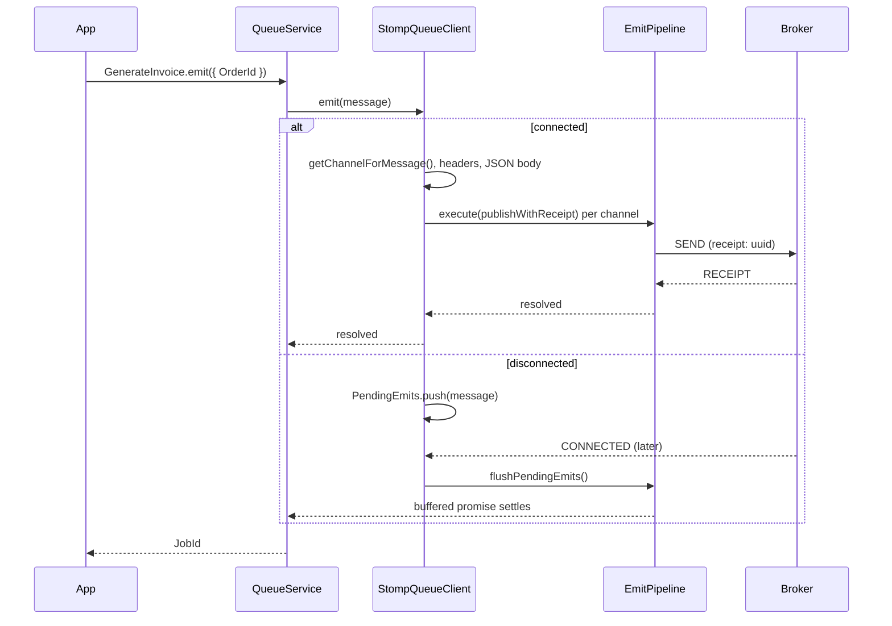

# Publishing messages

`StompQueueClient.emit()` sends a job or event to every channel its route names and resolves only when the broker has confirmed each publish with a `RECEIPT` frame. Failed or unconfirmed publishes are retried with backoff; messages emitted while disconnected wait for the next connect.

You do not call `emit()` directly: `QueueService.emit()`, `QueueJob.emit()` and `QueueEvent.emit()` from `@spinajs/queue` pick the connection and call it.

## How it works

1. `DefaultQueueService.emit(message)` picks the connections from `queue.routing.<Name>.connection` or `queue.default`, gives a job a `JobId` when it has none, and awaits `client.emit(message)` on each.
2. `StompQueueClient.emit(message)` checks the connection:
   - connected: it calls `publishMessage(message)`;
   - disconnected, and `dispose()` has started: it throws `UnexpectedServerError('Cannot emit message, queue connection <name> is disposing')`;
   - disconnected otherwise: it buffers the message, logs a warning with the number pending, and returns a promise that settles when the buffer is flushed.
3. `publishMessage(message)` resolves the channels with `getChannelForMessage(message)` from `QueueClient`:
   - `queue.routing.<Name>` as a string: that channel;
   - as an object: its `channel`, else the connection default;
   - as a list: each entry's channel, without duplicates;
   - no route: `defaultQueueChannel` for a job, `defaultTopicChannel` for an event, with a warning log.
4. It builds the STOMP headers (table below) and the body, `JSON.stringify(message)`.
5. For every channel at once it runs `EmitPipeline.execute(() => publishWhenConnected(channel, body, headers, message))`. `publishWhenConnected()` rejects once `dispose()` has started, calls `publishWithReceipt()` when connected, and otherwise waits up to `options.emitReconnectTimeout` (default `60000` ms) in `whenReady()` before it does.
6. `publishWithReceipt()` adds a `receipt` header with a new UUID, registers `client.watchForReceipt()`, publishes, and resolves when the receipt arrives. After `receiptTimeout` it rejects with `UnexpectedServerError('Timeout waiting for broker receipt while publishing to <channel> ( <name> )')`.
7. `EmitPipeline`, built by `buildEmitPipeline()`, retries any failure of step 6 with exponential backoff and jitter. When the retries run out, `emit()` rejects with the last error.
8. On the next connect, `flushPendingEmits()` publishes every buffered message through steps 3 to 7 and settles each buffered promise with the result.



## Message to STOMP frame

| Message field | STOMP header | Set when |
| --- | --- | --- |
| | `content-type: application/json` | always |
| | `receipt: <uuid>` | always, a new id per attempt |
| `JobId` | `correlation-id` | `JobId` is set; `QueueService` sets it on every job |
| `Persistent` | `persistent: true` | `Persistent` is `true`; `QueueJob.emit()` defaults it to `true`, `QueueEvent.emit()` does not |
| `Priority` | `priority` | `Priority` is not `0` |
| `ScheduleDelay` | `AMQ_SCHEDULED_DELAY` | set and not `0` |
| `SchedulePeriod` | `AMQ_SCHEDULED_PERIOD` | set and not `0` |
| `ScheduleRepeat` | `AMQ_SCHEDULED_REPEAT` | set and not `0` |
| `ScheduleCron` | `AMQ_SCHEDULED_CRON` | set and not empty |

The body is the whole message as JSON, including `Name`, `Type`, `RetryCount`, `Initiator` and your own fields. `CreatedAt`, a luxon `DateTime`, travels as an ISO string.

The `AMQ_SCHEDULED_*` headers are ActiveMQ's. ActiveMQ Classic applies them only with scheduler support on (`schedulerSupport="true"` on the broker); otherwise the message is delivered at once.

## Configuration

| Key | Type | Default | Allowed values | Meaning |
| --- | --- | --- | --- | --- |
| `queue.routing.<Name>` | `string`, `{ channel?, deadLetterChannel?, connection? }` or a list of those | none | STOMP destinations, connection names | Where messages of class `<Name>` go. |
| `queue.connections[].defaultQueueChannel` | `string` | `undefined` | STOMP destination | Channel for jobs with no route. |
| `queue.connections[].defaultTopicChannel` | `string` | `undefined` | STOMP destination | Channel for events with no route. |
| `queue.connections[].receiptTimeout` | `number` (ms) | `options.receiptTimeout`, else `5000` | `> 0` | Wait for the receipt of one publish attempt. |
| `queue.connections[].options.receiptTimeout` | `number` (ms) | `5000` | `> 0` | Used when the top-level key is not set. |
| `queue.connections[].options.emitRetries` | `number` | `3` | `>= 0` | Retries after the first attempt; `0` disables retry. |
| `queue.connections[].retryDelay` | `number` (ms) | `0`, which means a `200` ms base here | `>= 0` | Base delay of the exponential publish backoff, capped at `30000` ms. Also the job retry base; see [Consuming](03-consuming-retries-and-dead-letters.md). |

```ts
// config/queue.ts
export default {
  queue: {
    default: 'activemq',
    routing: {
      // jobs: a work queue, consumed by one worker
      GenerateInvoice: { channel: '/queue/invoices', deadLetterChannel: '/queue/invoices.dlq' },
      // events: a topic, delivered to every subscriber; sent to two channels
      OrderPlaced: ['/topic/orders', '/topic/audit'],
    },
    connections: [
      {
        service: 'StompQueueClient',
        name: 'activemq',
        host: 'ws://activemq:61614/ws',
        receiptTimeout: 3000,
        retryDelay: 500,
        options: { emitRetries: 4 },
        defaultQueueChannel: '/queue/default',
        defaultTopicChannel: '/topic/default',
      },
    ],
  },
};
```

## Services and extension points

| Service | DI token and lifetime | Default implementation | Alternatives | How to replace or extend |
| --- | --- | --- | --- | --- |
| Publish pipeline | `protected buildEmitPipeline(): ResiliencePipeline<void>`, built once per client | exponential retry, `emitRetries` attempts, jitter | circuit breaker, timeout, concurrency limit from `@spinajs/util` | Override in a subclass; see below |
| Message to frame | `protected publishMessage(message)` | the header table above | | Override, call `super.publishMessage()` with a changed message, or build your own headers and call `publishWithReceipt()` |
| One confirmed publish | `protected publishWithReceipt(channel, body, headers, message)` | receipt watch plus timeout | | Override to add headers to every frame, then call `super` |
| Receipt timeout | `protected get ReceiptTimeout()` | `receiptTimeout ?? options.receiptTimeout ?? 5000` | | Override the getter |
| Channel routing | `public getChannelForMessage(message)` from `QueueClient` | `queue.routing`, then the connection defaults | | Override in a subclass, eg. to add a tenant prefix |

### Publish pipeline: custom implementation

Replace the pipeline when the defaults do not fit: here a circuit breaker makes emits fail at once while the broker keeps failing, instead of every caller waiting through four receipt timeouts. The breaker is outermost, so one `emit()` counts as one action; its state is shared by all emits of the connection.

`buildEmitPipeline()` runs in a field initializer of `StompQueueClient`, before your subclass's own fields exist. Read only `this.Options` in it.

```ts sample
import { Injectable, PerInstanceCheck } from '@spinajs/di';
import { QueueClient } from '@spinajs/queue';
import { StompQueueClient } from '@spinajs/queue-stomp-transport';
import { BackoffType, ResiliencePipeline, ResiliencePipelineBuilder } from '@spinajs/util';

@PerInstanceCheck()
@Injectable(QueueClient)
export class FailFastStompClient extends StompQueueClient {
  protected buildEmitPipeline(): ResiliencePipeline<void> {
    const retries = (this.Options.options?.emitRetries as number | undefined) ?? 2;

    return new ResiliencePipelineBuilder<void>()
      .addCircuitBreaker({ FailureRatio: 0.5, MinimumThroughput: 20, SamplingDuration: 30000, BreakDuration: 10000 })
      .addRetry({ MaxRetryAttempts: retries, Delay: 250, MaxDelay: 5000, BackoffType: BackoffType.Exponential, UseJitter: true })
      .build();
  }
}

// config/queue.ts: select the subclass by its class name
export const config = {
  queue: {
    default: 'activemq',
    connections: [
      {
        service: 'FailFastStompClient',
        name: 'activemq',
        host: 'ws://activemq:61614/ws',
        defaultQueueChannel: '/queue/default',
        defaultTopicChannel: '/topic/default',
      },
    ],
  },
};
```

### Message to frame: custom headers

Override `publishWithReceipt()` to stamp every frame. The sample adds the tenant and the emitting service, which ActiveMQ message selectors and broker-side tooling can read.

```ts sample
import { StompHeaders } from '@stomp/stompjs';
import { Injectable, PerInstanceCheck } from '@spinajs/di';
import { IQueueMessage, QueueClient } from '@spinajs/queue';
import { StompQueueClient } from '@spinajs/queue-stomp-transport';

@PerInstanceCheck()
@Injectable(QueueClient)
export class TenantStompClient extends StompQueueClient {
  protected publishWithReceipt(channel: string, body: string, headers: StompHeaders, message: IQueueMessage): Promise<void> {
    const tenant = (message as IQueueMessage & { TenantId?: string }).TenantId;

    return super.publishWithReceipt(
      channel,
      body,
      {
        ...headers,
        'x-emitted-by': process.env.SERVICE_NAME ?? 'unknown',
        ...(tenant ? { 'x-tenant': tenant } : {}),
      },
      message,
    );
  }
}
```

## Important behaviour

- `emit()` resolves only after a broker receipt on **every** routed channel. With a list route, a failure on one channel rejects `emit()` while the others may already be published.
- A retry re-sends the message with a new receipt id. A receipt that arrives after its timeout leaves a duplicate on the broker; consumers get it twice. `QueueService` skips a job whose tracking row is already terminal (`queue.deduplicate`, default `true`); make event handlers idempotent.
- Worst case, one `emit()` takes `(emitRetries + 1) × receiptTimeout` plus the backoff delays: about 21 s with the defaults.
- A message emitted while disconnected is buffered with no limit and no timeout. Its promise stays pending until the next connect or until `dispose()`, which rejects it. With `reconnectDelay: 0` it stays pending.
- Buffered messages are flushed concurrently on connect; their order on the broker is not guaranteed.
- A socket that drops in the middle of a publish makes the attempt throw or time out; the pipeline's next attempt waits for the reconnect (up to `options.emitReconnectTimeout`) instead of failing at once. The message is not moved to the buffer.
- `Priority: 0` and `ScheduleDelay: 0` are not sent: `0` means unset.
- `getChannelForMessage()` falls back to `defaultQueueChannel` or `defaultTopicChannel`. When that default is not configured either, the frame has no usable destination; expect a broker error or a receipt timeout.

## Best practices

- Route every job type to its own `/queue/...` channel; see [Consuming](03-consuming-retries-and-dead-letters.md#important-behaviour) for why channels must not be shared.
- Keep `Persistent: true` on jobs (the `QueueJob.emit()` default). Set it on events only when losing one on a broker restart matters.
- Lower `receiptTimeout` and `emitRetries` for request paths that emit inline, so a slow broker does not hold the HTTP response for 20 s.
- Use `ScheduleDelay` for one-off delays and `ScheduleCron` for recurring jobs only on ActiveMQ with the scheduler on.

## Patterns and antipatterns

```ts
// Don't: fire and forget. A failed publish becomes an unhandled rejection and the job is lost silently.
void GenerateInvoice.emit({ OrderId: orderId });

// Do: await it, so a broker outage surfaces where you can handle it
const jobId = await GenerateInvoice.emit({ OrderId: orderId, RetryCount: 3 });
```

## Examples

### Send a reminder in 24 hours

```ts sample
import '@spinajs/queue-stomp-transport';
import { Job, QueueJob } from '@spinajs/queue';

@Job()
export class SendCartReminder extends QueueJob {
  public CartId: string;
  public Email: string;

  public async execute() {
    console.log(`Reminding ${this.Email} about cart ${this.CartId}`);
  }
}

// queue.routing.SendCartReminder: '/queue/cart-reminders' on an ActiveMQ connection
export async function scheduleCartReminder(cartId: string, email: string) {
  return SendCartReminder.emit({
    CartId: cartId,
    Email: email,
    RetryCount: 2,
    Priority: 4,
    ScheduleDelay: 24 * 60 * 60 * 1000,
  });
}
```

## Related

- [STOMP connection](01-stomp-connection.md): connect, reconnect and the `options` passthrough.
- [Consuming, retries and dead letters](03-consuming-retries-and-dead-letters.md): what happens to the message on the other side.
- [Extending the STOMP client](06-extending-the-stomp-client.md): registering a subclass like `FailFastStompClient`.
- [`@spinajs/queue`](../queue/README.md): `QueueService.emit()`, `queue.routing`, `queue.deduplicate`.
- [`@spinajs/util`](../util/README.md): `ResiliencePipelineBuilder` and its strategies.
