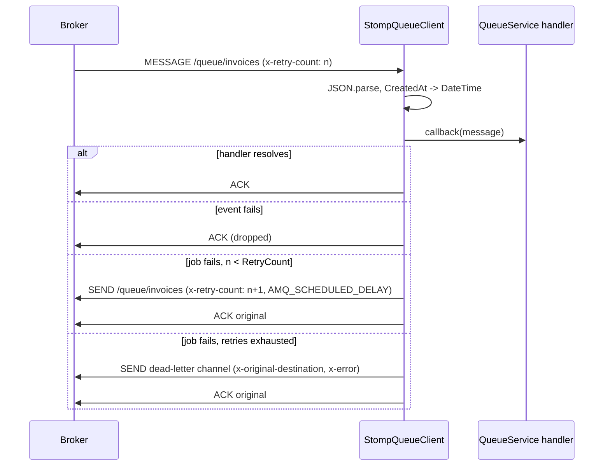

# Consuming, retries and dead letters

`StompQueueClient.subscribe()` turns a channel into a broker subscription with per-message acks, keeps it across reconnects, and decides what happens to a message whose handler fails: events are dropped, jobs are re-published with backoff until `RetryCount` runs out, then routed to a dead-letter channel.

You do not call `subscribe()` directly in most apps: `QueueService.consume()` from `@spinajs/queue` calls it with a handler that hydrates the message class, tracks jobs and runs `execute()`.

## How it works

Subscribing:

1. `DefaultQueueService.consume(MessageClass, callback?, subscriptionId?, durable?)` calls `client.subscribe(MessageClass, handler, subscriptionId, durable ?? <@Event durable option>)` on every connection the class is routed to.
2. `subscribe(channelOrMessage, callback, subscriptionId?, durable?)` takes the channel string, or the channels of the class from `getChannelForMessage()`. For each channel:
   - a channel this client already tracks is skipped with the warning `Channel <channel> already subscribed !`;
   - `durable` without `subscriptionId` throws `InvalidArgument('subscriptionId cannot be empty if using durable subscriptions')`;
   - otherwise it records a descriptor (channel, callback, id, durable) and, when connected, calls `applySubscription()`; when not connected, the descriptor waits for the next connect.
3. `applySubscription(desc)` subscribes with the headers `ack: client-individual` and `activemq.prefetchSize: 1`, plus `id: <subscriptionId>` when given and `activemq.subscriptionName: <subscriptionId>` when durable.
4. Every connect (`onConnect`) runs `applySubscription()` again for every tracked descriptor, because `stompjs` does not restore subscriptions after a drop.

Receiving one message:

1. The body is parsed as JSON. A body that does not parse goes to `handleUnparseableMessage()`, which dead-letters it to `defaultQueueDeadLetterChannel`.
2. A string `CreatedAt` becomes a luxon `DateTime`.
3. The callback runs. When it resolves, the message is acked.
4. When it rejects, `handleFailedMessage(message, qMessage, desc, err)` decides:
   - **event** (`Type !== 'JOB'`): logged as a warning and acked, so it is dropped;
   - **job with retries left** (`x-retry-count` header, default `0`, is below `RetryCount`): the body is published again to the same channel with `x-retry-count` plus one, `persistent: true`, the original `priority` and `correlation-id`, and `AMQ_SCHEDULED_DELAY: retryBackoff(attempt)` when that is above `0`. Then the original is acked. When that publish throws, the original is nacked;
   - **job with no retries left**: `deadLetter()` with the channel from `getDeadLetterChannelForMessage()`.
5. `deadLetter(message, dlq, channel, reason, attempt?)` publishes the body to `dlq` with `persistent: true`, `x-original-destination: <channel>`, `x-error: <err.message>` and `x-retry-count`, then acks the original. With no dead-letter channel it acks and drops the message with a warning. When the publish throws, it nacks.



### Dead-letter channel

`getDeadLetterChannelForMessage()` from `QueueClient` picks, in order:

1. `queue.routing.<Name>.deadLetterChannel` when the route is one object;
2. the first entry with a `deadLetterChannel` when the route is a list;
3. `queue.connections[].defaultQueueDeadLetterChannel`.

### Retry backoff

`retryBackoff(attempt)` returns `retryDelay × 2^(attempt − 1)` ms, or `0` when `retryDelay` is unset or `0`. With `retryDelay: 1000` the retries wait 1 s, 2 s, 4 s. The delay is applied by the broker through `AMQ_SCHEDULED_DELAY`; ActiveMQ Classic needs scheduler support on, otherwise the retry is delivered at once.

## Decorators

| Decorator | Target | Options | Effect |
| --- | --- | --- | --- |
| `@Event({ durable: true })` (`@spinajs/queue`) | event class | `durable` | `QueueService.consume()` subscribes durably; a `subscriptionId` is then required. |
| `@Job()` (`@spinajs/queue`) | job class | `runAs` | Marks the class as a job, so failures are retried and dead-lettered instead of dropped. |

## Configuration

| Key | Type | Default | Allowed values | Meaning |
| --- | --- | --- | --- | --- |
| `queue.routing.<Name>.deadLetterChannel` | `string` | `undefined` | STOMP destination | Dead-letter channel for this message class. |
| `queue.connections[].defaultQueueDeadLetterChannel` | `string` | `undefined` | STOMP destination | Dead-letter channel when the route has none, and for unparseable bodies. Unset: such messages are dropped. |
| `queue.connections[].retryDelay` | `number` (ms) | `0` | `>= 0` | Base of the exponential job retry delay; `0` retries at once. |
| `RetryCount` on the job | `number` | `0` | `>= 0` | Retries after the first run; set per emit, eg. `GenerateInvoice.emit({ ..., RetryCount: 3 })`. |

```ts
// config/queue.ts
export default {
  queue: {
    default: 'activemq',
    routing: {
      GenerateInvoice: { channel: '/queue/invoices', deadLetterChannel: '/queue/invoices.dlq' },
      OrderPlaced: '/topic/orders',
    },
    connections: [
      {
        service: 'StompQueueClient',
        name: 'activemq',
        host: 'ws://activemq:61614/ws',
        retryDelay: 1000,
        defaultQueueChannel: '/queue/default',
        defaultTopicChannel: '/topic/default',
        defaultQueueDeadLetterChannel: '/queue/dead-letter',
      },
    ],
  },
};
```

## Services and extension points

| Service | DI token and lifetime | Default implementation | Alternatives | How to replace or extend |
| --- | --- | --- | --- | --- |
| Failure policy | `protected handleFailedMessage(message, qMessage, desc, err)` | events dropped, jobs retried then dead-lettered | | Override in a subclass; call `super` for the cases you keep |
| Retry delay | `protected retryBackoff(attempt): number` | `retryDelay × 2^(attempt − 1)` | | Override to cap, add jitter or use a fixed delay |
| Dead-lettering | `protected deadLetter(message, dlq, channel, reason, attempt?)` | publish with `x-original-destination`, `x-error`, then ack | | Override to alert, add headers, or store the message elsewhere; call `super` |
| Poison bodies | `protected handleUnparseableMessage(message, channel, err)` | dead-letter to `defaultQueueDeadLetterChannel` | | Override, eg. to pick a separate quarantine channel |
| Subscription frame | `protected applySubscription(desc)` | `client-individual` ack, prefetch `1`, ActiveMQ durable name | | Override only with care: it also wires the parse, ack and failure handling |
| Dead-letter lookup | `public getDeadLetterChannelForMessage(message)` from `QueueClient` | route, then connection default | | Override in a subclass |

Subclasses are registered as described in [Extending the STOMP client](06-extending-the-stomp-client.md).

### Failure policy: custom implementation

A job that fails on bad input will fail on every retry. This subclass dead-letters a job at once when its handler throws `InvalidArgument`, and keeps the stock policy for every other error.

```ts sample
import { IMessage } from '@stomp/stompjs';
import { Injectable, PerInstanceCheck } from '@spinajs/di';
import { InvalidArgument } from '@spinajs/exceptions';
import { IQueueMessage, QueueClient, QueueMessageType } from '@spinajs/queue';
import { StompQueueClient } from '@spinajs/queue-stomp-transport';

@PerInstanceCheck()
@Injectable(QueueClient)
export class NoRetryOnBadInputStompClient extends StompQueueClient {
  protected handleFailedMessage(message: IMessage, qMessage: IQueueMessage, desc: Parameters<StompQueueClient['handleFailedMessage']>[2], err: unknown): void {
    if (qMessage.Type === QueueMessageType.Job && err instanceof InvalidArgument) {
      const attempt = Number(message.headers['x-retry-count'] ?? '0');
      this.deadLetter(message, this.getDeadLetterChannelForMessage(qMessage), desc.channel, `rejected input: ${err.message}`, attempt);
      return;
    }

    super.handleFailedMessage(message, qMessage, desc, err);
  }
}
```

### Retry delay: capped with jitter

The stock backoff doubles without a limit: with `retryDelay: 60000` and `RetryCount: 10` the last retry waits 8.5 hours. This override caps the delay at 15 minutes and spreads retries by ±20 % so a burst of failures does not come back at the same moment.

```ts sample
import { Injectable, PerInstanceCheck } from '@spinajs/di';
import { QueueClient } from '@spinajs/queue';
import { StompQueueClient } from '@spinajs/queue-stomp-transport';

const MAX_RETRY_DELAY_MS = 15 * 60 * 1000;

@PerInstanceCheck()
@Injectable(QueueClient)
export class CappedRetryStompClient extends StompQueueClient {
  protected retryBackoff(attempt: number): number {
    const base = this.Options.retryDelay ?? 1000;
    const delay = Math.min(base * 2 ** (attempt - 1), MAX_RETRY_DELAY_MS);
    return Math.round(delay * (0.8 + Math.random() * 0.4));
  }
}
```

### Dead-lettering: alert the on-call channel

```ts sample
import { IMessage } from '@stomp/stompjs';
import { Injectable, PerInstanceCheck } from '@spinajs/di';
import { Event, QueueClient, QueueEvent } from '@spinajs/queue';
import { StompQueueClient } from '@spinajs/queue-stomp-transport';

@Event()
export class JobDeadLettered extends QueueEvent {
  public Channel: string;
  public DeadLetterChannel: string;
  public Reason: string;
  public Attempts: number;
}

@PerInstanceCheck()
@Injectable(QueueClient)
export class AlertingStompClient extends StompQueueClient {
  protected deadLetter(message: IMessage, dlq: string | undefined, channel: string, reason: string, attempt?: number): void {
    super.deadLetter(message, dlq, channel, reason, attempt);

    // route JobDeadLettered to a topic an alerting service consumes
    JobDeadLettered.emit({ Channel: channel, DeadLetterChannel: dlq ?? '(dropped)', Reason: reason, Attempts: attempt ?? 0 }).catch((err) => {
      this.Log.error({ error: err, channel }, 'Cannot emit JobDeadLettered for ${channel}');
    });
  }
}
```

## Important behaviour

- **One subscription per channel per connection.** Subscriptions are keyed by channel. Two message classes routed to the same channel on one connection: the second `consume()` is skipped with a warning, and the first class's handler receives both. `QueueService` ignores a message whose `Name` does not match and resolves, so the transport acks it: the second class's messages are lost. `unsubscribe()` of either class removes the shared subscription. Give every consumed class its own channel.
- Prefetch is `1` with `client-individual` acks: ActiveMQ sends the next message on a subscription only after the current one is acked. Handlers on one subscription run one at a time.
- A retry is a new message: the original is acked after the retry is published. The retry publish does not wait for a broker receipt, so a broker that loses it loses the job.
- A retry keeps `priority` and `correlation-id` but drops the original `AMQ_SCHEDULED_*` headers, so a cron job does not schedule itself again on retry. It is always sent `persistent`.
- A job routed to a `/topic/...` channel is retried on that topic: every subscriber gets the retry. Route jobs to `/queue/...` channels.
- Events are never retried or dead-lettered. `queue.deduplicate` and job tracking in `QueueService` apply to jobs only.
- The transport counts attempts in the `x-retry-count` header; `QueueService` counts them in the `queue_jobs` row and marks it `dead` when they run out. Both use `RetryCount`, so they agree.
- An unparseable body uses only `defaultQueueDeadLetterChannel`; route-level dead-letter channels do not apply because the message name is unknown.
- When a publish to the retry or dead-letter channel throws, the original is nacked and the broker's redelivery policy takes over.
- A durable subscription is identified by ActiveMQ through `client-id` plus `activemq.subscriptionName`. The `client-id` comes from the [client factory](05-client-factory-and-client-id.md); keep `app.name`, `APP_ENV` and the connection `name` stable, or a restart creates a new durable subscription and the old one keeps collecting messages.
- `unsubscribe(channelOrClass, removeDurable = true)` sends `UNSUBSCRIBE` with `activemq.subscriptionName`, which deletes the durable subscription on the broker. Without `removeDurable` it only stops consuming; the broker keeps storing messages for it.
- `unsubscribe(channel, true)` on a durable subscription while the socket is down throws a `TypeError` from `stompjs` and keeps the descriptor, so the subscription comes back on reconnect. A plain `unsubscribe()` while down only forgets the descriptor.

## Best practices

- Set `RetryCount` on every job emit and a `deadLetterChannel` on every job route; without a dead-letter channel, a job that runs out of retries is dropped with only a log line.
- Set `retryDelay` on connections that carry jobs calling external services; immediate retries hit the same outage.
- Make job handlers throw on failure. A handler that catches its own error and resolves gets its message acked.
- Consume dead-letter channels with a separate tool or job that reads `x-original-destination` and `x-error` and re-emits after a fix.

## Patterns and antipatterns

```ts
// Don't: two job classes on one channel. Only the first consume() subscribes;
// ResizeImage messages reach the GenerateThumbnail handler, are ignored and acked.
routing: { GenerateThumbnail: '/queue/images', ResizeImage: '/queue/images' }

// Do: one channel per consumed class
routing: { GenerateThumbnail: '/queue/images.thumbnails', ResizeImage: '/queue/images.resize' }
```

```ts
// Don't: a durable subscription with a generated id; every restart leaves an orphaned subscription on the broker
await queue.consume(OrderPlaced, onOrderPlaced, `orders-${Date.now()}`, true);

// Do: a stable id per consumer role
await queue.consume(OrderPlaced, onOrderPlaced, 'billing-order-placed', true);
```

## Examples

### Durable event consumer that survives restarts

```ts sample
import '@spinajs/queue-stomp-transport';
import { DI } from '@spinajs/di';
import { Event, QueueEvent, QueueService } from '@spinajs/queue';

@Event({ durable: true })
export class OrderPlaced extends QueueEvent {
  public OrderId: string;
  public Total: number;
}

// queue.routing.OrderPlaced: '/topic/orders'
export async function startBillingListener() {
  const queue = await DI.resolve(QueueService);

  // the broker keeps OrderPlaced events for 'billing-order-placed' while this process is down
  await queue.consume<OrderPlaced>(
    OrderPlaced,
    async (order) => {
      console.log(`Billing order ${order.OrderId}: ${order.Total}`);
    },
    'billing-order-placed',
  );
}
```

### Retried job with a dead-letter channel

```ts sample
import '@spinajs/queue-stomp-transport';
import { DI } from '@spinajs/di';
import { Job, QueueJob, QueueService } from '@spinajs/queue';

@Job()
export class SyncCustomerToCrm extends QueueJob {
  public CustomerId: string;

  public async execute() {
    const res = await fetch(`https://crm.example.com/api/customers/${this.CustomerId}/sync`, { method: 'POST' });
    if (!res.ok) {
      // throwing makes the transport retry with backoff, then dead-letter
      throw new Error(`CRM sync failed with HTTP ${res.status}`);
    }
  }
}

// config/queue.ts
export const config = {
  queue: {
    default: 'activemq',
    routing: {
      SyncCustomerToCrm: { channel: '/queue/crm-sync', deadLetterChannel: '/queue/crm-sync.dlq' },
    },
    connections: [
      { service: 'StompQueueClient', name: 'activemq', host: 'ws://activemq:61614/ws', retryDelay: 30000 },
    ],
  },
};

export async function startCrmWorker() {
  const queue = await DI.resolve(QueueService);
  await queue.consume(SyncCustomerToCrm);
}

// 1 run + 4 retries after 30 s, 60 s, 120 s, 240 s, then /queue/crm-sync.dlq
export function syncCustomer(customerId: string) {
  return SyncCustomerToCrm.emit({ CustomerId: customerId, RetryCount: 4 });
}
```

## Related

- [Publishing messages](02-publishing-messages.md): the routing that also decides where consumers subscribe.
- [Client factory and client id](05-client-factory-and-client-id.md): the `client-id` durable subscriptions depend on.
- [Extending the STOMP client](06-extending-the-stomp-client.md): registering the subclasses on this page.
- [`@spinajs/queue`](../queue/README.md): `QueueService.consume()`, job tracking, `onFailed()`, `queue.deduplicate`.
