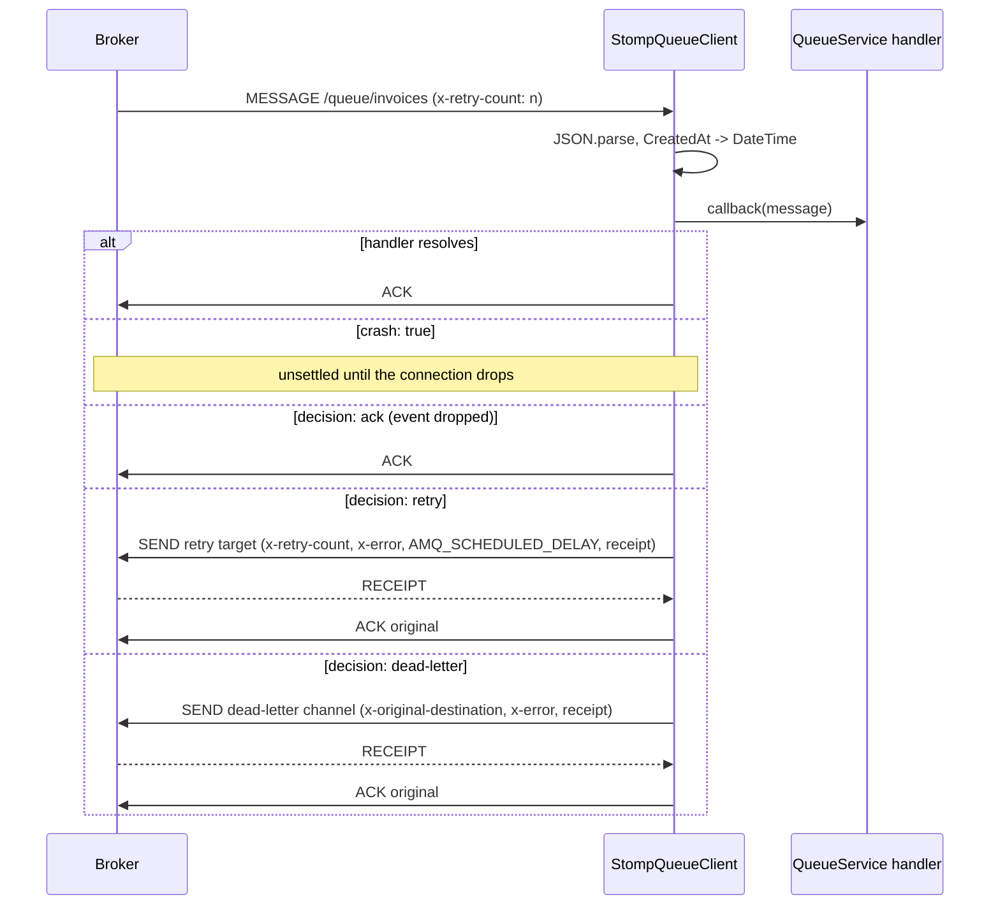

# Consuming, retries and dead letters

`StompQueueClient.subscribe()` turns a channel into a broker subscription with per-message acks and keeps it across reconnects. What happens to a message whose handler fails is decided by `decideDelivery()` from `@spinajs/queue`, the [delivery contract](../queue/11-delivery-contract.md) every transport shares: by default a failed event is dropped, and a job is re-published with backoff until its retries run out, then routed to a dead-letter channel. The transport executes that decision with `AMQ_SCHEDULED_DELAY`.

You do not call `subscribe()` directly in most apps: `QueueService.consume()` from `@spinajs/queue` calls it with a handler that hydrates the message class, tracks jobs and runs `execute()`.

## How it works

Subscribing:

1. `DefaultQueueService.consume(MessageClass, callback?, subscriptionId?, durable?)` calls `client.subscribe(MessageClass, handler, subscriptionId, durable ?? <@Event durable option>)` on every connection the class is routed to.
2. `subscribe(channelOrMessage, callback, subscriptionId?, durable?)` takes the channel string, or the channels of the class from `getChannelForMessage()`. `assertSubscribable()` first refuses, with `InvalidArgument`, what the failure path could not execute later (see [Virtual topics](#virtual-topics) and [Event retries](#event-retries-and-redeliverlater)). For each channel:
   - the descriptor is looked up by `subscriptionKey(channel, subscriptionId)`: `<channel>#<subscriptionId>` for a `/topic/...` channel with a `subscriptionId`, otherwise the channel;
   - the same channel string or message class subscribed twice under one key is skipped with the warning `Channel <channel> already subscribed !`;
   - `durable` without `subscriptionId` throws `InvalidArgument('subscriptionId cannot be empty if using durable subscriptions')`;
   - a key this client already tracks for another message class gets the new handler added to its descriptor; no second broker subscription is made;
   - otherwise it records a descriptor (channel, handlers, id, durable, and the consumer queue from `consumerQueueOf(channel, subscriptionId)` under virtual topics) and, when connected, calls `applySubscription()`; when not connected, the descriptor waits for the next connect.
3. `applySubscription(desc)` subscribes to the consumer queue when the descriptor has one, otherwise to the channel, with the headers `ack: client-individual` and `activemq.prefetchSize: <options.prefetch>` (default `1`), plus `id: <subscriptionId>@<channel>` (`frameIdOf(desc)`) when a `subscriptionId` is given and `activemq.subscriptionName: <subscriptionId>` when durable and not on a consumer queue.
4. Every connect (`onConnect`) runs `applySubscription()` again for every tracked descriptor, because `stompjs` does not restore subscriptions after a drop.

Receiving one message:

1. The body is parsed as JSON. A body that does not parse goes to `handleUnparseableMessage(message, desc, err)`: the decision is a dead letter to `defaultQueueDeadLetterChannel`, with an `x-error` that starts with `unparseable message body:` and the frame's `x-spinajs-message-id`.
2. A string `CreatedAt` becomes a luxon `DateTime`.
3. Every handler tracked for the channel runs. When all of them resolve, the message is acked. An ack that throws because the socket is gone is logged as a warning; the broker redelivers the message after the reconnect.
4. When one rejects, `handleFailedMessage(message, qMessage, desc, err)`:
   - a **crash** (an error with `crash: true`) is logged as an error and the frame is left unsettled: no ack, no nack. The broker hands it out again once the connection drops;
   - anything else goes to `decideDelivery(qMessage, x-retry-count, err, resolveDeliveryPolicy(this, qMessage))`, and `executeDecision()` carries out the answer.
5. `executeDecision(message, qMessage, desc, decision)`:
   - **ack** (a failed event under `onEventFailure: 'drop'`, the default): logged as a warning and acked, so it is dropped;
   - **retry**: the body is published again to the retry target with the decision's headers (`x-retry-count`, `x-error`, `x-spinajs-message-id`), `persistent: true`, the original `priority` and `correlation-id`, and `AMQ_SCHEDULED_DELAY: <delayMs>` when that is above `0`. The original is acked once the broker sends a receipt for that publish. When the publish throws or no receipt comes within `ReceiptTimeout`, the original is nacked. The retry target is the subscription's consumer queue; without one, a `/queue/...` channel itself; without one on a topic, the topic for a job only (see [Event retries](#event-retries-and-redeliverlater));
   - **dead-letter** (retries used up, a `NonRetryableError` or `PermanentJobFailure`, an unparseable body): `deadLetter()` with the decision's channel and headers plus `x-original-destination: <channel>`.
6. `deadLetter(message, dlq, headers)` publishes the body to `dlq` with `persistent: true` and the headers, then acks the original once the broker sends a receipt. With no dead-letter channel it acks and drops the message with a warning. When the publish throws or no receipt comes within `ReceiptTimeout`, it nacks.



### Dead-letter channel

`getDeadLetterChannelForMessage()` from `QueueClient` picks, in order:

1. `queue.routing.<Name>.deadLetterChannel` when the route is one object;
2. the first entry with a `deadLetterChannel` when the route is a list;
3. `queue.connections[].defaultQueueDeadLetterChannel`.

### Retry backoff

The delay comes from the route's `backoff` (`queue.routing.<Name>.backoff`). Without one it is `{ kind: 'exponential', delayMs: retryDelay }`: `retryDelay × 2^(attempt − 1)` ms, or `0` when `retryDelay` is unset or `0`. With `retryDelay: 1000` the retries wait 1 s, 2 s, 4 s. A `fixed` backoff waits `delayMs` before every retry, and `maxDelayMs` caps either kind. The delay is applied by the broker through `AMQ_SCHEDULED_DELAY`; ActiveMQ Classic needs scheduler support on, otherwise the retry is delivered at once.

### Virtual topics

A durable topic subscription keeps a copy for each subscriber, but a republish to a topic reaches every subscriber, so a failed event cannot be retried there for one subscriber only. ActiveMQ's virtual topics solve that: a publish to `/topic/VirtualTopic.<name>` is also copied into every queue named `Consumer.<id>.VirtualTopic.<name>`. ActiveMQ Classic has them on by default.

With `options.virtualTopics: true` on the connection, a subscription with a `subscriptionId` on a `/topic/VirtualTopic.<name>` channel consumes `/queue/Consumer.<subscriptionId>.VirtualTopic.<name>` instead of the topic (`consumerQueueOf()`). Then:

- the consumer queue is a queue: subscribers that share a `subscriptionId` (replicas) compete for one copy, each `subscriptionId` gets its own copy, and the broker keeps messages while nobody consumes;
- it is durable by nature: `durable` sends no `activemq.subscriptionName` for it;
- a `subscriptionId` on a topic cannot contain `.`, `*` or `>`, because it is one path element of the queue name (ActiveMQ's pattern is `Consumer.*.VirtualTopic.>`);
- a named topic subscription must be on a `/topic/VirtualTopic.*` channel; `subscribe()` refuses any other topic with `InvalidArgument`;
- a subscription without a `subscriptionId` still subscribes the topic itself.

It is off by default because it changes what a named topic subscription is. To move an existing durable topic subscription to a virtual topic, remove the old one first with `unsubscribe(channel, true)`, or it keeps collecting messages on the broker. `unsubscribe(…, true)` on a consumer queue only stops consuming and logs that the queue stays; deleting it is a broker-console action.

### Event retries and RedeliverLater

A retry decision goes into the subscription's consumer queue, for events and jobs alike. Without one, a `/queue/...` channel is its own retry target, because a queue hands a republished copy to one consumer. On a topic without a consumer queue a job is republished to the topic, as before, and an event has nowhere to go:

- `onEventFailure: 'retry'` on a message class whose subscription is a topic without a consumer queue (a plain topic, an unnamed subscription, or a connection without `options.virtualTopics`) throws `InvalidArgument` from `subscribe()`, so `QueueService.consume()` fails at boot. A route to a `/queue/...` channel is accepted;
- a raw `subscribe('/topic/...', …)` does not know the message class; if it meets a retry decision for an event, the transport logs an error and acks the event;
- a `RedeliverLater` (from event deduplication, or thrown by the handler) is republished into the consumer queue or the `/queue/...` channel with its delay and an unchanged `x-retry-count`. On a topic subscription without a consumer queue it is logged as an error and nacked: on ActiveMQ a NACK sends the message to the broker's dead-letter queue, it is not redelivered. A `RedeliverLater` is never acked.

`RedeliversFailedEvents` is `options.virtualTopics`, so `queue.deduplicateEvents` accepts a STOMP connection only with virtual topics (see [Event deduplication](../queue/12-event-deduplication.md)).

### Crash

An error with `crash: true` is never decided. The transport logs an error and leaves the frame unsettled, and the broker redelivers it once the connection drops. With the default `options.prefetch` of 1 the subscription receives nothing more until then. Outside tests only `FaultInjector` produces such an error.

## Decorators

| Decorator | Target | Options | Effect |
| --- | --- | --- | --- |
| `@Event({ durable: true })` (`@spinajs/queue`) | event class | `durable` | `QueueService.consume()` subscribes durably; a `subscriptionId` is then required. |
| `@Job()` (`@spinajs/queue`) | job class | `runAs` | Marks the class as a job, so failures are retried and dead-lettered instead of dropped. |

## Configuration

| Key | Type | Default | Allowed values | Meaning |
| --- | --- | --- | --- | --- |
| `queue.routing.<Name>.deadLetterChannel` | `string` | `undefined` | STOMP destination | Dead-letter channel for this message class. |
| `queue.connections[].defaultQueueDeadLetterChannel` | `string` | `undefined` | STOMP destination | Dead-letter channel when the route has none, and for unparseable bodies. Unset: such messages are dropped. |
| `queue.connections[].retryDelay` | `number` (ms) | `0` | `>= 0` | Base of the exponential retry delay when the route has no `backoff`; `0` retries at once. |
| `queue.routing.<Name>.backoff` | object | exponential from `retryDelay` | `{ kind: 'fixed' \| 'exponential', delayMs, maxDelayMs? }` | Retry delay; see [Delivery contract](../queue/11-delivery-contract.md). |
| `queue.routing.<Name>.onEventFailure` | `string` | `'drop'` | `'drop'`, `'retry'` | `'retry'` retries a failed event; needs a consumer queue or a `/queue/...` channel. |
| `queue.connections[].options.virtualTopics` | `boolean` | `false` | `true`, `false` | A named subscription of `/topic/VirtualTopic.X` consumes `/queue/Consumer.<subscriptionId>.VirtualTopic.X`. |
| `RetryCount` on the job | `number` | route's `maxRetries`, else `0` | `>= 0` | Retries after the first run; set per emit, eg. `GenerateInvoice.emit({ ..., RetryCount: 3 })`. |
| `queue.routing.<Name>.maxRetries` | `number` | `undefined` | integer `>= 0` | Retries for a job emitted without `RetryCount`; see [Connections and routing](../queue/02-connections-and-routing.md). |
| `queue.connections[].options.prefetch` | `number` | `1` | integer `>= 1` | Unacked messages ActiveMQ hands to each subscription of the connection. |

```ts
// config/queue.ts
export default {
  queue: {
    default: 'activemq',
    routing: {
      GenerateInvoice: { channel: '/queue/invoices', deadLetterChannel: '/queue/invoices.dlq' },
      OrderPlaced: '/topic/orders',
    },
    connections: [
      {
        service: 'StompQueueClient',
        name: 'activemq',
        host: 'ws://activemq:61614/ws',
        retryDelay: 1000,
        defaultQueueChannel: '/queue/default',
        defaultTopicChannel: '/topic/default',
        defaultQueueDeadLetterChannel: '/queue/dead-letter',
      },
    ],
  },
};
```

## Services and extension points

| Service | DI token and lifetime | Default implementation | Alternatives | How to replace or extend |
| --- | --- | --- | --- | --- |
| Failure policy | `protected handleFailedMessage(message, qMessage, desc, err)` | crash left unsettled, everything else through `decideDelivery()` | | Override in a subclass; call `super` for the cases you keep |
| Executing a decision | `protected executeDecision(message, qMessage, desc, decision)` | ack, republish to the retry target, or `deadLetter()` | | Override to observe decisions; call `super` |
| Retry delay | `queue.routing.<Name>.backoff` | `retryDelay × 2^(attempt − 1)` | `fixed`, `maxDelayMs` | Configuration, not a hook |
| Dead-lettering | `protected deadLetter(message, dlq, headers)` | publish with the decision headers and `x-original-destination`, then ack | | Override to alert, add headers, or store the message elsewhere; call `super` |
| Poison bodies | `protected handleUnparseableMessage(message, desc, err)` | dead-letter to `defaultQueueDeadLetterChannel` | | Override, eg. to pick a separate quarantine channel |
| Consumer queues | `protected consumerQueueOf(channel, subscriptionId?)`, `protected assertSubscribable(channelOrMessage, channels, subscriptionId?)` | ActiveMQ's virtual-topic names; the boot checks above | | Override to follow another naming convention |
| Subscription frame | `protected applySubscription(desc)` | `client-individual` ack, prefetch from `options.prefetch`, ActiveMQ durable name | | Override only with care: it also wires the parse, ack and failure handling |
| Dead-letter lookup | `public getDeadLetterChannelForMessage(message)` from `QueueClient` | route, then connection default | | Override in a subclass |

Subclasses are registered as described in [Extending the STOMP client](06-extending-the-stomp-client.md).

### Failure policy: custom implementation

A job that fails on bad input will fail on every retry. The cleanest fix is in the job: throw a `NonRetryableError` (`@spinajs/durable`). For handlers you do not own, this subclass turns their `InvalidArgument` into a `PermanentJobFailure`, which the decision dead-letters at once, and keeps the stock policy for every other error.

```ts sample
import { IMessage } from '@stomp/stompjs';
import { Injectable, PerInstanceCheck } from '@spinajs/di';
import { InvalidArgument } from '@spinajs/exceptions';
import { IQueueMessage, PermanentJobFailure, QueueClient, QueueMessageType } from '@spinajs/queue';
import { StompQueueClient } from '@spinajs/queue-stomp-transport';

@PerInstanceCheck()
@Injectable(QueueClient)
export class NoRetryOnBadInputStompClient extends StompQueueClient {
  protected handleFailedMessage(message: IMessage, qMessage: IQueueMessage, desc: Parameters<StompQueueClient['handleFailedMessage']>[2], err: unknown): void {
    const failure = qMessage.Type === QueueMessageType.Job && err instanceof InvalidArgument ? new PermanentJobFailure('rejected_input', err.message) : err;
    super.handleFailedMessage(message, qMessage, desc, failure);
  }
}
```

### Retry delay: capped

The stock backoff doubles without a limit: with `retryDelay: 60000` and `RetryCount: 10` the last retry waits 8.5 hours. A route's `backoff` caps it; this one waits 1 minute, then 2, 4, 8, and at most 15 minutes. The delays carry no jitter.

```ts sample
// config/queue.ts
export const config = {
  queue: {
    routing: {
      SyncCustomerToCrm: { channel: '/queue/crm-sync', maxRetries: 10, backoff: { kind: 'exponential', delayMs: 60_000, maxDelayMs: 15 * 60_000 } },
    },
  },
};
```

### Dead-lettering: alert the on-call channel

```ts sample
import { IMessage } from '@stomp/stompjs';
import { Injectable, PerInstanceCheck } from '@spinajs/di';
import { Event, QueueClient, QueueEvent, QueueHeaders } from '@spinajs/queue';
import { StompQueueClient } from '@spinajs/queue-stomp-transport';

@Event()
export class JobDeadLettered extends QueueEvent {
  public Channel: string;
  public DeadLetterChannel: string;
  public Reason: string;
  public Attempts: number;
}

@PerInstanceCheck()
@Injectable(QueueClient)
export class AlertingStompClient extends StompQueueClient {
  protected deadLetter(message: IMessage, dlq: string | undefined, headers: Record<string, string>): void {
    super.deadLetter(message, dlq, headers);

    const channel = headers[QueueHeaders.OriginalDestination];
    // route JobDeadLettered to a topic an alerting service consumes
    JobDeadLettered.emit({ Channel: channel, DeadLetterChannel: dlq ?? '(dropped)', Reason: headers[QueueHeaders.Error], Attempts: Number(headers[QueueHeaders.RetryCount] ?? 0) }).catch((err) => {
      this.Log.error({ error: err, channel }, 'Cannot emit JobDeadLettered for ${channel}');
    });
  }
}
```

## Important behaviour

- **One subscription per channel and subscription id per connection.** Subscriptions are keyed by channel, and on a `/topic/...` channel by channel and `subscriptionId`. Message classes with the same channel and `subscriptionId` on one connection share one broker subscription: every message runs every class's handler, and `QueueService` skips the ones whose `Name` does not match. Two `subscriptionId`s on one topic are two broker subscriptions, and each gets its own copy of every message. On a `/queue/...` channel all message classes share one broker subscription whatever their `subscriptionId`, because a second one would split the queue's messages; the subscription id and durability of the first `subscribe()` apply to all of them. The STOMP subscription id is `<subscriptionId>@<channel>`, so one `subscriptionId` used on several channels gives each its own. `unsubscribe(MessageClass)` removes that class's handler and drops a broker subscription with its last handler; `unsubscribe(channel)` drops every subscription of the channel at once. When one handler rejects, the failure policy below applies to the message, and a retry runs every handler of that subscription again.
- **Upgrading from 3.x.** There, a message class consumed durably on a topic under a different `subscriptionId` than another class on that topic joined the first class's durable subscription. Now it gets its own durable subscription, which the broker creates at its first subscribe and which holds nothing from before. Its messages still stored in the shared subscription are delivered there, `QueueService` skips them by `Name`, and they are acked without running its handler. Drain the topic before deploying (stop publishing and let the consumers empty the shared subscription), or accept that those messages are lost. To keep the shared subscription instead, give both classes the first class's `subscriptionId`.
- Prefetch defaults to `1` with `client-individual` acks: ActiveMQ sends the next message on a subscription only after the current one is acked, so handlers on one subscription run one at a time. With `options.prefetch: n`, up to `n` messages run at once. The value applies to every subscription on the connection; put job queues and event topics on separate connections when they need different values.
- A retry is a new message: the original is acked after the broker confirms the retry publish with a receipt. A receipt that arrives after `ReceiptTimeout` leaves the retry on the broker and the nacked original is redelivered too: the job runs twice.
- A retry keeps `priority` and `correlation-id` but drops the original `AMQ_SCHEDULED_*` headers, so a cron job does not schedule itself again on retry. It is always sent `persistent`.
- A job routed to a `/topic/...` channel without a consumer queue is retried on that topic: every subscriber gets the retry. Route jobs to `/queue/...` channels.
- A failed event is dropped unless its route says `onEventFailure: 'retry'`; then it is retried into its consumer queue or its `/queue/...` channel, and dead-lettered when its retries run out.
- `NonRetryableError` and `PermanentJobFailure` are dead-lettered on their first failure, whatever retries are left, and `QueueService` marks the job row `dead`.
- The transport counts attempts in the `x-retry-count` header; `QueueService` counts them in the `queue_jobs` row and marks it `dead` when they run out. Both use `RetryCount`, or the route's `maxRetries` when the job has none, so they agree. A `RedeliverLater` is not counted.
- An unparseable body uses only `defaultQueueDeadLetterChannel`; route-level dead-letter channels do not apply because the message name is unknown.
- When a publish to the retry or dead-letter channel throws or times out, the original is nacked. A NACK does not redeliver on ActiveMQ: the message goes to the broker's dead-letter queue (`DLQ.<queue>` in the reference broker config, see [ACTIVEMQ.md](../../packages/queue-stomp-transport/ACTIVEMQ.md)).
- A crashed frame (`crash: true`) holds its prefetch slot until the connection drops.
- A durable subscription is identified by ActiveMQ through `client-id` plus `activemq.subscriptionName`, not by the STOMP subscription id. The `client-id` comes from the [client factory](05-client-factory-and-client-id.md); keep `app.name`, `APP_ENV` and the connection `name` stable, or a restart creates a new durable subscription and the old one keeps collecting messages. The durable name is the `subscriptionId` alone, so one `subscriptionId` can be durable on one topic per `client-id`; ActiveMQ refuses a second (`Durable consumer is in use`).
- `unsubscribe(channelOrClass, removeDurable = true)` sends `UNSUBSCRIBE` with `activemq.subscriptionName`, which deletes the durable subscription on the broker. Without `removeDurable` it only stops consuming; the broker keeps storing messages for it.
- `unsubscribe()` while the socket is down only forgets the descriptor, so the subscription is not replayed on reconnect. With `removeDurable` it logs a warning: no `UNSUBSCRIBE` can be sent, so the broker keeps the durable subscription.

## Best practices

- Set `RetryCount` on every job emit and a `deadLetterChannel` on every job route; without a dead-letter channel, a job that runs out of retries is dropped with only a log line.
- Set `retryDelay` on connections that carry jobs calling external services; immediate retries hit the same outage.
- Make job handlers throw on failure. A handler that catches its own error and resolves gets its message acked.
- Consume dead-letter channels with a separate tool or job that reads `x-original-destination` and `x-error` and re-emits after a fix.

## Patterns and antipatterns

```ts
// Don't: two job classes on one channel. Only the first consume() subscribes;
// ResizeImage messages reach the GenerateThumbnail handler, are ignored and acked.
routing: { GenerateThumbnail: '/queue/images', ResizeImage: '/queue/images' }

// Do: one channel per consumed class
routing: { GenerateThumbnail: '/queue/images.thumbnails', ResizeImage: '/queue/images.resize' }
```

```ts
// Don't: a durable subscription with a generated id; every restart leaves an orphaned subscription on the broker
await queue.consume(OrderPlaced, onOrderPlaced, `orders-${Date.now()}`, true);

// Do: a stable id per consumer role
await queue.consume(OrderPlaced, onOrderPlaced, 'billing-order-placed', true);
```

## Examples

### Durable event consumer that survives restarts

```ts sample
import '@spinajs/queue-stomp-transport';
import { DI } from '@spinajs/di';
import { Event, QueueEvent, QueueService } from '@spinajs/queue';

@Event({ durable: true })
export class OrderPlaced extends QueueEvent {
  public OrderId: string;
  public Total: number;
}

// queue.routing.OrderPlaced: '/topic/orders'
export async function startBillingListener() {
  const queue = await DI.resolve(QueueService);

  // the broker keeps OrderPlaced events for 'billing-order-placed' while this process is down
  await queue.consume<OrderPlaced>(
    OrderPlaced,
    async (order) => {
      console.log(`Billing order ${order.OrderId}: ${order.Total}`);
    },
    'billing-order-placed',
  );
}
```

### Retried job with a dead-letter channel

```ts sample
import '@spinajs/queue-stomp-transport';
import { DI } from '@spinajs/di';
import { Job, QueueJob, QueueService } from '@spinajs/queue';

@Job()
export class SyncCustomerToCrm extends QueueJob {
  public CustomerId: string;

  public async execute() {
    const res = await fetch(`https://crm.example.com/api/customers/${this.CustomerId}/sync`, { method: 'POST' });
    if (!res.ok) {
      // throwing makes the transport retry with backoff, then dead-letter
      throw new Error(`CRM sync failed with HTTP ${res.status}`);
    }
  }
}

// config/queue.ts
export const config = {
  queue: {
    default: 'activemq',
    routing: {
      SyncCustomerToCrm: { channel: '/queue/crm-sync', deadLetterChannel: '/queue/crm-sync.dlq' },
    },
    connections: [
      { service: 'StompQueueClient', name: 'activemq', host: 'ws://activemq:61614/ws', retryDelay: 30000 },
    ],
  },
};

export async function startCrmWorker() {
  const queue = await DI.resolve(QueueService);
  await queue.consume(SyncCustomerToCrm);
}

// 1 run + 4 retries after 30 s, 60 s, 120 s, 240 s, then /queue/crm-sync.dlq
export function syncCustomer(customerId: string) {
  return SyncCustomerToCrm.emit({ CustomerId: customerId, RetryCount: 4 });
}
```

## Related

- [Publishing messages](02-publishing-messages.md): the routing that also decides where consumers subscribe.
- [Client factory and client id](05-client-factory-and-client-id.md): the `client-id` durable subscriptions depend on.
- [Extending the STOMP client](06-extending-the-stomp-client.md): registering the subclasses on this page.
- [`@spinajs/queue`](../queue/README.md): `QueueService.consume()`, job tracking, `onFailed()`, `queue.deduplicate`.
