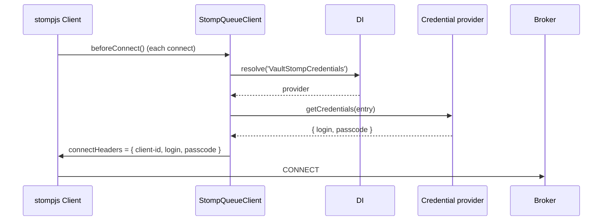

# Credential providers

A credential provider hands the STOMP client a fresh `login` and `passcode` right before every connect and reconnect. Use one when broker credentials rotate (a mounted Kubernetes secret, a vault lease) or when the broker accepts short-lived tokens as the passcode.

## How it works

1. You register a class that implements `IQueueCredentialsProvider` from `@spinajs/queue` under a string name in the root container, eg. `@Injectable('VaultStompCredentials')`.
2. The connection entry names it: `credentialProvider: 'VaultStompCredentials'`.
3. `StompQueueClient.resolve()` sees `credentialProvider` and installs `client.beforeConnect`. `stompjs` awaits `beforeConnect` before it opens each socket: the first connect and every reconnect.
4. `beforeConnect` resolves the provider with `DI.resolve(<name>)` and awaits `provider.getCredentials(entry)`, passing the whole connection entry.
5. It replaces `client.connectHeaders` with `client-id`, plus `login` and `passcode` when the provider returned non-empty values.
6. `stompjs` sends `CONNECT` with those headers. A rejected login comes back as an `ERROR` frame; see [STOMP connection](01-stomp-connection.md#how-it-works).



## Configuration

| Key | Type | Default | Allowed values | Meaning |
| --- | --- | --- | --- | --- |
| `queue.connections[].credentialProvider` | `string` | `undefined` | a name registered in the root DI container | Provider asked before every connect. Unset: `login` and `password` from the entry are used. |

```ts
// config/queue.ts
export default {
  queue: {
    connections: [
      {
        service: 'StompQueueClient',
        name: 'activemq',
        host: 'wss://mq.example.com:61619/ws',
        credentialProvider: 'MountedSecretStompCredentials',
        // read by the provider in the example below
        secretDir: '/var/run/secrets/activemq',
      },
    ],
  },
};
```

## Services and extension points

| Service | DI token and lifetime | Default implementation | Alternatives | How to replace or extend |
| --- | --- | --- | --- | --- |
| `IQueueCredentialsProvider` | a string name from `credentialProvider`, resolved with `DI.resolve(name)` from the root container on every connect; the registration's own lifetime, a singleton unless decorated otherwise | none | your providers | Register a class with `@Injectable('<Name>')` or `DI.register(Class).as('<Name>')`, then set `credentialProvider: '<Name>'` |

The interface:

```ts
interface IQueueCredentialsProvider {
  getCredentials(options: IQueueConnectionOptions): Promise<{ login?: string; passcode?: string }>;
}
```

### Credential provider: custom implementation

A token provider for a broker that accepts short-lived tokens as the passcode. As a singleton it keeps the token between reconnects and fetches a new one shortly before it expires. When the token service is down it falls back to the last token, because a provider that throws stops the reconnect loop (see Important behaviour).

```ts sample
import { Injectable, Singleton } from '@spinajs/di';
import { IQueueConnectionOptions, IQueueCredentialsProvider } from '@spinajs/queue';

interface CachedToken {
  token: string;
  expiresAt: number;
}

@Singleton()
@Injectable('BrokerTokenCredentials')
export class BrokerTokenCredentials implements IQueueCredentialsProvider {
  protected Tokens = new Map<string, CachedToken>();

  public async getCredentials(options: IQueueConnectionOptions) {
    const cached = this.Tokens.get(options.name);
    if (cached && cached.expiresAt - Date.now() > 60_000) {
      return { login: options.login, passcode: cached.token };
    }

    try {
      const res = await fetch('https://auth.internal.example.com/mq-token', {
        method: 'POST',
        headers: { 'content-type': 'application/json' },
        body: JSON.stringify({ client: options.login, connection: options.name }),
      });
      if (!res.ok) {
        throw new Error(`token endpoint answered HTTP ${res.status}`);
      }

      const { token, expiresIn } = (await res.json()) as { token: string; expiresIn: number };
      this.Tokens.set(options.name, { token, expiresAt: Date.now() + expiresIn * 1000 });
      return { login: options.login, passcode: token };
    } catch (err) {
      // never throw here: a rejected beforeConnect is an unhandled rejection and stops reconnecting
      return { login: options.login, passcode: cached?.token };
    }
  }
}

// config/queue.ts
export const config = {
  queue: {
    connections: [
      {
        service: 'StompQueueClient',
        name: 'activemq',
        host: 'wss://mq.example.com:61619/ws',
        login: 'orders-service',
        credentialProvider: 'BrokerTokenCredentials',
      },
    ],
  },
};
```

## Important behaviour

- The provider replaces the `CONNECT` headers as a whole: the entry's static `password` and any `options.connectHeaders` are not sent. Return `login` too when the broker needs it; the sample passes `options.login` through.
- An empty `login` or `passcode` is left out of the headers, not sent empty.
- The provider is resolved from the root container (`DI`), not from the container that built the queue service.
- A name that is not registered resolves to `null`, and `getCredentials` fails with a `TypeError`.
- A provider that throws or rejects, or a name that is not registered, rejects `stompjs`'s connect attempt before the socket opens. Nobody awaits that attempt, so the error is an unhandled promise rejection, which stops Node by default. When the process survives (an `unhandledRejection` handler), no socket close follows and `stompjs` schedules no reconnect: at boot `resolve()` never settles, and after a drop the client stays disconnected with emits buffered.
- `getCredentials()` runs on every reconnect. A slow provider delays every reconnect by its own latency.

## Best practices

- Catch errors inside `getCredentials()` and return the last good credentials; log the failure there.
- Make the provider a singleton and cache credentials until shortly before they expire, so a reconnect storm does not hammer your secret store.
- Key any cache by `options.name`: one provider instance serves every connection that names it.
- Keep secrets out of config files: set `credentialProvider` and leave `password` unset.

## Patterns and antipatterns

```ts
// Don't: let a failed lookup escape. One failed fetch during a reconnect is an unhandled rejection and ends reconnecting.
public async getCredentials(options: IQueueConnectionOptions) {
  const { token } = await (await fetch(TOKEN_URL)).json();
  return { login: options.login, passcode: token };
}

// Do: fall back to what worked last time
public async getCredentials(options: IQueueConnectionOptions) {
  try {
    this.Last = (await (await fetch(TOKEN_URL)).json()).token;
  } catch {
    // keep this.Last
  }
  return { login: options.login, passcode: this.Last };
}
```

## Examples

### Read a rotating Kubernetes secret on every connect

A mounted secret is updated in place when it rotates. Reading the files on every connect means a reconnect after rotation picks up the new password with no restart.

```ts sample
import { readFile } from 'fs/promises';
import { join } from 'path';
import { Injectable } from '@spinajs/di';
import { IQueueConnectionOptions, IQueueCredentialsProvider } from '@spinajs/queue';

interface SecretDirOptions extends IQueueConnectionOptions {
  secretDir?: string;
}

@Injectable('MountedSecretStompCredentials')
export class MountedSecretStompCredentials implements IQueueCredentialsProvider {
  protected Last: { login?: string; passcode?: string } = {};

  public async getCredentials(options: IQueueConnectionOptions) {
    const dir = (options as SecretDirOptions).secretDir ?? '/var/run/secrets/activemq';

    try {
      const [login, passcode] = await Promise.all([readFile(join(dir, 'username'), 'utf8'), readFile(join(dir, 'password'), 'utf8')]);
      this.Last = { login: login.trim(), passcode: passcode.trim() };
    } catch {
      // keep the last credentials that were read successfully
    }

    return this.Last;
  }
}
```

## Related

- [STOMP connection](01-stomp-connection.md): the connect flow `beforeConnect` is part of.
- [Client factory and client id](05-client-factory-and-client-id.md): the `client-id` the provider's headers keep.
- [`@spinajs/queue`](../queue/README.md): `IQueueCredentialsProvider` and `IQueueConnectionOptions`.
- [`@spinajs/di`](../di/README.md): string-named registrations and lifetimes.
