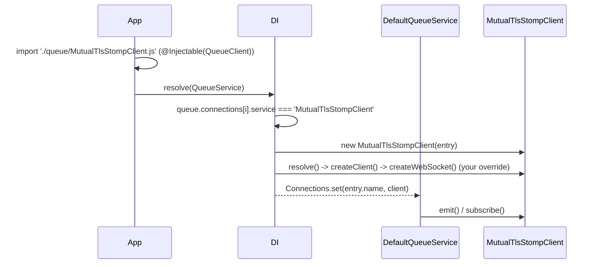

# Extending the STOMP client

`StompQueueClient` is a `QueueClient` implementation registered in DI. Subclass it to change how the socket is opened, how frames are built, how failures are retried or where dead letters go; every step of the client is a protected method meant to be overridden. Then point a connection at the subclass with its class name in `service`, or swap it in everywhere with a factory.

## How it works

1. **Register the subclass.** Decorate it `@Injectable(QueueClient)` and `@PerInstanceCheck()`. `@Injectable()` registers only the class it decorates, so a subclass without it is invisible to the connection lookup.
2. **Import it before `QueueService` resolves.** The decorator runs when the module is imported. Import the module from your app's entry or bootstrap code.
3. **Select it.** Set `service: '<ClassName>'` on the connection entries that should use it. DI compares `service` with the `name` of every class registered under `QueueClient`.
4. **Build.** DI resolves the subclass key with the entry as options. With no factory registered under that key, DI calls `new Subclass(entry)` and then `resolve()`, because `StompQueueClient` is an `AsyncService`. Your overrides run in place of the parent's; call `super` to keep the parent's steps.
5. **Use.** `DefaultQueueService` stores the instance under `entry.name` and calls `emit()`, `subscribe()` and `unsubscribe()` on it.

Errors on the way: a `service` with no matching class name throws `ServiceNotFound('Service <name> is not registered in DI container')` when `QueueService` resolves.



## Configuration

| Key | Type | Default | Allowed values | Meaning |
| --- | --- | --- | --- | --- |
| `queue.connections[].service` | `string` | none, required | class name of a `QueueClient` registration | Selects the subclass for this connection. |
| `queue.connections[].<custom key>` | any | none | any | Extra keys reach the instance in `this.Options`; read them through an interface that extends `IQueueConnectionOptions`. |

```ts
// config/queue.ts
export default {
  queue: {
    default: 'internal',
    connections: [
      { service: 'StompQueueClient', name: 'public', host: 'ws://activemq:61614/ws' },
      {
        service: 'MutualTlsStompClient',
        name: 'internal',
        host: 'wss://mq.internal.example.com:61619/ws',
        tls: { caFile: '/etc/mq/ca.pem', certFile: '/etc/mq/client.pem', keyFile: '/etc/mq/client.key' },
      },
    ],
  },
};
```

## Services and extension points

| Service | DI token and lifetime | Default implementation | Alternatives | How to replace or extend |
| --- | --- | --- | --- | --- |
| Queue transport | `QueueClient`, selected by class name from `queue.connections[].service`; `@PerInstanceCheck()`, matched by `Options.name` | `StompQueueClient` | `BlackHoleQueueClient` (`@spinajs/queue`), `AmqpQueueClient`, `SqsQueueClient`, your subclass, your own `QueueClient` | Register a class `@Injectable(QueueClient)` and name it in `service` |
| `StompQueueClient` key | a [factory](05-client-factory-and-client-id.md), called on every resolve | builds `StompQueueClient` with a prefixed client id | a factory that builds your subclass | `DI.register(factory).as(StompQueueClient)` to swap the class for every `service: 'StompQueueClient'` entry |

Protected hooks, in the order they run:

| Hook | Runs | Default | Override to |
| --- | --- | --- | --- |
| `buildEmitPipeline()` | once, in a field initializer during construction | exponential retry, `options.emitRetries ?? 3` | add a circuit breaker, timeout or concurrency limit; see [Publishing](02-publishing-messages.md#publish-pipeline-custom-implementation) |
| `resolve()` (public) | once, at boot | builds the client, installs handlers, connects | log, add metrics, adjust `this.Client` after `super.resolve()` |
| `createClient(config)` | once, in `resolve()` | `new Client(config)` from `@stomp/stompjs` | return a fake for tests, or a client with extra handlers |
| `createWebSocket()` | before every connect attempt | `new WebSocket(host, protocols)` from `ws` | TLS client certificates, proxies, handshake headers |
| `applySubscription(desc)` | on `subscribe()` while connected, and for every subscription on each connect | `client-individual` ack, prefetch `1`, ActiveMQ durable name | change subscription headers; it also wires parsing, ack and failure handling, so prefer the hooks below |
| `publishMessage(message)` | on `emit()` and when flushing buffered emits | routing, header mapping, one pipeline run per channel | change the message or headers before `super` |
| `publishWithReceipt(channel, body, headers, message)` | per channel and attempt | receipt watch with `ReceiptTimeout` | stamp headers on every frame; see [Publishing](02-publishing-messages.md#message-to-frame-custom-headers) |
| `ReceiptTimeout` (getter) | per attempt | `receiptTimeout ?? options.receiptTimeout ?? 5000` | compute it per connection |
| `handleFailedMessage(message, qMessage, desc, err)` | handler rejected | drop events, retry jobs, then dead-letter | change the policy; see [Consuming](03-consuming-retries-and-dead-letters.md#failure-policy-custom-implementation) |
| `retryBackoff(attempt)` | per job retry | `retryDelay × 2^(attempt − 1)` | cap, jitter, fixed delay |
| `handleUnparseableMessage(message, channel, err)` | body is not JSON | dead-letter to `defaultQueueDeadLetterChannel` | quarantine elsewhere |
| `deadLetter(message, dlq, channel, reason, attempt?)` | retries exhausted or poison body | publish with diagnostics headers, ack | alert, store, add headers; call `super` |
| `flushPendingEmits()` | on each connect | publish every buffered emit | add ordering or a buffer limit |
| `flushReadyWaiters()` | on each connect | resolve `whenReady()` callers | |
| `getChannelForMessage(message)`, `getDeadLetterChannelForMessage(message)` (public, from `QueueClient`) | on emit, subscribe and failure | `queue.routing`, then connection defaults | tenant prefixes, computed routes |

Protected state a subclass can read:

| Member | From | Holds |
| --- | --- | --- |
| `Options` | `QueueClient` (public) | The connection entry, custom keys included |
| `Client` | `StompQueueClient` | The `stompjs` client, set in `resolve()` |
| `Subscriptions` | `StompQueueClient` | Tracked subscriptions by channel, each with the handlers of every message class on it, replayed on connect |
| `PendingEmits` | `StompQueueClient` | Emits buffered while disconnected |
| `ReadyWaiters` | `StompQueueClient` | Pending `whenReady()` settlers: called with no argument on connect, with an error on `dispose()` |
| `Disposing` | `StompQueueClient` | `true` once `dispose()` has started |
| `EmitPipeline` | `StompQueueClient` | The pipeline from `buildEmitPipeline()` |
| `Log` | `QueueClient`, `@Logger('queue')` | The `queue` logger |
| `Routing` | `QueueClient`, `@Config('queue.routing')` | The routing table |

### WebSocket: custom TLS and handshake headers

An internal broker that requires client certificates. The certificate paths come from a custom `tls` key on the connection entry, so one class serves every connection that needs it.

```ts sample
import WebSocket from 'ws';
import { readFileSync } from 'fs';
import { IStompSocket, Versions } from '@stomp/stompjs';
import { Injectable, PerInstanceCheck } from '@spinajs/di';
import { InvalidArgument } from '@spinajs/exceptions';
import { IQueueConnectionOptions, QueueClient } from '@spinajs/queue';
import { StompQueueClient } from '@spinajs/queue-stomp-transport';

interface MutualTlsConnectionOptions extends IQueueConnectionOptions {
  tls?: { caFile: string; certFile: string; keyFile: string };
}

@PerInstanceCheck()
@Injectable(QueueClient)
export class MutualTlsStompClient extends StompQueueClient {
  protected createWebSocket(): IStompSocket {
    const { host, tls, name } = this.Options as MutualTlsConnectionOptions;

    if (!host || !tls) {
      throw new InvalidArgument(`Queue connection ${name} needs host and tls { caFile, certFile, keyFile }`);
    }

    // files are read on every connect attempt, so rotated certificates are picked up on reconnect
    return new WebSocket(host, Versions.default.protocolVersions(), {
      ca: readFileSync(tls.caFile),
      cert: readFileSync(tls.certFile),
      key: readFileSync(tls.keyFile),
      headers: { 'X-Client-Service': name },
    }) as unknown as IStompSocket;
  }
}
```

### Swap the class for every connection

To use a subclass for every `service: 'StompQueueClient'` entry without editing config, register a factory under the `StompQueueClient` key that builds it. It replaces the shipped factory, so build the client id yourself.

```ts sample
import '@spinajs/queue-stomp-transport';
import { DI, IContainer, Injectable, PerInstanceCheck } from '@spinajs/di';
import { Configuration } from '@spinajs/configuration';
import { IQueueConnectionOptions, IQueueMessage, QueueClient } from '@spinajs/queue';
import { StompQueueClient } from '@spinajs/queue-stomp-transport';

@PerInstanceCheck()
@Injectable(QueueClient)
export class MeteredStompClient extends StompQueueClient {
  public Published = 0;

  protected async publishMessage(message: IQueueMessage): Promise<void> {
    await super.publishMessage(message);
    this.Published++;
  }
}

DI.register(async (container: IContainer, options: IQueueConnectionOptions) => {
  const cfg = container.get(Configuration);
  const app = cfg?.get<string>('app.name', 'no-app') ?? 'no-app';
  const env = cfg?.get<string>('process.env.APP_ENV', 'development') ?? 'development';

  const client = new MeteredStompClient({ ...options, clientId: options.clientId ?? `${app}-${env}-${options.name}` });
  await client.resolve();
  return client;
}).as(StompQueueClient);
```

## Important behaviour

- `service` is matched against `class.name`. A minifier that renames classes breaks the lookup; keep class names in production builds.
- Decorate every subclass with `@PerInstanceCheck()` (or `@NewInstance()`). A subclass with no lifetime decorator but with its own property decorator (eg. `@Autoinject` or `@Config`) gets a fresh descriptor whose lifetime is singleton: a second connection with the same subclass then receives the first connection's instance.
- A subclass selected by its own name does not go through the shipped factory: its client id is `clientId ?? name`. See [Factory for a subclass](05-client-factory-and-client-id.md#factory-for-a-subclass).
- `buildEmitPipeline()` runs before the subclass's own field initializers. Use only `this.Options` in it.
- `createClient()` runs in `resolve()` before the handlers are installed; anything you set on the client's `onConnect`, `onStompError`, `onWebSocketError`, `onWebSocketClose`, `onDisconnect`, `onUnhandledMessage` or `debug` there is overwritten. Wrap them after `super.resolve()` instead, keeping the original handler.
- `createWebSocket()` is called inside the `stompjs` connect loop. An exception there is not reported to `resolve()`: it surfaces as an unhandled promise rejection and the first connect never settles. Validate options in `resolve()` before `super.resolve()` when that matters.
- Overriding `subscribe()`, `emit()` or `dispose()` without calling `super` drops reconnect replay, buffering or the rejection of buffered emits.

## Best practices

- Override the narrowest hook: `retryBackoff()` before `handleFailedMessage()`, `publishWithReceipt()` before `publishMessage()`, `createWebSocket()` before `createClient()`.
- Call `super` first in `resolve()` and add your logic after it; call `super` last in `deadLetter()` only when your step must run before the message leaves.
- Read custom settings from `this.Options` through an interface that extends `IQueueConnectionOptions`, so the connection entry stays the one place to configure a connection.
- Name subclasses after what they add (`MutualTlsStompClient`, `CappedRetryStompClient`) and use them only on the connections that need them.

## Patterns and antipatterns

```ts
// Don't: a subclass without its own @Injectable(QueueClient); `service: 'MyStompClient'` then fails with ServiceNotFound
export class MyStompClient extends StompQueueClient {}

// Do
@PerInstanceCheck()
@Injectable(QueueClient)
export class MyStompClient extends StompQueueClient {}
```

```ts
// Don't: replace the client's handlers in createClient(); resolve() overwrites them
protected createClient(config: StompConfig) {
  const client = super.createClient(config);
  client.onConnect = () => this.Log.info('connected');
  return client;
}

// Do: wrap the installed handler after super.resolve()
public async resolve() {
  await super.resolve();
  const onConnect = this.Client.onConnect;
  this.Client.onConnect = (frame) => {
    onConnect(frame);
    this.Log.info({ clientId: this.ClientId }, 'Reconnected as ${clientId}');
  };
}
```

## Examples

### Test emit headers without a broker

`createClient()` is the seam the package's own unit tests use. This subclass returns an in-memory client that connects at once and confirms every publish, so a test can assert on the frames a job produces.

```ts sample
import { Client, StompHeaders } from '@stomp/stompjs';
import { DI } from '@spinajs/di';
import { Configuration } from '@spinajs/configuration';
import { IQueueJob, QueueMessageType } from '@spinajs/queue';
import { StompQueueClient } from '@spinajs/queue-stomp-transport';
import { DateTime } from 'luxon';

interface SentFrame {
  destination: string;
  body: string;
  headers: StompHeaders;
}

export class InMemoryStompClient extends StompQueueClient {
  public Sent: SentFrame[] = [];

  protected createClient(): Client {
    const receipts = new Map<string, () => void>();
    // only the members StompQueueClient uses
    const fake: any = {
      connected: false,
      connectHeaders: {},
      activate: () => {
        fake.connected = true;
        fake.onConnect({});
      },
      deactivate: async () => {
        fake.connected = false;
      },
      watchForReceipt: (id: string, done: () => void) => receipts.set(id, done),
      publish: (frame: SentFrame) => {
        this.Sent.push(frame);
        receipts.get(frame.headers.receipt as string)?.();
      },
      subscribe: (destination: string) => ({ id: destination, unsubscribe: () => undefined }),
      unsubscribe: () => undefined,
    };
    return fake as Client;
  }
}

export async function invoiceJobIsPersistentAndCorrelated() {
  await DI.resolve(Configuration);

  const client = new InMemoryStompClient({
    transport: 'stomp',
    type: 'job',
    name: 'test',
    host: 'ws://unused',
    defaultQueueChannel: '/queue/test',
  });
  await client.resolve();

  const job: IQueueJob = {
    Name: 'GenerateInvoice',
    Type: QueueMessageType.Job,
    CreatedAt: DateTime.now(),
    Persistent: true,
    Priority: 0,
    RetryCount: 3,
    JobId: 'job-42',
  };
  await client.emit(job);

  const frame = client.Sent[0];
  return frame.destination === '/queue/test' && frame.headers.persistent === 'true' && frame.headers['correlation-id'] === 'job-42';
}
```

## Related

- [STOMP connection](01-stomp-connection.md): the boot flow the hooks run in.
- [Publishing messages](02-publishing-messages.md): `buildEmitPipeline()`, `publishMessage()`, `publishWithReceipt()`.
- [Consuming, retries and dead letters](03-consuming-retries-and-dead-letters.md): `handleFailedMessage()`, `retryBackoff()`, `deadLetter()`.
- [Client factory and client id](05-client-factory-and-client-id.md): factories for subclasses.
- [`@spinajs/queue`](../queue/README.md): the `QueueClient` contract for a transport written from scratch.
- [`@spinajs/di`](../di/04-lifetimes.md): `@PerInstanceCheck()` and other lifetimes.
