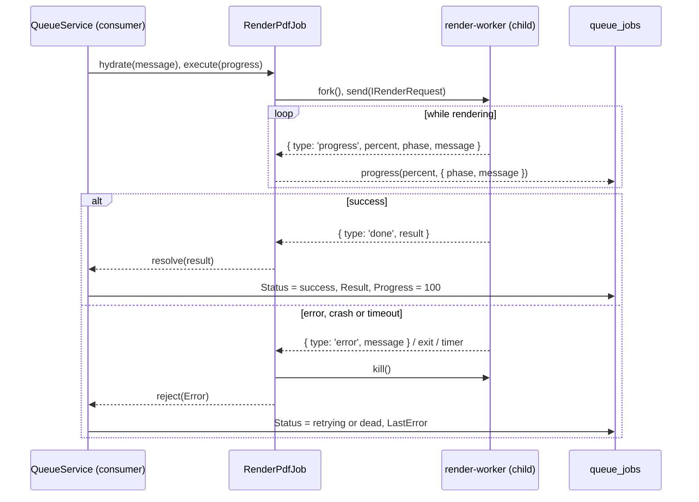

# Job supervision

`RenderPdfJob.execute()` runs in the queue consumer. It forks one worker process per render, sends it the request, relays the worker's progress to the job row and settles the job when the worker finishes, fails, exits or runs out of time.

## How it works

1. `DefaultQueueService.consume(RenderPdfJob)` receives a message, resolves `RenderPdfJob` from DI, calls `hydrate()` with the message, marks the row `executing` and calls `execute(progress)`.
2. `execute()` calls `spawnWorker()`, which runs `child_process.fork()` on `render-worker.js` next to the package's compiled `RenderPdfJob.js` (CommonJS or ESM build alike).
3. `superviseChild(child, progress)` arms a timer of `timeoutMs` (default `120000`), attaches `message`, `error` and `exit` listeners, then sends `buildRequest()` to the child over IPC.
4. For each `WorkerMessage` from the child:
   - `progress`: calls `progress(percent, { phase, message })` without awaiting it; a failed write is logged as a warning.
   - `done`: resolves with `result` (the `IRenderOutput`); the queue stores it in `queue_jobs.Result` and marks the row `success`.
   - `error`: rejects with `new Error(message)` and sends `SIGTERM` to the child.
5. A child `error` event rejects with that error. A child `exit` before `done` or `error` rejects with `Render worker exited unexpectedly with code <code>`.
6. When the timer fires first, the job rejects with `Render worker timed out after <timeoutMs>ms` and the child gets `SIGKILL`.
7. Every terminal path runs once: it clears the timer and removes the `message`, `error` and `exit` listeners, so a late `exit` after `done` changes nothing.
8. On a rejection the queue records the attempt, sets the row to `retrying` or `dead`, writes `LastError`, calls `onFailed()` and rethrows so the transport can retry or dead-letter.



## The IPC protocol

| Direction | Message | Shape |
| --- | --- | --- |
| parent to child | `IRenderRequest` | The payload fields without `timeoutMs`: `input`, `template`, `model`, `lang`, `output`, `pdfOptions`, `assetBasePath`, `config` |
| child to parent | progress | `{ type: 'progress'; percent: number; phase: string; message?: string }` |
| child to parent | success | `{ type: 'done'; result: IRenderOutput }` |
| child to parent | failure | `{ type: 'error'; message: string }` |

`WorkerMessage` is the union of the three child messages. Node's default IPC serialization is JSON, so every field of the request must be JSON-serializable.

## Configuration

| Key | Type | Default | Allowed values | Meaning |
| --- | --- | --- | --- | --- |
| `queue.progress.minDelta` | `number` | `5` | percent points | A progress write is skipped when it moved less than this and came sooner than `minInterval` |
| `queue.progress.minInterval` | `number` (ms) | `1000` | ms | See `minDelta` |

A progress call that carries a `phase` or `message`, or reaches 100, is always written. Every worker progress message carries a phase, so in practice each one reaches the row. See [Progress reporting](04-progress-reporting.md).

The job's own timeout is the payload field `timeoutMs`, not a config key.

## Services and extension points

| Service | DI token and lifetime | Default implementation | Alternatives | How to replace or extend |
| --- | --- | --- | --- | --- |
| The job class | `RenderPdfJob`; resolved per delivery with `DI.resolve(RenderPdfJob)`; singleton unless the registered class has `@NewInstance()` | `RenderPdfJob` | none shipped | Subclass and `DI.register(MyJob).as(RenderPdfJob)`; see [Extending `RenderPdfJob`](05-extending-render-pdf-job.md) |
| `spawnWorker(): ChildProcess` | protected method | `fork(<package lib>/render-worker.js)` | Your worker script; a fake child in tests | Override; see [Custom worker entry](06-custom-worker-entry.md) |
| `buildRequest(): IRenderRequest` | protected method | copies the payload fields | Your defaults | Override and call `super.buildRequest()`; see [Extending `RenderPdfJob`](05-extending-render-pdf-job.md#add-defaults-to-every-request) |
| `superviseChild(child, progress)` | protected method | timer, relay, settle-once | Your supervision | Override only to wrap it; the settle-once logic lives inside |
| `onFailed(err, ctx)` | inherited from `QueueJob` | no-op | Your alert | Override; see [Extending `RenderPdfJob`](05-extending-render-pdf-job.md#alert-on-the-final-failed-attempt) |

### Testing supervision without a real worker

`spawnWorker()` is the seam the package's own tests use: return an `EventEmitter` that records `send()` and `kill()`, then emit worker messages by hand.

```ts sample
import { ChildProcess } from 'child_process';
import { EventEmitter } from 'events';
import { RenderPdfJob, WorkerMessage } from '@spinajs/queue-templates-pdf';

class FakeWorker extends EventEmitter {
  public sent: unknown[] = [];
  public killed = false;

  public send(message: unknown): boolean {
    this.sent.push(message);
    return true;
  }

  public kill(): boolean {
    this.killed = true;
    return true;
  }
}

class RenderPdfJobUnderTest extends RenderPdfJob {
  public worker = new FakeWorker();

  protected spawnWorker(): ChildProcess {
    return this.worker as unknown as ChildProcess;
  }
}

async function failedRenderKillsTheWorker(): Promise<void> {
  const job = new RenderPdfJobUnderTest();
  job.input = '<h1>Invoice 1042</h1>';
  job.output = { provider: 'documents', path: 'invoices/1042.pdf' };

  const result = job.execute(() => Promise.resolve());
  const failure: WorkerMessage = { type: 'error', message: 'net::ERR_NAME_NOT_RESOLVED' };
  job.worker.emit('message', failure);

  await result.catch((err: Error) => console.log(err.message, job.worker.killed));
  // net::ERR_NAME_NOT_RESOLVED true
}
```

## Important behaviour

- One render, one process. The worker exits after `done` or `error`; no worker is reused between jobs.
- The job timeout (`timeoutMs`, default 120 s) covers the whole worker: process start, config bootstrap, template compile, Chromium start, render and upload. The renderer's own `templates.pdf.renderTimeout` (default 30 s) covers only the page; keep `timeoutMs` above it.
- A timeout sends `SIGKILL`, so the worker gets no chance to clean up. Its temp PDF stays in the OS temp directory.
- An `error` message sends `SIGTERM`; the worker is already disposing and exiting with code `1` by then.
- Progress persistence never blocks or fails the render: a rejected `progress()` call only logs `Failed to persist progress: <message>` on the `RenderPdfJob` logger.
- The worker's error reaches the job row as text only (`LastError`): the stack and the error class stay in the child.
- The job's return value is the `IRenderOutput` it was asked for (`{ provider, path }`), not a URL. Build a URL from it with the provider, eg. `getFs(provider).signedUrl?.(path)` where the provider supports it.

## Best practices

- Set `timeoutMs` per job kind: a one-page receipt needs seconds, a 300-page catalogue minutes.
- Override `spawnWorker()` in tests instead of mocking `child_process`.
- Read the failure from `queue_jobs.LastError` or the status endpoint's `error`; the worker's own logs carry the details.

## Patterns and antipatterns

```ts
// Don't: a job timeout below the page timeout; the job is killed before the renderer can report its own error
await scheduleRenderPdf({ ...payload, timeoutMs: 20_000 }); // templates.pdf.renderTimeout: 30000

// Do: leave room for process start, bootstrap and upload on top of the page timeout
await scheduleRenderPdf({ ...payload, timeoutMs: 90_000 });
```

## Examples

### Give large reports more time than receipts

```ts sample
import { IRenderPdfJobPayload, scheduleRenderPdf } from '@spinajs/queue-templates-pdf';

const TIMEOUTS = { receipt: 30_000, report: 10 * 60_000 };

async function renderDocument(kind: keyof typeof TIMEOUTS, payload: IRenderPdfJobPayload): Promise<string | undefined> {
  return scheduleRenderPdf({ ...payload, timeoutMs: TIMEOUTS[kind] });
}
```

## Related

- [Render worker](03-render-worker.md): what the forked process does with the request.
- [Progress reporting](04-progress-reporting.md): the progress messages relayed here.
- [`@spinajs/queue`](../queue/README.md): the consumer that calls `execute()` and owns the job row.
