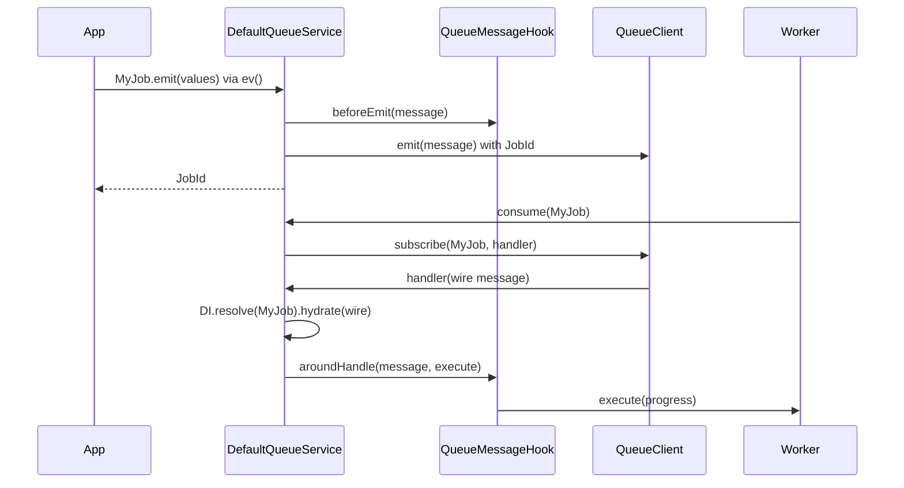

# Events and jobs

A queue message is a class: a `QueueEvent` is broadcast to every subscriber and nobody tracks it; a `QueueJob` runs once, its status, progress and result are stored, and it is retried on failure. Mark the class with `@Event()` or `@Job()`, emit it with the static `emit()`, and handle it in a worker with `QueueService.consume()`.

## How it works

Emitting, from `MyJob.emit(values, options?)` or `MyEvent.emit(values, options?)`:

1. The static `emit()` builds a plain `IQueueMessage`: `values`, then `Type`, `CreatedAt` (`values.CreatedAt` or now) and `Name` (the class name), then `options`. `QueueJob.emit()` also sets `Persistent: true` unless `values` or `options` set it.
2. `ev(message)` resolves `QueueService` from DI and calls `emit(message)`.
3. `DefaultQueueService.emit()` runs `beforeEmit()` of every [message hook](06-message-hooks.md), in registration order. A hook that throws rejects `emit()` and nothing is sent.
4. It finds the connections the message is routed to (see [Connections and routing](02-connections-and-routing.md)). An unknown connection name throws `ConnectionNotFound`.
5. For a job it sets `JobId` to a new UUID v4, unless the message already carries one. All routed connections get the same `JobId`.
6. It awaits `QueueClient.emit(message)` on each connection in turn.
7. It returns the `JobId` for a job and `undefined` for an event.

Consuming, from `QueueService.consume(MessageClass, callback?, subscriptionId?, durable?)`:

1. `DefaultQueueService.consume()` reads the `@Job` or `@Event` metadata of `MessageClass`. A class with neither throws `InvalidArgument`.
2. A durable subscription (the `durable` argument, or `@Event({ durable: true })`) without `subscriptionId` throws `InvalidArgument`.
3. On each routed connection it calls `QueueClient.subscribe(MessageClass, handler, subscriptionId, durable)`. An unknown connection throws `ServiceNotFound`.
4. On delivery, the handler skips any message whose `Name` is not `MessageClass.name`: several message types can share one channel.
5. It builds the message with `DI.resolve(MessageClass)` and copies the wire message onto it with `hydrate(message)`.
6. A job runs `execute(progress)` inside the [job tracking](03-job-tracking.md#how-it-works) flow, wrapped by every hook's `aroundHandle()`.
7. An event consumed without `callback` throws `InvalidArgument` here, on every delivery.
8. `callback(message)`, when given, runs wrapped by every hook's `aroundHandle()`. For a job it runs after `execute()` succeeded.
9. Errors from `execute()`, `callback` or a hook propagate to the transport, which retries or dead-letters the message.

`QueueService.stopConsuming(MessageClass)` calls `QueueClient.unsubscribe(MessageClass)` on every routed connection.



## API

| Export | Kind | Meaning |
| --- | --- | --- |
| `QueueMessage` | abstract class | Base of every message. `hydrate(payload)` copies the payload onto the instance with `Object.assign`. Has an index signature, so extra fields are allowed |
| `QueueEvent` | abstract class | Broadcast message. `static emit(values, options?): Promise<void>` |
| `QueueJob` | abstract class | Tracked message. `abstract execute(progress)`, `onFailed(err, ctx)`, `static emit(values, options?): Promise<string \| undefined>` |
| `QueueMessageType` | enum | `Job = 'JOB'`, `Event = 'EVENT'` |
| `isJob(message)` | function | `true` when `message.Type` is `QueueMessageType.Job` |
| `ev(message)` | function | Resolves `QueueService` and emits a plain message or a message instance. Returns the `JobId` for jobs |
| `_ev(message)` | function | Returns `() => ev(message)`, for function pipelines. Nothing is emitted until the thunk is called |
| `JobProgressCallback` | type | `(percent: number, meta?: IJobProgressMeta) => Promise<void>` |
| `IJobProgressMeta` | interface | `phase?: string`, `message?: string` |
| `IJobFailureContext` | interface | `attempt`, `maxAttempts`, `isFinal`, `jobId`, passed to `onFailed()` |
| `jobOptions(message)` | function | The `@Job` options of a message's own class: `{ runAs }` for `'initiator'` or `'system'`, else `{}` |

### Message fields

| Field | Type | Set by | Meaning |
| --- | --- | --- | --- |
| `Name` | `string` | `emit()`, constructor | Class name. Routing and consumer filtering use it |
| `Type` | `QueueMessageType` | `emit()`, constructor | `JOB` or `EVENT` |
| `CreatedAt` | `DateTime` | `emit()`, constructor | Creation time |
| `Persistent` | `boolean` | caller; `true` for `QueueJob.emit()` | Asks the transport to persist the message |
| `Priority` | `number` | caller | Broker priority, when the transport supports it |
| `ScheduleDelay` | `number` | caller | Milliseconds before the broker delivers the message |
| `SchedulePeriod` | `number` | caller | Milliseconds between repeated deliveries |
| `ScheduleRepeat` | `number` | caller | How many times to repeat the delivery |
| `ScheduleCron` | `string` | caller | Cron schedule for delivery |
| `Initiator` | `IQueueInitiator` | a message hook | Who emitted the message: `type`, `id`, optional `ceiling`. The queue never sets it |
| `JobId` | `string` | `DefaultQueueService.emit()` or caller | Job identity, key of the `queue_jobs` row |
| `RetryCount` | `number` | caller | Retries after the first failed run; `0` when unset |

Scheduling and priority are honoured only by transports that support them; [`@spinajs/queue-amqp-transport`](../queue-amqp-transport/README.md), for one, delivers scheduled messages at once.

## Decorators

| Decorator | Target | Options | Effect |
| --- | --- | --- | --- |
| `@Job(opts?)` | class extending `QueueJob` | `runAs?: 'initiator' \| 'system'` | Marks the class as a job. `runAs` is read by a [message hook](06-message-hooks.md), such as the one in `@spinajs/authz-queue`; the queue itself ignores it |
| `@Event(opts?)` | class extending `QueueEvent` | `durable?: boolean` | Marks the class as an event. `durable: true` makes every `consume()` of it durable, so it needs a `subscriptionId` |

Both decorators write the `queue:options` metadata only when the class has none of its own. `consume()` reads it through the prototype chain, so an undecorated subclass of a decorated class is consumable. `jobOptions()` reads only the class's own metadata, so a subclass never inherits its parent's `runAs`.

## Services and extension points

| Service | DI token and lifetime | Default implementation | Alternatives | How to replace or extend |
| --- | --- | --- | --- | --- |
| Message class | The class itself, built with `DI.resolve(MessageClass)` on every delivery; singleton unless the class is `@NewInstance()` | none | Shipped jobs and events: `EmailSend`, `EmailSent`, `EmailSendFailed` (`@spinajs/email`), `LazyUploadJob` (`@spinajs/http-lazy-file-uploader`), `RenderPdfJob` (`@spinajs/queue-templates-pdf`), `UserEvent` (`@spinajs/users`), `TaskSuccess`, `TaskFailed` (`@spinajs/tasks`) | Extend `QueueJob` or `QueueEvent`. Override `execute()`, `onFailed()` and `hydrate()`; inject services with `@Autoinject` |

### Message class: custom implementation

Because the consumer builds the message through DI, a job can inject the services it needs. Override:

- `execute(progress)`: the work. Its return value is stored as the job's `Result`.
- `onFailed(err, ctx)`: called after each failed run. Errors it throws are logged and swallowed.
- `hydrate(payload)`: called with the wire message. Call `super.hydrate(payload)`, then revive fields that JSON flattened, such as dates.

Mark the class `@NewInstance()`: without it, every delivery reuses one cached instance (see [Important behaviour](#important-behaviour)).

```ts sample
import { Autoinject, DI, Injectable, NewInstance } from '@spinajs/di';
import { IJobFailureContext, Job, JobProgressCallback, QueueJob, QueueService } from '@spinajs/queue';
import { DateTime } from 'luxon';

@Injectable()
export class SubscriptionBilling {
  public async charge(customerId: number, amount: number, periodEnd: DateTime) {
    return { invoice: `INV-${customerId}-${periodEnd.toFormat('yyyyMM')}`, amount };
  }

  public async alertFinance(message: string) {
    console.error(message);
  }
}

@NewInstance()
@Job()
export class ChargeSubscription extends QueueJob {
  @Autoinject()
  protected Billing: SubscriptionBilling;

  public CustomerId: number;
  public Amount: number;
  public PeriodEnd: DateTime;

  public hydrate(payload: any) {
    super.hydrate(payload);
    this.PeriodEnd = DateTime.isDateTime(payload.PeriodEnd) ? payload.PeriodEnd : DateTime.fromISO(payload.PeriodEnd);
  }

  public async execute(progress: JobProgressCallback) {
    await progress(10, { phase: 'charging', message: `Customer ${this.CustomerId}` });
    return this.Billing.charge(this.CustomerId, this.Amount, this.PeriodEnd);
  }

  public async onFailed(err: unknown, ctx: IJobFailureContext) {
    if (ctx.isFinal) {
      await this.Billing.alertFinance(`Charge for customer ${this.CustomerId} failed ${ctx.attempt}/${ctx.maxAttempts} times: ${String(err)}`);
    }
  }
}

export async function startBillingWorker() {
  const queue = await DI.resolve(QueueService);
  await queue.consume(ChargeSubscription);
}

export async function chargeAtPeriodEnd(customerId: number, amount: number) {
  return ChargeSubscription.emit({ CustomerId: customerId, Amount: amount, PeriodEnd: DateTime.now().endOf('month'), RetryCount: 3 });
}
```

## Important behaviour

- **One instance per message class.** `consume()` builds each delivery with `DI.resolve(MessageClass)`. A class without a lifetime decorator is a DI singleton, so all deliveries share one object and a field missing from a later message keeps the value of an earlier one, `Initiator` included. Overlapping deliveries also overwrite each other's fields. Mark message classes `@NewInstance()`.
- **`Persistent` defaults to `true` only in `QueueJob.emit()`.** A job instance passed to `ev()` or `QueueService.emit()` keeps whatever `Persistent` you set.
- **`emit()` mutates its argument.** `DefaultQueueService.emit()` writes `JobId` onto the message object you pass.
- **A caller-supplied `JobId` is kept.** Two emits with one `JobId` share one job row; the second is skipped once the first finished (see [deduplication](03-job-tracking.md#important-behaviour)).
- **`emit()` is not atomic across connections.** A message routed to several connections is sent one connection at a time; a failure leaves the earlier connections with the message.
- **`consume()` without a callback succeeds for an event**, but every delivery then throws `InvalidArgument`.
- **A job's `callback` runs after `execute()`**, outside the tracking flow: its error reaches the transport, but the job row already says `success`.
- **The static `emit()` takes `options: IMessageOptions`, whose fields are all required.** Put single options such as `ScheduleDelay` into `values` instead.
- **`QueueMessage`'s constructor sets `Name` and `CreatedAt` after `hydrate(data)`**, so `new MyEvent({ CreatedAt })` does not keep that `CreatedAt`.

## Best practices

- Name message classes uniquely across the app. `Name` is the class name, and routing, consumer filtering and the job row all use it.
- Keep message fields JSON-safe; override `hydrate()` for anything richer.
- Use `RetryCount` on the job, not a retry loop inside `execute()`: each failed run is recorded and the transport applies its backoff.
- Use `onFailed()` with `ctx.isFinal` for alerts, so you get one alert per job, not one per attempt.
- Report progress with `phase` and `message`; they are always persisted, while bare percentages are throttled.

## Patterns and antipatterns

```ts
// Don't: options must be a full IMessageOptions, so this does not compile without a cast
await SendReminder.emit({ UserId: 7 }, { ScheduleDelay: 60_000 });

// Do: message options are message fields
await SendReminder.emit({ UserId: 7, ScheduleDelay: 60_000 });
```

```ts
// Don't: shared singleton, a delivery without Coupon keeps the previous delivery's Coupon
@Job()
export class ApplyDiscount extends QueueJob { public Coupon?: string; /* ... */ }

// Do: a fresh instance per delivery
@NewInstance()
@Job()
export class ApplyDiscount extends QueueJob { public Coupon?: string; /* ... */ }
```

## Examples

### Notify other services when a user registers

```ts sample
import { DI, NewInstance } from '@spinajs/di';
import { Event, QueueEvent, QueueService } from '@spinajs/queue';

@NewInstance()
@Event({ durable: true })
export class UserRegistered extends QueueEvent {
  public UserId: number;
  public Email: string;
}

export async function registerUser(userId: number, email: string) {
  await UserRegistered.emit({ UserId: userId, Email: email });
}

// durable: messages emitted while the billing worker is down are delivered when it reconnects
export async function startBillingListener(createCustomer: (email: string) => Promise<void>) {
  const queue = await DI.resolve(QueueService);
  await queue.consume<UserRegistered>(UserRegistered, async (event) => createCustomer(event.Email), 'billing-service');
}

export async function stopBillingListener() {
  const queue = await DI.resolve(QueueService);
  await queue.stopConsuming(UserRegistered);
}
```

### Send a reminder in one hour, in a function pipeline

```ts sample
import { NewInstance } from '@spinajs/di';
import { Job, QueueJob, _ev, ev } from '@spinajs/queue';

const ONE_HOUR = 60 * 60 * 1000;

@NewInstance()
@Job()
export class SendCartReminder extends QueueJob {
  public CartId: string;

  public async execute() {
    return { reminded: this.CartId };
  }
}

// static emit: Persistent defaults to true
export async function scheduleReminder(cartId: string) {
  return SendCartReminder.emit({ CartId: cartId, ScheduleDelay: ONE_HOUR });
}

// an instance: set Persistent yourself
export async function scheduleReminderFromInstance(cartId: string) {
  return ev(Object.assign(new SendCartReminder(), { CartId: cartId, ScheduleDelay: ONE_HOUR, Persistent: true }));
}

// a thunk for a pipeline: nothing is emitted until it is called
export function reminderStep(cartId: string): () => Promise<string | undefined> {
  return _ev(Object.assign(new SendCartReminder(), { CartId: cartId, ScheduleDelay: ONE_HOUR, Persistent: true }));
}
```

## Related

- [Connections and routing](02-connections-and-routing.md): where an emitted message goes.
- [Job tracking](03-job-tracking.md): what happens around `execute()`.
- [Message hooks](06-message-hooks.md): code around every emit and handler, and what reads `runAs`.
- [Lifetimes](../di/04-lifetimes.md): why message classes need `@NewInstance()`.
- [`@spinajs/queue-http-progress`](../queue-http-progress/README.md): poll a job by the `JobId` that `emit()` returns.
