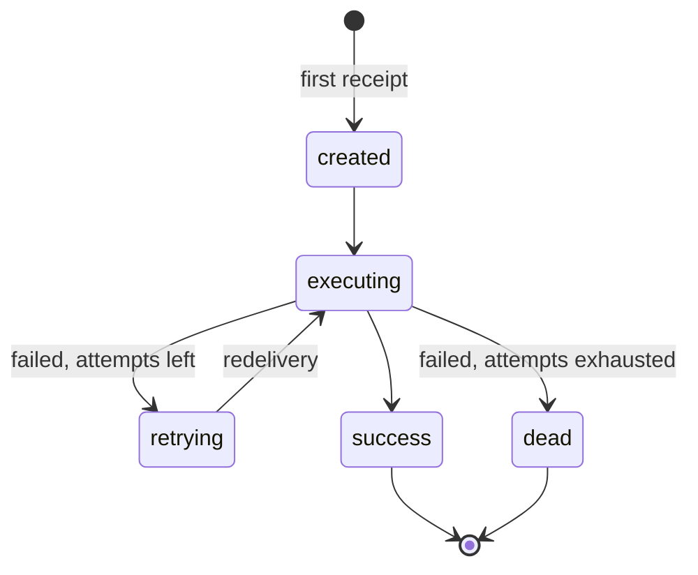

# Job tracking

Every consumed job has one row in the `queue_jobs` table, modelled by `JobModel`: its status, attempt count, progress, result or last error, and who emitted it. The consumer writes the row; the producer never touches the database. Read the row to show progress to a user, to find stuck jobs, or to purge old ones.

## How it works

`DefaultQueueService.consume()` runs these steps for each delivered job. Every row read and write goes through `tracked()`, which wraps it in the [tracking hooks](07-tracking-hooks.md).

1. **Find or create the row.** `JobModel.where({ JobId }).first()`. With no row, it inserts one: `Status: 'created'`, `Attempt: 0`, `Progress: 0`, `MaxAttempts: RetryCount + 1`, `Connection` (the connection name), `InitiatorType` and `InitiatorId` from `message.Initiator`. When the insert fails (another worker inserted the same `JobId` first), it reads the row again; no row then rethrows the insert error.
2. **Check the owner.** When the row's `InitiatorType` or `InitiatorId` differs from the message's `Initiator`, the job is dropped with a warning log: it does not run and does not touch the row.
3. **Skip duplicates.** With `queue.deduplicate` on (the default) and the row in a terminal status (`success`, `error`, `dead`), the job is skipped with an info log.
4. **Start.** `Status: 'executing'`, `ExecutedAt: now`, row updated.
5. **Run.** `execute(progress)`, wrapped by the [message hooks](06-message-hooks.md). Each `progress(percent, meta)` call goes through the throttle below.
6. **Success.** `Result` is the return value, `Status: 'success'`, `FinishedAt: now`, `Progress: 100`, row updated.
7. **Failure.**
   1. `Attempt` goes up by one.
   2. The retry limit is `MaxAttempts - 1` from the row (the message's `RetryCount` when `MaxAttempts` is `0`).
   3. `Status` becomes `dead` (with `FinishedAt: now`) when `Attempt` exceeds the limit, else `retrying`. `LastError` gets the error message, cut to 1024 characters. Row updated.
   4. `onFailed(err, { attempt, maxAttempts, isFinal, jobId })` runs, wrapped by the message hooks. Its errors are logged, never rethrown.
   5. The original error is rethrown, so the transport retries or dead-letters the message.

Progress throttle, in the `progress` callback:

1. `meta.phase` and `meta.message` are copied onto the row at once, cut to 32 and 512 characters.
2. The row is written when the percentage is `100` or more, when `meta` carries a phase or message, when the percentage rose by `queue.progress.minDelta` since the last write, or when `queue.progress.minInterval` ms passed since it.
3. Otherwise only the in-memory `Progress` changes; the next write saves it.



## API

| Export | Kind | Meaning |
| --- | --- | --- |
| `JobModel<T>` | model, `@Connection('queue')`, `@Model('queue_jobs')` | One tracked job. `T` types `Result` |
| `JobStatus` | type | `'created' \| 'executing' \| 'retrying' \| 'success' \| 'error' \| 'dead'`. `error` is a legacy terminal status the queue no longer writes |
| `JOB_TERMINAL_STATUSES` | constant | `['success', 'error', 'dead']` |
| `JOB_ACTIVE_STATUSES` | constant | `['created', 'executing', 'retrying']` |
| `JobQueryScopes` | query scopes on every `JobModel` builder: `query()`, `destroy()` | `byJobId(id)`, `withStatus(status \| status[])`, `terminal()`, `active()`, `olderThan(date)` (by `CreatedAt`), `finishedBefore(date)`. Each takes any where builder and returns it with its type, so they chain on a delete too: `JobModel.destroy().terminal().olderThan(date)` |

## Configuration

| Key | Type | Default | Allowed values | Meaning |
| --- | --- | --- | --- | --- |
| `queue.deduplicate` | `boolean` | `true` | | Skip a delivery whose row is already terminal |
| `queue.progress.minDelta` | `number` (%) | `5` | `>= 0` | Percentage rise that forces a progress write |
| `queue.progress.minInterval` | `number` (ms) | `1000` | `>= 0` | Time since the last write that forces a progress write |
| `db.Connections[]` with `Name: 'queue'`, or `db.Aliases.queue` | | none | | The database of `queue_jobs`. `JobModel` and the migrations use the connection named `queue` |

```ts
// config/queue.ts
export default {
  db: {
    Aliases: { queue: 'main' },
  },
  queue: {
    deduplicate: true,
    progress: { minDelta: 10, minInterval: 2000 },
  },
};
```

## Schema

### `queue_jobs`

| Column | Type | Meaning |
| --- | --- | --- |
| `Id` | `int`, primary key, auto increment | Row id |
| `JobId` | `varchar(36)`, not null, unique index `queue_jobs_job_id` | Job identity from the message |
| `Name` | `varchar(256)`, not null | Job class name |
| `Result` | `text`, JSON | Return value of a successful `execute()` |
| `Status` | `varchar(32)` (text on SQLite), not null, default `'created'` | Lifecycle status |
| `Progress` | `int`, not null, default `0` | Percentage |
| `Phase` | `varchar(32)`, nullable | Last reported progress phase |
| `Message` | `varchar(512)`, nullable | Last reported progress message |
| `Attempt` | `int`, not null, default `0` | Failed runs so far |
| `MaxAttempts` | `int`, not null, default `0` | `RetryCount + 1`, fixed at first receipt |
| `LastError` | `varchar(1024)`, nullable | Message of the last failure |
| `Connection` | `varchar`, not null | Connection name the job came from |
| `InitiatorType` | `varchar(32)`, nullable | `message.Initiator.type` at first receipt |
| `InitiatorId` | `varchar(255)`, nullable | `message.Initiator.id` at first receipt |
| `CreatedAt` | `timestamp`, not null, default now | Row creation, first receipt |
| `UpdatedAt` | `timestamp`, nullable | Last write |
| `ExecutedAt` | `timestamp`, nullable | Start of the last run |
| `FinishedAt` | `timestamp`, nullable | End of the successful run, or of the run that made the job `dead` |

Index `queue_jobs_status_created` on (`Status`, `CreatedAt`) serves retention and monitoring queries.

### Migrations

All are `@Migration('queue')` and run on the `queue` connection.

| Migration | Change |
| --- | --- |
| `Queue_2022_10_18_01_13_00` | Creates `queue_jobs` and the unique `JobId` index |
| `Queue_2026_06_30_00_00_00` | Adds `Attempt` |
| `Queue_2026_07_02_00_00_00` | Adds `LastError`, `MaxAttempts`, `UpdatedAt`; widens `Name` and `Result`, turns `Status` into `varchar(32)`; adds the (`Status`, `CreatedAt`) index |
| `Queue_2026_07_10_00_00_00` | Adds `Phase` and `Message` |
| `Queue_2026_07_17_00_00_00` | Turns `Status` into an enum of the six statuses, keeping `NOT NULL` and the `'created'` default |
| `Queue_2026_10_03_00_00_00` | Adds `InitiatorType` and `InitiatorId` |
| `Queue_2026_10_17_00_00_00` | Turns `Status` back into `varchar(32)`, keeping the `'created'` default |

The column changes are `modify()` calls on every driver. On SQLite each modifying `alterTable()` rebuilds `queue_jobs`, keeping its rows and indexes; see [SQLite `ALTER TABLE`](../orm-sqlite/04-schema-and-ddl.md#modifying-columns).

## Services and extension points

| Service | DI token and lifetime | Default implementation | Alternatives | How to replace or extend |
| --- | --- | --- | --- | --- |
| Job row | `JobModel`, used statically by `DefaultQueueService` and `DefaultJobRetentionService`; not a DI service | `JobModel` | none | Not replaceable. Wrap its queries with a [tracking hook](07-tracking-hooks.md); change the tracking flow in a [`QueueService` subclass](09-queue-service.md) |
| Purge | `JobRetentionService` | `DefaultJobRetentionService` | your own | See [Job retention](08-job-retention.md) |

## Important behaviour

- **No row before the first delivery.** `emit()` returns a `JobId` at once, but `JobModel` has no row for it until a consumer receives the job. A status reader must treat a missing row as "queued".
- **`MaxAttempts` is fixed at first receipt.** A redelivered message with another `RetryCount` does not change the limit.
- **Retries come from the transport.** The queue only records the failure and rethrows; a transport that does not redeliver leaves the job `retrying` forever.
- **Deduplication relies on the row, not the broker.** A redelivery of a finished job is acknowledged without running; a redelivery of a `retrying` job runs again.
- **A message whose `Initiator` differs from the row's is dropped silently** (warning log, no error), so a caller cannot run code under another principal's `JobId`.
- **Long texts are cut to their column.** `LastError` (1024), `Message` (512) and `Phase` (32) are truncated before the write, so a strict-mode database does not reject the row update.
- **`Result` must be JSON-serialisable**; it is stored with `@Json()`.
- **The row lives on the `queue` connection.** Consuming a job without a `queue` connection or alias fails on the first row query; emitting does not.

## Best practices

- Map the `queue` connection with `db.Aliases` (`{ queue: 'main' }`) instead of a separate database, unless job volume justifies one.
- Return small results from `execute()`; store files and large data elsewhere and return a reference.
- Query with the scopes (`JobModel.query().active()`, `.terminal()`) so status lists stay in sync with `JOB_ACTIVE_STATUSES` and `JOB_TERMINAL_STATUSES`.
- Turn on [retention](08-job-retention.md) in production; nothing else deletes rows.

## Patterns and antipatterns

```ts
// Don't: misses 'retrying' and the legacy 'error' status
const unfinished = await JobModel.where({ Status: 'executing' });

// Do
const unfinished = await JobModel.query().active();
```

## Examples

### Find jobs stuck for more than an hour

```ts sample
import { JobModel } from '@spinajs/queue';
import { DateTime } from 'luxon';

export async function findStuckJobs() {
  const cutoff = DateTime.now().minus({ hours: 1 });
  const stuck = await JobModel.query().active().olderThan(cutoff);

  return stuck.map((job) => ({
    jobId: job.JobId,
    name: job.Name,
    status: job.Status,
    attempt: `${job.Attempt}/${job.MaxAttempts}`,
    progress: job.Progress,
    phase: job.Phase,
    lastError: job.LastError,
  }));
}
```

### Report a job's status to its owner

```ts sample
import { JobModel, JOB_TERMINAL_STATUSES } from '@spinajs/queue';

export async function jobStatusFor(userId: string, jobId: string) {
  const job = await JobModel.query().byJobId(jobId).first();

  if (!job) {
    return { status: 'queued' as const };
  }

  if (job.InitiatorType !== 'user' || job.InitiatorId !== userId) {
    return undefined;
  }

  return {
    status: job.Status,
    done: JOB_TERMINAL_STATUSES.includes(job.Status),
    progress: job.Progress,
    phase: job.Phase,
    message: job.Message,
    result: job.Status === 'success' ? job.Result : undefined,
    error: job.Status === 'dead' ? job.LastError : undefined,
  };
}
```

## Related

- [Events and jobs](01-events-and-jobs.md): `execute()`, `onFailed()` and progress reporting.
- [Tracking hooks](07-tracking-hooks.md): run the row queries under another identity.
- [Job retention](08-job-retention.md): delete old rows.
- [`@spinajs/queue-http-progress`](../queue-http-progress/README.md): an HTTP route over this table.
- [Scopes and builder extensions](../orm/16-scopes-and-builder-extensions.md): how `JobQueryScopes` plugs into `JobModel` queries.
- [Connections](../orm/01-connections.md): `db.Aliases`.
