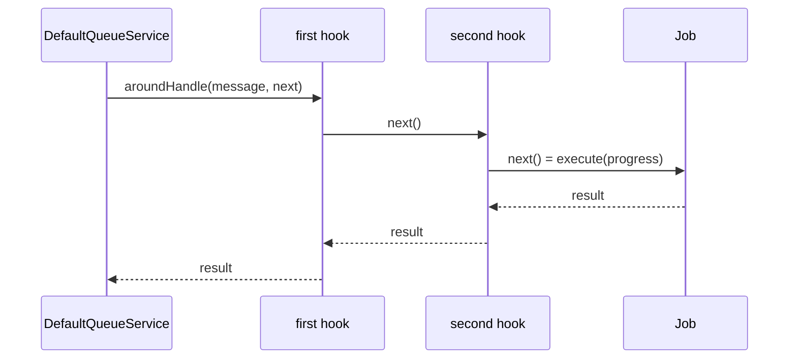

# Message hooks

A `QueueMessageHook` runs code before every emit and around every message handler. Use it to stamp data on outgoing messages (who sent it, a correlation id, a tenant) and to restore context while the consumer handles them. Several hooks can be registered; they form a chain.

## How it works

Emitting, in `DefaultQueueService.emit(message)`:

1. It resolves `Array.ofType(QueueMessageHook)` from DI.
2. It awaits `hook.beforeEmit(message)` for each hook, in registration order. A hook may change the message.
3. A hook that throws rejects `emit()`; no transport sees the message.

Handling, in the consumer built by `DefaultQueueService.consume()`:

1. It resolves `Array.ofType(QueueMessageHook)` again, on every call.
2. It nests the hooks: the first registered hook's `aroundHandle(message, next)` is outermost, the last one calls the real work.
3. The chain wraps, each separately: a job's `execute()`, a job's `onFailed()`, and the `callback` given to `consume()`.
4. `message` is the hydrated message instance, so `jobOptions(message)` and `message.Initiator` are available.
5. A hook that throws in a job's `execute()` chain fails the job through the normal failure path (see [Job tracking](03-job-tracking.md#how-it-works)).



## API

| Export | Kind | Meaning |
| --- | --- | --- |
| `QueueMessageHook` | abstract class | `beforeEmit(message): void \| Promise<void>`; `aroundHandle<T>(message, next: () => Promise<T>): Promise<T>` |
| `IQueueInitiator` | interface | `type`, `id`, optional `ceiling`: the shape a hook writes to `message.Initiator` |
| `JobOptions` | interface | `runAs?: 'initiator' \| 'system'`, the `@Job()` options a hook interprets |
| `jobOptions(message)` | function | `runAs` of the message's own class, or `{}` for an unknown value |

## Services and extension points

| Service | DI token and lifetime | Default implementation | Alternatives | How to replace or extend |
| --- | --- | --- | --- | --- |
| Message hook | `QueueMessageHook`, a list resolved with `Array.ofType(QueueMessageHook)` on every emit and handle; each hook is a singleton | none: with no hooks, messages pass unchanged | `AuthzQueueHook` (`@spinajs/authz-queue`): stamps the current principal as `Initiator` and runs the handler as the initiator, as `SYSTEM`, or unattended, from `@Job({ runAs })` | `@Injectable(QueueMessageHook)` on your class, or `DI.register(MyHook).as(QueueMessageHook)`. Remove one with `DI.unregister(TheirHook)`. Extend a shipped hook by subclassing it and registering the subclass instead |

### Message hook: custom implementation

Implement both methods; `aroundHandle()` must call `next()` once and return its result. Registration order is chain order, so import the module that registers your hook where you want it in the chain. Hooks are resolved per call, so a hook registered after `QueueService` was created still applies.

This hook carries a correlation id from the request that emitted a message to the worker that handles it, through `AsyncLocalStorage`.

```ts sample
import { AsyncLocalStorage } from 'node:async_hooks';
import { randomUUID } from 'node:crypto';
import { Injectable } from '@spinajs/di';
import { IQueueMessage, QueueMessageHook } from '@spinajs/queue';

export const correlation = new AsyncLocalStorage<{ id: string }>();

type CorrelatedMessage = IQueueMessage & { CorrelationId?: string };

@Injectable(QueueMessageHook)
export class CorrelationIdHook extends QueueMessageHook {
  public beforeEmit(message: CorrelatedMessage): void {
    message.CorrelationId ??= correlation.getStore()?.id ?? randomUUID();
  }

  public aroundHandle<T>(message: CorrelatedMessage, next: () => Promise<T>): Promise<T> {
    return correlation.run({ id: message.CorrelationId ?? randomUUID() }, next);
  }
}

// anywhere in the handler: correlation.getStore()?.id is the emitting request's id
export function currentCorrelationId(): string | undefined {
  return correlation.getStore()?.id;
}
```

## Important behaviour

- **The queue never sets `Initiator`.** Without a hook that stamps it, jobs have no initiator and their rows have `InitiatorType` and `InitiatorId` null.
- **`runAs` does nothing without a hook.** `@Job({ runAs })` is metadata for a hook such as `AuthzQueueHook`.
- **`beforeEmit()` sees the object passed to `emit()`.** For the static `emit()` this is a plain object, so `jobOptions(message)` returns `{}` there; read `runAs` in `aroundHandle()`.
- **A job with a `consume()` callback goes through the chain twice**: once around `execute()`, once around the callback. A failed job goes through it a third time around `onFailed()`.
- **`@NewInstance()` hooks are ignored.** `Array.ofType` leaves out `@NewInstance()` and factory registrations, so such a hook never runs.
- **Hook errors are not swallowed**, except around `onFailed()`, where they are logged.

## Best practices

- Keep `beforeEmit()` to data that survives JSON: the transport serialises the message.
- Do not trust message fields in `aroundHandle()` that any emitter can set; check them against the job row or a signature. `AuthzQueueHook` drops a caller-supplied `Initiator` in `beforeEmit()` for this reason.
- Put hooks that establish context (identity, tenant) before hooks that use it, by registration order.

## Patterns and antipatterns

```ts
// Don't: next() is never awaited inside the timing, and its result is dropped
public async aroundHandle<T>(message: IQueueMessage, next: () => Promise<T>): Promise<T> {
  const started = Date.now();
  next();
  console.log(`${message.Name} took ${Date.now() - started} ms`);
  return undefined as T;
}

// Do
public async aroundHandle<T>(message: IQueueMessage, next: () => Promise<T>): Promise<T> {
  const started = Date.now();
  try {
    return await next();
  } finally {
    console.log(`${message.Name} took ${Date.now() - started} ms`);
  }
}
```

## Examples

### Warn about slow handlers and refuse emits during maintenance

```ts sample
import { DI } from '@spinajs/di';
import { IQueueMessage, QueueMessageHook } from '@spinajs/queue';

export class MaintenanceGuardHook extends QueueMessageHook {
  public static Enabled = false;

  public beforeEmit(message: IQueueMessage): void {
    if (MaintenanceGuardHook.Enabled) {
      throw new Error(`Queue is in maintenance, ${message.Name} was not sent`);
    }
  }

  public aroundHandle<T>(_message: IQueueMessage, next: () => Promise<T>): Promise<T> {
    return next();
  }
}

export class SlowHandlerHook extends QueueMessageHook {
  protected ThresholdMs = 5000;

  public beforeEmit(): void {}

  public async aroundHandle<T>(message: IQueueMessage, next: () => Promise<T>): Promise<T> {
    const started = Date.now();
    try {
      return await next();
    } finally {
      const took = Date.now() - started;
      if (took > this.ThresholdMs) {
        console.warn(`${message.Name} handler took ${took} ms`);
      }
    }
  }
}

// guard first: it runs before any other hook's beforeEmit
DI.register(MaintenanceGuardHook).as(QueueMessageHook);
DI.register(SlowHandlerHook).as(QueueMessageHook);
```

## Related

- [Events and jobs](01-events-and-jobs.md): `@Job({ runAs })` and the emit and consume flows.
- [Job tracking](03-job-tracking.md): how `Initiator` becomes the row owner.
- [Tracking hooks](07-tracking-hooks.md): the other hook, around the queue's own database queries.
- [Multiple implementations](../di/06-multiple-implementations.md): `Array.ofType` and registration order.
