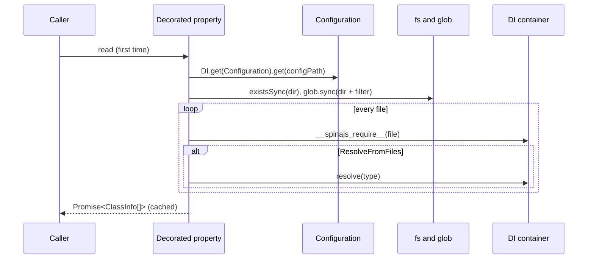

# Loading classes from directories

`@ResolveFromFiles` and `@ListFromFiles` turn a property into a lazy, cached scan of the directories listed under a configuration key. Use `@ListFromFiles` to get the classes only, and `@ResolveFromFiles` to also get an instance of each from `@spinajs/di`.

## How it works

1. **Decoration.** `ResolveFromFiles(filter, configPath, typeMatcher?)` or `ListFromFiles(...)` runs on a property. It checks that `filter` and `configPath` are non-empty strings, else it throws `InvalidArgument` from `@spinajs/exceptions`. It then replaces the property with a getter on the target (the class prototype for a class property).
2. **First read.** The getter starts the scan and caches the returned `Promise`. Every later read returns the same `Promise`.
3. **Directories.** The scan reads `DI.get(Configuration)` and `config.get(configPath)`. A missing or empty value ends the scan with `[]`. A single string becomes a one-item array. Duplicates are dropped.
4. **Missing directories.** Each directory is checked with `fs.existsSync()`. A missing one is logged at `warn` (`Directory ${directory} not exists`) and skipped.
5. **Files.** `glob.sync(path.join(dir, filter))` lists the files, backslashes turned into `/`. Each file is logged at `trace` (`Loading file ${file}`).
6. **Import.** `DI.__spinajs_require__(file)` imports each file; see [module loading](../di/13-module-loading.md).
7. **One entry per file.** The scan takes the first key of the module's exports, or the name the `typeMatcher` returns, and builds one `ClassInfo` from it; see [Choosing and resolving scanned classes](02-choosing-and-resolving-scanned-classes.md).
8. **Resolve.** `@ListFromFiles` stops here with `instance: undefined`. `@ResolveFromFiles` calls `DI.resolve(type)`, and awaits it when the class extends `AsyncService`.
9. **Result.** All entries are awaited with `Promise.all`. `null` and `undefined` entries are removed.



## Decorators

| Decorator | Target | Options | Effect |
| --- | --- | --- | --- |
| `@ResolveFromFiles(filter, configPath, typeMatcher?)` | property, or any object with `decorator(obj, key)` | `filter`: glob relative to each directory. `configPath`: dotted config key. `typeMatcher`: `(fileName) => exportName` | The property becomes `Promise<ClassInfo<T>[]>` with `instance` set from `DI.resolve(type)` |
| `@ListFromFiles(filter, configPath, typeMatcher?)` | same | same | Same scan; `instance` is always `undefined` and no class is resolved |

`ClassInfo<T>` comes from `@spinajs/di`:

| Field | Value |
| --- | --- |
| `file` | The path `glob` returned, with `/` separators |
| `name` | The export name used: the first export key, or the `typeMatcher` result |
| `type` | The exported value under `name`; `undefined` when the matcher names a missing export |
| `instance` | `@ResolveFromFiles`: the resolved instance. `@ListFromFiles`: `undefined` |

The filter `'/**/!(*.d).{ts,js}'` is the one the framework uses: every `.ts` and `.js` file at any depth, without `.d.ts` files.

## Configuration

The scan reads one key, the `configPath` you pass. The framework uses these:

| Key | Type | Default | Allowed values | Meaning |
| --- | --- | --- | --- | --- |
| `system.dirs.controllers` | `string[]` | not set | Absolute directory paths | Read by `FilesystemControllerSource` in `@spinajs/http` |
| `system.dirs.cli` | `string[]` | The `cli` folder of `@spinajs/cli`, plus each package that ships commands | Absolute directory paths | Read by `Cli` in `@spinajs/cli` |
| `system.dirs.socketControllers` | `string[]` | `[]` | Absolute directory paths | Read by the socket server in `@spinajs/http-socket` |
| `<your key>` | `string \| string[]` | none | Absolute directory paths | Anything you pass as `configPath` |

Configuration files merge arrays by concatenation, so every package and the app can add a directory to the same key:

```ts
// src/config/import-jobs.ts in your application
import { join, resolve } from 'path';

export default {
  system: {
    dirs: {
      importJobs: [resolve(join(process.cwd(), 'lib', 'import-jobs'))],
    },
  },
};
```

## Services and extension points

| Service | DI token and lifetime | Default implementation | Alternatives | How to replace or extend |
| --- | --- | --- | --- | --- |
| Configuration | `Configuration`, root container, read with `DI.get()` | `FrameworkConfiguration` | Any `Configuration` subclass | See [Scan services](03-scan-services.md#configuration-custom-implementation) |
| Logger | `Log` named `reflection`, or `InternalLoggerProxy` | `InternalLoggerProxy` | Any `Log` | See [Scan services](03-scan-services.md#logger-custom-implementation) |
| Module loader | Value `__module_loader__` | `import()` or `require()` | Your `IModuleLoader` | See [Scan services](03-scan-services.md#module-loader-custom-implementation) |
| Scanned classes | Each class by type, root container | Singleton | `@NewInstance()`, `AsyncService` | See [Choosing and resolving scanned classes](02-choosing-and-resolving-scanned-classes.md) |

## Important behaviour

- **The scan is lazy and runs once per decoration.** The cached `Promise` lives in the decorator closure, so all instances of the class, and all subclasses, share one result.
- **The property is always a `Promise`,** even with no directories. Await it before iterating.
- **One `ClassInfo` per file.** Only the first export, or the matcher's pick, is used. A second class in the same file is not listed.
- **Config and resolution use the root container.** `DI.get(Configuration)` and `DI.resolve(type)` go to the root, even when the decorated object came from a child container.
- **`Configuration` must be resolved first.** `DI.get()` does not build it. When it is missing, the `Promise` rejects with a `TypeError`.
- **Missing directories do not fail the scan;** they are logged at `warn` and skipped.
- **Resolution errors are logged, not thrown.** A synchronous `DI.resolve()` error is logged at `error` (`Cannot resolve type ${type} from file ${file}`) and the file is skipped. A rejected `AsyncService.resolve()` rejects the whole `Promise`.
- **Importing runs decorators.** A file is imported even by `@ListFromFiles`, so its class decorators (`@Injectable`, `@Command`, `@SocketController`) run. That is how `@spinajs/http-socket` registers socket controllers.
- **The property is read-only.** It has a getter and no setter. Assigning to it, eg. through a field initializer, throws a `TypeError` in strict mode.
- **Default exports are not supported in ESM mode.** `DI.__spinajs_require__` returns the default export itself, so the scan reads the class's static keys instead of the module's exports.

## Best practices

- Declare the property with `!` and a `Promise<ClassInfo<T>[]>` type, never with an initializer.
- Use `@ListFromFiles` when instances are expensive or need services that may be missing, and resolve each class when you use it. `@spinajs/cli` does this so commands with database dependencies do not break unrelated commands.
- Keep one exported class per scanned file, or pass a `typeMatcher` that names it.
- Filter the result by base class or decorator metadata; a scanned directory can hold helpers.
- Use the filter `'/**/!(*.d).{ts,js}'` so the same config works for `ts-node` and compiled output.

## Patterns and antipatterns

```ts
// Don't: the field initializer assigns to a getter-only property and throws at construction
class JobCatalog {
  @ListFromFiles('/**/!(*.d).{ts,js}', 'system.dirs.importJobs')
  public Jobs: ClassInfo<ImportJob>[] = [];
}

// Do: declare only, and await the Promise
class JobCatalog {
  @ListFromFiles('/**/!(*.d).{ts,js}', 'system.dirs.importJobs')
  public Jobs!: Promise<ClassInfo<ImportJob>[]>;
}
```

```ts
// Don't: iterating the property directly; it is a Promise, so for..of throws "is not iterable"
for (const c of this.Controllers) { /* ... */ }

// Do
for (const c of await this.Controllers) { /* ... */ }
```

## Examples

### Run every data import job found on disk

```ts sample
import { AsyncService, ClassInfo, DI } from '@spinajs/di';
import { Configuration } from '@spinajs/configuration';
import { ResolveFromFiles } from '@spinajs/reflection';

export abstract class ImportJob {
  public abstract readonly Source: string;
  public abstract run(): Promise<number>;
}

export class ImportRunner extends AsyncService {
  // Instances come from DI, so each job gets its own @Autoinject dependencies.
  @ResolveFromFiles('/**/!(*.d).{ts,js}', 'system.dirs.importJobs')
  protected Jobs!: Promise<ClassInfo<ImportJob>[]>;

  public async runAll(): Promise<void> {
    const jobs = (await this.Jobs).filter((j) => j.instance instanceof ImportJob);

    for (const job of jobs) {
      const rows = await job.instance!.run();
      console.log(`${job.name} imported ${rows} rows from ${job.instance!.Source}`);
    }
  }
}

async function main() {
  await DI.resolve(Configuration);
  const runner = await DI.resolve(ImportRunner);
  await runner.runAll();
}

void main();
```

### List command-like classes without building them

```ts sample
import { ClassInfo, DI } from '@spinajs/di';
import { ListFromFiles } from '@spinajs/reflection';

export abstract class MaintenanceTask {
  public abstract execute(): Promise<void>;
}

export class MaintenanceRunner {
  @ListFromFiles('/**/!(*.d).{ts,js}', 'system.dirs.maintenance')
  protected Tasks!: Promise<ClassInfo<MaintenanceTask>[]>;

  public async run(taskName: string): Promise<void> {
    const found = (await this.Tasks).find((t) => t.name === taskName);
    if (!found || !(found.type?.prototype instanceof MaintenanceTask)) {
      throw new Error(`Unknown maintenance task ${taskName}`);
    }

    // Built only now, so other tasks' dependencies are never touched.
    const task = (await DI.resolve(found.type)) as MaintenanceTask;
    await task.execute();
  }
}
```

## Related

- [Choosing and resolving scanned classes](02-choosing-and-resolving-scanned-classes.md): the export picked per file and what `instance` holds.
- [Scan services](03-scan-services.md): replacing the configuration, logger and module loader the scan uses.
- [Pluggable discovery sources](04-pluggable-discovery-sources.md): wrapping a scan in a replaceable DI service.
- [Module loading](../di/13-module-loading.md): how `DI.__spinajs_require__` imports a file.
- [Controller discovery](../http/03-controller-discovery.md) and [Command discovery](../cli/05-command-discovery.md): the framework's own scans.
