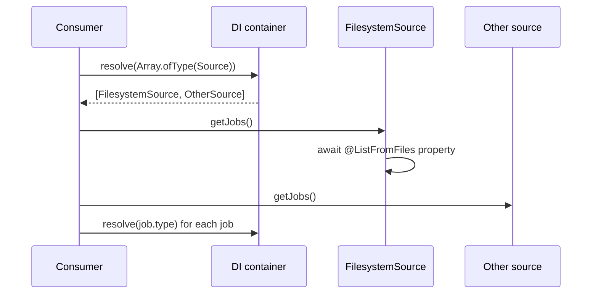

# Pluggable discovery sources

Wrap a directory scan in a DI service so it can be replaced, extended or joined by other sources. `@spinajs/http` finds controllers this way: an abstract `ControllerSource`, a `FilesystemControllerSource` built on `@ListFromFiles`, and a `DiRegistryControllerSource` next to it. Use the same pattern for anything your app discovers: jobs, reports, plugins.

## How it works

1. **Contract.** An abstract class extends `AsyncService` and declares the discovery method, eg. `getJobs(): Promise<ClassInfo<ReportJob>[]>`.
2. **Filesystem source.** A subclass registered with `@Injectable(Base)` holds an `@ListFromFiles(filter, configPath)` property and filters it in the discovery method.
3. **Other sources.** More subclasses register under the same base: a static list, a database table, classes registered in DI.
4. **Consumer.** The consumer resolves `Array.ofType(Base)`, awaits it (the elements are `AsyncService`s), calls each source and merges the results.
5. **Use.** The consumer resolves each `ClassInfo.type` when it needs an instance.



## Services and extension points

| Service | DI token and lifetime | Default implementation | Alternatives | How to replace or extend |
| --- | --- | --- | --- | --- |
| Your discovery source | Your abstract class; each implementation registered with `@Injectable(Base)`, singleton; resolved as `Array.ofType(Base)` | Your filesystem source | Static, database or DI-registry sources | Add one with `@Injectable(Base)`. Remove one with `DI.unregister(Impl)` before the first list resolve. Extend by subclassing and overriding the discovery method |
| `ControllerSource` (`@spinajs/http`) | `Array.ofType(ControllerSource)` | `FilesystemControllerSource`, `DiRegistryControllerSource` | `ExplainControllerSource` in `@spinajs/authz-http` | See [Controller discovery](../http/03-controller-discovery.md#services-and-extension-points) |
| `Cli.Commands` (`@spinajs/cli`) | A `@ListFromFiles` property on `Cli` | Scans `system.dirs.cli` | none | See [Command discovery](../cli/05-command-discovery.md) |

### Discovery source: custom implementation

The sample defines the contract, a filesystem source, a built-in source and the consumer. Register sources at import time with `@Injectable(Base)`, or in a `Bootstrapper` with `DI.register(Impl).as(Base)`; either way before the consumer resolves the list.

```ts sample
import { AsyncService, ClassInfo, DI, Injectable } from '@spinajs/di';
import { Configuration } from '@spinajs/configuration';
import { ListFromFiles } from '@spinajs/reflection';

export abstract class ReportJob {
  public abstract readonly Cron: string;
  public abstract run(): Promise<void>;
}

export abstract class ReportJobSource extends AsyncService {
  public abstract getJobs(): Promise<ClassInfo<ReportJob>[]>;
}

/** Report jobs dropped into the directories of `system.dirs.reportJobs`. */
@Injectable(ReportJobSource)
export class FilesystemReportJobSource extends ReportJobSource {
  @ListFromFiles('/**/!(*.d).{ts,js}', 'system.dirs.reportJobs')
  protected Files!: Promise<ClassInfo<ReportJob>[]>;

  public async getJobs(): Promise<ClassInfo<ReportJob>[]> {
    // A scanned directory can hold helpers; keep only real jobs.
    return (await this.Files).filter((f) => f.type?.prototype instanceof ReportJob);
  }
}

export class NightlySalesReport extends ReportJob {
  public readonly Cron = '0 2 * * *';

  public async run(): Promise<void> {
    console.log('sending the nightly sales report');
  }
}

/** Jobs shipped with the app, always on, independent of configuration. */
@Injectable(ReportJobSource)
export class BuiltInReportJobSource extends ReportJobSource {
  public async getJobs(): Promise<ClassInfo<ReportJob>[]> {
    const info = new ClassInfo<ReportJob>();
    info.name = NightlySalesReport.name;
    info.type = NightlySalesReport;
    info.file = '<built-in>';
    return [info];
  }
}

export class ReportScheduler {
  public async start(): Promise<void> {
    const sources = (await DI.resolve(Array.ofType(ReportJobSource))) as ReportJobSource[];
    const lists = await Promise.all(sources.map((s) => s.getJobs()));

    for (const job of lists.flat()) {
      const instance = (await DI.resolve(job.type)) as ReportJob;
      console.log(`scheduling ${job.name} at ${instance.Cron} (from ${job.file})`);
    }
  }
}

async function main() {
  await DI.resolve(Configuration);
  await DI.resolve(ReportScheduler).start();
}

void main();
```

### Discovery source: extend the filesystem source

Subclass the filesystem source to change what it keeps, and unregister the original so only one filesystem scan runs. `DI.unregister()` matches by class name in every list.

```ts sample
import { AsyncService, ClassInfo, DI, Injectable } from '@spinajs/di';
import { ListFromFiles } from '@spinajs/reflection';

export abstract class ReportJob {
  public abstract readonly Enabled: boolean;
  public abstract run(): Promise<void>;
}

export abstract class ReportJobSource extends AsyncService {
  public abstract getJobs(): Promise<ClassInfo<ReportJob>[]>;
}

@Injectable(ReportJobSource)
export class FilesystemReportJobSource extends ReportJobSource {
  @ListFromFiles('/**/!(*.d).{ts,js}', 'system.dirs.reportJobs')
  protected Files!: Promise<ClassInfo<ReportJob>[]>;

  public async getJobs(): Promise<ClassInfo<ReportJob>[]> {
    return (await this.Files).filter((f) => f.type?.prototype instanceof ReportJob);
  }
}

/** Skips jobs switched off in code, eg. a seasonal report. */
@Injectable(ReportJobSource)
export class EnabledReportJobSource extends FilesystemReportJobSource {
  public async getJobs(): Promise<ClassInfo<ReportJob>[]> {
    const jobs = await super.getJobs();
    const enabled: ClassInfo<ReportJob>[] = [];
    for (const job of jobs) {
      const instance = (await DI.resolve(job.type)) as ReportJob;
      if (instance.Enabled) {
        enabled.push(job);
      }
    }
    return enabled;
  }
}

// The subclass inherits the @ListFromFiles property and its cached scan.
DI.unregister(FilesystemReportJobSource);
```

## Important behaviour

- **A subclass shares the parent's scan.** The `@ListFromFiles` accessor sits on the parent prototype with one cached `Promise`, so the parent and every subclass read the same result.
- **The source list is cached.** Registering another source under the base rebuilds it on the next resolve; `DI.unregister()` does not touch the cache, so unregister before the first resolve.
- **`@ListFromFiles` still imports every file.** Imports run class decorators, so a source can register classes as a side effect even when its discovery method filters them out.
- **Duplicates are your job.** Two sources can return the same class; `@spinajs/http` dedupes by `type` and prefers an entry with a real file path.

## Best practices

- Use `@ListFromFiles` in a source, not `@ResolveFromFiles`, and resolve classes in the consumer. A broken dependency then fails one item, not the whole list.
- Give non-file entries a sentinel `file` such as `<built-in>` or `<di>`, as `@spinajs/http` does, so consumers can tell them apart.
- Filter scanned entries by base class or decorator metadata in the source, so consumers receive only usable types.

## Patterns and antipatterns

```ts
// Don't: the consumer owns the scan; nothing can add, remove or replace a source
export class ReportScheduler {
  @ListFromFiles('/**/!(*.d).{ts,js}', 'system.dirs.reportJobs')
  protected Jobs!: Promise<ClassInfo<ReportJob>[]>;
}

// Do: the scan lives in one registered source among others
export class ReportScheduler {
  public async start() {
    const sources = (await DI.resolve(Array.ofType(ReportJobSource))) as ReportJobSource[];
    // ...
  }
}
```

## Related

- [Loading classes from directories](01-loading-classes-from-directories.md): the scan inside the filesystem source.
- [Multiple implementations](../di/06-multiple-implementations.md): `@Injectable(Base)` and `Array.ofType()`.
- [Registering services](../di/01-registering-services.md): `DI.unregister()` and its cache caveat.
- [Controller discovery](../http/03-controller-discovery.md): the framework's own source list.
