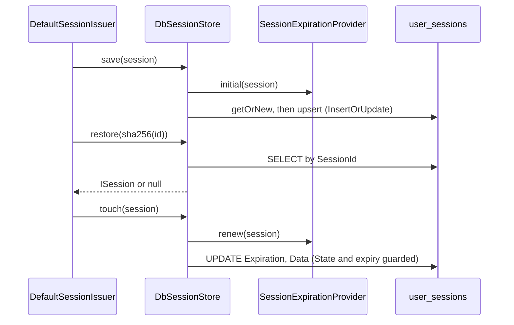

# Database session store

`DbSessionStore` keeps sessions in the `user_sessions` table. Use it when sessions must survive a restart and be shared by several application instances that already share a SQL database.

## How it works

### Selection, at boot

1. Importing `@spinajs/session-provider-db` runs `@Injectable(SessionProvider)` on `DbSessionStore`. It is registered under the `SessionProvider` token and as itself.
2. `DefaultSessionIssuer` (from `@spinajs/authn-session`) declares `@AutoinjectService('authn.session', SessionProvider) Store`. When the issuer is built, the DI container reads `authn.session.service` and picks the registered `SessionProvider` whose class name equals that value.
3. The container builds `DbSessionStore` once (singleton) and calls `DbSessionStore.resolve()`. It starts a timer that calls `cleanupExpired()` every `authn.session.db.cleanupInterval` milliseconds. The timer is `unref()`-ed, so it never keeps the process alive.
4. `DbSessionStore.dispose()` stops the timer.

### Save, `save(session)`

1. When `session.Expiration` is `undefined`, `SessionProvider.applyInitialExpiration()` asks the configured `SessionExpirationProvider` for the initial expiration. A `pending` session without an expiration throws `InvalidOperation`: the issuer must set it from `authn.session.pendingTtlSeconds`.
2. `DbSession.getOrNew({ SessionId })` loads the row or builds a new one.
3. The store sets every column: `Subject`, `ImpersonatorId` and `State` as [principal keys](#principal-keys), `Data` through `encodeSessionData()`, and `Expiration` (`NULL` for a never-expiring session).
4. `insert(InsertBehaviour.InsertOrUpdate)` writes the row as an upsert.

### Restore, `restore(sessionId)`

1. `DbSession.query().where({ SessionId })` reads the row with a flag that tells a `NULL` `Expiration` from an unreadable one. No row returns `null`.
2. `toSession()` reads `Subject`, `Impersonator` and `State` from their columns. A row without a readable `Subject` returns `null`.
3. It decodes `Data` (a `Buffer` is read as UTF-8 text first). A row whose `Data` does not decode throws.
4. An expired session returns `null`. The row stays until the sweep deletes it. An [unreadable `Expiration`](#unreadable-expiration) counts as passed, and so does an [unreadable `ImpersonatorId` or `ExternalKey`](#unreadable-impersonatorid-or-externalkey).

### Touch, `touch(session)`

1. `SessionProvider.applyRenewedExpiration()` computes the new expiration. A `pending` session keeps its expiration.
2. One `UPDATE` writes `Expiration` and `Data` where `SessionId` matches, the stored `State` equals `session.State`, the stored `ImpersonatorId` equals the principal key of `session.Impersonator` (`NULL` when it has none), and the stored `Expiration` is `NULL` or in the future.
3. When no row was updated, the store restores `session.Expiration` to its old value and returns `false`.
4. Otherwise it returns `true` when the expiration changed, `false` when it stayed the same.

### Revocation, `deleteBySubject(subject, opts)`

1. `matching()` reads the rows whose `Subject` equals the subject's principal key, plus those whose `ImpersonatorId` does when `includeImpersonations` is `true`.
2. A row whose `Data` does not decode keeps the owner its columns give and an empty `Data`; a warning is logged.
3. The row keyed `opts.except` is left out.
4. Live rows are deleted by key; the returned count is the number of rows that `DELETE` removed. Expired rows are deleted too, without being counted.
5. A second `DELETE` by `Subject` (and `ImpersonatorId`) removes rows saved after step 1, for example a rotation that raced the revocation.

`listBySubject(subject, opts)` uses the same `matching()` and returns the live sessions.

### Expired-session sweep, `cleanupExpired()`

1. It selects up to `authn.session.db.cleanupBatch` keys with `Expiration <= now`, oldest first, and deletes them with `DELETE ... WHERE SessionId IN (...) AND Expiration <= now`, so a row renewed meanwhile is not deleted. It repeats until a round selects fewer keys than the batch size.
2. It returns the number of deleted rows. The timer logs a positive count at `info` level; a thrown error is logged at `error` level and the next tick tries again.



## Configuration

| Key | Type | Default | Allowed values | Meaning |
| --- | --- | --- | --- | --- |
| `authn.session.service` | `string` | `MemorySessionStore` (from `@spinajs/authn-session`) | class name of a registered `SessionProvider` | Set to `DbSessionStore` to use this store. |
| `authn.session.db.cleanupInterval` | `number` | `600000` | milliseconds | Period of the expired-session sweep. |
| `authn.session.db.cleanupBatch` | `number` | `500` | positive integer | Rows selected and deleted per statement by the sweep. |
| `authn.session.expiration.service` | `string` | `SlidingCappedExpiration` | `AbsoluteExpiration`, `SlidingExpiration`, `SlidingCappedExpiration`, or a custom class name | Strategy the store calls in `save()` and `touch()`. Owned by `@spinajs/authn-session`. |
| `authn.session.expiration.ttl` | `number` | `30` | minutes | Idle lifetime for the shipped strategies. |
| `authn.session.expiration.maxLifetime` | `number` | `480` | minutes | Absolute cap for `SlidingCappedExpiration`. |
| `db.Aliases['session-provider-connection']` | `string` | unset | a connection `Name` | Binds the store's connection name to an existing connection. See [Session table and migrations](02-session-table-and-migrations.md#connection). |

```ts
this.Config = _.merge(this.Config, {
  authn: {
    session: {
      service: 'DbSessionStore',
      expiration: { service: 'SlidingCappedExpiration', ttl: 30, maxLifetime: 480 },
      db: { cleanupInterval: 10 * 60 * 1000 },
    },
  },
  db: {
    Aliases: { 'session-provider-connection': 'main' },
  },
});
```

## Principal keys

`Subject` and `ImpersonatorId` hold `principalKey(ref)` from `@spinajs/authn/contracts`: `<type>:<id>`. In the type, `%` is written `%25` and `:` is written `%3A`; the id is stored as is.

| `IdentityRef` | Column value |
| --- | --- |
| `{ type: 'user', id: 'u-1' }` | `user:u-1` |
| `{ type: 'svc:ops', id: 'a:b' }` | `svc%3Aops:a:b` |

## Services and extension points

| Service | DI token and lifetime | Default implementation | Alternatives | How to replace or extend |
| --- | --- | --- | --- | --- |
| Session store | `SessionProvider`, singleton, chosen by class name from `authn.session.service` | `MemorySessionStore` (`@spinajs/authn-session`) | `DbSessionStore` (this package), `RedisSessionStore`, `DynamoDbSessionProvider` | Set `authn.session.service`; subclass `DbSessionStore` with `@Injectable(SessionProvider)`. See [Extending the session store](03-extending-the-session-store.md#session-store-subclass-dbsessionstore). |
| Expiration strategy | `SessionExpirationProvider`, singleton, chosen by `authn.session.expiration.service` | `SlidingCappedExpiration` | `AbsoluteExpiration`, `SlidingExpiration` | Register your own `SessionExpirationProvider`. See [Extending the session store](03-extending-the-session-store.md#expiration-strategy). |

### `DbSessionStore` members

| Member | Visibility | Meaning |
| --- | --- | --- |
| `restore(sessionId)` | public | Live session or `null`. |
| `save(session)` | public | Upsert; applies the initial expiration only when none is set. |
| `touch(session)` | public | Update-only renewal; never re-creates a deleted row. |
| `delete(sessionId)` | public | `true` only when this call removed the row. |
| `deleteBySubject(subject, opts?)` | public | Revokes a subject's sessions; returns the live count. |
| `listBySubject(subject, opts?)` | public | The subject's live sessions. |
| `truncate()` | public | Deletes every row through `DbSession.truncate()`. |
| `cleanupExpired()` | public | Deletes expired rows; returns the count. |
| `resolve()` / `dispose()` | public | Start and stop the sweep timer. |
| `toSession(row, lenient?)` | protected | Row to `ISession`. Override to read extra columns. |
| `matching(subject, includeImpersonations?)` | protected | Rows of a subject, expired included. |
| `CleanupInterval`, `CleanupBatch`, `CleanupTimer`, `Log` | protected | Sweep period, sweep batch size, timer handle, `db-session-store` logger. |

## Important behaviour

- `restore()` throws when one row's `Data` does not decode. `deleteBySubject()` and `listBySubject()` do not: they log a warning and treat that row's `Data` as empty, so one bad row cannot block a revocation.
- A stored `State` other than exactly `active` reads back as `pending` (fail closed). A row without a readable `Subject` (a principal key with a non-empty type and id) reads as absent.
- `touch()` never extends a row that is expired, deleted, or stored in another `State`, a `NULL` `State` included. A forged `active` view of a `pending` row returns `false` and changes nothing.
- `touch()` writes `Data` even when it returns `false` because the expiration did not change.
- The store does not hash ids. It keys rows by whatever `SessionId` it gets; the issuer passes `sha256(rawId)`.
- `user_sessions` has no foreign key to `users`, so deleting a user does not end the user's sessions; call `SessionIssuer.revokeAll()` first.
- A session with `Expiration` `NULL` never expires and the sweep never deletes it.
- An `Expiration` that holds no readable datetime counts as passed: see [Unreadable `Expiration`](#unreadable-expiration).
- `cleanupExpired()` holds at most `cleanupBatch` keys at a time and reads them through the `user_sessions_expiration_idx` index, so a large backlog costs neither memory nor a table scan, and no single `DELETE` locks the table for long.
- Each `DbSessionStore` instance runs its own sweep. With several application instances, each sweeps the same table; the deletes are conditional on `Expiration`, so the overlap is harmless.

### Unreadable `Expiration`

An `Expiration` that holds a value no datetime converter reads (text written by hand on SQLite, a MySQL zero date, a PostgreSQL `infinity` or `-infinity`) counts as passed: `restore` answers `null`, listings leave it out, and the store logs a warning that names the subject, never the session id. Only `NULL` means never. The sweep compares in SQL and does not remove such a row on SQLite when the text sorts after the current date (`not a date`), or for a PostgreSQL `infinity` or a date after the year 275760; revoking the subject's sessions (`deleteBySubject`) deletes it. The store never writes such a value. To find and delete these rows on the session connection:

```sql
-- PostgreSQL
SELECT "Subject", "Expiration" FROM user_sessions WHERE NOT isfinite("Expiration") OR "Expiration" > '275760-09-13 00:00:00+00';
DELETE FROM user_sessions WHERE NOT isfinite("Expiration") OR "Expiration" > '275760-09-13 00:00:00+00';
-- MySQL
SELECT Subject, CAST(Expiration AS CHAR) FROM user_sessions WHERE CAST(Expiration AS CHAR) LIKE '____-00-%' OR CAST(Expiration AS CHAR) LIKE '____-__-00%';
DELETE FROM user_sessions WHERE CAST(Expiration AS CHAR) LIKE '____-00-%' OR CAST(Expiration AS CHAR) LIKE '____-__-00%';
-- SQLite (the SELECT; the DELETE takes the same WHERE)
SELECT Subject, Expiration FROM user_sessions WHERE Expiration IS NOT NULL
  AND NOT (typeof(Expiration) IN ('integer', 'real') AND abs(Expiration) <= 8640000000000)
  AND NOT (julianday(Expiration) IS NOT NULL AND date(substr(Expiration, 1, 10), '+0 days') = substr(Expiration, 1, 10))
  AND NOT (ltrim(Expiration, '-') GLOB '[0-9]*' AND ltrim(Expiration, '-') NOT GLOB '*[^0-9.]*' AND Expiration NOT GLOB '*.*.*' AND abs(CAST(Expiration AS REAL)) <= 8640000000000);
```

MSSQL's datetime types hold no such value. Setting `Expiration = NULL` instead of deleting makes the session never expire.

### Unreadable `ImpersonatorId` or `ExternalKey`

Revoking an impersonator (`deleteBySubject(admin, { includeImpersonations: true })`) and an IdP logout (`deleteByExternalKey`) select rows by equality on `ImpersonatorId` and `ExternalKey`, so a value present but unreadable would leave the session live after its revocation. Such a session counts as expired, as an unreadable `Expiration` does, and the warning names the subject and the column: an `ImpersonatorId` that is not a principal key with a non-empty type and id (`''`, `user:`, `:admin`, `admin`, `42`, a SQLite blob), or a SQLite blob in `ExternalKey` (any text is a key). Only `NULL` means not impersonated or no IdP session. The revocation does not delete such a row, because it cannot tell whose it is; `deleteBySubject(subject)` does, and so does the sweep once the row's `Expiration` passes. To find the `ImpersonatorId` rows:

```sql
-- PostgreSQL
SELECT "Subject", "ImpersonatorId" FROM user_sessions WHERE position(':' in "ImpersonatorId") <= 1 OR position(':' in "ImpersonatorId") = length("ImpersonatorId");
-- MySQL
SELECT Subject, ImpersonatorId FROM user_sessions WHERE LOCATE(':', ImpersonatorId) <= 1 OR LOCATE(':', ImpersonatorId) = CHAR_LENGTH(ImpersonatorId);
-- SQLite (also lists blobs, in either column)
SELECT Subject, ImpersonatorId FROM user_sessions WHERE typeof(ExternalKey) = 'blob' OR typeof(ImpersonatorId) = 'blob'
  OR instr(ImpersonatorId, ':') <= 1 OR instr(ImpersonatorId, ':') = length(ImpersonatorId);
```

## Best practices

- Revoke through `SessionIssuer.revokeAll()`, not `DbSessionStore.deleteBySubject()`: the issuer converts the `except` handle to the storage key.
- Call `cleanupExpired()` from a maintenance job when the application runs with long or no sweep intervals.

## Patterns and antipatterns

```ts
// Don't: the store keys rows by sha256(rawId); a raw cookie value finds nothing.
const session = await store.restore(cookieValue);

// Do: the issuer hashes the id.
const session = await issuer.restore(cookieValue);
```

```ts
// Don't: a subclass resolve() that skips the base starts no sweep.
public async resolve() {
  await this.warmUp();
}

// Do
public async resolve() {
  await super.resolve();
  await this.warmUp();
}
```

## Examples

### Purge expired sessions from a nightly maintenance job

```ts sample
import { DI } from '@spinajs/di';
import { Orm } from '@spinajs/orm';
import { DbSessionStore } from '@spinajs/session-provider-db';

export async function purgeExpiredSessions(): Promise<string> {
  // resolves the Orm, which fails on pending migrations: run `npx spinajs migrate-up` first
  await DI.resolve(Orm);
  const store = await DI.resolve(DbSessionStore);
  const removed = await store.cleanupExpired();
  return `Removed ${removed} expired sessions`;
}
```

### List the sessions an operator opened while impersonating customers

```ts sample
import { DI } from '@spinajs/di';
import { Orm } from '@spinajs/orm';
import { DbSessionStore } from '@spinajs/session-provider-db';

export async function impersonatedBy(operatorUuid: string): Promise<string[]> {
  await DI.resolve(Orm);
  const store = await DI.resolve(DbSessionStore);
  const operator = { type: 'user', id: operatorUuid };

  const sessions = await store.listBySubject(operator, { includeImpersonations: true });

  return sessions.filter((s) => s.Impersonator?.id === operatorUuid).map((s) => `${s.Subject.type}:${s.Subject.id} until ${s.Expiration?.toISO() ?? 'never'}`);
}
```

## Related

- [Session table and migrations](02-session-table-and-migrations.md): the columns this store reads and writes.
- [Extending the session store](03-extending-the-session-store.md): subclassing and replacing it.
- [`@spinajs/authn` sessions](../authn-session/README.md): ids, rotation, states and revocation, served by the issuer on top of this store.
- [Connections](../orm/01-connections.md): `db.Aliases` and `@Connection`.
