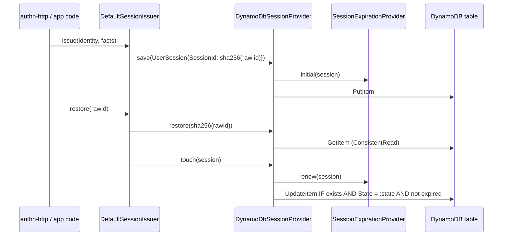

# DynamoDB session store

`DynamoDbSessionProvider` is a `SessionProvider` that keeps each session as one DynamoDB item keyed by `SessionId`. Use it when the app runs on AWS, has several instances, and should not run a SQL database or Redis only for sessions.

## How it works

`SessionIssuer` (`DefaultSessionIssuer` in `@spinajs/authn-session`) is the only caller in a normal app. It hashes the raw id, picks the state and the pending expiration, and calls the store:

1. **Boot.** `DefaultSessionIssuer.Store` is injected by `@AutoinjectService('authn.session', SessionProvider)`. It picks the `SessionProvider` class whose name equals `authn.session.service`. DI awaits `DynamoDbSessionProvider.resolve()`, which builds the client and creates the table when it is missing (see [Client and table provisioning](02-client-and-table-provisioning.md)).
2. **`save(session)`** sends one `PutItemCommand` (an upsert). A session with no `Expiration` first gets one from `applyInitialExpiration()`, which asks the configured `SessionExpirationProvider`. A `pending` session without `Expiration` throws `Error('A pending session must carry its own expiration ...')`.
3. **`restore(sessionId)`** sends a strongly consistent `GetItemCommand`. It returns `null` when the item is missing, expired (`Expiration <= now`), or a 2.x item with no `User` in its data. An item with no `Data`, or `Data` that is not valid JSON, makes it throw.
4. **`touch(session)`** renews `Expiration` through `applyRenewedExpiration()` and sends one conditional `UpdateItemCommand` that writes `Expiration` and `Data` only. The condition: the item exists, its stored `State` equals the caller's `State`, and it is not expired. It returns `true` when the expiration changed and was written, `false` when the condition failed or the expiration did not change.
5. **`delete(sessionId)`** sends one `DeleteItemCommand` with `ReturnValues: 'ALL_OLD'`. It returns `true` only when this call removed the item.
6. **`deleteBySubject(subject, opts)`** and **`listBySubject(subject, opts)`** scan the table (see [Subject lookup](03-subject-lookup.md)). `deleteBySubject` returns how many live sessions it ended; `listBySubject` returns live sessions only.
7. **`truncate()`** scans every `SessionId` and deletes the items one by one. It keeps the table.
8. **`dispose()`** destroys the `DynamoDBClient`.



## Configuration

| Key | Type | Default | Allowed values | Meaning |
| --- | --- | --- | --- | --- |
| `authn.session.service` | `string` | `'MemorySessionStore'` | a registered `SessionProvider` class name | Set to `'DynamoDbSessionProvider'` (or your subclass name) to use this store. |
| `authn.session.aws.table` | `string` | none | any DynamoDB table name | Table that holds the sessions. Required: there is no default. |
| `authn.session.aws.config` | `DynamoDBClientConfig` | none | any `@aws-sdk/client-dynamodb` client config | Passed to `new DynamoDBClient()`: `region`, `endpoint`, `credentials`, `maxAttempts` and so on. Ignored when `configPath` is set. |
| `authn.session.aws.configPath` | `string` | none | path to a JSON file | File read with `readFileSync` and `JSON.parse` on boot; its object is the client config. Wins over `config`. |
| `authn.session.aws.readCapacityUnits` | `number` | `10` | positive integer | Provisioned read capacity, used only when the store creates the table. |
| `authn.session.aws.writeCapacityUnits` | `number` | `10` | positive integer | Provisioned write capacity, used only when the store creates the table. |
| `authn.session.expiration.service` | `string` | `'SlidingCappedExpiration'` | `AbsoluteExpiration`, `SlidingExpiration`, `SlidingCappedExpiration` | Strategy the store asks for initial and renewed expirations. See [`@spinajs/authn`](../authn-session/README.md). |
| `authn.session.expiration.ttl` | `number` | `30` | minutes, `>= 1` | Idle or absolute lifetime, per strategy. |
| `authn.session.expiration.maxLifetime` | `number` | `480` | minutes, `>= 1` | Cap for `SlidingCappedExpiration`. |

With neither `config` nor `configPath`, the client gets `{}`: region and credentials come from the AWS SDK default chain (environment variables, shared config files, the instance or task role).

```ts
authn: {
  session: {
    service: 'DynamoDbSessionProvider',
    expiration: { service: 'SlidingCappedExpiration', ttl: 30, maxLifetime: 480 },
    aws: {
      table: 'app_sessions',
      config: { region: 'eu-central-1' },
      // configPath: '/etc/app/dynamo-client.json',
      readCapacityUnits: 10,
      writeCapacityUnits: 10,
    },
  },
}
```

## Schema

### `<authn.session.aws.table>`

Key schema: `SessionId` (`HASH`, type `S`). No secondary indexes. TTL attribute: `Expiration`.

| Column | Type | Meaning |
| --- | --- | --- |
| `SessionId` | `S` | Storage key. `sha256(raw id)` as hex for a 3.0 session; the raw UUID v4 for a 2.x item not yet migrated. |
| `Subject` | `S` | Owner as a principal key, `type:id`, with `:` and `%` in the type escaped as `%3A` and `%25` (`{ type: 'user', id: '77' }` is `user:77`). While impersonating, the target. |
| `ImpersonatorId` | `S` | Impersonator as a principal key. Absent when nobody impersonates. |
| `State` | `S` | `active` or `pending`. Any other value reads as `pending`. |
| `Creation` | `S` | Creation instant, ISO 8601. |
| `Expiration` | `N` | Absolute expiration in epoch **milliseconds**. Absent means the session never expires. |
| `Data` | `S` | Session data as JSON, written by `encodeSessionData` (keeps `Map`, `Set` and luxon `DateTime`). |
| `UserId` | `N` | 2.x items only. Never read: a 2.x item gets its owner from `User` in `Data`. |

An item with no `Subject` is a 2.x item. It is read through `adaptLegacySession()`: `Subject` from `Data` `User`, `Impersonator` from `Data` `Impersonator`, `State` `active` only when `Data` `Authorized` is `true`. `SessionIssuer.restore()` migrates it to the 3.0 layout on its first request.

## Services and extension points

| Service | DI token and lifetime | Default implementation | Alternatives | How to replace or extend |
| --- | --- | --- | --- | --- |
| `SessionProvider` | `@Injectable(SessionProvider)` on `DynamoDbSessionProvider`, also registered as itself; singleton; registered when the module is imported. Resolved by name from `authn.session.service` via `@AutoinjectService`. | `MemorySessionStore` (`authn-session` default config) | `DynamoDbSessionProvider` (this package), `DbSessionStore`, `RedisSessionStore` | Subclass, decorate `@Injectable(SessionProvider)`, set `authn.session.service` to the subclass name. |
| `DynamoDBClient` | Not in DI. Built by the protected `createClient(cfg)` in `resolve()`. | `new DynamoDBClient(cfg)` | none | Override `createClient` ([page](02-client-and-table-provisioning.md)). |
| Table provisioning | Protected `checkSessionTable()`, `createSessionTable()`, `updateTimeToLive()`, called by `resolve()`. | Provisioned table keyed by `SessionId`, TTL on `Expiration` | none | Override the three methods ([page](02-client-and-table-provisioning.md)). |
| Subject lookup | Protected `matching()` and `scan()`, called by `listBySubject` and `deleteBySubject`. | Strongly consistent paged `Scan` with a filter | none | Override `matching` ([page](03-subject-lookup.md)). |
| Item decoding | Protected `toSession(item, lenient)` and `instant(value)`. | 3.0 layout, 2.x items adapted | none | Override to read extra attributes; call `super.toSession()` first. |
| `SessionExpirationProvider` | `@AutoinjectService('authn.session.expiration', ...)` on the `SessionProvider` base; consumed, not owned. | `SlidingCappedExpiration` | `AbsoluteExpiration`, `SlidingExpiration` | Set `authn.session.expiration.service`; see [`@spinajs/authn`](../authn-session/README.md). |

The protected members a subclass can read: `Table`, `AwsConfig`, `ConfigPath`, `ReadCapacityUnits`, `WriteCapacityUnits`, `DynamoDb` (the client, set in `resolve()`), `Log` (logger `dynamo-session-store`) and, from the base, `Expiration`.

### Selecting the store

`authn.session.service` is matched against the class **name** of every class registered under `SessionProvider`. So:

- The class must be registered: import `@spinajs/session-provider-dynamodb` (or your subclass module) before `SessionIssuer` resolves.
- An unknown name fails the resolve with `ServiceNotFound: Service <name> is not registered in DI container`.
- A subclass is selected by its own class name, not by `'DynamoDbSessionProvider'`.

### `DynamoDbSessionProvider`: custom implementation

Subclass it when you need behaviour around the store calls: auditing, metrics, extra item attributes on read, or a different lookup. Every public method can be wrapped with `super`; the protected hooks change one step. Register the subclass with `@Injectable(SessionProvider)` and name it in `authn.session.service`. Registration happens at import time, so import the module before the app resolves `SessionIssuer`.

```ts sample
import { DynamoDbSessionProvider } from '@spinajs/session-provider-dynamodb';
import { SessionProvider } from '@spinajs/authn-session';
import type { IdentityRef } from '@spinajs/authn/contracts';
import { Injectable } from '@spinajs/di';

// Config: authn.session.service = 'AuditedDynamoSessionStore'
@Injectable(SessionProvider)
export class AuditedDynamoSessionStore extends DynamoDbSessionProvider {
  public async deleteBySubject(subject: IdentityRef, opts?: { includeImpersonations?: boolean; except?: string }): Promise<number> {
    const ended = await super.deleteBySubject(subject, opts);
    this.Log.info(`Revoked ${ended} session(s) of ${subject.type}:${subject.id} in table ${this.Table}`);
    return ended;
  }
}
```

## Important behaviour

- **Every read is strongly consistent.** `GetItem` and every `Scan` page use `ConsistentRead: true`, so a logout or revocation is seen at once by every instance.
- **Expiry is judged in Node, not by DynamoDB.** TTL deletion is eventual, so `restore`, `listBySubject` and `touch` treat `Expiration <= now` as gone even while the item still exists.
- **`Expiration` is stored in epoch milliseconds.** DynamoDB TTL reads its attribute as epoch seconds, so it sees these values far in the future and does not remove expired items. They stay in the table until `deleteBySubject`, `delete` or `truncate` removes them.
- **An `Expiration` that is not a number counts as passed.** `instant()` maps it to epoch 0.
- **`touch` never changes ownership or state.** It writes `Expiration` and `Data` only; `Subject`, `ImpersonatorId` and `State` stay as stored. A row that turned `pending`, was deleted, or expired between the caller's read and the write is not extended and not re-created.
- **`touch` never writes a 2.x item.** The item has no `State`, so the condition fails and `touch` returns `false`. `SessionIssuer` migrates 2.x items before any write.
- **`touch` on a never-expiring session** (no `Expiration`, strategy returns `undefined`) removes nothing, writes `Data` and returns `false`.
- **`save` is an unconditional overwrite.** It does not check that the item exists or its state.
- **`restore` throws on missing or undecodable `Data`** (`SyntaxError` or `InvalidArgument`), while `listBySubject` and `deleteBySubject` read such an item with empty `Data` and log a warning, so one bad item cannot break a revocation.
- **`deleteBySubject` counts only items that were live when read and that this call deleted.** It also deletes the subject's expired items without counting them.
- **`truncate` deletes item by item.** It keeps the table, because a deleted table stays `DELETING` for a while and cannot be recreated at once.
- **Item size limit.** DynamoDB items are limited to 400 KB, and `Data` holds everything set through `SessionIssuer.set()`. Keep session data small.

## Best practices

- Name the table per environment (`app_sessions_staging`, `app_sessions_prod`), because `truncate()` empties the whole table.
- Give the app role `dynamodb:GetItem`, `PutItem`, `UpdateItem`, `DeleteItem`, `Scan` and `DescribeTable` on the table. Add `CreateTable` and `UpdateTimeToLive` only if the store should create the table.
- Revoke through `SessionIssuer.revokeAll()`, not `DynamoDbSessionProvider.deleteBySubject()`: the issuer also ends 2.x sessions that are still keyed by their raw id.
- Put a v3 client config in `configPath` files: `{ "region": "...", "credentials": { "accessKeyId": "...", "secretAccessKey": "..." } }`. A 2.x-style file with top-level `accessKeyId` and `secretAccessKey` is passed as-is, so the client ignores those keys and falls back to the default credential chain.
- Prefer `authn.session.aws.config` with no `credentials` on AWS, so the instance or task role signs the requests.

## Patterns and antipatterns

```ts
// Don't: the store keys items by the storage key, so a raw cookie id finds nothing,
// and deleting by store bypasses the 2.x id the issuer also checks.
await store.delete(rawIdFromCookie);

// Do
await issuer.revoke(handle);
```

```ts
// Don't: both keys set; `config` is ignored without a warning.
aws: { table: 'app_sessions', configPath: './dynamo.json', config: { region: 'eu-central-1' } }

// Do
aws: { table: 'app_sessions', config: { region: 'eu-central-1' } }
```

## Examples

### Point the store at DynamoDB Local in tests

```ts
authn: {
  session: {
    service: 'DynamoDbSessionProvider',
    aws: {
      table: 'test_sessions',
      config: {
        region: 'local',
        endpoint: 'http://localhost:8000',
        credentials: { accessKeyId: 'local', secretAccessKey: 'local' },
      },
    },
  },
}
```

### Show a user their active devices

```ts sample
import '@spinajs/session-provider-dynamodb';
import { DI } from '@spinajs/di';
import { SessionIssuer } from '@spinajs/authn/contracts';

export async function activeDevices(userUuid: string) {
  const issuer = await DI.resolve(SessionIssuer);
  const sessions = await issuer.list({ type: 'user', id: userUuid });
  return sessions.map((s) => ({ handle: s.handle, lastSeen: s.lastSeenAt, device: s.userAgent ?? 'unknown' }));
}
```

### Count live sessions per subject for an admin report

```ts sample
import { DynamoDbSessionProvider } from '@spinajs/session-provider-dynamodb';
import { DI } from '@spinajs/di';

export async function liveSessionCount(userUuids: string[]): Promise<Map<string, number>> {
  const store = await DI.resolve(DynamoDbSessionProvider);
  const counts = new Map<string, number>();
  for (const id of userUuids) {
    const sessions = await store.listBySubject({ type: 'user', id }, { includeImpersonations: true });
    counts.set(id, sessions.length);
  }
  return counts;
}
```

Each `listBySubject` call scans the whole table; run such reports off-peak.

## Related

- [Client and table provisioning](02-client-and-table-provisioning.md): how `resolve()` builds the client and the table.
- [Subject lookup](03-subject-lookup.md): the scan behind `listBySubject` and `deleteBySubject`.
- [`@spinajs/authn` sessions](../authn-session/README.md): ids, rotation, states and expiration strategies.
- [`@spinajs/configuration` config-selected services](../configuration/08-config-selected-services.md): how `authn.session.service` picks the class.
