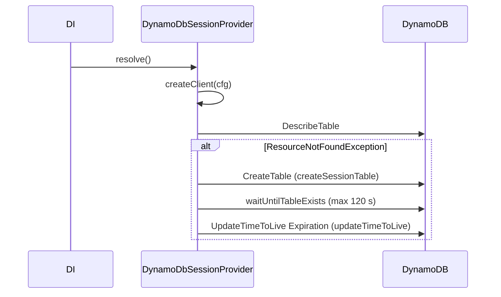

# Client and table provisioning

On boot, `DynamoDbSessionProvider.resolve()` builds the `DynamoDBClient` and creates the session table with TTL when it does not exist. Override its protected hooks to change the client (retries, instrumentation, credentials) or the table (on-demand billing, extra indexes, tags).

## How it works

DI calls `resolve()` once, when the singleton store is first resolved (usually while `DefaultSessionIssuer` is being built):

1. **Client config.** When `authn.session.aws.configPath` is set, `resolve()` reads the file with `readFileSync` and `JSON.parse`. Otherwise it uses `authn.session.aws.config`. With neither, the config is `{}`.
2. **Client.** `createClient(cfg)` returns the client; the default is `new DynamoDBClient(cfg)`. The result goes to the protected `DynamoDb` field.
3. **Table check.** `checkSessionTable()` sends `DescribeTableCommand`. A `ResourceNotFoundException` returns `null`; any other error fails the boot.
4. **Table creation** (only when step 3 returned `null`):
   1. `createSessionTable()` sends `CreateTableCommand`: hash key `SessionId` (`S`), provisioned throughput from `readCapacityUnits` and `writeCapacityUnits`.
   2. `waitUntilTableExists` polls until the table is `ACTIVE`, up to 120 seconds.
   3. `updateTimeToLive()` enables TTL on the `Expiration` attribute.
5. **Shutdown.** `dispose()` calls `DynamoDb.destroy()`.

An existing table is used as it is: the store does not check its key schema, throughput or TTL setting.



## Configuration

| Key | Type | Default | Allowed values | Meaning |
| --- | --- | --- | --- | --- |
| `authn.session.aws.table` | `string` | none | any DynamoDB table name | Table to describe, create and use. |
| `authn.session.aws.config` | `DynamoDBClientConfig` | none | client config object | Argument of `createClient`. Ignored when `configPath` is set. |
| `authn.session.aws.configPath` | `string` | none | path to a JSON file | JSON client config, read synchronously on boot. Wins over `config`. |
| `authn.session.aws.readCapacityUnits` | `number` | `10` | positive integer | `ReadCapacityUnits` of a table the store creates. |
| `authn.session.aws.writeCapacityUnits` | `number` | `10` | positive integer | `WriteCapacityUnits` of a table the store creates. |

```ts
authn: {
  session: {
    aws: {
      table: 'app_sessions',
      configPath: '/run/secrets/dynamo-client.json',
      readCapacityUnits: 25,
      writeCapacityUnits: 25,
    },
  },
}
```

## Services and extension points

| Service | DI token and lifetime | Default implementation | Alternatives | How to replace or extend |
| --- | --- | --- | --- | --- |
| Client factory `createClient(cfg: DynamoDBClientConfig): DynamoDBClient` | Protected method of the `SessionProvider` singleton; called once in `resolve()`. | `new DynamoDBClient(cfg)` | none | Override in a subclass; return any `DynamoDBClient`, or call `super.createClient()` with a changed config. |
| `checkSessionTable()` | Protected; called in `resolve()`. | `DescribeTableCommand`, `null` on `ResourceNotFoundException` | none | Override to skip the check (return a non-null value) or to validate the table. |
| `createSessionTable()` | Protected; called when the check returned `null`. | Provisioned table, hash key `SessionId` | none | Override to change billing mode, add indexes, tags or encryption. Keep `SessionId` (`S`) as the hash key. |
| `updateTimeToLive()` | Protected; called after the new table is `ACTIVE`. | TTL on `Expiration` | none | Override to skip TTL or to tag the table. |

The subclass is registered and selected like any store: `@Injectable(SessionProvider)` and `authn.session.service` set to its class name. See [Selecting the store](01-dynamodb-session-store.md#selecting-the-store).

### Client factory: custom implementation

Override `createClient` to add retries, timeouts, request middleware or credentials that a JSON config cannot express. The hook also lets tests return a fake client.

```ts sample
import { DynamoDbSessionProvider } from '@spinajs/session-provider-dynamodb';
import { SessionProvider } from '@spinajs/authn-session';
import { Injectable } from '@spinajs/di';
import { DynamoDBClient } from '@aws-sdk/client-dynamodb';
import type { DynamoDBClientConfig } from '@aws-sdk/client-dynamodb';

// Config: authn.session.service = 'ResilientDynamoSessionStore'
@Injectable(SessionProvider)
export class ResilientDynamoSessionStore extends DynamoDbSessionProvider {
  protected createClient(cfg: DynamoDBClientConfig): DynamoDBClient {
    const client = super.createClient({ ...cfg, maxAttempts: 5, retryMode: 'adaptive' });

    // Log every session-store call that takes longer than 200 ms.
    client.middlewareStack.add(
      (next, context) => async (args) => {
        const started = Date.now();
        const result = await next(args);
        const took = Date.now() - started;
        if (took > 200) {
          this.Log.warn(`Slow DynamoDB ${String(context.commandName)} on ${this.Table}: ${took} ms`);
        }
        return result;
      },
      { step: 'initialize', name: 'slowSessionCallLog' },
    );

    return client;
  }
}
```

### Table hooks: custom implementation

Override `createSessionTable` when the store should create an on-demand table. The default always sends `ProvisionedThroughput`.

```ts sample
import { DynamoDbSessionProvider } from '@spinajs/session-provider-dynamodb';
import { SessionProvider } from '@spinajs/authn-session';
import { Injectable } from '@spinajs/di';
import { CreateTableCommand } from '@aws-sdk/client-dynamodb';

// Config: authn.session.service = 'OnDemandDynamoSessionStore'
@Injectable(SessionProvider)
export class OnDemandDynamoSessionStore extends DynamoDbSessionProvider {
  protected createSessionTable() {
    return this.DynamoDb.send(
      new CreateTableCommand({
        TableName: this.Table,
        AttributeDefinitions: [{ AttributeName: 'SessionId', AttributeType: 'S' }],
        KeySchema: [{ AttributeName: 'SessionId', KeyType: 'HASH' }],
        BillingMode: 'PAY_PER_REQUEST',
        Tags: [{ Key: 'purpose', Value: 'sessions' }],
      }),
    );
  }
}
```

To manage the table only with infrastructure code, make the check always succeed so the app role needs no `CreateTable` permission:

```ts sample
import { DynamoDbSessionProvider } from '@spinajs/session-provider-dynamodb';
import { SessionProvider } from '@spinajs/authn-session';
import { Injectable } from '@spinajs/di';
import { DescribeTableCommand } from '@aws-sdk/client-dynamodb';

// Config: authn.session.service = 'ManagedTableDynamoSessionStore'
@Injectable(SessionProvider)
export class ManagedTableDynamoSessionStore extends DynamoDbSessionProvider {
  // A missing table fails the boot instead of being created.
  protected async checkSessionTable() {
    return this.DynamoDb.send(new DescribeTableCommand({ TableName: this.Table }));
  }
}
```

## Important behaviour

- **TTL is enabled only on a table the store creates.** A table you create yourself gets no TTL unless you enable it on `Expiration`.
- **TTL does not remove expired sessions.** `Expiration` holds epoch milliseconds and DynamoDB TTL expects epoch seconds, so TTL treats every item as expiring far in the future. See [Important behaviour of the store](01-dynamodb-session-store.md#important-behaviour).
- **Concurrent first boots race.** Two instances that both find no table both send `CreateTable`; the second gets `ResourceInUseException` and its boot fails. Create the table before scaling out, or let one instance boot first.
- **`resolve()` can block boot up to 120 seconds** while a new table becomes `ACTIVE`.
- **`configPath` is read synchronously and parsed as plain JSON.** A missing file or invalid JSON fails the boot.
- **`configPath` must hold a v3 client config.** It is passed to `new DynamoDBClient()` unchanged; top-level `accessKeyId` and `secretAccessKey` (the 2.x `loadFromPath` shape) are ignored and the default credential chain signs instead.
- **`config` is ignored when `configPath` is set**, with no warning.
- **Capacity keys apply only at creation.** Changing `readCapacityUnits` later does not update an existing table.

## Best practices

- Create the table with infrastructure code in production and use the `ManagedTableDynamoSessionStore` pattern above, so the app role has no `CreateTable` permission.
- Keep `createClient` overrides calling `super.createClient()` with a changed config; you keep the default construction if it changes.
- Use the `endpoint` key of `authn.session.aws.config` for DynamoDB Local instead of overriding `createClient`.

## Patterns and antipatterns

```ts
// Don't: a 2.x-style credentials file; the v3 client ignores these keys.
// /etc/app/dynamo.json
{ "region": "eu-central-1", "accessKeyId": "AKIA...", "secretAccessKey": "..." }

// Do
{ "region": "eu-central-1", "credentials": { "accessKeyId": "AKIA...", "secretAccessKey": "..." } }
```

```ts
// Don't: a custom table without SessionId as the string hash key; every store call fails.
KeySchema: [{ AttributeName: 'Id', KeyType: 'HASH' }]

// Do
KeySchema: [{ AttributeName: 'SessionId', KeyType: 'HASH' }]
```

## Examples

### Load client settings from a mounted secrets file

```ts
// /run/secrets/dynamo-client.json
{ "region": "eu-west-1", "maxAttempts": 4 }

// config
authn: {
  session: {
    service: 'DynamoDbSessionProvider',
    aws: { table: 'app_sessions', configPath: '/run/secrets/dynamo-client.json' },
  },
}
```

## Related

- [DynamoDB session store](01-dynamodb-session-store.md): the operations that use the client and table.
- [Subject lookup](03-subject-lookup.md): add secondary indexes here and use them there.
- [`@spinajs/di` service lifecycle](../di/10-service-lifecycle.md): when `resolve()` and `dispose()` of an `AsyncService` run.
