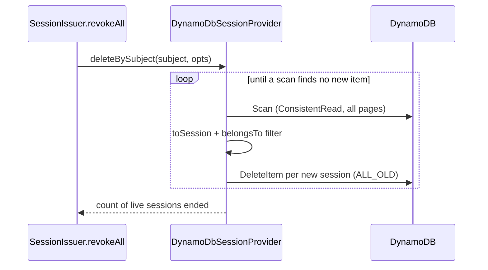

# Subject lookup

`listBySubject` and `deleteBySubject` find a subject's sessions with a strongly consistent, paged `Scan` of the whole table. Override `matching()` to use a secondary index instead when the table grows large.

## How it works

`listBySubject(subject, { includeImpersonations })`:

1. `matching(subject, includeImpersonations)` builds a `FilterExpression`:
   - `#subject = :key`;
   - with `includeImpersonations: true`, also `OR #impersonator = :key` on `ImpersonatorId`.

   `:key` is `principalKey(subject)`, for example `user:6f1c...`.
2. `scan(input)` sends `ScanCommand` with `ConsistentRead: true` and follows `LastEvaluatedKey` until the last page.
3. `matching` turns each item into a session with `toSession(item, true)`. Undecodable `Data` gives an empty `Data` and a `warn` log instead of an error. An item without a readable `Subject` is dropped.
4. `matching` keeps only sessions whose `Subject` (or, with `includeImpersonations`, `Impersonator`) equals the subject, compared as `IdentityRef` after parsing the principal keys.
5. `listBySubject` drops expired sessions.

`deleteBySubject(subject, { includeImpersonations, except })`:

1. Calls `matching()` and drops `except` and every `SessionId` already handled.
2. Ends when nothing is left; returns the count.
3. Otherwise sends `DeleteItemCommand` (`ReturnValues: 'ALL_OLD'`) for each found item. It counts an item when the delete removed it and it was not expired.
4. Goes back to step 1. The repeated scan catches a session saved for the subject while the call runs, for example a rotation racing a ban.



## Services and extension points

| Service | DI token and lifetime | Default implementation | Alternatives | How to replace or extend |
| --- | --- | --- | --- | --- |
| `matching(subject, includeImpersonations?): Promise<ISession[]>` | Protected method of the `SessionProvider` singleton. | Filtered consistent `Scan` + client-side match | none | Override; return every item of the subject, **expired ones included**, as `ISession`. `listBySubject` and `deleteBySubject` filter liveness themselves. |
| `scan(input): Promise<Record<string, AttributeValue>[]>` | Protected; used by `matching` and `truncate`. | All pages of a `ScanCommand` with `ConsistentRead: true` | none | Override to add `Limit`, parallel `Segment`s or metrics. |
| `toSession(item, lenient?)` | Protected; used by `restore` (strict) and `matching` (lenient). | The item layout of [DynamoDB session store](01-dynamodb-session-store.md#schema) | none | Override to read extra attributes; call `super.toSession()` first. |

Register the subclass with `@Injectable(SessionProvider)` and set `authn.session.service` to its class name ([Selecting the store](01-dynamodb-session-store.md#selecting-the-store)).

### `matching`: custom implementation

Replace the scan with a `Query` on two global secondary indexes: one on `Subject`, one on `ImpersonatorId`. Read the trade-offs first:

- **GSI reads are eventually consistent.** `ConsistentRead` is not allowed on a GSI. A session saved a moment before a ban can be missed, which the default scan guarantees against.

The sample creates the indexes on a new table (`createSessionTable`) and queries them (`matching`):

```ts sample
import { DynamoDbSessionProvider } from '@spinajs/session-provider-dynamodb';
import { SessionProvider } from '@spinajs/authn-session';
import type { ISession } from '@spinajs/authn-session';
import { principalKey } from '@spinajs/authn/contracts';
import type { IdentityRef } from '@spinajs/authn/contracts';
import { Injectable } from '@spinajs/di';
import { CreateTableCommand, QueryCommand } from '@aws-sdk/client-dynamodb';
import type { AttributeValue } from '@aws-sdk/client-dynamodb';

const BY_SUBJECT = 'Subject-index';
const BY_IMPERSONATOR = 'ImpersonatorId-index';

// Config: authn.session.service = 'IndexedDynamoSessionStore'
@Injectable(SessionProvider)
export class IndexedDynamoSessionStore extends DynamoDbSessionProvider {
  protected createSessionTable() {
    const index = (name: string, attribute: string) => ({
      IndexName: name,
      KeySchema: [{ AttributeName: attribute, KeyType: 'HASH' as const }],
      Projection: { ProjectionType: 'ALL' as const },
    });

    return this.DynamoDb.send(
      new CreateTableCommand({
        TableName: this.Table,
        BillingMode: 'PAY_PER_REQUEST',
        AttributeDefinitions: [
          { AttributeName: 'SessionId', AttributeType: 'S' },
          { AttributeName: 'Subject', AttributeType: 'S' },
          { AttributeName: 'ImpersonatorId', AttributeType: 'S' },
        ],
        KeySchema: [{ AttributeName: 'SessionId', KeyType: 'HASH' }],
        GlobalSecondaryIndexes: [index(BY_SUBJECT, 'Subject'), index(BY_IMPERSONATOR, 'ImpersonatorId')],
      }),
    );
  }

  protected async matching(subject: IdentityRef, includeImpersonations?: boolean): Promise<ISession[]> {
    const key = principalKey(subject);
    const items = await this.queryIndex(BY_SUBJECT, 'Subject', key);
    if (includeImpersonations === true) {
      items.push(...(await this.queryIndex(BY_IMPERSONATOR, 'ImpersonatorId', key)));
    }

    const byId = new Map<string, ISession>();
    for (const item of items) {
      const session = this.toSession(item, true);
      if (session) {
        byId.set(session.SessionId, session);
      }
    }
    return [...byId.values()];
  }

  private async queryIndex(index: string, attribute: string, key: string): Promise<Record<string, AttributeValue>[]> {
    const items: Record<string, AttributeValue>[] = [];
    let start: Record<string, AttributeValue> | undefined;
    do {
      const page = await this.DynamoDb.send(
        new QueryCommand({
          TableName: this.Table,
          IndexName: index,
          KeyConditionExpression: '#attr = :key',
          ExpressionAttributeNames: { '#attr': attribute },
          ExpressionAttributeValues: { ':key': { S: key } },
          ExclusiveStartKey: start,
        }),
      );
      items.push(...(page.Items ?? []));
      start = page.LastEvaluatedKey;
    } while (start);
    return items;
  }
}
```

For an existing table, add the two indexes with `UpdateTable` or your infrastructure code; `createSessionTable` runs only for a missing table.

## Important behaviour

- **Every call reads the whole table.** A `Scan` filter is applied after the read, so read capacity grows with the table size, not with the subject's session count.
- **Expired items are deleted too.** `deleteBySubject` removes the subject's expired items but does not count them.
- **A concurrent logout is not counted.** An item that another call deleted first returns no `Attributes`, so it does not add to the count.
- **`except` is a storage key**, compared with `SessionId`.

## Best practices

- Revoke through `SessionIssuer.revokeAll()`; it calls `deleteBySubject` with the right `except` key.
- Watch the table's consumed read capacity: every revocation and every session list is a full scan.

## Patterns and antipatterns

```ts
// Don't: matching must return expired items as well; filtering here makes
// deleteBySubject leave the subject's expired items in the table.
protected async matching(subject: IdentityRef) {
  return (await super.matching(subject)).filter((s) => !this.isExpired(s));
}

// Do: return everything that belongs to the subject; callers filter liveness.
protected async matching(subject: IdentityRef, includeImpersonations?: boolean) {
  return super.matching(subject, includeImpersonations);
}
```

## Examples

### Count scan pages for capacity monitoring

```ts sample
import { DynamoDbSessionProvider } from '@spinajs/session-provider-dynamodb';
import { SessionProvider } from '@spinajs/authn-session';
import { Injectable } from '@spinajs/di';

// Config: authn.session.service = 'MeteredDynamoSessionStore'
@Injectable(SessionProvider)
export class MeteredDynamoSessionStore extends DynamoDbSessionProvider {
  protected async scan(input: Parameters<DynamoDbSessionProvider['scan']>[0]) {
    const started = Date.now();
    const items = await super.scan(input);
    this.Log.info(`Session scan of ${this.Table} read ${items.length} item(s) in ${Date.now() - started} ms`);
    return items;
  }
}
```

## Related

- [DynamoDB session store](01-dynamodb-session-store.md): the other store operations and the item layout.
- [Client and table provisioning](02-client-and-table-provisioning.md): where the table and its indexes are created.
- [`@spinajs/authn` sessions](../authn-session/README.md): `revokeAll` and session listing on top of these calls.
