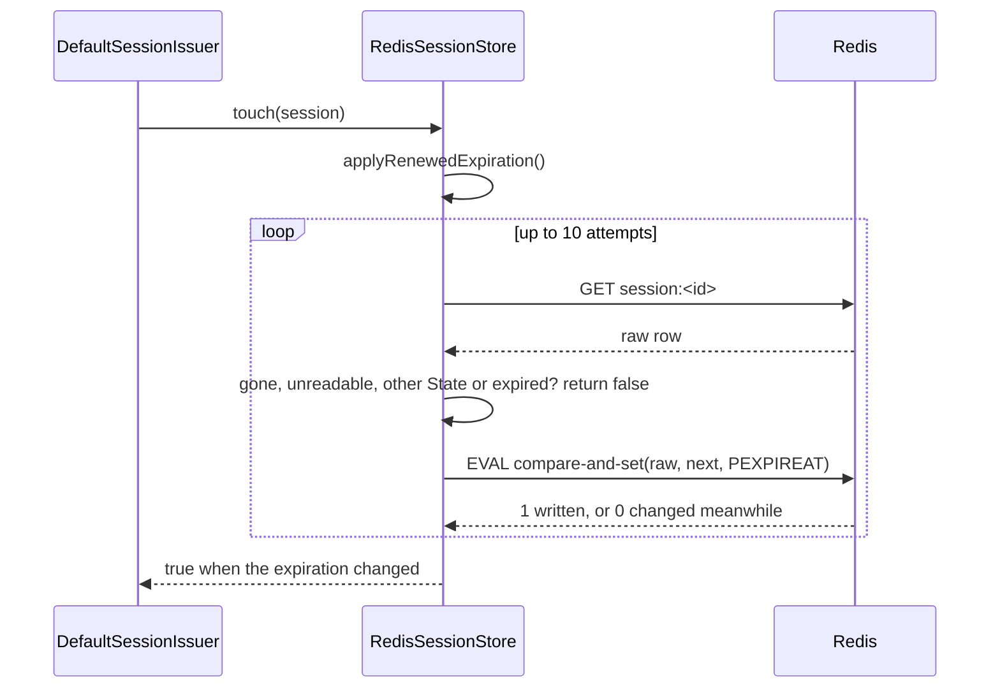

# Redis session store

`RedisSessionStore` keeps sessions in Redis. Use it when several application instances share sessions and you want expired sessions to free their memory on their own, through the Redis TTL.

## How it works

### Selection and connection, at boot

1. Importing `@spinajs/session-provider-redis` runs `@Injectable(SessionProvider)` on `RedisSessionStore`. It is registered under the `SessionProvider` token and as itself.
2. `DefaultSessionIssuer` (from `@spinajs/authn-session`) declares `@AutoinjectService('authn.session', SessionProvider) Store`. When the issuer is built, the DI container reads `authn.session.service` and picks the registered `SessionProvider` whose class name equals that value.
3. The container builds `RedisSessionStore` once (singleton) and awaits `RedisSessionStore.resolve()`:
   - `createClient()` builds `new Redis(authn.session.redis ?? {})`;
   - an `error` listener on the client writes connection errors to the `redis-session-store` logger.

   `resolve()` sends no command, so the boot does not wait for Redis.
4. `RedisSessionStore.dispose()` calls `Client.quit()`, so commands already sent finish first, and falls back to `disconnect()` when `quit()` fails.

### Save, `save(session)`

1. When `session.Expiration` is `undefined`, `SessionProvider.applyInitialExpiration()` asks the configured `SessionExpirationProvider` for the initial expiration. A `pending` session without an expiration throws `InvalidOperation`: the issuer must set it from `authn.session.pendingTtlSeconds`.
2. `GET session:<SessionId>` reads the previous row, so the store knows which index sets it was in.
3. One `MULTI` writes:
   - `SET session:<SessionId>` with the [stored JSON](#session-key);
   - `PEXPIREAT` at `Expiration`, or `PERSIST` for a session that never expires;
   - `SADD` to `session:subject:<principalKey>` and, when impersonating, `session:impersonator:<principalKey>`;
   - `SREM` from the sets of the previous row that the new row is no longer in (a changed `Subject` or `Impersonator`).
4. A failed command in the `MULTI` throws its error.

### Restore, `restore(sessionId)`

1. `GET session:<sessionId>`. No key returns `null`.
2. `toSession()` parses the JSON. A value that is not a JSON object **throws**.
3. `Subject`, `Impersonator` and `State` come from their fields. A value without a readable `Subject` returns `null`. `Data` is decoded with `decodeSessionData()`; `Data` that does not decode **throws**.
4. An expired session (`Expiration <= now`) is deleted with `delete()` and returns `null`.

### Touch, `touch(session)`

1. `SessionProvider.applyRenewedExpiration()` computes the new expiration. A `pending` session keeps its expiration.
2. `GET session:<SessionId>` reads the row. The touch stops and returns `false` when the key is gone, the row is unreadable, its stored `State` differs from `session.State`, or it is expired.
3. The store builds the next value from the stored JSON, replacing only `Expiration` and `Data`.
4. A Lua script (`EVAL`) compares the key with the value read in step 2 and, only when it is unchanged, writes the next value and its `PEXPIREAT` (or `PERSIST`).
5. A lost race (the key changed in between) goes back to step 2, 10 attempts in all. The tenth lost race throws `Error('Session touch lost 10 races in a row')`.
6. It returns `true` when the expiration changed, `false` when it stayed the same. Every `false` and the throw put the old `Expiration` back on `session`.



### Delete, `delete(sessionId)`

1. `GET` reads the row to learn its index sets.
2. One `MULTI` runs `DEL session:<sessionId>` and `SREM` from each set.
3. It returns `true` when `DEL` removed the key.

### Revocation, `deleteBySubject(subject, opts)`

1. `lookup()` reads `SMEMBERS session:subject:<principalKey>`, plus `session:impersonator:<principalKey>` when `includeImpersonations` is `true`. The id `opts.except` and ids already handled are left out.
2. One `MGET` reads the rows. A row whose `Subject` (or `Impersonator`, for the impersonator set) is the subject matches. Members whose row is gone, unreadable or owned by someone else are **stale**.
3. One `MULTI` deletes every matched row with its set memberships and removes the stale members.
4. The count grows for every row that `DEL` removed and that was live when read. Expired rows are deleted but not counted.
5. Steps 1 to 4 repeat until a pass finds no new id, so a session saved for the subject during the call (a rotation racing a ban) also ends.

### Listing, `listBySubject(subject, opts)`

1. `lookup()` reads the sets and rows as in revocation.
2. Expired rows and stale members are deleted in one `MULTI`.
3. It returns the live rows. `SessionId` is the storage key (the sha256 of the raw id), not the cookie value.

### Truncate, `truncate()`

`SCAN` with `MATCH` on the session rows and on both index-set patterns (built from `sessionKey()` and `indexKey()`, behind the escaped `keyPrefix`) in batches of 500, then `DEL` of each batch. It never runs `FLUSHDB`, and keys outside the store's prefix stay.

## Configuration

`RedisSessionStore` reads `authn.session.redis`. The other keys belong to `@spinajs/authn-session` and are listed because the store depends on them.

| Key | Type | Default | Allowed values | Meaning |
| --- | --- | --- | --- | --- |
| `authn.session.service` | `string` | `'MemorySessionStore'` | `'RedisSessionStore'` or the class name of a subclass | Picks this store |
| `authn.session.redis` | `RedisOptions` (ioredis) | not set: `{}`, so `127.0.0.1:6379`, db `0` | any ioredis constructor options | Passed whole to `new Redis()` |
| `authn.session.redis.host` | `string` | `'localhost'` (ioredis) | | Redis host |
| `authn.session.redis.port` | `number` | `6379` (ioredis) | | Redis port |
| `authn.session.redis.password` | `string` | none | | `AUTH` password |
| `authn.session.redis.db` | `number` | `0` (ioredis) | `0`-`15` on a default server | Database index |
| `authn.session.redis.keyPrefix` | `string` | `''` | | Prefix of every key the store writes, scans and truncates |
| `authn.session.redis.tls` | `object` | none | Node `tls.connect` options | Turns on TLS |
| `authn.session.redis.sentinels`, `authn.session.redis.name` | `{ host, port }[]`, `string` | none | | Connects through Redis Sentinel to the named master |
| `authn.session.expiration.service` | `string` | `'SlidingCappedExpiration'` | `'AbsoluteExpiration'`, `'SlidingExpiration'`, `'SlidingCappedExpiration'`, a custom class name | Expiration strategy the store applies on `save` and `touch` |
| `authn.session.expiration.ttl` | `integer` | `30` | `>= 1` | Idle timeout, minutes |
| `authn.session.expiration.maxLifetime` | `integer` | `480` | `>= 1` | Hard cap of `SlidingCappedExpiration`, minutes |
| `authn.session.pendingTtlSeconds` | `integer` | `300` | `>= 1` | Lifetime of a pending (pre-MFA) session; the store never extends it |

```ts
export default {
  authn: {
    session: {
      service: 'RedisSessionStore',
      expiration: { service: 'SlidingCappedExpiration', ttl: 30, maxLifetime: 480 },
      redis: {
        host: 'sessions.internal',
        port: 6380,
        password: process.env.REDIS_PASSWORD,
        db: 1,
        keyPrefix: 'shop:',
        tls: { servername: 'sessions.internal' },
      },
    },
  },
};
```

## Schema

Every key is written under `authn.session.redis.keyPrefix`; ioredis adds the prefix.

| Key | Redis type | Value | Expiry |
| --- | --- | --- | --- |
| `session:<SessionId>` | string | The [session JSON](#session-key) | `PEXPIREAT` at `Expiration`; none when the session never expires |
| `session:subject:<principalKey>` | set | `SessionId`s whose `Subject` is the principal | None; stale members are removed when met |
| `session:impersonator:<principalKey>` | set | `SessionId`s whose `Impersonator` is the principal | None; stale members are removed when met |

`<principalKey>` is `principalKey(ref)` from `@spinajs/authn/contracts`: the type with `%` escaped as `%25` and `:` as `%3A`, a `:`, then the id. `{ type: 'user', id: '42' }` is `user:42`.

### Session key

| Field | Type | Meaning |
| --- | --- | --- |
| `Subject` | `string` | Owner as a principal key; while impersonating, the target. A value without a readable `Subject` reads as absent |
| `Impersonator` | `string`, optional | The impersonating principal key |
| `State` | `'active' \| 'pending'` | Any other stored value reads as `'pending'` |
| `Creation` | ISO 8601 string | Issue time |
| `Expiration` | ISO 8601 string, optional | Absent: never expires. A value that does not parse counts as already passed |
| `Data` | `string` | `encodeSessionData(session.Data)`: JSON that keeps `Map`, `Set` and luxon `DateTime` values |

## Services and extension points

| Service | DI token and lifetime | Default implementation | Alternatives | How to replace or extend |
| --- | --- | --- | --- | --- |
| Session store | `SessionProvider`, singleton, chosen by class name from `authn.session.service`; also registered as `RedisSessionStore` | `MemorySessionStore` (`@spinajs/authn-session`) | `RedisSessionStore` (this package), `DbSessionStore`, `DynamoDbSessionProvider` | Set `authn.session.service`; subclass `RedisSessionStore` with `@Injectable(SessionProvider)`. See [Extending the Redis store](03-extending-the-redis-store.md#session-store-subclass-redissessionstore) |
| Redis connection | `RedisSessionStore.createClient()`, called once in `resolve()` | `new Redis(authn.session.redis ?? {})` | none shipped | Override `createClient()`. See [Extending the Redis store](03-extending-the-redis-store.md#redis-connection-createclient) |
| Expiration strategy | `SessionExpirationProvider`, resolved by name from `authn.session.expiration.service` | `SlidingCappedExpiration` | `AbsoluteExpiration`, `SlidingExpiration` | Register a class with `@Injectable(SessionExpirationProvider)` and name it in config. See [Extending the Redis store](03-extending-the-redis-store.md#expiration-strategy-sessionexpirationprovider) |
| Logger | `@Logger('redis-session-store')` | `Log` from `@spinajs/log` | | Route the `redis-session-store` category with `logger.rules` |

## Important behaviour

- **Liveness is judged in Node.** `restore`, `touch`, `listBySubject` and `deleteBySubject` compare `Expiration` with `DateTime.now()`. The Redis TTL only frees memory, so clock skew between the app and Redis does not matter.
- **`touch` never re-creates a row.** The compare-and-set writes only over the exact value it read, so a session deleted (logout, ban) between the read and the write stays deleted.
- **`touch` never extends a pending row,** nor a row that turned `pending` after the caller read it: the stored `State` must equal `session.State`.
- **`save` is an upsert without a compare.** It overwrites whatever the key holds. Only `touch` is guarded.
- **Revocation catches races.** `deleteBySubject` repeats until a pass finds nothing new, so a rotation that saves a new id during a ban is ended too.
- **Index sets heal themselves.** A member whose row is gone, unreadable or owned by another subject is removed the next time `listBySubject` or `deleteBySubject` reads that set. Nothing scans the sets in the background.
- **One bad row does not break revocation.** In lookups, `save`, `delete` and `touch`, an unparseable value is skipped with a warning that names the session id, and undecodable `Data` reads as an empty map with the row's own `Subject` kept.
- **`restore` is strict.** A value that is not JSON, or `Data` that does not decode, throws out of `restore`, and so out of the issuer's restore.
- **A Redis outage fails requests, not the boot.** `resolve()` sends no command. While Redis is unreachable, each store call fails once ioredis gives up the command (`maxRetriesPerRequest`).
- **Connection errors are logged.** `resolve()` attaches an `error` listener to the client that writes to the `redis-session-store` logger.
- **No Cluster.** `MULTI` spans keys in different hash slots, and `SCAN` reads one node.
- **`truncate()` deletes every key matching the session-row and index-set patterns under the prefix (`session:*` by default).** With an empty `keyPrefix` it also deletes `session:*` keys another application wrote to the same database.

## Best practices

- Set a `keyPrefix` (for example `'shop:'`) or a dedicated `db`, so `truncate()` touches only this application's keys.
- Configure Redis with `maxmemory-policy noeviction` or a `volatile-*` policy. Under `allkeys-*` Redis can evict an index set, and a ban then misses the sessions that set listed.
- Revoke through `deleteBySubject(subject, { includeImpersonations: true })` when banning a user, so the impersonations that user started end too.
- Use `listBySubject()` for "signed-in devices" views; its `SessionId` values are storage keys, so never show or compare them with cookie values.

## Patterns and antipatterns

```ts
// Don't: FLUSHDB wipes every key in the database, not only sessions, and skips the prefix.
await redis.flushdb();

// Do: removes this store's keys only.
await store.truncate();
```

```ts
// Don't: a ban that ignores impersonation leaves the sessions the banned admin started as someone else alive.
await store.deleteBySubject({ type: 'user', id: adminUuid });

// Do
await store.deleteBySubject({ type: 'user', id: adminUuid }, { includeImpersonations: true });
```

## Examples

### Sign a banned user out on every device

```ts sample
import { DI } from '@spinajs/di';
import { RedisSessionStore } from '@spinajs/session-provider-redis';

/** Ends every session of the user, and every session they started while impersonating someone. */
export async function signOutEverywhere(userUuid: string): Promise<number> {
  const store = await DI.resolve(RedisSessionStore);
  return store.deleteBySubject({ type: 'user', id: userUuid }, { includeImpersonations: true });
}
```

### Sign out the other devices after a password change

```ts sample
import { DI } from '@spinajs/di';
import { RedisSessionStore } from '@spinajs/session-provider-redis';

/** `currentKey` is the storage key of the session that changed the password (`ISession.SessionId`). */
export async function signOutOtherDevices(userUuid: string, currentKey: string): Promise<number> {
  const store = await DI.resolve(RedisSessionStore);
  return store.deleteBySubject({ type: 'user', id: userUuid }, { except: currentKey });
}
```

### List a user's devices with their last expiry

```ts sample
import { DI } from '@spinajs/di';
import { RedisSessionStore } from '@spinajs/session-provider-redis';

export interface DeviceRow {
  signedInAt: string;
  expiresAt: string | null;
  impersonated: boolean;
}

export async function devicesOf(userUuid: string): Promise<DeviceRow[]> {
  const store = await DI.resolve(RedisSessionStore);
  const sessions = await store.listBySubject({ type: 'user', id: userUuid });
  return sessions.map((s) => ({
    signedInAt: s.Creation.toISO() ?? '',
    expiresAt: s.Expiration ? s.Expiration.toISO() : null,
    impersonated: s.Impersonator !== undefined,
  }));
}
```

## Related

- [Extending the Redis store](03-extending-the-redis-store.md): subclassing, the connection hook, custom expiration.
- [`@spinajs/authn` sessions](../authn-session/README.md): ids, hashing, rotation and states the issuer applies before calling this store.
- [Config-selected services](../configuration/08-config-selected-services.md#autoinjectservice): how `authn.session.service` picks the store.
