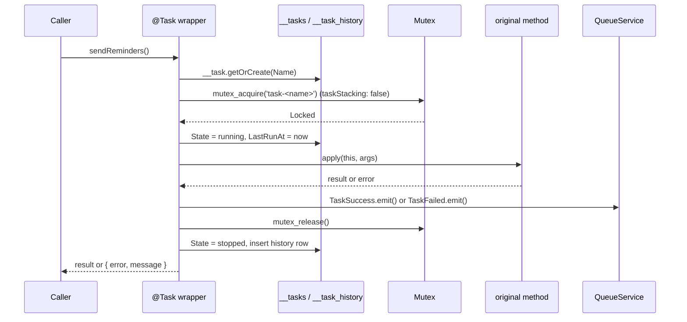

# Task decorator

`@Task(name, description, opts)` turns a method into a tracked task. Each call is logged, marked as running in the `__tasks` table, optionally guarded by a mutex, and reported as a `TaskSuccess` or `TaskFailed` event. Use it on methods that run periodically or on demand and that you want to see in the database and on the queue.

`@Task()` does **not** schedule the method. Call it from a timer, a queue job, a CLI command or an HTTP action.

## How it works

At class definition, `Task(taskName, description, opts)`:

1. Trims `taskName` and `description` with `_check_arg(_trim(), _non_empty())`. An empty value throws `InvalidArgument` while the class is being defined.
2. Replaces `descriptor.value` with an `async` wrapper around the original method.

On every call of the decorated method, the wrapper:

1. Resolves a logger with `DI.resolve('__log__', ['TASKS'])` and logs `Executing task ...` at `info`.
2. Calls `__task.getOrCreate(null, { Name, Description, State: 'stopped' })`. It finds the row by its unique `Name` column, or inserts it. An existing row keeps its stored `Description`.
3. When `opts.taskStacking` is `false`, calls `mutex_acquire({ Name: 'task-<name>' })` from `@spinajs/threading`. When the result has `Locked: false`, it logs a warning and returns `undefined` without running the method. See [Task locking](02-task-locking.md).
4. Sets `State = 'running'` and `LastRunAt = DateTime.now()` and saves the row with `task.update()`.
5. Calls the original method with the same `this` and arguments.
6. On success, emits `TaskSuccess` with `TaskName` and logs at `success`. See [Task events](03-task-events.md).
7. When the method or the `TaskSuccess` emit throws, logs at `error`, sets the result to `{ error: true, message: err.Message }` and emits `TaskFailed` with `TaskName` and `Reason: err.Message`.
8. In a `finally` block, it calls `mutex_release({ Name: 'task-' + name })`, then sets `State = 'stopped'` and inserts a `__task_history` row with `TaskId`, `Result` and `Duration` in milliseconds. Errors in this step are logged as `Cannot finalize task` and swallowed. **In the current source step 8 always fails;** see [Important behaviour](#important-behaviour).
9. Returns the method's result, or the `{ error, message }` object from step 7.

An error in steps 2 to 4 is logged as `Cannot start task` and rethrown to the caller. That covers a missing `default` connection, a missing `Mutex` registration, and calling a task decorated without `opts`.



## Decorators

| Decorator | Target | Options | Effect |
| --- | --- | --- | --- |
| `@Task(taskName, description, opts?)` | Method | `taskName: string` (stored in `__tasks.Name`, up to 64 characters, unique), `description: string` (stored in `__tasks.Description`, up to 128 characters), `opts: { taskStacking: boolean }` | Wraps the method as described above. The wrapper is `async`, so the method always returns a `Promise`. |

`opts` is typed as optional, but the wrapper reads `opts.taskStacking` on every call. Always pass it.

| Option | Type | Default | Meaning |
| --- | --- | --- | --- |
| `taskStacking` | `boolean` | none; `opts` must be passed | `false`: take the `task-<name>` mutex before the run and skip the run when it is held. `true`: no mutex; runs can overlap. |

The `TaskOptions` interface is not exported; pass an object literal.

`@Task()` replaces the method's descriptor. Decorators listed above it in the source wrap the `@Task()` wrapper; decorators listed below it are wrapped by it.

## Configuration

`@Task()` reads no config key. The package ships `config/tasks.js`, which `@spinajs/configuration` merges into the app config at startup:

| Key | Type | Default | Allowed values | Meaning |
| --- | --- | --- | --- | --- |
| `system.dirs.cli` | `string[]` | appends `node_modules/@spinajs/tasks/lib/<mjs\|cjs>/tasks`, resolved from `WORKSPACE_ROOT_PATH` or `process.cwd()` and from its parent | directory paths | CLI command directories. The package ships no `tasks` directory, so this entry adds no command. See [Command discovery](../cli/05-command-discovery.md). |
| `queue.routing.TaskFailed`, `queue.routing.TaskSuccess`, `queue.connections` | | `task-empty-queue` | | Where the task events go. See [Task events](03-task-events.md#configuration). |

The tables live on the `default` connection, which is `db.DefaultConnection`. See [Task tables and migration](04-task-tables-and-migration.md).

## Services and extension points

The wrapper resolves every service from the root container on each call, so a registration made at startup applies to every later run.

| Service | DI token and lifetime | Default implementation | Alternatives | How to replace or extend |
| --- | --- | --- | --- | --- |
| Lock backend | `Mutex` from `@spinajs/threading`, resolved by `mutex_acquire()` / `mutex_release()`; singleton | none registered | `OrmMutex` (`@spinajs/orm-threading`), your own `Mutex` | `DI.register(MyMutex).as(Mutex)` before the first task call. See [Task locking](02-task-locking.md). |
| Logger | `__log__` factory, resolved with the name `TASKS` on every call | the `@spinajs/log` logger | any logger registered as `__log__` | Route or silence it with a `logger.rules` entry for `TASKS`; replace the factory as in [Replacing the logger](../log/17-replacing-the-logger.md). |
| Event sink | `QueueService`, resolved by `TaskSuccess.emit()` / `TaskFailed.emit()` | `DefaultQueueService` | your `QueueService` | Route the events with `queue.routing`. See [Task events](03-task-events.md). |
| Task state | `__task`, `__task_history` models on `default` | shipped models | none | Read or extend the tables. See [Task tables and migration](04-task-tables-and-migration.md). |
| The task itself | the class that holds the decorated method; whatever lifetime you give it | none | any class | Put `@Task()` on a method of a DI service to use `@Autoinject` and `resolve()` / `dispose()` in it. See the example below. |

### Task host: a DI service that schedules its own tasks

`@Task()` works on any method, so the natural host is a DI service: it gets its dependencies injected, starts its timers in `resolve()`, and stops them in `dispose()`. Resolve it once at startup, after `Orm` and `QueueService`.

```ts sample
import { AsyncService, Autoinject, DI, Singleton } from '@spinajs/di';
import { Configuration } from '@spinajs/configuration';
import { Mutex } from '@spinajs/threading';
import { OrmMutex } from '@spinajs/orm-threading';
import { Task } from '@spinajs/tasks';

@Singleton()
export class ReportTasks extends AsyncService {
  @Autoinject()
  protected Config: Configuration;

  protected timers: NodeJS.Timeout[] = [];

  @Task('rebuild-sales-report', 'Rebuilds the daily sales report table', { taskStacking: false })
  public async rebuildSalesReport(): Promise<{ rows: number }> {
    const day = new Date().toISOString().slice(0, 10);
    // aggregate the orders of `day` into the report table here
    return { rows: day.length };
  }

  @Task('purge-temp-uploads', 'Deletes uploads older than one day', { taskStacking: true })
  public async purgeTempUploads(): Promise<{ deleted: number }> {
    return { deleted: 0 };
  }

  public async resolve(): Promise<void> {
    const everyMs = this.Config.get<number>('reports.rebuildEveryMs', 15 * 60 * 1000);

    this.timers.push(setInterval(() => void this.rebuildSalesReport(), everyMs));
    this.timers.push(setInterval(() => void this.purgeTempUploads(), 60 * 60 * 1000));

    await super.resolve();
  }

  public async dispose(): Promise<void> {
    this.timers.forEach((t) => clearInterval(t));
    this.timers = [];
  }
}

DI.register(OrmMutex).as(Mutex);

export async function startReportTasks(): Promise<ReportTasks> {
  return DI.resolve(ReportTasks);
}
```

## Important behaviour

The wrapper has several defects in the current source. They decide what you can rely on today:

- **The finalize step always fails.** `mutex_release()` is called with `` `task-${name}` ``, and `name` is not defined in the module. In Node.js this throws `ReferenceError: name is not defined`, which the wrapper logs as `Cannot finalize task`. As a result:
  - no `__task_history` row is ever written;
  - `__tasks.State` stays `'running'` after the first run;
  - the `task-<name>` mutex is never released.
- **Calling a task decorated without `opts` throws.** The wrapper reads `opts!.taskStacking`, so `@Task('a', 'b')` fails with a `TypeError` on every call, logged as `Cannot start task` and rethrown.
- **Error messages are lost.** The wrapper reads `err.Message`, but `Error` has `message`. The returned `{ error: true, message }` and the `TaskFailed.Reason` field are `undefined` for standard errors.

Other behaviour:

- **Errors of the method are not rethrown.** A failed run resolves with `{ error: true, message }`; it never rejects. Check the result if the caller must react.
- **A skipped run resolves with `undefined`.** When the mutex is held, nothing marks the call as skipped except the `warn` log line.
- **A failed `TaskSuccess` emit counts as a failed run.** It is inside the same `try` as the method, so the run is reported again as `TaskFailed`.
- **Errors from `TaskFailed.emit()` are swallowed.** The `return` in the `finally` block discards them.
- **The first run of a new task can race.** Two processes calling `getOrCreate` for a new `Name` at the same moment both insert; the second fails on the unique index and its call rejects.
- **`Description` is written once.** Changing the text in `@Task()` does not update an existing row.
- **Logs and events use the untrimmed name.** The database row and the mutex use the trimmed `taskName`; `TaskName` in the events and the `success` / `error` log fields use the string as passed.
- **The return value is stored as JSON.** `__task_history.Result` is a `@Json()` column, so return a JSON-serializable value.
- The exported constant `TASK_COMMAND` (`'task:command'`) is not used by the package.

## Best practices

- Always pass `opts`, with an explicit `taskStacking`.
- Keep `taskName` short, stable and unique across the app: it is the `__tasks` key and the mutex name.
- Return a small summary object (`{ sent: 12 }`), not the full data set: it is what the history stores.
- Catch errors you can handle inside the method and return them in the result; the wrapper turns every other error into `{ error: true }`.
- Call tasks through `void task()` or `.catch()` in timers: setup errors (no `Orm`, no `Mutex`) reject the call.

## Patterns and antipatterns

```ts
// Don't: no opts; every call throws "Cannot read properties of undefined (reading 'taskStacking')"
@Task('sync-exchange-rates', 'Downloads ECB exchange rates')
public async syncRates() {}

// Do
@Task('sync-exchange-rates', 'Downloads ECB exchange rates', { taskStacking: false })
public async syncRates() {}
```

```ts
// Don't: expects the task to reject on failure; the wrapper resolves with { error: true } instead
try {
  await tasks.syncRates();
} catch {
  alertOps();
}

// Do: inspect the result
const result = await tasks.syncRates();
if (result && result.error) {
  alertOps();
}
```

## Examples

### Run a task from a CLI command

A cron entry on one server calls `node app.js rates:sync`; the command runs the task once.

```ts sample
import { Autoinject } from '@spinajs/di';
import { CliCommand, Command } from '@spinajs/cli';
import { Task } from '@spinajs/tasks';

export class ExchangeRateTasks {
  @Task('sync-exchange-rates', 'Downloads ECB exchange rates', { taskStacking: true })
  public async syncRates(): Promise<{ currencies: number }> {
    // download and store the rates here
    return { currencies: 31 };
  }
}

@Command('rates:sync', 'Downloads the daily exchange rates')
export class SyncRatesCommand extends CliCommand {
  @Autoinject()
  protected Tasks: ExchangeRateTasks;

  public async execute(): Promise<void> {
    const result = await this.Tasks.syncRates();
    if (result && 'error' in result) {
      process.exitCode = 1;
    }
  }
}
```

### Quiet the task logger in production

`@Task()` logs every run at `info`. Keep only warnings and errors of the `TASKS` logger.

```js
// config/logger.js
module.exports = {
  logger: {
    rules: [
      { name: 'TASKS', level: 'warn', target: 'Console', final: true },
      { name: '*', level: 'info', target: 'Console' },
    ],
  },
};
```

## Related

- [Task locking](02-task-locking.md): what `taskStacking: false` does and which `Mutex` to register.
- [Task events](03-task-events.md): `TaskSuccess` and `TaskFailed`.
- [Task tables and migration](04-task-tables-and-migration.md): the rows step 2, 4 and 8 write.
- [Configuration and rules](../log/02-configuration-and-rules.md): routing the `TASKS` logger.
- [Commands](../cli/02-commands.md): running a task from the CLI.
