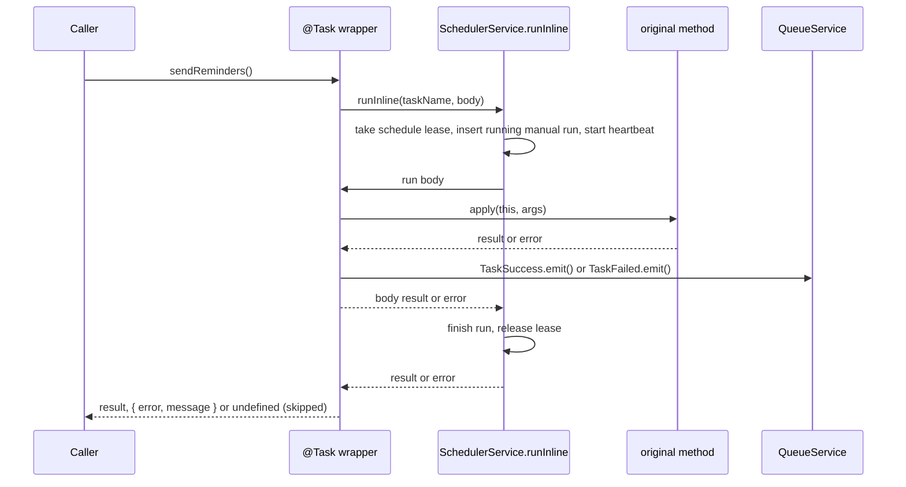

# Task decorator

`@Task(name, description, opts)` turns a method into a tracked task. Each call is a `manual` run of a `@spinajs/scheduler` schedule named after the task: it is recorded in `__scheduler_run`, guarded by the schedule lease, logged, and reported as a `TaskSuccess` or `TaskFailed` event. While `tasks.legacyHistory` is `true` (the 4.x default) it is also recorded in `__tasks` and `__task_history`. Use it on methods that run periodically or on demand and that you want to see in the database and on the queue.

> **Deprecated.** `@spinajs/tasks` is a shim over `@spinajs/scheduler` and is removed in 5.0. New code uses `@Schedule` classes, and `SchedulerService.runInline()` for work the app starts itself; see [Inline runs](../scheduler/README.md#inline-runs).

The decorator does not put the method on a timer. Call it yourself, or name the task in a `scheduler.schedules` entry (`task: '<name>'`) to give it a cron or an interval.

## How it works

At class definition, `Task(taskName, description, opts)`:

1. Trims `taskName` and `description` with `_check_arg(_trim(), _non_empty())`. An empty value throws `InvalidArgument` while the class is being defined.
2. Merges `opts` over `DEFAULT_TASK_OPTIONS` and records a `TaskDeclaration` (see [Task declarations](#task-declarations)).
3. Registers a schedule with `defineSchedule(adapter, taskName, { manual: true, overlap })`, where `overlap` is `'queue'` for `taskStacking: true` and `'skip'` otherwise. A second `@Task` with the same name reuses the first one's schedule.
4. Replaces `descriptor.value` with a wrapper that calls `runTask(declaration, this, args, { lock: true, rethrow: false })`.

On every call of the decorated method, `runTask()`:

1. Logs `Executing task ...` at `info` through the `TASKS` logger.
2. Resolves `SchedulerService` and calls `runInline(taskName, body, { triggeredBy: 'task:<name>' })`. That inserts a `__scheduler_run` row already claimed by this process (trigger `manual`), takes the schedule lease unless the schedule is `overlap: 'queue'`, and keeps the lease alive with the run heartbeat while the body runs. A call made while another run holds the lease of an `overlap: 'skip'` schedule is refused with `ScheduleOverlap`: the wrapper logs a warning and resolves with `undefined`.
3. In the body, with `tasks.legacyHistory` on: finds or inserts the `__tasks` row and sets `State = 'running'` and `LastRunAt`.
4. Calls the original method with the same `this` and arguments, inside the run context, so `currentRunContext()` returns the run.
5. Emits `TaskSuccess`, or `TaskFailed` with `Reason: message`. An emit that throws is logged and does not change the result.
6. With `tasks.legacyHistory` on: sets `State = 'stopped'` and inserts a `__task_history` row with `TaskId`, `Result` and `Duration`. Errors here are logged as `Cannot finalize task` and swallowed.
7. The run ends `succeeded` with the method's value as `Result`, or `failed` with the error. Inline runs are never retried automatically.
8. The wrapper resolves with the method's value, or with `{ error: true, message }` when it threw.



## Decorators

| Decorator | Target | Options | Effect |
| --- | --- | --- | --- |
| `@Task(taskName, description, opts?)` | Method, instance or static | `taskName: string` (stored in `__tasks.Name`, up to 64 characters, unique), `description: string` (stored in `__tasks.Description`, up to 128 characters), `opts: Partial<TaskOptions>` | Wraps the method as described above. The wrapper returns a `Promise`. |

`opts` is optional; missing options take their value from `DEFAULT_TASK_OPTIONS`.

| Option | Type | Default | Meaning |
| --- | --- | --- | --- |
| `taskStacking` | `boolean` | `false` | `false`: the schedule is `overlap: 'skip'`; a call while another run holds the schedule lease is skipped. `true`: `overlap: 'queue'`; inline calls run side by side. See [Task locking](02-task-locking.md). |
| `lockTtl` | `number` | `60000` | Deprecated and ignored. The schedule lease lives `scheduler.leaseTtl`. |

The options type is exported as `TaskOptions`, the defaults as `DEFAULT_TASK_OPTIONS`.

`@Task()` replaces the method's descriptor. Decorators listed above it in the source wrap the `@Task()` wrapper; decorators listed below it are wrapped by it.

### Task declarations

Every `@Task()` method is recorded as a `TaskDeclaration` when its class is defined: `name`, `description`, the merged `options`, the declaring class as `target` (the constructor itself for a static method), `isStatic`, `propertyKey` and the undecorated `method`. `getTaskDeclarations(name?)` returns the declarations of one task name, or all of them. Each declaration is also registered with the scheduler (`registerTaskMethod`), so a `scheduler.schedules` entry can name it in `task`.

`runTask(declaration, thisArg, args, { lock, rethrow })` runs a declaration with the same bookkeeping as the decorated method. `lock: false` runs the body without a scheduler run, for a caller that already is inside one (the scheduler executing the task's schedule does this). `rethrow: true` rejects with the method's error (or `ScheduleOverlap`) after the history row is written, instead of resolving with `{ error: true, message }` or `undefined`.

## Configuration

The package ships `config/tasks.js`, which `@spinajs/configuration` merges into the app config at startup:

| Key | Type | Default | Allowed values | Meaning |
| --- | --- | --- | --- | --- |
| `tasks.legacyHistory` | `boolean` | `true` | `true`, `false` | `true`: also write `__tasks` and `__task_history`. `false`: the run history is `__scheduler_run` only. 5.0 removes the tables and the key. |
| `queue.routing.TaskFailed`, `queue.routing.TaskSuccess`, `queue.connections` | | `task-empty-queue` | | Where the task events go. See [Task events](03-task-events.md#configuration). |

The scheduler's own settings (`scheduler.leaseTtl`, `scheduler.schedules`) apply to task runs as to any schedule. The tables live on the `default` connection, which is `db.DefaultConnection`. See [Task tables and migration](04-task-tables-and-migration.md).

## Services and extension points

The wrapper resolves every service from the root container on each call, so a registration made at startup applies to every later run.

| Service | DI token and lifetime | Default implementation | Alternatives | How to replace or extend |
| --- | --- | --- | --- | --- |
| Run host | `SchedulerService` from `@spinajs/scheduler`; singleton | `DefaultSchedulerService` | none | Its `runInline()` executes every call. See [Task locking](02-task-locking.md). |
| Logger | `__log__` factory, resolved with the name `TASKS` on every call | the `@spinajs/log` logger | any logger registered as `__log__` | Route or silence it with a `logger.rules` entry for `TASKS`; replace the factory as in [Replacing the logger](../log/17-replacing-the-logger.md). |
| Event sink | `QueueService`, resolved by `TaskSuccess.emit()` / `TaskFailed.emit()` | `DefaultQueueService` | your `QueueService` | Route the events with `queue.routing`. See [Task events](03-task-events.md). |
| Task state | `__task`, `__task_history` models on `default` | shipped models | none | Read or extend the tables. See [Task tables and migration](04-task-tables-and-migration.md). |
| The task itself | the class that holds the decorated method; whatever lifetime you give it | none | any class | Put `@Task()` on a method of a DI service to use `@Autoinject` and `resolve()` / `dispose()` in it. See the example below. |

### Task host: a DI service that schedules its own tasks

`@Task()` works on any method, so the natural host is a DI service: it gets its dependencies injected, starts its timers in `resolve()`, and stops them in `dispose()`. Resolve it once at startup, after `Orm` and `QueueService`.

```ts sample
import { AsyncService, Autoinject, DI, Singleton } from '@spinajs/di';
import { Configuration } from '@spinajs/configuration';
import { Task } from '@spinajs/tasks';

@Singleton()
export class ReportTasks extends AsyncService {
  @Autoinject()
  protected Config: Configuration;

  protected timers: NodeJS.Timeout[] = [];

  @Task('rebuild-sales-report', 'Rebuilds the daily sales report table', { taskStacking: false })
  public async rebuildSalesReport(): Promise<{ rows: number }> {
    const day = new Date().toISOString().slice(0, 10);
    // aggregate the orders of `day` into the report table here
    return { rows: day.length };
  }

  @Task('purge-temp-uploads', 'Deletes uploads older than one day', { taskStacking: true })
  public async purgeTempUploads(): Promise<{ deleted: number }> {
    return { deleted: 0 };
  }

  public async resolve(): Promise<void> {
    const everyMs = this.Config.get<number>('reports.rebuildEveryMs', 15 * 60 * 1000);

    this.timers.push(setInterval(() => void this.rebuildSalesReport(), everyMs));
    this.timers.push(setInterval(() => void this.purgeTempUploads(), 60 * 60 * 1000));

    await super.resolve();
  }

  public async dispose(): Promise<void> {
    this.timers.forEach((t) => clearInterval(t));
    this.timers = [];
  }
}

export async function startReportTasks(): Promise<ReportTasks> {
  return DI.resolve(ReportTasks);
}
```

## Important behaviour

- **Errors of the method are not rethrown.** A failed run resolves with `{ error: true, message }`. Check the result if the caller must react.
- **A run that cannot start rejects.** When the scheduler cannot write the run (no scheduler tables, a database outage), the call logs `Cannot start task` and rejects, as a 3.x start failure did. An error carrying `crash: true` is rethrown with nothing emitted or recorded.
- **A call costs more statements than in 3.x.** With `tasks.legacyHistory` on, a call issues about 15 SQL statements (lease, run row, attempt, journal, finish, release, plus the legacy rows) where 3.x issued about 5.
- **A skipped run resolves with `undefined`.** When another run holds the lease of a non-stacking task, nothing marks the call as skipped except the `warn` log line; no run row is written.
- **A failed event emit does not change the run.** When `TaskSuccess.emit()` or `TaskFailed.emit()` throws (a queue outage), the error is logged and the call resolves with the run's result as usual: a run whose side effects already happened must not look like a failure a caller would retry.
- **A run killed mid-way is reaped by the scheduler.** When the process dies during the method, the run's lease expires `scheduler.leaseTtl` after the last heartbeat and a scheduler loop ends the run. The legacy `__tasks.State` stays `'running'` and no history row is written; see [Task locking](02-task-locking.md#important-behaviour).
- **`Description` is written once.** Changing the text in `@Task()` does not update an existing row.
- **The name is trimmed everywhere.** The schedule name, the database row, the event `TaskName` and the log fields all use the trimmed `taskName`.
- **The return value is stored as JSON.** `__task_history.Result` is a `@Json()` column, so return a JSON-serializable value.
- The exported constant `TASK_COMMAND` (`'task:command'`) is not used by the package.

## Best practices

- Pass `opts` with an explicit `taskStacking`, so the locking choice is visible at the decorator.
- Keep `taskName` short, stable and unique across the app: it is the schedule name and the `__tasks` key.
- Return a small summary object (`{ sent: 12 }`), not the full data set: it is what the history stores.
- Catch errors you can handle inside the method and return them in the result; the wrapper turns every other error into `{ error: true }`.
- Call tasks through `void task()` or `.catch()` in timers: setup errors (no `Orm`, no scheduler tables) reject the call.

## Patterns and antipatterns

```ts
// Don't: expects the task to reject on failure; the wrapper resolves with { error: true } instead
try {
  await tasks.syncRates();
} catch {
  alertOps();
}

// Do: inspect the result
const result = await tasks.syncRates();
if (result && result.error) {
  alertOps();
}
```

## Examples

### Run a task from a CLI command

A cron entry on one server calls `node app.js rates:sync`; the command runs the task once.

```ts sample
import { Autoinject } from '@spinajs/di';
import { CliCommand, Command } from '@spinajs/cli';
import { Task } from '@spinajs/tasks';

export class ExchangeRateTasks {
  @Task('sync-exchange-rates', 'Downloads ECB exchange rates', { taskStacking: true })
  public async syncRates(): Promise<{ currencies: number }> {
    // download and store the rates here
    return { currencies: 31 };
  }
}

@Command('rates:sync', 'Downloads the daily exchange rates')
export class SyncRatesCommand extends CliCommand {
  @Autoinject()
  protected Tasks: ExchangeRateTasks;

  public async execute(): Promise<void> {
    const result = await this.Tasks.syncRates();
    if (result && 'error' in result) {
      process.exitCode = 1;
    }
  }
}
```

### Quiet the task logger in production

`@Task()` logs every run at `info`. Keep only warnings and errors of the `TASKS` logger.

```js
// config/logger.js
module.exports = {
  logger: {
    rules: [
      { name: 'TASKS', level: 'warn', target: 'Console', final: true },
      { name: '*', level: 'info', target: 'Console' },
    ],
  },
};
```

## Related

- [Task locking](02-task-locking.md): how `taskStacking` maps to the schedule's `overlap` and lease.
- [Task events](03-task-events.md): `TaskSuccess` and `TaskFailed`.
- [Task tables and migration](04-task-tables-and-migration.md): the rows step 2, 4 and 8 write.
- [Configuration and rules](../log/02-configuration-and-rules.md): routing the `TASKS` logger.
- [Commands](../cli/02-commands.md): running a task from the CLI.
