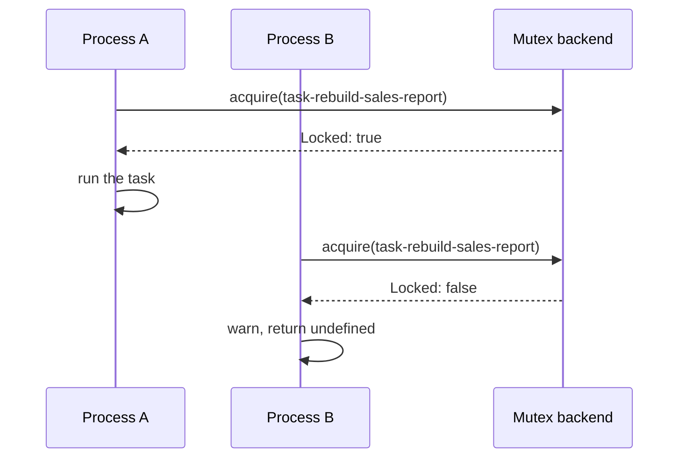

# Task locking

With `taskStacking: false`, `@Task()` takes a named mutex before each run and skips the run when the mutex is held. The lock goes through the `Mutex` DI service from `@spinajs/threading`, so the backend, and with it how strict the guard is, is yours to choose.

The package registers no `Mutex`. Register one before the first task with `taskStacking: false` runs.

## How it works

1. The `@Task()` wrapper reads `opts.taskStacking`. With `true` it skips locking and goes on to the run.
2. With `false` it calls `mutex_acquire({ Name: 'task-<taskName>' })`. It passes **no** `Tenant`, so the backend picks the owner; `OrmMutex` uses `app.name`.
3. `mutex_acquire()` calls `DI.resolve(Mutex).acquire(options)` on the root container.
4. `Locked: false`: the wrapper logs `Cannot acquire mutex for task ..., already locked !` at `warn` and returns `undefined`. The `__tasks` row is not touched.
5. `Locked: true`: the run goes ahead (see [Task decorator](01-task-decorator.md#how-it-works)).
6. After the run, the wrapper calls `mutex_release()`. In the current source that call throws before it reaches the `Mutex`, so **the lock is never released** (see [Important behaviour](#important-behaviour)).



## Configuration

`@Task()` has one locking option, `taskStacking`, on the decorator (see [Task decorator](01-task-decorator.md#decorators)). The backend reads its own keys; for `OrmMutex` these are `app.name` (the default tenant) and `threading.mutex.checkInterval`, see [Database mutex](../orm-threading/01-database-mutex.md#configuration).

## Services and extension points

| Service | DI token and lifetime | Default implementation | Alternatives | How to replace or extend |
| --- | --- | --- | --- | --- |
| `Mutex` | `Mutex` abstract class from `@spinajs/threading`; singleton by default; resolved by type through `mutex_acquire()` / `mutex_release()` on every task call | none: unregistered, the call fails with `TypeError: ... acquire is not a function`, logged as `Cannot start task` and rethrown | `OrmMutex` and its subclasses (`@spinajs/orm-threading`); an in-memory or lease-based `Mutex` (below) | `DI.register(MyMutex).as(Mutex)` in startup code, before the first task call. The last registration wins. Extend by subclassing `OrmMutex` and overriding `acquire()`; see [Custom mutex backends](../orm-threading/02-custom-mutex-backends.md). |

### What each backend guards against today

The lock is never released (see below), and the wrapper never passes a tenant. That decides what each backend does for tasks:

| Backend | Same process, overlapping calls | Two processes of one app | Second run of the task later |
| --- | --- | --- | --- |
| `OrmMutex` | both run: the same tenant (`app.name`) re-acquires | both run, same tenant | runs |
| `OrmMutex` subclass with a per-process tenant | both run | the first process to run the task keeps the lock forever; the others are always skipped | runs only in that first process |
| Any non-reentrant mutex without expiry | second is skipped | second is skipped | **never runs again** |
| A lease mutex (lock expires after a TTL) | second is skipped while the lease lasts | second is skipped while the lease lasts | runs once the lease has expired |

A lease is the only backend that gives a useful guard while the release step is broken, and it keeps working once release is fixed.

### `Mutex`: a lease for task locks, stored in the database

Extend `OrmMutex` and change `acquire()` for task locks only (names starting with `task-`). The lock is taken when it is free **or** when its `Updated_at` is older than the lease, in one `UPDATE`, so two processes cannot both win. Other `mutex_*` callers keep the stock behaviour.

Pick a lease longer than the slowest run of any task, and shorter than the interval between runs.

```ts sample
import { DI } from '@spinajs/di';
import { DateTime } from 'luxon';
import { Config } from '@spinajs/configuration';
import { ModelBase } from '@spinajs/orm';
import { LockResult, Mutex, MutexLockOptions } from '@spinajs/threading';
import { OrmMutex, __mutex__ } from '@spinajs/orm-threading';
import { Task } from '@spinajs/tasks';

// __mutex__ declares a required constructor argument, which the static model API rejects under strictNullChecks.
const MutexTable = __mutex__ as unknown as typeof ModelBase & (new (data?: Partial<__mutex__>) => __mutex__);

export class TaskLeaseMutex extends OrmMutex {
  @Config('tasks.lockLeaseMs', { defaultValue: 10 * 60 * 1000 })
  protected LeaseMs: number;

  public async acquire(options: MutexLockOptions): Promise<LockResult> {
    if (!options.Name.startsWith('task-')) {
      return super.acquire(options);
    }

    const name = options.Name.trim();
    const tenant = options.Tenant?.trim() || this.AppName;
    const now = DateTime.now();
    const expired = now.minus({ milliseconds: this.LeaseMs });

    await this.create({ Name: name, Tenant: tenant });

    const taken = await MutexTable.update({ Locked: true, Tenant: tenant, Updated_at: now })
      .where({ Name: name })
      .where(function () {
        this.where('Locked', false);
        this.orWhere('Updated_at', '<', expired);
      });

    return { Locked: taken.RowsAffected === 1, Mutex: await MutexTable.get(name) };
  }
}

DI.register(TaskLeaseMutex).as(Mutex);

export class SearchTasks {
  @Task('reindex-products', 'Rebuilds the product search index', { taskStacking: false })
  public async reindexProducts(): Promise<{ indexed: number }> {
    return { indexed: 0 };
  }
}
```

The `__mutex__` table and its migration come from `@spinajs/orm-threading`; see [Mutex table and migration](../orm-threading/03-mutex-table-and-migration.md).

### `Mutex`: an in-memory lease for one process

A single-process app, or a test, needs no table. This backend implements the whole `Mutex` contract in a `Map` and uses the same lease rule.

```ts sample
import { DI } from '@spinajs/di';
import { DateTime } from 'luxon';
import { LockResult, Mutex, MutexLock, MutexLockOptions } from '@spinajs/threading';
import { Task } from '@spinajs/tasks';

export class InMemoryLeaseMutex extends Mutex {
  protected locks = new Map<string, MutexLock>();

  constructor(protected leaseMs = 5 * 60 * 1000) {
    super();
  }

  public async acquire(options: MutexLockOptions): Promise<LockResult> {
    const lock = await this.create(options);
    const tenant = options.Tenant ?? 'local';
    const expired = DateTime.now().diff(lock.Updated_at).as('milliseconds') > this.leaseMs;

    if (lock.Locked && !expired) {
      return { Locked: false, Mutex: lock };
    }

    const taken: MutexLock = { ...lock, Locked: true, Tenant: tenant, Updated_at: DateTime.now() };
    this.locks.set(options.Name, taken);
    return { Locked: true, Mutex: taken };
  }

  public async release(options: MutexLockOptions, deleteOnClose?: boolean): Promise<boolean> {
    const lock = this.locks.get(options.Name);
    if (!lock || lock.Tenant !== (options.Tenant ?? 'local')) {
      return false;
    }

    if (deleteOnClose) {
      this.locks.delete(options.Name);
    } else {
      this.locks.set(options.Name, { ...lock, Locked: false, Updated_at: DateTime.now() });
    }
    return true;
  }

  public async create(options: MutexLockOptions): Promise<MutexLock> {
    const existing = this.locks.get(options.Name);
    if (existing) {
      return existing;
    }

    const now = DateTime.now();
    const lock: MutexLock = { Name: options.Name, Tenant: options.Tenant ?? 'local', Locked: false, Created_at: now, Updated_at: now };
    this.locks.set(options.Name, lock);
    return lock;
  }

  public async delete(options: MutexLockOptions): Promise<boolean> {
    return this.locks.delete(options.Name);
  }

  public async get(name: string): Promise<MutexLock | null> {
    return this.locks.get(name) ?? null;
  }

  public async wait(name: string, timeout = 0): Promise<boolean> {
    const start = Date.now();
    while ((await this.get(name))?.Locked) {
      if (timeout !== 0 && Date.now() - start >= timeout) {
        return false;
      }
      await new Promise((resolve) => setTimeout(resolve, 100));
    }
    return true;
  }
}

DI.register(InMemoryLeaseMutex).as(Mutex);

export class CacheTasks {
  @Task('warm-price-cache', 'Loads current prices into the cache', { taskStacking: false })
  public async warmPriceCache(): Promise<{ prices: number }> {
    return { prices: 0 };
  }
}
```

`DI` builds the class with no arguments, so the lease is the constructor default. To configure it, read it with `@Config` as in the database example.

## Important behaviour

- **The lock is never released.** The wrapper calls `mutex_release()` with an undefined variable, which throws `ReferenceError` before the call; see [Task decorator](01-task-decorator.md#important-behaviour). Choose a backend from the table above with this in mind.
- **No tenant is passed.** Each backend falls back to its own default owner; for `OrmMutex` that is `app.name`, shared by every process of the app.
- **A skipped run is silent to the caller.** It resolves with `undefined`; only the `warn` log line records it. No `TaskFailed` event is sent and no history row is written.
- **`taskStacking: true` still calls `mutex_release()`.** It fails the same way, but resolves no `Mutex`, so no backend is needed for stacking tasks.
- **The lock name is `task-` plus the trimmed task name.** `OrmMutex` stores names in a `VARCHAR(32)` column, so keep task names under 27 characters with that backend.
- **Missing backend fails at call time.** Nothing checks for a `Mutex` at startup; the first task call with `taskStacking: false` rejects.

## Best practices

- Register the backend in the same startup code that resolves `Orm`, before any service that schedules tasks is resolved.
- Use a lease-based backend for tasks; keep `OrmMutex` or `AtomicOrmMutex` for code that calls `mutex_acquire()` and `mutex_release()` itself.
- Limit a custom backend's special behaviour to names starting with `task-`, as `TaskLeaseMutex` does, so other lock users keep their semantics.
- Use `taskStacking: true` for tasks that are safe to overlap: it removes the database round trip and the dependency on a `Mutex`.

## Patterns and antipatterns

```ts
// Don't: a non-reentrant mutex without expiry; the task runs once and is skipped forever after
DI.register(AtomicNonReentrantMutex).as(Mutex);

// Do: a lease, so a lock left behind expires
DI.register(TaskLeaseMutex).as(Mutex);
```

```ts
// Don't: expect taskStacking: false to stop overlapping runs with the stock OrmMutex; every caller is the same tenant
DI.register(OrmMutex).as(Mutex);

// Do: guard the critical part yourself, with your own tenant, and release it
const lock = { Name: 'payout-run', Tenant: `payouts-${process.pid}` };
if ((await mutex_acquire(lock)).Locked) {
  try {
    await runPayouts();
  } finally {
    await mutex_release(lock);
  }
}
```

## Related

- [Task decorator](01-task-decorator.md): where the lock sits in a run.
- [Custom mutex backends](../orm-threading/02-custom-mutex-backends.md): the `Mutex` contract, `AtomicOrmMutex` and `ProcessTenantMutex`.
- [Database mutex](../orm-threading/01-database-mutex.md): how `OrmMutex` acquires, releases and picks a tenant.
- [Registering services](../di/01-registering-services.md): `DI.register(...).as(...)` and which registration wins.
