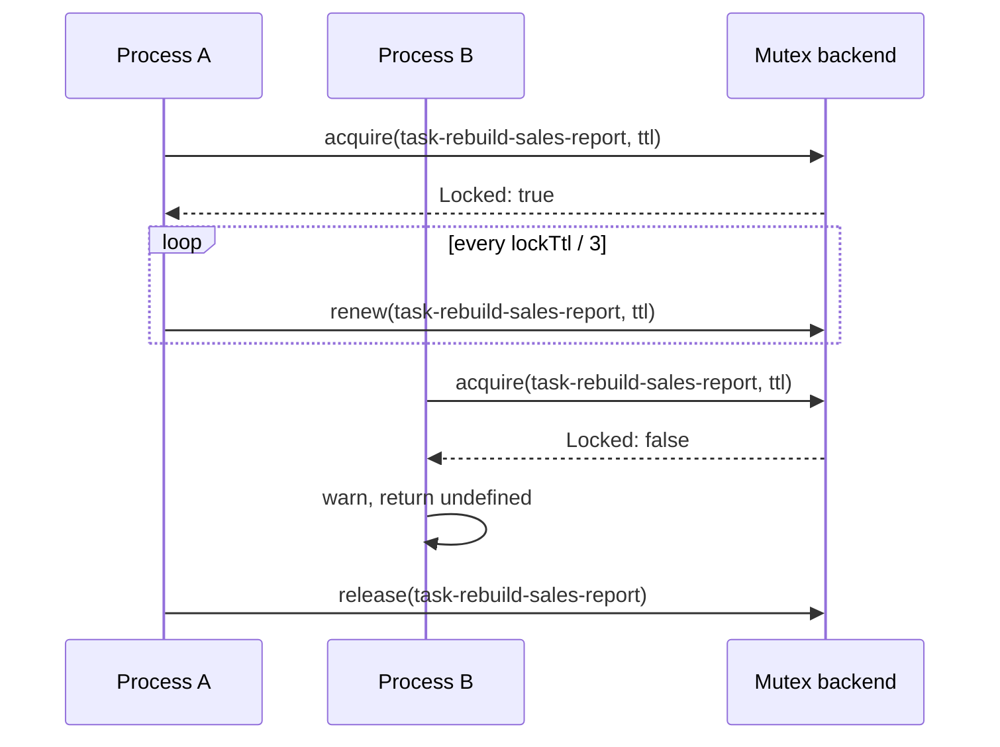

# Task locking

With `taskStacking: false`, the default, `@Task()` lets one run of a task happen at a time across every process that shares the lock backend. It takes a named mutex before each run, keeps it alive with a heartbeat while the run lasts, and skips the run when the mutex is held. The lock goes through the `Mutex` DI service from `@spinajs/threading`, so the backend is yours to choose.

The package registers no `Mutex`. Register one before the first task without `taskStacking: true` runs.

## How it works

1. The `@Task()` wrapper reads `taskStacking`. With `true` it skips every step below and goes on to the run.
2. When a run of the same task is already in progress in this process, it logs `Task ... is already running in this process` at `warn` and returns `undefined`. The mutex cannot tell these runs apart, because they share the process's default tenant, so the wrapper keeps an in-process set of running task names.
3. It calls `mutex_acquire({ Name: 'task-<taskName>', ttl: lockTtl })` without a `Tenant`, so the backend's default owner applies: with `OrmMutex`, the identity of this process (`processIdentity()`).
4. `Locked: false`: another process holds the lock. The wrapper logs `Cannot acquire mutex for task ..., already locked !` at `warn` and returns `undefined`. The `__tasks` row is not touched.
5. `Locked: true`: when `lockTtl` is above `0`, the wrapper starts a heartbeat that calls `mutex_renew({ Name, ttl: lockTtl })` every `lockTtl / 3` ms. A renew that returns `false` is logged at `warn` (`Task ... lost its mutex, another process may run it now`); the run goes on.
6. The run goes ahead (see [Task decorator](01-task-decorator.md#how-it-works)).
7. After the run, whether it succeeded or failed, the wrapper stops the heartbeat, removes the task from the in-process set and calls `mutex_release({ Name })`. Then it updates the `__tasks` row and writes the history row.



## Configuration

`@Task()` has two locking options on the decorator:

| Option | Type | Default | Meaning |
| --- | --- | --- | --- |
| `taskStacking` | `boolean` | `false` | `true`: no mutex and no in-process guard; runs can overlap. |
| `lockTtl` | `number` | `60000` | Lifetime of the task mutex in ms, renewed every `lockTtl / 3` while the task runs, so a crashed process frees the task after at most `lockTtl`. `0`: the lock never expires and no heartbeat runs. |

The defaults are exported as `DEFAULT_TASK_OPTIONS`. The backend reads its own keys; for `OrmMutex` these are `threading.mutex.tenant` (the default owner of task locks), `threading.mutex.ttl` (not used for task locks, because the wrapper always passes `lockTtl`) and `threading.mutex.checkInterval`, see [Database mutex](../orm-threading/01-database-mutex.md#configuration).

## Services and extension points

| Service | DI token and lifetime | Default implementation | Alternatives | How to replace or extend |
| --- | --- | --- | --- | --- |
| `Mutex` | `Mutex` abstract class from `@spinajs/threading`; singleton by default; resolved by type through `mutex_acquire()`, `mutex_renew()` and `mutex_release()` on every task call | none: unregistered, the call fails with `TypeError: ... acquire is not a function`, logged as `Cannot start task` and rethrown | `OrmMutex` and its subclasses (`@spinajs/orm-threading`); an in-memory `Mutex` (below) | `DI.register(MyMutex).as(Mutex)` in startup code, before the first task call. The last registration wins. See [Custom mutex backends](../orm-threading/02-custom-mutex-backends.md). |

### What each backend guards against

| Backend | Overlapping runs | Lock left by a process that died mid-run |
| --- | --- | --- |
| `OrmMutex` | the later run is skipped, in this process by the in-process guard and in other processes by the atomic `acquire()` | taken over once `lockTtl` has passed since the last heartbeat; with `lockTtl: 0` it stays held until the `__mutex__` row is unlocked by hand |
| A backend without expiry (such as the in-memory one below) | the later run is skipped | stays held until the process that holds it releases it |

### `Mutex`: in memory, for one process

A single-process app, or a test, needs no table. This backend implements the whole `Mutex` contract in a `Map`, with the same expiry rule as `OrmMutex`: a lock whose `LockedUntil` has passed may be taken by another tenant.

```ts sample
import { DI } from '@spinajs/di';
import { DateTime } from 'luxon';
import { LockResult, Mutex, MutexLock, MutexLockOptions, processIdentity } from '@spinajs/threading';
import { Task } from '@spinajs/tasks';

export class InMemoryMutex extends Mutex {
  protected locks = new Map<string, MutexLock>();

  protected tenantOf(options: MutexLockOptions): string {
    return options.Tenant?.trim() || processIdentity();
  }

  protected until(options: MutexLockOptions): number | null {
    return options.ttl ? Date.now() + options.ttl : null;
  }

  protected isHeld(lock: MutexLock): boolean {
    return lock.Locked && (lock.LockedUntil === null || lock.LockedUntil === undefined || lock.LockedUntil >= Date.now());
  }

  public async acquire(options: MutexLockOptions): Promise<LockResult> {
    const lock = await this.create(options);
    const tenant = this.tenantOf(options);

    if (this.isHeld(lock) && lock.Tenant !== tenant) {
      return { Locked: false, Mutex: { ...lock } };
    }

    const taken: MutexLock = { ...lock, Locked: true, Tenant: tenant, LockedUntil: this.until(options), Updated_at: DateTime.now() };
    this.locks.set(options.Name, taken);
    return { Locked: true, Mutex: { ...taken } };
  }

  public async renew(options: MutexLockOptions): Promise<boolean> {
    const lock = this.locks.get(options.Name);
    if (!lock || !lock.Locked || lock.Tenant !== this.tenantOf(options)) {
      return false;
    }

    lock.LockedUntil = this.until(options);
    return true;
  }

  public async release(options: MutexLockOptions, deleteOnClose?: boolean): Promise<boolean> {
    const lock = this.locks.get(options.Name);
    if (!lock || lock.Tenant !== this.tenantOf(options)) {
      return false;
    }

    if (deleteOnClose) {
      this.locks.delete(options.Name);
    } else {
      this.locks.set(options.Name, { ...lock, Locked: false, LockedUntil: null, Updated_at: DateTime.now() });
    }
    return true;
  }

  public async create(options: MutexLockOptions): Promise<MutexLock> {
    const existing = this.locks.get(options.Name);
    if (existing) {
      return existing;
    }

    const now = DateTime.now();
    const lock: MutexLock = { Name: options.Name, Tenant: this.tenantOf(options), Locked: false, LockedUntil: null, Created_at: now, Updated_at: now };
    this.locks.set(options.Name, lock);
    return lock;
  }

  public async delete(options: MutexLockOptions): Promise<boolean> {
    const lock = this.locks.get(options.Name);
    if (!lock || this.isHeld(lock) || lock.Tenant !== this.tenantOf(options)) {
      return false;
    }
    return this.locks.delete(options.Name);
  }

  public async get(name: string): Promise<MutexLock | null> {
    const lock = this.locks.get(name);
    return lock ? { ...lock } : null;
  }

  public async wait(name: string, timeout = 0): Promise<boolean> {
    const start = Date.now();
    for (let lock = this.locks.get(name); lock && this.isHeld(lock); lock = this.locks.get(name)) {
      if (timeout !== 0 && Date.now() - start >= timeout) {
        return false;
      }
      await new Promise((resolve) => setTimeout(resolve, 100));
    }
    return true;
  }
}

DI.register(InMemoryMutex).as(Mutex);

export class CacheTasks {
  @Task('warm-price-cache', 'Loads current prices into the cache', { lockTtl: 30_000 })
  public async warmPriceCache(): Promise<{ prices: number }> {
    return { prices: 0 };
  }
}
```

## Important behaviour

- **The owner of a task lock is the process.** The wrapper passes no `Tenant`, so with `OrmMutex` the lock belongs to `processIdentity()`, unless `threading.mutex.tenant` sets one value for every process. A fixed value shared by replicas makes them one owner, and their runs overlap.
- **Runs inside one process are excluded by the wrapper, not by the mutex.** The in-process guard is a module-level set, so it covers every `@Task()` method of that name in the process.
- **A lock left by a dead process expires.** After `lockTtl` without a heartbeat, another process may take it. With `lockTtl: 0` it stays held; unlock the `task-<name>` row by hand.
- **A run longer than `lockTtl` keeps its lock** as long as the heartbeat reaches the backend. When a renew fails, or the event loop is blocked for longer than `lockTtl`, another process may start the task while this run is still going.
- **A skipped run is silent to the caller.** It resolves with `undefined`; only the `warn` log line records it. No `TaskFailed` event is sent and no history row is written.
- **`taskStacking: true` never touches the `Mutex`.** No backend is needed for stacking tasks.
- **The lock name is `task-` plus the trimmed task name.** `OrmMutex` stores names in a `VARCHAR(32)` column, so keep task names under 27 characters with that backend.
- **Missing backend fails at call time.** Nothing checks for a `Mutex` at startup; the first task call without `taskStacking: true` rejects.

## Best practices

- Register the backend in the same startup code that resolves `Orm`, before any service that schedules tasks is resolved.
- Pick a `lockTtl` well above the longest pause of the event loop and well below the interval between runs, so a crashed process loses at most one run.
- Leave `threading.mutex.tenant` empty in apps that run tasks on several replicas.
- Use `taskStacking: true` for tasks that are safe to overlap: it removes the database round trips and the dependency on a `Mutex`.

## Patterns and antipatterns

```ts
// Don't: lockTtl: 0 on a task that runs on several replicas; a run killed mid-way leaves the task skipped forever after
@Task('sync-stock', 'Pulls stock levels', { lockTtl: 0 })

// Do: keep the default, or a ttl that fits the task, so a lock left behind expires
@Task('sync-stock', 'Pulls stock levels', { lockTtl: 5 * 60 * 1000 })
```

## Related

- [Task decorator](01-task-decorator.md): where the lock sits in a run.
- [Custom mutex backends](../orm-threading/02-custom-mutex-backends.md): the `Mutex` contract and `OrmMutex` subclasses.
- [Database mutex](../orm-threading/01-database-mutex.md): how `OrmMutex` acquires, renews, releases and picks a tenant.
- [Named mutex](../threading/01-named-mutex.md): `processIdentity()` and the `mutex_*` helpers.
- [Registering services](../di/01-registering-services.md): `DI.register(...).as(...)` and which registration wins.
