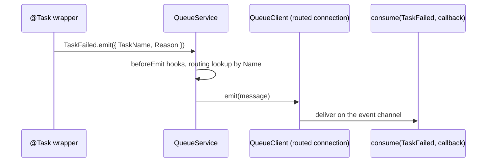

# Task events

Every finished run of a `@Task()` method emits a queue event: `TaskSuccess` when the method resolved, `TaskFailed` when it threw. Route them to a real transport to alert on failures or feed a dashboard. With the shipped config both go to a black hole and nobody receives them.

## How it works

1. After the method resolves, the `@Task()` wrapper calls `TaskSuccess.emit({ TaskName })`.
2. When the method or that emit throws, it calls `TaskFailed.emit({ TaskName, Reason })`.
3. `QueueEvent.emit()` builds the message with `Type: 'EVENT'`, `CreatedAt: now` and `Name` set to the class name (`'TaskSuccess'` or `'TaskFailed'`), and passes it to `QueueService.emit()`.
4. `DefaultQueueService` runs every `QueueMessageHook.beforeEmit()`, then looks up `queue.routing.<Name>` to pick the connection, and sends the message there.
5. The connection's `QueueClient` picks the channel: `queue.routing.<Name>.channel`, or the connection's `defaultTopicChannel`.
6. A consumer that calls `QueueService.consume(TaskFailed, callback)` receives it.

A run skipped because the mutex is held emits **no** event.



## Events

Both classes are `@Event()` subclasses of `QueueEvent`, exported from `@spinajs/tasks`; see [Alert on failed tasks](#alert-on-failed-tasks).

| Event | Fields | Emitted when |
| --- | --- | --- |
| `TaskSuccess` | `TaskName: string` | the method resolved and the run is reported as successful |
| `TaskFailed` | `TaskName: string`, `Reason: string` | the method threw, or `TaskSuccess.emit()` threw |

Every message also carries the standard fields `Name`, `Type` and `CreatedAt`; see [Events and jobs](../queue/01-events-and-jobs.md#message-fields).

`TaskName` is the trimmed name passed to `@Task()`, the same as `__tasks.Name`. `Reason` is the thrown error's `message`.

## Configuration

The package's `config/tasks.js` ships these keys; `@spinajs/configuration` merges your app config over them.

| Key | Type | Default | Allowed values | Meaning |
| --- | --- | --- | --- | --- |
| `queue.routing.TaskFailed` | routing option | `{ connection: 'task-empty-queue' }` | a channel string, `{ connection?, channel?, deadLetterChannel? }`, or an array of them | Connection and channel for `TaskFailed`. |
| `queue.routing.TaskSuccess` | routing option | `{ connection: 'task-empty-queue' }` | same | Connection and channel for `TaskSuccess`. |
| `queue.connections[]` (`task-empty-queue`) | connection | `{ name: 'task-empty-queue', service: 'BlackHoleQueueClient', defaultQueueChannel: 'task-jobs', defaultTopicChannel: 'task-events' }` | any connection definition | The sink both events go to by default. `BlackHoleQueueClient` drops every message. |

Arrays in config files are concatenated, not replaced: your `queue.connections` entries are added next to `task-empty-queue`, which stays. Objects are merged, so setting `connection` in your `queue.routing.TaskFailed` replaces the shipped one.

```js
// config/queue.js in your app: send task failures to RabbitMQ, keep successes in the black hole
module.exports = {
  queue: {
    connections: [
      {
        name: 'ops-rabbit',
        service: 'AmqpQueueClient',
        host: 'rabbit.internal',
        defaultQueueChannel: 'ops-jobs',
        defaultTopicChannel: 'ops-events',
      },
    ],
    routing: {
      TaskFailed: { connection: 'ops-rabbit', channel: 'ops.tasks.failed' },
    },
  },
};
```

Connection options other than `name`, `service` and the channel defaults depend on the transport; see [Transports](../queue/04-transports.md) and the transport's own docs.

## Services and extension points

| Service | DI token and lifetime | Default implementation | Alternatives | How to replace or extend |
| --- | --- | --- | --- | --- |
| Queue service | `QueueService`; singleton, resolved by `ev()` on every emit | `DefaultQueueService` | your `QueueService` | See [Queue service](../queue/09-queue-service.md). |
| Transport | `QueueClient`, one instance per `queue.connections` entry, chosen by `service` | `BlackHoleQueueClient` for `task-empty-queue` | `AmqpQueueClient`, `SqsQueueClient`, `StompQueueClient`, your own | Point `queue.routing.TaskFailed` / `TaskSuccess` at another connection. |
| Message hook | `QueueMessageHook`, resolved as a list (`Array.ofType`) on every emit | none | your hooks | `DI.register(MyHook).as(QueueMessageHook)`. Runs `beforeEmit()` for task events too. See [Message hooks](../queue/06-message-hooks.md). |
| Event class | none: the package calls the static `emit()` and never resolves the class | `TaskSuccess`, `TaskFailed` | a consumer-side class with the same name | Import the classes from `@spinajs/tasks` in the consumer, or declare a class with the same name; routing and delivery match on the class name. |

### Message hook: add the host name to task events

`beforeEmit()` receives the plain message before it is sent. This hook stamps `Host` on both task events so an alert says which instance failed; it leaves other messages unchanged.

```ts sample
import { hostname } from 'node:os';
import { DI } from '@spinajs/di';
import { IQueueMessage, QueueMessageHook } from '@spinajs/queue';

export class TaskHostHook extends QueueMessageHook {
  public beforeEmit(message: IQueueMessage): void {
    if (message.Name === 'TaskFailed' || message.Name === 'TaskSuccess') {
      (message as IQueueMessage & { Host?: string }).Host = hostname();
    }
  }

  public aroundHandle<T>(_message: IQueueMessage, next: () => Promise<T>): Promise<T> {
    return next();
  }
}

DI.register(TaskHostHook).as(QueueMessageHook);
```

## Important behaviour

- **Nothing is delivered by default.** Both events go to `BlackHoleQueueClient` until you route them elsewhere.
- **The emit is awaited inside the run.** A slow transport delays the task's promise. A failing `TaskSuccess` emit turns the run into a `TaskFailed`.
- **A failing `TaskFailed` emit rejects the task call**, after the lock is released and the history row is written.
- **Events are fire-and-forget.** They are `QueueEvent`s, not jobs: no `queue_jobs` row, no retry, no result.
- **Matching is by class name.** A consumer class must be named exactly `TaskFailed` or `TaskSuccess`; bundlers that rename classes break routing and delivery.
- `Reason` is `undefined` when the method throws something without a `message`, such as a string.

## Best practices

- Route `TaskFailed` to a real transport in production and leave `TaskSuccess` in the black hole unless something reads it: one success event per run adds up.
- Import `TaskFailed` and `TaskSuccess` from `@spinajs/tasks` in consumers instead of redeclaring them, so the fields stay in sync.
- `Reason` carries only the message; read the stack from your own logs (`TASKS` logger, `Cannot execute task`).

## Patterns and antipatterns

```ts
// Don't: deep-import the package's event class; the package exports only ".", so this does not resolve
import { TaskFailed } from '@spinajs/tasks/lib/mjs/events/TaskFailed.js';

// Do: import it from the package root
import { TaskFailed } from '@spinajs/tasks';
```

## Examples

### Alert on failed tasks

A monitoring worker consumes `TaskFailed` and posts a message to the ops chat. Route `TaskFailed` to a connection both processes share, as in [Configuration](#configuration).

```ts sample
import { DI } from '@spinajs/di';
import { QueueService } from '@spinajs/queue';
import { TaskFailed } from '@spinajs/tasks';

export async function startTaskFailureAlerts(postToOpsChat: (text: string) => Promise<void>): Promise<void> {
  const queue = await DI.resolve(QueueService);

  await queue.consume<TaskFailed>(TaskFailed, async (event) => {
    await postToOpsChat(`Task ${event.TaskName} failed at ${event.CreatedAt.toISO()}: ${event.Reason ?? 'see TASKS log'}`);
  });
}
```

### Count successful runs per task

```ts sample
import { DI } from '@spinajs/di';
import { QueueService } from '@spinajs/queue';
import { TaskSuccess } from '@spinajs/tasks';

export const successfulRuns = new Map<string, number>();

export async function countTaskSuccesses(): Promise<void> {
  const queue = await DI.resolve(QueueService);

  await queue.consume<TaskSuccess>(TaskSuccess, async (event) => {
    successfulRuns.set(event.TaskName, (successfulRuns.get(event.TaskName) ?? 0) + 1);
  });
}
```

## Related

- [Task decorator](01-task-decorator.md): when each event is emitted in a run.
- [Events and jobs](../queue/01-events-and-jobs.md): `QueueEvent`, `@Event()`, `emit()` and `consume()`.
- [Connections and routing](../queue/02-connections-and-routing.md): routing options and channels.
- [Message hooks](../queue/06-message-hooks.md): `QueueMessageHook`.
- [Config files](../configuration/03-config-files.md): how the package config and yours are merged.
