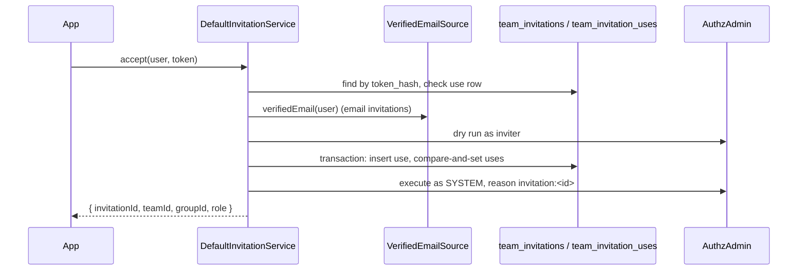

# Invitations

An invitation lets a team admin bring people into a team or one of its groups with a role. It is either a shareable link (a token, any number of uses) or an email invitation bound to one verified address. `InvitationService` creates, lists, revokes, resends and accepts them.

## How it works

### Create

1. `InvitationService.create(actor, input)` is called by the app, usually from an HTTP route.
2. `DefaultInvitationService` loads the live team and, with `groupId`, the live group; a group of another team is refused with `InvalidArgument`.
3. It validates `role`, `email` (trimmed, lowercased), `maxUses` and `expiresInHours` (1 to 8760, default `teams.invitations.defaultTtlHours`).
4. `actor` must hold `team:invitations.manage` at the team, else `AccessDenied`.
5. For an email invitation, a `VerifiedEmailSource` must be registered, else `InvalidOperation` before anything is written.
6. The accept command is dry-run through `AuthzAdmin` as the actor. An inviter who could not grant the role gets `AuthzAdminFailure` (`escalation`, `forbidden`).
7. A new token (32 random bytes, base64url) is hashed as `v1:` + HMAC-SHA256 with `teams.invitations.secret`, and the `TeamInvitation` row is inserted.
8. For an email invitation, `InvitationMailer.send()` mails it at once. A failed mail deletes the row and throws.
9. The result is `{ invitation, token }`. The token is returned here only.

### Accept

1. `InvitationService.accept(principal, token)` is called with the signed-in user and the token they received.
2. A principal that is not an authenticated `user` is refused with `not_a_user`.
3. The token is hashed and looked up by `token_hash`. An empty, too long (over 128 characters) or unknown token is refused with `unknown`.
4. When `team_invitation_uses` already holds a row for this invitation and principal, `accept` returns the result and changes nothing.
5. A revoked invitation is refused with `revoked`, an expired one with `expired`. A deleted team or group gives `unknown`.
6. For an email invitation, `VerifiedEmailSource.verifiedEmail(principal)`, trimmed and lowercased, must equal the stored address, else `email_mismatch`.
7. The inviter (`created_by`) is judged again: `team:invitations.manage` at the team and the dry run of the accept command, with the inviter's assignments at this moment. A demoted or removed inviter gives `inviter_lost_authority`.
8. `recordUse` opens `TeamInvitation.transaction()`, inserts a `TeamInvitationUse` row, and raises `uses` with a compare-and-set. An invitation at `max_uses` is refused with `used_up`.
9. `join` grants the role as `SYSTEM` with reason `invitation:<id>`: `set.addMember` for `group.member` at a group, `assignment.grant` otherwise. A role the user already holds at that scope is not granted again.
10. If the grant fails, `forgetUse` deletes the use row and lowers `uses` in one transaction, then the error is thrown.



### Revoke and resend

- `revoke(actor, teamId, id)` sets `revoked_at`; a second revoke changes nothing.
- `resend(actor, teamId, id)` stores a new token hash and mails the new token, so the old token stops working. A link invitation has no address (`InvalidArgument`); a revoked or expired one is refused with `InvalidOperation`. A failed mail restores the previous hash.
- Both need `team:invitations.manage`. An id from another team gives `ResourceNotFound`, so an id says nothing about other teams.

## Configuration

| Key | Type | Default | Allowed values | Meaning |
| --- | --- | --- | --- | --- |
| `teams.invitations.secret` | `string` | none | at least 32 characters | HMAC key for token hashes. Read on every use; unset or short throws `AuthzConfigError`. |
| `teams.invitations.defaultTtlHours` | `integer` | `168` | `>= 1` | Lifetime when `expiresInHours` is not given. |
| `teams.invitations.url` | `string` | none | a URL | The page that accepts; the mail link is this URL with `?token=` added. Without it the mail carries the bare token. |
| `teams.invitations.template` | `string` | none | an email template name | Template for the mail; without it a plain text mail is sent. |
| `teams.invitations.subject` | `string` | `You are invited to join a team` | non-empty | Mail subject. |
| `teams.invitations.connection` | `string` | `email.defaultConnection` | an email connection name | Connection the mail goes through. Neither set: `IOFail`. |

An unknown key under `teams.invitations` fails schema validation.

```ts
export default {
  teams: {
    invitations: {
      secret: process.env.TEAMS_INVITATION_SECRET,
      defaultTtlHours: 72,
      url: 'https://app.example.com/invitations/accept',
      template: 'teams-invitation',
    },
  },
};
```

## Schema

Both tables come from the migration `TeamsInvitations_2026_10_14_00_01_00` on the `default` connection.

### `team_invitations` (model `TeamInvitation`)

| Column | Type | Meaning |
| --- | --- | --- |
| `id` | `varchar(36)`, primary key | Invitation id (UUID). |
| `team_id` | `varchar(36)`, not null, foreign key to `teams.id`, indexed | The team. |
| `group_id` | `varchar(36)`, nullable, foreign key to `groups.id` | The group to join instead of the team. |
| `role` | `varchar(128)`, not null | Role granted on accept. |
| `email` | `varchar(255)`, nullable | Lowercased address of an email invitation; `NULL` for a link. |
| `token_hash` | `varchar(128)`, not null, unique | `v1:<hex HMAC-SHA256>` of the token. |
| `max_uses` | `int`, nullable | Use limit; `NULL` for unlimited. |
| `uses` | `int`, not null, default `0` | Accepts counted so far. |
| `expires_at` | `datetime`, not null | Expiry. |
| `revoked_at` | `datetime`, nullable | Set by `revoke`. |
| `created_by` | `varchar(100)`, not null | `principalKey` of the inviter. |
| `created_at` | `datetime`, not null | Creation time. |
| `last_sent_at` | `datetime`, nullable | Last successful mail. |

### `team_invitation_uses` (model `TeamInvitationUse`)

| Column | Type | Meaning |
| --- | --- | --- |
| `invitation_id` | `varchar(36)`, not null, foreign key to `team_invitations.id` | The invitation. |
| `principal` | `varchar(200)`, not null | `principalKey` of the user who accepted. |
| `used_at` | `datetime`, not null | Accept time (UTC). |

Unique index `team_invitation_uses_key` on (`invitation_id`, `principal`). `TeamInvitationUse` declares both columns `@Primary({ generated: 'assigned' })`, so a use row is addressed by the pair. Index `team_invitations_team` covers `team_invitations.team_id`.

## Services and extension points

| Service | DI token and lifetime | Default implementation | Alternatives | How to replace or extend |
| --- | --- | --- | --- | --- |
| Invitation service | `InvitationService`, singleton (`@Singleton`, `@Injectable(InvitationService)`) | `DefaultInvitationService` | none | Subclass and override the protected steps (`usedBy`, `recordUse`, `forgetUse`, `assertInviterMay`, `join`, `mail`), then `DI.register(MyService).as(InvitationService)`. |
| Mailer | `InvitationMailer`, new instance (`@Injectable(InvitationMailer)`) | `EmailInvitationMailer` (through `@spinajs/email`) | none | `DI.register(MyMailer).as(InvitationMailer)`. Resolved from the root container at each send. |
| Verified address | `VerifiedEmailSource`, no default | none | none | The app registers one. Resolved from the authz domain container named by `authz.orm.domain` (the root container for `root`). |

All three register on import of `@spinajs/teams`; register a replacement after that import and before the first call.

### `VerifiedEmailSource`: custom implementation

Email invitations need it: `Principal` carries no verified address. Return `undefined` when the user has none, and the invitation is refused with `email_mismatch`.

```ts sample
import type { Principal } from '@spinajs/authz';
import { DI } from '@spinajs/di';
import { VerifiedEmailSource } from '@spinajs/teams';

/** Reads the address the login strategy put on the principal, only when it was verified. */
export class AttributeVerifiedEmailSource extends VerifiedEmailSource {
  async verifiedEmail(principal: Principal): Promise<string | undefined> {
    const attributes = principal.attributes ?? {};
    return attributes.emailVerified === true && typeof attributes.email === 'string' ? attributes.email : undefined;
  }
}

DI.register(AttributeVerifiedEmailSource).as(VerifiedEmailSource);
```

### `InvitationMailer`: custom implementation

Replace it to send through another channel. The token is a secret: never queue, log or persist it.

```ts sample
import { InvitationMailer } from '@spinajs/teams';
import type { InvitationMail } from '@spinajs/teams';
import { DI } from '@spinajs/di';

/** Posts the invitation to a chat webhook instead of mailing it. */
export class WebhookInvitationMailer extends InvitationMailer {
  async send(mail: InvitationMail): Promise<void> {
    const link = `https://app.example.com/invitations/accept?token=${encodeURIComponent(mail.token)}`;
    const res = await fetch('https://hooks.example.com/invite', {
      method: 'POST',
      headers: { 'content-type': 'application/json' },
      body: JSON.stringify({ to: mail.to, team: mail.team.name, role: mail.role, link, expiresAt: mail.expiresAt.toISOString() }),
    });
    if (!res.ok) throw new Error(`invitation webhook answered ${res.status}`);
  }
}

DI.register(WebhookInvitationMailer).as(InvitationMailer);
```

## Important behaviour

- **One use per user.** A second `accept` by the same user returns the same result and counts nothing; `uses` counts users, not calls.
- **Last use under concurrency.** The use row and the counter change in one `TeamInvitation.transaction()`. The compare-and-set on `uses` keeps two accepts from both taking the last use; after 5 lost races `accept` throws `InvalidOperation` and the caller retries.
- **No escalation.** `create` and `accept` both dry-run the accept command as the inviter. An invitation never grants a role the inviter could not grant at that moment.
- **Grants run as `SYSTEM`** after the service's own checks, with reason `invitation:<id>` in the audit.
- **Defaults.** `maxUses` defaults to `1` for an email invitation and unlimited for a link; `null` is unlimited until expiry.
- **Mails are never queued.** `EmailInvitationMailer` sends at once and passes the token and link as `redact`, so they stay out of queued payloads, the `EmailSent` event, logs and errors. A send failure is `IOFail` without the original error as cause.
- **Deleting a team or group deletes its invitations.** `deleteGroup` and the team purge remove the `TeamInvitationUse` rows first, then the `TeamInvitation` rows.
- **Refusal codes are a contract.** `InvitationRefused.code` is one of `INVITATION_REFUSALS`: `unknown`, `revoked`, `expired`, `used_up`, `email_mismatch`, `not_a_user`, `inviter_lost_authority`. The message is not stable.

## Best practices

- Map `InvitationRefused.code` to HTTP answers and UI text; do not parse the message.
- Keep `teams.invitations.secret` in a secret store. Rotating it makes every open token `unknown`.
- Let a new user sign up through the app's own flow first, then call `accept` with the token they kept.
- Use `resend` for a lost mail instead of creating a second invitation: the old token stops working.

## Patterns and antipatterns

```ts
// Don't: the table is an internal detail, and a raw insert skips the counter and the use limit.
await driver.insert().into('team_invitation_uses').values({ invitation_id: id, principal: key, used_at: new Date() });

// Do
await invitations.accept(user, token);
```

## Examples

### Share a join link for a hackathon team

```ts sample
import type { Principal } from '@spinajs/authz';
import { DI } from '@spinajs/di';
import { InvitationRefused, InvitationService } from '@spinajs/teams';

/** A link for up to 20 people, valid for two days. */
export async function hackathonLink(owner: Principal, teamId: string): Promise<string> {
  const invitations = (await DI.resolve(InvitationService)) as InvitationService;
  const { token } = await invitations.create(owner, { teamId, role: 'team.member', maxUses: 20, expiresInHours: 48 });
  return `https://app.example.com/join?token=${encodeURIComponent(token)}`;
}

/** Joins the signed-in user; returns the refusal code instead of throwing it. */
export async function joinWithLink(user: Principal, token: string): Promise<string | null> {
  const invitations = (await DI.resolve(InvitationService)) as InvitationService;
  try {
    await invitations.accept(user, token);
    return null;
  } catch (e) {
    if (e instanceof InvitationRefused) return e.code;
    throw e;
  }
}
```

## Migration

### `INVITATION_USES_TABLE` is no longer exported

Use rows go through the `TeamInvitationUse` model, which names the `team_invitation_uses` table and the `default` connection.

```ts
// Before
import { INVITATION_USES_TABLE } from '@spinajs/teams';
const rows = await driver.select().from(INVITATION_USES_TABLE).where({ invitation_id: id });

// After
import { TeamInvitationUse } from '@spinajs/teams';
const rows = await TeamInvitationUse.query().where({ invitation_id: id });
```

## Related

- [`@spinajs/authz` admin](../authz/README.md): `AuthzAdmin` runs the dry run and the grant, and its guard decides `escalation`.
- [`@spinajs/authz-rbac`](../authz-rbac/README.md): `set.addMember` and `assignment.grant` write the membership.
- [`@spinajs/email`](../email/README.md): `EmailService` and `redact`, used by `EmailInvitationMailer`.
- [`@spinajs/orm` transactions](../orm/08-transactions.md): `Model.transaction()`, which `recordUse` and `forgetUse` use.
