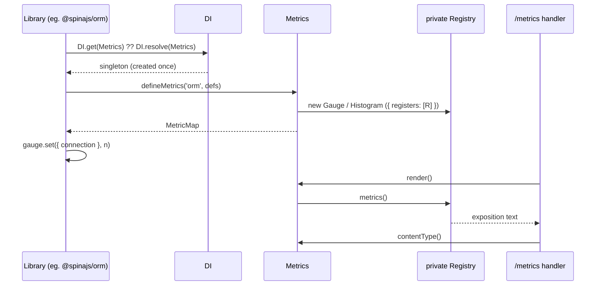

# Metrics service

`Metrics` is the one place every package records Prometheus metrics. It is a DI singleton that owns a private prom-client `Registry`, builds metrics from declarations, and renders the registry as Prometheus exposition text. Resolve it wherever you record or expose metrics.

## How it works

1. **Register.** Importing `@spinajs/telemetry-common` runs `@Injectable()` and `@Singleton()` on `Metrics`: the class is registered in the root container under its own name, `'Metrics'`.
2. **Resolve.** The first `DI.resolve(Metrics)` (or `@Autoinject(Metrics)`) runs the constructor, which creates `new client.Registry()`. Later resolves return the cached instance.
3. **Define.** Each package calls `defineMetrics(prefix, defs)` and gets a `MetricMap` of prom-client metrics, all registered on that private registry; see [Metric definitions](02-metric-definitions.md).
4. **Record.** Callers `inc()`, `set()` and `observe()` the returned metrics.
5. **Render.** A scrape handler awaits `render()` (prom-client's async `Registry.metrics()`) and sends it with `contentType()` as the `Content-Type`. In `@spinajs/telemetry`, `MetricsController` does this for `GET /metrics`.



## API

| Member | Returns | Meaning |
| --- | --- | --- |
| `defineMetrics(prefix, defs)` | `MetricMap` | Build metrics named `${prefix}_${def.name}` on the private registry. See [Metric definitions](02-metric-definitions.md). |
| `collectDefault()` | `void` | Call prom-client's `collectDefaultMetrics({ register })` against the private registry: `process_*` and `nodejs_*` (CPU, heap, event loop lag, GC, handles). |
| `render()` | `Promise<string>` | The registry as Prometheus text format. |
| `contentType()` | `string` | The registry's content type: `text/plain; version=0.0.4; charset=utf-8`. |
| `getRegistry()` | `Registry` | The private prom-client registry; see [Registry access](04-registry-access.md). |
| `registry` (protected) | `Registry` | The same registry, for subclasses. |

## Services and extension points

| Service | DI token and lifetime | Default implementation | Alternatives | How to replace or extend |
| --- | --- | --- | --- | --- |
| `Metrics` | `Metrics` (class name `'Metrics'`), singleton, registered in the root container at import time | `Metrics` with a fresh private `Registry` | None shipped. `@spinajs/telemetry` re-exports this same class, it does not subclass it | `DI.register(MyMetrics).as(Metrics)` at import time, before anything resolves `Metrics`; subclass to keep the default behaviour. See [Custom metrics service](03-custom-metrics-service.md) |

How the monorepo resolves it:

| Consumer | How it resolves `Metrics` | When |
| --- | --- | --- |
| `TelemetryBootstrapper` (`@spinajs/telemetry`) | `DI.get(Metrics) ?? DI.resolve(Metrics)` | At bootstrap, to call `collectDefault()` |
| `MetricsController` (`@spinajs/telemetry`) | `@Autoinject(Metrics)` | When the controller is built |
| `PromMetricSink`, telemetry HTTP middleware | `DI.get(Metrics) ?? DI.resolve(Metrics)` | Lazily, on the first measurement or request |
| `ormMetrics()` (`@spinajs/orm`), `socketMetrics()` (`@spinajs/http-socket`) | `DI.get(Metrics) ?? DI.resolve(Metrics)`, inside `try`/`catch` returning `null` | Lazily, on the first probe tick or command |

## Important behaviour

- **Private registry.** `Metrics` never touches prom-client's global `client.register`. Metrics a third-party library puts in the global registry do not appear in `render()`; merge them yourself, see [Registry access](04-registry-access.md#merge-prom-clients-global-registry).
- **One registry per singleton.** `DI.clearCache()` drops the instance; the next resolve builds a new `Metrics` with an empty registry. Tests and several SpinaJS apps in one process stay isolated this way.
- **Child containers share the root instance.** `DI.child().resolve(Metrics)` returns the root singleton.
- **`collectDefault()` is idempotent.** A second call on the same instance does nothing. `@spinajs/telemetry` calls it once at bootstrap when `telemetry.collectDefaultMetrics` is `true` (the default).
- **`render()` is async.** prom-client 14 returns a promise from `Registry.metrics()`; always `await` it.
- **No-sample metrics still render.** A labelled metric with no recorded value renders its `# HELP` and `# TYPE` lines only.
- **No config.** The service reads no configuration. Prefixes, buckets and the `collectDefault()` switch belong to the calling package.

## Best practices

- Resolve with `DI.get(Metrics) ?? DI.resolve(Metrics)` in library code: it reuses the built instance without a resolve on each hot-path call.
- Expose the output through `@spinajs/telemetry`'s `GET /metrics` when the app has HTTP. Without it, serve `render()` and `contentType()` yourself (example below).
- Keep `collectDefault()` in one place: the app bootstrap, or `@spinajs/telemetry`.

## Patterns and antipatterns

```ts
// Don't: a second registry is invisible to /metrics, which renders Metrics' private registry
import { Registry, Gauge } from 'prom-client';
const registry = new Registry();
const queueDepth = new Gauge({ name: 'jobs_queue_depth', help: 'Jobs waiting', registers: [registry] });

// Do: declare the metric on the shared service
const jobs = DI.resolve(Metrics).defineMetrics('jobs', [{ name: 'queue_depth', help: 'Jobs waiting', type: 'gauge' }]);
```

```ts
// Don't: prom-client's global registry is not rendered by Metrics
import { collectDefaultMetrics } from 'prom-client';
collectDefaultMetrics();

// Do
DI.resolve(Metrics).collectDefault();
```

## Examples

### Serve `/metrics` from a worker with no HTTP framework

A queue worker has no `@spinajs/http`. Expose its metrics on a bare Node server for Prometheus to scrape.

```ts sample
import { createServer } from 'node:http';
import { DI } from '@spinajs/di';
import { Metrics, Gauge } from '@spinajs/telemetry-common';

const metrics = DI.resolve(Metrics);
metrics.collectDefault();

const worker = metrics.defineMetrics('worker', [
  { name: 'jobs_in_progress', help: 'Jobs the worker is processing', type: 'gauge', labelNames: ['queue'] },
]);
const inProgress = worker['jobs_in_progress'] as Gauge<string>;
inProgress.set({ queue: 'emails' }, 3);

const server = createServer(async (req, res) => {
  if (req.url !== '/metrics') {
    res.statusCode = 404;
    res.end();
    return;
  }

  const body = await metrics.render();
  res.setHeader('Content-Type', metrics.contentType());
  res.end(body);
});

server.listen(9464);
```

### Assert a metric in a test

Clear the DI cache between tests so each test gets an empty registry.

```ts sample
import { DI } from '@spinajs/di';
import { Metrics, Counter } from '@spinajs/telemetry-common';

async function loginFailuresAreCounted(): Promise<void> {
  DI.clearCache();
  const metrics = DI.resolve(Metrics);

  const auth = metrics.defineMetrics('auth', [
    { name: 'login_failures_total', help: 'Failed logins', type: 'counter', labelNames: ['reason'] },
  ]);
  (auth['login_failures_total'] as Counter<string>).inc({ reason: 'bad_password' });

  const text = await metrics.render();
  if (!text.includes('auth_login_failures_total{reason="bad_password"} 1')) {
    throw new Error('login failure was not counted');
  }
}

void loginFailuresAreCounted();
```

## Related

- [Metric definitions](02-metric-definitions.md): what `defineMetrics()` builds and its rebuild rule.
- [Custom metrics service](03-custom-metrics-service.md): replacing or extending this service.
- [`@spinajs/telemetry`](../telemetry/README.md): the `GET /metrics` endpoint and `telemetry.collectDefaultMetrics`.
- [Lifetimes](../di/04-lifetimes.md): how the singleton is cached.
