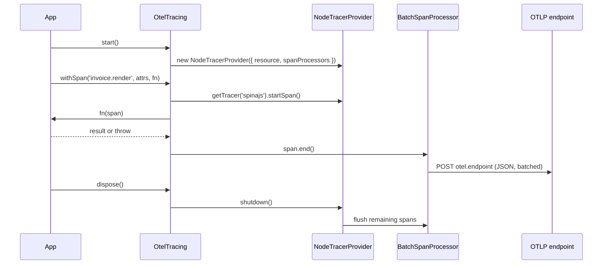

# Tracing service

`OtelTracing` creates a private OpenTelemetry `NodeTracerProvider` and hands out tracers from it. Use it to wrap an async operation in a span with `withSpan()`, or to get a full OTel `Tracer` with `tracer()`. With `otel.enabled: false` (the default) it creates nothing and every call costs a no-op.

## How it works

Starting:

1. Importing `@spinajs/telemetry-otel` runs `@Singleton()` and `@Injectable()` on `OtelTracing`, which registers it in the root container under its own class name.
2. `await DI.resolve(OtelTracing)` builds the singleton. It is an `AsyncService`, so `resolve()` returns a `Promise`. Its `resolve()` calls `start()` once the `Configuration` it injects is resolved.
3. `OtelTracing.start( processorOverride? )` runs from `resolve()`; call it yourself to pass a `processorOverride`. It returns at once when `otel.enabled` is `false` or a provider already exists.
4. `start()` builds the resource with `resourceFromAttributes()`: `service.name` from `otel.serviceName`, then every entry of `otel.resourceAttributes` (an entry named `service.name` overrides the first).
5. `start()` picks the span processor: `processorOverride` when given, else `new BatchSpanProcessor(new OTLPTraceExporter({ url: otel.endpoint }))`.
6. `start()` creates `new NodeTracerProvider({ resource, spanProcessors: [processor] })`, keeps it in a private field and logs `otel tracing started` at `info` on the `otel` logger. `active` is now `true`.

Recording a span with `withSpan(name, attrs, fn)`:

1. `tracer('spinajs').startSpan(name, { attributes: attrs })` starts the span.
2. `fn(span)` runs and is awaited.
3. On success the span gets status `OK` and the result is returned.
4. On a throw the span gets `recordException(err)` and status `ERROR` with the error message, and the error is re-thrown.
5. `span.end()` runs in both cases. The batch processor exports the ended span later, in the background.

Stopping:

1. `flush()` calls `provider.forceFlush()`: every ended span is exported now.
2. `dispose()` calls `provider.shutdown()`, which flushes and stops the processor, then clears the provider. `DI.dispose()` calls it for you. `start()` can create a new provider afterwards.



## API

| Member | Returns | Meaning |
| --- | --- | --- |
| `start(processorOverride?: SpanProcessor)` | `void` | Creates the provider. No-op when disabled or already started. See [Span processors](03-span-processors.md) for the override |
| `active` (getter) | `boolean` | `true` while a provider exists |
| `tracer(name: string)` | `Tracer` | A tracer from the private provider, or `trace.getTracer(name)` from `@opentelemetry/api` when no provider exists |
| `withSpan<T>(name, attrs: Attributes, fn: (span: Span) => Promise<T>)` | `Promise<T>` | Runs `fn` inside a span named `name` on the `spinajs` tracer; records errors and re-throws them |
| `flush()` | `Promise<void>` | Exports every ended span now. No-op without a provider |
| `dispose()` | `Promise<void>` | Shuts the provider down and clears it, then runs `AsyncService.dispose()` |

`Tracer`, `Span` and `Attributes` are the `@opentelemetry/api` types: everything the OTel API offers (`startActiveSpan`, links, span kinds) works on the tracer you get.

## Configuration

| Key | Type | Default | Allowed values | Meaning |
| --- | --- | --- | --- | --- |
| `otel.enabled` | `boolean` | `false` | `true`, `false` | Master switch. `false`: `start()` creates nothing and tracers are no-ops |
| `otel.endpoint` | `string` | `'https://otel.highlight.io:4318/v1/traces'` | Full OTLP/HTTP traces URL, path included | `url` of the `OTLPTraceExporter` |
| `otel.serviceName` | `string` | `'spinajs-app'` | Any string | The `service.name` resource attribute |
| `otel.resourceAttributes` | `Record<string, string>` | `{}` | String map | Extra resource attributes on every span, eg. `highlight.project_id` |
| `otel.longSpan.maxAgeMs` | `number` | `1800000` (30 min) | Milliseconds | Used by [`LongSpanRegistry`](02-long-lived-spans.md) |
| `otel.longSpan.sweepIntervalMs` | `number` | `60000` | Milliseconds | Used by [`LongSpanRegistry`](02-long-lived-spans.md) |

The package ships these defaults in `src/config/otel.ts`. `@Config` repeats the same values as `defaultValue`, so a missing key falls back to them. The package registers no schema for `otel.*`.

```ts
// src/config/otel.ts of your app: send traces to a local OpenTelemetry Collector
export default {
  otel: {
    enabled: process.env.APP_ENV === 'production',
    endpoint: 'http://otel-collector:4318/v1/traces',
    serviceName: 'billing-api',
    resourceAttributes: {
      'deployment.environment': 'production',
      'service.version': '4.2.0',
    },
  },
};
```

`OTLPTraceExporter` also reads the standard OpenTelemetry environment variables that `otel.*` does not set, eg. `OTEL_EXPORTER_OTLP_TRACES_HEADERS` for auth headers. To set headers from config instead, see [Customizing the tracing service](04-customizing-the-tracing-service.md#send-traces-with-an-auth-header-from-config).

## Services and extension points

| Service | DI token and lifetime | Default implementation | Alternatives | How to replace or extend |
| --- | --- | --- | --- | --- |
| `OtelTracing` | `OtelTracing` (class name), `@Singleton()`; registered by `@Injectable()` at import; resolved by type, eg. `@Autoinject(OtelTracing)` in `LongSpanRegistry` | `OtelTracing` | none shipped | `@Injectable(OtelTracing)` on a subclass, after this package is imported and before the first resolve. Override `start()`, `tracer()`, `withSpan()`, `flush()`, `dispose()`. See [Customizing the tracing service](04-customizing-the-tracing-service.md) |
| Span processor | `start( processorOverride )` argument | `BatchSpanProcessor` + `OTLPTraceExporter` | Any OTel `SpanProcessor` | Pass it to `start()`. See [Span processors](03-span-processors.md) |

### `OtelTracing`: custom implementation

Subclass it when the config keys are not enough: start on resolve, send auth headers, register the provider globally, sample. The provider field is `private`, so a subclass that needs the provider object keeps its own and overrides every member that uses it. The protected fields `enabled`, `endpoint`, `serviceName`, `resourceAttributes` and `log` are readable from a subclass.

```ts sample
import { DI, Injectable, Singleton } from '@spinajs/di';
import { Configuration } from '@spinajs/configuration';
import { OtelTracing } from '@spinajs/telemetry-otel';

// Starts tracing as soon as DI resolves the service, so no call site can forget it.
@Singleton()
@Injectable(OtelTracing)
export class AutoStartOtelTracing extends OtelTracing {
  public async resolve(): Promise<void> {
    await super.resolve();
    this.start();
  }
}

export async function boot(): Promise<void> {
  // @Config properties read the configuration, so it resolves first.
  await DI.resolve(Configuration);

  const tracing = await DI.resolve(OtelTracing);
  console.log(tracing instanceof AutoStartOtelTracing, tracing.active);
}
```

More variants are in [Customizing the tracing service](04-customizing-the-tracing-service.md).

## Important behaviour

- **`resolve()` starts tracing.** Resolving `OtelTracing` with `otel.enabled: true` creates the provider. A later `start( processorOverride )` is ignored while the provider exists.
- **`start()` reads the config once.** `otel.enabled`, `otel.endpoint`, `otel.serviceName` and `otel.resourceAttributes` are read when the provider is built. Changing them later has no effect until `dispose()` and a new `start()`.
- **The configuration must be resolved before `start()`.** `@Config` properties read it on access and throw `InvalidOperation` while the container's `Configuration` is unresolved.
- **The provider is private.** It is not set as the OTel global and no context manager is registered. Auto-instrumentation (`@opentelemetry/instrumentation-http` and others) and `trace.getTracer()` do not reach it.
- **`withSpan()` does not make its span active.** It calls `startSpan()`, not `startActiveSpan()`, and no context manager is registered. A span started inside `fn` is a new root span, not a child. Pass the span along, or use [`LongSpanRegistry.childSpan()`](02-long-lived-spans.md) for explicit parenting.
- **Disabled means "no own provider", not "no spans at all".** Without a provider, `tracer()` returns a no-op tracer that is independent of the OTel global, so a provider another library registered globally never receives these spans.
- **A tracer taken before `start()` stays a no-op.** `tracer()` resolves the provider at call time; a tracer stored in a field before `start()` never records.
- **Export is batched.** `BatchSpanProcessor` exports on its own timer. Spans of a process that exits without `flush()` or `dispose()` are lost.
- **`withSpan()` uses one fixed tracer name**, `spinajs`. Call `tracer('<your-scope>')` for spans that must carry your instrumentation scope.
- Every span gets the resource attributes; `otel.resourceAttributes` entries are added after `service.name`, so they override it.

## Best practices

- Resolve `OtelTracing` in your entry point, before handlers run; it starts itself. Call `start( processorOverride )` before that only to override the processor.
- Keep `otel.enabled` off in tests and local runs; turn it on per environment in config, not with code branches.
- Call `await tracing.flush()` at the end of short-lived CLI commands and jobs; the batch timer does not fire before the process exits.
- Use `otel.resourceAttributes` for `deployment.environment` and `service.version`: every span then carries them without per-call attributes.
- Name spans `<domain>.<operation>` (`invoice.render`, `payment.capture`) and keep ids in attributes, not in names, so the backend groups them.

## Patterns and antipatterns

```ts
// Don't: the tracer is taken when the class is built, before start(); it is the no-op tracer forever
class InvoiceRenderer {
  private readonly tracer = DI.get(OtelTracing)!.tracer('billing');
}

// Do: take the tracer when you start the span
class InvoiceRenderer {
  @Autoinject(OtelTracing)
  protected tracing!: OtelTracing;

  public render(id: string) {
    const span = this.tracing.tracer('billing').startSpan('invoice.render', { attributes: { 'invoice.id': id } });
    span.end();
  }
}
```

```ts
// Don't: the inner withSpan is not a child of the outer one; the backend shows two unrelated traces
await tracing.withSpan('order.checkout', {}, async () => {
  await tracing.withSpan('order.reserve-stock', {}, async () => reserve());
});

// Do: add steps to the one span as events, or parent explicitly with LongSpanRegistry.childSpan()
await tracing.withSpan('order.checkout', {}, async (span) => {
  await reserve();
  span.addEvent('stock.reserved');
});
```

## Examples

### Trace a nightly export job and flush before exit

```ts sample
import { DI } from '@spinajs/di';
import { Configuration } from '@spinajs/configuration';
import { OtelTracing } from '@spinajs/telemetry-otel';

interface ExportedFile {
  name: string;
  rows: number;
}

async function exportCustomers(): Promise<ExportedFile> {
  return { name: 'customers-2026-10-17.csv', rows: 18_240 };
}

export async function nightlyExport(): Promise<void> {
  await DI.resolve(Configuration);
  const tracing = await DI.resolve(OtelTracing);
  tracing.start();

  try {
    const file = await tracing.withSpan('export.customers', { 'export.kind': 'nightly' }, async (span) => {
      const result = await exportCustomers();
      span.setAttributes({ 'export.file': result.name, 'export.rows': result.rows });
      return result;
    });
    console.log(`exported ${file.rows} rows`);
  } finally {
    // A CLI process exits before the batch timer fires; flush exports the span now.
    await tracing.flush();
    await tracing.dispose();
  }
}
```

### Use the full OTel tracer API in a service

```ts sample
import { Autoinject, Injectable, Singleton } from '@spinajs/di';
import { SpanKind, SpanStatusCode } from '@opentelemetry/api';
import { OtelTracing } from '@spinajs/telemetry-otel';

@Singleton()
@Injectable()
export class ExchangeRateClient {
  @Autoinject(OtelTracing)
  protected tracing!: OtelTracing;

  public async rate(from: string, to: string): Promise<number> {
    const span = this.tracing.tracer('billing.exchange-rates').startSpan('exchange-rate.fetch', {
      kind: SpanKind.CLIENT,
      attributes: { 'currency.from': from, 'currency.to': to },
    });

    try {
      const rate = from === to ? 1 : 4.31;
      span.setAttribute('exchange-rate.value', rate);
      return rate;
    } catch (err) {
      span.recordException(err as Error);
      span.setStatus({ code: SpanStatusCode.ERROR });
      throw err;
    } finally {
      span.end();
    }
  }
}
```

## Related

- [Long-lived spans](02-long-lived-spans.md): spans that outlive one async call, built on this service's tracers.
- [Span processors](03-span-processors.md): what to pass to `start( processorOverride )`.
- [Customizing the tracing service](04-customizing-the-tracing-service.md): subclass or replace `OtelTracing`.
- [Service lifecycle](../di/10-service-lifecycle.md): how `AsyncService.resolve()` and `dispose()` are called.
- [Injecting config values](../configuration/07-injecting-config-values.md): how the `otel.*` properties are read.
