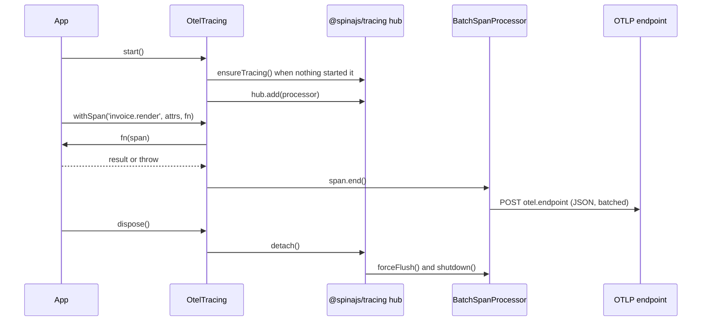

# Tracing service

`OtelTracing` exports the spans of the shared tracer provider of `@spinajs/tracing` over OTLP/HTTP. It owns no provider: `start()` attaches an OTLP span processor to the provider's hub, so the exporter sees every framework span (HTTP, policy, authz, ORM, queue) as well as the spans you start with `withSpan()` or `tracer()`. With `otel.enabled: false` (the default) nothing is attached and every call costs a no-op.

## How it works

Starting:

1. Importing `@spinajs/telemetry-otel` runs `@Singleton()` and `@Injectable()` on `OtelTracing`, which registers it in the root container under its own class name.
2. `await DI.resolve(OtelTracing)` builds the singleton. It is an `AsyncService`, so `resolve()` returns a `Promise`. Its `resolve()` calls `start()` once the `Configuration` it injects is resolved.
3. `OtelTracing.start( processorOverride? )` runs from `resolve()`; call it yourself to pass a `processorOverride`. It returns at once when `otel.enabled` is `false` or the export is already attached.
4. The first `start()` with `otel.enabled: true` logs one warning when the configuration still sets `otel.serviceName` or `otel.resourceAttributes` (see [Configuration](#configuration)).
5. `start()` takes the tracing state of `@spinajs/tracing`. When nothing has started tracing yet, it calls `ensureTracing(readTracingOptions(config))`, which registers the provider globally with the resource built from `tracing.serviceName` and `tracing.resourceAttributes`.
6. Under an external OpenTelemetry SDK, or with `tracing.enabled: false`, there is no hub. `start()` logs `otel export not started: <reason>` at `warn` on the `otel` logger and stays inactive.
7. `start()` picks the span processor: `processorOverride` when given, else `new BatchSpanProcessor(new OTLPTraceExporter({ url: otel.endpoint }))`. When the exporter cannot be built (an `otel.endpoint` that is not a URL), it logs `otel export not started: no OTLP exporter for <endpoint>` at `error` and stays inactive; the resolve does not fail.
8. `start()` adds the processor to the hub, keeps the detach function, and logs `otel export started` at `info`. `active` is now `true`.

Recording a span with `withSpan(name, attrs, fn)`:

1. `tracer('spinajs').startSpan(name, { attributes: attrs })` starts the span. Its parent is the active span, eg. the HTTP server span of the request.
2. `fn(span)` runs and is awaited.
3. On success the span gets status `OK` and the result is returned.
4. On a throw the span gets `error.type` and status `ERROR`, both set to the error's class name (`markSpanErrorType` from `@spinajs/tracing`), and the error is re-thrown. The error's message and an `exception` event stay off the span: an error's text can hold query parameters and payloads.
5. `span.end()` runs in both cases. The batch processor exports the ended span later, in the background.

Stopping:

1. `flush()` calls the processor's `forceFlush()`: every ended span is exported now.
2. `dispose()` runs the `onBeforeShutdown` hooks, then detaches the processor from the hub, which flushes and shuts it down. The provider and the other processors on the hub stay. `DI.dispose()` calls it for you. `start()` can attach a new processor afterwards.



## API

| Member | Returns | Meaning |
| --- | --- | --- |
| `start(processorOverride?: SpanProcessor)` | `void` | Attaches the processor to the hub of `@spinajs/tracing`. No-op when disabled or already attached. See [Span processors](03-span-processors.md) for the override |
| `active` (getter) | `boolean` | `true` while the processor is attached |
| `tracer(name: string)` | `Tracer` | `trace.getTracer(name)`, the global tracer of the shared provider, while active; a no-op tracer otherwise |
| `withSpan<T>(name, attrs: Attributes, fn: (span: Span) => Promise<T>)` | `Promise<T>` | Runs `fn` inside a span named `name` on the `spinajs` tracer; records errors and re-throws them |
| `flush()` | `Promise<void>` | Exports every ended span now. Rejects when the export fails. No-op while inactive |
| `onBeforeShutdown(hook: () => void)` | `void` | Runs `hook` at the start of `dispose()`, while the processor is still attached |
| `dispose()` | `Promise<void>` | Detaches the processor (flush and shutdown), then runs `AsyncService.dispose()`. Never rejects because of the export |

`Tracer`, `Span` and `Attributes` are the `@opentelemetry/api` types: everything the OTel API offers (`startActiveSpan`, links, span kinds) works on the tracer you get.

## Configuration

| Key | Type | Default | Allowed values | Meaning |
| --- | --- | --- | --- | --- |
| `otel.enabled` | `boolean` | `false` | `true`, `false` | Whether the OTLP processor is attached to the hub. `false`: nothing is exported and tracers are no-ops |
| `otel.endpoint` | `string` | `'https://otel.highlight.io:4318/v1/traces'` | Full OTLP/HTTP traces URL, path included | `url` of the `OTLPTraceExporter` |
| `otel.longSpan.maxAgeMs` | `number` | `1800000` (30 min) | Milliseconds | Used by [`LongSpanRegistry`](02-long-lived-spans.md) |
| `otel.longSpan.sweepIntervalMs` | `number` | `60000` | Milliseconds | Used by [`LongSpanRegistry`](02-long-lived-spans.md) |

The service name, the resource attributes and the sampler are configured once for every exporter, under `tracing.*` of `@spinajs/tracing`: `tracing.serviceName`, `tracing.resourceAttributes`, `tracing.sampler` and `tracing.enabled`. The 3.x keys `otel.serviceName` and `otel.resourceAttributes` are removed: nothing reads their values. When either is still set, `start()` logs one warning on the `otel` logger: `otel: otel.serviceName, otel.resourceAttributes is no longer read; set tracing.serviceName and tracing.resourceAttributes instead` (it names only the keys that are set).

The package ships these defaults in `src/config/otel.ts`. `@Config` repeats the same values as `defaultValue`, so a missing key falls back to them. The package registers no schema for `otel.*`.

```ts
// src/config/otel.ts of your app: send traces to a local OpenTelemetry Collector
export default {
  tracing: {
    serviceName: 'billing-api',
    resourceAttributes: {
      'deployment.environment': 'production',
      'service.version': '4.2.0',
    },
  },
  otel: {
    enabled: process.env.APP_ENV === 'production',
    endpoint: 'http://otel-collector:4318/v1/traces',
  },
};
```

`OTLPTraceExporter` also reads the standard `OTEL_EXPORTER_OTLP_*` environment variables for what `otel.*` does not set: headers (`OTEL_EXPORTER_OTLP_TRACES_HEADERS`, eg. for auth), the request timeout and compression. `otel.endpoint` always wins over `OTEL_EXPORTER_OTLP_TRACES_ENDPOINT`. To set headers from config instead, see [Customizing the tracing service](04-customizing-the-tracing-service.md#send-traces-with-an-auth-header-from-config).

## What leaves the process

Every span the shared provider records and samples, from any instrumentation, goes to `otel.endpoint` as OTLP/HTTP JSON:

- **Resource:** `service.name` and the entries of `tracing.resourceAttributes`, nothing else. No resource detector runs: `OTEL_SERVICE_NAME`, `OTEL_RESOURCE_ATTRIBUTES`, the host name and the process are not read.
- **Instrumentation scope:** the tracer's name and version (`@spinajs` for framework spans, `spinajs` for `withSpan()`).
- **Per span:** trace id, span id, parent span id, trace state, name, kind, start and end time, attributes, events, links and status, as the instrumentation that started the span set them. The exporter adds nothing to a span and removes nothing from it.

What is not exported:

- Spans of the default id-only mode: while no processor is on the hub (export off, no test collector), spans do not record.
- Spans the `tracing.sampler` does not sample.
- Logs, metrics and authz decision records: those go through `@spinajs/log-otlp`, `@spinajs/telemetry` and `OtelDecisionLog`.

`withSpan()` of this service records the thrown error's message as the status message and as an `exception` event. Do not let an error that may quote user data reach it, or catch and rethrow a sanitised error.

## When the collector is down or slow

- **`span.end()` never waits for the collector.** The batch processor puts the span in an in-memory queue and returns. A request, command or job never blocks on the export.
- **The queue is bounded.** It holds 2048 spans (`OTEL_BSP_MAX_QUEUE_SIZE`). While it is full, newly ended spans are dropped; the processor counts them and reports `Dropped <n> spans because maxQueueSize reached` through the OpenTelemetry `diag` logger once there is room again.
- **One export at a time.** Every 5 s, or as soon as 512 spans are queued, one batch is sent. A request is abandoned after 10 s (`OTEL_EXPORTER_OTLP_TRACES_TIMEOUT`); responses 429, 502, 503 and 504 are retried within those 10 s; a refused connection fails at once. A failed batch is lost and reported through the `diag` logger, not through the `otel` logger. Register `diag.setLogger(...)` from `@opentelemetry/api` to see these messages.
- **Shutdown is bounded.** `dispose()` sends what is still queued and waits for the requests in flight, each limited by the request timeout. When that export fails, `dispose()` logs `otel export: the spans still buffered at shutdown were not exported` at `warn` and resolves; the app's shutdown goes on.

## Services and extension points

| Service | DI token and lifetime | Default implementation | Alternatives | How to replace or extend |
| --- | --- | --- | --- | --- |
| `OtelTracing` | `OtelTracing` (class name), `@Singleton()`; registered by `@Injectable()` at import; resolved by type, eg. `@Autoinject(OtelTracing)` in `LongSpanRegistry` | `OtelTracing` | none shipped | `@Injectable(OtelTracing)` on a subclass, after this package is imported and before the first resolve. Override `start()`, `tracer()`, `withSpan()`, `flush()`, `dispose()`. See [Customizing the tracing service](04-customizing-the-tracing-service.md) |
| Span processor | `start( processorOverride )` argument | `BatchSpanProcessor` + `OTLPTraceExporter` | Any OTel `SpanProcessor` | Pass it to `start()`. See [Span processors](03-span-processors.md) |

### `OtelTracing`: custom implementation

Subclass it when the config keys are not enough: start on resolve, send auth headers, make `withSpan()` spans active. The protected fields `enabled`, `endpoint`, `cfg` and `log` are readable from a subclass.

```ts sample
import { DI, Injectable, Singleton } from '@spinajs/di';
import { Configuration } from '@spinajs/configuration';
import { OtelTracing } from '@spinajs/telemetry-otel';

// Starts tracing as soon as DI resolves the service, so no call site can forget it.
@Singleton()
@Injectable(OtelTracing)
export class AutoStartOtelTracing extends OtelTracing {
  public async resolve(): Promise<void> {
    await super.resolve();
    this.start();
  }
}

export async function boot(): Promise<void> {
  // @Config properties read the configuration, so it resolves first.
  await DI.resolve(Configuration);

  const tracing = await DI.resolve(OtelTracing);
  console.log(tracing instanceof AutoStartOtelTracing, tracing.active);
}
```

More variants are in [Customizing the tracing service](04-customizing-the-tracing-service.md).

## Important behaviour

- **`resolve()` starts the export.** Resolving `OtelTracing` with `otel.enabled: true` attaches the processor. A later `start( processorOverride )` is ignored while it is attached.
- **`start()` reads the config once.** `otel.enabled` and `otel.endpoint` are read when the processor is built. Changing them later has no effect until `dispose()` and a new `start()`.
- **The configuration must be resolved before `start()`.** `@Config` properties read it on access and throw `InvalidOperation` while the container's `Configuration` is unresolved.
- **The provider is the one of `@spinajs/tracing`.** It is registered as the OTel global with an `AsyncLocalStorage` context manager, so `trace.getTracer()` and auto-instrumentation libraries export through this processor too.
- **An external SDK wins.** When another OpenTelemetry SDK registered the global provider first, `@spinajs/tracing` reports `external`, `start()` warns and exports nothing. Register an OTLP exporter with that SDK instead.
- **`withSpan()` does not make its span active.** It calls `startSpan()`, not `startActiveSpan()`. The span is a child of the span active when it starts, but a span started inside `fn` is not its child. Pass the span along, or use [`LongSpanRegistry.childSpan()`](02-long-lived-spans.md) for explicit parenting.
- **Disabled means "nothing attached", not "no spans at all".** While inactive, `tracer()` returns a no-op tracer that is independent of the OTel global; framework spans still flow to the other processors on the hub, eg. a test collector.
- **A tracer taken before `start()` stays a no-op.** `tracer()` decides at call time; a tracer stored in a field before `start()` never records.
- **Export is batched.** `BatchSpanProcessor` exports on its own timer. Spans of a process that exits without `flush()` or `dispose()` are lost.
- **`withSpan()` uses one fixed tracer name**, `spinajs`. Call `tracer('<your-scope>')` for spans that must carry your instrumentation scope.

## Best practices

- Resolve `OtelTracing` in your entry point, before handlers run; it starts itself. Call `start( processorOverride )` before that only to override the processor.
- Keep `otel.enabled` off in tests and local runs; turn it on per environment in config, not with code branches.
- Call `await tracing.flush()` at the end of short-lived CLI commands and jobs; the batch timer does not fire before the process exits.
- Use `tracing.resourceAttributes` for `deployment.environment` and `service.version`: every span then carries them without per-call attributes.
- Name spans `<domain>.<operation>` (`invoice.render`, `payment.capture`) and keep ids in attributes, not in names, so the backend groups them.

## Patterns and antipatterns

```ts
// Don't: the tracer is taken when the class is built, before start(); it is the no-op tracer forever
class InvoiceRenderer {
  private readonly tracer = DI.get(OtelTracing)!.tracer('billing');
}

// Do: take the tracer when you start the span
class InvoiceRenderer {
  @Autoinject(OtelTracing)
  protected tracing!: OtelTracing;

  public render(id: string) {
    const span = this.tracing.tracer('billing').startSpan('invoice.render', { attributes: { 'invoice.id': id } });
    span.end();
  }
}
```

```ts
// Don't: the inner withSpan is not a child of the outer one; both are children of the request span
await tracing.withSpan('order.checkout', {}, async () => {
  await tracing.withSpan('order.reserve-stock', {}, async () => reserve());
});

// Do: add steps to the one span as events, or parent explicitly with LongSpanRegistry.childSpan()
await tracing.withSpan('order.checkout', {}, async (span) => {
  await reserve();
  span.addEvent('stock.reserved');
});
```

## Examples

### Trace a nightly export job and flush before exit

```ts sample
import { DI } from '@spinajs/di';
import { Configuration } from '@spinajs/configuration';
import { OtelTracing } from '@spinajs/telemetry-otel';

interface ExportedFile {
  name: string;
  rows: number;
}

async function exportCustomers(): Promise<ExportedFile> {
  return { name: 'customers-2026-10-17.csv', rows: 18_240 };
}

export async function nightlyExport(): Promise<void> {
  await DI.resolve(Configuration);
  const tracing = await DI.resolve(OtelTracing);
  tracing.start();

  try {
    const file = await tracing.withSpan('export.customers', { 'export.kind': 'nightly' }, async (span) => {
      const result = await exportCustomers();
      span.setAttributes({ 'export.file': result.name, 'export.rows': result.rows });
      return result;
    });
    console.log(`exported ${file.rows} rows`);
  } finally {
    // A CLI process exits before the batch timer fires; flush exports the span now.
    await tracing.flush();
    await tracing.dispose();
  }
}
```

### Use the full OTel tracer API in a service

```ts sample
import { Autoinject, Injectable, Singleton } from '@spinajs/di';
import { SpanKind, SpanStatusCode } from '@opentelemetry/api';
import { OtelTracing } from '@spinajs/telemetry-otel';

@Singleton()
@Injectable()
export class ExchangeRateClient {
  @Autoinject(OtelTracing)
  protected tracing!: OtelTracing;

  public async rate(from: string, to: string): Promise<number> {
    const span = this.tracing.tracer('billing.exchange-rates').startSpan('exchange-rate.fetch', {
      kind: SpanKind.CLIENT,
      attributes: { 'currency.from': from, 'currency.to': to },
    });

    try {
      const rate = from === to ? 1 : 4.31;
      span.setAttribute('exchange-rate.value', rate);
      return rate;
    } catch (err) {
      span.recordException(err as Error);
      span.setStatus({ code: SpanStatusCode.ERROR });
      throw err;
    } finally {
      span.end();
    }
  }
}
```

## Related

- [Long-lived spans](02-long-lived-spans.md): spans that outlive one async call, built on this service's tracers.
- [Span processors](03-span-processors.md): what to pass to `start( processorOverride )`.
- [Customizing the tracing service](04-customizing-the-tracing-service.md): subclass or replace `OtelTracing`.
- [Service lifecycle](../di/10-service-lifecycle.md): how `AsyncService.resolve()` and `dispose()` are called.
- [Injecting config values](../configuration/07-injecting-config-values.md): how the `otel.*` properties are read.
