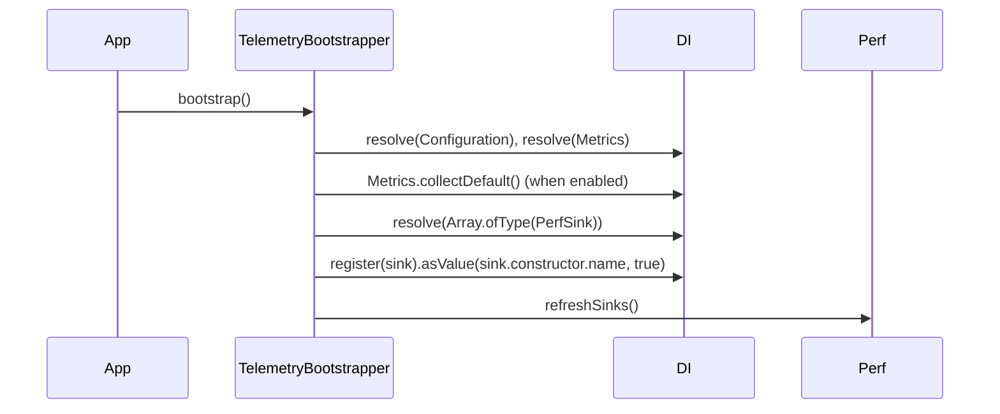

# Setup and configuration

Loading `@spinajs/telemetry` registers its services, and two bootstrappers wire the metric registry, the perf sinks and the scrape token at startup. This page lists what each step registers and every `telemetry.*` configuration key.

## How it works

1. `import '@spinajs/telemetry'` runs the decorators of every module the barrel reaches:
   - `TelemetryBootstrapper` and `TelemetryServiceTokenBootstrapper` join the `Bootstrapper` list.
   - `TelemetryMiddleware` joins the `ServerMiddleware` list.
   - `PromMetricSink` and `InMemoryPerfSink` join the `PerfSink` list.
   - `PublicPolicy` and `TelemetryTokenPolicy` join the `BasePolicy` list.
   - `TelemetryAccessContributor` joins the `AuthzContributor` list.
   - `schema.ts` calls `registerConfigurationSchemaAtImport(TELEMETRY_CONFIGURATION_SCHEMA)`.
2. `@spinajs/configuration` merges the package config file (`lib/config/telemetry.js`). It adds `system.dirs.controllers`, the `telemetry.*` defaults, the permission `telemetry:read`, and the RBAC role `telemetry`.
3. The app runs every `Bootstrapper`. `TelemetryBootstrapper.bootstrap()`:
   1. registers `TELEMETRY_CONFIGURATION_SCHEMA` again with `registerConfigurationSchema()`;
   2. resolves `Configuration` and the `Metrics` singleton;
   3. calls `metrics.collectDefault()` unless `telemetry.collectDefaultMetrics` is `false`;
   4. resolves `DI.resolve(Array.ofType(PerfSink))` and publishes each sink under its own class name with `DI.register(sink).asValue(sink.constructor.name, true)`;
   5. calls `Perf.refreshSinks()`, so the next measurement reaches the new sinks.
4. `TelemetryServiceTokenBootstrapper.bootstrap()` resolves `Configuration` and calls `bridgeTelemetryToken(cfg, log)`; see [Scrape token](12-scrape-token.md).
5. `@spinajs/http` scans the controller directories and mounts `MetricsController` and `TelemetryController`. Each controller module imports the policies and the schema itself, so the routes register even when the barrel was never imported.



## Configuration

| Key | Type | Default | Allowed values | Meaning |
| --- | --- | --- | --- | --- |
| `telemetry.auth.token` | `string` | `''` | any string | Scrape token; a non-empty value becomes the principal `service:telemetry`. Read once, at bootstrap |
| `telemetry.auth.policies.<endpoint>` | `string` | see below | `'AccessPolicy'` or the class name of a registered `BasePolicy` | How each endpoint is guarded |
| `telemetry.auth.permissions.<endpoint>` | `string \| string[]` | `'telemetry:read'` for the data endpoints | permission names (`PERMISSION_PATTERN`), a list needs at least one | Permission an `'AccessPolicy'` slot checks; any one of a list admits |
| `telemetry.auth.domain` | `string` | `'root'` | a non-empty authz domain name | Domain the `'AccessPolicy'` slots check in |
| `telemetry.auth.skipInDevelopment` | `boolean` | `false` | `true`, `false` | Skip the `'AccessPolicy'` checks in an explicit development env |
| `telemetry.collectDefaultMetrics` | `boolean` | `true` | `true`, `false` | Register prom-client `process_*` / `nodejs_*` metrics at bootstrap |
| `telemetry.prefix` | `string` | `'http'` | a Prometheus name prefix | Prefix of the request metrics |
| `telemetry.buckets` | `number[]` | `[5, 10, 25, 50, 100, 250, 500, 1000, 2500, 5000, 10000]` | ascending ms values | Buckets of `<prefix>_request_duration_ms` |
| `telemetry.apdexThresholdMs` | `number` | `25` | ms | Apdex satisfied threshold; tolerated is up to 4x |
| `telemetry.timeline.length` | `number` | `60` | positive integer | Buckets kept in the timeline ring |
| `telemetry.timeline.bucketMs` | `number` | `60000` | ms | Width of one timeline bucket |
| `telemetry.routes.enabled` | `boolean` | `true` | `true`, `false` | Record the per-route breakdown |
| `telemetry.routes.maxEntries` | `number` | `500` | positive integer | Cap on distinct method+route keys |
| `telemetry.perf.enabled` | `boolean` | `true` | `true`, `false` | Collect the JSON perf aggregate behind `/telemetry/perf` |
| `telemetry.perf.maxNames` | `number` | `200` | positive integer | Cap on distinct perf names, spans and events together |
| `telemetry.health.timeoutMs` | `number` | `2000` | ms | Per-check timeout of `/telemetry/ready` |
| `telemetry.health.failOnDegraded` | `boolean` | `false` | `true`, `false` | Answer 503 for a `degraded` overall status |
| `telemetry.health.version` | `string` | unset | any string | App version reported by `/telemetry/health`; omitted when unset |

The `<endpoint>` keys are `metrics`, `stats`, `timeline`, `routes`, `perf`, `health` and `ready`. The data endpoints default to `'AccessPolicy'` with `telemetry:read`; `health` and `ready` default to `'PublicPolicy'`.

The package config also sets keys outside `telemetry`:

| Key | Value | Meaning |
| --- | --- | --- |
| `system.dirs.controllers` | the package `controllers` directory | Mounts `MetricsController` and `TelemetryController` |
| `authz.permissions['telemetry:read']` | `{ description }` | Registers the permission the data endpoints check |
| `authz.rbac.roles.telemetry` | `{ grants: ['telemetry:read'] }` | Role read only when `@spinajs/authz-rbac` is loaded |
| `authz.rbac.serviceRoles['service:telemetry']` | `['telemetry']` | Gives the scrape-token principal that role |

```ts
// config/telemetry.ts in your app
export default {
  telemetry: {
    auth: { token: process.env.METRICS_TOKEN },
    prefix: 'api',
    buckets: [5, 25, 100, 500, 2500],
    timeline: { length: 120, bucketMs: 30_000 },
    health: { timeoutMs: 1000, version: process.env.APP_VERSION },
  },
};
```

### Configuration schema

`TELEMETRY_CONFIGURATION_SCHEMA` (`$id: 'spinajs/telemetry.configuration.schema.json'`, module `telemetry`) validates the `telemetry.auth` block only:

| Property | Rule |
| --- | --- |
| `auth.token` | string |
| `auth.skipInDevelopment` | boolean, default `false` |
| `auth.domain` | non-empty string, default `'root'` |
| `auth.policies` | object of non-empty strings |
| `auth.permissions` | object of a permission string, or a non-empty array of them; each matches `PERMISSION_PATTERN` from `@spinajs/authz` |

Every other `telemetry.*` key is a `@Config()` property with a code default and no schema.

## Services and extension points

| Service | DI token and lifetime | Default implementation | Alternatives | How to replace or extend |
| --- | --- | --- | --- | --- |
| Telemetry bootstrapper | `Bootstrapper` list (`Array.ofType(Bootstrapper)`), registered by `@Injectable(Bootstrapper)` at import | `TelemetryBootstrapper` | none | Remove with `DI.unregister(TelemetryBootstrapper)` before the app resolves the list; register your own `@Injectable(Bootstrapper)` subclass to run extra steps after `super.bootstrap()` |
| Token bridge bootstrapper | `Bootstrapper` list | `TelemetryServiceTokenBootstrapper` | an explicit `telemetry` entry in `authz.http.services` | See [Scrape token](12-scrape-token.md) |
| Configuration schema | `registerConfigurationSchemaAtImport()` at import, `registerConfigurationSchema()` at bootstrap | `TELEMETRY_CONFIGURATION_SCHEMA` | none | Register a schema of your own for your keys; do not reuse its `$id` |

### Bootstrapper: publish build information at startup

Add a bootstrapper of your own instead of replacing `TelemetryBootstrapper`. It needs only the `Metrics` singleton, which builds on first resolve, so it does not depend on the order of the list.

```ts sample
import { Bootstrapper, DI, Injectable } from '@spinajs/di';
import { Metrics } from '@spinajs/telemetry';
import type { Gauge } from '@spinajs/telemetry';

@Injectable(Bootstrapper)
export class BuildInfoBootstrapper extends Bootstrapper {
  public bootstrap(): void {
    const metrics = DI.get(Metrics) ?? DI.resolve(Metrics);
    const { info } = metrics.defineMetrics('app', [{ name: 'info', help: 'Build information, always 1', type: 'gauge', labelNames: ['version', 'commit'] }]);

    (info as Gauge<string>).set({ version: process.env.APP_VERSION ?? 'dev', commit: process.env.GIT_SHA ?? 'unknown' }, 1);
  }
}
```

`GET /metrics` then carries `app_info{version="…",commit="…"} 1`.

## Important behaviour

- `telemetry.auth.token` is read once, by `TelemetryServiceTokenBootstrapper`. A change or a configuration reload needs a restart.
- The controllers are found by the directory scan, not by the barrel. Without `import '@spinajs/telemetry'`, the endpoints still mount, but no bootstrapper is registered: no default process metrics, no `perf_*` series (`PromMetricSink` is never imported) and no token bridge.
- An app's `telemetry.buckets` replaces the shipped list. `authz.rbac.serviceRoles.*` concatenates (see [Arrays](../configuration/01-configuration-service.md#arrays)): an app cannot remove `authz.rbac.serviceRoles['service:telemetry']` by setting a shorter array; it only appends.
- `TelemetryBootstrapper` publishes each perf sink with `override: true`. A sink resolved directly before it ran is replaced in the cache, so `@Autoinject(InMemoryPerfSink)` gets the instance `Perf` writes to.

## Best practices

- Change the prefix and the buckets through `telemetry.prefix` and `telemetry.buckets`, never through a middleware subclass.
- Keep `telemetry.collectDefaultMetrics` on in production; turn it off in unit tests that render `/metrics` and compare text.
- Set `telemetry.health.version` from your build so `/telemetry/health` tells which release answers.

## Patterns and antipatterns

```ts
// Don't: resolve a perf sink directly before the bootstrappers ran
const sink = DI.resolve(PromMetricSink); // cached under its own name only; Perf never sees it

// Do: resolve the list, as TelemetryBootstrapper does
const sinks = DI.resolve(Array.ofType(PerfSink));
```

## Examples

### Shorter timeline buckets and a release tag

```ts sample
export default {
  telemetry: {
    timeline: { length: 120, bucketMs: 30_000 },
    health: { version: process.env.APP_VERSION ?? 'dev' },
  },
};
```

## Related

- [Scrape token](12-scrape-token.md): what `TelemetryServiceTokenBootstrapper` does.
- [Perf bridge](06-perf-bridge.md): the sinks `TelemetryBootstrapper` builds.
- [`@spinajs/configuration` config files](../configuration/03-config-files.md): how package config files are found and merged.
- [`@spinajs/di` service lifecycle](../di/10-service-lifecycle.md): how bootstrappers run.
