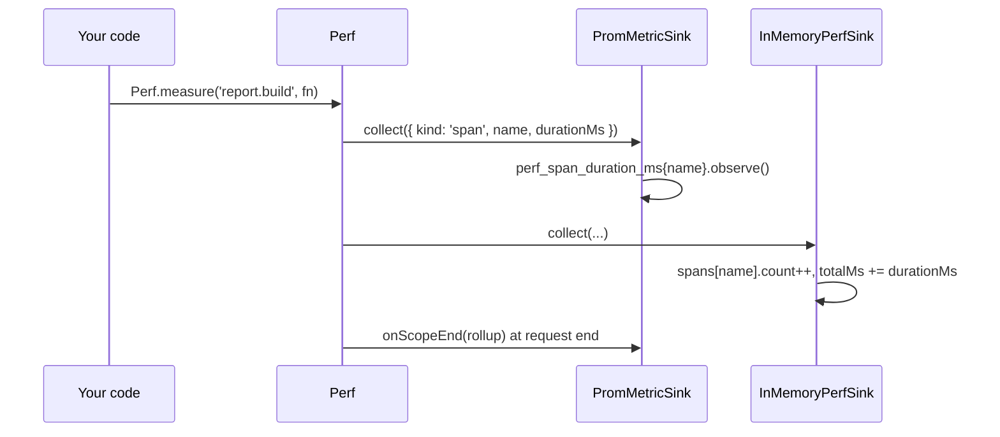

# Perf bridge

Every measurement the `@spinajs/log` `Perf` facade emits reaches two sinks this package ships. `PromMetricSink` exports it as `perf_*` Prometheus series. `InMemoryPerfSink` keeps a bounded JSON aggregate for `GET /telemetry/perf`. Neither needs code: instrument with `Perf.measure()`, `@Measure()` or `Perf.count()` and the numbers appear.

## How it works

1. `PromMetricSink` and `InMemoryPerfSink` register with `@Singleton()` and `@Injectable(PerfSink)` when the package is imported.
2. `TelemetryBootstrapper` resolves `DI.resolve(Array.ofType(PerfSink))`, publishes each sink under its own class name, and calls `Perf.refreshSinks()`.
3. On each measurement, `Perf` calls `collect(metric)` on every sink, each call guarded:
   - `PromMetricSink.collect()` observes a `span` in `perf_span_duration_ms{name}`, and adds `metric.value ?? 1` to `perf_events_total{name}` for a `counter` or `value`;
   - `InMemoryPerfSink.collect()` adds the span to its row (`count`, `totalMs`, `maxMs`) or the event to its row (`count`, `total`).
4. At the end of a request scope, `Perf` calls `onScopeEnd(rollup)`. `PromMetricSink` observes each name's `totalMs` above `0` in `perf_scope_total_ms{name}`. `InMemoryPerfSink` has no `onScopeEnd`.
5. `GET /telemetry/perf` returns `InMemoryPerfSink.toJSON()`: `{ truncated, spans, events }`. Spans are sorted by `totalMs`, events by `total`, both descending.



### Series

| Series | Type | Labels | Source |
| --- | --- | --- | --- |
| `perf_span_duration_ms` | histogram | `name` | every `Perf.measure()`, `@Measure()`, `span.end()` |
| `perf_events_total` | counter | `name` | every `Perf.count()` and `Perf.value()` |
| `perf_scope_total_ms` | histogram | `name` | per-request totals, e.g. total DB time of one request |

Both histograms use `PERF_DURATION_BUCKETS_MS`: `[1, 5, 10, 25, 50, 100, 250, 500, 1000, 2500, 5000, 10000]`. The prefix `perf` is fixed. The measurement's own `labels` are not exported; only `name` is.

Out of the box you also get `perf_span_duration_ms{name="orm.query"}` from every SQL query (`SqlDriver.execute`) and `perf_scope_total_ms{name="orm.query"}`, the DB time per HTTP request from the `PerfRollup` middleware of `@spinajs/http`.

### `/telemetry/perf` shape

| Field | Type | Meaning |
| --- | --- | --- |
| `truncated` | `boolean` | `true` once `maxNames` was reached and a new name was dropped |
| `spans[]` | `IPerfSpanEntry` | `{ name, count, totalMs, avgMs, maxMs }` |
| `events[]` | `IPerfEventEntry` | `{ name, count, total }` |

## Configuration

| Key | Type | Default | Allowed values | Meaning |
| --- | --- | --- | --- | --- |
| `telemetry.perf.enabled` | `boolean` | `true` | `true`, `false` | `InMemoryPerfSink` collects; `false` leaves `/telemetry/perf` empty |
| `telemetry.perf.maxNames` | `number` | `200` | positive integer | Cap on distinct names, spans and events together |

Both keys bound the JSON view only. The `perf_*` series are not affected. Log output of perf measurements is `logger.perf.*` in `@spinajs/log`, independent of both sinks.

## Services and extension points

| Service | DI token and lifetime | Default implementation | Alternatives | How to replace or extend |
| --- | --- | --- | --- | --- |
| Prometheus perf sink | `PerfSink` list, `@Singleton()`; also published as `'PromMetricSink'` by `TelemetryBootstrapper` | `PromMetricSink` | your `PerfSink` | Remove with `DI.unregister(PromMetricSink)` before `TelemetryBootstrapper` runs; add your own sink. See [Custom perf sinks](07-custom-perf-sinks.md) |
| JSON perf sink | `PerfSink` list, `@Singleton()`; published as `'InMemoryPerfSink'`; injected into `TelemetryController` with `@Autoinject(InMemoryPerfSink)` | `InMemoryPerfSink` | none | Turn off with `telemetry.perf.enabled: false`. Add a separate sink for another view instead of replacing it |
| Perf sink contract | `PerfSink` (`@spinajs/log`), resolved as `Array.ofType(PerfSink)` | `LogMetricSink` plus the two sinks above | your sink | See [Custom perf sinks](07-custom-perf-sinks.md) |

### `PromMetricSink`: export one label as its own series

Subclass `PromMetricSink` when a measurement label is bounded and you want it in Prometheus, e.g. the ORM driver name. The base `collect()` stays for the shared series.

```ts sample
import { DI, Injectable, Singleton } from '@spinajs/di';
import { PerfSink } from '@spinajs/log';
import type { IPerfMetric } from '@spinajs/log';
import { Metrics, PromMetricSink } from '@spinajs/telemetry';
import type { Histogram } from '@spinajs/telemetry';

@Singleton()
@Injectable(PerfSink)
export class DriverAwarePromSink extends PromMetricSink {
  protected byDriver?: Histogram<string>;

  public collect(metric: IPerfMetric): void {
    super.collect(metric);

    const driver = metric.labels?.driver;
    if (metric.kind !== 'span' || typeof driver !== 'string') return;

    this.byDriver ??= (DI.get(Metrics) ?? DI.resolve(Metrics)).defineMetrics('perf', [
      { name: 'driver_span_duration_ms', help: 'Perf span duration by driver', type: 'histogram', labelNames: ['name', 'driver'] },
    ])['driver_span_duration_ms'] as Histogram<string>;
    this.byDriver.observe({ name: metric.name, driver }, metric.durationMs ?? 0);
  }
}

// One Prometheus sink: drop the shipped one before TelemetryBootstrapper builds the list.
DI.unregister(PromMetricSink);
```

## Important behaviour

- `PromMetricSink` records every measurement, whatever `logger.perf.thresholds` says. Log noise and metric completeness are tuned separately.
- The `name` label has no cap on the Prometheus side. `maxNames` bounds only the JSON view.
- `InMemoryPerfSink` ignores per-request rollups, because their names match the span names and would double-count the same rows.
- Spans and events share one `maxNames` budget. Once full, known names keep counting and new ones are dropped.
- The JSON aggregate lives in memory, per process, from start-up.
- Both sinks define their metrics lazily, on the first measurement.

## Best practices

- Use a fixed vocabulary of measurement names (`report.build`, `cache.miss`), never per-request strings.
- Query the scope histogram for per-request cost: `rate(perf_scope_total_ms_sum{name="orm.query"}[5m]) / rate(perf_scope_total_ms_count{name="orm.query"}[5m])`.
- Instrument with `@Measure()` on service methods rather than timing by hand; the name then matches across logs, Prometheus and `/telemetry/perf`.

## Patterns and antipatterns

```ts
// Don't: a unique name per call; one Prometheus series per customer
await Perf.measure(`report.build.${customerId}`, () => buildReport(customerId));

// Do: a fixed name; put the id in fields, which only log sinks read
await Perf.measure('report.build', () => buildReport(customerId), { fields: { customerId } });
```

## Examples

### Time a report and count cache misses

```ts sample
import { Measure, Perf } from '@spinajs/log';

export class ReportService {
  protected cache = new Map<string, string>();

  @Measure('report.render')
  public async render(customerId: string): Promise<string> {
    const cached = this.cache.get(customerId);
    if (cached) return cached;

    Perf.count('report.cache_miss');
    const report = await Perf.measure('report.build', async () => `report for ${customerId}`);
    this.cache.set(customerId, report);
    return report;
  }
}
// GET /metrics: perf_span_duration_ms{name="report.render"}, {name="report.build"}, perf_events_total{name="report.cache_miss"}
// GET /telemetry/perf: rows for the same three names
```

### p95 query latency

```promql
histogram_quantile(0.95, sum by (le) (rate(perf_span_duration_ms_bucket{name="orm.query"}[5m])))
```

## Related

- [Custom perf sinks](07-custom-perf-sinks.md): adding or replacing sinks next to these two.
- [`@spinajs/log` performance measurement](../log/15-performance-measurement.md): `Perf`, `@Measure()` and `logger.perf.*`.
- [Setup and configuration](01-setup-and-configuration.md): how `TelemetryBootstrapper` builds the sink list.
