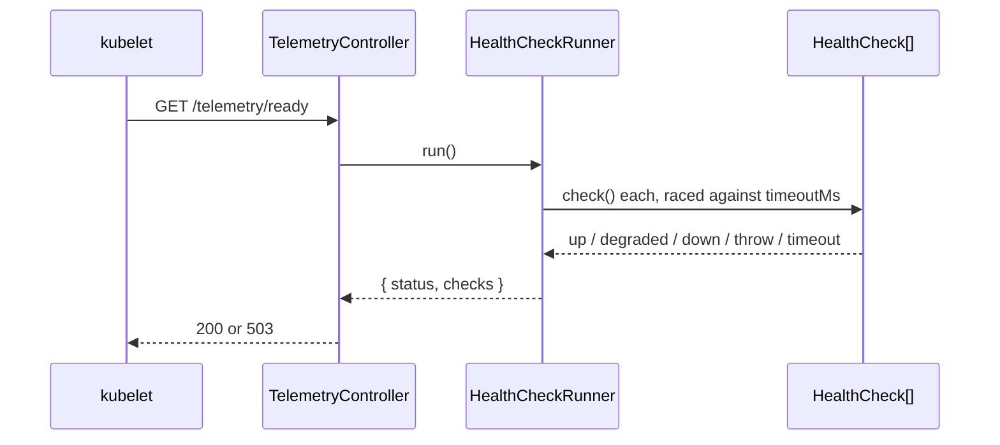

# Health and readiness

`GET /telemetry/health` answers liveness without running any check. `GET /telemetry/ready` runs every registered `HealthCheck` concurrently, each with a timeout, and answers 503 when the worst result is `down`. The package ships no checks; you register one per dependency.

## How it works

### Liveness

1. `TelemetryController.getHealth()` reads `process.uptime()`, `process.pid` and `process.version`.
2. It returns `{ status: 'up', startedAt, uptimeMs, pid, node }`, plus `version` when `telemetry.health.version` is set.
3. It runs no check, so a slow dependency can never make it slow.

### Readiness

1. `TelemetryController.getReady()` calls `HealthCheckRunner.run()`.
2. `run()` takes `Checks`, every `HealthCheck` registered, injected with `@Autoinject(HealthCheck)`, and runs them all with `Promise.all`.
3. For each check, `runOne()` races `check.check()` against a timer of `telemetry.health.timeoutMs`:
   - a result becomes `{ name, status, message, data, durationMs }`;
   - a throw or a timeout becomes `{ name, status: 'down', message, durationMs }`; the timeout message is `health check timed out after <n>ms`.
4. `run()` reduces the statuses to the worst one: `down` beats `degraded` beats `up`. A status outside these three ranks as `down`, while the check's own line keeps the value it returned.
5. `getReady()` asks `HealthCheckRunner.isFailing(status)`. `down` always fails; `degraded` fails only with `telemetry.health.failOnDegraded`. A failing report is returned as `ServiceUnavailable` (503), otherwise as `Ok` (200). The body is the report in both cases.



### Types

| Type | Shape |
| --- | --- |
| `HealthStatus` | `'up' \| 'degraded' \| 'down'` |
| `IHealthResult` | `{ status, message?, data? }`, what `check()` returns |
| `IHealthCheckReport` | `IHealthResult` plus `name` and `durationMs` |
| `IReadyReport` | `{ status, checks: IHealthCheckReport[] }`, the `/ready` body |

## Configuration

| Key | Type | Default | Allowed values | Meaning |
| --- | --- | --- | --- | --- |
| `telemetry.health.timeoutMs` | `number` | `2000` | ms | Per-check timeout; a timed-out check is `down` |
| `telemetry.health.failOnDegraded` | `boolean` | `false` | `true`, `false` | Answer 503 for an overall `degraded` |
| `telemetry.health.version` | `string` | unset | any string | Added to `/telemetry/health` as `version` |
| `telemetry.auth.policies.health`, `telemetry.auth.policies.ready` | `string` | `'PublicPolicy'` | see [Endpoint access](10-endpoint-access.md) | Guard of the probes |

```ts
export default {
  telemetry: {
    health: { timeoutMs: 1000, failOnDegraded: true, version: process.env.APP_VERSION },
  },
};
```

## Services and extension points

| Service | DI token and lifetime | Default implementation | Alternatives | How to replace or extend |
| --- | --- | --- | --- | --- |
| Readiness check | `HealthCheck` (abstract `AsyncService`), a list injected into `HealthCheckRunner` with `@Autoinject(HealthCheck)` | none | your checks | Subclass `HealthCheck`, set `Name`, implement `check()`, decorate `@Injectable(HealthCheck)` |
| Check runner | `HealthCheckRunner`, `@Singleton()`, registered by `@Injectable()`; injected into `TelemetryController` with `@Autoinject(HealthCheckRunner)` | `HealthCheckRunner` | your subclass | Override `isFailing()` or `run()`; `DI.register(MyRunner).as(HealthCheckRunner)` before the controller resolves |

### `HealthCheck`: check the database

A check belongs in the package that owns the dependency. Return `degraded` for a working but impaired dependency, `down` when the app cannot serve.

```ts sample
import { Injectable } from '@spinajs/di';
import { HealthCheck } from '@spinajs/telemetry';
import type { IHealthResult } from '@spinajs/telemetry';

interface IDatabase {
  ping(): Promise<number>;
}

declare const db: IDatabase;

@Injectable(HealthCheck)
export class DatabaseCheck extends HealthCheck {
  public Name = 'database';

  public async check(): Promise<IHealthResult> {
    try {
      const ms = await db.ping();
      return ms > 500 ? { status: 'degraded', message: `slow ping: ${ms} ms`, data: { ms } } : { status: 'up', data: { ms } };
    } catch (err) {
      return { status: 'down', message: (err as Error).message };
    }
  }
}
```

### `HealthCheckRunner`: ignore optional dependencies

Replace the runner when some checks are informational. This one reports every check but leaves those named in `OPTIONAL` out of the overall status.

```ts sample
import { DI, Injectable, Singleton } from '@spinajs/di';
import { HealthCheckRunner } from '@spinajs/telemetry';
import type { HealthStatus, IReadyReport } from '@spinajs/telemetry';

const OPTIONAL = new Set(['search-index', 'mail-relay']);
const RANK: Record<HealthStatus, number> = { up: 0, degraded: 1, down: 2 };

@Singleton()
@Injectable()
export class OptionalAwareRunner extends HealthCheckRunner {
  public async run(): Promise<IReadyReport> {
    const report = await super.run();

    let worst: HealthStatus = 'up';
    for (const check of report.checks) {
      if (OPTIONAL.has(check.name)) continue;
      const rank = RANK[check.status] ?? RANK.down;
      if (rank > RANK[worst]) worst = RANK[check.status] === undefined ? 'down' : check.status;
    }

    return { status: worst, checks: report.checks };
  }
}

DI.register(OptionalAwareRunner).as(HealthCheckRunner);
```

## Important behaviour

- Checks run concurrently; one slow check does not delay the others. The probe takes at most about `timeoutMs`.
- A timed-out check keeps running in the background; only its result is ignored. Give `check()` its own timeout for calls that can hang.
- `HealthCheckRunner` is a singleton, so the check list is injected once, when the runner is built for `TelemetryController`. Import your check modules before the HTTP server starts.
- With no check registered, `/ready` answers 200 with `{ status: 'up', checks: [] }`.
- `/health` and `/ready` are public by default: kubelet probes and load balancers cannot send a token. They expose uptime, pid, node version and, when set, the app version.
- `ServiceUnavailable` exists because `new Ok(body, { StatusCode: 503 })` still answers 200.

## Best practices

- Point the liveness probe at `/telemetry/health` and the readiness probe at `/telemetry/ready`; a failed dependency should take the pod out of rotation, not restart it.
- Keep `telemetry.health.timeoutMs` below the probe's `timeoutSeconds`.
- Return `data` with the measured numbers (latency, queue depth); the report keeps them per check.
- Guard the probes when the cluster can reach them from outside: set `telemetry.auth.policies.ready` to `'AccessPolicy'` and give it a permission.

## Patterns and antipatterns

```ts
// Don't: a status the type does not allow; it ranks as down and fails readiness
return { status: 'UNHEALTHY' as HealthStatus };

// Do
return { status: 'down', message: 'connection refused' };
```

## Examples

### Readiness depends on a queue backlog

```ts sample
import { Injectable } from '@spinajs/di';
import { HealthCheck } from '@spinajs/telemetry';
import type { IHealthResult } from '@spinajs/telemetry';

declare function pendingJobs(): Promise<number>;

@Injectable(HealthCheck)
export class JobBacklogCheck extends HealthCheck {
  public Name = 'job-backlog';

  public async check(): Promise<IHealthResult> {
    const pending = await pendingJobs();
    if (pending > 10_000) return { status: 'down', message: 'backlog over 10000', data: { pending } };
    if (pending > 1_000) return { status: 'degraded', data: { pending } };
    return { status: 'up', data: { pending } };
  }
}
```

```jsonc
// GET /telemetry/ready -> 200
{ "status": "degraded", "checks": [{ "name": "job-backlog", "status": "degraded", "data": { "pending": 2400 }, "durationMs": 4 }] }
```

## Related

- [Endpoints and OpenAPI](09-endpoints-and-openapi.md): `HealthResponse`, `ReadyResponse` and `ServiceUnavailable`.
- [Endpoint access](10-endpoint-access.md): the probe slots.
- [`@spinajs/orm` observability](../orm/13-observability-and-resilience.md): the ORM's own connection probe, which a `HealthCheck` can read.
