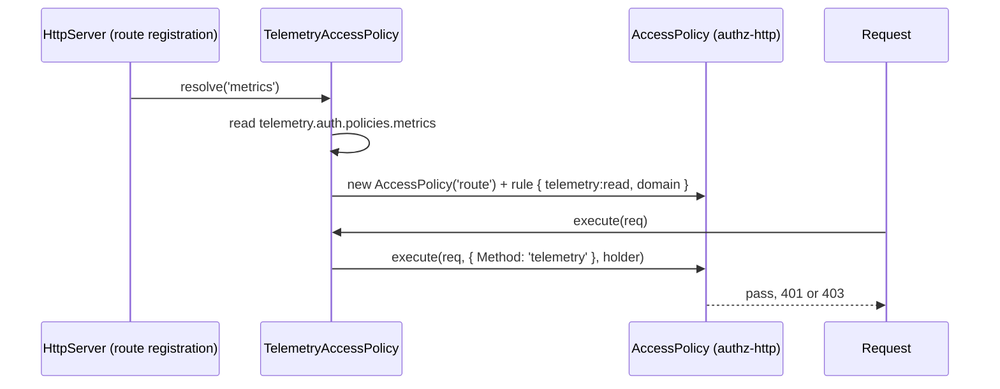

# Endpoint access

Each telemetry endpoint has a slot in `telemetry.auth.policies`. The slot `'AccessPolicy'` checks a permission through the SpinaJS 3.0 authz layer; any other value names a registered `BasePolicy` that decides instead. By default the data endpoints need `telemetry:read` and the probes are public.

## How it works

1. Every route carries `@TelemetryAccess('<endpoint>')`, which is `@Policy(TelemetryAccessPolicy, '<endpoint>')`.
2. When `@spinajs/http` registers the route, it resolves `TelemetryAccessPolicy` (`@NewInstance()`) with the endpoint name. `resolve()` reads the slot once from the `Configuration` of the container that resolves the policy and builds a guard:
   - `'AccessPolicy'`: reads `telemetry.auth.permissions.<endpoint>` (one permission or a list), and builds an authz-http `AccessPolicy('route')` over a rule with those permissions in `telemetry.auth.domain`;
   - `'AccessPolicy'` while the [development skip](#development-skip) holds: a guard that lets every request through, with one `warn` on the `Security` logger;
   - any other value: finds a `BasePolicy` registered under that class name and resolves it synchronously.
3. A slot that cannot be honoured throws `RouteRegistrationException`, so the route, and the whole controller, never registers.
4. Per request, `execute()`:
   - `'AccessPolicy'`: `AccessPolicy.execute()` checks whether the principal holds any of the permissions on the permission's type-level resource. No principal answers 401 `unauthenticated`; a principal without the permission answers 403 `forbidden`, naming the permission. The decision lands in `req.storage.AuthzDecision`.
   - named policy: delegates `isEnabled()` and `execute()` to it.
5. At authz domain boot, `TelemetryAccessContributor.contribute(domain)` returns every permission of every `'AccessPolicy'` slot when `domain` equals `telemetry.auth.domain`. An unregistered permission fails the domain boot with `AuthzConfigError`, naming the permission and its key.



### Slot errors

| Situation | Message (after `telemetry endpoint <name>: `) |
| --- | --- |
| Endpoint name empty or not a string | `the endpoint name must be a non-empty string` |
| Slot not set | `telemetry.auth.policies.<name> must name a policy, but it is not set` |
| `'AccessPolicy'` without a permission entry, also under the development skip | `telemetry.auth.permissions.<name> must be a permission name or a non-empty list of them, but it is not set` |
| Slot names `TelemetryAccessPolicy` | `... must not name TelemetryAccessPolicy itself` |
| Slot names no registered `BasePolicy` | `... names <X>, which is not a registered BasePolicy` |
| The named policy resolves to a promise or not to a `BasePolicy` | `... which does not resolve synchronously to a BasePolicy` |

## Configuration

| Key | Type | Default | Allowed values | Meaning |
| --- | --- | --- | --- | --- |
| `telemetry.auth.policies.<endpoint>` | `string` | `'AccessPolicy'` for `metrics`, `stats`, `timeline`, `routes`, `perf`; `'PublicPolicy'` for `health`, `ready` | `'AccessPolicy'` or a registered `BasePolicy` class name | Guard of the endpoint |
| `telemetry.auth.permissions.<endpoint>` | `string \| string[]` | `'telemetry:read'` for the five data endpoints | registered permissions | Any one admits |
| `telemetry.auth.domain` | `string` | `'root'` | an authz domain | Domain the checks and the contributor use |
| `telemetry.auth.skipInDevelopment` | `boolean` | `false` | `true`, `false` | Development skip, see below |

```ts
export default {
  telemetry: {
    auth: {
      domain: 'root',
      policies: { metrics: 'AccessPolicy', ready: 'AccessPolicy' },
      permissions: { metrics: 'telemetry:read', ready: ['ops:probe', 'telemetry:read'] },
    },
  },
  authz: { permissions: { 'ops:probe': { description: 'Call the readiness probe' } } },
};
```

### Development skip

The `'AccessPolicy'` slots let every request through only when all three hold:

1. `telemetry.auth.skipInDevelopment` is exactly `true`;
2. `configuration.isProduction` is not `true`;
3. the env names development: the env the configuration loaded (`--env`, else `APP_ENV`), else `APP_ENV`, else `NODE_ENV`, normalized with `normalizeEnvironment()` to `'dev'`. A missing env counts as production.

The skip is decided once, when the route registers. `telemetrySkipsAuth(settings, env)` and `isExplicitDevelopment(env, configuredEnv)` are exported for the same decision elsewhere; `configuredEnvOf(instance)` reads the env of the `Configuration` an instance's `@Config()` properties use.

## Services and extension points

| Service | DI token and lifetime | Default implementation | Alternatives | How to replace or extend |
| --- | --- | --- | --- | --- |
| Slot guard | `TelemetryAccessPolicy`, `@NewInstance()` `SyncService`; resolved by http per route with the endpoint name; attached by `@TelemetryAccess(endpoint)` | `TelemetryAccessPolicy` | none | Use `@TelemetryAccess()` on your own routes; change behaviour per endpoint through the slot, not by subclassing. See [Custom access policies](11-custom-access-policies.md) |
| Permission contributor | `AuthzContributor` list, `@Singleton()` in root, registered by `@Injectable(AuthzContributor)` | `TelemetryAccessContributor` | none | Covers every `'AccessPolicy'` slot, yours included; nothing to add for new slots |
| Public policy | `BasePolicy` list, registered by `@Injectable(BasePolicy)`; resolved by name `'PublicPolicy'` | `PublicPolicy` | any `BasePolicy` | Name another policy in the slot |
| Token policy (deprecated) | `BasePolicy` list; name `'TelemetryTokenPolicy'` | `TelemetryTokenPolicy` | `'AccessPolicy'` and the [scrape token](12-scrape-token.md) | Migrate to `'AccessPolicy'` |
| Named policy | `BasePolicy` list; resolved by class name from the slot | `PublicPolicy` for the probes | your `BasePolicy` | `@Injectable(BasePolicy)` on your class and its name in the slot; see [Custom access policies](11-custom-access-policies.md) |

### Deprecated `TelemetryTokenPolicy`

Naming `'TelemetryTokenPolicy'` in a slot compares the presented token with `telemetry.auth.token` itself, without authz:

- it reads `x-metrics-token`, else the credentials of `Authorization: Bearer <token>`;
- it compares SHA-256 digests with `timingSafeEqual`;
- a missing token and a wrong token both answer 403 (`access token is not set`, `invalid access token`), not 401;
- an empty configured token refuses every request;
- the development skip is checked per request, under the same three conditions.

## Important behaviour

- A broken slot stops the whole controller from registering, probes included. The app never starts with an open route.
- The slot is read from the container that resolves the policy. A domain or tenant child container with its own `telemetry.auth.*` guards with its own values; the contributor reads the root configuration.
- Loading this package loads `@spinajs/authz-http`, whose `PrincipalMiddleware` stops the HTTP server when the root authz domain fails to boot.
- The probes expose uptime, pid, node version and the app version. Guard them if that is more than you want to publish.
- A request with a principal from any authenticator passes when the principal holds the permission; the scrape token is one way to hold it.

## Best practices

- Grant `telemetry:read` through a role, not to individual users.
- Use a separate permission per endpoint group (`ops:probe`, `telemetry:read`) when probes must be guarded; a list in `permissions` admits any one.
- Leave `skipInDevelopment` out of shared config files; set it only in a local development override.

## Patterns and antipatterns

```ts
// Don't: an empty slot to "open" an endpoint; the route never registers
telemetry: { auth: { policies: { stats: '' } } }

// Do: name the public policy explicitly
telemetry: { auth: { policies: { stats: 'PublicPolicy' } } }
```

## Examples

### Let an SRE role read telemetry and debug perf

```ts sample
export default {
  telemetry: {
    auth: {
      permissions: { metrics: 'telemetry:read', stats: 'telemetry:read', perf: ['telemetry:read', 'ops:debug'] },
    },
  },
  authz: {
    permissions: { 'ops:debug': { description: 'Read debugging telemetry' } },
    rbac: { roles: { sre: { description: 'Site reliability', grants: ['telemetry:read', 'ops:debug'] } } },
  },
};
```

### Decide the development skip in your own code

```ts sample
import { telemetrySkipsAuth } from '@spinajs/telemetry';

export function canSkipAuth(cfg: { get<T>(path: string, def?: T): T }): boolean {
  return telemetrySkipsAuth({
    skipInDevelopment: cfg.get('telemetry.auth.skipInDevelopment'),
    isProduction: cfg.get('configuration.isProduction'),
  });
}
```

## Related

- [Custom access policies](11-custom-access-policies.md): your own policy in a slot, and slots for your own routes.
- [Scrape token](12-scrape-token.md): how the default token becomes a principal with `telemetry:read`.
- [`@spinajs/authz` HTTP adapter](../authz-http/README.md): `AccessPolicy`, principals and 401/403 answers.
- [`@spinajs/http` policies](../http/13-policies.md): `@Policy()`, `BasePolicy` and named policies.
- [`@spinajs/configuration-common` environment names](../configuration-common/07-environment-names.md): how the env is normalized.
